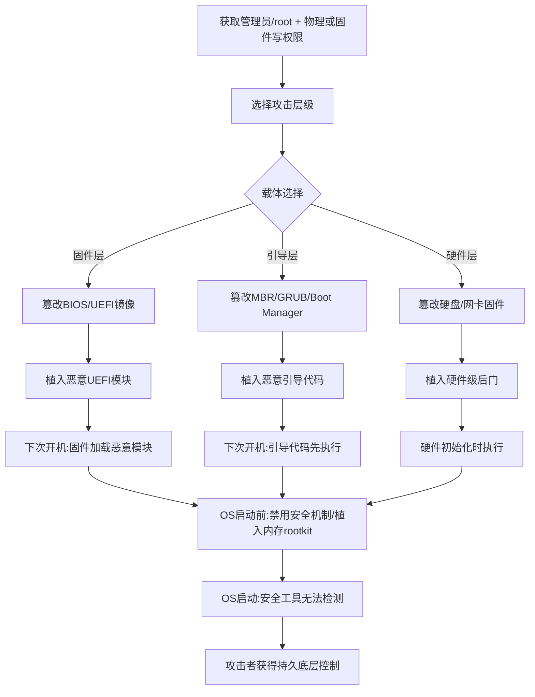

# T1542 - 预启动

## 一句话通俗理解

> 想象一下，攻击者不是在公司大楼里藏人，而是直接篡改了大楼的"建筑设计图纸"——以后每次重建大楼都按篡改后的图纸施工，连地基里都预埋了内鬼通道。预启动攻击就是这个套路：篡改BIOS/UEFI固件或引导加载器，让恶意代码在操作系统启动**之前**就先运行，操作系统层面的安全工具根本看不到它。

## 30秒速查卡

| 维度 | 你需要知道的 |
|------|-------------|
| 这是什么？ | 攻击者篡改BIOS/UEFI/引导加载器，让恶意代码在OS启动前运行 |
| 为什么危险？ | 固件层恶意代码OS重装也清不掉，安全软件看不到，极难检测根除 |
| 谁需要关心？ | 硬件运维、安全架构师、高安全等级环境管理员 |
| 你的第一步防御 | 启用Secure Boot + 固件密码保护 |
| 如果只做一件事 | 开启UEFI Secure Boot并定期检查固件版本hash |

## 难度等级

⭐⭐⭐⭐ **专家级**：需要固件/引导加载器/内核加载机制深度知识

**前置知识要求**：
- 理解BIOS/UEFI启动流程和固件结构
- 熟悉MBR/GPT分区和引导加载器（GRUB/Windows Boot Manager）
- 了解Secure Boot和TPM工作原理
- 知道内核加载顺序和驱动初始化机制

> ⚠️ **初学者可跳过**：本技术涉及固件层，技术密度高。如果没有硬件级安全背景，建议先理解T1547（OS层持久化）再回来读。

## 前置知识检查

在读下面的内容前，确认你能回答这些问题：

- [ ] BIOS和UEFI有什么区别？为什么UEFI更安全？
- [ ] MBR和GPT引导方式有什么区别？
- [ ] Secure Boot是怎么防止未签名代码在OS启动前运行的？
- [ ] 为什么说"重装系统清不掉固件层后门"？

> 如果有3个以上答不上来，建议先补一下计算机启动流程基础再继续。

## 技术描述

### 用人话说：预启动是什么？

计算机启动不是"按电源键→操作系统起来"这么简单，而是分多个阶段：

```
[按下电源键]
    ↓
[1. 固件层: BIOS/UEFI] ← 预启动攻击目标
    ↓
[2. 引导加载器: GRUB/Windows Boot Manager] ← 预启动攻击目标
    ↓
[3. 内核加载: Linux内核/Windows NT内核]
    ↓
[4. 系统服务启动: systemd/SCM] ← T1543攻击目标
    ↓
[5. 用户登录]
```

**进阶理解**：预启动（Pre-OS Boot）指的就是**前两个阶段**——固件层和引导加载器层。攻击者篡改这两个层级的代码后，恶意逻辑会在操作系统内核之前执行，这意味着：
- 操作系统的安全工具（EDR/AV）还没启动，**根本看不到**恶意代码
- 即便重装操作系统，固件层后门**依然存在**
- 恶意代码可以修改操作系统加载过程，**禁用安全机制**

**类比延伸**：如果T1543（系统服务）是在保安队里塞内鬼，那T1542（预启动）就是篡改保安培训教材的**源头印刷厂**——所有新培训的保安都按篡改后的教材上岗，连保安队长都不知道教材被改过。

### 五大子技术载体

| 子技术 | 攻击位置 | 持久性 | 检测难度 |
|--------|---------|--------|---------|
| T1542.001 System Firmware | BIOS/UEFI芯片 | 极高（重装OS无效） | 极高 |
| T1542.002 Component Firmware | 硬盘/网卡固件 | 极高 | 极高 |
| T1542.003 Bootkit | MBR/引导扇区 | 高（重装OS可清除） | 高 |
| T1542.004 ROMkit | 可写ROM | 极高 | 极高 |
| T1542.005 TFTP Boot | PXE网络启动 | 中 | 中 |

## 子技术列表

| 子技术ID | 名称 | 平台 | 一句话说明 |
|---------|------|------|-----------|
| T1542.001 | System Firmware | Windows/Linux | 篡改BIOS/UEFI主板固件 |
| T1542.002 | Component Firmware | Windows/Linux | 篡改硬盘/网卡等硬件固件 |
| T1542.003 | Bootkit | Windows/Linux | 篡改MBR/引导扇区 |
| T1542.004 | ROMkit | Windows/Linux | 篡改可写ROM芯片 |
| T1542.005 | TFTP Boot | Linux | 篡改PXE网络启动配置 |

### 重点子技术详写

#### T1542.001 System Firmware（最严重）

攻击者篡改主板BIOS/UEFI固件。这是最严重的持久化——固件存在主板SPI Flash芯片里，**重装系统、换硬盘都清不掉**，必须刷新固件才能清除。

UEFI固件攻击方式：
- 利用固件更新漏洞植入恶意UEFI模块
- 篡改固件镜像后用编程器写入SPI Flash
- 利用Intel ME/CSTOR漏洞绕过固件保护

恶意UEFI模块在OS启动前执行，可以：
- 修改Windows启动管理器加载恶意内核驱动
- 在内存中植入rootkit，OS启动后仍然存在
- 禁用Secure Boot验证逻辑

#### T1542.003 Bootkit（相对常见）

Bootkit篡改MBR（主引导记录）或VBR（卷引导记录）。MBR是磁盘第一个扇区（512字节），BIOS启动后首先读取它。攻击者替换MBR为恶意引导代码，在OS加载前先执行恶意逻辑。

经典Bootkit如Mebromi（中国首个BIOS Rootkit）、Rovnix、Gapz。

## 攻击流程



## 真实案例

### 案例1：Mebromi——中国首个BIOS Rootkit（2011）

- **时间**：2011年8月-2012年
- **目标**：中国个人用户（主要感染Award BIOS的台式机）
- **攻击组织**：未归因（中国黑客）
- **手法**：Mebromi同时攻击三层：BIOS（Award BIOS固件）、MBR（主引导记录）、Windows系统文件（感染MBR.exe等）。BIOS层后门会监控MBR，如果MBR被清理，BIOS会重新写入恶意MBR——形成"三位一体"持久化。即便用户重装系统、修复MBR，只要BIOS还活着，下次开机又会重新感染。
- **影响**：主要影响中国地区，通过恶意网站挂马传播
- **数据来源**：江民科技/360安全中心技术分析（一手厂商报告）

> 🎯 **真实攻击**：Mebromi是研究BIOS+MBR组合持久化的经典案例，安全厂商技术报告详细拆解了其三层联动机制

### 案例2：LoJax——APT28的UEFI Rootkit（2018）

- **时间**：2018年5月-9月（疑似更早开始）
- **目标**：巴尔干地区和东欧政府机构
- **攻击组织**：APT28（Fancy Bear，俄罗斯GRU背景）
- **手法**：APT28使用名为LoJax的工具，利用RWEverything工具绕过SPI闪存保护，将恶意UEFI模块（包含Netnticel和Binary Writing Component）写入主板SPI Flash。该UEFI模块在每次开机时执行，将ntfsrootkit驱动注入Windows内核，实现比OS更早的持久化。即便受害者更换硬盘、重装Windows，只要主板不换，UEFI后门依然存在。
- **影响**：首个被公开确认的野外UEFI rootkit实战案例
- **数据来源**：ESET《LoJax: First UEFI rootkit found in the wild》（一手厂商报告，标杆案例）

> 📚 **深入了解**：ESET的LoJax分析报告是UEFI rootkit研究的必读文献，详细分析了SPI Flash写入机制

### 案例3：MosaicRegression——UEFI 0day持久化（2021-2022）

- **时间**：2021年Q4-2022年Q1
- **目标**：欧洲和中东政府、外交机构
- **攻击组织**：疑似APT41或相关中国背景组织（Kaspersky归因为FirmwareBark活动）
- **手法**：攻击者利用多个UEFI固件0day漏洞（影响多款主流主板），在固件中植入名为MosaicRegression的恶意模块。该模块通过SMM（System Management Mode）权限运行，比操作系统更高权限，可在OS启动前禁用Secure Boot并注入恶意驱动。攻击通过钓鱼邮件投递利用工具，无需物理接触即可远程刷写固件。
- **影响**：多国政府机构固件被长期植入
- **数据来源**：Kaspersky《FirmwareBark: UEFI 0day exploitation in the wild》（一手厂商报告）

## 红队视角

### 可持续利用手段

| 手段 | 说明 | 检测难度 |
|------|------|---------|
| UEFI模块持久化 | 固件层后门，OS重装无效 | 极高 |
| MBR+BIOS联动 | BIOS监控并恢复MBR后门 | 极高 |
| SMM权限运行 | 比OS更高权限，OS看不到 | 极高 |
| 硬盘固件后门 | 篡改硬盘控制器固件 | 极高 |
| 禁用Secure Boot | 在固件层绕过签名验证 | 高 |

### 可复制性分析

| 维度 | 评分 | 说明 |
|------|------|------|
| 技术门槛 | ⭐⭐⭐⭐⭐ | 需要固件开发深度知识 |
| 工具可用性 | ⭐⭐ | 多为定制开发 |
| 检测规避 | ⭐⭐⭐⭐⭐ | OS层工具完全看不到 |
| 跨平台适用 | ⭐⭐⭐ | 主要x86平台 |

## 蓝队视角

### 用人话说：怎么发现"地基被动手脚"？

固件层攻击就像地基被注入了放射源——你在楼上（OS层）装再多监控也测不到。防御核心是**Secure Boot + 固件hash基线 + 物理保护**：开启Secure Boot让未签名代码无法在OS启动前运行，定期比对固件版本hash发现篡改，物理保护防止离线刷写。

### 检测规则

#### UEFI固件：监控固件版本和配置

```powershell
# Windows: 查询固件信息
Confirm-SecureBootUEFI  # 应返回True
Get-WmiObject Win32_BIOS | Select Manufacturer, Name, Version, ReleaseDate

# 检查固件版本是否在已知漏洞版本范围
# Sigma风格：检测固件版本异常
title: UEFI固件版本异常
logsource:
    product: windows
detection:
    selection:
        EventID: 4  # 固件相关事件
    condition: selection
level: high
```

```bash
# Linux: 查询UEFI变量
efibootmgr -v  # 查看启动项
ls /sys/firmware/efi/efivars/  # 查看UEFI变量

# 对比固件镜像hash基线
# 需要主板厂商工具或chipsec
```

#### MBR/引导加载器：监控引导扇区变更

```bash
# Linux: 备份并对比MBR
dd if=/dev/sda of=/tmp/mbr_backup bs=512 count=1
sha256sum /tmp/mbr_backup > /tmp/mbr_hash

# 定期对比
sha256sum /dev/sda | head -c 512  # 实际需用dd截取
# auditd监控块设备写入
auditctl -w /dev/sda -p w -k mbr_change
```

#### 使用chipsec检测固件完整性

```bash
# Intel chipsec工具（需Linux/Windows + Python）
pip install chipsec
chipsec_util.py spi dump spi_backup.bin  # 备份固件
chipsec_util.py uefi var-list  # 列出UEFI变量
# 对比固件镜像hash与厂商官方版本
```

### 检测建议分层

| 层次 | 检测点 | 工具 |
|------|--------|------|
| 网络层 | 固件异常网络通信 | 难以检测 |
| 主机层 | Secure Boot状态/固件版本 | chipsec/WMI |
| 应用层 | 启动项/驱动加载异常 | Sysmon + 可信启动 |

## 避坑指南

| 坑 | 说明 | 正确做法 |
|----|------|---------|
| 只查OS层 | 固件后门OS层看不到 | 用chipsec检测固件层 |
| 忽略Secure Boot状态 | Secure Boot被关闭是重大风险 | 监控Secure Boot状态变更 |
| 忽略硬盘固件 | 只查主板固件忽略硬盘 | 硬盘固件也要hash基线 |
| 以为重装能解决 | 固件后门重装无效 | 必须刷新固件 |
| 忽略物理安全 | 固件可被物理刷写 | 服务器物理访问控制 |

## 检测建议

### 网络层检测

- 固件层后门的C2通信通常在OS启动后才出现
- 分析异常的早期启动网络连接（OS启动后30秒内）

### 主机层检测（最重要）

1. **chipsec框架**（固件完整性检测）：
```bash
# 检测Secure Boot配置
chipsec_util.py uefi var-list SecureBoot

# 检测UEFI模块完整性
chipsec_util.py spi dump current_firmware.bin
# 与基线hash对比
```

2. **Windows事件**：
```powershell
# 监控固件相关事件
Get-WinEvent -LogName "Microsoft-Windows-CodeIntegrity/Operational" |
  Where-Object { $_.Id -in 3023, 3024 }  # Secure Boot相关
```

### 应用层检测

- Windows: 可信启动（Measured Boot）+ TPM度量
- Linux: dm-verity保护根文件系统

## 缓解措施

| 措施 | 说明 | 实施难度 |
|------|------|---------|
| 启用Secure Boot | UEFI强制签名验证 | 低 |
| 固件密码保护 | 设置BIOS/UEFI密码 | 低 |
| 固件更新 | 及时打固件补丁 | 中 |
| 物理访问控制 | 防止离线刷写固件 | 中 |
| TPM度量启动 | 记录启动链完整性 | 高 |
| 固件hash基线 | 定期比对固件版本 | 高 |
| 硬件级安全模块 | HSM保护关键密钥 | 极高 |

## 动手实验

### 实验1：检测Secure Boot状态（隔离环境）

```powershell
# 1. 检查Secure Boot是否启用
Confirm-SecureBootUEFI
# 预期输出: True（已启用）

# 2. 查询BIOS信息
Get-WmiObject Win32_BIOS | Select Manufacturer, Name, Version, ReleaseDate

# 3. 记录基线hash
$biosInfo = Get-WmiObject Win32_BIOS
$biosHash = ($biosInfo.Manufacturer + $biosInfo.Version + $biosInfo.ReleaseDate).GetHashCode()
Write-Host "BIOS基线hash: $biosHash"

# 4. 检查UEFI启动项
bcdedit /enum firmware

# 预期输出:
# True
# Manufacturer: Dell Inc.
# Version: Dell Inc. 2.18.0
# ...
```

### 实验2：Linux下检查引导加载器完整性

```bash
# 1. 备份GRUB配置基线
sha256sum /boot/grub/grub.cfg > /tmp/grub_hash_baseline

# 2. 检查MBR
dd if=/dev/sda of=/tmp/mbr_current bs=446 count=1  # MBR引导代码区域
sha256sum /tmp/mbr_current

# 3. 检查EFI启动项
efibootmgr -v

# 4. 定期对比（可加入cron）
sha256sum /boot/grub/grub.cfg | diff - /tmp/grub_hash_baseline
# 如有差异，说明GRUB配置被修改
```

### 专用工具表

| 工具 | 平台 | 用途 |
|------|------|------|
| chipsec | Windows/Linux | 固件完整性检测（Intel开源） |
| RWEverything | Windows | 硬件寄存器读写（攻击者也用） |
| Flashrom | Linux | 固件读写工具 |
| efibootmgr | Linux | UEFI启动项管理 |
| bcdedit | Windows | 启动配置编辑 |

## 术语解释

| 术语 | 解释 |
|------|------|
| BIOS | Basic Input/Output System，传统固件接口 |
| UEFI | Unified Extensible Firmware Interface，BIOS的现代替代 |
| MBR | Master Boot Record，主引导记录，磁盘第一扇区 |
| GPT | GUID Partition Table，现代分区表 |
| Secure Boot | UEFI机制，仅允许签名代码在OS启动前运行 |
| SMM | System Management Mode，x86最高权限模式 |
| SPI Flash | 主板上存储固件的闪存芯片 |
| TPM | Trusted Platform Module，可信平台模块 |
| Bootkit | 篡改引导过程的恶意软件 |
| Measured Boot | 度量启动，TPM记录启动链hash |

## 参考资料

### 📚 深入了解（MITRE官方）
- [MITRE ATT&CK T1542](https://attack.mitre.org/techniques/T1542/) - 官方技术页面
- [MITRE ATT&CK T1542.001](https://attack.mitre.org/techniques/T1542/001/) - System Firmware
- [MITRE ATT&CK T1542.003](https://attack.mitre.org/techniques/T1542/003/) - Bootkit

### 🔧 动手试试
- [chipsec工具](https://github.com/chipsec/chipsec) - 固件安全检测框架
- [UEFI规范](https://uefi.org/specifications) - UEFI官方规范文档
- [NIST SP 800-147B](https://csrc.nist.gov/publications/detail/sp/800-147b/final) - 固件保护指南

### 🎯 真实攻击
- [ESET LoJax报告](https://www.welivesecurity.com/2018/09/27/lojax-first-uefi-rootkit-found-wild-courtesy-sednit-group/) - 首个野外UEFI rootkit分析
- [Kaspersky FirmwareBark](https://securelist.com/) - UEFI 0day实战案例
- [360 Mebromi分析](https://www.360.cn/) - 中国首个BIOS Rootkit案例

## 版本历史

| 版本 | 日期 | 变更 |
|------|------|------|
| v3.1 | 2026-07-10 | 从跨战术污染重写为持久化(TA0003)正确内容 |
