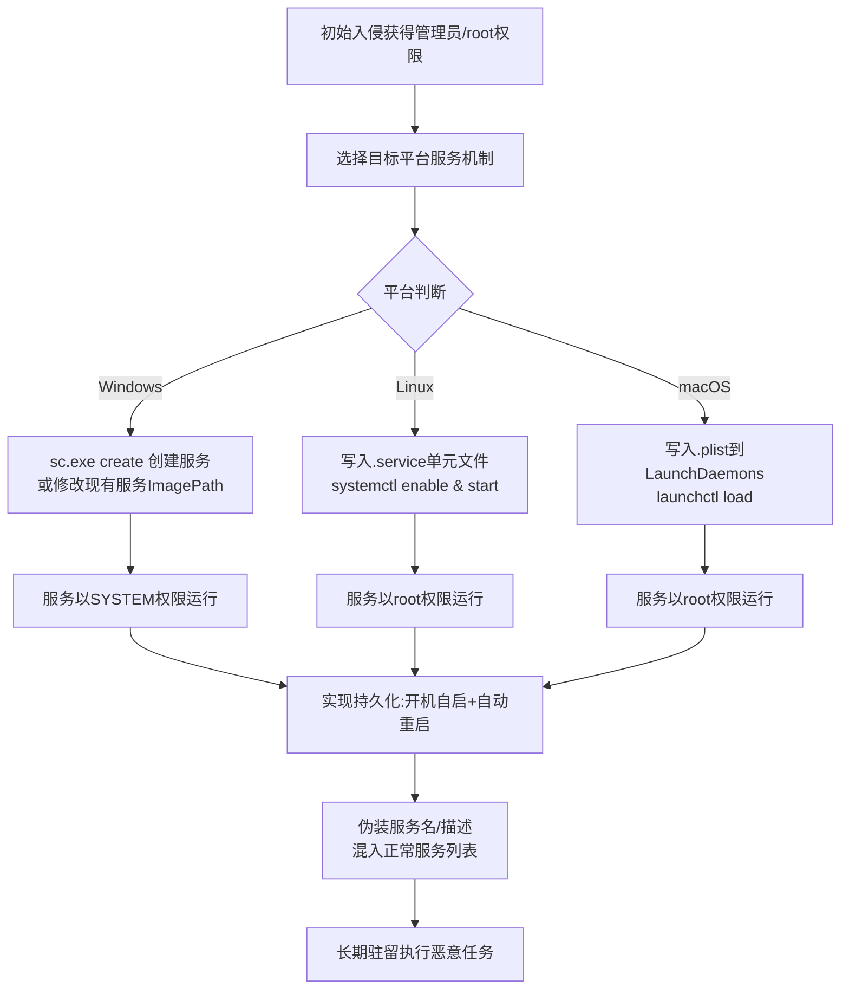

# T1543 - 创建或修改系统进程

## 一句话通俗理解

> 想象一下，攻击者就像一个偷偷在你家公司保安队里塞了自己人的内鬼——他伪装成正式员工入职，以后每天名正言顺地来上班，你想赶都赶不走。创建或修改系统进程就是这个套路：把恶意程序注册成系统"正规军"（Windows服务、Linux systemd、macOS LaunchDaemon），让它开机自启、自动重启、拥有系统权限。

## 30秒速查卡

| 维度 | 你需要知道的 |
|------|-------------|
| 这是什么？ | 攻击者新建或篡改操作系统级别的服务/守护进程，实现开机自启和持久驻留 |
| 为什么危险？ | 系统服务拥有高权限、自动重启、隐藏在几十个正常服务中，极难发现 |
| 谁需要关心？ | 系统管理员、安全运维团队、云平台运维人员 |
| 你的第一步防御 | 建立服务基线，任何新增/修改服务必须经变更审批 |
| 如果只做一件事 | 部署Sysmon EventID 7045（新服务创建）告警并接入SIEM |

## 难度等级

⭐⭐⭐ **高级**：需要操作系统服务管理机制知识（Windows SCM、Linux systemd、macOS launchd），以及权限提升能力

**前置知识要求**：
- 了解Windows服务控制管理器（SCM）工作原理
- 熟悉Linux systemd单元文件结构
- 理解macOS LaunchDaemon/LaunchAgent plist格式
- 知道如何用sc.exe/systemctl/launchctl管理系统服务

## 前置知识检查

在读下面的内容前，确认你能回答这些问题：

- [ ] Windows服务和普通应用程序有什么区别？
- [ ] `systemctl enable` 和 `systemctl start` 的区别是什么？
- [ ] macOS的LaunchDaemon和LaunchAgent放在哪个目录？有什么区别？
- [ ] 为什么系统服务通常以SYSTEM/root权限运行？

> 如果有3个以上答不上来，建议先补一下操作系统服务管理基础再继续。

## 技术描述

### 用人话说：系统服务是什么？

系统服务（system service）就像一栋大楼里的**常驻保安队**。普通程序是来访客——进门要登记、办完事就走；系统服务是编内保安——大楼一通电就上岗、24小时巡逻、出了问题自动重启、享受最高权限。

**进阶理解**：操作系统在启动早期会启动一批"系统服务"来提供核心功能（网络、打印、时间同步等）。这些服务由专门的管理器统管：
- **Windows**：服务控制管理器（SCM，`services.exe`），注册表记录在 `HKLM\SYSTEM\CurrentControlSet\Services\`
- **Linux**：systemd（`systemd`，PID 1），单元文件在 `/etc/systemd/system/`、`/usr/lib/systemd/system/`
- **macOS**：launchd（`launchd`，PID 1），plist文件在 `/Library/LaunchDaemons/`（系统级）、`~/Library/LaunchAgents/`（用户级）

攻击者把这些"保安队编制表"偷偷塞进自己人，以后每次开机，系统会堂而皇之地启动恶意服务——有正规编制、有系统权限、还能自动重启。

### 三大平台的服务机制对比

| 平台 | 服务管理器 | 服务定义位置 | 创建命令 | 权限要求 |
|------|-----------|-------------|---------|---------|
| Windows | SCM (services.exe) | 注册表 `HKLM\SYSTEM\CurrentControlSet\Services\` | `sc.exe create` | Administrator |
| Linux | systemd | `/etc/systemd/system/*.service` | `systemctl enable` | root |
| macOS | launchd | `/Library/LaunchDaemons/*.plist` | `launchctl load` | root |

## 子技术列表

| 子技术ID | 名称 | 平台 | 一句话说明 |
|---------|------|------|-----------|
| T1543.002 | Systemd Service | Linux | 创建systemd单元文件实现开机自启 |
| T1543.004 | Launch Daemon | macOS | 在/Library/LaunchDaemons放置plist实现持久化 |
| T1543.001 | Launch Agent | macOS | 在用户级~/Library/LaunchAgents放置plist |
| T1543.003 | Windows Service | Windows | 用sc.exe或API创建Windows服务 |
| T1543.005 | Container Service | Container | 在容器运行时配置中植入恶意服务 |

### 重点子技术详写

#### T1543.002 Systemd Service（Linux最常见）

Linux systemd是现代发行版的init系统（PID 1），管理所有系统服务。攻击者创建`.service`单元文件放到`/etc/systemd/system/`，用`systemctl enable`设为开机自启：

```ini
# /etc/systemd/system/persistence.service
[Unit]
Description=System Update Service
After=network.target

[Service]
Type=simple
ExecStart=/usr/local/bin/.update --daemon
Restart=always
RestartSec=10

[Install]
WantedBy=multi-user.target
```

**为什么攻击者爱用它**：
- `Restart=always` 让服务被杀后10秒自动重启
- 伪装成系统更新服务，名字像正规军
- 以root权限运行（systemd默认）

#### T1543.003 Windows Service（Windows最常见）

Windows服务通过SCM管理。攻击者用`sc.exe`创建服务：

```cmd
sc.exe create "WindowsUpdateHelper" binPath= "C:\Windows\Temp\update.exe" start= auto
sc.exe description "WindowsUpdateHelper" "Manages Windows updates"
```

服务注册表项 `HKLM\SYSTEM\CurrentControlSet\Services\WindowsUpdateHelper` 记录了ImagePath、Start类型（2=自动）、ServiceDll等关键信息。

#### T1543.004 Launch Daemon（macOS持久化首选）

macOS用launchd替代传统init。系统级守护进程plist放在`/Library/LaunchDaemons/`：

```xml
<?xml version="1.0" encoding="UTF-8"?>
<!DOCTYPE plist PUBLIC "-//Apple//DTD PLIST 1.0//EN" "http://www.apple.com/DTDs/PropertyList-1.0.dtd">
<plist version="1.0">
<dict>
    <key>Label</key>
    <string>com.apple.systemupdate</string>
    <key>ProgramArguments</key>
    <array>
        <string>/usr/local/bin/.sysupdate</string>
    </array>
    <key>RunAtLoad</key>
    <true/>
    <key>KeepAlive</key>
    <true/>
</dict>
</plist>
```

`KeepAlive=true` 让进程退出后自动重启，`RunAtLoad=true` 让开机/加载时立即执行。

## 攻击流程



## 真实案例

### 案例1：Rocke组织用systemd服务实现Linux挖矿持久化（2018-2019）

- **时间**：2018年6月-2019年3月
- **目标**：云服务器、企业Linux服务器
- **攻击组织**：Rocke（中文"摇滚币"组织，专门挖矿）
- **手法**：Rocke通过Apache Struts 2漏洞（CVE-2017-5638）入侵Linux服务器后，创建systemd服务`pwnrigl.service`伪装成"pwnrig watchdog"，单元文件放在`/etc/systemd/system/`，设置`Restart=always`确保挖矿进程被杀后自动重启。同时创建定时任务下载更新挖矿脚本。
- **影响**：单个组织控制数万台服务器挖门罗币
- **数据来源**：阿里云安全团队技术分析报告（一手厂商报告）

> 📚 **深入了解**：阿里云安全《Rocke恶意软件演进分析》详细拆解了其systemd持久化手法

### 案例2：Lazarus组织用macOS LaunchDaemon植入后门（2020-2021）

- **时间**：2020年8月-2021年3月
- **目标**：加密货币交易所员工、区块链公司
- **攻击组织**：Lazarus（朝鲜APT38子组）
- **手法**：通过钓鱼邮件投递伪装成招聘文档的macOS恶意软件（Macho文件），获取root权限后在`/Library/LaunchDaemons/com.apple.systemupdate.plist`植入plist，`RunAtLoad=true`+`KeepAlive=true`确保后门`/usr/local/bin/.sysupdate`开机自启且被杀后重启。后门伪装成Apple系统更新服务。
- **影响**：窃取多家加密货币交易所数字资产
- **数据来源**：ESET《Lazarus攻击加密货币行业报告》（一手厂商报告）

### 案例3：APT29用Windows服务植入SUNBURST后门（2020 SolarWinds事件）

- **时间**：2020年3月-12月
- **目标**：SolarWinds Orion平台用户（美国政府机构、财富500强）
- **攻击组织**：APT29（Cozy Bear，俄罗斯SVR背景）
- **手法**：SUNBURST后门通过SolarWinds Orion更新植入后，在目标网络内创建名为`SolarWinds.Orion.Core.BusinessLayer.dll`的Windows服务，服务描述伪装成"SolarWinds Orion Business Layer"。服务以NETWORK SERVICE权限运行，等待2周后才开始C2通信，避免被实时检测。
- **影响**：约18,000个组织受影响，包括美国财政部、国务院、国土安全部
- **数据来源**：Mandiant/CISA Alert AA21-077A（一手政府+厂商报告）

## 红队视角

### 可持续利用手段

| 手段 | 说明 | 检测难度 |
|------|------|---------|
| 伪装服务名 | 用"WindowsUpdate""SystemHelper"等系统风格命名 | 中 |
| 修改现有服务 | 篡改已存在但禁用的服务的ImagePath，比新建更隐蔽 | 高 |
| 服务DLL劫持 | 用 rundll32 加载恶意DLL作为ServiceDll | 高 |
| 多层重启保护 | 服务监控+重启二级服务，杀一个起一个 | 高 |

### 可复制性分析

| 维度 | 评分 | 说明 |
|------|------|------|
| 技术门槛 | ⭐⭐ | sc.exe/systemctl命令简单 |
| 工具可用性 | ⭐⭐⭐⭐⭐ | 系统自带工具即可 |
| 检测规避 | ⭐⭐⭐ | 伪装得当可长期潜伏 |
| 跨平台适用 | ⭐⭐⭐⭐ | 三大平台都有等价机制 |

## 蓝队视角

### 用人话说：怎么发现被塞了"假保安"？

系统服务就像员工花名册——正常情况下每个名字都有来路。防御的核心是**建立基线+变更告警**：先盘点所有正规服务做基线，之后任何新增/修改都要告警。

### 检测规则

#### Windows：监控新服务创建（Sysmon EventID 7045）

```yaml
# Sigma规则：检测新建可疑Windows服务
title: 可疑Windows服务创建
status: experimental
description: 检测从临时目录或可疑路径创建的新服务
logsource:
    product: windows
    service: system
detection:
    selection:
        EventID: 7045
        ImagePath|contains:
            - 'C:\Users\'
            - 'C:\Temp\'
            - 'C:\Windows\Temp\'
            - 'C:\ProgramData\'
    condition: selection
falsepositives:
    - 软件安装
level: high
```

```powershell
# PowerShell：枚举所有服务并检查可疑项
Get-WmiObject Win32_Service | Where-Object {
    $_.PathName -match 'Temp|AppData|Users\\' -and
    $_.State -eq 'Running'
} | Select Name, DisplayName, PathName, StartMode
```

#### Linux：监控systemd单元文件变更

```bash
# 监控systemd单元文件目录变更（auditd规则）
auditctl -w /etc/systemd/system/ -p wa -k systemd_unit_change
auditctl -w /usr/lib/systemd/system/ -p wa -k systemd_unit_change

# 查看近期创建的服务
find /etc/systemd/system/ -name "*.service" -mtime -30 -exec ls -la {} \;

# 列出所有enabled的服务，人工审查
systemctl list-unit-files --state=enabled --type=service
```

#### macOS：监控LaunchDaemon新增

```bash
# 监控LaunchDaemons目录
auditctl -w /Library/LaunchDaemons/ -p wa -k launchdaemon_change
auditctl -w /Library/LaunchAgents/ -p wa -k launchagent_change

# 列出所有已加载的LaunchDaemon，审查非Apple官方项
launchctl list | grep -v "com.apple"
```

### 检测建议分层

| 层次 | 检测点 | 工具 |
|------|--------|------|
| 网络层 | 服务进程异常出网 | IDS + 防火墙日志 |
| 主机层 | 新服务创建/服务路径变更 | Sysmon 7045 / auditd |
| 应用层 | 服务账户异常权限使用 | SIEM行为分析 |

## 避坑指南

| 坑 | 说明 | 正确做法 |
|----|------|---------|
| 只盯新建服务 | 攻击者常篡改现有禁用服务的ImagePath | 同时监控ImagePath字段变更 |
| 忽略macOS | macOS的launchd持久化常被忽视 | macOS必须纳入监控范围 |
| 服务名太像 | "WindowsUpdateHelper"易被误认为系统服务 | 建立服务白名单基线 |
| 忘记检查DLL服务 | ServiceDll类型的服务的真实载荷是DLL | 检查`HKLM\...\Parameters\ServiceDll` |
| Linux只看cron | 只查crontab忽略systemd | systemd单元文件是现代Linux持久化首选 |

## 检测建议

### 网络层检测

```bash
# 检测新创建服务的异常网络连接
# Windows: Sysmon网络连接事件(EventID 3)关联服务进程
# Sigma关联规则
```

### 主机层检测（最重要）

1. **Sysmon配置**（Windows）：
```xml
<RuleGroup name="Service Creation" groupRelation="or">
  <EventID>7045</EventID>
</RuleGroup>
```

2. **auditd配置**（Linux/macOS）：
```bash
# 关键目录监控
-w /etc/systemd/system/ -p wa -k systemd
-w /usr/lib/systemd/system/ -p wa -k systemd
-w /Library/LaunchDaemons/ -p wa -k launchd
-w /Library/LaunchAgents/ -p wa -k launchd
```

### 应用层检测

- 服务描述字段异常（拼写错误、编码异常）
- 服务启动类型突然从禁用改为自动
- 服务账户从LocalSystem变为自定义账户

## 缓解措施

| 措施 | 说明 | 实施难度 |
|------|------|---------|
| 服务白名单基线 | 建立合法服务清单，任何新增需审批 | 中 |
| 限制服务创建权限 | 仅Domain Admins可创建服务 | 低 |
| 启用LSA Protection | 防止服务进程被注入 | 低 |
| systemd单元文件只读 | 关键路径设为immutable | 中 |
| macOS SIP | 启用系统完整性保护 | 低 |
| 启动盘加密+Secure Boot | 防止离线修改服务配置 | 高 |

## 动手实验

### 实验1：创建测试Windows服务（隔离环境）

```cmd
# 创建测试服务
sc.exe create "TestPersistence" binPath= "C:\Windows\System32\calc.exe" start= auto
sc.exe description "TestPersistence" "Test service for learning"

# 验证创建成功
sc.exe query TestPersistence

# 清理
sc.exe delete TestPersistence
```

**预期输出**：
```
[SC] CreateService SUCCESS
SERVICE_NAME: TestPersistence
        TYPE               : 10  WIN32_OWN_PROCESS
        STATE              : STOPPED
        WIN32_EXIT_CODE    : 0  (0x0)
```

### 实验2：创建测试Linux systemd服务

```bash
# 创建单元文件
sudo tee /etc/systemd/system/test-persistence.service << 'EOF'
[Unit]
Description=Test Persistence Service
[Service]
Type=oneshot
ExecStart=/bin/echo "Hello from test service"
[Install]
WantedBy=multi-user.target
EOF

# 启用并启动
sudo systemctl daemon-reload
sudo systemctl enable test-persistence.service
sudo systemctl start test-persistence.service

# 验证
systemctl status test-persistence.service

# 清理
sudo systemctl disable test-persistence.service
sudo rm /etc/systemd/system/test-persistence.service
sudo systemctl daemon-reload
```

### 专用工具表

| 工具 | 平台 | 用途 |
|------|------|------|
| Autoruns | Windows | 枚举所有自启项含服务 |
| sc.exe | Windows | 系统自带服务管理 |
| systemctl | Linux | systemd服务管理 |
| launchctl | macOS | launchd服务管理 |
| Knockout | macOS | 图形化LaunchDaemon管理 |

## 术语解释

| 术语 | 解释 |
|------|------|
| SCM | Service Control Manager，Windows服务控制管理器，由services.exe实现 |
| systemd | Linux现代init系统，PID 1进程，管理所有系统服务 |
| launchd | macOS的init系统，PID 1进程，管理LaunchDaemon/LaunchAgent |
| plist | Property List，macOS的XML配置文件格式 |
| RunAtLoad | launchd配置项，加载时立即执行 |
| KeepAlive | launchd配置项，进程退出后自动重启 |
| ImagePath | Windows服务注册表项，指向服务可执行文件路径 |
| ServiceDll | Windows服务可加载DLL形式的载荷 |

## 参考资料

### 📚 深入了解（MITRE官方）
- [MITRE ATT&CK T1543](https://attack.mitre.org/techniques/T1543/) - 官方技术页面
- [MITRE ATT&CK T1543.002](https://attack.mitre.org/techniques/T1543/002/) - Systemd Service
- [MITRE ATT&CK T1543.003](https://attack.mitre.org/techniques/T1543/003/) - Windows Service

### 🔧 动手试试
- [Sysinternals Autoruns](https://docs.microsoft.com/sysinternals/downloads/autoruns) - 服务枚举工具
- [Microsoft服务文档](https://docs.microsoft.com/windows/win32/services/services) - Windows服务开发指南

### 🎯 真实攻击
- [CISA Alert AA21-077A](https://www.cisa.gov/news-events/cybersecurity-advisories/aa21-077a) - SolarWinds事件分析
- [ESET Lazarus报告](https://www.welivesecurity.com/) - macOS LaunchDaemon持久化案例

## 版本历史

| 版本 | 日期 | 变更 |
|------|------|------|
| v3.1 | 2026-07-10 | 从跨战术污染重写为持久化(TA0003)正确内容 |
