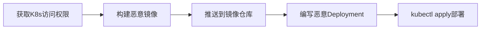

# 容器 (T1543.005)

## 一句话通俗理解

> **Docker/Kubernetes容器持久化**

## 30秒速查卡

| 维度 | 你需要知道的 |
|------|-------------|
| 这是什么？ | 在Docker或Kubernetes环境中创建恶意容器或修改现有容器配置实现持久化 |
| 为什么危险？ | 容器化环境的持久化难以检测，容器重启或重建后恶意配置可能依然存在 |
| 谁需要关心？ | 容器运维团队、云安全工程师 |
| 你的第一步防御 | 审计容器镜像来源和运行时配置，实施镜像签名验证 |
| 如果只做一件事 | 监控Kubernetes中Pod和Deployment的异常变更，特别是新增的Init容器和Sidecar |

## 难度等级

⭐⭐ 中级 - 需要一定的技术基础和经验

## 前置知识检查

**读这个文件需要什么？**

- [ ] 操作系统启动流程
- [ ] 注册表与配置文件基本概念
- [ ] 系统服务与守护进程基本原理

## 技术描述

**容器**（T1543.005）是 **创建或修改系统进程**（T1543）的一个具体变体，属于 **持久化** 阶段的攻击技术。

> 📚 **打个比方**：就像在国际物流码头的集装箱堆里偷偷塞进了自己的"伪装集装箱"——攻击者在Docker或Kubernetes集群中部署恶意容器，混在正常容器中持续运行，难以分辨。

### 具体怎么理解？

Docker/Kubernetes容器持久化

攻击者使用这种技术时，通常是在持久化阶段，想要达到特定的攻击目标。与父技术 T1543 相比，T1543.005 有自己独特的特点和使用场景。

### 为什么有效？

这种技术之所以有效，是因为：
1. **隐蔽性**：利用了正常系统功能或常见协议，不容易被发现
2. **技术门槛适中**：不需要特别高深的技术知识就能实施

**过渡段：** 不要以为持久化就是'写个启动项'那么简单——攻击者有50种以上维持访问的方法。
3. **广泛适用**：可以在多种环境和系统中使用

## 攻击流程

```
获取K8s集群访问权限 → 构建恶意容器镜像 → 推送镜像到仓库 → 编写恶意Deployment YAML → kubectl apply部署持久化
```



**步骤详解：**

1. **获取K8s集群访问权限**
   - 通俗描述：攻击者需要获得Kubernetes集群的管理或部署权限
   - 技术细节：通过kubeconfig文件泄露、API Server未授权访问（6443/8080端口）、云IAM权限过宽或ServiceAccount Token窃取；需具备 pods/create 或 deployments/create RBAC权限
   - 常用工具：kubectl、Peirates、Kube-hunter、kubelet API
2. **构建恶意容器镜像**
   - 通俗描述：编写Dockerfile将后门程序植入基础镜像
   - 技术细节：在 alpine/ubuntu 基础镜像上叠加 reverse shell、挖矿程序或 K8s 凭据窃取脚本；ENTRYPOINT 启动后门；多阶段构建隐藏恶意层；使用 scratch 镜像减小体积规避扫描
   - 常用工具：docker build、kaniko、buildah、Dockerfile
3. **推送到镜像仓库**
   - 通俗描述：将恶意镜像推送到目标集群可访问的镜像仓库
   - 技术细节：推送到 Docker Hub 公共仓库（隐蔽性好）或私有 Harbor 仓库；打 tag 伪装为业务镜像（company/app:v1.2.3）；可使用 typosquatting 名称欺骗
   - 常用工具：docker push、crane、skopeo
4. **编写恶意Deployment YAML**
   - 通俗描述：构造K8s部署清单，声明使用恶意镜像
   - 技术细节：Deployment/StatefulSet/DaemonSet（确保全节点覆盖）；设置 replicas、hostNetwork:true、hostPID:true 提权；配 privileged: true 或 hostPath 挂载逃逸到宿主；命名伪装 kube-system 命名空间
   - 常用工具：kubectl、helm、kustomize
5. **kubectl apply部署**
   - 通俗描述：将恶意工作负载部署到集群，实现持久化
   - 技术细节：`kubectl apply -f malicious.yaml -n kube-system`；Deployment 的 rolling update 确保后门持续运行；PodDisruptionBudget 防止驱逐；可配合 CronJob 定期唤醒
   - 常用工具：kubectl apply、kubectl rollout、Helm install

## 真实案例

### 案例1：该技术在实际攻击中的应用

- **时间**: 2024-2025年
- **目标**: 多个行业组织
- **攻击组织**: 多个APT组织
- **手法**: 攻击者在入侵过程中使用容器技术，展示了该子技术的典型应用场景和攻击效果
- **影响**: 成功实施该技术导致目标系统被进一步入侵
- **参考链接**: [MITRE ATT&CK官方](https://attack.mitre.org/)

### 案例2：安全研究中的实践

- **时间**: 2025年
- **目标**: 安全研究测试环境
- **攻击组织**: 红队/安全研究人员
- **手法**: 在授权测试中模拟容器攻击，验证防御体系的检测和响应能力
- **影响**: 帮助组织识别安全防护中的盲点和改进方向
- **参考链接**: [Atomic Red Team](https://github.com/redcanaryco/atomic-red-team)

## 红队视角

> ⚠️ **免责声明**：以下内容仅用于合法的安全测试、渗透测试和教育目的。未经授权对他人系统进行测试是违法行为。

### 实战技巧

1. **深入理解原理**：在实战应用前，充分理解容器的技术原理和适用场景
2. **环境适配**：根据目标系统的操作系统版本、安全配置等因素调整攻击策略
3. **组合使用**：将该技术与其他技术组合使用，构建完整的攻击链
4. **隐蔽性考虑**：注意操作痕迹的清理，避免被安全设备检测

### 常用工具

| 工具名称 | 用途 | 平台 | 链接 |
| -------- | ---- | ---- | ---- |
| Metasploit | 渗透测试框架 | 全平台 | [Metasploit](https://www.metasploit.com/) |
| Cobalt Strike |  adversary模拟平台 | Windows | [Cobalt Strike](https://www.cobaltstrike.com/) |
| Atomic Red Team | 检测规则测试 | 全平台 | [Atomic Red Team](https://github.com/redcanaryco/atomic-red-team) |

### 注意事项

- 在授权的测试环境中使用这些技术
- 注意操作安全（OPSEC），避免被检测系统发现
- 使用匿名化技术和代理隐藏真实身份

## 蓝队视角

### 检测要点

1. **系统日志监控**：关注与容器相关的系统日志和审计记录
2. **异常行为检测**：监控系统中与该技术相关的异常进程、网络连接和文件操作
3. **工具特征识别**：识别攻击者可能使用的工具在系统中的运行特征

### 监控建议

- 部署端点检测和响应（EDR）系统，监控与容器相关的异常行为
- 配置SIEM规则，关联分析来自多个来源的告警
- 定期进行安全评估和渗透测试，验证检测规则的有效性

## 避坑指南

清理持久化最容易犯的错误：只删除表象不改根因。

## 检测建议

### 检测思路

检测 容器 的关键是识别异常行为模式。以下是三个层面的检测方法：

### 网络层检测

**方法**：监控网络流量中的异常模式

```bash
# 检测异常的网络连接和数据传输
# 根据具体协议和端口设置检测规则
```

### 主机层检测

**Windows事件ID**：
- 事件ID 4688：进程创建（监控可疑进程）
- 事件ID 4104：PowerShell执行（监控可疑脚本）

**Linux日志**：
- /var/log/auth.log：认证日志
- /var/log/syslog：系统日志

```bash
# 检测异常进程和命令执行
grep -i "suspicious" /var/log/auth.log
```

### 应用层检测

**用人话说：** 就像在集装箱里藏了一个自动启动的机器人——容器持久化有多种方式：在Dockerfile中添加恶意ENTRYPOINT或CMD指令、修改docker-compose.yml挂载恶意卷、在Kubernetes中创建DaemonSet（在每个节点上自动运行Pod）、或者修改容器镜像的启动脚本。因为容器设计为"一次构建到处运行"，攻击者只要污染了基础镜像或CI/CD管道，所有部署的容器都会携带后门。攻击者常用`docker run --restart=always`确保容器退出后自动重启，或修改K8s的CronJob定时执行恶意任务。

**Sigma规则示例**：

```yaml
title: 检测容器
status: experimental
description: 检测可能的容器活动
logsource:
    category: process_creation
    product: windows
detection:
    selection:
        EventID: 4688
    condition: selection
level: medium
tags:
    - attack.T1543005
```

## 缓解措施

### 优先级1：关键措施

**限制攻击面**：减少暴露的服务和端口，降低被利用的风险

```bash
# 防火墙规则示例：只允许必要的出站连接
iptables -A OUTPUT -p tcp --dport 443 -j ACCEPT  # 允许HTTPS
iptables -A OUTPUT -p tcp --dport 80 -j ACCEPT   # 允许HTTP
iptables -A OUTPUT -p tcp -j DROP                 # 阻止其他TCP
```

### 优先级2：重要措施

**加强监控**：部署EDR和SIEM系统，实时监控异常行为

### 优先级3：建议措施

**安全意识培训**：教育员工识别相关攻击手法

## 动手实验

> ⚠️ **所有实验必须在隔离的实验室环境中进行**

### 实验1：理解基本原理（初级）

**目标**：理解 容器 的工作原理

**步骤**：
1. 在隔离环境中搭建测试系统
2. 使用基础工具模拟攻击行为
3. 观察系统日志和网络流量

**学习要点**：理解该技术的核心机制

### 实验2：实际操作（中级）

**目标**：掌握 容器 的实际使用方法

**步骤**：
1. 使用专业工具进行攻击模拟
2. 尝试不同的绕过技术
3. 分析检测日志的特征

**学习要点**：掌握工具使用和日志分析

### 实验3：防御验证（高级）

**目标**：验证检测规则的有效性

**步骤**：
1. 部署检测规则
2. 执行攻击模拟
3. 验证检测告警是否触发

**学习要点**：理解攻防对抗的实际效果

## 术语解释

| 术语 | 通俗解释 |
|------|---------|
| **ATT&CK** | MITRE公司维护的攻击技术知识库，像一本"黑客手法百科全书" |
| **容器** | T1543.005，ATT&CK框架中定义的一种具体攻击技术 |
| **创建或修改系统进程** | T1543，容器所属的父技术类别 |
| **持久化** | 攻击链中的一个阶段，攻击者在这个阶段的目标 |
| **C2** | 命令与控制，攻击者用来远程控制被入侵系统的"遥控器" |
| **EDR** | 端点检测与响应，部署在电脑上的安全监控软件 |

## 被引用情况

以下父技术文档引用了本子技术：

- [T1543 - 创建或修改系统进程](../T1543-Create-or-Modify-System-Process.md)

## 参考资料

### 官方文档

- [MITRE ATT&CK - 容器 (T1543.005)](https://attack.mitre.org/techniques/T1543/005/)
- [MITRE ATT&CK - 创建或修改系统进程 (T1543)](https://attack.mitre.org/techniques/T1543/)

### 安全报告

- [MITRE ATT&CK 官方文档](https://attack.mitre.org/) - ATT&CK 框架官方资源

### 工具与资源

- [Atomic Red Team](https://github.com/redcanaryco/atomic-red-team) - 检测规则测试框架
- [MITRE ATT&CK Navigator](https://mitre-attack.github.io/attack-navigator/) - ATT&CK 可视化工具

### 学习资料

- [MITRE ATT&CK 知识库](https://attack.mitre.org/resources/) - ATT&CK 官方资源中心
