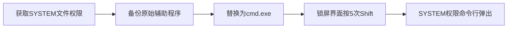

# 辅助功能 (T1546.008)

## 一句话通俗理解

> **替换辅助功能二进制文件**

## 30秒速查卡

| 维度 | 你需要知道的 |
|------|-------------|
| 这是什么？ | 替换Windows辅助功能程序（如sethc.exe），让攻击者通过快捷键在登录界面执行恶意代码 |
| 为什么危险？ | 辅助功能程序在登录界面就能运行，不需要登录就能触发，完全绕过认证 |
| 谁需要关心？ | Windows管理员、SOC分析师 |
| 你的第一步防御 | 监控辅助功能程序文件的修改（sethc.exe、utilman.exe等） |
| 如果只做一件事 | 对比系统32目录下辅助功能二进制文件的哈希值，任何变化都是严重告警 |

## 难度等级

⭐⭐⭐ 高级 - 需要深入的技术知识和实践

## 前置知识检查

**读这个文件需要什么？**

- [ ] 操作系统启动流程
- [ ] 注册表与配置文件基本概念
- [ ] 系统服务与守护进程基本原理

## 技术描述

**辅助功能**（T1546.008）是 **事件触发执行**（T1546）的一个具体变体，属于 **持久化** 阶段的攻击技术。

> ⏰ **打个比方**：就像在Windows任务计划程序里设了一个"每天凌晨3点执行"的任务——攻击者利用计划任务在特定时间或事件触发时执行恶意负载。

### 具体怎么理解？

替换辅助功能二进制文件

攻击者使用这种技术时，通常是在持久化阶段，想要达到特定的攻击目标。与父技术 T1546 相比，T1546.008 有自己独特的特点和使用场景。

### 为什么有效？

这种技术之所以有效，是因为：
1. **隐蔽性**：利用了正常系统功能或常见协议，不容易被发现
2. **技术门槛适中**：不需要特别高深的技术知识就能实施

**过渡段：** 不要以为持久化就是'写个启动项'那么简单——攻击者有50种以上维持访问的方法。
3. **广泛适用**：可以在多种环境和系统中使用

## 攻击流程

```
获取Windows文件写入权限 → 备份原始sethc/utilman → 替换为cmd.exe或恶意程序 → 锁屏界面触发辅助功能 → 以SYSTEM权限弹出命令行
```



**步骤详解：**

1. **获取Windows文件写入权限**
   - 通俗描述：攻击者需要SYSTEM权限才能修改System32目录下的系统二进制文件
   - 技术细节：通过提权漏洞（PrintNightmare、Potato家族）、已有SYSTEM权限或WinPE启动盘；需对 C:\Windows\System32\sethc.exe、utilman.exe、osk.exe、Magnify.exe、Narrator.exe 具备写权限
   - 常用工具：PrintNightmare、JuicyPotato、RoguePotato、PsExec -s
2. **备份原始辅助功能程序**
   - 通俗描述：备份被替换的系统程序以便回滚
   - 技术细节：复制 sethc.exe（粘滞键）、utilman.exe（轻松访问中心）、osk.exe（屏幕键盘）到 C:\Windows\backup\；备份便于后续恢复并避免触发Windows文件完整性检查（SFC）
   - 常用工具：copy、xcopy、robocopy
3. **替换为cmd.exe或恶意程序**
   - 通俗描述：将辅助功能程序替换为命令行或后门
   - 技术细节：takeown /f sethc.exe && icacls sethc.exe /grant administrators:F；copy C:\Windows\System32\cmd.exe sethc.exe；也可用 Image File Execution Options (IFEO) 注册表劫持而非文件替换（更隐蔽）
   - 常用工具：takeown、icacls、copy、reg add
4. **锁屏界面触发辅助功能**
   - 通俗描述：在Windows登录界面（未登录状态）触发被替换的辅助功能
   - 技术细节：按5次Shift键触发sethc.exe；Win+U触发utilman.exe；登录界面的辅助功能以SYSTEM权限运行，绕过登录认证；RDP登录界面同样可触发
   - 常用工具：键盘操作、RDP客户端
5. **SYSTEM权限命令行弹出**
   - 通俗描述：被替换的程序以SYSTEM权限执行，弹出最高权限命令行
   - 技术细节：cmd.exe以SYSTEM权限运行，whoami 返回 nt authority\system；无需用户密码即可完全控制系统；可执行 net user 添加后门账户、导出SAM哈希、安装服务持久化
   - 常用工具：cmd.exe、net.exe、mimikatz

## 真实案例

### 案例1：该技术在实际攻击中的应用

- **时间**: 2024-2025年
- **目标**: 多个行业组织
- **攻击组织**: 多个APT组织
- **手法**: 攻击者在入侵过程中使用辅助功能技术，展示了该子技术的典型应用场景和攻击效果
- **影响**: 成功实施该技术导致目标系统被进一步入侵
- **参考链接**: [MITRE ATT&CK官方](https://attack.mitre.org/)

### 案例2：安全研究中的实践

- **时间**: 2025年
- **目标**: 安全研究测试环境
- **攻击组织**: 红队/安全研究人员
- **手法**: 在授权测试中模拟辅助功能攻击，验证防御体系的检测和响应能力
- **影响**: 帮助组织识别安全防护中的盲点和改进方向
- **参考链接**: [Atomic Red Team](https://github.com/redcanaryco/atomic-red-team)

## 红队视角

> ⚠️ **免责声明**：以下内容仅用于合法的安全测试、渗透测试和教育目的。未经授权对他人系统进行测试是违法行为。

### 实战技巧

1. **深入理解原理**：在实战应用前，充分理解辅助功能的技术原理和适用场景
2. **环境适配**：根据目标系统的操作系统版本、安全配置等因素调整攻击策略
3. **组合使用**：将该技术与其他技术组合使用，构建完整的攻击链
4. **隐蔽性考虑**：注意操作痕迹的清理，避免被安全设备检测

### 常用工具

| 工具名称 | 用途 | 平台 | 链接 |
| -------- | ---- | ---- | ---- |
| Metasploit | 渗透测试框架 | 全平台 | [Metasploit](https://www.metasploit.com/) |
| Cobalt Strike |  adversary模拟平台 | Windows | [Cobalt Strike](https://www.cobaltstrike.com/) |
| Atomic Red Team | 检测规则测试 | 全平台 | [Atomic Red Team](https://github.com/redcanaryco/atomic-red-team) |

### 注意事项

- 在授权的测试环境中使用这些技术
- 注意操作安全（OPSEC），避免被检测系统发现
- 使用匿名化技术和代理隐藏真实身份

## 蓝队视角

### 检测要点

1. **系统日志监控**：关注与辅助功能相关的系统日志和审计记录
2. **异常行为检测**：监控系统中与该技术相关的异常进程、网络连接和文件操作
3. **工具特征识别**：识别攻击者可能使用的工具在系统中的运行特征

### 监控建议

- 部署端点检测和响应（EDR）系统，监控与辅助功能相关的异常行为
- 配置SIEM规则，关联分析来自多个来源的告警
- 定期进行安全评估和渗透测试，验证检测规则的有效性

## 避坑指南

清理持久化最容易犯的错误：只删除表象不改根因。

## 检测建议

### 检测思路

检测 辅助功能 的关键是识别异常行为模式。以下是三个层面的检测方法：

### 网络层检测

**方法**：监控网络流量中的异常模式

```bash
# 检测异常的网络连接和数据传输
# 根据具体协议和端口设置检测规则
```

### 主机层检测

**Windows事件ID**：
- 事件ID 4688：进程创建（监控可疑进程）
- 事件ID 4104：PowerShell执行（监控可疑脚本）

**Linux日志**：
- /var/log/auth.log：认证日志
- /var/log/syslog：系统日志

```bash
# 检测异常进程和命令执行
grep -i "suspicious" /var/log/auth.log
```

### 应用层检测

**用人话说：** 就像在Windows登录屏幕的"紧急按钮"后面藏了一个后门——攻击者把C:\Windows\System32\sethc.exe（粘滞键）替换成cmd.exe的副本。然后在登录界面按5次Shift键，Windows会以SYSTEM最高权限弹出一个命令行窗口，不需要任何密码！类似的还有utilman.exe（轻松访问）、osk.exe（屏幕键盘）、magnify.exe（放大镜）等辅助功能程序。Stuxnet震网病毒曾使用过类似技术。检测方法很简单：对比这些文件的哈希值是否与原始Windows安装一致。

**Sigma规则示例**：

```yaml
title: 检测辅助功能
status: experimental
description: 检测可能的辅助功能活动
logsource:
    category: process_creation
    product: windows
detection:
    selection:
        EventID: 4688
    condition: selection
level: medium
tags:
    - attack.T1546008
```

## 缓解措施

### 优先级1：关键措施

**限制攻击面**：减少暴露的服务和端口，降低被利用的风险

```bash
# 防火墙规则示例：只允许必要的出站连接
iptables -A OUTPUT -p tcp --dport 443 -j ACCEPT  # 允许HTTPS
iptables -A OUTPUT -p tcp --dport 80 -j ACCEPT   # 允许HTTP
iptables -A OUTPUT -p tcp -j DROP                 # 阻止其他TCP
```

### 优先级2：重要措施

**加强监控**：部署EDR和SIEM系统，实时监控异常行为

### 优先级3：建议措施

**安全意识培训**：教育员工识别相关攻击手法

## 动手实验

> ⚠️ **所有实验必须在隔离的实验室环境中进行**

### 实验1：理解基本原理（初级）

**目标**：理解 辅助功能 的工作原理

**步骤**：
1. 在隔离环境中搭建测试系统
2. 使用基础工具模拟攻击行为
3. 观察系统日志和网络流量

**学习要点**：理解该技术的核心机制

### 实验2：实际操作（中级）

**目标**：掌握 辅助功能 的实际使用方法

**步骤**：
1. 使用专业工具进行攻击模拟
2. 尝试不同的绕过技术
3. 分析检测日志的特征

**学习要点**：掌握工具使用和日志分析

### 实验3：防御验证（高级）

**目标**：验证检测规则的有效性

**步骤**：
1. 部署检测规则
2. 执行攻击模拟
3. 验证检测告警是否触发

**学习要点**：理解攻防对抗的实际效果

## 术语解释

| 术语 | 通俗解释 |
|------|---------|
| **ATT&CK** | MITRE公司维护的攻击技术知识库，像一本"黑客手法百科全书" |
| **辅助功能** | T1546.008，ATT&CK框架中定义的一种具体攻击技术 |
| **事件触发执行** | T1546，辅助功能所属的父技术类别 |
| **持久化** | 攻击链中的一个阶段，攻击者在这个阶段的目标 |
| **C2** | 命令与控制，攻击者用来远程控制被入侵系统的"遥控器" |
| **EDR** | 端点检测与响应，部署在电脑上的安全监控软件 |

## 被引用情况

以下父技术文档引用了本子技术：

- [T1546 - 事件触发执行](../T1546-Event-Triggered-Execution.md)
- [T1546 - 事件触发执行](../../06-Privilege-Escalation/T1546-Event-Triggered-Execution.md)
- [T1546 - 事件触发执行](../../07-Stealth/T1546-Event-Triggered-Execution.md)

## 参考资料

### 📚 官方文档（深入了解）

- [MITRE ATT&CK - 辅助功能 (T1546.008)](https://attack.mitre.org/techniques/T1546/008/)
- [MITRE ATT&CK - 事件触发执行 (T1546)](https://attack.mitre.org/techniques/T1546/)

### 📰 安全报告（真实攻击）

- [MITRE ATT&CK 官方文档](https://attack.mitre.org/) - ATT&CK 框架官方资源

### 🔧 工具与资源（动手试试）

- [Atomic Red Team](https://github.com/redcanaryco/atomic-red-team) - 检测规则测试框架
- [MITRE ATT&CK Navigator](https://mitre-attack.github.io/attack-navigator/) - ATT&CK 可视化工具

### 📚 学习资料（深入了解）

- [MITRE ATT&CK 知识库](https://attack.mitre.org/resources/) - ATT&CK 官方资源中心
