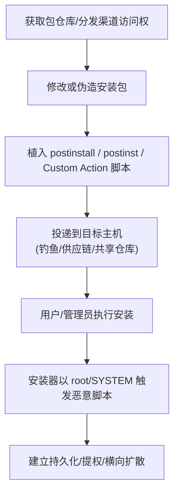

# 安装程序包 (T1546.016)

## 一句话通俗理解

> **把后门塞进"安装包"——用户一装软件，恶意代码就以高权限自动跑起来**

## 30秒速查卡

| 维度 | 你需要知道的 |
|------|-------------|
| 这是什么？ | 攻击者通过安装程序（macOS pkg/dmg、Linux deb/rpm、Windows MSI）中嵌入的安装前/后脚本触发恶意代码执行，建立持久化或提权 |
| 为什么危险？ | 安装程序通常以 root / SYSTEM 权限运行，安装脚本（postinstall、preinst/postinst、MSI Custom Action）默认被信任，且会随用户主动安装行为合法触发 |
| 谁需要关心？ | macOS/Linux/Windows 系统管理员、SOC 分析师、供应链安全负责人 |
| 你的第一步防御 | 监控包安装事件，关联安装脚本执行与异常子进程；对生产环境包仓库做完整性校验 |
| 如果只做一件事 | 监控 postinstall / postinst / preinst / postrm / MSI Custom Action 脚本的创建、修改与触发执行 |

## 难度等级

⭐⭐⭐ 高级 - 需要深入理解跨平台包管理器机制与安装生命周期

## 前置知识检查

**读这个文件需要什么？**

- [ ] 操作系统包管理机制（dpkg / rpm / pkgutil / MSI）
- [ ] 安装脚本生命周期（preinst / postinst / preun / postun / postinstall / preinstall）
- [ ] 进程权限继承基本原理

## 技术描述

**安装程序包**（T1546.016）是 **事件触发执行**（T1546）的一个具体变体，属于 **持久化** 阶段的攻击技术，同时可被用于 **权限提升**（TA0004）。

> 🔑 **打个比方**：就像在快递包裹里塞了张"开箱即焚"的小纸条——只要收件人按惯例拆包（执行安装），纸条上的指令就会自动被信件处理流程（root 权限的安装器）执行，无需攻击者再次登场。

### 具体怎么理解？

攻击者通过在安装程序（Installer Packages）中嵌入恶意内容，依赖安装程序在目标系统上"被正常安装"这一事件触发恶意代码执行。安装程序普遍包含 **安装前脚本**（pre-install）和 **安装后脚本**（post-install）等生命周期钩子，这些脚本在安装过程中以包管理器所在权限（通常为 root / SYSTEM）运行，因此攻击者可借此同时实现持久化与权限提升。

不同平台的滥用方式：

- **macOS**：`.pkg` / `.dmg` 安装包通过 `postinstall`、`preinstall` 脚本（由 `installer` 命令以 root 调用）执行任意命令；攻击者可在分发版 `.dmg` 中夹带恶意 `.dylib` 或在 `postinstall` 中提取隐藏的 plist 并注册为 Launch Daemon。
- **Linux**：`.deb` / `.rpm` 包内嵌 **维护者脚本**（maintainer scripts）`preinst`、`postinst`、`prerm`、`postrm`，这些脚本在安装/卸载时以 root 权限执行，是 Debian / Red Hat 体系的合法机制。
- **Windows**：MSI 安装包通过 **Custom Actions**（自定义操作）调用 DLL / 脚本，由 `msiexec.exe` 以 SYSTEM 或高完整性权限运行；攻击者可滥用 `msiexec` 静默安装参数触发恶意例程。
- **跨平台生态**：Node.js 的 `npm` 包通过 `preinstall` / `postinstall` 钩子触发，Python 的 `setup.py` / `pip` 安装钩子也属同类风险。

与父技术 T1546 相比，T1546.016 的核心特征是：**触发事件是"安装动作本身"**，而非系统启动、用户登录、网络事件等常规触发器；因此它在供应链攻击、初始入侵阶段的二次扩散中尤为常见。

### 为什么有效？

这种技术之所以有效，是因为：

1. **权限继承合法**：安装器以高权限运行是设计如此，恶意脚本搭便车即可获得 root / SYSTEM 权限
2. **触发即合法**：用户主动安装行为本身被视为可信事件，安全工具容易放行
3. **跨平台一致**：所有主流 OS 的包管理器都有等价的脚本钩子机制
4. **供应链放大效应**：一旦污染上游包仓库，可在数小时内扩散到数千台主机

**过渡段：** 不要以为持久化就是'写个启动项'那么简单——攻击者有 50 种以上维持访问的方法，安装程序包是最隐蔽、最具扩散性的一种。

## 攻击流程

```
获取包仓库/分发渠道访问权 → 修改或伪造安装包内嵌脚本 → 投递到目标主机 → 用户/管理员执行安装 → 安装器以高权限触发恶意脚本
```



**步骤详解：**

1. **获取包仓库 / 分发渠道访问权**
   - 通俗描述：攻击者拿到可被目标用户信任的包仓库或分发渠道的控制权
   - 技术细节：供应链入侵（如 3CX 内网被攻陷后伪造签名包）、上游开源仓库账号窃取、内部软件分发服务器（SCCM / MDM / apt 仓库）被攻陷、钓鱼邮件附带伪装的安装包
   - 常用工具：Git 凭据窃取、代码签名证书窃取、内部 MDM 服务器滥用

2. **修改或伪造安装包**
   - 通俗描述：在合法包中注入恶意脚本，或从头构造一个伪装包
   - 技术细节：macOS 上用 `pkgbuild` / `productbuild` 重新打包并嵌入 `postinstall`；Linux 上 `dpkg-deb --unpack` 后修改 `DEBIAN/postinst` 再 `dpkg-deb --build`；Windows 上用 `WiX Toolset` / `Orca` 修改 MSI 的 Custom Action 表
   - 常用工具：`pkgbuild`、`productbuild`、`dpkg-deb`、`rpmbuild`、`WiX`、`Orca`、`msitran`

3. **植入 postinstall / postinst / Custom Action 脚本**
   - 通俗描述：把恶意指令写进安装生命周期钩子
   - 技术细节：macOS `postinstall` 脚本接收 `$1`（安装路径）、`$2`（目标卷）、`$3`（目标设备）参数，由 `/usr/sbin/installer` 以 root 调用；Linux 维护者脚本由 `dpkg` / `rpm` 以 root 调用，stdout 走 `/var/log/dpkg.log` / `/var/log/yum.log`；Windows Custom Action 类型 34 / 50 可调用 `cmd.exe` / `powershell.exe` 并以 `msiexec.exe` 子进程身份运行
   - 常用工具：Bash、PowerShell、`pkgutil`、`dpkg`、`rpm`

4. **投递到目标主机**
   - 通俗描述：让被污染的包送到受害者手上
   - 技术细节：钓鱼邮件附带 `.dmg` / `.msi` / `.deb`、被劫持的官方下载页（如 3CX 官网下载被替换）、内部 MDM / SCCM 推送、PyPI / npm / crates.io 等公共仓库上传恶意包
   - 常用工具：钓鱼邮件、被劫持的 CDN、公共包管理仓库

5. **用户 / 管理员执行安装**
   - 通俗描述：用户双击或命令行安装，触发恶意钩子
   - 技术细节：macOS `sudo installer -pkg x.pkg -target /`；Linux `apt install / dpkg -i / yum install`；Windows `msiexec /i x.msi /quiet`；npm `npm install <pkg>` 自动执行 `preinstall`
   - 常用工具：`installer`、`apt`、`dpkg`、`yum`、`msiexec`、`npm`

6. **安装器以 root / SYSTEM 触发恶意脚本**
   - 通俗描述：恶意脚本随安装流程自动执行，落地持久化或回连 C2
   - 技术细节：脚本可释放后续 payload 到 `/Library/LaunchDaemons/`、`/etc/cron.d/`、`C:\ProgramData\` 等位置；可创建用户、添加 SSH 公钥、注册 LaunchDaemon / systemd unit / Windows Service；脚本退出码决定安装是否回滚，攻击者通常返回 0 静默成功
   - 常用工具：`curl` / `wget` 拉取二阶段 payload、`launchctl`、`systemctl`、`sc.exe`

## 真实案例

### 案例 1：3CX 供应链攻击（C0057）

- **时间**: 2023 年
- **目标**: 3CX 桌面客户端用户（全球 60 万+ 企业）
- **攻击活动**: C0057（3CX 供应链攻击）
- **手法**: 攻击者入侵 3CX 内网后，在 macOS `.dmg` 安装包中夹带恶意 `.dylib`（AppleJeus 家族组件），用户安装 3CX 客户端时，恶意 dylib 被加载并回连 C2，构成经典的"安装即触发"持久化
- **影响**: 全球数百万 3CX 用户受波及，下游金融机构被进一步渗透
- **参考链接**: [MITRE ATT&CK - C0057](https://attack.mitre.org/campaigns/C0057/)

### 案例 2：AppleJeus（S0584）

- **时间**: 2018-2021 年（Lazarus 子组织持续运营）
- **目标**: 加密货币交易所与个人投资者
- **攻击组织/软件**: AppleJeus（S0584，疑似 Lazarus Group）
- **手法**: 通过伪装的加密货币交易应用安装包（macOS `.dmg` / `.pkg`），在 `postinstall` 脚本中提取隐藏的 plist 文件，落地为 Launch Daemon 并以 root 权限启动，实现持久化与 C2 通信
- **影响**: 多家加密货币交易所资产被盗，损失数千万美元
- **参考链接**: [MITRE ATT&CK - AppleJeus S0584](https://attack.mitre.org/software/S0584/)

### 案例 3：Shai-Hulud（S9008）NPM 包供应链

- **时间**: 2021-2022 年
- **目标**: Node.js 开发者与 CI/CD 流水线
- **攻击组织/软件**: Shai-Hulud（S9008）
- **手法**: 在多个 npm 包中插入 `postinstall` / `preinstall` 生命周期钩子，利用 npm 默认自动执行钩子的特性，在开发者执行 `npm install` 时即以开发者本机权限触发恶意行为，并通过 `preinstall` 钩子绕过部分沙箱限制
- **影响**: 大量开发者主机被植入后门，CI/CD 凭据被窃取
- **参考链接**: [MITRE ATT&CK - Shai-Hulud S9008](https://attack.mitre.org/software/S9008/)

## 红队视角

> ⚠️ **免责声明**：以下内容仅用于合法的安全测试、渗透测试和教育目的。未经授权对他人系统进行测试是违法行为。

### 实战技巧

1. **优先选择供应链入口**：与其单点突破再持久化，不如污染一次分发渠道让持久化自动落地
2. **平台差异化脚本**：macOS 用 `postinstall` + LaunchDaemon、Linux 用 `postinst` + systemd unit、Windows 用 MSI Custom Action + Service，根据目标 OS 选择对应机制
3. **保留合法安装行为**：恶意脚本应让原始安装流程正常完成（退出码 0），避免用户察觉异常
4. **签名与混淆**：尽可能复用合法代码签名证书，对脚本内容做 base64 / 变量名混淆绕过静态扫描

### 常用工具

| 工具名称 | 用途 | 平台 | 链接 |
| -------- | ---- | ---- | ---- |
| pkgbuild / productbuild | 重新打包 macOS pkg | macOS | Apple 官方工具 |
| dpkg-deb | 解包/重打 deb 包 | Linux | dpkg 工具集 |
| WiX Toolset / Orca | 构造/修改 MSI | Windows | [WiX](https://wixtoolset.org/) |
| Atomic Red Team | 检测规则测试 | 全平台 | [Atomic Red Team](https://github.com/redcanaryco/atomic-red-team) |

### 注意事项

- 在授权的测试环境中使用这些技术
- 注意操作安全（OPSEC），避免被 EDR / SIEM 在安装事件层捕获
- 不要在生产包仓库上做实验——分发即违法

## 蓝队视角

### 检测要点

1. **包安装事件监控**：捕获 macOS `installer` 命令、Linux `dpkg` / `rpm` / `apt` / `yum` 调用、Windows `msiexec.exe` 进程
2. **安装脚本执行关联**：将安装事件与紧随其后的子进程（`bash` / `sh` / `powershell.exe` / `cmd.exe`）创建行为关联
3. **维护者脚本完整性**：基线化包仓库内 `postinst` / `preinst` / `postinstall` / MSI Custom Action 表的哈希值，检测任何偏离

### 监控建议

- 部署 EDR 监控 `msiexec.exe` / `installer` / `dpkg` / `rpm` 启动的非系统二进制
- 配置 SIEM 关联规则：包安装事件（AN0938/AN0939/AN0940）→ 紧随的网络外联 → 紧随的持久化位置写入
- 对内部 MDM / SCCM / apt 仓库实施代码签名 + 哈希完整性校验

## 避坑指南

清理安装程序包类持久化最容易犯的三个错误：

1. **只卸载包，不清理脚本释放物**：`apt remove` / `msiexec /x` 不会删除 `postinst` 主动写入的 LaunchDaemon / 服务 / 计划任务，必须手动对照脚本逐项清理
2. **信任官方仓库哈希**：上游仓库被污染后，下游镜像会同步污染——必须比对独立第三方的 SBOM 或签名链
3. **忽略 `preinstall` / `preinst`**：钩子在用户看到"安装进度条"之前就执行完了，蓝队取证常漏掉这一窗口

## 检测建议

### 检测思路

检测安装程序包滥用的关键是：**把"安装事件"和"安装后异常进程创建"关联起来**。以下是三个层面的检测方法。

### 网络层检测

**方法**：监控包安装后短时间内主机发起的异常外联。

```bash
# 检测安装后 60 秒内的出站连接
journalctl -u apt-daily.service --since "5 min ago" | grep -E "Connect|GET"
# 或基于 Suricata / Zeek 关联安装主机的新增 TLS SNI
```

### 主机层检测

**Windows 事件 ID**：
- 事件 ID 4688：进程创建（监控 `msiexec.exe` 派生的 `powershell.exe` / `cmd.exe` 子进程）
- 事件 ID 11707 / 11724：MSI 安装成功 / 卸载成功
- Sysmon EID 1：进程创建，关联 ParentImage 为 `msiexec.exe`

**Linux 日志**：
- `/var/log/dpkg.log`：deb 包安装记录
- `/var/log/yum.log` / `/var/log/dnf.log`：rpm 包安装记录
- `/var/log/install.log`：macOS 安装日志

```bash
# 检测 deb 包安装后 30 秒内的异常进程
grep "status installed" /var/log/dpkg.log | awk '{print $1, $2}'
# 再关联 auth.log 中相同时间窗的 root 权限命令
```

### 应用层检测

**Sigma 规则示例**：

```yaml
title: 检测 macOS postinstall 脚本执行可疑子进程
id: 7c4a1d8b-3f2e-4a9b-8c1d-5e6f7a8b9c0d
status: experimental
description: 检测 macOS installer 触发 postinstall 脚本派生可疑子进程的行为，对齐 ATT&CK T1546.016
references:
    - https://attack.mitre.org/techniques/T1546/016/
author: ATT&CK 知识库
date: 2026/07/17
logsource:
    product: macos
    category: process_creation
detection:
    selection_parent:
        ParentImage|endswith:
            - '/installer'
            - '/usr/sbin/installer'
            - '/bin/bash'
    selection_script:
        Image|endswith:
            - '/curl'
            - '/wget'
            - '/python3'
            - '/openssl'
    condition: selection_parent and selection_script
falsepositives:
    - 合法软件安装过程中的下载行为（如 Homebrew cask）
level: medium
tags:
    - attack.persistence
    - attack.privilege_escalation
    - attack.t1546.016
```

```yaml
title: 检测 Windows msiexec 派生可疑子进程
id: 9b2c3d4e-5f6a-4b8c-9d0e-1f2a3b4c5d6e
status: experimental
description: 检测 msiexec.exe 作为父进程派生 powershell/cmd 子进程，对齐 ATT&CK T1546.016
references:
    - https://attack.mitre.org/techniques/T1546/016/
author: ATT&CK 知识库
date: 2026/07/17
logsource:
    product: windows
    category: process_creation
detection:
    selection_parent:
        ParentImage|endswith:
            - '\msiexec.exe'
    selection_child:
        Image|endswith:
            - '\powershell.exe'
            - '\pwsh.exe'
            - '\cmd.exe'
            - '\wscript.exe'
            - '\certutil.exe'
    condition: selection_parent and selection_child
falsepositives:
    - 合法 MSI 安装包内置的 Custom Action 调用脚本
level: medium
tags:
    - attack.persistence
    - attack.privilege_escalation
    - attack.t1546.016
```

### ATT&CK 检测映射

| 数据源 / 分析 | 编号 | 说明 |
| -------------- | ---- | ---- |
| 包安装事件与 postinstall 脚本执行关联 | DET0330 | 监控安装器进程及其派生脚本进程 |
| 包安装事件与 postinstall 脚本执行关联 | AN0938 | 关联安装行为与脚本子进程创建 |
| dpkg / rpm 操作中维护者脚本被修改 / 执行 | AN0939 | 基线化维护者脚本哈希 |
| msiexec.exe 运行安装包导致异常进程创建 | AN0940 | 监控 msiexec 派生的非系统二进制 |

## 缓解措施

> ⚠️ **MITRE 官方标注**：该子技术"**无法通过预防性控制轻松缓解**"（This technique cannot be easily mitigated with preventive controls），因为安装脚本钩子是操作系统的合法核心功能，禁用会破坏正常软件分发。

### 原因说明

- macOS `postinstall` / Linux `postinst` / Windows MSI Custom Action 是 OS 设计层面的合法扩展点，禁用将导致所有依赖安装钩子的软件无法安装
- 攻击者只需"用户主动安装一次"即可触发，难以通过白名单区分合法与恶意包

### 深度防御建议（替代缓解）

#### 优先级 1：关键措施

**包完整性校验与签名验证**

```bash
# macOS: 强制验证 pkg 签名
spctl --add /path/to/trusted/publisher
pkgutil --check-signature /path/to/package.pkg

# Linux: 启用 apt / rpm 签名强制
echo 'APT::Get::AllowUnauthenticated "false";' > /etc/apt/apt.conf.d/99no-unauth
# rpm 默认强制 GPG 校验，禁用 --nodigest / --nosignature
```

**限制安装来源**：仅允许从内部 MDM / SCCM / 内部 apt 仓库安装，禁止用户直接安装外部下载包。

#### 优先级 2：重要措施

**安装脚本基线化**：对内部仓库的所有 `postinstall` / `postinst` / MSI Custom Action 维护哈希白名单，CI/CD 中任何变更需双重审批。

**最小权限分发**：MDM / SCCM 服务账号使用最小权限，限制推送目标范围。

#### 优先级 3：建议措施

**用户安全意识培训**：教育员工不安装来源不明的 `.pkg` / `.msi` / `.deb`，警惕钓鱼邮件附带的安装包。

**安装行为审计**：开启 macOS `eslogger` / Linux `auditd` / Windows `AppLocker` 安装事件日志，长期归档。

## 动手实验

> ⚠️ **所有实验必须在隔离的实验室环境中进行**

### 实验 1：理解安装脚本生命周期（初级）

**目标**：理解 macOS / Linux 安装脚本钩子的执行时机

**步骤**：
1. 在隔离虚拟机中用 `pkgbuild` 构造一个仅含 `echo "postinstall triggered" >> /tmp/log` 的最小 macOS pkg
2. 用 `sudo installer -pkg test.pkg -target /` 安装，观察 `/tmp/log` 内容
3. 用 `dpkg-deb` 构造等价的 deb 包，重复实验

**学习要点**：理解 postinstall / postinst 在安装流程中的执行时机与权限上下文

### 实验 2：模拟供应链投递（中级）

**目标**：在隔离环境中复现"安装即触发"持久化

**步骤**：
1. 构造一个 macOS pkg，其 `postinstall` 脚本写入 `/Library/LaunchDaemons/com.evil.plist`
2. 安装后用 `launchctl list` 验证 LaunchDaemon 是否被加载
3. 在另一台 Linux 主机上构造等价的 `postinst` + systemd unit 实验

**学习要点**：掌握跨平台安装脚本持久化的等价机制

### 实验 3：检测规则验证（高级）

**目标**：验证 Sigma / EDR 检测规则是否能捕获本子技术

**步骤**：
1. 部署本文件"检测建议"章节的 Sigma 规则到 SIEM
2. 在受控主机执行实验 2 的攻击模拟
3. 验证检测告警是否触发，并记录告警延迟与误报率

**学习要点**：理解攻防对抗的实际效果与规则调优方向

## 术语解释

| 术语 | 通俗解释 |
|------|---------|
| **ATT&CK** | MITRE 公司维护的攻击技术知识库，像一本"黑客手法百科全书" |
| **安装程序包** | T1546.016，通过安装包内嵌脚本触发恶意代码执行的子技术 |
| **事件触发执行** | T1546，安装程序包所属的父技术类别 |
| **postinstall / postinst** | macOS / Linux 安装包中"安装完成后"自动执行的脚本钩子，由 root 权限调用 |
| **维护者脚本** | Linux deb / rpm 包中 preinst / postinst / prerm / postrm 的统称 |
| **MSI Custom Action** | Windows MSI 安装包中的自定义操作，可在安装各阶段调用 DLL 或脚本 |
| **持久化** | 攻击链中的一个阶段，攻击者在这个阶段维持对系统的长期访问 |
| **C2** | 命令与控制，攻击者用来远程控制被入侵系统的"遥控器" |
| **EDR** | 端点检测与响应，部署在电脑上的安全监控软件 |
| **供应链攻击** | 攻击者通过污染上游软件分发链路，使下游用户在正常安装流程中被感染 |

## 被引用情况

以下父技术文档引用了本子技术：

- [T1546 - 事件触发执行](../T1546-Event-Triggered-Execution.md)
- [T1546 - 事件触发执行](../../07-Stealth/T1546-Event-Triggered-Execution.md)

## 参考资料

### 📚 官方文档（深入了解）

- [MITRE ATT&CK - Installer Packages (T1546.016)](https://attack.mitre.org/techniques/T1546/016/)
- [MITRE ATT&CK - Event Triggered Execution (T1546)](https://attack.mitre.org/techniques/T1546/)
- [MITRE ATT&CK - C0057 3CX 供应链攻击](https://attack.mitre.org/campaigns/C0057/)
- [MITRE ATT&CK - AppleJeus (S0584)](https://attack.mitre.org/software/S0584/)
- [MITRE ATT&CK - Shai-Hulud (S9008)](https://attack.mitre.org/software/S9008/)

### 📰 安全报告（真实攻击）

- [CISA 3CX 供应链攻击联合公告](https://www.cisa.gov/news-events/cybersecurity-advisories/aa23-108a3) - 3CX 攻击官方分析
- [Mandiant AppleJeus 报告](https://www.mandiant.com/resources/blog/applejeus-operation-cryptocurrency-exchange) - AppleJeus 运营细节
- [MITRE ATT&CK 官方文档](https://attack.mitre.org/) - ATT&CK 框架官方资源

### 🔧 工具与资源（动手试试）

- [Atomic Red Team](https://github.com/redcanaryco/atomic-red-team) - 检测规则测试框架
- [MITRE ATT&CK Navigator](https://mitre-attack.github.io/attack-navigator/) - ATT&CK 可视化工具
- [WiX Toolset](https://wixtoolset.org/) - MSI 构造工具
- [pkgbuild 文档](https://developer.apple.com/library/archive/documentation/DeveloperTools/Reference/DistributionDefinitionRef/) - macOS 打包工具

### 📚 学习资料（深入了解）

- [MITRE ATT&CK 知识库](https://attack.mitre.org/resources/) - ATT&CK 官方资源中心
- [Debian 维护者脚本指南](https://www.debian.org/doc/debian-policy/ch-maintainerscripts.html) - Linux 维护者脚本机制
- [MSI Custom Action 类型参考](https://learn.microsoft.com/en-us/windows/win32/msi/custom-action-types) - Windows MSI 自定义操作类型
