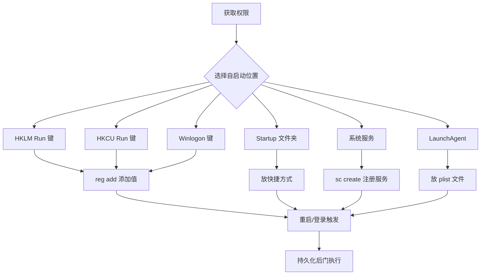

# T1547 - 启动或登录自动执行

## 一句话通俗理解

Windows 和 Linux 都有"开机自启动"功能——本来是让常用软件（如输入法、杀毒）开机就跑，攻击者发现这是完美的持久化载体，把自己的后门也加进去，从此每次开机自动激活。

## 30秒速查卡

| 维度 | 你需要知道的 |
|------|-------------|
| 这是什么？ | 利用系统开机/登录自启动机制实现持久化 |
| 为什么危险？ | 自启动是系统级机制，每次开机必定触发，隐蔽性高 |
| 谁需要关心？ | 所有系统管理员、终端安全团队 |
| 你的第一步防御 | 定期审计 Run/RunOnce 键和 Startup 文件夹 |
| 如果只做一件事 | 用 Autoruns 工具定期导出自启动项对比基线 |

## 难度等级

⭐⭐ 中级：需要了解系统自启动机制（注册表 Run 键/Startup 文件夹/LaunchAgent），无需编程基础

## 前置知识检查

读这个文件前，你需要知道：
- **自启动（Autostart）**：系统开机或用户登录时自动执行的程序
- **Run 注册表键**：`HKLM/HKCU\...\CurrentVersion\Run`，经典自启动位置
- **Startup 文件夹**：开始菜单的"启动"文件夹，放快捷方式自动执行
- **LaunchAgent/LaunchDaemon**：macOS 的自启动机制

## 技术描述

### 场景引入

想象你家的电视有个"开机自动播放"功能——每次开电视，自动播放你上次设的频道。某天小偷偷偷改了设置，让电视开机时顺便给他的手机发个信号"电视开了，家里有人"。

你每天开电视，以为是正常自动播放——实际上每次开机都在给小偷通风报信。系统自启动机制就是这套"开机自动播放"：攻击者把自己的后门注册进去，每次开机/登录自动执行，用户毫无察觉。

### 通俗比喻

| 自启动位置 | 比喻 | 攻击者怎么用 |
|-----------|------|-------------|
| HKLM Run 键 | "大楼所有电视的开机设置" | 加恶意程序路径，所有用户登录都执行 |
| HKCU Run 键 | "你家电视的开机设置" | 仅当前用户登录时执行，无需管理员 |
| Startup 文件夹 | "电视旁的便签" | 放快捷方式，登录时自动运行 |
| 计划任务启动触发器 | "定时器" | 开机或登录时触发 |
| LaunchAgent | "macOS 的开机管家" | macOS 登录时自动加载 |
| Winlogon Shell | "登录界面的程序" | 修改 Shell 值，登录时替换 explorer |

### 进阶理解

操作系统为方便用户，提供了多种"开机/登录自启动"机制。这些机制在系统启动或用户登录的特定阶段被触发，自动执行注册的程序——本意是让输入法、杀毒软件等常用程序"开机即用"。

攻击者利用的核心逻辑：**自启动是系统级机制，触发频率高（每次开机/登录）、隐蔽性强（在大量自启动项中不易发现）、持久性好（重启后依然有效）**。

**Windows 关键自启动位置：**
- `HKLM\SOFTWARE\Microsoft\Windows\CurrentVersion\Run` —— 所有用户登录时执行
- `HKCU\SOFTWARE\Microsoft\Windows\CurrentVersion\Run` —— 当前用户登录时执行
- `HKLM\...\RunOnce` —— 执行一次后删除
- `%APPDATA%\Microsoft\Windows\Start Menu\Programs\Startup\` —— Startup 文件夹
- `HKLM\...\Winlogon\Userinit` / `Shell` —— 登录流程执行
- `HKLM\SYSTEM\...\Services` —— 系统服务，开机时启动

**Linux/macOS 关键位置：**
- `/etc/rc.local`、`/etc/init.d/` —— 系统启动脚本
- `systemd` 单元文件 —— `/etc/systemd/system/`
- `crontab @reboot` —— 重启时执行
- `~/Library/LaunchAgents/` —— macOS 用户登录时执行
- `/Library/LaunchDaemons/` —— macOS 系统启动时执行

## 子技术列表

T1547 有 15 个子技术，是持久化战术中子技术最多的父技术。常用子技术：

| 子技术 ID | 名称 | 简述 |
|----------|------|------|
| T1547.001 | Registry Run Keys / Startup Folder | Run 键和 Startup 文件夹 |
| T1547.004 | Winlogon Helper DLL | Winlogon 辅助 DLL |
| T1547.005 | Security Support Provider | 安全支持提供者 |
| T1547.007 | Re-opened Applications | 重新打开的应用程序 |
| T1547.009 | Shortcut Modification | 快捷方式修改 |
| T1547.010 | Port Monitors | 端口监视器 |
| T1547.012 | Print Processors | 打印处理器 |
| T1547.014 | Active Setup | Active Setup 键 |
| T1547.015 | Login Items | macOS 登录项 |

**详写 2 个最常用的子技术：**

**T1547.001 Registry Run Keys / Startup Folder**：最经典的自启动手法。攻击者在 `HKLM\...\Run` 或 `HKCU\...\Run` 键下添加值，指向恶意程序路径。系统登录时自动执行该程序。HKLM 需要管理员权限（影响所有用户），HKCU 只需用户权限（仅影响当前用户）。Startup 文件夹效果类似，放快捷方式即可。

**T1547.004 Winlogon Helper DLL**：修改 `HKLM\...\Winlogon\Userinit` 或 `Shell` 值。正常情况下 Userinit 是 `userinit.exe`，Shell 是 `explorer.exe`。攻击者在值后追加恶意程序路径（如 `userinit.exe, C:\malware.exe`），登录时两者都会执行。需要管理员权限。

## 攻击流程



## 真实案例

### 案例1：APT28 用 Run 键持久化攻击欧洲政府
- **时间**：2016-2019 年
- **目标**：欧洲多国外交部、政府机构
- **攻击组织**：APT28（俄罗斯 GRU 背景）
- **手法**：鱼叉钓鱼投放 Sofacy 木马后，在 `HKLM\SOFTWARE\Microsoft\Windows\CurrentVersion\Run` 添加值 `Microsoft Update = C:\Windows\Temp\msupdate.exe`，指向 X-Agent 后门。命名伪装成微软更新，每次登录自动执行。部分变种用 HKCU Run 键避免需要管理员权限
- **数据来源**：ESET Research + FireEye 报告（一手厂商报告）

### 案例2：Rocke 组织用 systemd 实现 Linux 持久化
- **时间**：2018-2019 年
- **目标**：暴露 SSH 和 Web 服务的 Linux 服务器
- **攻击组织**：Rocke（加密货币挖矿组织）
- **手法**：创建 systemd 服务单元 `/etc/systemd/system/system-update.service`，内容为执行挖矿程序。`systemctl enable` 设置开机自启。命名伪装成系统更新服务，运维人员难以从服务列表中识别
- **数据来源**：Trend Micro / Palo Alto Unit 42 报告（一手厂商报告）

### 案例3：Lazarus 用 macOS LaunchAgent 持久化
- **时间**：2020-2021 年
- **目标**：加密货币交易所员工（通过虚假招聘）
- **攻击组织**：Lazarus Group（朝鲜背景）
- **手法**：投放伪装成招聘文档的恶意软件后，在 `~/Library/LaunchAgents/com.apple.update.plist` 创建 LaunchAgent，指向后门可执行文件。plist 文件命名伪装成 Apple 更新，macOS 登录时自动加载。还利用 `RunAtLoad` 键确保立即执行
- **数据来源**：ESET Lazarus 报告 + Kaspersky 报告（一手厂商报告）

## 红队视角

### 可持续利用性分析

| 维度 | 评估 | 说明 |
|------|------|------|
| 隐蔽性 | 中 | 自启动项可见但数量多，需白名单辅助识别 |
| 持久性 | 极高 | 重启/登录必定触发 |
| 可移植性 | 极高 | Windows/Linux/macOS 全平台 |
| 检测难度 | 低 | 自启动项可枚举，但需基线对比 |

### 红队可复制性

```cmd
:: HKLM Run 键（需管理员）
reg add "HKLM\SOFTWARE\Microsoft\Windows\CurrentVersion\Run" /v "Microsoft Update" /t REG_SZ /d "C:\Windows\Temp\msupdate.exe" /f

:: HKCU Run 键（无需管理员）
reg add "HKCU\SOFTWARE\Microsoft\Windows\CurrentVersion\Run" /v "OneDriveSync" /t REG_SZ /d "%APPDATA%\Microsoft\sync.exe" /f

:: Startup 文件夹
copy C:\temp\payload.lnk "%APPDATA%\Microsoft\Windows\Start Menu\Programs\Startup\"

:: Winlogon 辅助（需管理员）
reg add "HKLM\SOFTWARE\Microsoft\Windows NT\CurrentVersion\Winlogon" /v "Userinit" /t REG_SZ /d "userinit.exe, C:\Windows\Temp\payload.exe" /f
```

```bash
# Linux：systemd 服务
cat > /etc/systemd/system/system-update.service << 'EOF'
[Unit]
Description=System Update Service
After=network.target

[Service]
Type=simple
ExecStart=/usr/bin/systemd-update
Restart=always

[Install]
WantedBy=multi-user.target
EOF
systemctl enable system-update.service
systemctl start system-update.service

# macOS：LaunchAgent
cat > ~/Library/LaunchAgents/com.apple.update.plist << 'EOF'
<?xml version="1.0" encoding="UTF-8"?>
<!DOCTYPE plist PUBLIC "-//Apple//DTD PLIST 1.0//EN" "http://www.apple.com/DTDs/PropertyList-1.0.dtd">
<plist version="1.0">
<dict>
    <key>Label</key>
    <string>com.apple.update</string>
    <key>ProgramArguments</key>
    <array>
        <string>/Users/user/.update/payload</string>
    </array>
    <key>RunAtLoad</key>
    <true/>
    <key>KeepAlive</key>
    <true/>
</dict>
</plist>
EOF
launchctl load ~/Library/LaunchAgents/com.apple.update.plist
```

## 蓝队视角

### 用人话说检测

自启动检测的核心是**枚举和审计"所有自启动位置"**——Run 键、Startup 文件夹、Winlogon、systemd、LaunchAgent。这些位置在正常运行中变更频率低，任何新增都值得怀疑。Autoruns 工具能枚举 50+ 自启动位置，是最全面的审计工具。

### Sigma 规则

```yaml
title: 检测 Run/RunOnce 注册表键的可疑添加
id: 1f5c8e7a-3b2d-4e9c-8f5a-3d7b4c2a1e8f
status: stable
description: 监控 Run/RunOnce 键的值添加
logsource:
    product: windows
    category: registry_event
detection:
    selection_key:
        TargetObject|contains:
            - '\Software\Microsoft\Windows\CurrentVersion\Run\'
            - '\Software\Microsoft\Windows\CurrentVersion\RunOnce\'
            - '\Software\Microsoft\Windows NT\CurrentVersion\Winlogon\Userinit'
            - '\Software\Microsoft\Windows NT\CurrentVersion\Winlogon\Shell'
    filter_legitimate:
        Details|contains:
            - 'C:\Program Files\'
            - 'C:\Windows\System32\'
    condition: selection_key and not filter_legitimate
falsepositives:
    - 合法软件安装
level: medium
```

### Sysmon 配置

```xml
<RuleGroup name="Autostart Persistence" groupRelation="or">
  <RegistryEvent onmatch="include">
    <TargetObject name="technique_id=T1547,technique_name=Boot or Logon Autostart Execution" condition="contains">\CurrentVersion\Run</TargetObject>
  </RegistryEvent>
  <RegistryEvent onmatch="include">
    <TargetObject condition="contains">\CurrentVersion\RunOnce</TargetObject>
  </RegistryEvent>
  <RegistryEvent onmatch="include">
    <TargetObject condition="contains">\Winlogon\Userinit</TargetObject>
  </RegistryEvent>
  <RegistryEvent onmatch="include">
    <TargetObject condition="contains">\Winlogon\Shell</TargetObject>
  </RegistryEvent>
  <FileCreate onmatch="include">
    <TargetFilename condition="contains">\Start Menu\Programs\Startup\</TargetFilename>
  </FileCreate>
</RuleGroup>
```

### 命令行检测

```powershell
# 查询所有 Run 键
reg query "HKLM\SOFTWARE\Microsoft\Windows\CurrentVersion\Run" /s
reg query "HKCU\SOFTWARE\Microsoft\Windows\CurrentVersion\Run" /s
reg query "HKLM\SOFTWARE\WOW6432Node\Microsoft\Windows\CurrentVersion\Run" /s

# 查询 Winlogon 键
reg query "HKLM\SOFTWARE\Microsoft\Windows NT\CurrentVersion\Winlogon" /v Userinit
reg query "HKLM\SOFTWARE\Microsoft\Windows NT\CurrentVersion\Winlogon" /v Shell

# 列出 Startup 文件夹
Get-ChildItem "$env:APPDATA\Microsoft\Windows\Start Menu\Programs\Startup\"
Get-ChildItem "C:\ProgramData\Microsoft\Windows\Start Menu\Programs\StartUp\"

# 用 Autoruns 导出（最全面）
& "C:\Sysinternals\Autorunsc.exe" -a * -c -nobanner > C:\temp\autoruns.csv
```

```bash
# Linux：列出 systemd 服务
systemctl list-unit-files --state=enabled
systemctl list-timers --all

# 检查 rc.local
cat /etc/rc.local 2>/dev/null
ls -la /etc/init.d/

# 检查 cron @reboot
crontab -l | grep @reboot
for user in $(cut -f1 -d: /etc/passwd); do crontab -u $user -l 2>/dev/null | grep @reboot; done

# macOS：列出 LaunchAgent/LaunchDaemon
ls ~/Library/LaunchAgents/ /Library/LaunchAgents/ /Library/LaunchDaemons/
launchctl list
```

### 关键检测维度

| 维度 | 关注点 |
|------|--------|
| HKLM Run 键 | 非系统/已知软件的新增值 |
| HKCU Run 键 | 用户级持久化，无需管理员 |
| Winlogon 键 | Userinit/Shell 值被追加路径 |
| Startup 文件夹 | 新增的 .lnk/.bat/.exe 文件 |
| systemd 服务 | 命名伪装的新服务 |
| LaunchAgent | com.apple.* 命名的非 Apple 项 |

### 网络层检测
- 自启动程序执行后的 C2 通信
- 系统启动后立即出现的异常外连

## 避坑指南

| 坑 | 说明 | 正确做法 |
|----|------|---------|
| 只查 HKLM Run | HKCU Run 和 Startup 同样常用 | 覆盖所有自启动位置 |
| 忽略 Wow6432Node | 32 位程序在 64 位系统有独立 Run 键 | 监控 Wow6432Node 路径 |
| 忽略 macOS | LaunchAgent 是 macOS 主要持久化方式 | 覆盖 macOS LaunchAgent/LaunchDaemon |
| 只看注册表不看文件 | Startup 文件夹放快捷方式同样有效 | 同时检查 Startup 文件夹 |
| 忽略 RunOnce | RunOnce 执行后删除，更隐蔽 | RunOnce 也要监控 |
| 不维护白名单 | 大量合法自启动项导致告警疲劳 | 建立合法自启动项白名单 |

## 检测建议

### 主机层
- **Sysmon**：监控 Run/RunOnce/Winlogon 注册表和 Startup 文件夹
- **Autoruns**：定期导出 50+ 自启动位置对比基线
- **Windows 事件日志**：EventID 4657（注册表值修改）
- **Linux**：监控 `/etc/systemd/system/`、`/etc/init.d/`、crontab
- **macOS**：监控 `~/Library/LaunchAgents/`、`/Library/LaunchDaemons/`

### 应用层
- 计划任务审计：`schtasks /query`
- 服务审计：`sc query` / `systemctl list-units`
- 自启动项白名单管理

### 网络层
- 系统启动后的异常外连
- 自启动进程的网络活动

## 缓解措施

| 措施 | 实施方式 | 效果 |
|------|---------|------|
| 自启动白名单 | 用 Autoruns + 基线对比 | 识别非授权自启动项 |
| 注册表权限加固 | 限制 HKLM Run 键写权限 | 提高篡改门槛 |
| AppLocker/WDAC | 限制可执行文件来源 | 阻止未签名程序自启动 |
| systemd 服务审计 | 定期审计启用的服务 | 发现伪装服务 |
| LaunchAgent 管理 | 用 MDM 管理 macOS 持久化 | 控制自启动项 |
| 启动项告警 | 自启动项变更即时告警 | 快速响应 |

## 动手实验

### 实验1：观察 Run 键持久化

```cmd
:: 1. 创建测试脚本
echo msgbox "Run键触发" > C:\temp\test.vbs

:: 2. 添加到 HKCU Run 键
reg add "HKCU\SOFTWARE\Microsoft\Windows\CurrentVersion\Run" /v TestAutostart /t REG_SZ /d "wscript.exe C:\temp\test.vbs" /f

:: 3. 注销重新登录
shutdown /l

:: 4. 登录后弹出对话框

:: 5. 清理
reg delete "HKCU\SOFTWARE\Microsoft\Windows\CurrentVersion\Run" /v TestAutostart /f
del C:\temp\test.vbs
```

**预期输出**：登录后弹出"Run键触发"对话框，证明 HKCU Run 键持久化生效。

### 实验2：用 Autoruns 枚举自启动项

```bash
# 1. 下载 Autoruns
# https://learn.microsoft.com/sysinternals/downloads/autoruns

# 2. 命令行导出
autorunsc.exe -a * -c -nobanner -o C:\temp\autoruns.csv

# 3. 建立基线（首次运行后保存）
copy C:\temp\autoruns.csv C:\temp\autoruns_baseline.csv

# 4. 定期对比
# 用 PowerShell 对比 CSV
$baseline = Import-Csv C:\temp\autoruns_baseline.csv
$current = Import-Csv C:\temp\autoruns.csv
Compare-Object $baseline $current -Property 'Entry Location', 'Entry' -PassThru |
  Where-Object {$_.SideIndicator -eq '=>'}
```

**预期输出**：Autoruns 列出所有 50+ 自启动位置的项，定期对比发现新增项。

### 专用工具

| 工具 | 用途 | 特点 |
|------|------|------|
| Autoruns | Sysinternals 自启动枚举 | 覆盖 50+ 位置，最全面 |
| AutoRuns Logon Profile | 自启动分析 | Logon 阶段专项 |
| systemd-cgls | Linux 服务树查看 | systemd 服务可视化 |
| KnockKnock | macOS 持久化项枚举 | macOS 专用 |

## 术语解释

| 术语 | 通俗解释 |
|------|---------|
| 自启动 | 开机或登录时自动执行的程序 |
| Run 键 | 注册表中经典的自启动位置 |
| Startup 文件夹 | 开始菜单的"启动"文件夹 |
| Winlogon | Windows 登录管理器 |
| systemd | Linux 的系统和服务管理器 |
| LaunchAgent | macOS 的用户登录自启动代理 |
| LaunchDaemon | macOS 的系统启动守护进程 |

## 参考资料

### 深入了解
- 📚 [MITRE ATT&CK T1547](https://attack.mitre.org/techniques/T1547/) —— 官方技术页面
- 📚 [MITRE ATT&CK T1547.001 Registry Run Keys](https://attack.mitre.org/techniques/T1547/001/)
- 📚 [MITRE ATT&CK T1547.004 Winlogon Helper DLL](https://attack.mitre.org/techniques/T1547/004/)

### 动手试试
- 🔧 [Autoruns](https://learn.microsoft.com/sysinternals/downloads/autoruns) —— 自启动枚举工具
- 🔧 [KnockKnock](https://objective-see.org/products/knockknock.html) —— macOS 持久化枚举

### 真实攻击
- 🎯 ESET APT28 报告 —— Run 键持久化
- 🎯 Trend Micro Rocke 报告 —— systemd 服务持久化
- 🎯 ESET Lazarus 报告 —— macOS LaunchAgent 持久化

## 版本历史

| 版本 | 日期 | 变更 |
|------|------|------|
| v3.1 | 2026-07-10 | 重写为持久化战术正确内容，修复跨战术污染 |
| v3.0 | 2026-06-15 | 初版 v3.0 风格 |
