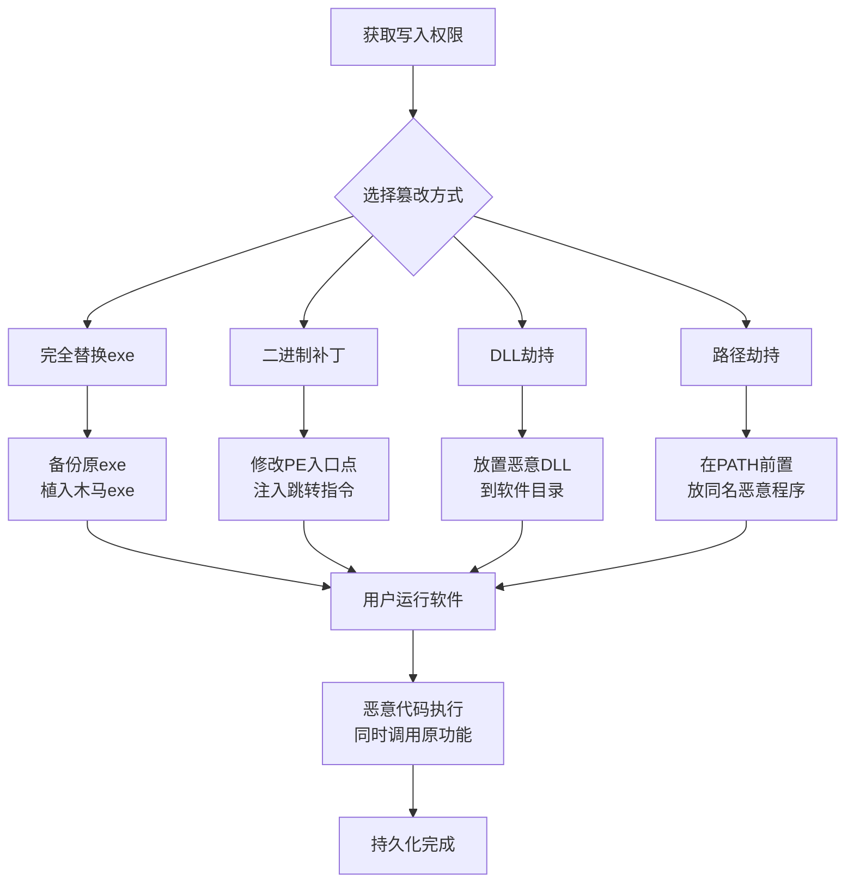

# T1554 - 篡改客户端软件二进制

## 一句话通俗理解

攻击者把常用软件（如 notepad.exe、ssh）的可执行文件替换成"特洛伊木马"——用户每次双击打开以为是正常软件，实际上恶意代码已经偷偷运行。

## 30秒速查卡

| 维度 | 你需要知道的 |
|------|-------------|
| 这是什么？ | 替换或修改常用软件的可执行文件实现持久化 |
| 为什么危险？ | 用户主动运行"正常软件"，不触发安全告警 |
| 谁需要关心？ | 系统管理员、文件完整性监控运维、终端安全团队 |
| 你的第一步防御 | 对常用软件二进制文件做哈希基线，定期对比 |
| 如果只做一件事 | 启用 Windows 文件完整性监控，保护 System32 目录 |

## 难度等级

⭐⭐⭐ 高级：需要了解可执行文件结构、PE/ELF 格式、代码签名机制，需逆向或编译基础

## 前置知识检查

读这个文件前，你需要知道：
- **可执行文件**：能直接运行的程序文件（Windows 的 .exe/.dll，Linux 的 ELF）
- **PE 格式**：Windows 可执行文件格式（Portable Executable）
- **ELF 格式**：Linux 可执行文件格式（Executable and Linkable Format）
- **代码签名**：用数字证书签名验证文件未被篡改

## 技术描述

### 场景引入

想象你每天早上喝的牛奶，送货员每次送到门口。某天小偷不是偷牛奶，而是把牛奶盒换了——外面看起来一模一样，但里面掺了安眠药。你每天早上喝"正常"的牛奶，实际上在不知不觉中摄入药物。

篡改客户端软件二进制就是这套逻辑：用户每天双击打开 notepad、putty、winscp，以为是正常软件——但可执行文件已被攻击者替换成"特洛伊木马"，运行时除了执行正常功能，还会偷偷启动后门。

### 通俗比喻

| 篡改方式 | 比喻 | 攻击者怎么用 |
|---------|------|-------------|
| 完全替换 | "牛奶盒整个换掉" | 用恶意 exe 替换合法 exe |
| DLL 劫持 | "往牛奶里加料" | 放恶意 DLL 到软件目录，被软件加载 |
| 二进制补丁 | "在牛奶盒上扎个针管注入" | 修改 exe 字节，注入代码 |
| 路径劫持 | "把假牛奶放到更顺路的位置" | 在 PATH 前置位置放同名恶意程序 |

### 进阶理解

用户每天会运行大量"可信"软件——notepad、putty、ssh、浏览器等。这些软件通常在系统信任路径（System32、Program Files）或用户习惯路径中。攻击者篡改这些二进制文件后，用户主动运行"正常软件"时，恶意代码随之执行。

**关键篡改手法：**
- **完全替换**：用恶意程序替换合法 exe，恶意程序内嵌原 exe 功能（特洛伊木马）
- **二进制补丁**：直接修改 exe 的字节，在入口点注入跳转到恶意代码
- **DLL 劫持**：在软件目录放置恶意 DLL，软件启动时加载该 DLL（利用 DLL 搜索顺序）
- **路径劫持**：在 PATH 环境变量前置位置放同名恶意程序

**与 T1574（劫持执行流）的区别：**
T1554 侧重"修改文件本身"——替换或补丁可执行文件；T1574 侧重"修改加载机制"——如修改注册表、PATH、Manifest 等让系统加载不同的文件。两者常配合使用。

## 子技术列表

T1554 是父技术，无子技术。

## 攻击流程



## 真实案例

### 案例1：Sony后门攻击——替换 putty.exe
- **时间**：2014 年（Sony Pictures 泄露事件关联）
- **目标**：Sony Pictures Entertainment 内部网络
- **攻击组织**：Lazarus Group（朝鲜背景）
- **手法**：在内网传播阶段，替换管理员常用的 `putty.exe` 为木马版本——木马版 putty 外观和功能完全正常，但每次运行时会将本机凭证外传到 C2。管理员用"正常"的 putty 管理 SSH 服务器时，凭证被持续窃取
- **数据来源**：Novetta Lazarus Group 分析报告（一手厂商报告）

### 案例2：Sunburst 后门——篡改 SolarWinds DLL
- **时间**：2020 年
- **目标**：全球 1.8 万+ SolarWinds 客户（政府、企业）
- **攻击组织**：APT29（Nobelium，俄罗斯 SVR 背景）
- **手法**：入侵 SolarWinds 构建流程，在 `SolarWinds.Orion.Core.BusinessLayer.dll` 中植入 Sunburst 后门。该 DLL 随 Orion 软件更新分发给所有客户，客户运行"合法更新"时后门激活。DLL 经过了合法 SolarWinds 证书签名，绕过了代码签名验证
- **数据来源**：CISA Alert AA21-008A + FireEye/Mandiant 报告（一手官方文档）

### 案例3：Linux SSH 二进制篡改
- **时间**：2018-2021 年
- **目标**：暴露 SSH 服务的 Linux 服务器
- **攻击组织**：多个 APT 组织（包括 Winnti、Baron Samedit）
- **手法**：入侵后替换 `/usr/sbin/sshd` 为植入后门的版本——后门版 sshd 正常提供 SSH 服务，但当攻击者用特定"魔数"用户名登录时，跳过密码验证直接放行。同时替换 `/bin/ps`、`/bin/netstat` 等监控工具隐藏后门进程
- **数据来源**：ESET Winnti 报告 + Sysdig Baron Samedit 报告（一手厂商报告）

## 红队视角

### 可持续利用性分析

| 维度 | 评估 | 说明 |
|------|------|------|
| 隐蔽性 | 高 | 用户主动运行，不触发安全告警 |
| 持久性 | 高 | 文件不被恢复则永久有效 |
| 可移植性 | 极高 | Windows/Linux/macOS 均可 |
| 检测难度 | 中 | 文件完整性监控可检测，但需基线 |

### 红队可复制性

```bash
# Windows：替换 notepad.exe（需 TrustedInstaller 权限）
takeown /f C:\Windows\System32\notepad.exe
icacls C:\Windows\System32\notepad.exe /grant administrators:F
copy C:\Windows\System32\notepad.exe C:\Windows\System32\notepad.exe.bak
copy C:\temp\trojan_notepad.exe C:\Windows\System32\notepad.exe

# DLL 劫持（在 putty 目录放置恶意 DLL）
copy C:\temp\evil.dll "C:\Program Files\PuTTY\version.dll"
# putty 启动时会加载 version.dll

# Linux：替换 sshd（需 root）
cp /usr/sbin/sshd /usr/sbin/sshd.bak
cp /tmp/trojan_sshd /usr/sbin/sshd
chmod 755 /usr/sbin/sshd
systemctl restart sshd

# 二进制补丁（用工具修改 PE 入口点）
# 工具：CFF Explorer / PE-bear / xxd
```

## 蓝队视角

### 用人话说检测

二进制篡改检测的核心是**文件完整性监控**——对常用软件和系统二进制文件建立哈希基线，定期对比。任何哈希变化（即使只差一个字节）都需调查。重点关注：System32 目录、Program Files 常用软件、`/usr/bin`、`/usr/sbin`。

### Sigma 规则

```yaml
title: 检测系统二进制文件的可疑修改
id: d5f8e7a3-2b1c-4e9d-8f5a-3c7b4c2a1e8f
status: stable
description: 监控 System32 和 Program Files 中可执行文件的修改
logsource:
    product: windows
    category: file_event
detection:
    selection_path:
        TargetFilename|startswith:
            - 'C:\Windows\System32\'
            - 'C:\Windows\SysWOW64\'
            - 'C:\Program Files\'
            - 'C:\Program Files (x86)\'
    selection_ext:
        TargetFilename|endswith:
            - '.exe'
            - '.dll'
            - '.sys'
    filter_legitimate:
        Image|startswith:
            - 'C:\Windows\System32\TiWorker.exe'
            - 'C:\Windows\System32\TrustedInstaller.exe'
            - 'C:\Windows\SoftwareDistribution\'
    condition: selection_path and selection_ext and not filter_legitimate
falsepositives:
    - Windows 更新（TiWorker/TrustedInstaller）
    - 合法软件安装和更新
level: high
```

### 命令行检测

```powershell
# 对比系统二进制文件哈希基线
# 1. 建立基线（首次运行）
Get-ChildItem C:\Windows\System32\*.exe, C:\Windows\System32\*.dll |
  Get-FileHash -Algorithm SHA256 |
  Export-Csv C:\temp\system32_baseline.csv -NoTypeInformation

# 2. 定期对比
$baseline = Import-Csv C:\temp\system32_baseline.csv
$current = Get-ChildItem C:\Windows\System32\*.exe, C:\Windows\System32\*.dll | Get-FileHash -Algorithm SHA256
Compare-Object $baseline $current -Property Hash, Path -PassThru |
  Where-Object {$_.SideIndicator -eq '=>'}  # 新增或修改的文件

# 检查文件签名
Get-AuthenticodeSignature C:\Windows\System32\notepad.exe | Select-Object Path, Status, SignerCertificate

# 用 Sysinternals Sigcheck 批量检查签名
sigcheck -a -h -nobanner C:\Windows\System32\*.exe > C:\temp\sigcheck.txt
```

```bash
# Linux：用 AIDE 监控二进制完整性
# 1. 初始化基线
aide --init
cp /var/lib/aide/aide.db.new /var/lib/aide/aide.db

# 2. 定期检查
aide --check

# 用 rpm/deb 包管理器验证
rpm -Va 2>/dev/null | grep -E '^..5'  # 5 表示 MD5 变化
debsums -c  # -c 仅显示校验失败的

# 检查关键二进制文件
md5sum /usr/sbin/sshd /bin/ps /bin/netstat /bin/login
# 对比官方包校验值
```

### 关键审计点

| 审计项 | 关注点 |
|--------|--------|
| System32 文件哈希 | 与官方 ISO 对比 |
| Program Files 文件签名 | 未签名或签名失效 |
| /usr/bin、/usr/sbin | 与包管理器校验值对比 |
| 文件修改时间 | 非补丁日的修改 |
| 文件所有者 | 非预期的所有者变更 |
| PATH 环境变量 | 异常前置路径 |

### 网络层检测
- "正常软件"启动后的异常网络外连
- 木马化软件的 C2 通信模式

## 避坑指南

| 坑 | 说明 | 正确做法 |
|----|------|---------|
| 只监控 .exe | DLL 同样可被篡改 | 覆盖 .exe/.dll/.sys |
| 忽略用户目录 | 用户级软件（如 putty）常被篡改 | 覆盖用户习惯路径 |
| 信任代码签名 | Sunburst 用合法签名绕过验证 | 签名+哈希双重验证 |
| 忽略 Linux | /usr/sbin/sshd 篡改同样危险 | 覆盖 Linux 关键二进制 |
| 忘记检查 PATH | 路径劫持不需要修改原文件 | 审计 PATH 环境变量 |
| 只看哈希不看大小 | 简单补丁可能只改几字节 | 哈希+大小+签名综合判断 |

## 检测建议

### 主机层
- **文件完整性监控（FIM）**：AIDE/Tripwire/Sysmon FileCreate
- **代码签名验证**：定期检查签名有效性
- **哈希基线对比**：与官方 ISO 或包管理器校验值对比
- **EDR**：监控系统二进制文件的写入操作

### 应用层
- **软件更新审计**：验证更新包签名和哈希
- **PATH 环境变量监控**：审计 PATH 变更
- **软件清单管理**：记录所有软件版本和哈希

### 网络层
- 软件启动后的异常网络外连
- 木马化软件的 C2 通信

## 缓解措施

| 措施 | 实施方式 | 效果 |
|------|---------|------|
| 文件完整性监控 | AIDE/Tripwire 定期对比 | 检测篡改 |
| 代码签名强制 | WDAC 要求所有可执行文件签名 | 阻止未签名篡改 |
| System32 权限保护 | 限制 TrustedInstaller 写权限 | 提高篡改门槛 |
| PATH 加固 | 限制 PATH 变更，避免可写前置路径 | 防止路径劫持 |
| 软件更新验证 | 验证更新包签名和哈希 | 防止供应链篡改 |
| 只读挂载 | 关键系统目录只读挂载 | 防止运行时篡改 |

## 动手实验

### 实验1：观察 DLL 劫持（虚拟机中操作）

```bash
# 1. 用 Process Monitor 监控某软件启动时的 DLL 搜索
# 2. 找到软件尝试加载但找不到的 DLL（NAME NOT FOUND）

# 3. 编译测试 DLL（C 代码）
cat > C:\temp\testdll.c << 'EOF'
#include <windows.h>
BOOL APIENTRY DllMain(HMODULE hModule, DWORD ul_reason_for_call, LPVOID lpReserved) {
    if (ul_reason_for_call == DLL_PROCESS_ATTACH) {
        system("echo DLL Hijacked >> C:\\temp\\hijack.log");
    }
    return TRUE;
}
EOF
# 4. 编译为 DLL（需 gcc 或 cl）
gcc -shared -o C:\temp\version.dll C:\temp\testdll.c

# 5. 放到目标软件目录
copy C:\temp\version.dll "C:\Program Files\某软件\"

# 6. 启动目标软件，检查日志
type C:\temp\hijack.log

# 7. 清理
del "C:\Program Files\某软件\version.dll" C:\temp\hijack.log
```

**预期输出**：软件启动后 `hijack.log` 出现"DLL Hijacked"，证明 DLL 劫持成功。

### 实验2：建立二进制哈希基线

```powershell
# 1. 建立系统二进制基线
Get-ChildItem C:\Windows\System32\*.exe | ForEach-Object {
    [PSCustomObject]@{
        Path = $_.FullName
        Hash = (Get-FileHash $_.FullName -Algorithm SHA256).Hash
        Size = $_.Length
        LastWrite = $_.LastWriteTime
        Signature = (Get-AuthenticodeSignature $_.FullName).Status
    }
} | Export-Csv C:\temp\binary_baseline.csv -NoTypeInformation

# 2. 定期对比（可作为定期审计脚本）
$baseline = Import-Csv C:\temp\binary_baseline.csv
foreach ($entry in $baseline) {
    $current = Get-FileHash $entry.Path -Algorithm SHA256
    if ($current.Hash -ne $entry.Hash) {
        Write-Host "篡改告警: $($entry.Path)"
        Write-Host "  基线: $($entry.Hash)"
        Write-Host "  当前: $($current.Hash)"
    }
}
```

**预期输出**：建立基线后，任何二进制文件修改都会被检测到，输出篡改告警。

### 专用工具

| 工具 | 用途 | 特点 |
|------|------|------|
| AIDE | Linux 文件完整性监控 | 开源，哈希基线对比 |
| Tripwire | 文件完整性监控 | 商业，企业级 |
| Sigcheck | Sysinternals 签名检查 | 批量验证签名 |
| Process Monitor | DLL 加载监控 | 实时监控文件操作 |
| PE-bear | PE 文件分析 | 逆向和补丁分析 |

## 术语解释

| 术语 | 通俗解释 |
|------|---------|
| 特洛伊木马 | 伪装成正常程序的恶意软件 |
| PE 格式 | Windows 可执行文件格式 |
| ELF 格式 | Linux 可执行文件格式 |
| DLL 劫持 | 放置恶意 DLL 被软件加载 |
| 二进制补丁 | 直接修改可执行文件字节 |
| 路径劫持 | 在 PATH 前置放同名恶意程序 |
| 代码签名 | 数字证书验证文件未被篡改 |

## 参考资料

### 深入了解
- 📚 [MITRE ATT&CK T1554](https://attack.mitre.org/techniques/T1554/) —— 官方技术页面
- 📚 [DLL 劫持详解](https://learn.microsoft.com/windows/win32/dlls/dynamic-link-library-search-order) —— Microsoft 官方文档

### 动手试试
- 🔧 [AIDE](https://aide.github.io/) —— Linux 文件完整性监控
- 🔧 [Process Monitor](https://learn.microsoft.com/sysinternals/downloads/procmon) —— DLL 加载监控

### 真实攻击
- 🎯 Novetta Lazarus Group 报告 —— putty.exe 篡改
- 🎯 FireEye Sunburst 报告 —— SolarWinds DLL 篡改
- 🎯 ESET Winnti 报告 —— Linux sshd 篡改

## 版本历史

| 版本 | 日期 | 变更 |
|------|------|------|
| v3.1 | 2026-07-10 | 重写为持久化战术正确内容，修复跨战术污染 |
| v3.0 | 2026-06-15 | 初版 v3.0 风格 |
