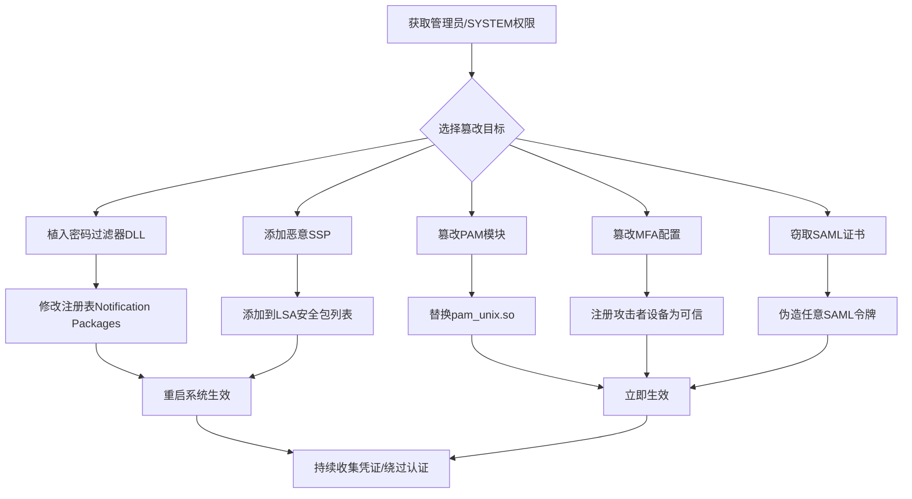

# T1556 - 修改认证流程

## 一句话通俗理解

门卫每天靠看工牌认人——攻击者不偷工牌，而是直接把门卫换成自己人，或者给门卫戴副"特殊眼镜"，让某些假工牌也能通过，从此想进谁进谁。

## 30秒速查卡

| 维度 | 你需要知道的 |
|------|-------------|
| 这是什么？ | 篡改认证组件（DLL/SSP/密码过滤器）让攻击者用任意凭证通过认证 |
| 为什么危险？ | 攻持者控制认证本身，比偷密码更彻底——所有密码都可能被记录或绕过 |
| 谁需要关心？ | 域管理员、安全架构师、身份认证系统运维 |
| 你的第一步防御 | 监控 LSA 保护模式、SSP 列表变更、认证 DLL 签名验证 |
| 如果只做一件事 | 启用 Windows LSA Protection（RunAsPPL）防止未签名 SSP 加载 |

## 难度等级

⭐⭐⭐⭐ 高级：需要深入理解 Windows 认证架构（LSA/Kerberos/NTLM）和 DLL 机制，需系统编程或逆向基础

## 前置知识检查

读这个文件前，你需要知道：
- **LSA（Local Security Authority）**：Windows 本地安全机构，负责认证的子系统，运行在 lsass.exe 进程
- **SSP（Security Support Provider）**：安全支持提供者，LSA 加载的认证 DLL（如 NTLM/Kerberos）
- **密码过滤器**：用于密码复杂度验证的 DLL，可被植入用于窃取明文密码
- **PAM（Pluggable Authentication Modules）**：Linux 的可插拔认证模块，类似 Windows SSP

## 技术描述

### 场景引入

想象一栋大楼的门禁系统由"门卫"（认证系统）把守。门卫的工作是检查每个人的工牌（凭证），确认无误后放行。

攻击者有两种思路：
- **偷工牌**（窃取凭证）—— 拿一张工牌混进去
- **换门卫**（修改认证流程）—— 把真门卫换成自己人，或者给门卫戴副"特殊眼镜"让假工牌也能过

后者显然更彻底——不仅想进就进，还能记录所有合法用户的工牌信息。这就是修改认证流程攻击的精髓：**不偷密码，直接控制"验证密码"的系统。**

### 通俗比喻

| 认证组件 | 比喻 | 攻击者怎么篡改 |
|---------|------|---------------|
| SSP（安全支持提供者） | "门卫的眼镜" | 替换为恶意 DLL，让任意密码通过 |
| 密码过滤器 | "工牌检查器" | 植入恶意 DLL，记录所有改密时的明文密码 |
| Authentication Package | "门卫的认证手册" | 修改认证逻辑，植入后门口令 |
| PAM 模块（Linux） | "Linux 的门卫" | 替换 pam_unix.so，记录所有登录密码 |
| MFA 配置 | "第二道验证" | 篡改 MFA 配置，让攻击者设备注册为可信 |
| OAuth/SAML | "云门卫的信任名单" | 修改 SAML 令牌签名证书，伪造任意身份 |

### 进阶理解

Windows 认证流程的核心是 LSA（Local Security Authority），它运行在 `lsass.exe` 进程中。LSA 加载多个 SSP（Security Support Provider）DLL 来处理不同协议：
- **Msv1_0.dll** —— NTLM 认证
- **Kerberos.dll** —— Kerberos 认证
- **Schannel.dll** —— TLS/SSL 认证
- **Wdigest.dll** —— 摘要认证（旧版）

攻击者篡改认证流程的关键手法：
- **添加恶意 SSP**：向 LSA 注册自定义 SSP DLL，所有认证请求都会经过它——可以记录所有明文凭证
- **替换密码过滤器**：修改注册表 `HKLM\SYSTEM\...\Notification Packages`，植入恶意 DLL。每当用户改密码，DLL 会收到明文密码
- **修改 Authentication Package**：替换合法认证包，植入后门口令（如"magic password"始终通过）
- **PAM 模块篡改**：Linux 上替换 `pam_unix.so`，记录所有登录密码
- **MFA 配置篡改**：在 Azure AD 中注册攻击者控制的设备为可信设备，绕过 MFA
- **SAML 证书窃取**：窃取 SAML 令牌签名证书，伪造任意用户的身份令牌（Golden SAML）

**与 T1003（凭证转储）的区别：**
T1003 是"读取密码数据库"——一次性窃取；T1556 是"篡改认证系统"——长期持续收集，且可主动绕过认证。

## 子技术列表

T1556 有 9 个子技术：

| 子技术 ID | 名称 | 简述 |
|----------|------|------|
| T1556.001 | Domain Controller Authentication | 篡改域控认证（如 DCSync、Skeleton Key） |
| T1556.002 | Password Filter DLL | 植入密码过滤器 DLL 窃取明文密码 |
| T1556.003 | Pluggable Authentication Modules | 篡改 Linux PAM 模块 |
| T1556.004 | Network Device Authentication | 篡改网络设备认证 |
| T1556.005 | Reversible Encryption | 启用可逆加密存储密码 |
| T1556.006 | Multi-Factor Authentication | 篡改 MFA 配置 |
| T1556.007 | Hybrid Identity | 篡改混合身份同步 |
| T1556.008 | Network Provider DLL | 植入网络提供者 DLL |
| T1556.009 | Conditional Access Policies | 篡改条件访问策略 |

**详写 2 个最常用的子技术：**

**T1556.002 Password Filter DLL**：攻击者修改注册表 `HKLM\SYSTEM\CurrentControlSet\Control\Lsa\Notification Packages`，添加恶意 DLL。每当任何用户修改密码，LSA 会调用该 DLL 的 `PasswordChangeNotify` 函数，传入**明文新密码**。攻击者借此持续收集所有密码变更。需要管理员权限和系统重启生效。

**T1556.006 Multi-Factor Authentication**：攻击者篡改 Azure AD / Okta 的 MFA 配置，注册自己控制的设备为"可信设备"，或修改条件访问策略排除 MFA 要求。这样攻击者即使只有密码也能登录，且合法用户的 MFA 不会告警。

## 攻击流程



## 真实案例

### 案例1：Skeleton Key 攻击——APT29 篡改域控认证
- **时间**：2015-2017 年
- **目标**：多个国际组织和政府机构
- **攻击组织**：APT29（俄罗斯 SVR 背景）
- **手法**：获取域控 SYSTEM 权限后，用 mimikatz 的 misc::skeleton 命令向 lsass.exe 注入 Skeleton Key。注入后，所有账户都可以用密码 `mimikatz` 登录（原密码仍有效）。攻击者用这个"万能密码"登录任意域账户，实现持久化
- **数据来源**：CrowdStrike + Dell SecureWorks 报告（一手厂商报告）

### 案例2：Mimikatz 密码过滤器 DLL 持久化
- **时间**：2017-2020 年（工具技术持续在野利用）
- **目标**：多起 APT 攻击中的域环境
- **攻击组织**：多个 APT 组织（包括 FIN6、APT29 等）
- **手法**：部署 mimikatz 的 `kfilt.dll` 作为密码过滤器，修改注册表 `Notification Packages` 添加 `kfilt`。此后每次用户改密码，明文密码被记录到 `%SystemRoot%\kfilt.log`。攻击者持续收集企业所有密码变更
- **数据来源**：Microsoft / CISA 警报（一手官方文档）

### 案例3：SolarWinds Golden SAML 攻击
- **时间**：2020 年
- **目标**：美国多个政府机构和企业
- **攻击组织**：APT29（Nobelium）
- **手法**：窃取 SAML 令牌签名证书后，伪造任意 Azure AD 用户的 SAML 令牌。伪造的令牌可访问所有信任该 IdP 的 SaaS 应用，无需密码和 MFA。这是"修改认证流程"在云时代的典型变体——篡改信任根而非认证组件
- **数据来源**：CISA Alert AA21-008A + Microsoft MSTIC 报告（一手官方文档）

## 红队视角

### 可持续利用性分析

| 维度 | 评估 | 说明 |
|------|------|------|
| 隐蔽性 | 极高 | 篡改在内核/系统层，用户层无感知 |
| 持久性 | 极高 | 密码过滤器重启后仍有效，SSP 持续收集 |
| 可移植性 | 高 | Windows/Linux/云平台均有对应手法 |
| 检测难度 | 高 | 需要系统级监控和基线对比 |

### 红队可复制性

```bash
# Windows：植入密码过滤器 DLL
# 1. 编译恶意 kfilt.dll（mimikatz 提供）
# 2. 复制到 C:\Windows\System32\
# 3. 修改注册表
reg add "HKLM\SYSTEM\CurrentControlSet\Control\Lsa" /v "Notification Packages" /t REG_MULTI_SZ /d " rassfm\0scecli\0kfilt" /f
# 4. 重启系统生效

# Windows：添加恶意 SSP
reg add "HKLM\SYSTEM\CurrentControlSet\Control\Lsa\OSConfig" /v "Security Packages" /t REG_MULTI_SZ /d "kerberos\0msv1_0\0schannel\0wdigest\0tspkg\0pku2u\0evilssp" /f

# Windows：Skeleton Key（需域控 SYSTEM）
mimikatz # privilege::debug
mimikatz # misc::skeleton

# Linux：替换 PAM 模块
# 编译恶意 pam_unix.so 替换 /lib/security/pam_unix.so
# 记录所有登录密码到 /tmp/.pamlog
```

## 蓝队视角

### 用人话说检测

认证流程篡改检测的核心是**盯住"认证组件的变更"**——SSP 列表、密码过滤器注册表、PAM 模块文件、MFA 配置。这些组件在正常运行中几乎不变，任何变更都是高危信号。重点关注 `Notification Packages` 和 `Security Packages` 注册表值的修改。

### Sigma 规则

```yaml
title: 检测密码过滤器和 SSP 注册表变更
id: b4c8e7f3-2a1d-4e9c-8f5a-3d7b4c2a1e8f
status: stable
description: 监控 Lsa Notification Packages 和 Security Packages 的可疑修改
logsource:
    product: windows
    category: registry_event
detection:
    selection_key:
        TargetObject|endswith:
            - '\Lsa\Notification Packages'
            - '\Lsa\OSConfig\Security Packages'
            - '\Lsa\Security Packages'
    filter_baseline:
        Details|contains:
            - 'rassfm'
            - 'scecli'
            - 'kerberos'
            - 'msv1_0'
            - 'schannel'
            - 'wdigest'
            - 'tspkg'
            - 'pku2u'
    condition: selection_key and not filter_baseline
falsepositives:
    - 合法的安全软件安装新 SSP（需审批）
level: critical
```

### Sysmon 配置

```xml
<RuleGroup name="Authentication Tampering" groupRelation="or">
  <RegistryEvent onmatch="include">
    <TargetObject name="technique_id=T1556,technique_name=Modify Authentication Process" condition="end with">\Lsa\Notification Packages</TargetObject>
  </RegistryEvent>
  <RegistryEvent onmatch="include">
    <TargetObject condition="end with">\Lsa\Security Packages</TargetObject>
  </RegistryEvent>
  <RegistryEvent onmatch="include">
    <TargetObject condition="end with">\Lsa\OSConfig\Security Packages</TargetObject>
  </RegistryEvent>
  <FileCreate onmatch="include">
    <TargetFilename condition="contains">\System32\</TargetFilename>
    <TargetFilename condition="end with">.dll</TargetFilename>
  </FileCreate>
</RuleGroup>
```

### 命令行检测

```powershell
# 检查密码过滤器注册表
reg query "HKLM\SYSTEM\CurrentControlSet\Control\Lsa" /v "Notification Packages"

# 检查 SSP 安全包
reg query "HKLM\SYSTEM\CurrentControlSet\Control\Lsa\OSConfig" /v "Security Packages"
reg query "HKLM\SYSTEM\CurrentControlSet\Control\Lsa" /v "Security Packages"

# 检查加载的 SSP（需工具或 lsass 进程分析）
# 工具：Get-LSASecPackage.ps1
Get-LSASecPackage

# 检查 LSA 保护模式
reg query "HKLM\SYSTEM\CurrentControlSet\Control\Lsa" /v "RunAsPPL"
# 1 = 已启用保护，0 = 未启用

# 检查认证 DLL 签名
Get-AuthenticodeSignature C:\Windows\System32\*.dll | Where-Object {$_.Status -ne "Valid"}
```

```bash
# Linux：检查 PAM 模块完整性
md5sum /lib/security/pam_*.so
# 对比发行版官方包的校验值

rpm -V pam  # RPM 系统
debsums libpam-modules  # DEB 系统

# 检查 PAM 配置变更
find /etc/pam.d/ -newer /etc/pam.d/other -type f
```

### 关键检测维度

| 维度 | 关注点 |
|------|--------|
| Notification Packages | 出现非 `rassfm`/`scecli` 的项 |
| Security Packages | 出现非系统自带的 SSP |
| LSA 保护模式 | RunAsPPL 被设为 0 |
| 认证 DLL 签名 | 系统目录出现未签名 DLL |
| PAM 模块校验值 | 与官方包不一致 |
| MFA 配置 | 非授权设备被注册为可信 |
| SAML 证书 | 令牌签名证书异常更新 |

### 网络层检测
- 异常的 Kerberos 票据请求模式（Skeleton Key 特征）
- SAML 令牌从异常 IP 被使用
- DCSync 攻击的 LDAP 复制流量

## 避坑指南

| 坑 | 说明 | 正确做法 |
|----|------|---------|
| 不启用 LSA 保护 | RunAsPPL=0 时 SSP 可被随意添加 | 域控强制启用 RunAsPPL=1 |
| 只监控新 DLL | 攻击者可能替换已有合法 SSP | 对认证 DLL 做签名和哈希基线 |
| 忽略密码过滤器 | Notification Packages 很少被审计 | 重点监控该注册表值 |
| 忽略 PAM 篡改 | Linux PAM 同样可被植入后门 | 定期校验 PAM 模块哈希 |
| 忽略云 MFA 篡改 | MFA 配置变更常被忽视 | 审计条件访问策略和可信设备列表 |
| Skeleton Key 后忘记改密码 | 注入后改密码无效，攻击者仍可用万能密码 | 需先清除 lsass 注入再重置 krbtgt 两次 |

## 检测建议

### 主机层
- **Sysmon**：监控 LSA 相关注册表变更和 System32 DLL 创建
- **LSA 审计**：启用 LSA 审计策略，记录 SSP 加载
- **文件完整性监控**：认证 DLL 基线对比
- **Linux**：AIDE/Tripwire 监控 PAM 模块

### 应用层
- **AD 审计**：监控域控的认证组件变更
- **云平台**：Azure AD 条件访问策略变更告警
- **MFA 审计**：可信设备注册和 MFA 排除规则变更

### 网络层
- DCSync 攻击的 LDAP 复制流量（EventID 4662）
- 异常 Kerberos 票据请求
- SAML 令牌异常使用

## 缓解措施

| 措施 | 实施方式 | 效果 |
|------|---------|------|
| LSA Protection | 启用 RunAsPPL=1（组策略） | 阻止未签名 SSP 加载 |
| Credential Guard | 启用 Windows Credential Guard | 隔离 lsass 凭证存储 |
| SSP 白名单 | 仅允许签名 SSP 加载 | 阻断恶意 SSP |
| 密码过滤器审计 | 定期检查 Notification Packages | 发现异常 DLL |
| PAM 模块保护 | 用 AIDE 监控 PAM 模块完整性 | 检测 Linux 篡改 |
| MFA 配置保护 | 限制条件访问策略修改权限 | 防止 MFA 绕过 |
| krbtgt 定期重置 | 每 180 天重置 krbtgt 密码两次 | 失效 Golden Ticket 和 Skeleton Key |
| SAML 证书保护 | 用 HSM 存储签名密钥 | 防止证书窃取 |

## 动手实验

### 实验1：观察密码过滤器注册表（仅查看，不植入）

```powershell
# 1. 查看当前密码过滤器
reg query "HKLM\SYSTEM\CurrentControlSet\Control\Lsa" /v "Notification Packages"
# 预期：rassfm 和 scecli（系统默认）

# 2. 查看当前 SSP
reg query "HKLM\SYSTEM\CurrentControlSet\Control\Lsa\OSConfig" /v "Security Packages"
# 预期：kerberos, msv1_0, schannel, wdigest, tspkg, pku2u

# 3. 检查 LSA 保护状态
reg query "HKLM\SYSTEM\CurrentControlSet\Control\Lsa" /v "RunAsPPL"
# 如果返回 1，说明 LSA 保护已启用

# 4. 用 PowerShell 查看 LSA 加载的安全包
# 需要运行 Get-LSASecPackage 脚本（来自 PowerSploit）
```

**预期输出**：了解系统默认的密码过滤器和 SSP 列表，作为审计基线。

### 实验2：检测 Skeleton Key 攻击特征（只读检测）

```powershell
# 1. 检查 lsass.exe 的异常线程注入
# 用 Process Explorer 查看 lsass.exe 的 DLL 列表
# 关注非系统 DLL

# 2. 检查事件 4662（目录服务访问）
Get-WinEvent -FilterHashtable @{LogName='Security'; Id=4662} -MaxEvents 100 |
  Where-Object {$_.Properties[11].Value -match '1131f6aa-9c07-11d1-f79f-00c04fc2dcd2'} |
  # DS-Replication-Get-Changes-All 权限（DCSync 特征）
  Select-Object TimeCreated, @{N='Subject';E={$_.Properties[5].Value}}

# 3. 检测异常 Kerberos 登录
# Skeleton Key 登录使用 RC4-HMAC 且来自异常来源
Get-WinEvent -FilterHashtable @{LogName='Security'; Id=4768} -MaxEvents 100 |
  Where-Object {$_.Properties[9].Value -eq '0x17'}  # RC4-HMAC
```

**预期输出**：识别 DCSync 攻击特征和 RC4 降级登录，这些是认证流程篡改的关联信号。

### 专用工具

| 工具 | 用途 | 特点 |
|------|------|------|
| mimikatz | 认证攻击测试 | Skeleton Key/DCSync 等功能 |
| Get-LSASecPackage | LSA 安全包查询 | PowerShell 脚本 |
| AIDE | Linux 文件完整性监控 | 检测 PAM 模块篡改 |
| Azure AD Identity Protection | 云 MFA 异常检测 | 条件访问策略监控 |
| SEMPERPS | PowerShell 检测脚本 | AD 持久化检测 |

## 术语解释

| 术语 | 通俗解释 |
|------|---------|
| LSA | Local Security Authority，Windows 本地安全机构 |
| SSP | Security Support Provider，安全支持提供者 DLL |
| 密码过滤器 | 验证密码复杂度的 DLL，可被植入窃取明文 |
| Skeleton Key | 向 lsass 注入万能密码的攻击 |
| DCSync | 模拟域控同步窃取密码哈希 |
| PAM | Pluggable Authentication Modules，Linux 可插拔认证 |
| Golden SAML | 用窃取的证书伪造 SAML 令牌 |
| RunAsPPL | LSA 保护模式，阻止未签名 SSP |

## 参考资料

### 深入了解
- 📚 [MITRE ATT&CK T1556](https://attack.mitre.org/techniques/T1556/) —— 官方技术页面
- 📚 [MITRE ATT&CK T1556.002 Password Filter DLL](https://attack.mitre.org/techniques/T1556/002/)
- 📚 [MITRE ATT&CK T1556.006 Multi-Factor Authentication](https://attack.mitre.org/techniques/T1556/006/)
- 📚 [Microsoft LSA Protection 文档](https://learn.microsoft.com/windows-server/security/credentials-protection-and-management/configuring-additional-lsa-protection) —— LSA 保护配置

### 动手试试
- 🔧 [mimikatz](https://github.com/gentilkiwi/mimikatz) —— 认证攻击测试工具
- 🔧 [AIDE](https://aide.github.io/) —— Linux 文件完整性监控

### 真实攻击
- 🎯 CrowdStrike APT29 Skeleton Key 报告 —— 域控认证篡改
- 🎯 CISA Alert AA21-008A —— SolarWinds Golden SAML
- 🎯 Microsoft 密码过滤器警报 —— 持续凭证收集

## 版本历史

| 版本 | 日期 | 变更 |
|------|------|------|
| v3.1 | 2026-07-10 | 重写为持久化战术正确内容，修复跨战术污染 |
| v3.0 | 2026-06-15 | 初版 v3.0 风格 |
