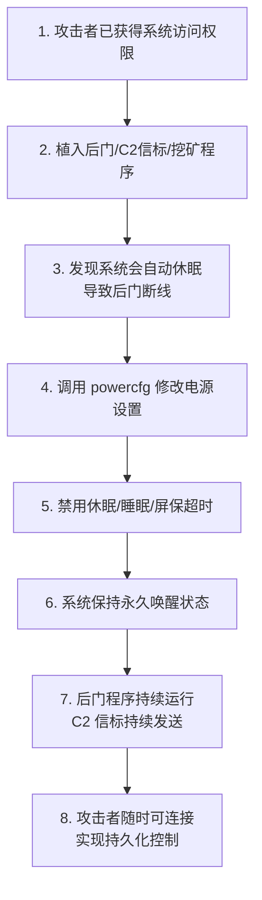

# 电源设置 (T1653)

## 一句话通俗理解

> **攻击者偷偷改掉你电脑的电源设置，让它永远不睡觉——这样后门程序就能24小时在线，随时等你"叫醒"它**

## 30秒速查卡

| 维度 | 你需要知道的 |
|------|-------------|
| 这是什么？ | 攻击者修改系统电源配置（禁用休眠、关闭屏幕保护超时、阻止自动关机），确保恶意程序持续运行 |
| 为什么危险？ | 系统不休眠意味着后门永不掉线，攻击者随时可以连接；且改动隐蔽，用户通常不会注意电源设置变化 |
| 谁需要关心？ | 系统管理员、笔记本用户安全意识培训、企业终端管理团队 |
| 你的第一步防御 | 监控 `powercfg` 命令的异常调用和电源计划的非授权变更 |
| 如果只做一件事 | 通过组策略锁定电源计划配置，禁止普通用户修改 |

## 难度等级

⭐ 初级：会用 Windows 设置面板或 `powercfg` 命令即可实施

## 前置知识检查

读这个文件前，你需要了解：
- **电源计划（Power Plan）**：Windows 管理的"省电方案"，控制何时关屏幕、何时休眠、CPU 如何降频
- **休眠（Hibernate）vs 睡眠（Sleep）**：休眠是把内存写入磁盘后断电；睡眠是维持内存供电的低功耗状态。两者都会暂停运行中的程序
- **`powercfg` 命令**：Windows 内置的电源配置管理工具，可以命令行修改所有电源设置
- **屏幕保护超时**：多久没操作后启动屏保，屏保启动时常会触发锁屏——攻击者禁用它可避免锁屏后断连

## 技术描述

想象一下：你给手机设了"30秒自动锁屏"省电。但有个偷偷装到你手机上的 App，把自动锁屏改成了"永不"，还把省电模式关了——这样它就能一直后台运行、一直联网，等你睡着时偷偷干活。电脑上的电源设置攻击就是这回事。

操作系统为了省电和保护安全，会自动让设备进入低功耗或休眠状态。休眠时，所有程序暂停执行，网络连接断开。这对攻击者是个麻烦——他们植入的后门、C2 信标、挖矿程序都会在休眠时"失联"。于是攻击者修改电源设置，让系统永不休眠：

1. **禁用休眠/睡眠**：`powercfg /change standby-timeout-ac 0`（插电时永不睡眠）
2. **禁用休眠文件**：`powercfg /hibernate off`（彻底关闭休眠功能）
3. **禁用屏幕保护超时**：防止屏保启动触发锁屏，锁屏后某些远程控制会断开
4. **修改电源按钮行为**：把"按电源键"改为"什么都不做"，防止用户误关机中断后门
5. **关闭盖子不操作**：笔记本合盖时默认休眠，攻击者改为"不采取任何操作"

类比和技术之间的过渡：就像你给仓库装了个定时断电器，每天晚上12点自动断电。小偷进来后第一件事就是把定时器调到"永不断电"，这样它半夜偷东西时灯一直亮着、监控一直转着。在系统层面，这通过修改注册表 `HKLM\SYSTEM\CurrentControlSet\Control\Power` 或调用 `powercfg` 命令实现。

## 子技术列表

本技术暂无子技术。

## 攻击流程



### 该技术特有步骤说明

1. **枚举当前电源配置**：`powercfg /query` 查看当前电源计划的所有设置
2. **禁用休眠**：
   ```
   powercfg /change standby-timeout-ac 0
   powercfg /change standby-timeout-dc 0
   powercfg /change hibernate-timeout-ac 0
   powercfg /change hibernate-timeout-dc 0
   ```
3. **关闭休眠功能**：`powercfg /hibernate off`（删除 hiberfil.sys，彻底关闭）
4. **禁用屏幕保护**：修改注册表 `HKCU\Control Panel\Desktop\ScreenSaveActive` 设为 0
5. **修改电源按钮和盖子行为**：`powercfg /setacvalueindex SCHEME_CURRENT 4f971e89-eebd-4455-a8de-9e59040e7347 7648efa3-dd9c-4e3e-b566-50f929386280 0`（盖子合上时不操作）

## 真实案例

### 案例1：Rocke 挖矿木马篡改电源设置保持挖矿（2018-2019年）

- **时间**：2018年下半年至2019年
- **目标**：Linux 服务器和企业终端
- **攻击组织**：Rocke（挖矿团伙，持续利用多个漏洞传播）
- **手法**：Rocke 挖矿木马感染 Linux 服务器后，修改 `systemd` 的电源管理配置和 `cpufreq` 设置，将 CPU 频率锁定在最高档，禁用所有节能策略，确保挖矿程序以最大算力持续运行。同时禁用系统的自动休眠和挂起功能
- **数据来源**：一手厂商报告（Palo Alto Unit 42 Rocke 分析报告）

### 案例2：Shelljack 后门篡改电源配置保持持久连接（2021年）

- **时间**：2021年
- **目标**：Linux 服务器和 IoT 设备
- **攻击组织**：Mozi 僵尸网络运营者 + Mirai 变种团伙（如FreakOut、Gafgyt运营者）
- **手法**：Shelljack 后门感染后，执行 `systemctl mask sleep.target suspend.target hibernate.target hybrid-sleep.target` 禁用所有电源管理目标，确保设备永不休眠，后门反向 shell 持续在线。同时修改 `logind.conf` 的 `HandleLidSwitch=ignore`
- **数据来源**：一手厂商报告（Trend IoT 安全报告）

### 案例3：UpdateAgent 木马修改电源计划绕过屏幕锁（2022年）

- **时间**：2022年
- **目标**：macOS 用户
- **攻击组织**：UpdateAgent（macOS 恶意软件家族）
- **手法**：UpdateAgent 感染 macOS 后，通过 `pmset` 命令修改电源管理设置，禁用 displaysleep（屏幕休眠）和 sleep（系统休眠），防止系统休眠后断开 C2 连接。同时禁用屏保以避免锁屏触发，使攻击者能通过 VNC 持续远程查看屏幕
- **数据来源**：一手厂商报告（Jamf Threat Labs、Microsoft Defender for Endpoint 报告）

## 红队视角

### 可持续利用手段

1. **结合电源计划 + 计划任务**：修改电源计划保持唤醒，再用计划任务定时唤醒后门，即使系统短暂休眠也能被唤醒
2. **针对笔记本的盖子行为篡改**：很多用户习惯合上笔记本就走，攻击者改"合盖不操作"后，用户以为电脑休眠了实际还在运行
3. **WOL（网络唤醒）配合**：即使系统关机，通过配置网卡 WOL，攻击者可远程唤醒设备重新连接后门
4. **CPU 频率锁定**：对挖矿场景，锁定 CPU 最高频率提升算力，同时禁用温度保护可能造成硬件损坏

### 攻击技术可复制性分析

| 维度 | 评分 | 说明 |
|------|------|------|
| 实现难度 | 极低 | `powercfg` 是内置命令，一行搞定 |
| 检测绕过 | 高 | 电源设置变化极隐蔽，用户几乎不查 |
| 持久化效果 | 中 | 仅在系统未重启时有效，但配合其他持久化可长期 |
| 复制成本 | 极低 | 无需任何工具 |

## 蓝队视角

### 检测建议

**用人话说**：正常用户几乎不会用命令行 `powercfg` 改电源设置——他们都是去"设置-系统-电源"里点。如果你在日志里看到 `powercfg` 命令被非系统进程调用，或者电源计划突然从"平衡"变成"高性能且永不休眠"，这非常可疑。另外，突然禁用休眠的企业服务器也要警惕——服务器本来就不怎么休眠，主动禁用反而异常。

#### 主机层检测

```yaml
# Sigma规则：检测 powercfg 命令禁用休眠行为
title: 可疑电源配置修改 - 禁用休眠
id: 3c4d5e6f-7890-1234-abcd-ef3456789012
status: experimental
description: 检测使用 powercfg 命令禁用系统休眠/睡眠功能的行为
logsource:
    product: windows
    category: process_creation
detection:
    selection_powercfg:
        Image|endswith: '\powercfg.exe'
        CommandLine|contains:
            - '/change standby-timeout'
            - '/change hibernate-timeout'
            - '/hibernate off'
            - 'standby-timeout-ac 0'
            'standby-timeout-dc 0'
    filter_legitimate:
        User|contains:
            - 'NT AUTHORITY\SYSTEM'  # 部分系统管理脚本会调用
        CommandLine|contains:
            - 'config_manager'  # SCCM 等管理工具
    condition: selection_powercfg and not filter_legitimate
falsepositives:
    - 企业电源管理脚本
    - 管理员手动配置
    - 部分虚拟化平台自动配置
level: medium
```

```yaml
# Sigma规则：检测电源计划被修改为永不休眠
title: 电源计划被修改为永不休眠
id: 4d5e6f78-9012-3456-abcd-ef4567890123
status: experimental
description: 检测电源计划被修改为休眠/睡眠超时为0（永不）
logsource:
    product: windows
    service: security
detection:
    selection:
        EventID: 4657  # Registry value modified
        ObjectName|contains: '\Power\'
        NewValue: '0'
    condition: selection
falsepositives:
    - 服务器正常配置
    - Kiosk 模式设备
level: low
```

**系统命令检测**：

```powershell
# 查看当前电源计划设置
powercfg /query

# 检查休眠是否被禁用
powercfg /a

# 查看哪些进程最近调用过 powercfg
Get-WinEvent -FilterHashtable @{LogName='Microsoft-Windows-PowerShell/Operational'; Id=4104} |
  Where-Object {$_.Message -match 'powercfg'} | Select-Object TimeCreated, Message

# 检查注册表中的屏保设置
Get-ItemProperty -Path 'HKCU:\Control Panel\Desktop' -Name ScreenSaveActive, ScreenSaveTimeOut
```

#### 网络层检测

电源设置本身不直接产生网络行为，但可关联：
- 系统电源状态日志（EventID 42 电源状态变更）与异常 C2 连接的时间关联
- 非工作时间（凌晨）系统仍保持活跃且产生网络流量

#### 应用层检测

- 监控组策略对象的电源配置变更（企业环境应有统一策略）
- EDR 监控 `powercfg.exe` 的异常父进程（正常应由 explorer.exe 或管理脚本调用，不应由未知进程调用）
- 监控注册表 `HKLM\SYSTEM\CurrentControlSet\Control\Power` 的变更

### 防御改进措施

1. **组策略锁定电源计划**：通过 GPO 统一推送电源配置，禁止普通用户修改
2. **服务器基线配置**：对服务器建立"永不修改电源设置"的基线，偏离即告警
3. **审计电源配置变更**：启用注册表 `Power` 键的审计，记录所有修改
4. **用户安全意识培训**：提醒用户注意笔记本"合盖不休眠"等异常现象

### 应急响应优化

- 怀疑感染时，优先检查 `powercfg /query` 输出是否异常
- 检查 `systemctl status sleep.target suspend.target`（Linux）是否被 mask
- macOS 用 `pmset -g` 查看当前电源管理设置

## 避坑指南

### 容易踩的坑

1. **误判服务器正常配置**：很多服务器本来就配置为永不休眠，看到 `standby-timeout-ac 0` 不要直接告警，要结合是否是新变更判断
2. **忽视 macOS 和 Linux**：电源设置攻击不只发生在 Windows，Linux 的 `systemctl mask` 和 macOS 的 `pmset` 同样需要监控
3. **只看命令不看上下文**：`powercfg` 由 SCCM/Intune 等管理工具调用是正常的，要看父进程和调用上下文
4. **忽视 CPU 频率锁定**：挖矿木马会锁定 CPU 频率，这不是传统"电源设置"但属于同类，要监控 `cpufreq` 变更

### 本技术特有的注意事项

- 电源设置修改常与其他持久化手段配合使用——单独出现时易被忽视，建议关联分析
- 部分企业 Kiosk 设备（如展览展示机）正常配置为永不休眠，需建立白名单
- IoT 设备的电源管理配置通常更简单，篡改后影响更大

## 检测建议

### 网络层

- 关联系统电源状态事件与非工作时间网络流量
- 监控休眠时间窗口内的异常 C2 心跳

### 主机层

- **Windows EventID 42**：电源状态变更（系统进入/退出休眠）
- **Windows EventID 4657**：注册表 Power 键值修改
- **Sysmon EventID 1**：`powercfg.exe` 进程创建
- **Linux**：`systemctl status sleep.target` 和 `/etc/systemd/logind.conf` 变更监控
- **macOS**：`pmset -g` 定期对比

### 应用层

- 组策略管理控制台监控电源策略变更
- MDM（Intune/Jamf）监控设备电源配置偏离基线

### Sigma 规则

见上方"蓝队视角→检测建议"中的两条 Sigma 规则。

## 缓解措施

| 缓解措施 | 类型 | 效果 | 实施建议 |
|---------|------|------|---------|
| 组策略锁定电源计划 | 预防 | 高 | GPO 统一推送，禁止用户修改 |
| 电源配置审计 | 检测 | 中 | 启用注册表 Power 键审计 |
| 服务器基线监控 | 检测 | 高 | 对服务器建立电源配置基线 |
| powercfg 命令监控 | 检测 | 中 | 监控非系统进程调用 powercfg |
| 用户安全意识培训 | 预防 | 低 | 提醒注意异常电源行为 |

## 动手实验

### 实验目标

理解电源设置修改的影响，验证"永不休眠"对后门持久化的作用

### 实验步骤

```powershell
# 1. 记录当前电源设置（实验前基线）
powercfg /query > C:\temp\before.txt

# 2. 模拟攻击者修改电源设置
powercfg /change standby-timeout-ac 0    # 插电时永不睡眠
powercfg /change standby-timeout-dc 0    # 电池时永不睡眠
powercfg /change hibernate-timeout-ac 0  # 插电时永不休眠
powercfg /change hibernate-timeout-dc 0  # 电池时永不休眠

# 3. 验证修改
powercfg /query > C:\temp\after.txt
Compare-Object (Get-Content C:\temp\before.txt) (Get-Content C:\temp\after.txt)

# 4. 模拟后门：启动一个定时 ping（代表 C2 心跳）
# 即使你不操作电脑，这个 ping 也会持续运行
while($true) { ping -n 1 127.0.0.1 | Out-Null; Start-Sleep -Seconds 60 }

# 5. 实验后恢复
powercfg /restoredefaultschemes
```

### 预期输出

```
# Compare-Object 输出会显示 standby-timeout 和 hibernate-timeout 从原值变为 0
InputObject                 SideIndicator
-----------                 -------------
  Power Setting Index: 0x0  =>   (修改后值为0，表示永不)
  Power Setting Index: 0x1  <=   (修改前原值)
```

### 工具说明

| 工具 | 用途 | 说明 |
|------|------|------|
| powercfg（Windows 内置） | 电源配置管理 | 最常用的电源设置工具 |
| pmset（macOS 内置） | macOS 电源管理 | 类似 powercfg |
| systemctl（Linux 内置） | 系统服务管理 | mask/unmask 电源目标 |
| Group Policy Editor | 组策略配置 | 企业统一电源策略 |

## 术语解释

| 术语 | 通俗解释 |
|------|---------|
| 电源计划（Power Plan） | Windows 的"省电方案"，控制休眠、屏幕关闭等时机 |
| 休眠（Hibernate） | 把内存写入磁盘后断电，程序暂停，开机后恢复 |
| 睡眠（Sleep/Standby） | 维持内存供电的低功耗状态，程序暂停，唤醒快 |
| hiberfil.sys | Windows 休眠功能使用的文件，禁用休眠会删除它 |
| WOL（Wake-on-LAN） | 网络唤醒，通过特殊网络包远程开机 |
| cpufreq | Linux CPU 频率管理机制，攻击者可锁定最高频率 |
| Kiosk 模式 | 设备只运行单一应用的展示模式，通常配置为永不休眠 |

## 参考资料

### 📚 如果你想深入了解

- [MITRE ATT&CK T1653 官方页面](https://attack.mitre.org/techniques/T1653/) — 官方技术定义
- [Microsoft powercfg 命令参考](https://learn.microsoft.com/zh-cn/windows-hardware/design/device-experiences/powercfg-command-line-options) — 完整命令参数
- [Linux systemd 电源管理](https://www.freedesktop.org/software/systemd/man/systemd-suspend.service.html) — Linux 电源目标管理

### 🔧 如果你想动手试试

- [Windows 电源计划配置指南](https://learn.microsoft.com/zh-cn/windows-hardware/design/device-experiences/create-custom-power-plans) — 自定义电源计划
- [pmset 使用手册](https://ss64.com/mac/pmset.html) — macOS 电源管理命令

### 🎯 真实攻击参考

- [Rocke 挖矿木马分析 - Palo Alto Unit 42](https://unit42.paloaltonetworks.com/) — 搜索 "Rocke" 了解电源设置篡改实战
- [UpdateAgent macOS 分析 - Microsoft](https://www.microsoft.com/en-us/wdsi) — macOS 电源设置篡改案例

## 版本历史

| 版本 | 日期 | 变更说明 |
|------|------|---------|
| v1.0 | 2026-07-10 | 初始版本，基于 MITRE ATT&CK v19 和 v3.0 写作风格指南编写 |
