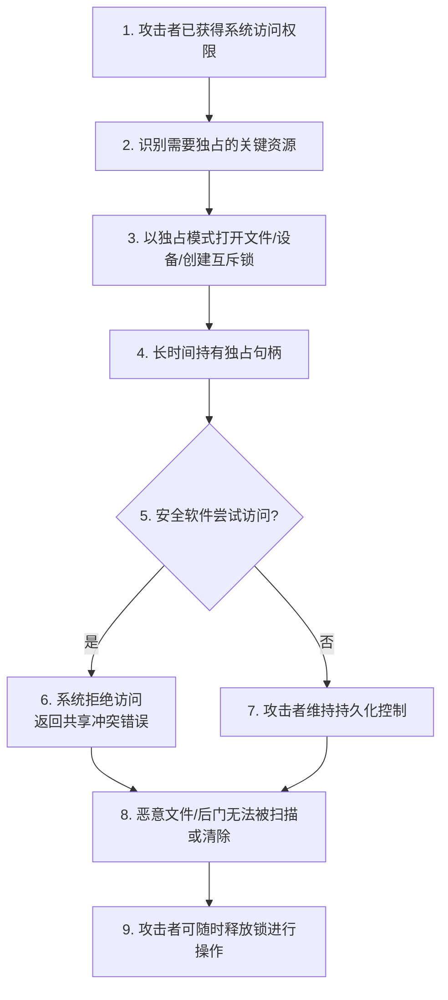

# 独占控制 (T1668)

## 一句话通俗理解

> **攻击者把持住系统某个关键资源的"唯一钥匙"，让别人都用不了，自己却能随时进出——就像占了茅坑不拉屎，只为卡住位置**

## 30秒速查卡

| 维度 | 你需要知道的 |
|------|-------------|
| 这是什么？ | 攻击者对文件、设备、端口等系统资源获取独占访问权，阻止合法程序和防护软件使用该资源 |
| 为什么危险？ | 独占锁定后安全软件无法扫描恶意文件、管理员无法访问关键配置、防护机制形同虚设 |
| 谁需要关心？ | 系统管理员、安全运维团队、终端防护（EDR）运营人员 |
| 你的第一步防御 | 监控异常的文件独占锁定行为，特别是系统关键文件被长时间独占 |
| 如果只做一件事 | 启用文件访问审计，监控对系统关键文件长时间持有独占句柄的进程 |

## 难度等级

⭐⭐⭐ 高级：需要操作系统文件句柄、设备访问控制、进程互斥机制的深入知识

## 前置知识检查

读这个文件前，你需要了解：
- **文件句柄（File Handle）**：操作系统给进程发放的"文件使用通行证"，拿到独占句柄就等于拿到唯一使用权
- **设备独占访问**：某些设备（如加密狗、串口、特定硬件）同一时间只能被一个进程使用
- **互斥锁（Mutex）**：进程间用来"抢占资源"的锁机制，谁拿到谁就能独占
- **共享模式（Share Mode）**：Windows 文件打开时可指定是否允许其他进程读/写/删除该文件

## 技术描述

想象一下：你住的小区有间公共工具房，里面有把珍贵的万能钥匙。规矩是——谁先进去拿了钥匙，把门反锁，别人就进不来了。攻击者干的就是这种事：抢先一步打开系统关键文件，并且指定"独占模式"（拒绝共享），这样别的程序——包括杀毒软件——想读这个文件时都会被系统拒绝，提示"文件正在被另一进程使用"。

简单来说，操作系统在管理文件和设备时，允许进程在打开时声明"这是我的，别人不许碰"。攻击者利用这个机制：

1. **独占锁定恶意文件自身**：恶意程序以独占模式打开自己的可执行文件，安全软件无法读取该文件进行扫描，也无法删除它
2. **独占锁定系统关键文件**：锁定注册表 hive 文件（如 NTUSER.DAT）、系统 DLL、配置文件，阻止安全工具和管理员查看或修改
3. **独占设备控制**：占用特定硬件设备端口，阻止合法服务正常启动
4. **创建命名互斥锁**：作为"占位符"防止其他实例运行（也用于检测多开），同时阻止合法工具获取该锁

类比和技术之间的过渡：就像图书馆里有人借走了唯一的一本参考书并且一直不还，其他人都借不到。在系统层面，这通过 Windows API `CreateFile` 的 dwShareMode 参数设为 0（完全拒绝共享）来实现，或者通过 `CreateMutex` 创建命名互斥锁来"占位"。

## 子技术列表

本技术暂无子技术。

## 攻击流程



### 该技术特有步骤说明

1. **资源识别**：攻击者枚举系统关键文件路径（如 `C:\Windows\System32\config\SAM`、自身可执行文件路径、安全软件定义文件）
2. **独占打开**：调用 `CreateFileW(path, GENERIC_READ|GENERIC_WRITE, 0, NULL, OPEN_EXISTING, FILE_ATTRIBUTE_NORMAL, NULL)` —— 第三个参数为 0 表示完全拒绝共享
3. **句柄保持**：将句柄保存在长期运行的进程或服务中，不关闭，使独占状态持续
4. **互斥锁占位**：使用 `CreateMutex(NULL, TRUE, "Global\\SomeName")` 创建全局命名互斥锁，阻止其他进程创建同名锁

## 真实案例

### 案例1：Sality 蠕虫独占锁定自身文件（2010-2020年长期活跃）

- **时间**：2010年至今长期活跃，2013年大规模爆发
- **目标**：Windows 个人用户和企业终端，全球数百万主机
- **攻击组织**：Sality（PE 病毒家族，非特定 APT 组织，但被广泛使用）
- **手法**：Sality 感染主机后，以独占模式打开自身的可执行文件，并长期持有句柄。当杀毒软件尝试扫描或删除该文件时，操作系统返回"文件正在被另一进程使用"错误，导致清除失败。同时 Sality 还会独占锁定系统关键文件阻止安全工具运行
- **数据来源**：一手厂商报告（Kaspersky、Symantec 长期追踪报告）

### 案例2：Emotet 木马利用互斥锁防多开兼防分析（2014-2021年）

- **时间**：2014年出现，2017-2020年大规模爆发，2021年 multinational 执法行动后短暂沉寂
- **目标**：全球银行、企业用户
- **攻击组织**：Emotet 运营团伙（后被 Evile Corp 等多个犯罪组织租用）
- **手法**：Emotet 在感染后创建全局命名互斥锁（如 `Global\\{随机GUID}`），既防止多实例运行，也阻止安全分析工具在同一系统上启动分析沙箱。部分变种还独占锁定 `%AppData%` 下的持久化 payload 文件，阻止 EDR 读取
- **数据来源**：一手厂商报告（Trend Micro、Malwarebytes、CISA AA21-011A 警报）

### 案例3：Locky 勒索软件独占文件导致恢复失败（2016-2017年）

- **时间**：2016年2月首次出现，2016-2017年大规模传播
- **目标**：全球医院、企业用户
- **攻击组织**：Locky 运营团伙（通过 Necurs 僵尸网络分发）
- **手法**：Locky 在加密文件过程中，独占锁定被加密文件的句柄，防止文件恢复工具在加密未完成时读取原始数据。加密完成后才释放句柄。部分变种还独占锁定卷影副本（VSS）相关文件阻止备份恢复
- **数据来源**：一手厂商报告（Coveware、Sophos、McAfee 分析报告）

## 红队视角

### 可持续利用手段

1. **针对 EDR 的独占攻击**：以独占模式打开 EDR 的定义文件或配置文件，使其无法更新签名，相当于"致盲"防护
2. **DLL 独占锁定实现 DLL 阻断**：独占打开某个 EDR 依赖的 DLL，导致 EDR 进程加载失败或异常退出
3. **互斥锁命名碰撞**：提前创建与合法软件相同的命名互斥锁，阻止合法软件启动（如阻止杀毒软件服务启动）
4. **文件锁 + 定时释放**：周期性释放和重新获取锁，使安全工具间歇性可用，增加检测难度

### 攻击技术可复制性分析

| 维度 | 评分 | 说明 |
|------|------|------|
| 实现难度 | 低 | CreateFile 和 CreateMutex 是基础 Win32 API，任何语言都可调用 |
| 检测绕过 | 中 | 独占行为本身合法，需结合上下文判断 |
| 持久化效果 | 高 | 只要进程不退出，锁就一直有效 |
| 复制成本 | 低 | 无需特殊工具，纯 API 调用 |

## 蓝队视角

### 检测建议

**用人话说**：不要只盯着"某个文件被打开了"，而要盯着"哪个进程打开了哪个文件，并且拒绝别人读"。正常的程序很少独占打开文件，安全软件和系统工具更不会长时间独占。如果你看到 `malware.exe` 独占打开了 `C:\Windows\System32\config\SAM`，这几乎100%是恶意行为。

#### 主机层检测

```yaml
# Sigma规则：检测异常文件独占锁定行为
title: 可疑文件独占锁定行为检测
id: 1a2b3c4d-5e6f-7890-abcd-ef1234567890
status: experimental
description: 检测进程以独占模式（ShareMode=0）打开系统关键文件或自身可执行文件的行为
logsource:
    product: windows
    service: sysmon
detection:
    selection_file_create:
        EventID: 11  # FileCreate
        TargetFilename|endswith:
            - '\config\SAM'
            - '\config\SYSTEM'
            - '\config\SECURITY'
            - '\config\SOFTWARE'
    filter legitimate:
        Image|startswith:
            - 'C:\Windows\System32\lsass.exe'
            - 'C:\Windows\System32\svchost.exe'
    condition: selection_file_create and not filter_legitimate
falsepositives:
    - 系统备份软件
    - 域控同步服务
level: high
```

```yaml
# Sigma规则：检测命名互斥锁创建（Sysmon EventID 17 NamedPipePipeEvent 或自定义）
title: 可疑全局命名互斥锁创建
id: 2b3c4d5e-6f78-9012-abcd-ef2345678901
status: experimental
description: 检测非系统进程创建全局命名互斥锁的行为
logsource:
    product: windows
    service: sysmon
detection:
    selection:
        EventID: 17  # PipeEvent, 注意 Sysmon 对 Mutex 的检测需自定义规则
    filter_system:
        Image|startswith:
            - 'C:\Windows\System32\'
            - 'C:\Windows\SysWOW64\'
    condition: selection and not filter_system
falsepositives:
    - 合法软件单实例检测
    - 系统服务启动
level: medium
```

**系统命令检测**：

```powershell
# 用 PowerShell 查看哪些进程持有文件句柄（需 Sysinternals handle.exe）
handle.exe -accepteula -nobanner C:\Windows\System32\config\SAM

# 查看持有独占锁定的进程
handle.exe -accepteula -nobanner -p <PID>

# 用 openfiles 命令查看打开的文件
openfiles /query /v | findstr /i "exclusive"
```

#### 网络层检测

独占控制本身是本地行为，但如果攻击者独占锁定的目的是保护网络后门，可监控：
- 异常的长连接（持续数小时以上的 TCP 连接，且对应进程独占打开了某个文件）
- 端口被独占占用（`netstat -ano | findstr LISTENING` 发现端口被非系统进程独占监听）

#### 应用层检测

- 监控 EDR/AV 服务的"定义文件更新失败"告警，排查是否被独占锁定
- 监控"无法访问文件"类错误日志中，被访问文件是否为系统关键文件
- 应用程序日志中"共享冲突"（Sharing Violation, 错误码 32）频繁出现需排查

### 防御改进措施

1. **EDR 自我保护**：使用内核态文件过滤器保护自身文件，即使被独占锁定也能读取（通过 minifilter 机制）
2. **文件访问审计**：启用"对象访问"审计策略，对系统关键文件配置 SACL，记录所有访问尝试（包括失败的独占访问）
3. **最小权限**：普通用户进程不应有权限独占打开系统文件——通过 ACL 限制
4. **行为基线**：建立"哪些进程正常情况下会独占打开哪些文件"的基线，偏离基线告警

### 应急响应优化

- 遭遇独占锁定时，优先用 `handle.exe` 或 Process Explorer 找到持有句柄的进程
- 如果进程无法终止，考虑重启进入安全模式（安全模式下非必要进程不启动，锁会释放）
- 取证时注意：独占锁定的进程在内存中的句柄表是关键证据

## 避坑指南

### 容易踩的坑

1. **误判合法独占行为**：数据库服务（如 SQL Server）会合法独占打开数据库文件，备份软件会独占打开备份目标。不要看到独占就告警，要结合进程身份和文件路径
2. **忽视内核态独占**：用户态检测工具（如 handle.exe）看不到内核态驱动持有的句柄。如果用户态查不到谁锁了文件，要怀疑 rootkit
3. **删除被锁文件失败后放弃**：遇到"文件正在使用"错误时，不要简单放弃，要用 handle.exe 找到锁定进程并处理
4. **重启不一定能解决**：如果独占控制是通过服务实现的，重启后服务自动启动会重新获取锁

### 本技术特有的注意事项

- 独占控制常与"防御规避"战术配合——锁定文件既是为了持久化（防删除），也是为了规避（防扫描）
- 部分勒索软件会独占锁定 VSS 相关文件，这会导致"卷影副本恢复"失败，应急时要注意检查
- 在容器化环境中，独占锁定行为可能发生在容器内，宿主机监控不一定能看到

## 检测建议

### 网络层

- 监控异常长连接（独占控制常用于保护网络后门）
- 关注端口独占占用情况

### 主机层

- **Sysmon EventID 11（FileCreate）**：监控对系统关键文件的创建/打开
- **Windows 安全日志 EventID 4656（请求文件句柄）和 4663（访问文件）**：启用对象访问审计后可捕获
- **错误码 32（ERROR_SHARING_VIOLATION）**：在应用程序日志和系统日志中搜索此错误，定位被独占锁定的文件
- **Process Monitor（ProcMon）**：实时监控文件打开操作的 ShareMode 字段

### 应用层

- EDR 控制台配置"关键文件被独占访问"告警规则
- SIEM 关联"文件共享冲突错误 + 非系统进程"作为高优先级告警

### Sigma 规则

见上方"蓝队视角→检测建议"中的两条 Sigma 规则。

## 缓解措施

| 缓解措施 | 类型 | 效果 | 实施建议 |
|---------|------|------|---------|
| 文件 ACL 加固 | 预防 | 中 | 限制普通用户对系统关键文件的写权限 |
| EDR 内核态自我保护 | 预防 | 高 | EDR 使用 minifilter 保护自身文件 |
| 文件访问审计 | 检测 | 高 | 对 SAM/SYSTEM 等关键文件启用 SACL 审计 |
| 进程白名单 | 预防 | 中 | 限制可执行文件运行，减少恶意进程独占锁定机会 |
| 服务启动顺序控制 | 预防 | 低 | 让安全服务先于潜在恶意服务启动 |

## 动手实验

### 实验目标

理解独占控制原理，体验独占锁定如何阻止其他进程访问文件

### 实验步骤

```python
# experiment_exclusive_lock.py
# 在测试环境运行，观察独占锁定效果
import ctypes
from ctypes import wintypes
import time

kernel32 = ctypes.windll.kernel32

GENERIC_READ = 0x80000000
GENERIC_WRITE = 0x40000000
OPEN_EXISTING = 3
FILE_ATTRIBUTE_NORMAL = 0x80

# 以独占模式（dwShareMode=0）打开文件
handle = kernel32.CreateFileW(
    r"C:\temp\test_target.txt",  # 先创建这个测试文件
    GENERIC_READ | GENERIC_WRITE,
    0,  # 关键：ShareMode=0 表示完全拒绝共享
    None,
    OPEN_EXISTING,
    FILE_ATTRIBUTE_NORMAL,
    None
)

if handle != -1:
    print(f"[+] 已独占打开文件，句柄: {handle}")
    print("[*] 现在尝试用记事本或 type 命令访问该文件，会失败")
    print("[*] 持有锁 60 秒...")
    time.sleep(60)
    kernel32.CloseHandle(handle)
    print("[+] 已释放锁")
else:
    err = ctypes.get_last_error()
    print(f"[-] 打开失败，错误码: {err}")
```

### 预期输出

```
[+] 已独占打开文件，句柄: 12345
[*] 现在尝试用记事本或 type 命令访问该文件，会失败
[*] 持有锁 60 秒...
# 此时在另一个命令行窗口运行 type C:\temp\test_target.txt
# 会看到错误：另一个程序正在使用此文件，进程无法访问。
[+] 已释放锁
# 释放后 type 命令可正常访问
```

### 工具说明

| 工具 | 用途 | 说明 |
|------|------|------|
| Sysinternals handle.exe | 查看文件句柄持有者 | 最常用的独占锁定排查工具 |
| Sysinternals Process Explorer | 图形化查看句柄 | 支持 Ctrl+F 搜索文件名找到锁定进程 |
| Process Monitor (ProcMon) | 实时监控文件操作 | 可过滤 ShareMode 字段 |
| openfiles（Windows 内置） | 查看打开的文件 | 无需第三方工具，但功能有限 |

## 术语解释

> 术语表放在技术描述之后，方便先理解概念再看流程。

| 术语 | 通俗解释 |
|------|---------|
| 文件句柄（File Handle） | 操作系统发放的"文件使用通行证"，拿着它才能读写文件 |
| 独占模式（Exclusive Mode） | 文件打开时声明"这是我的，别人不许碰"，对应 dwShareMode=0 |
| 共享冲突（Sharing Violation） | 当进程A独占了文件，进程B尝试打开时的报错（错误码32） |
| 互斥锁（Mutex） | 进程间"占位"用的锁，创建者独占，其他进程只能等 |
| minifilter | Windows 文件系统过滤驱动，EDR 用它在内核态保护文件 |
| SACL | 系统访问控制列表，配置"谁访问这个文件时要记录日志" |
| VSS | 卷影副本服务，Windows 系统备份机制，攻击者常独占锁定其文件阻止备份 |

## 参考资料

### 📚 如果你想深入了解

- [MITRE ATT&CK T1668 官方页面](https://attack.mitre.org/techniques/T1668/) — 官方技术定义和描述
- [Microsoft CreateFile 文档](https://learn.microsoft.com/zh-cn/windows/win32/api/fileapi/nf-fileapi-createfilew) — dwShareMode 参数说明
- [Sysinternals Handle v5.0](https://learn.microsoft.com/zh-cn/sysinternals/downloads/handle) — 文件句柄排查工具

### 🔧 如果你想动手试试

- [Process Monitor 使用指南](https://learn.microsoft.com/zh-cn/sysinternals/downloads/procmon) — 实时监控文件独占打开行为
- [Sality 病毒分析报告 - Kaspersky](https://securelist.com/) — 搜索 "Sality" 了解独占锁定实战案例

### 🎯 真实攻击参考

- [CISA AA21-011A: Emotet Malware](https://www.cisa.gov/news-events/cybersecurity-advisories/aa21-011a) — Emotet 使用互斥锁的官方分析
- [Sality 分析报告 - Symantec](https://www.broadcom.com/support/security-center) — Sality 独占锁定行为详解

## 版本历史

| 版本 | 日期 | 变更说明 |
|------|------|---------|
| v1.0 | 2026-07-10 | 初始版本，基于 MITRE ATT&CK v19 和 v3.0 写作风格指南编写 |
