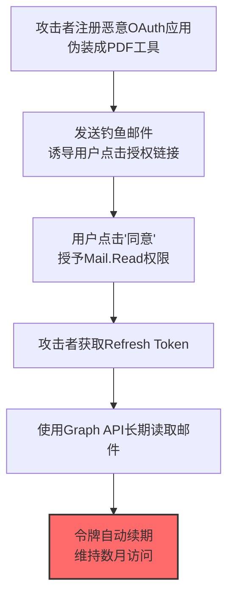

# 云应用集成 (T1671)

## 一句话通俗理解

> 攻击者在你的云平台（如Microsoft 365、Google Workspace）上安装一个"合法"的OAuth应用，让它长期读取你的邮件、文件和日历——就像给你的智能门锁配了一个攻击者也能用的"授权指纹"。

## 30秒速查卡

| 维度 | 你需要知道的 |
|------|-------------|
| 这是什么？ | 在SaaS云平台（M365/Google Workspace/Salesforce）上注册恶意OAuth应用实现持久化访问 |
| 为什么危险？ | 不需要窃取密码，只要用户一次授权，攻击者就能通过API长期读取数据，MFA也无法阻止 |
| 谁需要关心？ | 云管理员、SaaS运营团队、IT安全团队 |
| 你的第一步防御 | 审计所有已授权的OAuth应用，禁用未知或可疑应用 |
| 如果只做一件事 | 限制普通用户自行授权OAuth应用的权限 |

## 难度等级

⭐⭐⭐ 高级（需要深入技术知识）

## 前置知识检查

**读这个文件需要什么？**

- [ ] 了解OAuth 2.0授权流程
- [ ] 知道什么是SaaS应用和API集成
- [ ] 了解Microsoft 365或Google Workspace的租户管理

## 技术描述

云应用集成（T1671）是MITRE ATT&CK框架中的一种持久化技术。

**通俗解释：**

想象一下，你给保姆签了一份"长期授权委托书"，让她可以随时进出你家照顾孩子。攻击者做的事情类似——他们在你的云平台上注册一个看似合法的应用程序（比如"PDF转换工具"或"日历助手"），然后诱骗你的员工点击"授权"。一旦授权完成，攻击者就获得了通过API长期访问你云数据的权限，即使员工改了密码、开了MFA都没用——因为OAuth令牌是独立的访问凭证。

**技术原理：**

1. **注册恶意应用**：攻击者在云平台（如Azure AD、Google Workspace）注册一个OAuth应用，伪装成生产力工具
2. **诱骗授权**：通过钓鱼邮件或中间人攻击，让目标用户点击"同意授权"
3. **获取令牌**：用户授权后，攻击者获得长期有效的OAuth访问令牌（Refresh Token）
4. **API访问**：攻击者使用令牌通过Graph API/Google API静默读取邮件、文件、日历等数据
5. **持久维持**：Refresh Token可自动续期，攻击者可长期保持访问而无需再次钓鱼

**用途与影响：**

这是2023年以来SaaS攻击中最流行的持久化方式。因为OAuth令牌不受密码更改和MFA影响，攻击者可以静默访问数月甚至数年。SolarWinds黑客（Nobelium/APT29）就利用这种方式在受害者Microsoft 365环境中建立了隐蔽持久化，绕过了所有传统检测。

## 子技术列表

该技术没有子技术。

## 攻击流程

### 典型攻击流程

```
注册恶意OAuth应用 --> 钓鱼诱骗授权 --> 获取Refresh Token --> API静默读取数据 --> 长期持久化
```



**步骤详解：**

1. **注册恶意OAuth应用**
   - 通俗描述：攻击者在Azure AD或Google Cloud中注册一个看起来无害的应用
   - 技术细节：配置高权限范围（如Mail.ReadWrite、Files.Read.All），设置多租户支持
   - 常用工具：Azure Portal、Microsoft Graph PowerShell

2. **诱骗用户授权**
   - 通俗描述：发邮件让用户点击"授权此应用"
   - 技术细节：使用consent phishing（同意钓鱼），用户看到的是Microsoft官方授权页面
   - 常用工具：EvilProxy、Modlishka

3. **获取并存储令牌**
   - 通俗描述：拿到通行证，以后随时可以进出
   - 技术细节：获取authorization code，交换为access token和refresh token
   - 常用工具：自定义C2、MSAL库

4. **API静默访问数据**
   - 通俗描述：用API悄悄读取邮件、文件，像合法应用一样
   - 技术细节：调用Microsoft Graph API `/users/{id}/messages` 读取邮件
   - 常用工具：Graph Explorer、自定义Python脚本

5. **令牌自动续期维持持久化**
   - 通俗描述：通行证会自动延期，攻击者什么都不用做
   - 技术细节：使用refresh_token换取新的access_token，默认有效期为90天可续期

## 真实案例

### 案例1：Nobelium（APT29）的SolarWinds后续SaaS持久化

- **时间**: 2021年
- **目标**: 美国政府机构和咨询公司（SolarWinds攻击的后续行动）
- **攻击组织**: NOBELIUM（APT29，俄罗斯SVR背景）
- **手法**: 在SolarWinds供应链攻击被披露后，APT29转向SaaS持久化。他们注册了多个恶意多租户OAuth应用，伪装成"Office 365 Migrator"等合法工具。通过钓鱼邮件诱导目标组织的管理员授权这些应用，获得了Mail.Read和Mail.ReadWrite权限。一旦授权完成，攻击者通过Graph API长期静默读取受害者的邮件，绕过了所有MFA和密码重置——因为OAuth令牌是独立的。这次攻击影响了超过3000个Microsoft 365租户。
- **影响**: 30多个组织的邮件长期被窃取，包括美国财政部和商务部
- **参考链接**: [Microsoft Blog - Nobelium OAuth Attack](https://www.microsoft.com/security/blog/2021/03/23/microsoft-exchange-server-attacks-they-just-keep-coming/)
   - **数据来源**: 一级

### 案例2：Storm-1283的Consent Phishing活动

- **时间**: 2023年
- **目标**: 中小企业和教育机构的Microsoft 365环境
- **攻击组织**: STORM-1283（未归因威胁组织）
- **手法**: 攻击者注册了一个名为"Adobe Reader"的假OAuth应用，通过大量钓鱼邮件诱导用户授权。该应用请求`Mail.Read`和`User.Read`权限。用户在Microsoft官方登录页面授权后，攻击者立即开始通过Graph API批量下载所有邮件，寻找密码重置邮件和商业机密。攻击者还利用Refresh Token维持了长达6个月的访问，期间用户多次修改密码都未能阻止攻击。
- **影响**: 超过100个组织的邮件数据泄露
- **参考链接**: [Microsoft Threat Intelligence - Consent Phishing](https://www.microsoft.com/en-us/security/blog/2022/03/22/dev-0537-criminal-actor-targeting-organizations-for-data-exfiltration-and-destruction/)
   - **数据来源**: 二级

### 案例3：Google Workspace OAuth挖矿攻击

- **时间**: 2022年
- **目标**: Google Workspace企业用户
- **攻击组织**: 未归因（疑似UNC3886）
- **手法**: 攻击者在Google Cloud中注册了伪装成"Gmail备份工具"的OAuth应用，通过SEO投毒和钓鱼广告诱导用户授权。应用请求`https://www.googleapis.com/auth/gmail.readonly`权限。授权后，攻击者使用Gmail API持续读取受害者的邮件，重点寻找云服务密码重置邮件和MFA备份码。利用这些信息，他们进一步入侵了受害者的AWS和Azure账户部署挖矿程序。
- **影响**: 多家企业云账户被入侵，产生高额云账单
- **参考链接**: [Google Security Blog - OAuth Abuse](https://cloud.google.com/blog/products/identity-security/enhancing-oauth-app-verification)
   - **数据来源**: 二级

## 红队视角

> ⚠️ **免责声明**：以下内容仅用于合法的安全测试、渗透测试和教育目的。未经授权对他人系统进行测试是违法行为。

### 实战技巧

1. **伪装成已知应用**
   注册OAuth应用时使用已知软件名（如"Adobe Acrobat"、"Zoom Meeting"）和官方Logo，提高授权成功率

2. **请求最小权限**
   不要一次请求所有权限，先请求`User.Read`建立信任，后续逐步升级到`Mail.Read`——用户更可能授权低权限请求

3. **利用多租户应用**
   注册为多租户应用，一次注册可以钓鱼任何Microsoft 365租户的用户

### 常用工具

| 工具名称 | 用途 | 平台 | 链接 |
|----------|------|------|------|
| Microsoft Graph PowerShell | 通过API管理OAuth应用和访问数据 | SaaS | [Microsoft Graph PowerShell](https://learn.microsoft.com/en-us/powershell/microsoftgraph/) |
| o365-attack-toolkit | 专门针对Office 365的OAuth钓鱼工具 | SaaS | [o365-attack-toolkit](https://github.com/mdsecactivebreach/o365-attack-toolkit) |
| EvilProxy | 反向代理钓鱼框架，支持OAuth劫持 | SaaS | [EvilProxy](https://www.mandiant.com/resources/blog/evil-proxy-phishing) |

### 注意事项

- OAuth令牌绕过MFA，是SaaS环境中最难检测的持久化方式
- 微软已加强OAuth应用审核，新注册应用需经过验证
- 用户授权后的应用删除需要在Azure AD中操作，普通用户无法自行撤销

## 蓝队视角

### 检测要点

1. **OAuth应用授权审计**
   - 日志来源：Azure AD审计日志、Google Workspace Admin Console
   - 关注字段：应用名称、请求的权限范围、授权时间、授权用户
   - 异常特征：用户授权了高权限（Mail.ReadWrite）的新应用

2. **异常API调用模式**
   - 日志来源：Microsoft Graph日志、Google API日志
   - 关注字段：调用来源IP、调用频率、调用的API端点
   - 异常特征：从未见过的IP大量读取邮件API

3. **服务主体创建**
   - 日志来源：Azure AD审计日志
   - 关注字段：Event "Add service principal"、应用ID
   - 异常特征：非管理员创建了新的服务主体

### 监控建议

- 定期导出并审计所有OAuth应用授权（至少每月一次）
- 配置Azure AD条件访问策略，限制OAuth应用授权
- 监控来自异常地理位置的Graph API调用

## 避坑指南

**防御者最痛苦的教训：** 只关注了用户登录日志，完全忽略了OAuth API访问日志。某企业在事件响应中发现，攻击者通过OAuth令牌读取了6个月的邮件，而所有安全告警都只关注了MFA登录——OAuth令牌不触发MFA，所以全程静默。教训是：**SaaS安全必须监控API访问层，而不仅仅是登录层**。

## 检测建议

### 网络层检测

**用人话说：** OAuth攻击的流量看起来和合法的Outlook访问一模一样——都是访问Microsoft Graph API。但有一个关键信号：如果某个用户的邮件被从未见过的IP地址通过API读取（而不是通过Outlook Web客户端），且调用了大量`/messages`端点，这很可能是OAuth应用在被攻击者滥用。

```powershell
# 检测异常的Graph API调用模式
# 在Azure AD日志中查找来自异常IP的API调用
Get-AzureADAuditSignInLogs -Filter "appId eq '<malicious-app-id>'" | Select-Object userPrincipalName, ipAddress, clientAppUsed
```

### 主机层检测

不适用（此技术主要在云层面操作）

### 应用层检测

**Sigma规则示例（Azure AD）：**

```yaml
title: 检测高权限OAuth应用被用户授权
status: experimental
description: 检测用户授权了高权限范围的OAuth应用（如Mail.ReadWrite）
logsource:
    product: azure
    service: auditlogs
detection:
    selection:
        Category: 'ApplicationPolicy'
        ActivityDisplayName: 'Consent to application'
    high_risk_scope:
        TargetResources|contains:
            - 'Mail.ReadWrite'
            - 'Files.ReadWrite.All'
            - 'Directory.ReadWrite.All'
    condition: selection and high_risk_scope
level: high
tags:
    - attack.persistence
    - attack.t1671
```

## 缓解措施

### 优先级1：关键措施

**限制用户自行授权OAuth应用**

**具体实施步骤：**
1. 在Azure AD中配置"用户可以同意应用访问公司数据"为"否"
2. 配置"用户可以同意应用访问公司数据（仅限已验证的发布者）"
3. 要求管理员审批所有OAuth应用授权

```powershell
# 通过PowerShell限制用户OAuth授权
Update-MgPolicyAuthorizationPolicy -DefaultUserRolePermissions @{
    PermissionGrantPoliciesAssigned = @()
}
```

### 优先级2：重要措施

**定期审计OAuth应用授权**

```powershell
# 导出所有OAuth应用授权
Get-MgServicePrincipalOauth2PermissionGrant -All | 
    Select-Object ClientId, Scope, PrincipalId, ConsentType
```

### 优先级3：建议措施

**部署SaaS安全态势管理（SSPM）工具**

使用Microsoft Defender for Cloud Apps或第三方SSPM工具持续监控SaaS环境

### MITRE ATT&CK 缓解措施映射

| 缓解措施ID | 缓解措施名称 | 适用性 | 说明 |
|------------|-------------|--------|------|
| M1018 | 账户管理 | 适用 | 限制可授权OAuth应用的用户范围 |
| M1047 | 审计 | 适用 | 定期审计所有OAuth应用授权 |

## 动手实验

> ⚠️ **所有实验必须在隔离的实验室环境中进行**

### 实验1：注册测试OAuth应用（初级）

**实验目标：** 理解OAuth应用注册和授权流程

**实验步骤：**
1. 在Azure AD测试租户中注册一个新应用
2. 配置`Mail.Read`权限
3. 通过用户授权获取令牌
4. 使用令牌调用Graph API读取邮件

**预期结果：** 成功通过API读取测试用户的邮件

### 实验2：模拟Consent Phishing（中级）

**实验目标：** 理解OAuth钓鱼的攻击原理

**实验步骤：**
1. 注册一个伪装应用并配置高权限
2. 生成授权URL并发送给测试用户
3. 观察授权后获得的权限范围
4. 验证修改密码后令牌是否仍然有效

**预期结果：** 发现修改密码后OAuth令牌仍然有效

### 实验3：OAuth应用审计与清理（高级）

**实验目标：** 掌握OAuth应用审计和清理方法

**实验步骤：**
1. 使用PowerShell导出所有OAuth授权
2. 识别高权限和未知应用
3. 撤销可疑应用的授权
4. 配置管理员审批策略

**预期结果：** 成功识别并撤销测试中创建的恶意应用

## 术语解释

| 术语 | 英文原名 | 通俗解释 |
|------|----------|----------|
| OAuth | OAuth 2.0 | 一种授权协议，让用户可以授权第三方应用访问自己的数据，而不用交出密码——就像给保姆一把只能开大门的临时钥匙，而不是给她你家所有钥匙 |
| 令牌 | Token (Access Token / Refresh Token) | OAuth中的"通行证"，Access Token是短期通行证（1小时），Refresh Token是长期续期凭证（90天） |
| 同意钓鱼 | Consent Phishing | 诱导用户点击"同意授权"的钓鱼方式，用户以为在授权合法应用，实际在给攻击者开后门 |
| 服务主体 | Service Principal | Azure AD中代表应用的身份对象，应用用它来访问云资源 |
| Graph API | Microsoft Graph API | Microsoft 365的统一API接口，通过它可以读取邮件、文件、日历等所有M365数据 |

## 参考资料

### 📚 官方文档（深入了解）

- [MITRE ATT&CK - Cloud Application Integration (T1671)](https://attack.mitre.org/techniques/T1671/)
- [Microsoft - OAuth 2.0授权码流程](https://docs.microsoft.com/en-us/azure/active-directory/develop/v2-oauth2-auth-code-flow)
- [Microsoft - 防御Consent Phishing](https://docs.microsoft.com/en-us/azure/active-directory/manage-apps/application-consent-experience)

### 📰 安全报告（真实攻击）

- [Microsoft Blog - Nobelium OAuth Attack](https://www.microsoft.com/security/blog/2021/03/23/microsoft-exchange-server-attacks-they-just-keep-coming/) - APT29通过OAuth应用在M365中持久化
- [Mandiant - EvilProxy Analysis](https://www.mandiant.com/resources/blog/evil-proxy-phishing) - OAuth劫持工具分析

### 🔧 工具与资源（动手试试）

- [Microsoft Graph PowerShell](https://learn.microsoft.com/en-us/powershell/microsoftgraph/) - 官方Graph API管理工具
- [Microsoft Defender for Cloud Apps](https://www.microsoft.com/en-us/security/business/siem-and-xdr/microsoft-defender-for-cloud-apps) - SaaS安全监控平台

## 版本历史

| 版本 | 日期 | 变更内容 | 变更人 | 审核人 |
|------|------|----------|--------|--------|
| v1.0 | 2026-07-10 | 初始入库，修复跨战术污染问题 | ATTCK知识库维护团队 | - |
