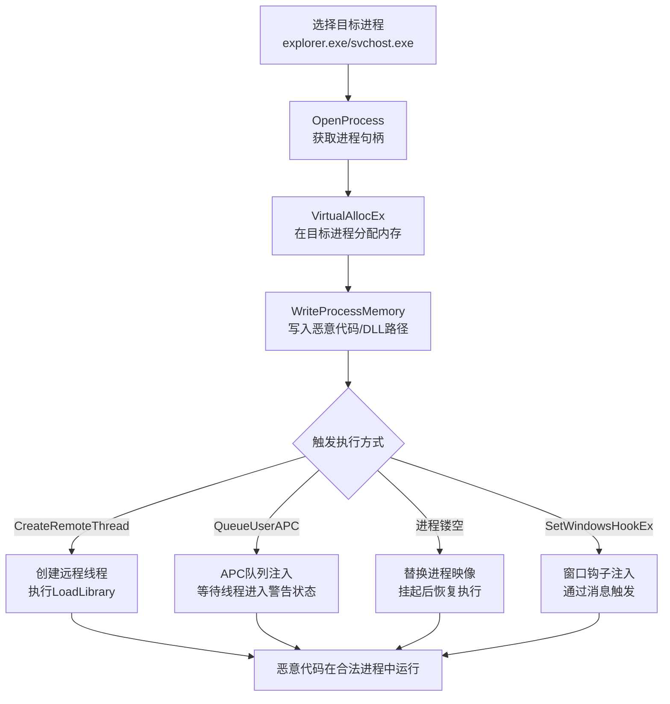

# 进程注入 (T1055)

## 一句话通俗理解

攻击者像"附身的鬼魂"一样钻进正常进程中运行恶意代码——让恶意行为披着合法进程的外衣运行，躲过安全检测。

## 30秒速查卡

| 维度 | 你需要知道的 |
|------|-------------|
| 这是什么？ | 攻击者将恶意代码注入到合法进程中执行的技术 |
| 为什么危险？ | 恶意代码以合法进程身份运行，绕过基于进程名的检测和白名单 |
| 谁需要关心？ | EDR开发人员、SOC分析师、恶意软件分析师 |
| 你的第一步防御 | 监控跨进程内存操作API（VirtualAllocEx+WriteProcessMemory+CreateRemoteThread） |
| 如果只做一件事 | 启用EDR的API行为监控，特别关注跨进程注入的三件套API调用 |

## 难度等级

⭐⭐⭐ 高级（需要深入理解操作系统进程管理和内存机制）

**前置知识要求：**
- Windows进程与线程管理
- 虚拟内存与内存保护机制
- Windows API基础（VirtualAlloc、CreateRemoteThread等）
- PE文件格式

## 前置知识检查

**读这个文件需要什么？**

- [ ] Windows进程管理基础（进程、线程、句柄）
- [ ] 虚拟内存概念（VirtualAlloc、内存保护属性）
- [ ] Windows API调用机制
- [ ] PE文件格式基础

## 技术描述

进程注入（T1055）是MITRE ATT&CK框架中隐蔽战术的一种技术，指攻击者将恶意代码注入到另一个正在运行的合法进程中执行，从而以合法进程的身份进行恶意操作。

**通俗解释：**

想象一个坏人想进入一栋需要身份验证的大楼。他不是自己刷卡进去（自己进去会被发现），而是偷偷跟着一个已经刷卡进去的合法员工，钻进他的衣服里（注入他的进程），然后用这个员工的身份在大楼里到处活动。大楼的安保系统看到的是"这个合法员工在走动"，实际上里面是坏人。

**过渡段：** 简单来说，操作系统中的每个进程都有自己的内存空间和权限。安全软件通常通过进程名、签名、行为来判断一个进程是否恶意。如果攻击者把恶意代码塞进一个合法进程（如explorer.exe、svchost.exe）的内存空间中执行，安全软件看到的是合法进程在运行，实际执行的是恶意代码。

**技术原理：**

1. **经典DLL注入**：使用`VirtualAllocEx`在目标进程分配内存，用`WriteProcessMemory`写入DLL路径，再用`CreateRemoteThread`调用`LoadLibrary`加载DLL
2. **进程镂空（Process Hollowing）**：以挂起状态创建合法进程，替换其内存中的代码为恶意代码，然后恢复执行
3. **反射式DLL注入**：自实现的DLL加载器，不通过`LoadLibrary`，直接在内存中映射DLL
4. **进程 Doppelgänging**：利用Windows事务API创建临时进程，替换其内容
5. **APC注入**：将恶意代码地址附加到目标进程的APC队列，当线程进入可警告状态时执行

**用途与影响：**
进程注入是几乎所有高级恶意软件的标配技术。通过注入合法进程，恶意软件可以绕过基于进程名的安全策略、获取合法进程的权限和令牌、避免在进程列表中暴露自己。Cobalt Strike、Mimikatz等工具都广泛使用进程注入。

## 子技术列表

| 子技术ID | 名称 | 说明 |
|----------|------|------|
| T1055.001 | 动态链接库注入 | 经典DLL注入，通过CreateRemoteThread调用LoadLibrary |
| T1055.002 | 便携式可执行文件注入 | 直接将PE文件注入目标进程内存 |
| T1055.003 | 进程镂空 | 创建挂起的合法进程，替换代码后恢复 |
| T1055.004 | 异步过程调用注入 | 通过APC队列执行注入代码 |
| T1055.005 | 线程本地存储注入 | 利用TLS回调函数执行注入代码 |
| T1055.008 | Ptrace系统调用注入 | Linux/macOS上的ptrace注入 |
| T1055.009 | 进程镂空变体 | 使用更隐蔽的进程镂空变体 |
| T1055.011 | 额外窗口内存注入 | 通过窗口额外内存区域注入 |
| T1055.012 | 进程双重化 | 利用事务API的进程镂空变体 |
| T1055.013 | 进程重影 | 利用映像映射创建幽灵进程 |
| T1055.014 | VDSO劫持 | Linux上劫持VDSO页面 |
| T1055.015 | ListPlanting | 利用列表视图控件注入 |

## 攻击流程

### 典型攻击流程

```
选择目标进程 --> 获取进程句柄 --> 分配内存 --> 写入恶意代码 --> 触发执行 --> 恶意代码运行
```



**步骤详解：**

1. **选择目标进程**
   - 通俗描述：找一个合适的"宿主"进程来藏身
   - 技术细节：通常选择长时间运行、网络权限高的进程（如svchost.exe、explorer.exe、chrome.exe）
   - 常用工具：Process Explorer、自定义枚举代码

2. **获取进程句柄**
   - 通俗描述：获得操作目标进程内存的"钥匙"
   - 技术细节：使用`OpenProcess(PROCESS_ALL_ACCESS, FALSE, pid)`获取进程句柄
   - 常用工具：Windows API

3. **分配内存并写入代码**
   - 通俗描述：在目标进程的内存空间里开辟一块区域，把恶意代码放进去
   - 技术细节：`VirtualAllocEx`分配RWX内存，`WriteProcessMemory`写入shellcode或DLL路径
   - 常用工具：Windows API

4. **触发执行**
   - 通俗描述：想办法让目标进程"运行"注入的代码
   - 技术细节：CreateRemoteThread创建远程线程、QueueUserAPC排队执行、进程镂空替换映像
   - 常用工具：Windows API

## 真实案例

### 案例1：Cobalt Strike Beacon的进程注入（持续活跃）

- **时间**：持续活跃（2015年至今）
- **目标**：各类红队测试和恶意攻击
- **攻击组织**：各种APT和犯罪团伙
- **手法**：Cobalt Strike的Beacon支持多种进程注入方式。最常用的是通过`VirtualAllocEx`+`WriteProcessMemory`+`CreateRemoteThread`将Beacon DLL注入到合法进程（如svchost.exe）中。Beacon还支持`fork&run`模式——先创建一个合法进程的挂起实例，然后注入Beacon代码。这种方式使得Beacon运行在合法进程的上下文中，继承合法进程的令牌和权限。
- **影响**：Cobalt Strike是最流行的C2框架，进程注入是其核心隐蔽技术
- **参考链接**：[Cobalt Strike Documentation](https://hstechdocs.helpsystems.com/manuals/cobaltstrike/)

### 案例2：APT29使用进程镂空绕过检测（2020年SolarWinds攻击）

- **时间**：2020年
- **目标**：SolarWinds供应链攻击受害者
- **攻击组织**：APT29（Cozy Bear，俄罗斯SVR）
- **手法**：APT29在SolarWinds攻击中使用进程镂空技术：以挂起状态创建一个合法进程（如dllhost.exe），然后掏空其内存映像，替换为SUNBURST后门的代码，最后恢复线程执行。从进程列表看，运行的是合法的dllhost.exe，但实际执行的是SUNBURST后门。攻击者还使用反射式DLL注入将后续阶段payload注入到其他进程中。
- **影响**：进程注入帮助SUNBURST在受害者网络中隐蔽运行数月
- **参考链接**：[CISA Alert AA21-078A](https://www.cisa.gov/news-events/cybersecurity-advisories/aa21-078a)

### 案例3：FIN7使用APC注入攻击餐饮零售业（2017-2019年）

- **时间**：2017-2019年
- **目标**：美国餐饮、零售企业
- **攻击组织**：FIN7（Carbanak Group）
- **手法**：FIN7使用APC注入技术将Carbanak后门注入到explorer.exe中。攻击者首先获取explorer.exe的线程ID，然后使用`QueueUserAPC`将shellcode地址排入目标线程的APC队列。当explorer.exe的线程进入可警告等待状态（如调用SleepEx、WaitForSingleObjectEx）时，APC队列中的shellcode被执行。这种技术比CreateRemoteThread更隐蔽，因为它不创建新线程。
- **影响**：FIN7通过这种方式隐蔽运行后门，造成超过10亿美元损失
- **参考链接**：[FireEye FIN7 Analysis](https://www.fireeye.com/blog/threat-research/2017/04/fin7-phishing.html)

## 红队视角

> ⚠️ **免责声明**：以下内容仅用于合法的安全测试、渗透测试和教育目的。未经授权对他人系统进行测试是违法行为。

### 实战技巧

1. **经典DLL注入（C#实现）**
   ```csharp
   // 获取目标进程句柄
   IntPtr hProcess = OpenProcess(ProcessAccess.AllAccess, false, targetPid);
   // 分配内存
   IntPtr pDllPath = VirtualAllocEx(hProcess, IntPtr.Zero, (uint)dllPath.Length,
       AllocationType.Commit | AllocationType.Reserve, MemoryProtection.ExecuteReadWrite);
   // 写入DLL路径
   WriteProcessMemory(hProcess, pDllPath, dllPathBytes, dllPathBytes.Length, out _);
   // 获取LoadLibrary地址
   IntPtr pLoadLibrary = GetProcAddress(GetModuleHandle("kernel32.dll"), "LoadLibraryA");
   // 创建远程线程执行LoadLibrary
   CreateRemoteThread(hProcess, IntPtr.Zero, 0, pLoadLibrary, pDllPath, 0, out _);
   ```

2. **进程镂空**
   - 以`CREATE_SUSPENDED`标志创建合法进程
   - 使用`NtUnmapViewOfSection`清空进程内存
   - 使用`VirtualAllocEx`+`WriteProcessMemory`写入恶意PE
   - 修改进程上下文（PEB->ImageBaseAddress）
   - 使用`SetThreadContext`+`ResumeThread`恢复执行

3. **避免直接调用API**
   - 使用间接syscall绕过EDR的用户层hook
   - 使用NTAPI（NtAllocateVirtualMemory）替代Win32 API
   - 使用直接系统调用号

### 常用工具

| 工具名称 | 用途 | 平台 | 链接 |
|----------|------|------|------|
| Cobalt Strike | C2框架，内置多种注入方式 | Windows | https://www.cobaltstrike.com/ |
| Metasploit | 渗透测试框架，支持migrate命令 | 跨平台 | https://www.metasploit.com/ |
| InjectProc | 进程注入研究工具 | Windows | https://github.com/secruw/InjectProc |
| SysWhispers | 间接syscall生成器 | Windows | https://github.com/jthuraisamy/SysWhispers3 |

### 注意事项

- 现代EDR监控VirtualAllocEx+WriteProcessMemory+CreateRemoteThread的API序列
- RWX内存分配是强检测信号，应尽量使用RW+后续改为RX
- 进程注入后，注入的线程的起始地址不在目标模块范围内，可被检测
- 注入到受保护进程（PPL）需要更高权限

## 蓝队视角

### 检测要点

1. **跨进程API调用序列检测**
   - 日志来源：EDR API监控、Sysmon Event ID 8（CreateRemoteThread）
   - 关注字段：VirtualAllocEx、WriteProcessMemory、CreateRemoteThread的组合调用
   - 异常特征：一个进程对另一个进程执行"分配内存+写入+创建线程"的序列

2. **内存保护属性异常**
   - 日志来源：EDR内存监控
   - 关注字段：RWX内存分配、RW改为RX的VirtualProtect调用
   - 异常特征：非代码区域被设置为可执行权限

3. **进程行为异常**
   - 日志来源：EDR行为监控
   - 关注字段：合法进程发起网络连接、加载未知DLL
   - 异常特征：explorer.exe突然发起C2连接，svchost.exe加载非标准DLL

### 监控建议

- 启用Sysmon Event ID 8（CreateRemoteThread）监控
- 使用ETW（Event Tracing for Windows）监控内存操作API
- 配置EDR监控跨进程内存操作
- 监控合法进程的网络行为异常

## 避坑指南

**常见误区：** 认为注入到svchost.exe就安全了。实际上，svchost.exe有特定的DLL加载规则和网络行为模式，异常行为很容易被EDR检测。

**正确的红队做法：** 选择与payload行为模式相似的宿主进程，如浏览器进程适合C2通信，系统服务进程适合持久化。

## 检测建议

### 网络层检测

**检测方法：** 监控合法进程发起的异常网络连接，如explorer.exe连接未知IP、svchost.exe使用非标准端口通信。

**用人话说：** 进程注入后，恶意代码会以合法进程的身份发网络请求。如果explorer.exe突然开始连一个可疑的境外IP，很可能被注入了。

**具体命令/规则示例：**

```bash
# 检测异常进程的网络连接（Suricata规则示例）
# 需要配合端点数据使用
alert tcp $HOME_NET any -> $EXTERNAL_NET any (
    msg:"T1055 - 可疑进程发起外部连接（可能被注入）";
    flow:established,to_server;
    # 需要结合端点信息判断
    classtype:trojan-activity;
    sid:10010551;
    rev:1;
)
```

### 主机层检测

**Windows事件ID：**
- Sysmon Event ID 8：CreateRemoteThread（远程线程创建）
- Sysmon Event ID 10：ProcessAccess（进程访问）
- Sysmon Event ID 7：ImageLoaded（DLL加载）
- Sysmon Event ID 25：ProcessTampering（进程篡改）

**具体命令示例：**
```powershell
# 检测CreateRemoteThread事件
Get-WinEvent -FilterHashtable @{LogName='Microsoft-Windows-Sysmon/Operational'; ID=8} |
    Select-Object TimeCreated, @{N='SourceProcess';E={$_.Properties[2].Value}},
    @{N='TargetProcess';E={$_.Properties[5].Value}}

# 检测进程访问（可能的注入前奏）
Get-WinEvent -FilterHashtable @{LogName='Microsoft-Windows-Sysmon/Operational'; ID=10} |
    Where-Object { $_.Message -match 'PROCESS_VM_WRITE|PROCESS_VM_OPERATION' }
```

### 应用层检测

**Sigma规则示例：**

**用人话说：** 进程注入检测的核心是抓住"一个进程在操作另一个进程的内存"这个行为。Sysmon Event ID 8（CreateRemoteThread）是最直接的信号。另外要关注RWX内存分配和合法进程的异常行为。

```yaml
title: 进程注入检测 - CreateRemoteThread
status: experimental
description: 检测通过CreateRemoteThread进行的进程注入
logsource:
    product: windows
    service: sysmon
detection:
    selection:
        EventID: 8
    filter_legitimate:
        SourceImage|endswith:
            - '\csrss.exe'
            - '\wininit.exe'
            - '\services.exe'
    condition: selection and not filter_legitimate
level: medium
tags:
    - attack.t1055
    - attack.defense_evasion
    - attack.stealth
    - attack.privilege_escalation
```

## 缓解措施

### 优先级1：关键措施

**措施名称：** 启用EDR API行为监控

**具体实施步骤：**
1. 部署支持ETW监控的EDR解决方案
2. 配置VirtualAllocEx+WriteProcessMemory+CreateRemoteThread序列告警
3. 监控RWX内存分配和VirtualProtect权限修改

### 优先级2：重要措施

**措施名称：** 进程保护

**具体实施步骤：**
1. 对关键进程启用PPL（Protected Process Light）
2. 配置Windows Defender Application Guard隔离浏览器
3. 使用CFG（Control Flow Guard）保护进程

### 优先级3：建议措施

**措施名称：** 行为基线

**具体实施步骤：**
1. 建立各进程的正常行为基线（网络连接、DLL加载）
2. 配置异常行为告警
3. 监控合法进程的非预期子进程创建

### MITRE ATT&CK 缓解措施映射

| 缓解措施ID | 缓解措施名称 | 适用性 | 说明 |
|------------|-------------|--------|------|
| M1040 | 行为检测 | 适用 | 监控跨进程内存操作 |
| M1026 | 特权账户管理 | 部分适用 | 限制调试权限 |
| M1038 | 执行防护 | 适用 | 阻止非授权代码执行 |

## 动手实验

> ⚠️ **重要提示**：所有实验必须在隔离的实验室环境中进行，禁止对未授权的真实系统进行测试。

### 实验环境准备

**所需工具：**
- Windows 10/11 VM（带Sysmon）
- Visual Studio 或 MinGW
- Process Hacker / Process Explorer

### 实验1：经典DLL注入（中级）

**实验目标：** 理解DLL注入的原理和检测方法

**实验步骤：**
1. 编写一个简单的测试DLL（弹MessageBox）
2. 编写注入器程序（OpenProcess→VirtualAllocEx→WriteProcessMemory→CreateRemoteThread）
3. 将DLL注入到notepad.exe中
4. 在Sysmon日志中查看Event ID 8（CreateRemoteThread）
5. 在Process Hacker中查看notepad.exe加载的DLL

**预期结果：** DLL被注入成功，MessageBox弹出，Sysmon记录CreateRemoteThread事件

**学习要点：** 理解DLL注入的API调用序列和检测信号

### 实验2：进程镂空（高级）

**实验目标：** 理解进程镂空的原理

**实验步骤：**
1. 以CREATE_SUSPENDED创建合法进程
2. 读取恶意PE文件
3. NtUnmapViewOfSection清空目标进程内存
4. VirtualAllocEx分配新内存
5. WriteProcessMemory写入PE各节
6. 修改基址和入口点
7. ResumeThread恢复执行

**预期结果：** 进程列表显示合法进程名，但实际运行的是恶意代码

**学习要点：** 掌握进程镂空的完整流程和检测难点

## 术语解释

| 术语 | 英文原名 | 通俗解释 |
|------|----------|----------|
| 进程注入 | Process Injection | 将代码注入到另一个进程中执行 |
| 进程镂空 | Process Hollowing | 创建合法进程后替换其代码 |
| 句柄 | Handle | 操作系统提供的对资源的引用标识 |
| RWX内存 | Read-Write-Execute Memory | 可读可写可执行的内存区域 |
| APC | Asynchronous Procedure Call | 异步过程调用，可以在特定条件触发执行 |
| 反射式加载 | Reflective Loading | 自实现DLL加载，不通过LoadLibrary |
| PPL | Protected Process Light | 受保护进程，限制其他进程的访问 |

## 参考资料

### 📚 官方文档（深入了解）

- [MITRE ATT&CK - T1055 Process Injection](https://attack.mitre.org/techniques/T1055/)

### 📰 安全报告（真实攻击）

- [CISA - SolarWinds (APT29) 分析报告](https://www.cisa.gov/news-events/cybersecurity-advisories/aa21-078a)
- [FireEye - FIN7 攻击分析](https://www.fireeye.com/blog/threat-research/2017/04/fin7-phishing.html)
- [Cobalt Strike - 进程注入文档](https://hstechdocs.helpsystems.com/manuals/cobaltstrike/)

### 🔧 工具与资源（动手试试）

- [SysWhispers3 - 间接Syscall生成器](https://github.com/jthuraisamy/SysWhispers3)
- [InjectProc - 进程注入研究工具](https://github.com/secruw/InjectProc)
- [Process Hacker - 进程分析工具](https://processhacker.sourceforge.io/)
