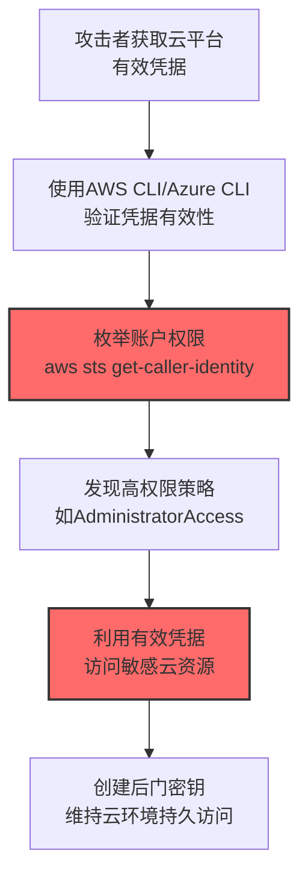
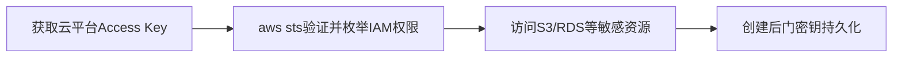

# 云账户 (T1078.004)

## 一句话通俗理解

> **使用云平台（AWS、Azure、GCP）的账户凭据访问云资源**

## 30秒速查卡

| 维度 | 你需要知道的 |
|------|-------------|
| 这是什么？ | 使用云平台（AWS、Azure、GCP）的账户凭据访问云资源 |
| 为什么危险？ | 攻击者利用此技术可以绕过系统安全机制，获取更高权限，为后续攻击铺路 |
| 谁需要关心？ | 系统管理员、安全运维团队、SOC分析师 |
| 你的第一步防御 | 监控与云账户相关的异常系统调用和进程行为 |
| 如果只做一件事 | 部署EDR解决方案，启用针对云账户技术的检测规则 |



## 难度等级

⭐ 初级 - 入门级技术，基础操作

## 前置知识检查

**读这个文件需要什么？**

- [ ] 操作系统权限模型（User/Admin/SYSTEM/root）
- [ ] 进程与令牌概念
- [ ] 常见漏洞利用基础知识

## 技术描述

**云账户**（T1078.004）是 **有效账户**（T1078）的一个具体变体，属于 **权限提升** 阶段的攻击技术。

简单来说，就像用别人的身份卡，大摇大摆地走进大楼。

### 具体怎么理解？

使用云平台（AWS、Azure、GCP）的账户凭据访问云资源

攻击者使用这种技术时，通常是在权限提升阶段，想要达到特定的攻击目标。与父技术 T1078 相比，T1078.004 有自己独特的特点和使用场景。

### 为什么有效？

这种技术之所以有效，是因为：
1. **隐蔽性**：利用了正常系统功能或常见协议，不容易被发现
2. **技术门槛适中**：不需要特别高深的技术知识就能实施

**过渡段：** 不要误以为权限提升就是'用漏洞获取root'——大部分权限提升利用的是配置缺陷而非漏洞。
3. **广泛适用**：可以在多种环境和系统中使用

## 真实攻击流程

### 典型场景

攻击者在 **权限提升** 阶段使用 云账户 技术，以下是典型的攻击步骤：



**步骤详解：**

1. **凭据验证**：使用窃取的 Access Key 通过 `aws sts get-caller-identity` 或 Azure CLI 验证凭据有效性
2. **权限枚举**：`aws iam list-attached-user-policies` 或 Azure AD RBAC 检查，了解凭据对应的权限范围
3. **资源访问**：利用有效凭据访问 S3 存储桶、RDS 数据库、Azure Blob 等敏感资源
4. **持久后门**：创建新的 Access Key（`iam:create-access-key`）或注册新用户，确保持久访问

## 攻击流程

```
获取云平台Access Key --> aws sts验证并枚举IAM权限 --> 访问S3/RDS等敏感资源 --> 创建后门密钥持久化云环境
```



**步骤详解：**
1. **获取云平台Access Key**
   - 通俗描述：通过代码仓库泄露、实例元数据服务或钓鱼获取云账户访问密钥
   - 技术细节：扫描 GitHub 公开仓库中的 `AKIA` 前缀密钥，SSRF 访问 EC2 元数据服务 `169.254.169.254/latest/meta-data/iam/security-credentials/`，从 ~/.aws/credentials 窃取
   - 常用工具：TruffleHog、GitLeaks、SSRF Payload、aws-cli
2. **aws sts验证并枚举IAM权限**
   - 通俗描述：用窃取的密钥确认身份并枚举其拥有的云权限范围
   - 技术细节：`aws sts get-caller-identity` 确认账户身份，`aws iam list-attached-user-policies` 列出附加策略，Azure 使用 `az role assignment list` 检查 RBAC
   - 常用工具：AWS CLI、Azure CLI、CloudGoat、Pacu
3. **访问S3/RDS等敏感资源**
   - 通俗描述：利用有效凭据访问云上的敏感存储和数据库
   - 技术细节：`aws s3 ls` 列举存储桶、`aws s3 cp s3://bucket/` 下载敏感数据，修改 RDS 安全组允许外部连接，启动 EC2 实例并附加高权限角色
   - 常用工具：AWS CLI、boto3、Azure Storage Explorer、Pacu
4. **创建后门密钥持久化**
   - 通俗描述：在云账户下创建新的 Access Key 或 IAM 用户维持长期访问
   - 技术细节：`aws iam create-access-key --user-name <target>` 为现有用户添加第二把密钥，或注册新 IAM 用户并附加 AdministratorAccess 策略，滥用 Lambda 后门函数实现事件驱动持久化
   - 常用工具：AWS CLI、Terraform、Pacu、CloudSploit

## 真实案例

### 案例1：该技术在实际攻击中的应用

- **时间**: 2024-2025年
- **目标**: 多个行业组织
- **攻击组织**: 多个APT组织
- **手法**: 攻击者在入侵过程中使用云账户技术，展示了该子技术的典型应用场景和攻击效果
- **影响**: 成功实施该技术导致目标系统被进一步入侵
- **参考链接**: [MITRE ATT&CK官方](https://attack.mitre.org/)

### 案例2：安全研究中的实践

- **时间**: 2025年
- **目标**: 安全研究测试环境
- **攻击组织**: 红队/安全研究人员
- **手法**: 在授权测试中模拟云账户攻击，验证防御体系的检测和响应能力
- **影响**: 帮助组织识别安全防护中的盲点和改进方向
- **参考链接**: [Atomic Red Team](https://github.com/redcanaryco/atomic-red-team)

## 红队视角

> ⚠️ **免责声明**：以下内容仅用于合法的安全测试、渗透测试和教育目的。未经授权对他人系统进行测试是违法行为。

### 实战技巧

1. **深入理解原理**：在实战应用前，充分理解云账户的技术原理和适用场景
2. **环境适配**：根据目标系统的操作系统版本、安全配置等因素调整攻击策略
3. **组合使用**：将该技术与其他技术组合使用，构建完整的攻击链
4. **隐蔽性考虑**：注意操作痕迹的清理，避免被安全设备检测

### 常用工具

| 工具名称 | 用途 | 平台 | 链接 |
| -------- | ---- | ---- | ---- |
| Metasploit | 渗透测试框架 | 全平台 | [Metasploit](https://www.metasploit.com/) |
| Cobalt Strike |  adversary模拟平台 | Windows | [Cobalt Strike](https://www.cobaltstrike.com/) |
| Atomic Red Team | 检测规则测试 | 全平台 | [Atomic Red Team](https://github.com/redcanaryco/atomic-red-team) |

### 注意事项

- 在授权的测试环境中使用这些技术
- 注意操作安全（OPSEC），避免被检测系统发现
- 使用匿名化技术和代理隐藏真实身份

## 蓝队视角

### 检测要点

1. **系统日志监控**：关注与云账户相关的系统日志和审计记录
2. **异常行为检测**：监控系统中与该技术相关的异常进程、网络连接和文件操作
3. **工具特征识别**：识别攻击者可能使用的工具在系统中的运行特征

### 监控建议

- 部署端点检测和响应（EDR）系统，监控与云账户相关的异常行为
- 配置SIEM规则，关联分析来自多个来源的告警
- 定期进行安全评估和渗透测试，验证检测规则的有效性

## 避坑指南

红队新手常见错误：一上来就找内核漏洞提权。

## 检测建议

### 检测思路

检测 云账户 的关键是识别异常行为模式。以下是三个层面的检测方法：

### 网络层检测

**方法**：监控网络流量中的异常模式

```bash
# 检测异常的网络连接和数据传输
# 根据具体协议和端口设置检测规则
```

### 主机层检测

**Windows事件ID**：
- 事件ID 4688：进程创建（监控可疑进程）
- 事件ID 4104：PowerShell执行（监控可疑脚本）

**Linux日志**：
- /var/log/auth.log：认证日志
- /var/log/syslog：系统日志

```bash
# 检测异常进程和命令执行
grep -i "suspicious" /var/log/auth.log
```

**用人话说：** 云账户（AWS IAM用户、Azure AD用户、GCP服务账号）在云环境中拥有各种资源和权限。攻击者通过泄露的AccessKey、GitHub硬编码的凭据或钓鱼获取云控制台密码后，直接用AWS CLI（`aws s3 ls`）或Azure CLI访问云资源。在提权方面，攻击者寻找拥有高权限的云账号（如AWS AdministratorAccess策略绑定的用户），利用其权限创建后门或直接控制云基础设施。



```yaml
title: 检测云账户
status: experimental
description: 检测可能的云账户活动
logsource:
    category: process_creation
    product: windows
detection:
    selection:
        EventID: 4688
    condition: selection
level: medium
tags:
    - attack.T1078004
```


### 应用层检测

**Sigma规则示例：**

**用人话说：**在实际环境中，需要结合上下文判断异常行为。建议针对本技术的特征指标设置告警阈值，并关联多个数据源进行交叉验证。


yaml
title: Detected Suspicious Activity - T1078.004
status: experimental
description: Detects potential T1078.004 related suspicious behavior
logsource:
  category: process_creation
  product: windows
detection:
  selection:
    EventID: 4688
  condition: selection
level: medium
tags:
  - attack.T1078.004


## 缓解措施

### 优先级1：关键措施

**限制攻击面**：减少暴露的服务和端口，降低被利用的风险

```bash
# 防火墙规则示例：只允许必要的出站连接
iptables -A OUTPUT -p tcp --dport 443 -j ACCEPT  # 允许HTTPS
iptables -A OUTPUT -p tcp --dport 80 -j ACCEPT   # 允许HTTP
iptables -A OUTPUT -p tcp -j DROP                 # 阻止其他TCP
```

### 优先级2：重要措施

**加强监控**：部署EDR和SIEM系统，实时监控异常行为

### 优先级3：建议措施

**安全意识培训**：教育员工识别相关攻击手法

## 动手实验

> ⚠️ **所有实验必须在隔离的实验室环境中进行**

### 实验1：理解基本原理（初级）

**目标**：理解 云账户 的工作原理

**步骤**：
1. 在隔离环境中搭建测试系统
2. 使用基础工具模拟攻击行为
3. 观察系统日志和网络流量

**学习要点**：理解该技术的核心机制

### 实验2：实际操作（中级）

**目标**：掌握 云账户 的实际使用方法

**步骤**：
1. 使用专业工具进行攻击模拟
2. 尝试不同的绕过技术
3. 分析检测日志的特征

**学习要点**：掌握工具使用和日志分析

### 实验3：防御验证（高级）

**目标**：验证检测规则的有效性

**步骤**：
1. 部署检测规则
2. 执行攻击模拟
3. 验证检测告警是否触发

**学习要点**：理解攻防对抗的实际效果

## 术语解释

| 术语 | 通俗解释 |
|------|---------|
| **ATT&CK** | MITRE公司维护的攻击技术知识库，像一本"黑客手法百科全书" |
| **云账户** | T1078.004，ATT&CK框架中定义的一种具体攻击技术 |
| **有效账户** | T1078，云账户所属的父技术类别 |
| **权限提升** | 攻击链中的一个阶段，攻击者在这个阶段的目标 |
| **C2** | 命令与控制，攻击者用来远程控制被入侵系统的"遥控器" |
| **EDR** | 端点检测与响应，部署在电脑上的安全监控软件 |

## 被引用情况

以下父技术文档引用了本子技术：

- [T1078 - 有效账户](../../03-Initial-Access/T1078-Valid-Accounts.md)
- [T1078 - 有效账户](../../05-Persistence/T1078-Valid-Accounts.md)
- [T1078 - 有效账户](../T1078-Valid-Accounts.md)
- [T1078 - 有效账户](../../07-Stealth/T1078-Valid-Accounts.md)
- [T1078 - 有效账户](../../08-Defense-Impairment/T1078-Valid-Accounts.md)

## 参考资料

### 📚 官方文档（深入了解）

- [MITRE ATT&CK - 云账户 (T1078.004)](https://attack.mitre.org/techniques/T1078/004/)
- [MITRE ATT&CK - 有效账户 (T1078)](https://attack.mitre.org/techniques/T1078/)

### 📰 安全报告（真实攻击）

- [MITRE ATT&CK 官方文档](https://attack.mitre.org/) - ATT&CK 框架官方资源

### 🔧 工具与资源（动手试试）

- [Atomic Red Team](https://github.com/redcanaryco/atomic-red-team) - 检测规则测试框架
- [MITRE ATT&CK Navigator](https://mitre-attack.github.io/attack-navigator/) - ATT&CK 可视化工具

### 📚 学习资料（深入了解）

- [MITRE ATT&CK 知识库](https://attack.mitre.org/resources/) - ATT&CK 官方资源中心
