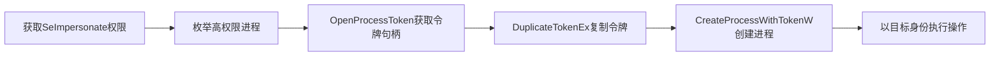

# 访问令牌操纵 (T1134)

## 一句话通俗理解

> **像偷了别人的工牌混进公司禁区，系统以为你是合法的管理员**

## 30秒速查卡

| 维度 | 你需要知道的 |
|------|-------------|
| 这是什么？ | 窃取或伪造Windows访问令牌冒充其他用户身份的技术 |
| 为什么危险？ | 能绕过所有基于身份的访问控制，且极难追踪 |
| 谁需要关心？ | Windows系统管理员、域管理员、安全团队 |
| 你的第一步防御 | 监控SeImpersonatePrivilege和SeAssignPrimaryTokenPrivilege的使用 |
| 如果只做一件事 | 启用Windows审计策略监控特权使用事件（Event ID 4673/4674） |

## 难度等级

⭐⭐⭐ 高级 - 需要Windows安全模型、访问令牌机制和C++编程基础

## 前置知识检查

**读这个文件需要什么？**

- [ ] Windows访问控制模型（ACL/DACL/SACL）
- [ ] 访问令牌（Access Token）和模拟令牌（Impersonation Token）
- [ ] C/C++编程和Windows API

## 技术描述

### 通俗解释

在Windows中，每个登录的用户都有一个"身份证"叫做访问令牌（Access Token），里面记录了用户的SID、所属组、权限等信息。系统就是通过检查这个令牌来决定你能不能访问某个文件或执行某个操作。攻击者如果能偷到管理员的令牌（比如通过DuplicateTokenEx API复制一个），就可以"变成"管理员，系统会以为真的是管理员在操作。

### 过渡段

简单来说，Windows进程启动时会被分配一个代表用户身份的令牌。如果有SeImpersonatePrivilege权限，进程可以通过API获取并使用其他用户的令牌，从而以该用户身份执行操作。

### 技术原理

访问令牌操纵的核心API：
1. **OpenProcessToken**：打开目标进程的令牌句柄
2. **DuplicateTokenEx**：复制令牌，创建新的模拟令牌
3. **ImpersonateLoggedOnUser**：使当前线程使用复制的令牌
4. **CreateProcessWithTokenW**：使用复制的令牌创建新进程
5. **SetThreadToken**：直接设置线程的令牌

令牌类型：
- **Primary Token（主令牌）**：代表进程的身份
- **Impersonation Token（模拟令牌）**：线程临时使用其他用户身份

### 用途与影响

令牌操纵是横向移动和权限提升的关键技术，被Mimikatz、Cobalt Strike等工具内置支持。攻击者可以通过令牌操纵从普通用户跳转到SYSTEM或域管理员，无需知道密码。

## 子技术列表

| 子技术ID | 名称 | 说明 |
|----------|------|------|
| T1134.001 | Token Impersonation/Theft | 令牌模拟/窃取 |
| T1134.002 | Create Process with Token | 使用令牌创建进程 |
| T1134.003 | Make and Impersonate Token | 创建并模拟令牌 |
| T1134.004 | Parent PID Spoofing | 父进程ID欺骗 |
| T1134.005 | SID-History Injection | SID-History注入 |
| T1134.006 | Token Manipulation in macOS | macOS令牌操纵 |

## 攻击流程



### 步骤详解
1. 攻击者获取SeImpersonatePrivilege（通常通过服务账户或提权漏洞）
2. 枚举系统中的高权限进程（如lsass.exe、winlogon.exe）
3. 使用OpenProcessToken打开目标进程令牌
4. 使用DuplicateTokenEx复制令牌为模拟令牌
5. 使用CreateProcessWithTokenW或ImpersonateLoggedOnUser使用令牌
6. 以目标身份（SYSTEM/管理员）执行后续操作

## 真实案例

### 案例1：APT29 SolarWinds攻击中的令牌操纵（2020年）
- **时间**：2020年
- **目标**：美国政府机构
- **攻击组织**：APT29（Cozy Bear）
- **手法**：通过SolarWinds后门获取初始访问后，APT29使用Cobalt Strike beacon的"steal_token"功能，从lsass.exe进程窃取域管理员的访问令牌。然后使用窃取的令牌创建新进程，以域管理员身份访问域控制器。整个过程不需要知道域管理员密码，仅通过令牌操纵完成提权
- **影响**：成功横向移动到多个域控，窃取大量敏感邮件
- **参考链接**：Mandiant SolarWinds分析报告

### 案例2：Conti勒索软件利用令牌操纵提权（2021年）
- **时间**：2021年
- **目标**：爱尔兰卫生服务署（HSE）
- **攻击组织**：Conti勒索团伙
- **手法**：在获取初始访问后，Conti操作者使用PrintSpoofer工具（利用打印机服务漏洞获取SeImpersonatePrivilege），然后通过DuplicateTokenEx复制SYSTEM令牌，创建以SYSTEM权限运行的进程。随后窃取域管理员登录的令牌实现域控接管
- **影响**：HSE系统全面瘫痪，影响数百万患者
- **参考链接**：爱尔兰HSE事件报告

### 案例3：FIN7使用令牌操纵进行横向移动（2018-2019年）
- **时间**：2018-2019年
- **目标**：零售和餐饮企业
- **攻击组织**：FIN7（Carbanak Group）
- **手法**：在Carbanak后门中内置令牌操纵模块，通过OpenProcessToken+DuplicateTokenEx窃取POS系统管理员的令牌，然后以管理员身份在POS终端上部署恶意DLL，拦截信用卡数据
- **影响**：窃取超过1500万张信用卡信息
- **参考链接**：Trellix/FIN7分析报告

## 红队视角

### 实战技巧
- 优先从lsass.exe窃取令牌（SYSTEM和域管理员令牌通常在此）
- 使用CreateProcessWithTokenW而非ImpersonateLoggedOnUser，前者更稳定
- 需要SeImpersonatePrivilege权限，可通过Potato系列漏洞获取

### 常用工具
| 工具 | 类型 | 特点 |
|------|------|------|
| Mimikatz | 后渗透工具 | privilege::debug + token::whoami |
| Cobalt Strike | C2框架 | steal_token / make_token命令 |
| JuicyPotato | 提权工具 | 利用DCOM获取SYSTEM令牌 |
| PrintSpoofer | 提权工具 | 利用打印服务获取SeImpersonate |
| Incognito | 令牌工具 | 专门用于令牌操纵的后渗透工具 |

## 蓝队视角

### 检测要点
- 监控SeImpersonatePrivilege和SeAssignPrimaryTokenPrivilege的使用
- 检测进程创建时的父进程与令牌所有者不匹配的情况
- 监控OpenProcessToken针对lsass.exe的调用

### 监控建议
- 启用Windows审计策略"特权使用"（Event ID 4673/4674）
- 使用Sysmon Event ID 8（CreateRemoteThread）和Event ID 10（ProcessAccess）
- 部署EDR监控令牌相关API调用

## 避坑指南

- SeImpersonate权限不仅管理员有，服务账户（如IIS、SQL Server）也有
- Potato系列攻击不需要管理员权限，需要额外关注
- 令牌操纵不会在安全日志中留下密码相关记录，需要专门监控特权使用

## 检测建议

### 网络层
- 监控异常的认证模式（如同一账户从多个主机同时认证）
- 检测Kerberos票据的异常使用模式

### 主机层
- **用人话说**：Windows会记录谁使用了"超级权限"（如模拟其他用户），重点关注使用SeImpersonate权限的进程
```yaml
# 关键审计事件
Event ID: 4673  # 敏感特权调用
Event ID: 4674  # 敏感特权使用成功
Event ID: 4688  # 进程创建（检查创建者与令牌所有者是否匹配）
```

### 应用层
```yaml
# Sigma规则：检测令牌操纵相关行为
title: 检测可疑令牌操纵行为
status: experimental
description: 检测使用SeImpersonatePrivilege或访问lsass进程令牌的行为
logsource:
    product: windows
    category: process_creation
detection:
    selection_tools:
        CommandLine|contains:
            - 'JuicyPotato'
            - 'PrintSpoofer'
            - 'RoguePotato'
            - 'incognito'
            - 'steal_token'
    selection_api:
        CommandLine|contains:
            - 'DuplicateTokenEx'
            - 'ImpersonateLoggedOnUser'
            - 'CreateProcessWithTokenW'
    condition: selection_tools or selection_api
level: critical
```

## 缓解措施

### 优先级1（必须实施）
- 限制SeImpersonatePrivilege仅授予必要的本地系统账户
- 启用Windows审计策略监控特权使用
- 部署EDR监控令牌操纵API调用

### 优先级2（推荐实施）
- 修补Potato系列漏洞相关的Windows组件（DCOM、打印服务、NTLM中继）
- 使用Protected Users组保护高权限账户
- 部署LSA Protection（RunAsPPL）

### 优先级3（长期规划）
- 实施Windows Server 2016+的Credential Guard
- 部署行为分析系统识别异常令牌使用模式

## 动手实验

### 实验1：使用PowerShell查看当前进程令牌权限
```powershell
# 预期输出：列出当前进程持有的所有特权
whoami /priv
# 查看是否包含SeImpersonatePrivilege
```

### 实验2：使用Incognito查看可用令牌
```bash
# 预期输出：列出当前可用的模拟令牌
incognito.exe list_tokens -u
# 输出示例：[NT AUTHORITY\SYSTEM] [DOMAIN\Administrator]
```

## 术语解释

| 术语 | 说明 |
|------|------|
| Access Token | 访问令牌，包含用户SID、组、特权等信息的Windows对象 |
| SeImpersonatePrivilege | 允许进程模拟客户端的特权 |
| Primary Token | 主令牌，代表进程默认身份 |
| Impersonation Token | 模拟令牌，线程临时使用的其他用户身份 |
| lsass.exe | 本地安全机构子系统服务，管理安全令牌和认证 |

## 参考资料

### 📚 深入了解
- [MITRE ATT&CK T1134](https://attack.mitre.org/techniques/T1134/)
- [Microsoft Access Token文档](https://learn.microsoft.com/windows/win32/secauthz/access-tokens)

### 📰 真实攻击
- [Mandiant SolarWinds分析报告](https://www.mandiant.com/resources/sunburst-additional-technical-details)
- [Conti HSE攻击分析](https://www.hse.ie/eng/services/news/)

### 🔧 动手试试
- [Incognito令牌操纵工具](https://github.com/fdiskyou/incognito)
- [PrintSpoofer使用指南](https://github.com/itm4n/PrintSpoofer)
