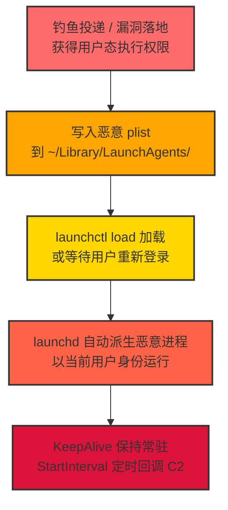

# Launch Agent / 启动代理 (T1543.001)

## 一句话通俗理解

> **macOS 上让恶意程序在用户登录时自动启动的"开机自启"机制——本质是一个 plist 配置文件，告诉 launchd 在合适时机帮你把代码跑起来。**

## 30秒速查卡

| 维度 | 你需要知道的 |
|------|-------------|
| 这是什么？ | Launch Agent（T1543.001），创建或修改系统进程（T1543）的子技术，专指 macOS 上以用户身份运行的 LaunchAgent 持久化 |
| 为什么危险？ | 用户登录即可自动拉起恶意进程，无需 root；plist 配置可触发 RunAtLoad（加载即运行）、KeepAlive（崩溃自动重启）、StartCalendarInterval（定时执行），兼具持久化与权限提升属性 |
| 谁需要关心？ | macOS 终端管理员、企业 MDM 运维、SOC 分析师、红蓝队研究人员 |
| 你的第一步防御 | 监控 `~/Library/LaunchAgents/` 与 `/Library/LaunchAgents/` 目录的 plist 写入，并审计 `launchctl` 命令执行 |
| 如果只做一件事 | 部署 KnockKnock 或 BlockBlock（Objective-See），对 LaunchAgent 新建事件实时告警 |
| 常见混淆点 | LaunchAgent（用户态，~/Library/LaunchAgents）≠ LaunchDaemon（系统态，/Library/LaunchDaemons，需 root）；后者归 T1543.004 |

## 难度等级

⭐⭐ 中级 - 需要一定的技术基础和经验

## 前置知识检查

**读这个文件需要什么？**

- [x] 操作系统权限模型基础（理解 user vs root）
- [x] 创建或修改系统进程（T1543）的原理
- [x] macOS 基础知识（launchd 守护进程、Property List 格式、`~/Library` 目录结构）
- [x] XML 基础语法（plist 文件格式）

## 技术描述

**Launch Agent / 启动代理**（T1543.001）是 **创建或修改系统进程**（T1543）的一个具体变体，属于 **权限提升** 与 **持久化** 阶段均会使用的攻击技术。MITRE ATT&CK 官方将其同时映射到 TA0004（权限提升）与 TA0003（持久化）两个战术。

macOS 通过 `launchd` 作为 1 号进程（PID 1）统一管理系统与服务。LaunchAgent 是 launchd 加载的一种特殊配置文件（Property List，扩展名 `.plist`），用于在特定条件下启动用户态进程。攻击者通过在受控位置写入恶意 plist，可让 `launchd` 在用户登录、系统启动或定时触发时自动拉起恶意可执行文件。

LaunchAgent 与 LaunchDaemon 的关键区别：

| 维度 | LaunchAgent (T1543.001) | LaunchDaemon (T1543.004) |
|------|------------------------|------------------------|
| 运行身份 | 当前登录用户 | root（系统级） |
| 加载时机 | 用户登录后 | 系统启动早期（用户登录前） |
| 用户级路径 | `~/Library/LaunchAgents/` | 无（仅系统级） |
| 系统级路径 | `/Library/LaunchAgents/`（影响所有用户） | `/Library/LaunchDaemons/` |
| 系统原生路径 | `/System/Library/LaunchAgents/`（SIP 保护） | `/System/Library/LaunchDaemons/`（SIP 保护） |
| 写入权限要求 | 用户级只需普通用户权限；系统级需 root | 必须 root |
| GUI 访问 | 有（用户会话内） | 通常无（除非配置） |

### 具体怎么理解？

把 macOS 想象成一家公司，`launchd` 是总台调度员。LaunchAgent 是一张"委托单"放在总台的抽屉里，上面写着："当 X 用户来上班时，自动帮我把这份工作跑起来。" 这张委托单放在用户的私人抽屉（`~/Library/LaunchAgents/`）只需要用户自己签字，不需要找总经理（root）。

plist 文件中的关键字段决定了"怎么跑"：

- **`Label`**：唯一标识，反向域名格式（如 `com.evil.persist`）
- **`ProgramArguments`**：要执行的可执行文件路径与参数数组
- **`RunAtLoad`**：`true` 时加载即立即执行一次
- **`KeepAlive`**：`true` 时进程退出会被自动重启；可配置为字典实现条件重启
- **`StartInterval`**：每隔 N 秒执行一次
- **`StartCalendarInterval`**：类 cron 的定时调度（指定时分秒日月周）
- **`WatchPaths`** / **`QueuedDirectories`**：监听指定路径变化触发执行

### 为什么有效？

1. **机制原生可信**：`launchd` 是 macOS 系统 1 号进程，安全工具默认不怀疑它派生子进程的行为
2. **加载即执行**：`RunAtLoad=true` 配合 `launchctl load` 可在写入瞬间触发执行，无需等待重启
3. **持久稳定**：`KeepAlive=true` 让恶意进程被 kill 后自动复活，蓝队难以彻底清除
4. **权限门槛低**：用户级 LaunchAgent 不需要 root，普通钓鱼落地后即可完成持久化
5. **路径隐蔽**：plist 是纯 XML 文本，可伪装成系统服务名（如 `com.apple.update.plist`），不仔细看难以发现
6. **跨会话存活**：每次用户登录都会触发，重启不影响持久化效果

## 真型场景

攻击者在 **权限提升/持久化** 阶段使用 Launch Agent 技术，以下是典型的攻击步骤：



**步骤详解：**

1. **初始落地**：攻击者通过钓鱼附件、漏洞利用或供应链投递获得目标 macOS 的用户态执行权限。此时进程仅在当前会话存活，重启即丢失。
2. **写入 plist**：在 `~/Library/LaunchAgents/com.evil.persist.plist` 写入配置文件，`ProgramArguments` 指向恶意可执行文件路径（通常藏在 `~/Library/Application Support/`、`/tmp/`、`~/.hidden/` 等隐蔽位置），并设置 `RunAtLoad=true`、`KeepAlive=true`。
3. **加载触发**：调用 `launchctl load ~/Library/LaunchAgents/com.evil.persist.plist` 主动加载，立即触发执行；或保持静默等待用户下次登录由 launchd 自动加载。
4. **持续运行**：launchd 派生子进程执行恶意代码，与 C2 服务器建立通信；进程被 kill 后由 `KeepAlive` 自动拉起，登录会话切换或重启后仍能恢复。

## 攻击流程

```
1. 钓鱼落地获得普通用户权限
2. 构造 plist 配置文件（含恶意可执行路径）
3. 写入 ~/Library/LaunchAgents/com.evil.persist.plist
4. 调用 launchctl load 立即加载（或等待下次登录）
5. launchd 派生恶意进程并保持常驻
6. 通过 C2 通道持续接收指令
```


**步骤详解：**

1. **构造 plist 文件**
   - 通俗描述：编写一个 XML 格式的配置文件，告诉 launchd 要运行什么、什么时候运行
   - 技术细节：使用 `Label`（唯一标识）、`ProgramArguments`（执行命令数组）、`RunAtLoad`（加载即运行）、`KeepAlive`（保持常驻）等键
   - 常用工具：直接 `cat > file.plist` 写入；或用 `/usr/libexec/PlistBuddy` 命令式构造；也可用 Python `plistlib` 模块生成

2. **写入 LaunchAgents 目录**
   - 通俗描述：把 plist 文件放到 macOS 约定的"开机自启"目录
   - 技术细节：用户级放 `~/Library/LaunchAgents/`（仅需普通用户权限）；系统级放 `/Library/LaunchAgents/`（需 root + `sudo`）
   - 常用工具：`mv`、`cp`、`curl` 远程下载、`PlistBuddy`

3. **launchctl 加载**
   - 通俗描述：告诉 launchd "这张委托单生效了"
   - 技术细节：旧语法 `launchctl load -w ~/Library/LaunchAgents/com.evil.plist`；macOS 10.10+ 新语法 `launchctl bootstrap gui/$(id -u) ~/Library/LaunchAgents/com.evil.plist`
   - 常用工具：`launchctl`

4. **launchd 派生进程并常驻**
   - 通俗描述：launchd 按照 plist 配置自动拉起恶意进程，被杀也会自动复活
   - 技术细节：`RunAtLoad=true` 立即执行一次；`KeepAlive=true` 进程退出后自动重启；`StartInterval=N` 每 N 秒执行一次
   - 常用工具：launchd 内置机制

**实战 plist 示例（用户级持久化）：**

```xml
<?xml version="1.0" encoding="UTF-8"?>
<!DOCTYPE plist PUBLIC "-//Apple//DTD PLIST 1.0//EN"
  "http://www.apple.com/DTDs/PropertyList-1.0.dtd">
<plist version="1.0">
<dict>
    <key>Label</key>
    <string>com.apple.update.agent</string>
    <key>ProgramArguments</key>
    <array>
        <string>/Users/victim/.hidden/updater</string>
        <string>--silent</string>
    </array>
    <key>RunAtLoad</key>
    <true/>
    <key>KeepAlive</key>
    <true/>
    <key>StartInterval</key>
    <integer>3600</integer>
    <key>StandardOutPath</key>
    <string>/dev/null</string>
    <key>StandardErrorPath</key>
    <string>/dev/null</string>
</dict>
</plist>
```

加载与卸载命令：

```bash
# 加载（旧语法，仍广泛兼容）
launchctl load -w ~/Library/LaunchAgents/com.apple.update.agent.plist

# 加载（新语法，macOS 10.10+）
launchctl bootstrap gui/$(id -u) ~/Library/LaunchAgents/com.apple.update.agent.plist

# 卸载
launchctl unload -w ~/Library/LaunchAgents/com.apple.update.agent.plist
launchctl bootout gui/$(id -u)/com.apple.update.agent

# 查看已加载的 LaunchAgent
launchctl list | grep -i update
```

## 真实案例

### 案例1：OceanLotus / APT32 macOS 后门

- **时间**: 2017-2023 年（持续活跃）
- **目标**: 东南亚国家政府机构、企业、异议人士的 macOS 设备
- **攻击组织**: OceanLotus（APT32 / SeaLotus，越南背景）
- **手法**: 通过伪装 Adobe Flash 更新包投递恶意 `.app`，安装后在 `~/Library/LaunchAgents/com.apple.google.plist` 创建持久化项，Label 伪装成 Google/Apple 系统服务，`RunAtLoad=true` + `KeepAlive=true` 实现开机自启与自动重启。后门以当前用户身份运行，与 C2 通信执行命令、窃取文档。
- **影响**: 长期静默潜伏（平均驻留 200+ 天），窃取大量内部文档与通信记录
- **参考链接**: 
  - [Trend Micro - OceanLotus macOS Analysis](https://www.trendmicro.com/en_us/research/18/a/oceanlotus-macos-malware-updated.html)
  - [MITRE ATT&CK T1543.001](https://attack.mitre.org/techniques/T1543/001/)

### 案例2：DazzleSpy 水坑攻击

- **时间**: 2021-2022 年
- **目标**: 访问被劫持合法网站的香港/亚洲用户（macOS 用户）
- **攻击组织**: DazzleSpy（疑似 APT41 关联组织）
- **手法**: 水坑攻击注入 JavaScript 漏洞利用链，落地后写入 `~/Library/LaunchAgents/com.apple.system.plist`，调用 `launchctl load` 立即激活。Patrick Wardle 在《The Art of Mac Malware Vol 2》中详细分析了其 LaunchAgent 持久化机制：plist 中 `Program` 字段指向 `~/Library/Application Support/.local/agent`，使用 `KeepAlive` 字典形式（`SuccessfulExit=false`）实现"非正常退出才重启"的精细化常驻。
- **影响**: 完整后门功能——文件窃取、键盘记录、屏幕截图、命令执行
- **参考链接**: 
  - [Patrick Wardle - The Art of Mac Malware Vol 2](https://taomm.org/vol2/pdfs/CH%205%20Persistence.pdf)
  - [ESET - DazzleSpy Analysis](https://www.welivesecurity.com/2022/01/25/dazzlespy-sophisticated-backdoor-targeting-macos/)

### 案例3：WindTail macOS 恶意软件

- **时间**: 2018-2019 年
- **目标**: 中东地区外交机构 macOS 用户
- **攻击组织**: WindTail（疑似 APT 组织，未明确归因）
- **手法**: 通过钓鱼邮件附件 `Final_Presentation.app` 投递，启动后将自身复制到 `~/Library/.DS_Store.all`（注意带点号的隐藏文件名伪装），并在 `~/Library/LaunchAgents/com.apple.FinderFix.plist` 创建 LaunchAgent。plist 中 `ProgramArguments` 指向隐藏可执行文件，`RunAtLoad=true` 实现登录即触发。
- **影响**: 窃取 Keychain 凭据、浏览器数据、文档，向 C2 持续外传
- **参考链接**: 
  - [Patrick Wardle - WindTail Analysis](https://objective-see.org/blog/blog_0x37.html)

### 案例4：Silver Sparrow 神秘 macOS 恶意软件

- **时间**: 2021 年 2 月发现
- **目标**: 全球 macOS 用户（含 M1 芯片设备，首批原生 ARM64 macOS 恶意软件之一）
- **攻击组织**: 未归因
- **手法**: 使用 `/usr/libexec/PlistBuddy` 命令行工具程序化构造 plist，写入 `~/Library/LaunchAgents/launch3.plist`（命名刻意简单），`RunAtLoad=true` 触发执行 `~/Library/.languageday` 隐藏二进制。Silver Sparrow 的特殊之处在于使用 `distribution.xml` 包裹的 Installer pkg，安装阶段即完成 LaunchAgent 部署，无需用户后续交互。
- **影响**: 截至发现时未观察到实际 payload 执行（"无有效负载"特征），但已构建完整分发与持久化基础设施，被视为潜伏期威胁
- **参考链接**: 
  - [Red Canary - Silver Sparrow](https://redcanary.com/blog/silver-sparrow/)
  - [Ars Technica - Silver Sparrow on M1](https://arstechnica.com/information-technology/2021/02/mysterious-malware-found-on-almost-30000-macs-tries-to-redefine-word-no/)

### 案例5：XCSSET macOS 木马

- **时间**: 2020-2021 年
- **目标**: 通过恶意 Excel 宏文档感染 macOS 开发者
- **攻击组织**: 未归因
- **手法**: 利用 Excel for Mac 的宏功能执行 VBA 脚本，脚本枚举用户 Xcode 项目并植入恶意代码（开发者编译即传播）。持久化阶段在 `~/Library/LaunchAgents/com.apple.xcsupd.plist` 创建 LaunchAgent，`RunAtLoad=true` 自动拉起 `~/Library/Application Support/xcsupd/xcsupd`。同时利用 Safari Cookie 注入、屏幕截图等组合技术。
- **影响**: 感染开发者机器，污染下游编译产物（Xcode 供应链攻击变体），影响范围跨多个 Apple 平台
- **参考链接**: 
  - [Trend Micro - XCSSET Analysis](https://www.trendmicro.com/en_us/research/20/h/xcsset-mac-malware-infects-xcode-projects.html)

## 红队视角

> ⚠️ **免责声明**：以下内容仅用于合法的安全测试、渗透测试和教育目的。未经授权对他人系统进行测试是违法行为。

### 实战技巧

1. **深入理解原理**：掌握 plist 各键的语义差异——`RunAtLoad` 是"加载即跑一次"，`KeepAlive` 是"持续保持运行"，`StartInterval` 是"定时跑"，组合使用可模拟多种持久化行为。`KeepAlive` 还支持字典形式（`SuccessfulExit`、`Crashed`、`OtherJobEnabled`）实现精细控制。
2. **环境适配**：现代 macOS（10.10+）推荐使用 `launchctl bootstrap gui/$(id -u) <plist>` 替代旧的 `launchctl load -w`，避免触发部分 EDR 的旧命令特征规则。同时注意 macOS 13+ 对 `launchctl` 子命令的进一步收紧。
3. **组合使用**：LaunchAgent 可与 Login Items（T1547.013）、Launch Daemon（T1543.004）形成多层持久化——单点清除无法根除，蓝队需同时排查所有自启位置。结合 dylib 劫持（T1574.004）让"合法"系统进程加载恶意库可进一步降低特征。
4. **隐蔽性考虑**：Label 命名伪装成 Apple 系统服务（如 `com.apple.update`、`com.apple.google`、`com.apple.FinderFix`）；可执行文件藏于 `~/Library/Application Support/`、`~/Library/Caches/`、`~/.hidden/` 等用户不易察觉的位置；plist 本身可放在子目录并设置 `StartCalendarInterval` 错峰运行，避免蓝队工作时间触发告警。

### 常用工具

| 工具名称 | 用途 | 平台 | 链接 |
| -------- | ---- | ---- | ---- |
| `launchctl` | 系统原生，加载/卸载/查询 LaunchAgent | macOS 内置 | `man launchctl` |
| `PlistBuddy` | 命令式构造/修改 plist（避免大段 XML） | macOS 内置（`/usr/libexec/PlistBuddy`） | `man PlistBuddy` |
| Python `plistlib` | 程序化生成 plist，适合红队框架 | 跨平台 | [Python Docs](https://docs.python.org/3/library/plistlib.html) |
| Atomic Red Team T1543.001 | 标准化检测规则测试用例 | macOS | [atomic-red-team](https://github.com/redcanaryco/atomic-red-team/blob/master/atomics/T1543.001/T1543.001.md) |
| Empire / Mythic macOS agent | 红队 C2 框架，自带 LaunchAgent 持久化模块 | macOS | [Empire](https://github.com/BC-SECURITY/Empire) |

### 注意事项

- 在授权的测试环境中使用这些技术，签署书面授权文件
- 注意操作安全（OPSEC）：避免使用 `RunAtLoad=true` + 立即 `launchctl load`，该组合会在文件写入瞬间触发执行，是 EDR 的高优先级告警特征；可改用 `StartCalendarInterval` 延迟触发
- 使用匿名化技术和代理隐藏 C2 真实身份
- 测试结束后必须完整清理 plist 与可执行文件，避免残留被蓝队反向溯源

## 蓝队视角

### 检测要点

1. **系统日志监控**：通过 macOS Unified Log（`log show`）+ Endpoint Security 框架采集 `launchd` 子进程派生事件；监控 `~/Library/LaunchAgents/`、`/Library/LaunchAgents/` 目录的 `write`/`rename`/`create` 文件系统事件。
2. **异常行为检测**：监控 `launchctl load` / `launchctl bootstrap` / `launchctl enable` 命令执行；监控非交互式进程（如浏览器、邮件客户端、办公软件）派生 `launchctl` 子进程——这是落地即持久化的强信号。
3. **工具特征识别**：监控 `PlistBuddy` 写入 `~/Library/LaunchAgents` 路径的事件（Silver Sparrow 模式）；监控 plist 文件中 `RunAtLoad=true` + `KeepAlive=true` 组合；监控可执行文件路径位于 `/tmp/`、`/var/tmp/`、`~/Library/Application Support/.*/`、`~/.*/` 等隐蔽目录的 LaunchAgent。

### 监控建议

- 部署端点检测和响应（EDR）系统（推荐 CrowdStrike Falcon、SentinelOne、Microsoft Defender for Endpoint，均支持 macOS）
- 配置 SIEM 规则，关联分析来自多个来源的告警（文件系统写入 + 进程派生 + 网络外联）
- 定期进行安全评估和渗透测试（推荐使用 KnockKnock 每周扫描持久化点）
- 部署 Apple Endpoint Security 框架的自定义传感器（如 Google Santa、Elastic Endpoint Security）

## 避坑指南

**红队新手常见错误：**

1. **plist XML 格式错误导致加载失败**：plist 必须严格符合 Apple DTD 规范，缺一个 `</dict>` 或大小写错误（如 `runatload` 应为 `RunAtLoad`）都会导致 `launchctl load` 静默失败。**对策**：用 `plutil -lint file.plist` 校验后再加载。

2. **`Label` 与文件名不一致**：`Label` 字段必须与 plist 文件名（去 `.plist`）完全一致，否则 `launchctl bootstrap` 会报 `Bootstrap failed: 125`。**对策**：统一命名规范。

3. **`ProgramArguments` 用字符串而非数组**：常见错误是直接写 `<string>/path/to/binary arg1 arg2</string>`，正确写法是数组形式 `<array><string>/path/to/binary</string><string>arg1</string><string>arg2</string></array>`。

4. **可执行文件无执行权限或架构不匹配**：Apple Silicon 设备需确保二进制为 Universal 2 或 ARM64；签名权限不足会被 Gatekeeper 拦截。**对策**：`chmod +x` + `codesign --sign - <binary>` 自签名。

5. **忘记清理实验残留**：测试环境遗留的 plist 在重启后仍会触发，污染后续实验。**对策**：每次实验结束执行 `launchctl unload -w` + 删除 plist + 删除可执行文件三步清理。

6. **误用 `/System/Library/LaunchAgents/`**：该目录受 SIP（System Integrity Protection）保护，即使 root 也无法写入。**对策**：实验与攻击模拟均应使用 `~/Library/LaunchAgents/` 或 `/Library/LaunchAgents/`。

## 检测建议

### 检测思路

检测 Launch Agent 的关键是识别 **plist 文件的创建/修改** + **launchctl 命令执行** + **launchd 异常派生进程** 三类事件的关联。以下是三个层面的检测方法：

### 网络层检测

**方法**：监控由 `launchd` 直接派生进程发起的出站连接（特别是非标准端口、低信誉 IP、近期注册域名），并关联回 plist 文件溯源。

```bash
# 使用 lsof 查看由 launchd 派生的进程的网络连接
sudo lsof -i -P -n | grep -E "launchd|launchctl"

# 使用 nettop 实时监控进程网络活动
nettop -p $(pgrep -f "com.evil" ) -J bytes_in,bytes_out

# 通过 Elastic Endpoint Security 等采集 launchd 子进程的网络外联事件
```

### 主机层检测

**macOS Unified Log 事件**：
- `process_hook` 事件：进程创建/退出（含父进程链）
- `file_write` 事件：文件写入（含路径与进程）
- `endpoint_security` 事件：Apple Endpoint Security 框架采集的高保真事件

**auditd（OpenBSM Audit）**：
- `/var/audit/current` 中 `execve(2)` 系统调用记录
- `open(2)` 写入 `~/Library/LaunchAgents/` 路径的事件

```bash
# 查看 launchctl 命令执行历史
log show --predicate 'process == "launchctl"' --last 24h

# 监控 LaunchAgents 目录的文件创建事件（实时）
log stream --predicate 'eventMessage CONTAINS "LaunchAgents"' --style compact

# 使用 fs_usage 实时监控 LaunchAgents 目录写入
sudo fs_usage -w -f filesys | grep -i "LaunchAgents"

# 列出当前用户已加载的所有 LaunchAgent
launchctl list | grep -v "com.apple"

# 查找所有第三方 LaunchAgent plist（排除 Apple 系统项）
find ~/Library/LaunchAgents /Library/LaunchAgents -name "*.plist" -exec plutil -p {} \; 2>/dev/null | grep -B1 "ProgramArguments"
```

**用人话说**：苹果自带的日志工具能看到 `launchctl` 被谁调用、写了哪个 plist、launchd 派生了什么进程；把这些事件关联起来就能识别"落地 → 写 plist → 加载 → 出网"的完整攻击链。重点盯三类信号：浏览器/Office 等非交互进程派生 `launchctl`、plist 中的可执行文件路径在临时或隐藏目录、Label 伪装成 `com.apple.*` 但位于用户目录。

```yaml
title: macOS LaunchAgent 创建可疑持久化
status: experimental
description: 检测 ~/Library/LaunchAgents 或 /Library/LaunchAgents 目录中 plist 文件的创建/修改，关联 launchctl 加载行为
logsource:
    category: file_event
    product: macos
detection:
    selection_path:
        TargetFilename|contains:
            - '/Library/LaunchAgents/'
    selection_ext:
        TargetFilename|endswith: '.plist'
    filter_apple:
        TargetFilename|contains: '/System/Library/LaunchAgents/'
    condition: selection_path and selection_ext and not filter_apple
level: medium
tags:
    - attack.persistence
    - attack.privilege_escalation
    - attack.t1543.001
```

### 应用层检测

**Sigma 规则示例（增强版）：**

```yaml
title: macOS LaunchAgent 持久化 — 可疑进程拉起 launchctl
id: 4d1c4c8c-7d8b-11ed-a1eb-0242ac120002
status: experimental
description: 非交互式进程（浏览器、Office、邮件客户端）派生 launchctl 子进程并加载 LaunchAgent plist，是落地即持久化的强信号
references:
    - https://attack.mitre.org/techniques/T1543/001/
    - https://taomm.org/vol2/pdfs/CH%205%20Persistence.pdf
author: SOC Team
date: 2026/07/27
logsource:
    category: process_creation
    product: macos
detection:
    selection_parent:
        ParentImage|endswith:
            - '/Safari'
            - '/Chrome'
            - '/Firefox'
            - '/Microsoft Word'
            - '/Microsoft Excel'
            - '/Mail'
            - '/Outlook'
            - '/Notes'
    selection_child:
        Image|endswith: '/launchctl'
        CommandLine|contains:
            - 'load'
            - 'bootstrap'
            - 'enable'
    condition: selection_parent and selection_child
falsepositives:
    - 极少见，浏览器/Office 通常不调用 launchctl
level: high
tags:
    - attack.persistence
    - attack.privilege_escalation
    - attack.t1543.001
```

**KnockKnock 持久化扫描示例：**

```bash
# Objective-See KnockKnock 扫描所有持久化位置（含 LaunchAgent）
sudo /Applications/KnockKnock.app/Contents/MacOS/KnockKnock -scan -json > /tmp/knockknock_results.json

# 提取 LaunchAgent 项
cat /tmp/knockknock_results.json | jq '.[] | select(.category == "Launch Agents")'
```

## 缓解措施

### 优先级1：关键措施

**限制 LaunchAgents 目录写入权限**：通过 MDM 配置文件限制用户对 `/Library/LaunchAgents/` 的写入权限；对 `~/Library/LaunchAgents/` 部署文件完整性监控（FIM）。

```bash
# 通过 MDM Profile 限制 /Library/LaunchAgents 写入（仅允许管理员）
sudo chmod 755 /Library/LaunchAgents
sudo chown root:admin /Library/LaunchAgents

# 部署 filebeat/fim 工具监控 ~/Library/LaunchAgents 变更
# 示例：使用 fswatch 持续监控
fswatch -0 ~/Library/LaunchAgents /Library/LaunchAgents | while read -d "" event; do
    logger -t LAUNCHAGENT_WATCH "Change detected: $event"
done
```

**部署 Apple Endpoint Security 框架的 EDR**：现代 macOS EDR（Falcon、SentinelOne、Defender for Endpoint）基于 Endpoint Security API 实时采集进程派生、文件写入、`launchctl` 调用事件，是检测 LaunchAgent 滥用的最有效手段。

### 优先级2：重要措施

**应用白名单（Santa / Gatekeeper）**：部署 Google Santa 或 Caesar Software Firewall 等白名单工具，仅允许签名可信的二进制执行——即使攻击者写入 plist，引用的恶意可执行文件也无法运行。

```bash
# Santa 配置示例：仅允许 Apple 签名与白名单二进制
sudo santactl rule --path /usr/bin/launchctl --allow
# 默认模式为 monitor，确认无误后切换至 lockdown
sudo defaults write com.google.santa batchSize -int 100
```

**部署 KnockKnock + BlockBlock（Objective-See）**：KnockKnock 定期扫描所有持久化位置（LaunchAgent、LaunchDaemon、Login Items、Startup Items 等）；BlockBlock 实时告警任何持久化点的创建/修改。

### 优先级3：建议措施

**安全意识培训**：教育员工识别钓鱼附件（特别是 `.dmg`、`.pkg`、`.app` 文件），不轻易安装来源不明的应用；启用 Gatekeeper "仅允许 App Store 与已识别开发者" 设置。

**MDM 强制策略**：通过 Jamf Pro / Kandji / Intune 等 MDM 推送以下策略：
- 禁用 `~/Library/LaunchAgents/` 中非白名单 Label 的自动加载
- 强制 Gatekeeper 与 Notarization 检查
- 部署设备合规性检查，定期扫描持久化点

## 动手实验

> ⚠️ **所有实验必须在隔离的实验室环境中进行**——建议使用 VMware Fusion / Parallels / UTM 隔离虚拟机，开启快照，实验后回滚。

### 实验1：理解基本原理（初级）

**目标**：理解 LaunchAgent 的 plist 格式与 launchctl 加载机制

**步骤**：
1. 在隔离 macOS 虚拟机中创建 `~/Library/LaunchAgents/com.test.hello.plist`，内容如下：

```xml
<?xml version="1.0" encoding="UTF-8"?>
<!DOCTYPE plist PUBLIC "-//Apple//DTD PLIST 1.0//EN"
  "http://www.apple.com/DTDs/PropertyList-1.0.dtd">
<plist version="1.0">
<dict>
    <key>Label</key>
    <string>com.test.hello</string>
    <key>ProgramArguments</key>
    <array>
        <string>/bin/echo</string>
        <string>LaunchAgent triggered at $(date)</string>
    </array>
    <key>RunAtLoad</key>
    <true/>
    <key>StandardOutPath</key>
    <string>/tmp/hello.log</string>
</dict>
</plist>
```

2. 验证 plist 语法：`plutil -lint ~/Library/LaunchAgents/com.test.hello.plist`
3. 加载：`launchctl load ~/Library/LaunchAgents/com.test.hello.plist`
4. 检查 `/tmp/hello.log` 应有输出；用 `launchctl list | grep com.test.hello` 确认加载状态
5. 卸载：`launchctl unload ~/Library/LaunchAgents/com.test.hello.plist`，删除 plist

**学习要点**：掌握 plist 基本字段、`RunAtLoad` 触发机制、`launchctl load/unload` 命令

### 实验2：实际操作（中级）

**目标**：模拟恶意 LaunchAgent 持久化并分析检测特征

**步骤**：
1. 编写一个简单 Python 反弹脚本 `/tmp/test_agent.py`（仅本机回环测试，不连外部）

```python
#!/usr/bin/env python3
import time, os
while True:
    with open('/tmp/agent_heartbeat.log', 'a') as f:
        f.write(f"{time.strftime('%H:%M:%S')} alive pid={os.getpid()}\n")
    time.sleep(10)
```

2. 创建 `~/Library/LaunchAgents/com.test.persist.plist`，设置 `KeepAlive=true`、`StartInterval=10`

```xml
<?xml version="1.0" encoding="UTF-8"?>
<!DOCTYPE plist PUBLIC "-//Apple//DTD PLIST 1.0//EN"
  "http://www.apple.com/DTDs/PropertyList-1.0.dtd">
<plist version="1.0">
<dict>
    <key>Label</key>
    <string>com.test.persist</string>
    <key>ProgramArguments</key>
    <array>
        <string>/usr/bin/python3</string>
        <string>/tmp/test_agent.py</string>
    </array>
    <key>RunAtLoad</key>
    <true/>
    <key>KeepAlive</key>
    <true/>
    <key>StandardOutPath</key>
    <string>/dev/null</string>
    <key>StandardErrorPath</key>
    <string>/dev/null</string>
</dict>
</plist>
```

3. `launchctl load` 加载，观察 `/tmp/agent_heartbeat.log` 持续写入
4. 尝试 `kill -9 <pid>` 杀掉 Python 进程，观察 launchd 自动重启（KeepAlive 生效）
5. 用 `log show --predicate 'process == "launchd"' --last 5m` 分析 launchd 日志
6. 卸载并清理：`launchctl unload` + 删除 plist + 删除 `/tmp/test_agent.py` + 清空日志

**学习要点**：理解 `KeepAlive` 自动重启机制；学会通过 macOS Unified Log 分析 launchd 行为；体会"被 kill 后自动复活"的检测难点

### 实验3：防御验证（高级）

**目标**：验证检测规则的有效性

**步骤**：
1. 部署 Sigma 规则（实验2中提到的两条）到 SIEM，或部署 BlockBlock 实时告警工具
2. 执行实验2的攻击模拟
3. 验证检测告警是否触发——重点检查：
   - plist 文件写入事件是否被采集
   - `launchctl load` 命令是否被记录
   - launchd 派生 Python 进程是否在进程树中可见
4. 测试绕过：尝试用 `PlistBuddy` 程序化构造 plist（而非直接写 XML），观察检测规则是否仍能触发
5. 测试绕过：尝试用 `launchctl bootstrap gui/$(id -u)` 新语法替代 `launchctl load`，观察规则是否漏报

**学习要点**：理解攻防对抗的实际效果；学会从"绕过视角"反向优化检测规则；认识到单点检测（仅监控 `launchctl load` 命令）易被绕过，需多维度关联

## 术语解释

| 术语 | 通俗解释 |
|------|---------|
| **ATT&CK** | MITRE 公司维护的攻击技术知识库 |
| **Launch Agent** | T1543.001，macOS 上以用户身份运行的 launchd 持久化项 |
| **LaunchDaemon** | T1543.004，macOS 上以 root 身份运行的系统级 launchd 持久化项 |
| **launchd** | macOS 的 1 号进程（PID 1），统一管理所有系统服务与持久化项 |
| **plist** | Property List，Apple 的 XML/二进制配置文件格式 |
| **launchctl** | 加载/卸载/查询 LaunchAgent 与 LaunchDaemon 的命令行工具 |
| **PlistBuddy** | Apple 内置的命令式 plist 编辑工具，常被攻击者用于程序化构造恶意 plist |
| **SIP** | System Integrity Protection，macOS 系统完整性保护，保护 `/System/` 等目录 |
| **Endpoint Security** | Apple 提供的内核级安全事件采集框架，是现代 macOS EDR 的基础 |
| **创建或修改系统进程** | T1543，本子技术所属的父技术类别 |
| **权限提升** | 攻击链中的一个阶段，本技术同时也用于持久化（TA0003） |
| **C2** | 命令与控制 |
| **EDR** | 端点检测与响应 |

## 被引用情况

以下父技术文档引用了本子技术：

- [T1543 - 创建或修改系统进程](../T1543-Create-or-Modify-System-Process.md)

## 参考资料

### 📚 官方文档（深入了解）

- [MITRE ATT&CK - Launch Agent (T1543.001)](https://attack.mitre.org/techniques/T1543/001/)
- [MITRE ATT&CK - Create or Modify System Process (T1543)](https://attack.mitre.org/techniques/T1543/)
- [Apple Developer - Creating Launch Daemons and Agents](https://developer.apple.com/library/archive/documentation/MacOSX/Conceptual/BPSystemStartup/Chapters/CreatingLaunchdJobs.html)
- [Apple Developer - launchd.plist Manual](https://www.manpagez.com/man/5/launchd.plist/)

### 📰 安全报告（真实攻击）

- [Patrick Wardle - The Art of Mac Malware Vol 2: Persistence](https://taomm.org/vol2/pdfs/CH%205%20Persistence.pdf)
- [Trend Micro - OceanLotus macOS Malware Updated](https://www.trendmicro.com/en_us/research/18/a/oceanlotus-macos-malware-updated.html)
- [ESET - DazzleSpy Analysis](https://www.welivesecurity.com/2022/01/25/dazzlespy-sophisticated-backdoor-targeting-macos/)
- [Patrick Wardle - WindTail Analysis (Objective-See)](https://objective-see.org/blog/blog_0x37.html)
- [Red Canary - Silver Sparrow](https://redcanary.com/blog/silver-sparrow/)
- [Trend Micro - XCSSET Mac Malware](https://www.trendmicro.com/en_us/research/20/h/xcsset-mac-malware-infects-xcode-projects.html)

### 🔧 工具与资源（动手试试）

- [Atomic Red Team - T1543.001](https://github.com/redcanaryco/atomic-red-team/blob/master/atomics/T1543.001/T1543.001.md) - 标准化检测规则测试用例
- [Objective-See KnockKnock](https://objective-see.org/products/knockknock.html) - macOS 持久化点扫描
- [Objective-See BlockBlock](https://objective-see.org/products/blockblock.html) - 持久化实时告警
- [Objective-See LuLu](https://objective-see.org/products/lulu.html) - macOS 防火墙
- [Google Santa](https://github.com/google/santa) - 二进制白名单工具
- [MITRE ATT&CK Navigator](https://mitre-attack.github.io/attack-navigator/) - ATT&CK 可视化工具
