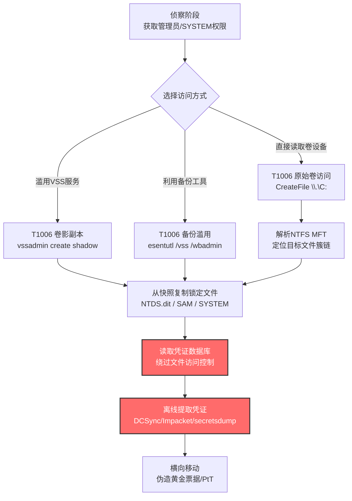

# 直接卷访问 (T1006)

## 一句话通俗理解

攻击者像绕过图书馆的借阅登记台，直接从书架上把书拿走——不走正常的文件打开流程，而是直接读写硬盘上的"原始数据"，让文件访问控制和监控工具都看不见。

## 30秒速查卡

| 维度 | 你需要知道的 |
|------|-------------|
| 这是什么？ | 直接对逻辑卷设备（如`\\.\C:`）发起读写请求，绕过Windows文件系统和访问控制层，按文件系统数据结构手动解析文件 |
| 为什么危险？ | 传统的文件访问监控（Sysmon Event ID 11、文件审计策略）全部失效；可以读取被锁定的活动文件（如NTDS.dit、SAM）；可绕过DRM、AV实时扫描 |
| 谁需要关心？ | 域控管理员、AD安全工程师、EDR研发人员、SOC分析师、取证人员 |
| 你的第一步防御 | 监控对`\\.\C:`、`\\.\PhysicalDrive0`等原始设备路径的句柄打开行为，禁用非必要的卷影副本创建权限 |
| 如果只做一件事 | 启用Sysmon Event ID 9（RawAccessRead）审计，捕获任何进程直接读取磁盘卷的原始数据行为 |

## 难度等级

⭐⭐ 中级（需要操作系统与文件系统知识）

直接卷访问属于中级隐蔽技术，原因在于：
- 攻击者需要理解NTFS/FAT32文件系统的内部数据结构（MFT、文件记录段、簇链）
- 必须拥有管理员权限才能打开原始卷设备句柄（`\\.\C:`）
- 调用`CreateFile`打开原始设备、用`DeviceIoControl`或`ReadFile`按字节偏移读取，需要Win32 API编程经验
- 防御方若不了解原始设备访问路径，很难区分合法备份软件与攻击者工具的行为

## 前置知识检查

**读这个文件需要什么？**

- [ ] Windows设备路径命名规则（`\\.\C:`、`\\.\PhysicalDrive0`、`\\?\Volume{GUID}`）
- [ ] Win32文件I/O API（CreateFile、ReadFile、DeviceIoControl）
- [ ] NTFS文件系统结构（MFT主文件表、文件记录、簇位图）
- [ ] 卷影副本服务（VSS / Volume Shadow Copy Service）工作原理
- [ ] Windows权限模型（SeBackupPrivilege、SeRestorePrivilege、管理员令牌）

## 技术描述

直接卷访问（T1006）是MITRE ATT&CK框架中**属于隐蔽战术（TA0005）**的技术。攻击者通过直接访问逻辑卷设备，绕过Windows文件访问控制机制和文件系统监控工具，按文件系统数据结构直接读取或写入磁盘上的文件内容。

**通俗解释：**

想象你公司有个保险柜，员工取文件必须经过管理员登记（文件访问控制），监控摄像头也会记录每一次存取（文件系统监控）。但攻击者不走正门——他们直接拆开保险柜的背板，从背后伸手把文件抽出来。管理员没看到登记记录，摄像头也没拍到取文件的过程，文件就这么消失了。

在Windows世界里，"保险柜背板"就是逻辑卷设备路径（如`\\.\C:`）。正常程序通过`CreateFile("C:\path\file.txt")`打开文件时，Windows会经过I/O管理器、文件系统驱动（NTFS.sys）、卷管理器层层检查权限和审计策略。但当程序用`CreateFile("\\.\C:")`直接打开卷设备时，就绕过了文件系统驱动，直接和卷管理器对话——此时读取的是磁盘的"原始字节"，没有文件名、没有权限检查、没有审计日志。

**过渡段：** 直接卷访问的核心价值是"绕过文件层"。攻击者通过解析NTFS的MFT（主文件表）数据结构，能定位并读取任何文件——即使是正在被系统独占使用的`ntds.dit`、`SAM`、`SYSTEM`等关键文件。这正是勒索软件、凭证转储工具、数据窃取程序爱用它的原因。下面我们看看攻击者具体怎么操作。

**技术原理：**

### 一、原始卷设备访问

Windows把每个逻辑卷暴露为一个设备对象，路径形如`\\.\C:`、`\\.\D:`。任何拥有管理员权限的进程都可以通过`CreateFile`打开这个设备，获得一个直接读写卷的句柄。

```c
// 打开C:卷的原始设备句柄
HANDLE hVolume = CreateFileW(
    L"\\\\.\\C:",                    // 设备路径
    GENERIC_READ,                    // 读权限
    FILE_SHARE_READ | FILE_SHARE_WRITE,
    NULL,
    OPEN_EXISTING,
    FILE_FLAG_NO_BUFFERING | FILE_FLAG_WRITE_THROUGH,
    NULL
);

// 按字节偏移读取（必须按扇区对齐）
LARGE_INTEGER offset;
offset.QuadPart = clusterOffset * bytesPerCluster;
SetFilePointerEx(hVolume, offset, NULL, FILE_BEGIN);

DWORD bytesRead;
ReadFile(hVolume, buffer, bufferSize, &bytesRead, NULL);
```

打开卷设备需要`SeBackupPrivilege`（备份特权），普通用户默认没有，但管理员账户可通过策略启用。

### 二、NTFS数据结构解析

获得卷句柄后，攻击者直接读取磁盘字节，需要手动解析NTFS数据结构才能找到具体文件：

1. **引导扇区（VBR）**：卷的第一个扇区，包含BPB（BIOS Parameter Block），描述每簇字节数、MFT起始位置等元数据
2. **MFT（主文件表）**：NTFS的"目录索引"，每个文件对应一条MFT记录（通常1024字节）
3. **文件记录属性**：`$DATA`属性（数据流）、`$STANDARD_INFORMATION`（时间戳）、`$FILE_NAME`（文件名）等
4. **簇链**：非驻留`$DATA`通过簇链定位文件内容在卷上的物理位置

工具如`NinjaCopy`（PowerSploit模块）就是把这套解析逻辑用PowerShell实现，可以读取任意被锁文件。

### 三、卷影副本（VSS）滥用

直接卷访问的另一种形式是滥用卷影副本服务（VSS）。VSS是Windows用于备份的官方机制，会创建卷的一致性快照。攻击者利用合法工具创建快照，再从快照中读取原本被锁定的文件：

- **vssadmin create shadow /for=C:** — 创建卷影副本
- **esentutl /y /vss /d \\?\GLOBALROOT\Device\HarddiskVolumeShadowCopy1\Windows\NTDS\ntds.dit** — 从快照复制NTDS.dit
- **wbadmin start backup** — Windows备份工具，同样能创建快照

由于这些是微软签名的系统工具，传统AV/EDR通常不拦截。

### 四、网络设备上的直接卷访问

在路由器、交换机等网络设备上，攻击者可通过CLI命令（如Cisco IOS的`copy flash:`、`format`、`partition`）直接操作flash存储，绕过文件系统层访问控制，读取或修改配置文件、固件镜像。

**用途与影响：**

直接卷访问是凭证转储和数据窃取的关键使能技术。它的价值体现在三个层面：**绕过文件锁**（读取活动中的NTDS.dit/SAM）、**绕过审计**（无文件访问日志）、**绕过AV扫描**（不经过文件系统过滤驱动）。几乎所有针对Active Directory的高级攻击都会用到这一技术——从创建卷影副本转储NTDS.dit，到用NinjaCopy直接读取SAM数据库。现代红队和APT组织将其视为凭证获取的标准操作之一。

## 真实攻击流程

### 典型攻击流程

```
获取管理员权限 --> 创建卷影副本或直接打开卷设备 --> 解析NTFS结构定位目标文件 --> 读取NTDS.dit/SAM等锁定文件 --> 离线解析凭证并横向移动
```



**步骤详解：**

1. **获取管理员权限**
   - 通俗描述：攻击者必须先拿到"保险柜管理员"的钥匙
   - 技术细节：通过钓鱼、漏洞利用、Kerberoasting等手段获得域管或本地管理员凭证，启用`SeBackupPrivilege`特权
   - 常用工具：Mimikatz、Cobalt Strike、Impacket

2. **选择卷访问方式并执行**
   - 通俗描述：从"拆背板"或"借备份服务"两条路里选一条
   - 技术细节：调用`CreateFileW(L"\\\\.\\C:")`打开原始卷；或执行`vssadmin create shadow /for=C:`创建快照
   - 常用工具：NinjaCopy、vssadmin、esentutl、wbadmin

3. **解析NTFS或访问快照**
   - 通俗描述：直接访问时需要按NTFS规则"读地图"找文件位置；走VSS则直接访问快照路径
   - 技术细节：解析VBR定位MFT，遍历MFT记录查找目标文件的`$DATA`属性簇链；或拼接`\\?\GLOBALROOT\Device\HarddiskVolumeShadowCopyN\`路径
   - 常用工具：NinjaCopy、自定义NTFS解析代码

4. **读取锁定文件**
   - 通俗描述：把"保险柜里的钥匙文件"复制出来，文件本身还在原位，没被打开过
   - 技术细节：按簇链读取NTDS.dit（Active Directory数据库）、SAM（本地账户哈希）、SYSTEM（加密密钥）等被系统独占的文件
   - 常用工具：NinjaCopy、esentutl、robocopy（针对快照路径）

5. **离线提取凭证并横向移动**
   - 通俗描述：拿到文件后到安全的地方"拆解"，提取密码哈希后伪造身份横行
   - 技术细节：用secretsdump.py解析NTDS.dit+SYSTEM，提取NTLM/Kerberos哈希；用黄金票据或PtT进行横向移动
   - 常用工具：Impacket secretsdump、Mimikatz、Rubeus

## 检测建议

**用人话说：** 直接卷访问的检测核心是"识别谁在直接读写卷设备，谁在创建卷影副本"。Windows暴露了Sysmon Event ID 9专门捕获原始卷读取，是检测这一技术的金标准。同时要监控vssadmin、wbadmin、esentutl等工具的命令行用法——合法备份通常在固定时间窗口、由特定服务账户运行，偏离基线的执行高度可疑。

### 网络层检测

**检测方法：** 直接卷访问本身是本地操作，但读取的凭证数据库往往伴随后续的C2回连和数据外传。监控从域控异常端口外发的大流量数据传输，或非工作时段的SMB/ldap异常查询，可间接发现凭证转储后的利用行为。

### 主机层检测

**Windows事件ID：**
- Sysmon Event ID 9：**RawAccessRead（核心）**——任何进程对`\\.\C:`、`\\.\D:`等卷设备的原始读取都被记录
- Sysmon Event ID 1：进程创建（关注vssadmin、wbadmin、esentutl、diskshadow的命令行）
- Sysmon Event ID 11：FileCreate（关注`HarddiskVolumeShadowCopy`路径下的文件读取）
- Event ID 4904：审核安全事件源注册（VSS相关）
- Event ID 7036：服务状态变更（Volume Shadow Copy服务启动）
- Event ID 8222：VSS卷影副本创建（来源：VSS）

**具体命令示例：**
```powershell
# 检测原始卷读取（Sysmon Event ID 9）
Get-WinEvent -FilterHashtable @{LogName='Microsoft-Windows-Sysmon/Operational'; ID=9} |
    Select-Object TimeCreated, @{N='Process';E={$_.Properties[0].Value}},
                  @{N='Device';E={$_.Properties[1].Value}} -First 50

# 检测卷影副本创建命令
Get-WinEvent -FilterHashtable @{LogName='Microsoft-Windows-Sysmon/Operational'; ID=1} |
    Where-Object { $_.Message -match 'vssadmin|wbadmin|esentutl|diskshadow' } |
    Select-Object TimeCreated, @{N='CommandLine';E={$_.Properties[10].Value}} -First 50

# 检测从卷影副本路径读取文件
Get-WinEvent -FilterHashtable @{LogName='Microsoft-Windows-Sysmon/Operational'; ID=11} |
    Where-Object { $_.Message -match 'HarddiskVolumeShadowCopy' } |
    Select-Object TimeCreated, @{N='TargetFilename';E={$_.Properties[5].Value}} -First 50

# 列出当前系统上的卷影副本
vssadmin list shadows
```

### 应用层检测

**检测要点：**

1. **原始卷设备访问检测**
   - 日志来源：Sysmon Event ID 9
   - 关注字段：Process、Device（目标卷设备路径）
   - 异常特征：非备份/取证类进程（如PowerShell、cmd、未知exe）打开`\\.\C:`等卷设备
   - 合法基线：Windows Backup、Veeam、Commvault等备份软件在固定窗口执行

2. **卷影副本创建行为检测**
   - 日志来源：Sysmon Event ID 1、Windows Event ID 8222
   - 关注字段：CommandLine、ShadowCopyId
   - 异常特征：非计划任务触发、由交互式会话或可疑父进程（如powershell.exe、wscript.exe）触发的`vssadmin create shadow`
   - 合法基线：备份软件按计划执行、Windows系统还原点创建

3. **从快照读取敏感文件检测**
   - 日志来源：Sysmon Event ID 11
   - 关注字段：TargetFilename、Image
   - 异常特征：访问`HarddiskVolumeShadowCopyN\Windows\NTDS\ntds.dit`、`...\Windows\System32\config\SAM`等路径
   - 合法基线：备份软件读取，但通常批量而非单文件

4. **esentutl滥用检测**
   - 日志来源：Sysmon Event ID 1
   - 关注字段：CommandLine
   - 异常特征：`esentutl /y /vss`、`esentutl /y \\?\GLOBALROOT`等带`/vss`或快照路径的调用
   - 合法基线：Exchange数据库维护（不同命令模式）

## 检测规则示例

### Sigma规则：检测原始卷设备读取（Sysmon Event ID 9）

```yaml
title: 检测进程直接读取卷设备行为
id: e7c19f6a-7d3e-4b2c-9a4f-5e6d7c8b9a01
status: experimental
description: 检测进程通过\\.\C:等路径直接读取逻辑卷设备的原始数据，可能表明T1006直接卷访问，绕过文件系统监控读取锁定文件
references:
    - https://attack.mitre.org/techniques/T1006/
    - https://attack.mitre.org/detectionstrategies/DET0426/
author: ATT&CK知识库
date: 2026/07/24
logsource:
    product: windows
    service: sysmon
detection:
    selection_raw_access:
        EventID: 9
    filter_backup_tools:
        Image|endswith:
            - '\vssvc.exe'           # VSS服务
            - '\wbengine.exe'        # Windows备份引擎
            - '\veeam.exe'           # Veeam备份
            - '\CVsDaemon.exe'       # Commvault
    filter_system:
        Image|startswith:
            - 'C:\Windows\System32\'
            - 'C:\Windows\SysWOW64\'
    condition: selection_raw_access and not filter_backup_tools and not filter_system
falsepositives:
    - 合法备份软件执行卷级读取（需建立白名单基线）
    - 取证工具（如FTK Imager）的合法使用
    - 磁盘碎片整理程序
level: high
tags:
    - attack.t1006
    - attack.defense_evasion
    - attack.credential_access
```

### Sigma规则：检测可疑卷影副本创建

```yaml
title: 检测可疑卷影副本创建行为
id: 8d4f5b6a-9c2d-4e3a-8b1f-0c2d3e4f5a6b
status: experimental
description: 检测通过vssadmin、wbadmin、diskshadow等工具创建卷影副本，可能用于T1006直接卷访问以读取锁定的NTDS.dit或SAM文件
references:
    - https://attack.mitre.org/techniques/T1006/
    - https://attack.mitre.org/campaigns/C0051/
    - https://attack.mitre.org/campaigns/C0063/
author: ATT&CK知识库
date: 2026/07/24
logsource:
    product: windows
    category: process_creation
detection:
    selection_tool:
        Image|endswith:
            - '\vssadmin.exe'
            - '\wbadmin.exe'
            - '\diskshadow.exe'
    selection_keyword:
        CommandLine|contains:
            - 'create shadow'
            - 'start backup'
            - 'add volume'
    filter_backup_service:
        ParentImage|endswith:
            - '\services.exe'
            - '\svchost.exe'
        User|contains:
            - 'SYSTEM'
            - 'NETWORK SERVICE'
    condition: selection_tool and selection_keyword and not filter_backup_service
falsepositives:
    - 计划任务触发的合法备份操作（建议建立时间窗口白名单）
    - 系统还原点创建（通常由rundll32调用）
    - Windows Update前的自动快照
level: high
tags:
    - attack.t1006
    - attack.defense_evasion
    - attack.credential_access
```

### Sigma规则：检测esentutl从卷影副本复制文件

```yaml
title: 检测esentutl滥用卷影副本读取锁定文件
id: 9a5b6c7d-8e1f-4a2b-9c3d-0e1f2a3b4c5d
status: experimental
description: 检测esentutl使用/vss参数或访问GLOBALROOT\Device\HarddiskVolumeShadowCopy路径，常用于T1006直接卷访问读取NTDS.dit等锁定文件
references:
    - https://attack.mitre.org/techniques/T1006/
    - https://lolbas-project.github.io/lolbas/Binaries/Esentutl/
author: ATT&CK知识库
date: 2026/07/24
logsource:
    product: windows
    category: process_creation
detection:
    selection_esentutl:
        Image|endswith: '\esentutl.exe'
    selection_suspicious_flags:
        CommandLine|contains:
            - '/vss'
            - 'GLOBALROOT\Device\HarddiskVolumeShadowCopy'
            - 'ntds.dit'
            - '\config\SAM'
            - '\config\SYSTEM'
    condition: selection_esentutl and selection_suspicious_flags
falsepositives:
    - Exchange数据库维护操作（罕见使用/vss参数）
    - 系统管理员手动备份操作（需审批记录）
level: critical
tags:
    - attack.t1006
    - attack.defense_evasion
    - attack.credential_access
```

## 缓解措施

### 优先级1：关键措施

**措施名称：** 启用Sysmon Event ID 9并配置卷设备访问告警

**具体实施步骤：**
1. 部署Sysmon并配置RawAccessRead事件捕获：
   ```xml
   <RuleGroup name="RawVolumeAccess" groupRelation="or">
     <RawAccessRead onmatch="include">
       <TargetFileName condition="contains">\Device\HarddiskVolume</TargetFileName>
     </RawAccessRead>
   </RuleGroup>
   ```
2. 将告警接入SIEM，建立备份软件白名单基线（按进程路径+时间窗口）
3. 对偏离基线的原始卷读取行为触发高优先级告警，要求SOC人工研判

### 优先级2：重要措施

**措施名称：** 限制卷影副本创建权限

**具体实施步骤：**
1. 通过组策略限制`vssadmin.exe`、`wbadmin.exe`、`diskshadow.exe`的执行：
   ```powershell
   # AppLocker规则示例：仅允许Backup Operators组运行vssadmin
   New-AppLockerPolicy -Xml -RuleType Path -Path "%SystemRoot%\System32\vssadmin.exe" -User "BUILTIN\Backup Operators" -Action Allow
   ```
2. 从普通管理员账户中移除`SeBackupPrivilege`和`SeRestorePrivilege`，仅授予Backup Operators组
3. 在域控上启用"审核卷影副本创建"的高级审计策略：
   ```powershell
   auditpol /set /subcategory:"Detailed File Share" /success:enable
   ```

### 优先级3：建议措施

**措施名称：** 加固NTDS.dit与SAM的访问控制

**具体实施步骤：**
1. 确保NTDS.dit文件ACL仅允许SYSTEM和特定服务账户读取，禁止Administrators组直接访问
2. 启用Active Directory的"回收站"功能以监控删除/恢复操作
3. 部署EDR行为检测规则，识别从卷影副本路径读取NTDS.dit或SAM的可疑进程
4. 在域控上启用Credential Guard（Windows 10/11 Enterprise），将LSA敏感操作隔离在VTL1
5. 定期审计卷影副本数量，发现非计划快照立即调查：
   ```powershell
   schtasks /query /v | findstr /i "vssadmin shadow"
   ```

### MITRE ATT&CK 缓解措施映射

| 缓解措施ID | 缓解措施名称 | 适用性 | 说明 |
|------------|-------------|--------|------|
| M1040 | 端点行为防护 | 适用 | EDR可阻止vssadmin创建快照、拦截对卷设备的原始读取 |
| M1018 | 用户账户管理 | 适用 | 限制备份相关权限仅授予Backup Operators组，监控异常备份活动 |

## 动手实验

> ⚠️ **重要提示**：所有实验必须在隔离的实验室环境中进行，禁止对未授权的真实系统进行测试。读取NTDS.dit涉及Active Directory核心凭证，必须获得书面授权。

### 实验环境准备

**所需工具：**
- Windows Server 2019/2022虚拟机（域控角色，启用Sysmon日志）
- PowerSploit框架（含Invoke-NinjaCopy.ps1）
- Impacket工具包（secretsdump.py）
- vssadmin、esentutl（系统自带）
- 一个测试域账户（普通权限，用于对比）

### 实验1：NinjaCopy直接读取锁定文件（中级）

**实验目标：** 理解T1006直接卷访问的核心原理，观察如何绕过文件锁读取SAM数据库

**实验步骤：**
1. 在域控上以管理员身份启动PowerShell，确认无法用普通方法读取SAM：
   ```powershell
   Copy-Item C:\Windows\System32\config\SAM C:\Temp\SAM_copy
   # 预期：拒绝访问（进程不能打开文件，被系统独占）
   ```

2. 加载PowerSploit并执行NinjaCopy：
   ```powershell
   Import-Module C:\PowerSploit\Exfiltration\Invoke-NinjaCopy.ps1
   Invoke-NinjaCopy -Path "C:\Windows\System32\config\SAM" -LocalDestination "C:\Temp\SAM_ninja"
   # 预期：成功复制，无错误
   ```

3. 同时复制SYSTEM文件（包含解密密钥）：
   ```powershell
   Invoke-NinjaCopy -Path "C:\Windows\System32\config\SYSTEM" -LocalDestination "C:\Temp\SYSTEM_ninja"
   ```

4. 检查Sysmon Event ID 9日志，确认原始卷读取事件被记录：
   ```powershell
   Get-WinEvent -FilterHashtable @{LogName='Microsoft-Windows-Sysmon/Operational'; ID=9} -MaxEvents 5
   # 关注：Process=powershell.exe, Device=\Device\HarddiskVolume2
   ```

5. 在另一台Linux机器上用secretsdump.py离线解析：
   ```bash
   secretsdump.py -sam SAM_ninja -system SYSTEM_ninja LOCAL
   ```

**预期结果：** NinjaCopy成功复制SAM和SYSTEM，Sysmon记录了原始卷读取事件，secretsdump.py提取出本地账户的NTLM哈希

**学习要点：** 理解为何绕过文件系统层后能读取被锁文件，掌握Sysmon Event ID 9作为检测金标准

### 实验2：卷影副本滥用读取NTDS.dit（中级）

**实验目标：** 理解VSS滥用攻击，掌握vssadmin+esentutl组合的真实操作

**实验步骤：**
1. 创建C:卷的卷影副本：
   ```powershell
   vssadmin create shadow /for=C:
   # 记录输出中的Shadow Copy Volume Name，如 \\?\GLOBALROOT\Device\HarddiskVolumeShadowCopy1
   ```

2. 使用esentutl从快照中复制NTDS.dit：
   ```powershell
   esentutl /y /vss \\?\GLOBALROOT\Device\HarddiskVolumeShadowCopy1\Windows\NTDS\ntds.dit /d C:\Temp\ntds.dit
   ```

3. 同样复制SYSTEM文件（解密密钥）：
   ```powershell
   esentutl /y /vss \\?\GLOBALROOT\Device\HarddiskVolumeShadowCopy1\Windows\System32\config\SYSTEM /d C:\Temp\SYSTEM_vss
   ```

4. 检查Sysmon日志，识别3个关键事件：
   - Event ID 1：vssadmin.exe进程创建（命令行包含`create shadow`）
   - Event ID 11：esentutl.exe文件创建（目标路径含`HarddiskVolumeShadowCopy`）
   - Event ID 7036：Volume Shadow Copy服务启动

5. 用Impacket解析域凭证：
   ```bash
   secretsdump.py -ntds ntds.dit -system SYSTEM_vss LOCAL
   ```

6. **清理**：删除卷影副本
   ```powershell
   vssadmin delete shadows /for=C: /oldest
   ```

**预期结果：** 卷影副本成功创建，NTDS.dit从快照复制成功，提取出域内所有账户的NTLM和Kerberos哈希

**学习要点：** 理解VSS作为"合法绕过文件锁"的机制，掌握通过Sysmon Event ID 1和11关联检测VSS滥用

## 真实案例

### 案例1：APT28"近邻攻击"行动滥用VSS转储NTDS.dit（2024）

- **时间**：2024年
- **目标**：欧洲政府机构、外交组织（俄罗斯APT28针对乌克兰及其周边国家）
- **攻击组织**：APT28（Fancy Bear、Sofacy Group，G0007）
- **手法**：在"近邻攻击"行动中，APT28通过入侵邻近期望目标的Wi-Fi网络，横向渗透进入目标组织内网。获得域控访问权限后，攻击者执行`vssadmin`创建卷影副本，再从快照中读取`NTDS.dit`文件，提取Active Directory中所有域账户的凭证哈希。这一步是后续横向移动和持久化的关键——拿到域哈希后，攻击者可伪造Kerberos票据，无需再爆破密码即可访问域内任意资源。
- **影响**：多个政府机构的AD域被完全攻陷，攻击者潜伏数月未被察觉
- **参考链接**：[MITRE - APT28 Nearest Neighbor Campaign](https://attack.mitre.org/campaigns/C0051/)、[Volexity - Nearest Neighbor Attack](https://www.volexity.com/blog/2024/11/22/the-nearest-neighbor-attack-how-a-russian-apt-weaponized-nearby-wi-fi-networks-for-covert-access/)

### 案例2：2025波兰擦除器攻击中的VSS滥用（2025）

- **时间**：2025年12月
- **目标**：波兰能源行业关键基础设施
- **攻击组织**：未公开归因（疑似与俄罗斯关联）
- **手法**：攻击者入侵能源行业OT网络后，通过执行`vssadmin`创建卷影副本，将域控上的`NTDS.dit`文件转储到攻击者控制的位置。这一步发生在最终擦除器payload部署之前——攻击者先窃取凭证用于横向移动和收集情报，然后在撤退阶段触发擦除器，删除卷影副本和原始数据以阻碍恢复。整个攻击链中，T1006直接卷访问是凭证获取阶段的核心技术。
- **影响**：多处能源设施运营中断，部分系统数据无法恢复
- **参考链接**：[MITRE - 2025 Poland Wiper Attacks](https://attack.mitre.org/campaigns/C0063/)、[CERT Polska - Energy Sector Incident Report](https://cert.pl/uploads/docs/CERT_Polska_Energy_Sector_Incident_Report_2025.pdf)

### 案例3：Scattered Spider虚拟化域控卷影副本提取NTDS.dit（2023）

- **时间**：2023年
- **目标**：跨国企业、托管服务提供商（MSP）、云环境
- **攻击组织**：Scattered Spider（Octo Tempest，G1015）
- **手法**：Scattered Spider在攻击云环境中的虚拟域控（如AWS上的Managed Microsoft AD或自建VM）时，利用云平台快照或管理接口获得虚拟磁盘访问权，创建域控虚拟机的磁盘快照。然后挂载快照卷，从中提取`NTDS.dit`文件。由于操作发生在虚拟化层而非Guest OS内，传统的EDR完全检测不到。拿到NTDS.dit后，攻击者用secretsdump.py离线提取所有域账户哈希，使用PtT（Pass the Hash）横向移动到云中其他Windows实例。
- **影响**：多家企业AD域被攻陷，部分受害者支付勒索赎金
- **参考链接**：[MITRE - Scattered Spider](https://attack.mitre.org/groups/G1015/)、[Microsoft - Octo Tempest](https://www.microsoft.com/en-us/security/blog/2023/10/25/octo-tempest-crosses-boundaries-to-facilitate-extortion-encryption-and-destruction/)

### 案例4：Volt Typhoon针对美国关键基础设施的VSS滥用（2023-2024）

- **时间**：2023年-2024年
- **目标**：美国关岛和本土的电力、水务、交通等关键基础设施
- **攻击组织**：Volt Typhoon（Bronze Silhouette、Insidious Taurus，G1017）
- **手法**：Volt Typhoon在长期潜伏期间，使用Windows原生`vssadmin`命令创建卷影副本，从域控上提取`NTDS.dit`和`SYSTEM`文件。攻击者刻意选择系统自带工具而非自定义可执行文件，以"生活在陆地"（Living off the Land）方式规避AV/EDR检测。提取的凭证用于在多台机器间建立持久化访问，确保即使部分后门被发现清除，攻击者仍可通过有效账户重新进入。
- **影响**：潜伏期长达数年，CISA与多国情报机构联合发布预警
- **参考链接**：[MITRE - Volt Typhoon](https://attack.mitre.org/groups/G1017/)、[CISA - PRC State-Sponsored Actors](https://www.cisa.gov/sites/default/files/2024-03/aa24-038a_csa_prc_state_sponsored_actors_compromise_us_critical_infrastructure_3.pdf)

## 术语解释

| 术语 | 英文原名 | 通俗解释 |
|------|----------|----------|
| 直接卷访问 | Direct Volume Access | 绕过文件系统直接读写逻辑卷设备的原始字节 |
| 逻辑卷设备 | Logical Volume Device | Windows暴露的卷设备对象，路径形如`\\.\C:` |
| 原始卷句柄 | Raw Volume Handle | 通过CreateFile打开卷设备获得的直接读写句柄 |
| 主文件表 | MFT (Master File Table) | NTFS的文件索引表，每条记录描述一个文件 |
| 文件记录段 | File Record Segment | MFT中单条记录，包含文件的所有属性 |
| 卷影副本 | Volume Shadow Copy | VSS服务创建的卷一致性快照 |
| VSS | Volume Shadow Copy Service | Windows备份框架，提供卷级快照能力 |
| 备份特权 | SeBackupPrivilege | Windows权限，允许绕过ACL读取任意文件 |
| 还原特权 | SeRestorePrivilege | Windows权限，允许绕过ACL写入任意文件 |
| NinjaCopy | NinjaCopy | PowerSploit中的PowerShell模块，实现直接卷读取 |
| esentutl | Extensible Storage Engine Utilities | Windows自带工具，可操作ESE数据库和VSS快照 |
| NTDS.dit | NT Directory Services Database | Active Directory的数据库文件，存储所有域账户凭证哈希 |

## 参考资料

### 📚 官方文档（深入了解）

- [MITRE ATT&CK - T1006 Direct Volume Access](https://attack.mitre.org/techniques/T1006/)
- [MITRE ATT&CK - TA0005 Stealth](https://attack.mitre.org/tactics/TA0005/)
- [MITRE ATT&CK - Detection Strategy DET0426](https://attack.mitre.org/detectionstrategies/DET0426/) — Detection of Direct Volume Access for File System Evasion
- [MITRE ATT&CK - Mitigation M1040 Behavior Prevention on Endpoint](https://attack.mitre.org/mitigations/M1040/)
- [MITRE ATT&CK - Mitigation M1018 User Account Management](https://attack.mitre.org/mitigations/M1018/)

### 📰 安全报告（真实攻击）

- [Volexity - The Nearest Neighbor Attack (APT28)](https://www.volexity.com/blog/2024/11/22/the-nearest-neighbor-attack-how-a-russian-apt-weaponized-nearby-wi-fi-networks-for-covert-access/)
- [CERT Polska - Energy Sector Incident Report 2025](https://cert.pl/uploads/docs/CERT_Polska_Energy_Sector_Incident_Report_2025.pdf)
- [Microsoft - Octo Tempest (Scattered Spider)](https://www.microsoft.com/en-us/security/blog/2023/10/25/octo-tempest-crosses-boundaries-to-facilitate-extortion-encryption-and-destruction/)
- [CISA - PRC State-Sponsored Actors (Volt Typhoon)](https://www.cisa.gov/sites/default/files/2024-03/aa24-038a_csa_prc_state_sponsored_actors_compromise_us_critical_infrastructure_3.pdf)

### 🔧 工具与资源（动手试试）

- [Hakobyan - FDump: Dumping File Sectors Directly from Disk](http://www.codeproject.com/Articles/32169/FDump-Dumping-File-Sectors-Directly-from-Disk-usin) — 直接读取磁盘扇区的概念验证代码
- [PowerSploit Invoke-NinjaCopy](https://github.com/PowerShellMafia/PowerSploit/blob/master/Exfiltration/Invoke-NinjaCopy.ps1) — PowerShell实现直接卷读取
- [LOLBAS - Esentutl.exe](https://lolbas-project.github.io/lolbas/Binaries/Esentutl/) — esentutl滥用方法
- [DFIR on the Mountain - Locked File Access Using ESENTUTL](https://dfironthemountain.wordpress.com/2018/12/06/locked-file-access-using-esentutl-exe/) — esentutl实战分析
- [Atomic Red Team - T1006 Tests](https://atomicredteam.io/) — 可执行的检测测试用例

## 相关技术

- **[T1003 操作系统凭证转储](../09-Credential-Access/T1003-OS-Credential-Dumping.md)**：T1006最常见的配合技术——直接卷访问读取NTDS.dit/SAM后，用T1003的子技术解析提取凭证哈希
- **[T1564 隐藏痕迹](./T1564-Hide-Artifacts.md)**：同为隐蔽战术，攻击者常用T1564.002隐藏用户配合T1006绕过文件访问控制
- **[T1070 清除痕迹](./T1070-Indicator-Removal.md)**：攻击者在T1006读取凭证后，常用T1070.001清除事件日志以掩盖卷影副本创建痕迹
- **[T1078 有效账户](./T1078-Valid-Accounts.md)**：T1006提取的凭证用于T1078有效账户登录，实现持久化和横向移动
- **[T1218 系统二进制代理执行](./T1218-System-Binary-Proxy-Execution.md)**：esentutl既属于T1006直接卷访问工具，也可被归类为T1218系统二进制代理执行（滥用合法签名工具）
- **[T1490 抑制系统恢复](../15-Impact/T1490-Inhibit-System-Recovery.md)**：勒索软件常用vssadmin删除卷影副本（T1490），与T1006创建卷影副本形成"先用后删"的攻击链
