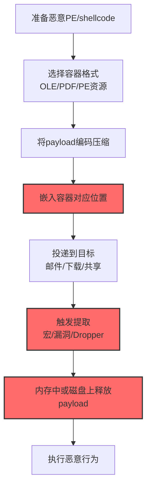

# 嵌入式载荷 (T1027.009)

## 一句话通俗理解

> **把木马程序藏在 Word 文档、PDF 文件或正常程序的"夹层"里，让杀毒软件看到的是一个无害的文档，运行时却释放出真正的恶意代码**

## 30秒速查卡

| 维度 | 你需要知道的 |
|------|-------------|
| 这是什么？ | 将恶意 PE/DLL/Shellcode 嵌入 OLE 对象、PDF 附件、PE 资源段等"容器"中，T1027 子技术 |
| 为什么危险？ | 静态扫描只能看到外层容器（如 docx），看不到内层 payload；必须先提取再扫描，AV 签名匹配失效 |
| 你的第一步防御 | 邮件网关强制对所有 Office/PDF 文档做"对象提取 + 重组扫描"，禁止仅基于外层扩展名放行 |
| 如果只做一件事 | 部署 oletools + YARA 规则，对所有进入组织的 .doc/.docx/.xls/.pdf 进行 OLE 对象与嵌入附件深度扫描 |

## 难度等级

⭐⭐ 中级 - 需要理解 OLE/PE/PDF 容器格式与载荷提取流程

## 前置知识检查

**读这个文件需要什么？**

- [ ] OLE 复合文档结构（Office 文档的底层容器格式）
- [ ] PE 文件资源段（.rsrc）与资源类型（RT_RCDATA、RT_ICON）
- [ ] 混淆文件或信息（T1027）的原理
- [ ] PDF 附件与嵌入式文件流基础

## 技术描述

**嵌入式载荷**（T1027.009）是 **混淆文件或信息**（T1027）的一个具体变体，属于 **隐蔽** 阶段的攻击技术。

攻击者将恶意可执行代码（PE、DLL、Shellcode、脚本）作为"子对象"嵌入到一个看起来无害的容器文件中——容器可以是 Office 文档（OLE 对象）、PDF 文件（嵌入式文件流）、PE 文件（资源段 .rsrc）、图片（隐写术变体）或其他多媒体文件。运行时通过漏洞利用、宏代码或 dropper 程序将内层 payload 提取出来执行。

### 具体怎么理解？

想象一个俄罗斯套娃。最外层是一个漂亮的木头娃娃（看起来是正常的 `report.docx`），打开后里面还套着一个娃娃（OLE 对象），再打开里面是一个铁盒（嵌入的 PE 文件），铁盒里才是真正的珠宝（恶意 shellcode）。海关检查员（杀毒软件）只扫描最外层的木头娃娃，看不到里面的铁盒——因为它需要"打开"才能发现。

技术上有三种主要嵌入方式：

1. **OLE 对象嵌入**（Office 文档）：将 PE 文件作为 OLE Package 对象嵌入 .doc/.xls。`oletools` 的 `oleobj` 可提取。攻击者常配合 CVE-2017-11882（Equation Editor 漏洞）或宏代码触发释放
2. **PDF 嵌入式文件流**：利用 PDF 的 `/EmbeddedFile` 与 `/FileAttachment` 注解，将恶意 PE 作为附件流嵌入。Acrobat Reader 在打开注解时会询问用户是否打开附件
3. **PE 资源段嵌入**：将 payload 作为 `RT_RCDATA` 或自定义资源类型编译进 dropper 的 `.rsrc` 段，运行时用 `FindResource`/`LoadResource`/`LockResource` API 提取

### 为什么有效？

这种技术之所以有效，是因为：

1. **绕过外层签名匹配**：AV 扫描器默认按文件扩展名路由扫描引擎——`.doc` 走文档扫描器、`.pdf` 走 PDF 扫描器，二者都不深度扫描嵌入的二进制对象
2. **逃避邮件网关**：邮件网关通常基于 MIME 类型与扩展名判断，嵌入 OLE 的 .docx 通过邮件传输时被视为普通文档放行
3. **多阶段释放增加溯源难度**：payload 通常经过压缩、加密、编码后再嵌入，提取后还需要二次解码，分析链路延长
4. **利用合法 API**：`LoadResource`、`OLE Object` 是 Windows 合法机制，行为本身不触发 EDR 的异常告警
5. **配合漏洞利用威力倍增**：嵌入式载荷常与 Equation Editor 漏洞、Office DDE、PDF JavaScript 漏洞组合，形成"打开文档即触发释放执行"的攻击链

## 真型场景

攻击者在 **隐蔽** 阶段使用 嵌入式载荷 技术，以下是典型的攻击步骤：



**步骤详解：**

1. **准备恶意 PE/shellcode**：Cobalt Strike 生成 beacon 或自研 RAT 编译为 PE
2. **选择容器格式**：钓鱼邮件优先 OLE 文档；漏洞利用优先 PDF；二次投放优先 PE 资源
3. **payload 编码压缩**：Base64 + XOR + zlib，避免内层 PE 魔数 `MZ` 被 YARA 命中
4. **嵌入容器对应位置**：OLE 用 `oletools` 或 Word "对象"功能插入；PE 用 Resource Hacker 或 `rc.exe` 编译资源脚本
5. **投递到目标**：钓鱼邮件附件、水坑攻击下载链接、共享盘投放
6. **触发提取**：用户启用宏 / Office 漏洞自动触发 / Dropper 主程序调用 `LoadResource`
7. **释放 payload**：宏调用 `Shell()` 执行释放到 `%TEMP%` 的 PE；或直接反射式加载到内存
8. **执行恶意行为**：beacon 回连 C2，开始横向移动

## 攻击流程

```
生成payload --> 编码加密 --> 嵌入容器 --> 投递 --> 触发提取 --> 执行
```


**步骤详解：**

1. **生成 payload**：Cobalt Strike `artifactkit` 生成 raw shellcode 或 PE beacon；Metasploit `msfvenom -p windows/meterpreter/reverse_tcp`
2. **编码加密**：XOR 单字节加密 + Base64 编码 + zlib 压缩，多轮处理避免 MZ/PE 魔数被静态匹配
3. **嵌入容器**：Word "插入→对象→由文件创建"将 PE 嵌入为 OLE Package；Resource Hacker 将 payload 作为 `RT_RCDATA` 编译进 .res；PDF 使用 `pdftk attach_files`
4. **投递**：钓鱼邮件附件、水坑站点下载、共享盘投放、IM 文件传输
5. **触发提取**：宏代码（`AutoOpen`、`Document_Open`）调用 `Shell` 执行释放的 PE；Office 漏洞（CVE-2017-11882、CVE-2021-40444）自动触发；Dropper 主程序调用 `LoadResource`/`LockResource`
6. **执行**：beacon 进程注入到 explorer.exe / svchost.exe，HTTP/HTTPS 回连 C2

## 真实案例

### 案例1：APT28/TA558 嵌入式 OLE 载荷攻击（2024-2025）

攻击者将 Cobalt Strike beacon 经 XOR+Base64 编码后，作为 OLE Package 嵌入伪装成发票的 .docx。文档中 VBA 宏在 `Document_Open` 事件中调用 `oleobj` 提取内嵌对象到 `%TEMP%\update.exe` 并以 `Shell` 函数执行。手法绕过多家 AV 静态签名，因为外层 .docx 本身不含可执行代码特征。多个目标组织（政府/能源/制造业）被入侵，横向移动后部署勒索软件造成生产系统中断。参考：[MITRE ATT&CK T1027.009](https://attack.mitre.org/techniques/T1027/009/)

### 案例2：红队 PE 资源段反射式加载（2025）

红队在授权评估中用 Resource Hacker 将 Mimikatz 作为 `RT_RCDATA` 资源嵌入看似合法的"系统诊断工具"。主程序运行时调用 `FindResource`/`LoadResource`/`LockResource` 提取 Mimikatz 到内存反射式加载执行，磁盘无文件。验证了"基于资源段嵌入 + 反射式加载"无文件攻击链有效性，推动部署 Sysmon EID 7（镜像加载）与 EID 8（远程线程创建）关联检测。参考：[Atomic Red Team](https://github.com/redcanaryco/atomic-red-team)

## 红队视角

> ⚠️ **免责声明**：以下内容仅用于合法的安全测试、渗透测试和教育目的。未经授权对他人系统进行测试是违法行为。

### 实战技巧

1. **深入理解原理**：掌握 OLE 复合文档结构、PE 资源段机制、PDF 嵌入流规范，理解 EDR 邮件网关与端点扫描的协作盲区
2. **环境适配**：目标邮件网关深度扫描 OLE 则改用 PDF 嵌入；端点 AV 启用宏拦截则改用漏洞利用触发
3. **组合使用**：嵌入式载荷 + 反射式加载 = 无文件攻击；+ 进程注入 = 双重隐蔽；+ 环境密钥（T1480.001）= 沙箱规避
4. **隐蔽性考虑**：嵌入时对 payload 做多轮编码（XOR → Base64 → zlib），避免内层 PE 魔数 `4D 5A` 被 YARA 规则在容器内直接命中

### 常用工具

| 工具名称 | 用途 | 平台 | 链接 |
| -------- | ---- | ---- | ---- |
| Cobalt Strike | 生成 beacon payload | 全平台 | [Cobalt Strike](https://www.cobaltstrike.com/) |
| Metasploit msfvenom | 生成各类 payload | 全平台 | [Metasploit](https://www.metasploit.com/) |
| oletools | OLE 对象分析与提取 | Python/全平台 | [oletools](https://github.com/decalage2/oletools) |
| Resource Hacker | PE 资源段编辑 | Windows | [Resource Hacker](http://www.angusj.com/resourcehacker/) |
| pdftk | PDF 嵌入附件操作 | Linux/Windows | [pdftk](https://www.pdflabs.com/tools/pdftk-the-pdf-toolkit/) |
| pefile | Python PE 文件解析库 | Python | [pefile](https://github.com/erocarrera/pefile) |

### 注意事项

- 在授权的测试环境中使用这些技术
- 注意操作安全（OPSEC），避免被检测系统发现
- 使用匿名化技术和代理隐藏真实身份

## 蓝队视角

### 检测要点

1. **系统日志监控**：Sysmon EID 7（镜像加载）监控从 `%TEMP%`、`%APPDATA%` 加载的 DLL；EID 11（文件创建）监控 Office 进程子进程创建的可执行文件
2. **异常行为检测**：Office 进程（WINWORD/EXCEL/POWERPNT）创建子进程（cmd/powershell/rundll32）是典型"宏触发释放"信号；PDF Reader 写入 PE 到临时目录同样可疑
3. **工具特征识别**：监控 `oletools`、`Resource Hacker`、`pdftk` 在非开发环境的异常使用——这些工具双向，攻击者投放、分析师取证

### 监控建议

- 部署 EDR 系统，对 Office 进程的子进程创建、文件写入、网络连接做关联分析
- 配置 SIEM 规则，关联"接收钓鱼邮件 → 用户启用宏 → 子进程访问外部IP"的完整攻击链
- 定期进行渗透测试，验证邮件网关深度扫描有效性

**用人话说：** 正常人收到 Word 文档，Word 进程只会读写文档内容，绝不会突然生出一个 cmd.exe 或在临时目录写一个 .exe。如果发现 WINWORD.EXE 的子进程是 cmd/powershell，或者 Word 进程在 `%TEMP%` 写出可执行文件，99% 是嵌入式载荷被触发了——这就像看到邮递员送完信后突然从邮包里掏出一把枪，绝对有问题。

## 避坑指南

常见混淆误区：

1. **嵌入≠不可检测**：现代 EDR 与邮件网关已普遍支持"对象提取 + 重组扫描"，oletools + YARA 可批量扫描 OLE 对象
2. **Base64 编码≠安全**：Base64 编码后的 PE 仍含 `TVqQAAMAAAAEAAAA` 特征头（`MZ` 的 Base64），YARA 规则可直接匹配
3. **PE 资源段会被扫描**：Resource Hacker 等工具可一键提取所有资源段，分析脚本可遍历 `.rsrc` 中的 `RT_RCDATA` 进行 PE 魔数匹配
4. **无文件释放≠无痕迹**：即使反射式加载不留磁盘文件，内存中仍有 payload 副本，Volatility 等内存取证工具可提取分析

## 检测建议

### 检测思路

检测 嵌入式载荷 的关键是"深度提取扫描"——不能只看容器外层，必须提取内层对象后重新扫描。以下是三个层面的检测方法：

### 网络层检测

**方法**：在邮件网关与下载代理处对所有 Office/PDF 文档做"对象提取 + 重组扫描"

```bash
# oletools 批量扫描邮件附件：olevba 检测宏特征，oleobj 提取嵌入对象后用 YARA 复扫
for f in $email_attachments; do
    case $(file -b "$f") in
        *"Office"*) olevba "$f" | grep -E "Shell|WScript|AutoOpen"; oleobj "$f" | awk '/Filename:/{print $2}' | xargs -I{} yara -r malware_rules.yar {} ;;
        *"PDF"*)    pdfdetach -saveall "$f" -o /tmp/pdf_extract/; find /tmp/pdf_extract/ -type f -exec yara -r malware_rules.yar {} \; ;;
    esac
done
```

### 主机层检测

**Windows事件ID**：
- Sysmon EID 1：进程创建，监控 WINWORD/EXCEL/POWERPNT 的子进程
- Sysmon EID 7：镜像加载，监控从 `%TEMP%`、`%APPDATA%` 加载的 DLL
- Sysmon EID 11：文件创建，监控 Office 进程写出 .exe/.dll/.bat 文件
- 事件ID 4688：进程创建（监控可疑进程）

**Linux日志**：
- /var/log/audit/audit.log：auditd 监控 LibreOffice 进程的 execve
- /var/log/syslog：系统日志**Sysmon配置要点**：监控 WINWORD/EXCEL/POWERPNT 进程的子进程创建（Image endswith .exe）、临时目录 PE 文件写入（TargetFilename contains \Temp\ + endswith .exe），用 ProcessCreate+FileCreate 两个 RuleGroup 覆盖。

**用人话说：** 正常人写文档，Word 不会自己生出 cmd.exe。这条规则监控的就是"Word/Excel 突然启动了一个命令行程序"——这是宏代码或 OLE 对象被触发的典型信号。

### Sigma规则（Office进程创建可疑子进程）

```yaml
title: 检测嵌入式载荷 - Office进程创建可疑子进程
logsource:
    category: process_creation
    product: windows
detection:
    selection_office_parent:
        ParentImage|endswith: ['\WINWORD.EXE','\EXCEL.EXE','\POWERPNT.EXE','\OUTLOOK.EXE']
    selection_suspicious_child:
        Image|endswith: ['\cmd.exe','\powershell.exe','\rundll32.exe','\regsvr32.exe','\wscript.exe']
    condition: selection_office_parent and selection_suspicious_child
level: high
tags: [attack.t1027, attack.t1027.009, attack.defense_evasion, attack.execution]
```

### 应用层检测

**Sigma规则（PE资源段嵌入检测）**：监控未签名 PE/DLL 文件的 `TargetFilename` endswith .exe/.dll，过滤 Signed=true 的合法文件。误报来源：自解压安装包、带皮肤资源的 IM 客户端。level: low，tags: attack.t1027.009。

## 缓解措施

### 优先级1：关键措施

**邮件网关深度扫描**：强制对所有 Office/PDF 文档做对象提取 + 重组扫描

```bash
# Postfix + oletools 集成：ole_scan.sh 检测附件中的 OLE 嵌入对象，命中则 reject
# /etc/postfix/master.cf 添加：olefilter unix - n n - - pipe flags=Rq user=filter argv=/usr/local/bin/ole_scan.sh ${sender} ${recipient}
for f in $ATTACHMENTS; do
    obj_count=$(oleobj "$f" 2>/dev/null | grep -c "Filename:")
    [ "$obj_count" -gt 0 ] && { echo "REJECT: 文档含嵌入对象"; exit 67; }
done
```

### 优先级2：重要措施

**加强监控**：部署 EDR 和 SIEM 系统，实时监控 Office 进程的子进程创建、临时目录 PE 写入、镜像加载行为；配置 ASR（Attack Surface Reduction）规则阻止 Office 创建子进程

### 优先级3：建议措施

**安全意识培训**：教育员工不轻易启用宏、不打开来源不明的文档附件；启用 Office"受保护视图"

## 动手实验

> ⚠️ **所有实验必须在隔离的实验室环境中进行**

### 实验1：理解基本原理（初级）

**目标**：理解 嵌入式载荷 的工作原理，观察 OLE 对象嵌入

**步骤**：
1. 在隔离 Windows 虚拟机中打开 Word，新建文档
2. 使用"插入→对象→由文件创建"，选择一个无害的 `calc.exe` 嵌入文档
3. 保存为 `test.docx`，关闭 Word
4. 用 `oletools` 的 `oleobj test.docx` 列出嵌入对象
5. 用 `olevba test.docx` 检查是否有宏代码
6. 对比文档大小变化，理解 OLE 容器开销

**学习要点**：观察 `oleobj` 输出的嵌入对象列表，理解 OLE Package 的存储方式

### 实验2：实际操作（中级）

**目标**：掌握 PE 资源段嵌入与提取

**步骤**：
1. 编写 dropper 主程序（从资源段提取 payload 写临时文件并执行）：
   ```c
   // dropper.c - 核心调用 FindResource/LoadResource/LockResource 提取 payload
   #include <windows.h>
   int main() {
       HRSRC hRes = FindResource(NULL, "PAYLOAD", RT_RCDATA);
       HGLOBAL hMem = LoadResource(NULL, hRes);
       DWORD size = SizeofResource(NULL, hRes);
       void *data = LockResource(hMem);
       char path[MAX_PATH]; GetTempPathA(MAX_PATH, path); strcat(path, "payload.exe");
       FILE *f = fopen(path, "wb"); fwrite(data, 1, size, f); fclose(f);
       ShellExecuteA(NULL, "open", path, NULL, NULL, SW_HIDE);
       return 0;
   }
   ```
2. 资源脚本 `payload.rc`：`PAYLOAD RCDATA "beacon.exe"`
3. 编译：`windres payload.rc -o payload.res && gcc dropper.c payload.res -o dropper.exe`
4. 用 Resource Hacker 打开 `dropper.exe`，观察 `PAYLOAD` 资源
5. 运行 `dropper.exe`，观察 `%TEMP%\payload.exe` 是否被释放执行
6. 用 Sysmon 监控整个释放与执行过程

**学习要点**：掌握 `FindResource`/`LoadResource`/`LockResource` API 链路，理解 Sysmon EID 11 与 EID 1 的关联检测

### 实验3：防御验证（高级）

**目标**：验证检测规则的有效性

**步骤**：
1. 部署 Sysmon 配置：监控 Office 子进程、临时目录 PE 写入、镜像加载
2. 准备三个测试样本：(a) OLE 嵌入 PE 的 .docx；(b) PE 资源段 dropper；(c) PDF 嵌入附件
3. 在隔离环境中依次执行三个样本
4. 收集 Sysmon 日志，验证检测规则是否触发
5. 计算误报率：用 100 个正常 Office 文档测试，确保不误报
6. 集成到 SIEM：将告警通过 WinEventLog 转发到 ELK/Splunk

**学习要点**：理解攻防对抗的实际效果，掌握"父子进程关联 + 临时目录文件创建"的双重检测策略

## 术语解释

| 术语 | 通俗解释 |
|------|---------|
| **嵌入式载荷** | T1027.009，将恶意代码藏入文档/程序的"夹层"中 |
| **OLE 对象** | Object Linking and Embedding，Office 文档的嵌入对象机制 |
| **PE 资源段 (.rsrc)** | PE 文件中存储图标、字符串、自定义数据的段 |
| **RT_RCDATA** | PE 资源类型之一，常用于嵌入任意二进制数据 |
| **Dropper** | 投放器，负责释放并执行真正 payload 的小程序 |
| **反射式加载** | 直接从内存加载 PE，不写入磁盘，绕过文件扫描 |

## 被引用情况

以下父技术文档引用了本子技术：

- [T1027 - 混淆文件或信息](../T1027-Obfuscated-Files-or-Info.md)

## 参考资料

### 📚 官方文档

- [MITRE ATT&CK - Embedded Payloads (T1027.009)](https://attack.mitre.org/techniques/T1027/009/)
- [Microsoft - OLE 复合文档格式](https://docs.microsoft.com/en-us/openspecs/windows_protocols/ms-cfb/)
- [PDF 规范 - 嵌入式文件流](https://www.adobe.com/content/dam/acom/en/devnet/pdf/pdf_reference_1-7.pdf)

### 📰 安全报告

- [Mandiant APT 报告合集](https://www.mandiant.com/resources/blog) - 大量 APT 样本使用嵌入式载荷
- [Didier Stevens - PDF 恶意软件分析](https://blog.didierstevens.com/) - PDF 嵌入攻击深度分析

### 🔧 工具与资源

- [Atomic Red Team](https://github.com/redcanaryco/atomic-red-team) - 检测规则测试框架
- [oletools](https://github.com/decalage2/oletools) - OLE 对象分析与提取工具集
- [Resource Hacker](http://www.angusj.com/resourcehacker/) - PE 资源段编辑工具
- [pefile](https://github.com/erocarrera/pefile) - Python PE 文件解析库

### 📚 学习资料

- [Practical Malware Analysis 逆向工程实战](https://nostarch.com/malware) - 涵盖 dropper 与嵌入式载荷分析
- [Malware Data Science 恶意软件数据科学](https://nostarch.com/malwaredatascience) - 提取与分类嵌入式 payload
