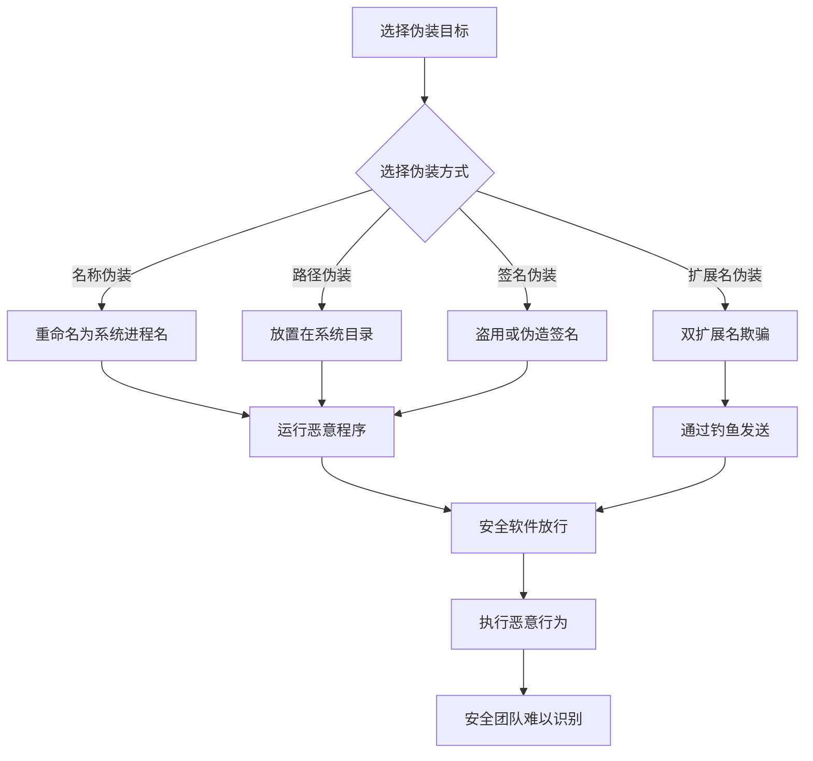

# 伪装 (T1036)

> 攻击者通过修改恶意文件或进程的特征，让它看起来像合法程序——就像狼披着羊皮混进羊群，羊群和安全管理员都认不出来。

## 30秒速查卡

| 维度 | 你需要知道的 |
|------|-------------|
| 这是什么？ | 修改文件名、路径、签名等特征让恶意代码伪装成合法程序 |
| 为什么危险？ | 混淆安全分析和调查，绕过基于名称的检测规则 |
| 谁需要关心？ | 终端安全团队、SOC分析师、系统管理员 |
| 你的第一步防御 | 监控进程路径与名称是否匹配，启用签名验证 |
| 如果只做一件事 | 建立合法进程路径白名单，告警非标准路径的"系统进程" |

## 难度等级

⭐⭐ 中级：需要了解操作系统进程管理、文件系统、数字签名基础

## 前置知识检查

阅读本文件前，你应该了解：
- **进程是什么**：正在运行的程序实例，有PID、名称、路径等属性
- **数字签名**：验证文件来源和完整性的机制
- **系统进程**：操作系统正常运行需要的进程（如svchost.exe、lsass.exe）
- **文件扩展名**：Windows用扩展名关联程序，可被欺骗
- **进程树**：父子进程关系，帮助识别异常启动链

## 技术描述

### 通俗解释

想象一个安保系统通过看工牌颜色识别员工。蓝色工牌是IT部门，红色工牌是保洁。攻击者想要混进机房，最简单的办法就是搞一块蓝色工牌戴上——这就是伪装。

具体手段包括：
- **改名换姓**：把恶意程序命名为`svchost.exe`或`chrome.exe`，管理员一看名字就放行
- **搬家换址**：把`svchost.exe`从`System32`搬到`Temp`目录运行——地址不对劲
- **换装变色**：修改文件图标和扩展名，让`.exe`看起来像`.pdf`文档
- **冒名顶替**：给恶意程序打上合法公司的数字签名（盗用或伪造签名）

简单来说，程序运行时安全软件会检查它的"身份证"——文件名、路径、签名。攻击者把这些信息改成合法程序的样子，就能骗过基于规则的检测。

### 过渡段

上面用工牌类比。实际在Windows中，安全软件通常通过进程名（如svchost.exe）判断是否为系统进程。攻击者将恶意PE文件重命名为svchost.exe，如果安全软件只看名字不看完整路径，就会被骗。更高级的做法是将恶意文件放在非标准路径（如C:\Temp\svchost.exe），利用管理员疏忽。数字签名层面，攻击者可能盗用合法签名证书给恶意程序签名，或利用签名验证的时间差。

### 技术原理

1. **匹配合法名称**：将恶意可执行文件重命名为系统进程名（svchost.exe、lsass.exe、csrss.exe等）或常见软件名（chrome.exe、firefox.exe）
2. **匹配合法位置**：将恶意文件放在合法系统目录（System32）或模仿合法程序目录结构（C:\Program Files\）
3. **代码签名**：使用盗用的代码签名证书给恶意程序签名，或利用时间戳攻击（在签名撤销前运行）
4. **扩展名欺骗**：利用Windows的扩展名隐藏特性，将`malware.exe`命名为`document.pdf.exe`，显示为`document.pdf`
5. **右键左进**：利用RTL（从右到左）字符覆盖技术，反转文件名显示顺序
6. **进程属性篡改**：运行时修改进程的PEB（进程环境块）中的命令行和映像路径，欺骗读取PEB的工具

### 用途与影响

- **绕过检测**：基于名称或路径的检测规则失效
- **混淆调查**：安全分析师难以从进程列表中识别恶意进程
- **社会工程辅助**：让钓鱼附件看起来像正常文档
- **权限提升**：伪装成高权限系统服务进程

## 子技术列表

| 子技术ID | 名称 | 说明 |
|---------|------|------|
| T1036.001 | Invalid Code Signature | 使用无效或伪造的代码签名 |
| T1036.002 | Right-to-Left Override | 利用RTL字符覆盖技术 |
| T1036.003 | Rename System Utilities | 重命名系统工具（如powershell改名为calc） |
| T1036.004 | Masquerade Task or Service | 伪装计划任务或服务 |
| T1036.005 | Match Legitimate Name or Location | 匹配合法名称或位置 |
| T1036.006 | Space after Filename | 文件名后加空格 |
| T1036.007 | Double File Extension | 双重文件扩展名 |
| T1036.008 | Masquerade File Type | 伪装文件类型 |
| T1036.009 | Break Process Trees | 打断进程树关联 |
| T1036.010 | Space in Filename | 文件名中加空格模仿合法程序 |

## 攻击流程



## 真实案例

### 案例1：APT29伪装svchost.exe绕过检测

- **时间**：2020-2021年
- **目标**：美国政府机构、科技公司
- **攻击组织**：APT29（Cozy Bear，俄罗斯SVR背景）
- **手法**：在SolarWinds供应链攻击的后续阶段，APT29将Cobalt Strike beacon重命名为`svchost.exe`并放置在临时目录运行。由于安全软件通常将svchost.exe列为系统进程白名单，该恶意程序成功绕过了基于名称的检测。进一步，攻击者修改了进程的PEB结构，使任务管理器和部分EDR工具显示的进程路径为`C:\Windows\System32\svchost.exe`而非实际路径。他们还使用合法的SolarWinds签名证书给恶意DLL签名，利用签名验证的时间差绕过检测
- **影响**：长期隐蔽运行Cobalt Strike beacon，横向移动到多个政府机构
- **参考**：
  - 📰 Mandiant: SUNBURST Analysis
  - 📜 CISA: SolarWinds Compromise

### 案例2：Emotet木马使用双扩展名钓鱼

- **时间**：2019-2021年（持续活跃）
- **目标**：全球企业用户
- **攻击组织**：Emotet运营者（MUMMY SPIDER）
- **手法**：Emotet通过钓鱼邮件传播，附件使用双扩展名伪装技术。恶意可执行文件命名为`发票文档.pdf.exe`，Windows默认隐藏已知扩展名，用户看到的文件名是`发票文档.pdf`。文件图标设置为Adobe PDF图标，用户双击以为打开PDF文档，实际执行了恶意程序。Emotet还使用RTL覆盖技术，将文件名设为` invoices\u202Edoc.exe`，显示为`invoicesexe.doc`。在2020年的一次大规模攻击中，Emotet利用此技术感染了超过10万台主机
- **影响**：大规模感染，作为其他恶意软件（如TrickBot、Ryuk）的投递载体
- **参考**：
  - 📰 US-CERT: Emotet Malware Alert
  - 📰 Trend Micro: Emotet Evolution

### 案例3：LockBit勒索软件重命名系统工具

- **时间**：2022-2023年
- **目标**：全球企业
- **攻击组织**：LockBit勒索软件团伙
- **手法**：LockBit在攻击过程中重命名合法系统工具来逃避检测。他们将`PsExec.exe`重命名为`svchost.exe`，将`procdump.exe`重命名为`notepad.exe`，将这些工具放在`C:\Windows\Temp`目录运行。由于安全团队通常将svchost.exe和notepad.exe作为合法进程监控，这些工具的侦察和凭据转储行为未被及时检测。LockBit还使用`rundll32.exe`加载恶意DLL（重命名为`version.dll`），利用rundll32的合法签名绕过应用白名单。在部署勒索软件阶段，他们将加密器命名为`lsass.exe`运行
- **影响**：感染超过1000个组织，勒索赎金超过1亿美元
- **参考**：
  - 📰 Cisco Talos: LockBit Analysis
  - 📜 FBI: LockBit Flash Report

## 红队视角

### 实战技巧

1. **选择高频系统进程名**：svchost.exe、chrome.exe等不会引起注意
2. **路径要合理**：System32下的svchost.exe比Temp下的更可信
3. **签名优先**：有签名的程序比无签名的更容易绕过
4. **利用系统工具**：rundll32.exe、regsvr32.exe本身是签名的

### 常用工具

| 工具 | 用途 | 平台 |
|------|------|------|
| Resource Hacker | 修改文件图标和版本信息 | Windows |
| SigThief | 盗取/伪造签名 | Windows |
| Invoke-Phantom | 进程PEB篡改 | Windows |
| msfvenom | 生成自定义payload | 全平台 |

### 注意事项

- 现代EDR基于行为分析而非仅名称
- 签名证书被撤销后失效
- 路径异常是重要告警指标

## 蓝队视角

### 检测要点

1. **进程路径验证**：系统进程必须在标准路径
2. **签名验证**：检查签名是否有效
3. **进程树分析**：谁启动了这个进程
4. **文件哈希**：同一名称不同哈希
5. **网络行为**：合法进程的异常外联

### 监控建议

- 建立系统进程路径白名单
- 监控可执行文件重命名事件
- 启用Sysmon Event ID 1（进程创建）记录命令行
- 配置文件完整性监控

## 避坑指南

- **坑1**：只看进程名不看路径——svchost.exe在Temp目录必有问题
- **坑2**：信任数字签名——签名可被盗用或撤销有时间差
- **坑3**：忽略父进程关系——svchost.exe由services.exe启动才正常
- **坑4**：文件扩展名显示设置——确保显示完整扩展名

## 检测建议

### 网络层

> **用人话说**：网络层看的是"谁在上网"。如果svchost.exe突然连接外部IP，那就像保安发现保洁阿姨在用机密电话——职位和行为的匹配很重要。

```bash
# 检测系统进程的异常网络连接
# 用人话说：系统服务进程不该随便连外网
tshark -i any -Y "(process == svchost.exe || process == lsass.exe) && ip.dst not in {<内网段>}" -T fields -e ip.dst -e tcp.dst_port -e process

# 检测beacon通信模式
# 用人话说：定期心跳是C2标志
netstat -ano | findstr ESTABLISHED | sort /+30 | uniq -c -w30 | sort -rn
```

### 主机层

> **用人话说**：主机层就是查户口——每个进程都要核对姓名、住址、出身（父进程）。Sysmon是核户口最好的工具。

**关键事件ID**：

| 事件ID | 日志源 | 说明 |
|--------|--------|------|
| 1 | Sysmon | 进程创建（含命令行和路径） |
| 7 | Sysmon | DLL加载 |
| 11 | Sysmon | 文件创建 |
| 13 | Sysmon | 注册表值修改 |
| 4688 | Security | 进程创建（需启用命令行审计） |

```powershell
# 检测非标准路径的系统进程
# 用人话说：系统进程必须在系统目录，在别的地方就有鬼
Get-WinEvent -LogName "Microsoft-Windows-Sysmon/Operational" -FilterXPath "*[System[EventID=1] and (EventData[Data[@Name='Image'] = 'svchost.exe' or Data[@Name='Image'] = 'lsass.exe' or Data[@Name='Image'] = 'csrss.exe']) and EventData[Data[@Name='Image'] not contains 'System32' and Data[@Name='Image'] not contains 'SysWOW64']]" -MaxEvents 50

# 检测svchost.exe的异常父进程
# 用人话说：svchost只能由services.exe启动，别的都不对
Get-WinEvent -LogName "Microsoft-Windows-Sysmon/Operational" -FilterXPath "*[System[EventID=1] and EventData[Data[@Name='Image'] = 'svchost.exe'] and EventData[Data[@Name='ParentImage'] != 'services.exe']]" -MaxEvents 50

# 检测双扩展名文件
# 用人话说：文件名里有多个点的要警惕
Get-ChildItem C:\Users -Recurse -Include *.exe,*.scr,*.bat,*.vbs -ErrorAction SilentlyContinue | Where-Object {$_.BaseName -match '\.'} | Select-Object FullName
```

### 应用层

> **用人话说**：应用层主要看签名和文件元数据。就像检查工牌有没有防伪标记。

```yaml
# Sigma规则：检测非标准路径的svchost.exe
title: Suspicious svchost.exe from Non-Standard Path
status: experimental
description: 检测从非System32目录运行的svchost.exe
logsource:
    product: windows
    service: sysmon
detection:
    selection:
        EventID: 1
        Image|endswith: 'svchost.exe'
    filter:
        Image|startswith:
            - 'C:\Windows\System32\'
            - 'C:\Windows\SysWOW64\'
    condition: selection and not filter
level: critical
tags:
    - attack.defense_evasion
    - attack.t1036.005

# Sigma规则：检测双扩展名文件创建
title: Double Extension File Creation
status: experimental
description: 检测具有双重扩展名的可疑文件
logsource:
    product: windows
    service: sysmon
detection:
    selection:
        EventID: 11
        TargetFilename|re: '.*\.(pdf|doc|xls|txt|jpg)\.(exe|scr|bat|vbs|com|pif)$'
    condition: selection
level: high
tags:
    - attack.defense_evasion
    - attack.t1036.007
```

## 缓解措施

### 优先级1（必须立即实施）

| 措施 | 说明 | MITRE映射 |
|------|------|-----------|
| 系统进程路径白名单 | 限制系统进程只能在标准目录运行 | T1036.005 mitigation |
| 禁用扩展名隐藏 | 在文件夹选项中显示完整扩展名 | T1036.007 mitigation |
| 代码签名验证策略 | 启用WDAC验证签名 | T1036.001 mitigation |

### 优先级2（1周内实施）

| 措施 | 说明 | MITRE映射 |
|------|------|-----------|
| 进程父关系监控 | 建立合法进程启动链基线 | T1036 mitigation |
| 服务名称审计 | 监控服务创建和名称变更 | T1036.004 mitigation |
| 文件重命名告警 | 监控系统目录文件重命名 | T1036.003 mitigation |

### 优先级3（1月内实施）

| 措施 | 说明 | MITRE映射 |
|------|------|-----------|
| 签名证书撤销检查 | 配置实时证书撤销检查 | T1036.001 mitigation |
| RTL字符检测 | 部署RTL字符检测规则 | T1036.002 mitigation |
| 文件元数据分析 | 分析文件版本信息和图标 | T1036.008 mitigation |

## 动手实验

### 实验1：检测非标准路径的系统进程

**环境**：任意Windows系统

```powershell
# 列出所有运行的svchost.exe路径
# 用人话说：查查有多少svchost在跑，都在哪里
Get-Process svchost -ErrorAction SilentlyContinue | Select-Object Id, Path

# 验证路径是否在System32
# 用人话说：正常的svchost都在系统目录
Get-Process svchost -ErrorAction SilentlyContinue | Where-Object {$_.Path -notlike "*\System32\*" -and $_.Path -notlike "*\SysWOW64\*"} | Select-Object Id, Path
```

**预期输出**：正常系统中所有svchost.exe路径都是C:\Windows\System32\svchost.exe

### 实验2：分析进程父关系

**环境**：任意Windows系统

```powershell
# 查看svchost.exe的父进程
# 用人话说：svchost应该是services.exe的孩子
Get-WinEvent -LogName "Microsoft-Windows-Sysmon/Operational" -FilterXPath "*[System[EventID=1] and EventData[Data[@Name='Image'] = 'svchost.exe']]" -MaxEvents 100 | ForEach-Object {
    $xml = [xml]$_.ToXml()
    $image = ($xml.Event.EventData.Data | Where-Object {$_.Name -eq 'Image'}).'#text'
    $parent = ($xml.Event.EventData.Data | Where-Object {$_.Name -eq 'ParentImage'}).'#text'
    [PSCustomObject]@{
        Time = $_.TimeCreated
        Image = $image
        Parent = $parent
    }
} | Format-Table -AutoSize
```

**预期输出**：正常svchost.exe的ParentImage应为C:\Windows\System32\services.exe

### 实验3：检测双扩展名文件

**环境**：任意Windows系统

```powershell
# 搜索用户目录下的双扩展名文件
# 用人话说：找找有没有名为xxx.pdf.exe的可疑文件
Get-ChildItem -Path C:\Users -Recurse -Include *.exe,*.scr,*.bat,*.vbs,*.com,*.pif -ErrorAction SilentlyContinue | Where-Object {$_.BaseName -match '\.(pdf|doc|xls|txt|jpg|png)$'} | Select-Object FullName, Length, LastWriteTime
```

**预期输出**：正常系统返回空列表，有恶意文件时返回文件路径

## 术语解释

| 术语 | 解释 |
|------|------|
| 进程伪装 | 修改进程特征使其看起来像合法进程 |
| PEB | 进程环境块，存储进程信息的内存结构 |
| 代码签名 | 验证文件来源和完整性的数字签名 |
| 双扩展名 | 利用扩展名隐藏特性，如document.pdf.exe |
| RTL覆盖 | 利用从右到左字符反转文件名显示 |
| 进程树 | 父子进程的层次关系 |
| svchost.exe | Windows服务宿主进程，常被模仿 |
| WDAC | Windows Defender Application Control |
| 文件元数据 | 文件属性信息（图标、版本、公司等） |
| 签名撤销 | 证书被吊销后，基于该签名的文件不再可信 |

## 参考资料

### 📚 深入了解

- [MITRE ATT&CK T1036](https://attack.mitre.org/techniques/T1036/) — 官方技术页面
- [Microsoft Process Security](https://learn.microsoft.com/en-us/windows/win32/procthread/process-security-and-access-rights) — 进程安全文档
- [Windows Digital Signatures](https://learn.microsoft.com/en-us/windows/win32/seccrypto/digital-signatures) — 数字签名文档

### 📰 真实攻击

- [CISA: SolarWinds Advisory](https://www.cisa.gov/news-events/cybersecurity-advisories/aa21-072a) — SolarWinds攻击分析
- [US-CERT: Emotet Alert](https://www.cisa.gov/news-events/alerts/2018/07/20/cisa-analysis-report-ar18-200a-emotet-malware) — Emotet分析报告
- [CrowdStrike: LockBit Report](https://www.crowdstrike.com/blog/lockbit-3-analysis/) — LockBit分析

### 🔧 动手试试

- [Sysmon](https://learn.microsoft.com/en-us/sysinternals/downloads/sysmon) — 系统监控工具
- [Process Hacker](https://processhacker.sourceforge.io/) — 进程分析工具
- [SigCheck](https://learn.microsoft.com/en-us/sysinternals/downloads/sigcheck) — 签名验证工具

## 版本历史

| 版本 | 日期 | 变更 |
|------|------|------|
| v3.1 | 2026-07-10 | 初始版本，从T1654.002模板污染恢复 |
| v1.0 | - | MITRE ATT&CK原始定义 |
