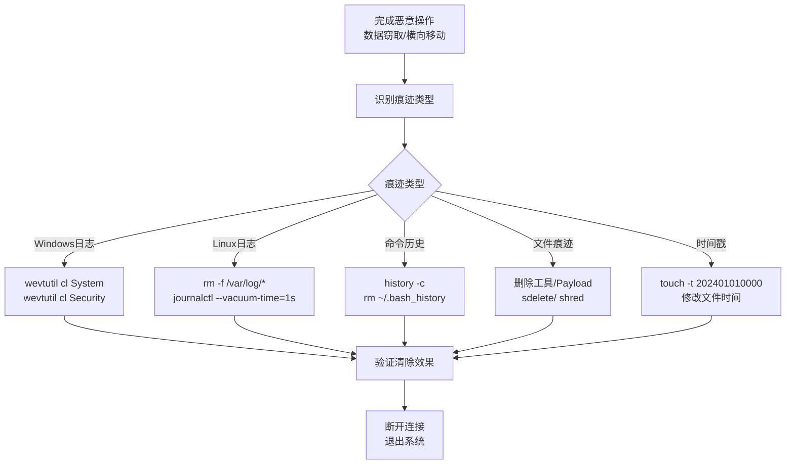

# 清除痕迹 (T1070)

## 一句话通俗理解

攻击者干完坏事后"擦指纹"——删除日志、清空命令历史、销毁入侵证据，让蓝队无从追踪。

## 30秒速查卡

| 维度 | 你需要知道的 |
|------|-------------|
| 这是什么？ | 攻击者删除或修改系统日志、文件、命令历史等取证痕迹的技术 |
| 为什么危险？ | 没有日志，安全团队无法追溯攻击路径，也无法评估损失范围 |
| 谁需要关心？ | SOC分析师、取证调查人员、系统管理员 |
| 你的第一步防御 | 将日志转发到独立的日志服务器（攻击者无法在本地删除） |
| 如果只做一件事 | 监控日志清除命令（wevtutil cl、rm /var/log、history -c）并立即告警 |

## 难度等级

⭐⭐ 中级（需要了解操作系统日志机制和基本取证知识）

**前置知识要求：**
- 操作系统日志体系（Windows事件日志、Linux syslog、bash history）
- 基本命令行操作
- 数字取证基础概念

## 前置知识检查

**读这个文件需要什么？**

- [ ] Windows事件日志结构（Application/Security/System）
- [ ] Linux日志文件位置（/var/log/、~/.bash_history）
- [ ] 常用日志管理命令（wevtutil、journalctl、logrotate）

## 技术描述

清除痕迹（T1070）是MITRE ATT&CK框架中隐蔽战术的一种技术，指攻击者主动删除或修改其在入侵过程中留在系统上的各种痕迹。

**通俗解释：**

想象一个小偷闯入你家偷东西。走的时候，他不仅把指纹擦干净，还把你家的监控录像删了，把门锁恢复原样，甚至把你记事本上写的"今天有人来过"的记录也撕掉了。等你发现丢了东西，想查监控、查记录，什么都查不到——这就是攻击者在系统里做的"清除痕迹"。

**过渡段：** 简单来说，系统在运行过程中会持续记录"谁做了什么"——登录了谁、执行了什么命令、访问了哪些文件、网络连了哪里。这些记录就是安全团队的"眼睛"。攻击者要做的就是蒙上这双眼睛。

**技术原理：**

1. **清除事件日志**：Windows使用`wevtutil cl System`清空系统日志，Linux使用`rm /var/log/*`或`> /var/log/syslog`清空日志文件
2. **清除命令历史**：删除`~/.bash_history`、`~/.zsh_history`，或使用`history -c`清除当前会话历史，或设置`unset HISTFILE`不记录历史
3. **删除临时文件**：清除攻击工具、Payload、临时下载文件等落地证据
4. **时间戳篡改**：修改文件的创建时间、修改时间、访问时间，混淆取证分析
5. **清除网络连接记录**：删除Netflow记录、防火墙日志、DNS缓存

**用途与影响：**
清除痕迹是攻击者在完成目标操作后的"收尾"步骤，也是APT长期潜伏的关键。没有有效的日志和痕迹，安全团队无法进行事件响应和取证分析，攻击者可以反复入侵而不被发现。

## 子技术列表

| 子技术ID | 名称 | 说明 |
|----------|------|------|
| T1070.001 | 清除Windows事件日志 | 使用wevtutil清空Security/System/Application日志 |
| T1070.002 | 清除Linux/Mac系统日志 | 删除/清空/var/log下的日志文件 |
| T1070.003 | 清除命令历史 | 删除.bash_history或使用history -c |
| T1070.004 | 文件删除 | 删除攻击工具、Payload、临时文件 |
| T1070.005 | 删除网络共享连接 | 清除网络映射驱动器的连接记录 |
| T1070.006 | 时间戳篡改 | 修改文件时间戳混淆取证 |
| T1070.007 | 清除网络连接历史 | 清除DNS缓存、网络连接记录 |
| T1070.008 | 清除邮箱数据 | 删除邮箱中的钓鱼邮件等证据 |
| T1070.009 | 清除内存 | 清除内存中的取证数据 |

## 攻击流程

### 典型攻击流程

```
完成恶意操作 --> 识别需要清除的痕迹 --> 执行清除命令 --> 验证清除效果 --> 断开连接
```



**步骤详解：**

1. **完成恶意操作**
   - 通俗描述：攻击者完成数据窃取、横向移动等目标操作
   - 技术细节：此时系统中留下了大量操作痕迹（日志、临时文件、网络连接记录）
   - 常用工具：各类攻击工具

2. **识别需要清除的痕迹**
   - 通俗描述：攻击者盘点哪些日志和文件可能暴露自己
   - 技术细节：检查Windows事件日志、Linux syslog、命令历史、临时文件目录
   - 常用工具：手动检查

3. **执行清除命令**
   - 通俗描述：用系统命令删除或清空痕迹
   - 技术细节：wevtutil cl（Windows）、rm/var/log（Linux）、history -c（命令历史）
   - 常用工具：wevtutil、rm、shred、sdelete

4. **验证清除效果**
   - 通俗描述：确认痕迹已被彻底删除
   - 技术细节：检查日志文件大小、确认历史文件不存在
   - 常用工具：手动验证

## 真实案例

### 案例1：APT29（Cozy Bear）清除Windows事件日志（2020年SolarWinds供应链攻击）

- **时间**：2020年12月
- **目标**：SolarWinds供应链攻击的受害者（美国政府机构、企业）
- **攻击组织**：APT29（Cozy Bear，俄罗斯SVR背景）
- **手法**：APT29在SolarWinds供应链攻击的后续阶段，使用`wevtutil cl System`和`wevtutil cl Security`命令清空Windows事件日志，以消除其在受害者网络中横向移动和凭据窃取的痕迹。攻击者还删除了SUNBURST后门的临时文件和注册表项。
- **影响**：导致受害组织无法完整追溯攻击者的活动路径，严重影响事件响应和损失评估
- **参考链接**：[CISA Alert AA21-078A](https://www.cisa.gov/news-events/cybersecurity-advisories/aa21-078a)

### 案例2：FIN7清空事件日志和命令历史（2018-2020年）

- **时间**：2018-2020年
- **目标**：美国餐饮、零售企业
- **攻击组织**：FIN7（Carbanak Group，金融犯罪团伙）
- **手法**：FIN7在入侵后使用批处理脚本自动清除痕迹，包括：使用`wevtutil cl System /`清空所有Windows事件日志、使用`del /f /q %TEMP%\*`删除临时文件、使用`cmd /c rd /s /q`删除工具目录。攻击者还会设置`HISTFILE=/dev/null`阻止Linux跳板机的命令历史记录。
- **影响**：多次入侵造成的损失难以完整追溯，已知损失超过10亿美元
- **参考链接**：[DOJ FIN7 Indictment](https://www.justice.gov/opa/pr/five-members-notorious-international-cybercrime-group-fin7-cybercriminal-enterprise-charged)

### 案例3：UNC2529使用PowerShell清除日志（2020年）

- **时间**：2020年12月
- **目标**：全球医疗、国防、航空航天企业
- **攻击组织**：UNC2529（疑似APT组织）
- **手法**：UNC2529在钓鱼邮件攻击的后续阶段，使用PowerShell命令清除痕迹：`PowerShell -Command "wevtutil cl Security; wevtutil cl System; wevtutil cl Application; Remove-Item -Path $env:TEMP\* -Recurse -Force"`。攻击者还会清除PowerShell自身的脚本块日志（Event ID 4104），试图抹去命令执行记录。
- **影响**：多个受害组织无法追溯攻击者的完整活动
- **参考链接**：[FireEye UNC2529 Analysis](https://www.fireeye.com/blog/threat-research/2020/12/unc2529-triple-double-trouble.html)

## 红队视角

> ⚠️ **免责声明**：以下内容仅用于合法的安全测试、渗透测试和教育目的。未经授权对他人系统进行测试是违法行为。

### 实战技巧

1. **批量清除Windows日志**
   使用PowerShell批量清除所有事件日志（需要管理员权限）：
   ```powershell
   Get-WinEvent -ListLog * -Force | Where-Object {$_.RecordCount -gt 0} | ForEach-Object {Wevtutil cl $_.LogName}
   ```

2. **Linux无痕操作**
   - `unset HISTFILE HISTFILESIZE` — 不记录当前会话历史
   - `export HISTCONTROL=ignorespace` — 以空格开头的命令不记录
   - `kill -9 $$` — 强制退出不写历史文件

3. **安全删除文件**
   使用`shred`或`sdelete`多次覆写删除，防止恢复：
   ```bash
   shred -vfz -n 5 sensitive_file.txt
   ```

### 常用工具

| 工具名称 | 用途 | 平台 | 链接 |
|----------|------|------|------|
| wevtutil | Windows日志管理 | Windows | 系统内置 |
| shred | 安全删除文件 | Linux | 系统内置 |
| sdelete | 安全删除文件 | Windows | Sysinternals |
| Clear-Evtx | 批量清除事件日志 | Windows | PowerShell脚本 |

### 注意事项

- 清除日志本身会在日志中留下一条"日志已清除"的记录（Event ID 1102），这反而是一个强信号
- 集中式日志服务器（SIEM）的日志无法在本地清除
- 文件删除后仍可能被取证工具恢复（如未覆写磁盘空间）

## 蓝队视角

### 检测要点

1. **日志清除事件检测**
   - 日志来源：Windows Event ID 1102（Audit log cleared）、Sysmon Event ID 4
   - 关注字段：日志清除操作的主体账户、时间
   - 异常特征：任何非计划的日志清除操作都应视为高危

2. **日志清除命令检测**
   - 日志来源：Windows Event ID 4688（进程创建）、PowerShell Event ID 4104
   - 关注字段：`wevtutil cl`、`Remove-EventLog`、`Limit-EventLog`
   - 异常特征：命令行中出现日志清除参数

3. **命令历史删除检测**
   - 日志来源：Linux auditd、bash_history监控
   - 关注字段：`history -c`、`rm .bash_history`、`unset HISTFILE`、`HISTFILE=/dev/null`
   - 异常特征：用户主动删除或禁用命令历史记录

### 监控建议

- 将所有系统日志实时转发到独立的SIEM/Syslog服务器
- 监控Windows Event ID 1102（日志清除）并配置即时告警
- 使用auditd监控Linux系统上的日志文件删除和修改操作
- 监控`.bash_history`文件的删除和修改

## 避坑指南

**常见误区：** 认为删除了本地日志就彻底安全了。实际上，日志可能已经被转发到SIEM、备份系统或网络监控设备。

**正确的蓝队做法：** 不要只依赖本地日志，建立集中式日志收集和实时告警体系。

## 检测建议

### 网络层检测

**检测方法：** 监控网络流量中与日志清除相关的活动，包括检测远程执行的日志清除命令、异常的Syslog流量中断、日志转发服务的异常停止。

**用人话说：** 攻击者清日志时，日志转发流量会突然中断或减少。如果日志服务器突然收不到某台机器的日志了，那台机器很可能正在被攻击。

**具体命令/规则示例：**

```bash
# 检测Syslog流量中断（某主机停止发送日志超过5分钟）
# 在日志服务器上执行
awk '{print $4}' /var/log/syslog | sort | uniq -c | sort -rn | head -20
# 找到日志量突然为0的主机
```

**Suricata规则示例：**
```
# 检测通过WinRM远程执行的wevtutil清除命令
alert tcp any any -> $HOME_NET 5985 (
    msg:"T1070 - Remote wevtutil log clearing via WinRM";
    flow:established,to_server;
    content:"wevtutil"; nocase;
    content:"cl"; distance:0;
    classtype:trojan-activity;
    sid:10010701;
    rev:1;
)
```

### 主机层检测

**Windows事件ID：**
- Event ID 1102：审核日志已清除（最关键）
- Event ID 4688：进程创建（检测wevtutil命令）
- Sysmon Event ID 4：Sysmon配置变更
- PowerShell Event ID 4104：脚本块日志

**具体命令示例：**
```powershell
# 检测Windows安全日志清除事件
Get-WinEvent -FilterHashtable @{LogName='Security'; ID=1102} |
    Select-Object TimeCreated, @{N='ClearedBy';E={$_.Properties[1].Value}}

# 检测wevtutil清除命令
Get-WinEvent -FilterHashtable @{LogName='Security'; ID=4688} |
    Where-Object { $_.Message -match 'wevtutil.*cl' }
```

**Linux auditd规则示例：**
```bash
# 监控日志文件删除
auditctl -w /var/log/ -p wa -k log_deletion
# 监控bash_history文件修改
auditctl -w /home/*/.bash_history -p wa -k history_modification
# 检查auditd日志
ausearch -k log_deletion
```

### 应用层检测

**Sigma规则示例：**

**用人话说：** 日志清除检测的关键是抓住"清除行为本身"。Windows会记录一条Event ID 1102说"日志被清了"，这条记录本身就是最直接的告警信号。另外要关注wevtutil、rm、history -c这些命令的出现。

```yaml
title: Windows安全日志清除检测
status: experimental
description: 检测通过wevtutil或其他方式清除Windows事件日志的行为
logsource:
    product: windows
    service: security
detection:
    selection_event:
        EventID: 1102
    selection_command:
        EventID: 4688
        CommandLine|contains:
            - 'wevtutil cl'
            - 'Remove-EventLog'
            - 'Limit-EventLog -MaximumSize 0'
    condition: selection_event or selection_command
level: high
tags:
    - attack.t1070
    - attack.defense_evasion
    - attack.stealth
```

## 缓解措施

### 优先级1：关键措施

**措施名称：** 集中式日志收集与转发

**具体实施步骤：**
1. 部署SIEM或集中式Syslog服务器
2. 配置所有终端实时转发日志到中央服务器
3. 确保中央日志服务器与终端网络隔离，攻击者无法直接访问

### 优先级2：重要措施

**措施名称：** 日志清除告警

**具体实施步骤：**
1. 配置Windows Event ID 1102的实时告警
2. 监控Linux系统上日志文件的删除和修改
3. 设置日志量异常下降的告警（日志突然停止可能意味着被清除）

### 优先级3：建议措施

**措施名称：** 日志备份与完整性保护

**具体实施步骤：**
1. 定期备份关键日志到只读存储
2. 使用WORM（Write Once Read Many）存储保护日志
3. 实施日志完整性校验（如HMAC签名）

### MITRE ATT&CK 缓解措施映射

| 缓解措施ID | 缓解措施名称 | 适用性 | 说明 |
|------------|-------------|--------|------|
| M1029 | 远程数据存储 | 适用 | 将日志存储在远程服务器 |
| M1047 | 审计 | 适用 | 审计日志清除操作 |
| M1053 | 文件恢复 | 部分适用 | 使用取证工具恢复被删除的日志 |

## 动手实验

> ⚠️ **重要提示**：所有实验必须在隔离的实验室环境中进行，禁止对未授权的真实系统进行测试。

### 实验环境准备

**所需工具：**
- Windows 10/11 VM（带Sysmon）
- Linux VM（Ubuntu/CentOS）
- Splunk Free 或 ELK Stack

### 实验1：Windows日志清除与检测（初级）

**实验目标：** 理解攻击者如何清除Windows事件日志，以及蓝队如何检测

**实验步骤：**
1. 在Windows VM上产生一些安全事件（如登录失败几次）
2. 打开事件查看器，记录Security日志的当前记录数
3. 以管理员身份运行`wevtutil cl Security`
4. 检查Security日志，确认已被清空
5. 查看Event ID 1102记录（日志清除事件本身）
6. 在SIEM中配置Event ID 1102的告警规则

**预期结果：** Security日志被清空，但Event ID 1102记录了清除操作

**学习要点：** 理解日志清除本身会留下痕迹，以及为什么集中式日志收集很重要

### 实验2：Linux无痕操作与检测（中级）

**实验目标：** 学习Linux下攻击者的无痕操作技术及检测方法

**实验步骤：**
1. 在Linux VM上配置auditd监控`~/.bash_history`
2. 执行`unset HISTFILE`后运行几个命令
3. 检查`.bash_history`文件，确认命令未被记录
4. 执行`history -c`清空当前会话历史
5. 使用`ausearch -k history_modification`查看auditd日志
6. 编写auditd规则检测`unset HISTFILE`和`history -c`

**预期结果：** 命令历史被清除，但auditd记录了清除操作

**学习要点：** 理解Linux下的痕迹清除技术及auditd检测方法

## 术语解释

| 术语 | 英文原名 | 通俗解释 |
|------|----------|----------|
| 事件日志 | Event Log | Windows系统记录重要事件的日志文件 |
| wevtutil | Windows Event Command Line Utility | Windows内置的日志管理命令行工具 |
| 命令历史 | Command History | Shell记录用户执行过的命令的文件 |
| 取证 | Forensics | 通过分析数字证据还原事件过程 |
| 时间戳篡改 | Timestomp | 修改文件的创建/修改时间以混淆取证 |
| auditd | Linux Audit Daemon | Linux系统的审计守护进程 |

## 参考资料

### 📚 官方文档（深入了解）

- [MITRE ATT&CK - T1070 Indicator Removal](https://attack.mitre.org/techniques/T1070/)

### 📰 安全报告（真实攻击）

- [CISA - SolarWinds (APT29) 分析报告](https://www.cisa.gov/news-events/cybersecurity-advisories/aa21-078a)
- [FireEye - UNC2529 钓鱼攻击分析](https://www.fireeye.com/blog/threat-research/2020/12/unc2529-triple-double-trouble.html)

### 🔧 工具与资源（动手试试）

- [Sysinternals SDelete - 安全删除工具](https://docs.microsoft.com/en-us/sysinternals/downloads/sdelete)
- [auditd - Linux审计工具](https://linux.die.net/man/8/auditd)
- [Sysmon - Windows系统监控](https://docs.microsoft.com/en-us/sysinternals/downloads/sysmon)
