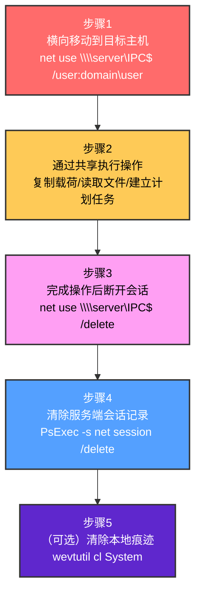
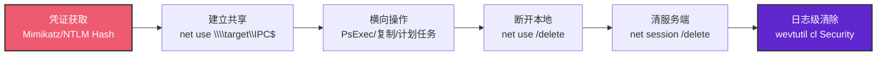

# 网络共享连接移除 (T1070.005)

## 一句话通俗理解

> **攻击者用完网络共享（比如 `\\财务服务器\财务部`）之后，立刻把这条连接"剪掉"，让你查日志时只看到"曾经连过"却查不到"还连着"——就像小偷离开作案现场前把监控录像带抽走，再顺手把门锁复位。**

## 30秒速查卡

| 维度 | 你需要知道的 |
|------|-------------|
| 这是什么？ | Network Share Connection Removal（T1070.005），指示器移除（T1070）的子技术 |
| 为什么危险？ | 横向移动留下的"共享会话"是 SOC 最容易抓的痕迹之一，移除后取证时只看到"曾经登录"，无法追溯"做了什么、传了什么文件" |
| 谁需要关心？ | SOC 分析师、应急响应人员、AD 管理员、Windows/Linux 系统管理员 |
| 你的第一步防御 | 启用 Windows 事件 ID 4779（会话断开）、5140/5145（共享访问）审计，并在 SIEM 中关联"短时间内共享建立+断开"模式 |
| 如果只做一件事 | 把 `net use` / `net session` / `net file` 命令调用纳入 Sysmon EID 1 进程审计，关键字段含 `/delete` 参数 |

## 难度等级

⭐⭐ 中级 - 需要一定的技术基础和经验

执行门槛极低（一行 `net use \\x /delete` 命令即可），但要真正做到"擦干净"且不被 EDR 捕获，需要理解 Windows 会话、SMB 协议、日志清除链路的协同——这是中级难度而非初级。

## 前置知识检查

**读这个文件需要什么？**

- [x] 操作系统权限模型基础（Administrator/SYSTEM 与普通用户的差异）
- [x] 指示器移除（T1070）的原理（父技术：清除痕迹的统称）
- [x] Windows 网络共享基础（SMB 协议、`net use`/`net session` 命令族）
- [x] Windows 事件日志体系（Sysmon、Security、System 日志通道）
- [x] ATT&CK 横向移动战术（TA0008）中通过 SMB/Windows Admin Share 横移的常见路径

## 技术描述

**网络共享连接移除**（T1070.005）是 **指示器移除**（T1070）的一个具体变体，属于 **隐蔽**（TA0005）阶段的攻击技术。

根据 MITRE ATT&CK v19 官方描述： adversaries may remove share connections on Windows systems to clear the indication that they had accessed a network share. 网络共享连接（如 `\\server\share`、IPC$ 管道、SMB 会话）是攻击者横向移动（T1021.002 Remote Services: SMB/Windows Admin Shares）后最常见的"足迹"之一。每次建立 SMB 会话，目标主机都会记录会话 ID、客户端 IP、用户上下文；本地工作站也会在 `net use` 列表中保留映射痕迹。攻击者在完成横向操作（执行载荷、复制数据、建立持久化）后，会主动断开这些会话以切断"活动连接"这一实时取证线索。

### 具体怎么理解？

可以把网络共享连接想象成"租房"：
- **建立连接（`net use \\server\share`）** = 攻击者签了一份租约，房东（目标服务器）和租客（攻击者工作站）都留有合同副本
- **正常断开（用户主动 `net use /delete` 或注销）** = 合同到期双方和平解约，房东登记本上记一笔"此人曾住"
- **攻击者移除（T1070.005）** = 攻击者不仅退租，还趁房东不注意把登记本上自己的那行也划掉，让后来人查不到

在 Windows 上，攻击者最常用的命令是：
- `net use \\server\IPC$ /delete` — 删除命名管道会话
- `net use * /delete /y` — 一键清空所有共享映射
- `net session \\client_ip /delete` — 在服务端反向踢掉客户端
- `net file <id> /close` — 关闭特定打开的文件句柄

在 Linux 上对应的操作是 `umount //server/share`（卸载 CIFS 挂载点）或 `smbclient -L //server -U user` 后主动断开。

### 为什么有效？

这条技术对攻击者有效的核心原因有三：

1. **会话是"实时证据"，断开后取证价值大幅下降**。安全响应人员最想抓的是"现在还连着的攻击者"——这意味着可以抓现行、阻断 C2 通道。一旦会话断开，Windows 默认安全日志只保留登录/登出事件（EID 4624/4634），但**当前活动会话列表**会被立即清除，应急响应时 `net session` 看到的就是空列表。
2. **共享审计日志不完整**。许多企业未启用详细文件共享审计（EID 5140 共享被访问、5145 文件被详细访问），导致攻击者断开后，"做了什么"完全没有留痕。
3. **正常运维也常用此命令**，告警基线被噪音淹没。`net use /delete` 是脚本化运维的标准操作，攻击者借此"藏在噪声中"，单条命令几乎不会触发告警。

## 真型场景

攻击者在 **隐蔽** 阶段使用网络共享连接移除技术，以下是典型的攻击步骤：



**步骤详解：**

1. **建立 SMB 会话**：攻击者通过凭证窃取或 Pass-the-Hash 拿到合法域账户，对目标主机发起 `net use \\target\IPC$` 建立命名管道会话，相当于拿到一张"门禁卡"。
2. **利用共享进行操作**：通过已建立的会话，攻击者执行 PsExec 远程命令、复制 Mimikatz 到目标、读取域控上的机密文件、或通过 SCRPC 建立计划任务实现持久化（T1053）。
3. **主动断开连接**：操作完成后立即执行 `net use \\target\IPC$ /delete`，将本地映射表清空。此时 Windows 工作站上 `HKLM\SYSTEM\CurrentControlSet\Services\LanmanWorkstation` 下的会话信息被清理。
4. **服务端会话清理**：高级攻击者还会登录目标主机（或通过 PsExec -s）执行 `net session /delete`，强制关闭服务端的会话记录，让应急响应时 `Get-SmbSession` 查不到当前活动连接。
5. **可选：日志级清除**：若已获得 Administrator 权限，进一步清除 Windows Security 日志（EID 4779 共享会话断开事件）以彻底抹掉痕迹——但这通常会触发日志清除告警，谨慎的攻击者会跳过此步。

## 攻击流程

```
[初始访问/凭证窃取]
    ↓
[建立 SMB 会话到目标主机]   ← net use \\target\IPC$
    ↓
[横向操作：执行/复制/持久化]
    ↓
[断开本地共享映射]          ← net use \\target\IPC$ /delete
    ↓
[清除服务端会话记录]        ← net session \\client_ip /delete
    ↓
[验证清除]                 ← net use; net session（确认空列表）
```



**步骤详解：**

1. **凭证获取**
   - 通俗描述：攻击者先拿到一张能开目标主机门的"门禁卡"——通常是 NTLM Hash 或明文凭证。
   - 技术细节：通过 Mimikatz `sekurlsa::logonpasswords` 或 LSASS dump 提取 NTLM Hash；也可使用 Pass-the-Hash 技术无需破解明文。
   - 常用工具：Mimikatz、Impacket `secretsdump.py`、Cobalt Strike `run sekurlsa::logonpasswords`

2. **建立共享会话**
   - 通俗描述：用门禁卡刷开目标主机的"管理通道"（IPC$ 是 Windows 默认开启的命名管道共享）。
   - 技术细节：`net use \\target\IPC$ /user:DOMAIN\user <hash_or_password>`；Cobalt Strike 的 `jump psexec` 或 `link` 命令也底层调用此 API。
   - 常用工具：net.exe、PsExec、Cobalt Strike、Impacket `psexec.py`

3. **横向操作**
   - 通俗描述：进入后做坏事——放下后门、复制工具、读取数据。
   - 技术细节：通过 IPC$ 会话调用 `\\target\ADMIN$\system32\` 路径下放文件，再通过 SCRPC（`sc \\target create`）创建服务执行；或通过 `schtasks /s \\target` 创建计划任务。
   - 常用工具：PsExec、Cobalt Strike、Metasploit `psexec` 模块

4. **断开本地映射**
   - 通俗描述：从攻击者工作站端"注销"共享连接，让 `net use` 列表恢复空白。
   - 技术细节：执行 `net use \\target\IPC$ /delete` 或 `net use * /delete /y` 批量清空。Windows 会在本地工作站的 `HKLM\System\CurrentControlSet\Services\LanmanWorkstation` 下移除会话项。
   - 常用工具：net.exe、PowerShell `Remove-SmbMapping`

5. **清除服务端会话**
   - 通俗描述：再到目标主机上把"访客登记本"里自己的名字划掉。
   - 技术细节：通过 RDP/PsExec 进目标主机后执行 `net session \\attacker_ip /delete`，强制断开 SMB 会话并清除服务端会话表。
   - 常用工具：net.exe、PowerShell `Close-SmbSession`

6. **日志级清除（可选）**
   - 通俗描述：如果担心被发现，连日志里"曾来访"的记录也一并擦掉。
   - 技术细节：`wevtutil cl Security` 清空整个 Security 通道；或定向删除 EID 4779 事件。**注意：清空 Security 日志会触发 EID 1102 告警**，老练攻击者通常不做这步。
   - 常用工具：wevtutil.exe、PowerShell `Clear-EventLog`

## 真实案例

### 案例1：Conti 勒索软件攻击链中的共享痕迹清除

- **时间**: 2021-2023 年
- **目标**: 全球医疗机构、制造业、关键基础设施
- **攻击组织**: Conti 勒索软件团伙（与 Wizard Spider/TR026 关联）
- **手法**: Conti 在横向移动阶段大量使用 SMB 共享（`net use \\target\IPC$`）配合 PsExec 投递勒索载荷。在每个主机投放完成后，攻击脚本会自动执行 `net use * /delete /y` 清除所有共享映射，并在结束所有操作后通过 `wevtutil cl Security` 清空安全日志。CISA 的 AA21-265A 通告中明确记录了这一模式。
- **影响**: 全球超过 1000 家组织受影响，单次攻击勒索金额最高达 4000 万美元（Ireland HSE 案例）。由于日志被清除，许多受害者甚至无法确定初始访问时间。
- **参考链接**: [CISA Alert AA21-265A - Conti Ransomware](https://www.cisa.gov/news-events/cybersecurity-advisories/aa21-265a)

### 案例2：APT29 在 SolarWinds 事件后的痕迹清理

- **时间**: 2020 年
- **目标**: SolarWinds 供应链攻击中的二级目标（美国政府机构、智库）
- **攻击组织**: APT29（Nobelium / Midnight Blizzard，俄罗斯 SVR 关联）
- **手法**: Mandiant 报告显示，APT29 在通过 SUNBURST 后门横向移动后，使用 `net use /delete` 和 PowerShell `Remove-SmbMapping` 清除共享连接，同时删除 `C:\Windows\Tasks` 下创建的计划任务文件（与 T1070.009 Clear Persistence 协同）。攻击者还修改了 SACL（系统访问控制列表）以禁止对敏感会话日志的进一步审计。
- **影响**: 18,000 个 SolarWinds 客户中至少 100 个被深度入侵，攻击者在受影响网络中潜伏长达 9 个月未被发现，部分原因就是精心的痕迹清理。
- **参考链接**: [Mandiant SUNBURST Analysis](https://www.mandiant.com/resources/sunburst-additional-technical-details)

### 案例3：LockBit 3.0 自动化痕迹清理

- **时间**: 2022-2024 年
- **目标**: 制造、医疗、IT 服务行业
- **攻击组织**: LockBit 3.0 勒索团伙
- **手法**: LockBit 3.0 的 PowerShell 投递脚本在执行加密前会运行一段"痕迹清理"模块，包含 `net use * /delete /y`、`net session * /delete`、`Remove-SmbMapping -Force` 以及针对 Windows 事件日志的定向清除。脚本还会调用 `wmic /node:target process call create "cmd /c net use * /delete /y"` 在横向移动到的远程主机上执行同样清理。
- **影响**: 截至 2024 年，LockBit 3.0 全球累计攻击超过 2000 起，因日志清除导致取证困难，许多受害企业无法精确还原攻击时间线。
- **参考链接**: [Microsoft Threat Intelligence - LockBit 3.0](https://www.microsoft.com/en-us/security/blog/2022/12/12/microsoft-investigates-lockbit-30-ransomware/)

### 案例4：安全研究中的实践

- **时间**: 2025 年
- **目标**: 安全研究测试环境
- **攻击组织**: 红队/安全研究人员
- **手法**: 在授权红队测试中模拟 T1070.005 攻击，使用 Atomic Red Team 的 [T1070.005](https://github.com/redcanaryco/atomic-red-team/blob/master/atomics/T1070.005/T1070.005.md) 测试用例，验证 SOC 检测能力。典型测试包括：建立共享→执行操作→断开→检查 SOC 是否在 5 分钟内告警。
- **影响**: 验证防御体系的检测和响应能力，评估"共享建立+断开"的快速组合是否能被 SIEM 关联规则捕获。
- **参考链接**: [Atomic Red Team T1070.005](https://github.com/redcanaryco/atomic-red-team/tree/master/atomics/T1070.005)

## 红队视角

> ⚠️ **免责声明**：以下内容仅用于合法的安全测试、渗透测试和教育目的。未经授权对他人系统进行测试是违法行为。

### 实战技巧

1. **深入理解原理**：T1070.005 不只是 `net use /delete` 这条命令，更核心的是理解 Windows SMB 会话机制——客户端会话表（`HKLM\System\CCS\Services\LanmanWorkstation`）和服务端会话表（`HKLM\System\CCS\Services\LanmanServer`）是两套独立记录，必须双端清理才算干净。
2. **环境适配**：Windows 域环境用 `net use`，Linux 红队需用 `smbclient` 配合 `umount.cifs`，macOS 上是 `mount_smbfs` + `umount`。云环境（Azure Files、AWS FSx）的 SMB 共享清理逻辑类似但审计路径不同。
3. **组合使用**：与 T1070.002（清除 Windows 事件日志）、T1070.009（清除持久化）协同使用——前者清除"事件记录"，本技术清除"实时会话"，后者清除"持久化痕迹"，三者构成完整的痕迹清除链。
4. **隐蔽性考虑**：单纯 `net use /delete` 不会触发 EID 4779（这事件记录的是"会话因正常原因断开"）。但**快速建立+断开**模式（5 分钟内连断）会被行为分析引擎标记为可疑。建议操作至少持续 10 分钟以上，或伪装为正常的运维脚本执行时段。

### 常用工具

| 工具名称 | 用途 | 平台 | 链接 |
| -------- | ---- | ---- | ---- |
| net.exe | 建立和删除 SMB 共享映射 | Windows | 系统内置 |
| PowerShell `Remove-SmbMapping` / `Close-SmbSession` | 现代 SMB 模块命令 | Windows | 系统内置（SmbShare 模块） |
| PsExec | 通过 SMB 执行远程命令并保留可清除会话 | Windows | [Sysinternals](https://docs.microsoft.com/sysinternals/downloads/psexec) |
| Cobalt Strike | `jump psexec` / `link` 内置 SMB 横移与会话管理 | Windows | 商业红队平台 |
| Impacket `psexec.py` / `smbclient.py` | 跨平台 SMB 操作 | Linux/macOS | [Impacket GitHub](https://github.com/SecureAuthCorp/impacket) |
| smbclient | Samba 客户端，Linux/macOS 上的 SMB 操作 | Linux/macOS | 系统包管理器 |
| wevtutil | 清除 Windows 事件日志（可选） | Windows | 系统内置 |

### 注意事项

- 在授权的测试环境中使用这些技术，确保有明确的书面授权范围（Rules of Engagement）
- 注意操作安全（OPSEC），避免被检测系统发现——`net use * /delete /y` 这类批量操作容易触发 EDR 行为规则
- 使用匿名化技术和代理隐藏真实身份，红队测试中应使用与真实攻击类似的"慢速"模式
- **法律边界**：在未授权系统上执行 `net use /delete` 同样构成"未授权访问计算机系统罪"，不要在生产系统测试

## 蓝队视角

### 检测要点

1. **系统日志监控**：核心是 Windows 安全日志 EID 4624（类型 3 网络登录）、4634（网络登出）、4779（共享会话断开）；高级审计策略中启用 "File Share Access" 后还会有 EID 5140、5145。
2. **异常行为检测**：单条 `net use /delete` 不可疑，但"5 分钟内建立+删除+在不同主机上重复"模式高度可疑。重点关注"快速建立-断开"的时间序列模式。
3. **工具特征识别**：Sysmon EID 1 进程创建事件中，`net.exe` 或 `net1.exe` 命令行参数包含 `/delete` 且路径含 `\\<remote>` 的，标记为中风险；批量 `* /delete /y` 标记为高风险。
4. **PowerShell 监控**：`Remove-SmbMapping`、`Close-SmbSession`、`Get-SmbSession | Remove-SmbSession` 等 PowerShell 命令需要 EID 4104（ScriptBlock 日志）和 4103（Module 日志）覆盖。

### 监控建议

- 部署端点检测和响应（EDR）系统：Microsoft Defender for Endpoint、CrowdStrike Falcon、SentinelOne 等内置对 `net.exe` 命令行的解析规则
- 配置 SIEM 规则，关联分析来自多个来源的告警：将"同一用户在 10 分钟内对 5 个以上主机执行 net use 建立+断开"作为可疑横向移动信号
- 定期进行安全评估和渗透测试：通过红队演练验证 SOC 是否能在"会话断开前"抓到攻击者
- **基线建立**：先观察正常运维脚本中的 `net use /delete` 使用频率，避免告警风暴

## 避坑指南

红队新手常踩的坑：

1. **只删本地不删远端**：执行 `net use \\target\IPC$ /delete` 只清除了攻击者工作站这边的映射，目标主机上的 `net session` 仍能看到你的 IP。**正确做法**：登录目标主机执行 `net session \\<your_ip> /delete`，或使用 `klist -li 0x3e7 purge` 清理 Kerberos 票据。
2. **批量 `* /delete` 触发告警**：`net use * /delete /y` 会一次性断开所有共享，包括正常运维的映射，这会立即触发 SOC 的"批量操作"规则。**正确做法**：定向 `net use \\<specific_share> /delete`，每次只清理一个。
3. **遗忘 Windows Admin Shares**：很多红队成员只清理 `\\target\IPC$`，却忘了 ADMIN$、C$、ADMIN$ 这些自动建立的会话也需要 `/delete`。**正确做法**：执行前后用 `net use` 列出完整列表对照。
4. **依赖日志清除作为最终手段**：在成熟 SOC 环境中，`wevtutil cl Security` 会立即触发 EID 1102 告警，反而暴露行踪。**正确做法**：宁可保留日志，也要确保会话层断开干净，把"被发现"风险降到最低。
5. **不验证清除效果**：执行 `/delete` 后未运行 `net use` 和 `net session` 二次确认，留下了"以为清理了其实没断"的连接。**正确做法**：always verify。
6. **macOS/Linux 上误用工具**：在 Linux 上尝试 `net use`（不存在该命令），或 macOS 上用 `mount_smbfs` 后忘了 `umount`。**正确做法**：跨平台场景使用 `smbclient` 配合显式 `exit`。

## 检测建议

### 检测思路

检测网络共享连接移除的关键是识别"异常的会话生命周期模式"。以下是三个层面的检测方法：

### 网络层检测

**方法**：监控 SMB 协议中 TREE_DISCONNECT 和 LOGOFF 命令的频率异常。正常用户的会话通常持续数小时，攻击者的会话往往"建-用-断"在数分钟内完成。

```bash
# 使用 tshark 捕获并统计 SMB 会话生命周期
# 监控异常短的 SMB 会话（<5分钟）
tshark -i eth0 -Y "smb2.cmd == 4 || smb2.cmd == 5" \
  -T fields -e frame.time -e ip.src -e ip.dst -e smb2.cmd \
  | awk '
    /smb2.cmd == 4/ { start[$2"->"$3] = $1 }
    /smb2.cmd == 5/ {
      key = $2"->"$3
      if (key in start) {
        print "SMB 会话:", key, "开始:", start[key], "结束:", $1
        delete start[key]
      }
    }
  '
```

### 主机层检测

**Windows事件ID**：
- 事件ID 4624（类型 3 网络登录）：SMB 会话建立
- 事件ID 4634（类型 3 网络登出）：SMB 会话结束
- 事件ID 4779：共享会话因正常原因断开（关键事件）
- 事件ID 5140：网络共享对象被访问
- 事件ID 5145：网络共享对象被详细访问（需启用详细审计）
- 事件ID 1102：安全审计日志被清除（关联告警）

**Linux日志**：
- /var/log/samba/log.smbd：Samba 服务日志
- /var/log/audit/audit.log：auditd 记录的 umount 调用

```bash
# Windows: 检测异常 net use /delete 调用（PowerShell 查询）
# 查询最近 24 小时内对 net.exe/net1.exe 的 /delete 参数调用
Get-WinEvent -FilterHashtable @{
    LogName='Microsoft-Windows-Sysmon/Operational'
    Id=1
    StartTime=(Get-Date).AddHours(-24)
} | Where-Object {
    $_.Message -match 'net\.exe|net1\.exe' -and 
    $_.Message -match '/delete'
} | Select-Object TimeCreated, @{N='CommandLine';E={
    $_.Properties[10].Value  # CommandLine field
}}, @{N='User';E={$_.Properties[12].Value}}

# Linux: 检测异常的 umount.cifs 调用
grep -E "umount\.cifs|smbclient.*disconnect" /var/log/audit/audit.log | \
  awk -F'"' '{print $2, $4, $6}'
```

**用人话说**：你要找的是"突然之间冒出来一堆网络登录，每对登录-登出之间间隔不到 5 分钟，还都是同一个用户从同一个 IP 发起"——这就是典型的横向移动+痕迹清除模式。正常用户登录共享通常持续 1 小时以上，攻击者没耐心等。

```yaml
title: 检测网络共享连接移除 T1070.005
id: 9e8b2c1f-3a4b-4c5d-9e6f-7a8b9c0d1e2f
status: experimental
description: 检测可能的网络共享连接移除活动 - net use /delete 异常模式
references:
    - https://attack.mitre.org/techniques/T1070/005/
author: ATT&CK 知识库
date: 2026/07/27
logsource:
    category: process_creation
    product: windows
detection:
    selection_net_delete:
        Image|endswith:
            - '\net.exe'
            - '\net1.exe'
        CommandLine|contains|all:
            - 'use'
            - '/delete'
    selection_ps_remove_smb:
        Image|endswith: '\powershell.exe'
        CommandLine|contains:
            - 'Remove-SmbMapping'
            - 'Close-SmbSession'
    filter_admin_script:
        ParentImage|endswith:
            - '\wsus.exe'           # WSUS 运维脚本
            - '\sccm.exe'           # SCCM 客户端
        User|contains:
            - 'SYSTEM'
            - 'NT AUTHORITY'
    condition: (selection_net_delete or selection_ps_remove_smb) and not filter_admin_script
falsepositives:
    - 合法的系统运维脚本（需建立基线）
    - SCCM/WSUS 等管理工具的正常操作
    - 用户主动断开共享映射
level: medium
tags:
    - attack.defense_evasion
    - attack.t1070.005
```

### 应用层检测

**Sigma规则示例**（高级模式 - 关联建立+断开）：

```yaml
title: 检测 SMB 共享会话快速建立-断开模式
id: a1b2c3d4-e5f6-7890-abcd-ef1234567890
status: experimental
description: 检测短时间内 SMB 会话建立后立即断开的可疑模式，可能指示横向移动后清除痕迹
references:
    - https://attack.mitre.org/techniques/T1070/005/
logsource:
    product: windows
    service: security
detection:
    selection_4624_type3:
        EventID: 4624
        LogonType: 3
    selection_4634_type3:
        EventID: 4634
        LogonType: 3
    timeframe: 10m
    condition:
        - selection_4624_type3
        - '|count() by TargetUserName, IpAddress < 10'  # 10 分钟内同一用户/IP 登录次数少于 10
        - selection_4634_type3
        # 配对 4624-4634 时间差 < 5 分钟视为可疑
        - '|time_diff(selection_4624_type3, selection_4634_type3) < 5m'
falsepositives:
    - 监控扫描工具的快速连接测试
    - 自动化运维任务的批量会话
level: high
tags:
    - attack.defense_evasion
    - attack.t1070.005
    - attack.lateral_movement
```

## 缓解措施

### 优先级1：关键措施

**启用 SMB 共享审计与详细文件访问审计**：

```powershell
# 启用文件共享访问审计
auditpol /set /subcategory:"File Share" /success:enable /failure:enable
auditpol /set /subcategory:"File System" /success:enable /failure:enable
auditpol /set /subcategory:"Other Object Access Events" /success:enable /failure:enable

# 验证审计策略
auditpol /get /subcategory:"File Share"
```

**限制 ADMIN$ 和 IPC$ 共享的远程访问**（仅限专用管理网段）：

```powershell
# 通过组策略限制管理共享（生产环境谨慎使用，影响运维）
# 推荐使用 Windows Defender Firewall 规则替代
New-NetFirewallRule -DisplayName "Block SMB from non-admin networks" `
    -Direction Inbound -Protocol TCP -LocalPort 445 `
    -RemoteAddress 10.0.0.0/8,192.168.0.0/16 `
    -Action Block -Profile Domain
```

### 优先级2：重要措施

**部署 EDR 与 SIEM 联动**：部署 EDR（Microsoft Defender for Endpoint、CrowdStrike、SentinelOne）并配置 SIEM 关联规则，监控"短时间内 net use 建立+断开"模式。

**配置 Sysmon 详细日志**：

```xml
<!-- Sysmon 配置 - 捕获 net.exe 和 PowerShell SMB 命令 -->
<RuleGroup name="Network Share Operations" groupRelation="or">
  <ProcessCreate onmatch="include">
    <!-- 捕获所有 net use 操作 -->
    <CommandLine condition="contains">net use</CommandLine>
    <!-- 捕获 PowerShell SMB 模块操作 -->
    <CommandLine condition="contains">Remove-SmbMapping</CommandLine>
    <CommandLine condition="contains">Close-SmbSession</CommandLine>
    <CommandLine condition="contains">Get-SmbSession</CommandLine>
  </ProcessCreate>
</RuleGroup>
```

### 优先级3：建议措施

**安全意识培训**：教育运维团队识别 `net use * /delete /y` 这类批量操作的风险，规范运维脚本的日志记录。

**最小权限原则**：限制普通用户对 IPC$、ADMIN$ 共享的访问权限；域管理员账户禁止直接通过 SMB 横移，必须通过跳板机+ JIT（Just-in-Time）权限模型。

**网络分段**：将关键服务器（域控、文件服务器、关键业务系统）置于独立 VLAN，并通过防火墙限制 SMB 445 端口的跨段访问。

## 动手实验

> ⚠️ **所有实验必须在隔离的实验室环境中进行**

### 实验1：理解基本原理（初级）

**目标**：理解网络共享连接移除的工作原理

**环境**：两台 Windows 10/11 虚拟机（同一网段，同一工作组）

**步骤**：
1. 在 VM-A 创建测试共享：`net share TestShare=C:\Temp /grant:Everyone,Full`
2. 在 VM-B 建立连接：`net use Z: \\VM-A\TestShare /user:VM-A\User password`
3. 验证连接：`net use`（应看到 Z: 映射）
4. 在 VM-A 上查看会话：`net session`（应看到 VM-B 的 IP）
5. 在 VM-B 上断开连接：`net use Z: /delete`
6. 在 VM-A 上再次查看：`net session`（应仍能看到，但状态变为断开）
7. 在 VM-A 上清理：`net session \\VM-B_IP /delete`

**学习要点**：理解客户端映射（net use）与服务端会话（net session）是两套独立记录，必须双端清理。

### 实验2：实际操作（中级）

**目标**：掌握 T1070.005 在攻击链中的实际使用方法

**环境**：3 台 VM 组成的实验域（域控、攻击机、目标主机）

**步骤**：
1. 在攻击机上使用 Mimikatz 提取域用户凭证
2. 通过 PsExec 横向移动到目标主机：`psexec \\target -u domain\user -p password cmd`
3. 在目标主机上执行操作：`dir C:\Users\Administrator\Documents`
4. 退出 PsExec 会话：`exit`
5. 在攻击机上清理本地映射：`net use \\target\IPC$ /delete`
6. 通过 RDP 登录目标主机，清理服务端会话：`net session \\attacker_ip /delete`
7. 在目标主机上启用 Sysmon，重复实验，观察 EID 1 进程创建日志中的 `net use` 调用

**学习要点**：掌握双端清理的完整流程，理解为什么单一 `/delete` 不够。

### 实验3：防御验证（高级）

**目标**：验证检测规则的有效性

**环境**：上述实验环境 + SIEM（推荐 Elastic Security 或 Splunk Free）

**步骤**：
1. 部署 Sysmon 配置，捕获 net.exe 和 net1.exe 的命令行
2. 配置 Windows 安全审计策略，启用 File Share 审计
3. 在 SIEM 中导入本文的 Sigma 规则
4. 执行实验2 的攻击流程
5. 验证是否在 5 分钟内触发告警
6. 尝试慢速模式（会话持续 30 分钟以上），观察告警是否仍触发——验证检测规则的鲁棒性

**学习要点**：理解攻防对抗的实际效果——快速攻击易被抓，慢速攻击难抓但攻击成本高。

## 术语解释

| 术语 | 通俗解释 |
|------|---------|
| **ATT&CK** | MITRE 公司维护的攻击技术知识库 |
| **网络共享连接移除** | T1070.005，ATT&CK 框架中定义的一种具体攻击技术 |
| **指示器移除** | T1070，本子技术所属的父技术类别 |
| **隐蔽** | 攻击链中的一个阶段（TA0005），目标是隐藏攻击者的存在 |
| **SMB** | Server Message Block，Windows 网络文件共享协议 |
| **IPC$** | Inter-Process Communication 共享，Windows 默认开启的命名管道共享，常用于远程管理 |
| **ADMIN$** | Windows 管理共享，指向 `C:\Windows` 目录，仅管理员可访问 |
| **C2** | 命令与控制（Command and Control），攻击者远程控制受害主机的通道 |
| **EDR** | 端点检测与响应（Endpoint Detection and Response） |
| **Pass-the-Hash** | 哈希传递攻击，使用 NTLM 哈希而非明文密码进行认证 |
| **PsExec** | Sysinternals 工具，通过 SMB/IPC$ 在远程主机执行命令 |
| **会话（Session）** | SMB 协议中客户端与服务器之间的一次连接上下文 |

## 被引用情况

以下父技术文档引用了本子技术：

- [T1070 - 指示器移除](../T1070-Indicator-Removal.md)

## 参考资料

### 📚 官方文档（深入了解）

- [MITRE ATT&CK - Network Share Connection Removal (T1070.005)](https://attack.mitre.org/techniques/T1070/005/)
- [MITRE ATT&CK - Indicator Removal (T1070)](https://attack.mitre.org/techniques/T1070/)
- [MITRE ATT&CK - Stealth (TA0005)](https://attack.mitre.org/tactics/TA0005/)

### 📰 安全报告（真实攻击）

- [CISA Alert AA21-265A - Conti Ransomware (2021)](https://www.cisa.gov/news-events/cybersecurity-advisories/aa21-265a) — Conti 攻击链中 net use /delete 痕迹清理
- [Mandiant SUNBURST Analysis (2021)](https://www.mandiant.com/resources/sunburst-additional-technical-details) — APT29 SolarWinds 事件的痕迹清理策略
- [Microsoft Threat Intelligence - LockBit 3.0 (2022)](https://www.microsoft.com/en-us/security/blog/2022/12/12/microsoft-investigates-lockbit-30-ransomware/) — LockBit 3.0 自动化痕迹清理模块
- [The DFIR Report - Multiple Ransomware Cases](https://thedfirreport.com/) — 多个真实案例中的 SMB 会话清理分析

### 🔧 工具与资源（动手试试）

- [Atomic Red Team T1070.005](https://github.com/redcanaryco/atomic-red-team/tree/master/atomics/T1070.005) - 检测规则测试用例
- [MITRE ATT&CK Navigator](https://mitre-attack.github.io/attack-navigator/) - ATT&CK 可视化工具
- [Sysinternals Sysmon](https://docs.microsoft.com/sysinternals/downloads/sysmon) - 进程与网络监控
- [Sigma Rule Repository](https://github.com/SigmaHQ/sigma) - 检测规则社区
- [Impacket](https://github.com/SecureAuthCorp/impacket) - 跨平台 SMB 操作工具包
