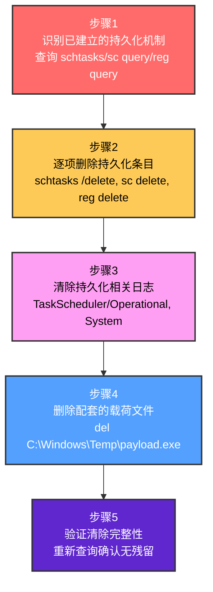

# 清除持久化 (T1070.009)

## 一句话通俗理解

> **攻击者在主机上扎了根（建了计划任务、藏了启动项、留了服务后门），干完活或准备撤离前，把这些"根"全拔掉——就像间谍撤离安全屋前把暗号、备用钥匙、藏匿点全部清除，让反间谍人员查不出"这里曾有人长期潜伏"。**

## 30秒速查卡

| 维度 | 你需要知道的 |
|------|-------------|
| 这是什么？ | Clear Persistence（T1070.009），指示器移除（T1070）的子技术 |
| 为什么危险？ | 持久化机制本身是攻击者"还在场"的最强证据，清除后取证人员只能看到"系统正常"——这是 APT 长期潜伏的关键收尾动作 |
| 谁需要关心？ | 应急响应人员、威胁狩猎分析师、系统管理员、AD 管理员 |
| 你的第一步防御 | 启用 Windows 审计策略 "Task Scheduler"、"Security State Change"、"System"，监控 schtasks /delete、sc delete、reg delete HKLM\\...\\Run 等删除命令 |
| 如果只做一件事 | 在 SIEM 中配置告警——任何 `schtasks /delete` 或 `sc.exe delete` 调用，若执行者非 SCCM/Ansible 等运维工具，立即告警 |

## 难度等级

⭐⭐ 中级 - 需要一定的技术基础和经验

清除单条持久化很容易（一行 `schtasks /delete` 命令），但要做到"清除干净且不触发日志告警"——既要清掉计划任务本体、又要清掉 Task Scheduler 日志、还要抹掉 SCRPC 通信记录——需要深入理解 Windows 子系统的多套独立日志体系，这是中级而非初级难度。

## 前置知识检查

**读这个文件需要什么？**

- [x] 操作系统权限模型基础（Administrator/SYSTEM 与普通用户的差异）
- [x] 指示器移除（T1070）的原理（父技术：清除痕迹的统称）
- [x] 持久化战术（TA0003）的常见技术：T1053 计划任务、T1543.003 系统服务、T1547.001 注册表 Run 键、T1546.003 WMI 事件订阅
- [x] Windows 注册表结构（HKLM\Software\Microsoft\Windows\CurrentVersion\Run 等启动项位置）
- [x] Linux systemd/cron 持久化机制和 macOS LaunchAgent/LaunchDaemon

## 技术描述

**清除持久化**（T1070.009）是 **指示器移除**（T1070）的一个具体变体，属于 **隐蔽**（TA0005）阶段的攻击技术。

根据 MITRE ATT&CK v19 官方描述：adversaries may clear artifacts associated with persistence to remove evidence of their activities on a system. 与 T1070 家族其他子技术（清日志、删文件、清命令历史）不同，本技术专门针对**持久化机制本身留下的痕迹**——攻击者前期为保持长期存在（TA0003 Persistence）建立的计划任务、服务、注册表启动项、WMI 订阅、登录脚本等机制，在攻击目标达成后或撤离阶段会被主动清除，目的是：

1. **断绝"还在场"的证据链**：应急响应人员最关注的就是"攻击者是否还在系统里"。一个存在的计划任务或服务后门直接证明攻击者具有持续访问能力，清除后则只能推断"曾经来过"。
2. **避免触发二次告警**：某些持久化机制（如可疑服务名、异常计划任务触发频率）可能被 EDR 持续监控并周期性告警，清除后即可消除这些噪音告警，让真正的活跃攻击隐藏在静默中。
3. **为伪装"无入侵"做铺垫**：高级 APT 在最终撤离前会做"无痕清理"（无痕擦拭），清除持久化是这一过程的必经步骤——让受害系统看起来从未被入侵过。

### 具体怎么理解？

把持久化机制想象成"间谍在敌国建立的秘密据点"：

- **建立持久化（TA0003）** = 间谍租了套公寓、配了备用钥匙、装了暗号信箱——保证自己随时能回来
- **正常活动期** = 间谍用这些据点收发情报、躲避追踪
- **清除持久化（T1070.009）** = 任务完成准备撤离，间谍把公寓退了、钥匙销毁、信箱拆除——让反间谍部门事后调查时找不到任何"长期潜伏"的证据

在 Windows 上，攻击者清除持久化的常见命令：
- `schtasks /delete /tn "MaliciousTask" /f` — 删除计划任务
- `sc delete MaliciousService` — 删除系统服务
- `reg delete "HKLM\SOFTWARE\Microsoft\Windows\CurrentVersion\Run" /v MaliciousEntry /f` — 删除注册表启动项
- `wmic /namespace:\\root\subscription PATH __EventFilter WHERE Name="MalFilter" DELETE` — 删除 WMI 事件订阅
- `del "C:\ProgramData\Microsoft\Windows\Start Menu\Programs\Startup\malware.lnk"` — 删除启动文件夹快捷方式

在 Linux 上对应：
- `crontab -r` 或 `rm /etc/cron.d/malicious` — 清除 cron 任务
- `systemctl disable malicious.service && rm /etc/systemd/system/malicious.service` — 清除 systemd 服务
- `rm ~/.bashrc` 中的恶意 alias 或函数定义
- `sed -i '/malicious_line/d' /etc/rc.local`

在 macOS 上：
- `launchctl unload ~/Library/LaunchAgents/com.malicious.plist && rm ~/Library/LaunchAgents/com.malicious.plist` — 清除 LaunchAgent

### 为什么有效？

本技术对攻击者有效的原因有三：

1. **持久化是"长期在场"的直接证据，清除后取证价值大幅下降**。EDR 和 SOC 最敏感的就是"新出现的持久化"——一旦发现计划任务或服务被创建，立即会触发高优先级告警。但反过来，"持久化被删除"通常只触发低优先级日志事件，不会引起警觉。
2. **持久化创建与删除之间存在时间差，攻击者已达成目的**。从建立持久化到清除可能间隔数月，期间攻击者已经完成了数据窃取、横向移动、影响破坏等目标。清除时核心攻击早已完成。
3. **多套日志独立但难关联**。Windows 上 Task Scheduler、Service Control Manager、Registry 各有独立日志通道（Microsoft-Windows-TaskScheduler/Operational、System、Security），单看任一通道都是"正常删除"，需要在 SIEM 中跨通道关联才能识别"批量清除"模式，多数企业未配置此类关联规则。

## 真型场景

攻击者在 **隐蔽** 阶段使用清除持久化技术，以下是典型的攻击步骤：



**步骤详解：**

1. **枚举持久化**：攻击者首先查询系统上自己建立的持久化机制，常见命令包括 `schtasks /query /fo LIST /v`（列出所有计划任务）、`sc query state= all`（列出所有服务）、`reg query "HKLM\SOFTWARE\Microsoft\Windows\CurrentVersion\Run"`（查询注册表启动项）、`wmic /namespace:\\root\subscription PATH __EventConsumer`（列出 WMI 订阅）。
2. **逐项删除**：根据枚举结果，使用对应的删除命令逐项清理。攻击者通常会按"风险等级"排序——先删最容易暴露的（如名字可疑的计划任务），再删隐蔽性强的（如 WMI 订阅）。
3. **清除相关日志**：Task Scheduler 操作日志（`Microsoft-Windows-TaskScheduler/Operational`）会记录任务删除事件（EID 141），Service Control Manager 日志会记录服务删除（EID 7034/7036）。攻击者可能定向清除这些日志或用 `wevtutil cl` 清空整个通道。
4. **删除载荷文件**：持久化机制通常会引用一个载荷文件路径（如计划任务调用的脚本、服务对应的可执行文件）。清除条目后必须同步删除这些文件，否则文件系统的取证仍能找到证据。
5. **验证清除完整性**：重新执行枚举命令，确认所有持久化条目和载荷文件已被清除。老练攻击者还会检查 `C:\Windows\System32\Tasks\` 下的 XML 文件残留（计划任务的物理存储位置）。

## 攻击流程

```
[前期：建立持久化]
    ↓
[攻击目标达成：数据窃取/横向移动/破坏完成]
    ↓
[枚举本机持久化]                ← schtasks /query, sc query, reg query
    ↓
[删除计划任务/服务/启动项]      ← schtasks /delete, sc delete, reg delete
    ↓
[清除 WMI 订阅]                ← wmic ... DELETE
    ↓
[删除载荷文件]                 ← del / rm
    ↓
[清除相关日志]                 ← wevtutil cl Microsoft-Windows-TaskScheduler/Operational
    ↓
[验证完整性]                   ← 重新枚举确认无残留
```


**步骤详解：**

1. **目标达成**
   - 通俗描述：攻击者完成了本次入侵的核心目标——可能是数据库数据窃取、横向移动到域控、或加密勒索前的侦察。
   - 技术细节：此阶段攻击者已获得足够权限（通常 Administrator 或 SYSTEM），且已建立多套持久化机制确保随时回访。
   - 常用工具：Cobalt Strike beacon、Metasploit meterpreter、Empire agent

2. **枚举持久化**
   - 通俗描述：攻击者盘点自己在受害系统上留下的所有"后门"——记住每一个都要清掉。
   - 技术细节：使用 `schtasks /query /fo LIST /v | findstr /i "malicious"` 过滤出自己建立的任务；`sc query state= all | findstr "BATTERY_SERVICE"` 等过滤可疑服务名；PowerShell `Get-ScheduledTask | Where-Object {$_.TaskName -like "*mal*"}` 更精确。
   - 常用工具：schtasks.exe、sc.exe、reg.exe、wmic.exe、PowerShell（Get-ScheduledTask、Get-Service、Get-CimInstance）

3. **删除条目**
   - 通俗描述：把"后门"的注册信息从系统里抹掉——计划任务从 Task Scheduler 数据库删除、服务从 SCM 数据库删除、启动项从注册表删除。
   - 技术细节：`schtasks /delete /tn "TaskName" /f`（/f 强制不确认）；`sc delete ServiceName`；`reg delete "HKLM\...\Run" /v ValueName /f`；WMI 订阅需用 `wmic /namespace:\\root\subscription PATH __EventFilter WHERE Name="X" DELETE`、`PATH __EventConsumer WHERE Name="X" DELETE`、`PATH __FilterToConsumerBinding WHERE Filter="..." DELETE` 三步。
   - 常用工具：schtasks.exe、sc.exe、reg.exe、wmic.exe、PowerShell（Unregister-ScheduledTask、Remove-Service、Remove-Item、Remove-CimInstance）

4. **删除载荷文件**
   - 通俗描述：把后门对应的可执行文件、脚本、DLL 等物理文件从硬盘上删掉，避免取证时被文件系统层面发现。
   - 技术细节：定位载荷路径（计划任务的 Actions.Execute 字段、服务的 ImagePath 注册表值），然后 `del /f /q C:\Windows\Temp\payload.exe`；Linux 上 `rm -f /usr/local/bin/payload`。
   - 常用工具：del.exe、rm（Linux）、PowerShell `Remove-Item -Force`

5. **清除相关日志**
   - 通俗描述：把"后门曾经存在过"的日志记录也擦掉。
   - 技术细节：`wevtutil cl Microsoft-Windows-TaskScheduler/Operational`（清空 Task Scheduler 操作日志）；`wevtutil cl System`（清空 System 日志，含服务事件）；定向删除特定 EventID 需更复杂的脚本。
   - 常用工具：wevtutil.exe、PowerShell `Clear-EventLog`

6. **二次验证**
   - 通俗描述：再次检查所有持久化位置，确认彻底清除无残留。
   - 技术细节：重新执行枚举命令；额外检查 `C:\Windows\System32\Tasks\` 目录下是否还有计划任务的 XML 残留文件（schtasks /delete 通常会同步删除，但异常情况可能残留）；检查 `HKLM\SYSTEM\CurrentControlSet\Services` 下是否还有已删除服务的注册表残留。
   - 常用工具：schtasks.exe、reg.exe、PowerShell（Get-ScheduledTask、Get-Service、Get-ItemProperty）

## 真实案例

### 案例1：APT29 SolarWinds SUNBURST 后门痕迹清理

- **时间**: 2020 年
- **目标**: SolarWinds 供应链攻击中的政府机构和智库
- **攻击组织**: APT29（Nobelium / Midnight Blizzard，俄罗斯 SVR 关联）
- **手法**: Mandiant 报告显示，APT29 在 SUNBURST 后门活动后期，通过 Cobalt Strike beacon 执行了完整的持久化清除流程：删除 `\\target\ADMIN$\system32\` 下投放的临时 beacon DLL（T1070.004 文件删除），删除通过 SCRPC 创建的恶意服务 `AppAssist`（`sc delete AppAssist`），删除 `HKLM\SOFTWARE\Microsoft\Windows\CurrentVersion\Run` 下的持久化键值，并清空 `Microsoft-Windows-TaskScheduler/Operational` 日志通道以抹除计划任务删除记录。攻击者还修改了 SACL 防止后续审计。
- **影响**: 18,000 个 SolarWinds 客户中至少 100 个被深度入侵，攻击者潜伏长达 9 个月，部分原因就是精心的持久化清除使事后取证极难重建完整攻击时间线。
- **参考链接**: [Mandiant SUNBURST Analysis](https://www.mandiant.com/resources/sunburst-additional-technical-details)

### 案例2：Turla Snake 恶意软件撤离清理

- **时间**: 2022 年
- **目标**: 乌克兰政府、北约成员国政府机构
- **攻击组织**: Turla（俄罗斯 FSB 关联）
- **手法**: CISA Alert AA22-271A 详述了 Turla 的 Snake 植入在撤离阶段的清理流程：通过 `sc stop "AppleUpdate"` 停止服务、`sc delete "AppleUpdate"` 删除服务（伪装成 Apple 更新）、删除 `C:\Windows\System32\drivers\ AppleUpdate.sys` 内核驱动文件、清除 `System` 和 `Security` 日志中的相关条目。Snake 还会先删除自己创建的命名管道和注册表键，再卸载内核驱动，最后才退出用户态进程。
- **影响**: Turla 利用 Snake 在目标网络潜伏超过 20 年，被发现的多个案例中，取证人员只能通过磁盘镜像的未分配空间恢复部分证据，活动日志层面的证据已被彻底清除。
- **参考链接**: [CISA Alert AA22-271A - Turla Snake](https://www.cisa.gov/news-events/cybersecurity-advisories/aa22-271a)

### 案例3：Lazarus Group macOS 持久化清除

- **时间**: 2023 年
- **目标**: 加密货币交易所开发人员（供应链攻击链）
- **攻击组织**: Lazarus Group（朝鲜关联）
- **手法**: Elastic Security 报告显示，Lazarus 在 macOS 上通过 `~/Library/LaunchAgents/com.apple.systemupdate.plist` 建立持久化（伪装成系统更新），在确认目标已下载并执行了恶意 payload 后，攻击者通过 `launchctl unload ~/Library/LaunchAgents/com.apple.systemupdate.plist` 卸载并删除该 plist 文件、删除 `/tmp/.systemupdate/` 目录下的所有 payload、清除 `~/Library/Logs/com.apple.systemupdate.log` 自定义日志文件。同时清除 `~/Library/Application Support/Google/Chrome/Default/History` 中的恶意下载记录。
- **影响**: 多名开发人员的工作站被入侵，私钥和加密资产被窃取，损失超过 1 亿美元。由于持久化被精心清除，受害企业的 EDR 在事后扫描时未发现任何异常。
- **参考链接**: [Elastic Security Labs - Lazarus macOS Campaign](https://www.elastic.co/security-labs)

### 案例4：安全研究中的实践

- **时间**: 2025 年
- **目标**: 安全研究测试环境
- **攻击组织**: 红队/安全研究人员
- **手法**: 在授权红队测试中模拟 T1070.009 攻击，使用 Atomic Red Team 的相关测试用例验证 SOC 检测能力。典型测试包括：通过 `schtasks /create` 建立持久化任务→等待 24 小时→执行 `schtasks /delete` 清除→检查 SOC 是否在 30 分钟内告警"持久化被删除"。
- **影响**: 验证防御体系的检测和响应能力，评估"持久化建立+删除"的快速组合是否能被 SIEM 关联规则捕获，以及日志清除是否触发 EID 1102 告警。
- **参考链接**: [Atomic Red Team T1070](https://github.com/redcanaryco/atomic-red-team/tree/master/atomics/T1070)

## 红队视角

> ⚠️ **免责声明**：以下内容仅用于合法的安全测试、渗透测试和教育目的。未经授权对他人系统进行测试是违法行为。

### 实战技巧

1. **深入理解原理**：T1070.009 不只是"删除命令"，核心是理解 Windows 持久化的多套独立子系统——Task Scheduler（XML 文件 + 注册表 + 操作日志）、Service Control Manager（注册表 + System 日志）、Registry Run keys（注册表 + Security 日志）、WMI（CIM 数据库 + Operations 日志）——每套都需要独立的清除流程，遗漏任何一套都会留下证据。
2. **环境适配**：Windows 域环境优先清 WMI 订阅（最隐蔽但最难清，需要 wmic 三连删）、再清服务、再清计划任务、最后清注册表；Linux 上 systemd 服务要先 `systemctl stop` 再 `systemctl disable` 再 `rm` unit 文件；macOS LaunchAgent 要先 `launchctl unload` 再删 plist。
3. **组合使用**：与 T1070.002（清除 Windows 事件日志）、T1070.004（文件删除）、T1070.005（网络共享连接移除）协同使用——本技术清除"持久化痕迹"，前者清除"事件日志记录"，T1070.004 清除"载荷文件物理痕迹"，T1070.005 清除"横向移动痕迹"，四者构成完整的痕迹清除链。
4. **隐蔽性考虑**：纯 `sc delete` 会立即在 System 日志中产生 EID 7034/7036（服务停止/启动）事件，老练攻击者会先 `sc config ServiceName start= demand` 改为手动启动、再 `sc stop`、再 `sc delete`——这样日志看起来更像正常运维操作。批量删除多个计划任务时，间隔 30 秒以上避免触发"批量删除"行为规则。

### 常用工具

| 工具名称 | 用途 | 平台 | 链接 |
| -------- | ---- | ---- | ---- |
| schtasks.exe | 删除计划任务 | Windows | 系统内置 |
| sc.exe | 删除系统服务 | Windows | 系统内置 |
| reg.exe | 删除注册表启动项 | Windows | 系统内置 |
| wmic.exe | 删除 WMI 事件订阅 | Windows | 系统内置 |
| PowerShell `Unregister-ScheduledTask` / `Remove-Service` / `Remove-Item` / `Remove-CimInstance` | 现代 PowerShell 命令 | Windows | 系统内置 |
| wevtutil.exe | 清除 Windows 事件日志 | Windows | 系统内置 |
| crontab / systemctl / rm | 清除 cron、systemd 服务、文件 | Linux | 系统内置 |
| launchctl / rm | 清除 LaunchAgent/LaunchDaemon | macOS | 系统内置 |
| Cobalt Strike | `jump psexec` + `shell sc delete` 等远程清除 | Windows | 商业红队平台 |

### 注意事项

- 在授权的测试环境中使用这些技术，确保有明确的书面授权范围（Rules of Engagement）
- 注意操作安全（OPSEC），避免被检测系统发现——批量 `sc delete` 会立即触发 EDR 行为规则，应分散操作
- 使用匿名化技术和代理隐藏真实身份，红队测试中应模拟真实 APT 的"慢速清理"模式（每小时清一条持久化）
- **法律边界**：在未授权系统上执行持久化清除同样构成"破坏计算机信息系统罪"，且会破坏受害方的取证证据，可能承担刑事责任

## 蓝队视角

### 检测要点

1. **系统日志监控**：核心是 Windows 事件 ID 4698（计划任务创建）、4699（计划任务删除）、4702（计划任务更新）、7045（服务创建）、7034/7036（服务停止/启动）、4657（注册表值修改，需启用对象访问审计 SACL）；Task Scheduler 操作日志 EID 141（任务删除）、200（任务执行）、201（任务完成）。
2. **异常行为检测**：单条 `schtasks /delete` 可能是正常运维，但"短时间内多条持久化删除"或"非运维账户执行删除"高度可疑。重点关注"创建后 24 小时内即删除"的计划任务模式——这是红队测试或攻击者撤离的典型特征。
3. **工具特征识别**：Sysmon EID 1 进程创建事件中，`schtasks.exe /delete`、`sc.exe delete`、`reg.exe delete ... \Run`、`wmic.exe ... DELETE` 等命令行模式应被标记为需要关联分析的中风险事件。
4. **PowerShell 监控**：`Unregister-ScheduledTask`、`Remove-Service`、`Remove-CimInstance` 等 PowerShell 命令需要 EID 4104（ScriptBlock 日志）和 4103（Module 日志）覆盖。
5. **WMI 持久化检测**：定期执行 `Get-CimInstance -Namespace root/subscription -ClassName __EventFilter` 等查询，对比基线识别新增/删除的 WMI 订阅。

### 监控建议

- 部署端点检测和响应（EDR）系统：Microsoft Defender for Endpoint 内置"持久化清除"行为检测规则
- 配置 SIEM 规则，关联分析来自多个来源的告警：将"同一主机 1 小时内出现 3 条以上持久化删除事件"作为可疑清理信号
- 定期进行安全评估和渗透测试：通过红队演练验证 SOC 是否能在"持久化被删除"时触发告警
- **基线建立**：先观察正常运维中 `schtasks /delete`、`sc delete` 的使用频率（SCCM 客户端、Ansible 等管理工具会大量使用），建立白名单后剩余事件再告警
- **WMI 持久化基线**：每日导出 `root/subscription` 命名空间下的所有 `__EventFilter`、`__EventConsumer`、`__FilterToConsumerBinding` 实例，对比每日基线

## 避坑指南

红队新手常踩的坑：

1. **只删条目不删文件**：执行 `schtasks /delete` 只删除了 Task Scheduler 数据库中的条目，但计划任务调用的载荷文件（如 `C:\Windows\Temp\payload.exe`）仍在硬盘上。取证时通过未分配空间恢复文件即可证明攻击。**正确做法**：先记录每个持久化引用的载荷路径，删除条目后立即删除对应文件。
2. **WMI 订阅只删一项**：WMI 持久化由 `__EventFilter`、`__EventConsumer`、`__FilterToConsumerBinding` 三个实例组成，新手常只删 Filter，留下 Consumer 和 Binding——Binding 会持续尝试匹配已删除的 Filter，产生错误日志暴露异常。**正确做法**：三连删，顺序为 Binding → Filter → Consumer。
3. **忽视 `C:\Windows\System32\Tasks\` 物理文件**：schtasks /delete 通常会同步删除 `C:\Windows\System32\Tasks\` 下的 XML 文件，但权限异常或文件锁情况下可能残留。**正确做法**：删除后用 `dir C:\Windows\System32\Tasks\TaskName` 二次验证。
4. **清日志触发 EID 1102 告警**：`wevtutil cl Security` 会立即产生 EID 1102（审计日志被清除）事件，反而暴露行踪。**正确做法**：宁可不清日志，也要确保持久化条目和文件清理干净；若必须清日志，应只清特定通道（如 `Microsoft-Windows-TaskScheduler/Operational`），不清 Security 通道。
5. **不验证清除效果**：执行 `/delete` 后未重新枚举确认，留下了"以为清了其实没删"的条目。**正确做法**：always verify，删除后立即执行 `schtasks /query /tn "TaskName"` 应返回"找不到指定的任务"。
6. **依赖单一删除路径**：新手只用 `schtasks /delete`，但有些顽固计划任务（如带 SYSTEM 权限的）需要先 `schtasks /change /tn "X" /disable` 再 `/delete`。**正确做法**：先 disable 再 delete，或直接删除 `C:\Windows\System32\Tasks\` 下的 XML 文件并重启 Task Scheduler 服务。
7. **Linux 上忘了 `systemctl disable`**：只 `rm /etc/systemd/system/service.service` 而不 `systemctl disable`，导致 systemd 仍尝试加载该服务并产生错误日志。**正确做法**：标准顺序 `systemctl stop → systemctl disable → systemctl daemon-reload → rm unit file`。

## 检测建议

### 检测思路

检测清除持久化的关键是识别"持久化条目被删除"的事件，并关联"创建-删除"时间差。以下是三个层面的检测方法：

### 网络层检测

**方法**：清除持久化本身主要是本地操作，但远程清除（通过 PsExec 或 WMI 远程调用 `sc delete`）会产生 SMB/RPC 流量。监控异常的 SCRPC 调用模式。

```bash
# 使用 Wireshark/tshark 检测远程 SCRPC 调用模式
# 监控短时间内对多台主机的 SCRPC DeleteService 调用
tshark -i eth0 -Y "rpc.opnum == 2 && dcerpc.opnum == 2" \
  -T fields -e frame.time -e ip.src -e ip.dst \
  | awk '{ count[$2"->"$3]++ } END { 
    for (k in count) if (count[k] > 5) print "异常:", k, count[k], "次 SCRPC 删除调用"
  }'
```

### 主机层检测

**Windows事件ID**：
- 事件ID 4698：计划任务创建（用于关联"创建-删除"模式）
- 事件ID 4699：计划任务删除（**关键事件**）
- 事件ID 4702：计划任务更新
- 事件ID 7045：服务创建（用于关联）
- 事件ID 7034/7036：服务停止/启动
- 事件ID 4657：注册表值修改（需对 Run/RunOnce/AutoRun 等键配置 SACL）
- 事件ID 1102：安全审计日志被清除（关联告警）
- Task Scheduler 操作日志 EID 141：任务删除
- Task Scheduler 操作日志 EID 375：服务账户任务删除

**Linux日志**：
- /var/log/cron：cron 任务变更
- /var/log/audit/audit.log：auditd 记录的 `/etc/cron.d/`、`/etc/systemd/system/` 文件 unlink 事件
- /var/log/journalctl.log：systemd 服务变更

```powershell
# Windows: 检测最近 24 小时内的持久化删除事件
Get-WinEvent -FilterHashtable @{
    LogName='Security'
    Id=4699  # 计划任务删除
    StartTime=(Get-Date).AddHours(-24)
} | Select-Object TimeCreated, 
    @{N='TaskName';E={$_.Properties[0].Value}},
    @{N='User';E={$_.Properties[1].Value}}

# 检测服务删除（System 日志）
Get-WinEvent -FilterHashtable @{
    LogName='System'
    Id=7034,7036
    StartTime=(Get-Date).AddHours(-24)
} | Where-Object {
    $_.Message -match 'service was stopped|service entered the stopped state'
} | Select-Object TimeCreated, Message -First 50

# Sysmon: 检测 schtasks /delete 和 sc delete 命令
Get-WinEvent -FilterHashtable @{
    LogName='Microsoft-Windows-Sysmon/Operational'
    Id=1
    StartTime=(Get-Date).AddHours(-24)
} | Where-Object {
    $_.Message -match 'schtasks\.exe.*\/delete' -or 
    $_.Message -match 'sc\.exe.*delete' -or
    $_.Message -match 'reg\.exe.*delete.*\\Run'
} | Select-Object TimeCreated, 
    @{N='CommandLine';E={$_.Properties[10].Value}},
    @{N='User';E={$_.Properties[12].Value}}
```

```bash
# Linux: 检测 cron/systemd 服务的删除
# 通过 auditd 监控关键持久化目录的 unlink 事件
auditctl -w /etc/cron.d/ -p wa -k persistent_change
auditctl -w /etc/systemd/system/ -p wa -k persistent_change
auditctl -w /etc/crontab -p wa -k persistent_change

# 查询最近的持久化变更事件
ausearch -k persistent_change --start today | \
  awk '/type=PATH/ { print $0 }' | \
  grep -E "unlink|remove"
```

**用人话说**：你要找的是"突然之间有人开始批量删计划任务或服务"——正常运维很少一次性删多个持久化，攻击者撤离时往往会一次性清掉所有后门。重点关注"非运维账户"、"非工作时间"、"批量删除"这三个特征中的任意两个。

```yaml
title: 检测清除持久化 T1070.009
id: b7c4d5e6-f7a8-9012-bcde-f23456789012
status: experimental
description: 检测可能的持久化清除活动 - schtasks/sc/reg/wmic delete 异常模式
references:
    - https://attack.mitre.org/techniques/T1070/009/
author: ATT&CK 知识库
date: 2026/07/27
logsource:
    category: process_creation
    product: windows
detection:
    selection_schtasks_delete:
        Image|endswith: '\schtasks.exe'
        CommandLine|contains|all:
            - '/delete'
            - '/tn'
    selection_sc_delete:
        Image|endswith: '\sc.exe'
        CommandLine|contains:
            - 'delete'
    selection_reg_delete_run:
        Image|endswith: '\reg.exe'
        CommandLine|contains|all:
            - 'delete'
            - '\Run'
    selection_ps_unregister:
        Image|endswith: '\powershell.exe'
        CommandLine|contains:
            - 'Unregister-ScheduledTask'
            - 'Remove-Service'
            - 'Remove-CimInstance'
    selection_wmic_delete:
        Image|endswith: '\wmic.exe'
        CommandLine|contains:
            - 'DELETE'
            - 'delete'
    filter_admin_script:
        ParentImage|endswith:
            - '\sccm.exe'
            - '\wsus.exe'
            - '\ansible.exe'
        User|contains:
            - 'SYSTEM'
            - 'NT AUTHORITY'
    condition: (selection_schtasks_delete or selection_sc_delete or selection_reg_delete_run or selection_ps_unregister or selection_wmic_delete) and not filter_admin_script
falsepositives:
    - 合法的系统运维脚本（SCCM、Ansible、WSUS 等管理工具）
    - 软件卸载过程中的正常持久化清理
    - 系统迁移或重建时的批量清理
level: medium
tags:
    - attack.defense_evasion
    - attack.t1070.009
```

### 应用层检测

**Sigma规则示例**（高级模式 - 关联创建-删除时间差）：

```yaml
title: 检测持久化快速创建-删除模式
id: c8d5e6f7-a8b9-0123-cdef-345678901234
status: experimental
description: 检测计划任务或服务在创建后短时间内被删除的可疑模式，可能指示红队测试或攻击者撤离
references:
    - https://attack.mitre.org/techniques/T1070/009/
logsource:
    product: windows
    service: security
detection:
    selection_create:
        EventID: 
            - 4698  # 计划任务创建
            - 7045  # 服务创建
    selection_delete:
        EventID:
            - 4699  # 计划任务删除
            - 7042  # 服务删除
    timeframe: 24h
    condition:
        # 同一持久化名称在 24 小时内既创建又删除
        - selection_create
        - selection_delete
        - '|correlate_by(TaskName|ServiceName)'
        - '|time_diff(selection_create, selection_delete) < 24h'
falsepositives:
    - 红队测试或攻击模拟（需结合授权清单排查）
    - 软件安装后回滚
    - CI/CD 测试环境
level: high
tags:
    - attack.defense_evasion
    - attack.t1070.009
    - attack.persistence
```

## 缓解措施

### 优先级1：关键措施

**启用持久化审计策略**：

```powershell
# 启用 Task Scheduler 审计
auditpol /set /subcategory:"Other Object Access Events" /success:enable /failure:enable
auditpol /set /subcategory:"Sensitive Privilege Use" /success:enable /failure:enable

# 启用注册表 Run 键的 SACL 审计
# 通过组策略或 PowerShell 配置
$key = "HKLM:\SOFTWARE\Microsoft\Windows\CurrentVersion\Run"
$acl = Get-Acl $key
$rule = New-Object System.Security.AccessControl.RegistryAuditRule(
    "Everyone",
    "SetValue,Delete,ChangePermissions",
    "ContainerInherit",
    "None",
    "Success,Failure"
)
$acl.AddAuditRule($rule)
Set-Acl -Path $key -AclObject $acl

# 验证审计策略
auditpol /get /subcategory:"Other Object Access Events"
```

**部署 Sysmon 监控持久化位置**：

```xml
<!-- Sysmon 配置 - 监控持久化位置的文件和注册表变更 -->
<RuleGroup name="Persistence Monitoring" groupRelation="or">
  <!-- 监控 Task Scheduler 目录变更 -->
  <FileCreate onmatch="include">
    <TargetFilename condition="contains">\System32\Tasks\</TargetFilename>
  </FileCreate>
  <!-- 监控注册表 Run 键变更 -->
  <RegistryEvent onmatch="include">
    <TargetObject condition="contains">\CurrentVersion\Run\</TargetObject>
    <TargetObject condition="contains">\CurrentVersion\RunOnce\</TargetObject>
    <TargetObject condition="contains">\CurrentVersion\Explorer\Shell Folders</TargetObject>
  </RegistryEvent>
  <!-- 监控 WMI 订阅变更 -->
  <WmiEvent onmatch="include">
    <!-- Sysmon EID 19/20/21 捕获 WMI 持久化 -->
  </WmiEvent>
</RuleGroup>
```

### 优先级2：重要措施

**部署 EDR 与 SIEM 联动**：部署 EDR（Microsoft Defender for Endpoint、CrowdStrike、SentinelOne）并配置 SIEM 关联规则，监控"短时间内多个持久化被删除"模式。

**配置 WMI 持久化基线监控**：

```powershell
# 定期导出 WMI 订阅基线并对比
$baseline = @()
$filters = Get-CimInstance -Namespace root/subscription -ClassName __EventFilter
$consumers = Get-CimInstance -Namespace root/subscription -ClassName __EventConsumer
$bindings = Get-CimInstance -Namespace root/subscription -ClassName __FilterToConsumerBinding

# 与昨日基线对比，新增或删除的实例均告警
# 完整脚本见: https://github.com/danielbohannon/Invoke-WMIDetection
```

### 优先级3：建议措施

**安全意识培训**：教育运维团队识别 `sc delete`、`schtasks /delete` 等命令的风险，规范运维脚本的操作日志记录。

**最小权限原则**：限制普通用户对持久化位置的写入权限；服务账户禁止直接创建系统服务或计划任务，必须通过 CI/CD 流水线+审批流程。

**配置文件完整性监控**：使用 Tripwire、AIDE（Linux）、Windows FIM（File Integrity Monitoring）监控 `/etc/cron.d/`、`/etc/systemd/system/`、`C:\Windows\System32\Tasks\` 等关键目录的变更。

## 动手实验

> ⚠️ **所有实验必须在隔离的实验室环境中进行**

### 实验1：理解基本原理（初级）

**目标**：理解持久化清除的工作原理

**环境**：单台 Windows 10/11 虚拟机（管理员权限）

**步骤**：
1. 创建测试计划任务：`schtasks /create /tn "TestTask" /tr "calc.exe" /sc daily /st 09:00`
2. 验证任务存在：`schtasks /query /tn "TestTask"`
3. 检查 Task Scheduler 操作日志：`Get-WinEvent -LogName Microsoft-Windows-TaskScheduler/Operational -MaxEvents 10`
4. 删除任务：`schtasks /delete /tn "TestTask" /f`
5. 再次检查日志：应看到 EID 141（任务删除）事件
6. 检查 `C:\Windows\System32\Tasks\` 目录：TestTask 文件应已被删除

**学习要点**：理解 `schtasks /delete` 同步删除 XML 文件和数据库条目，但日志记录无法被 schtasks 本身清除。

### 实验2：实际操作（中级）

**目标**：掌握 T1070.009 在攻击链中的实际使用方法

**环境**：3 台 VM 组成的实验域（域控、攻击机、目标主机）+ Sysmon + SIEM

**步骤**：
1. 在目标主机上建立多种持久化：
   - 创建计划任务：`schtasks /create /tn "Updater" /tr "powershell.exe -enc ..." /sc onlogon`
   - 创建服务：`sc create "AppAssist" binPath= "C:\Windows\Temp\svc.exe" start= auto`
   - 添加注册表 Run 键：`reg add "HKLM\...\Run" /v AppAssist /t REG_SZ /d "C:\Windows\Temp\run.exe"`
   - 创建 WMI 订阅：使用 PowerShell 创建 `__EventFilter` + `CommandLineEventConsumer` + `__FilterToConsumerBinding`
2. 投放对应的载荷文件（假可执行文件）
3. 启用 Sysmon 和 SIEM 日志采集
4. 模拟攻击者撤离：依次删除所有持久化条目和载荷文件
5. 在 SIEM 中检查告警：是否触发了"批量持久化删除"规则
6. 尝试不清日志、清部分日志、清全部日志三种模式，对比 SIEM 告警差异

**学习要点**：掌握多类型持久化的完整清除流程，理解为什么 WMI 订阅最难清、Task Scheduler 最容易留日志。

### 实验3：防御验证（高级）

**目标**：验证检测规则的有效性

**环境**：上述实验环境 + WMI 基线监控脚本

**步骤**：
1. 部署本文的 Sigma 规则到 SIEM
2. 配置 WMI 基线监控脚本，每日导出 `root/subscription` 命名空间实例
3. 执行实验2 的清除流程，尝试三种隐蔽等级：
   - 低级：批量 `schtasks /delete`、`sc delete`，不清日志
   - 中级：分散删除（间隔 5 分钟），清 `TaskScheduler/Operational` 日志
   - 高级：先 `disable` 再 `delete`，模拟运维操作，只清特定日志条目
4. 验证哪种隐蔽等级能被检测到
5. 优化 Sigma 规则的误报率，建立运维工具白名单（SCCM、Ansible）

**学习要点**：理解攻防对抗的实际效果——快速批量删除易被抓，慢速模拟运维难抓但攻击成本高。

## 术语解释

| 术语 | 通俗解释 |
|------|---------|
| **ATT&CK** | MITRE 公司维护的攻击技术知识库 |
| **清除持久化** | T1070.009，ATT&CK 框架中定义的一种具体攻击技术 |
| **指示器移除** | T1070，本子技术所属的父技术类别 |
| **隐蔽** | 攻击链中的一个阶段（TA0005），目标是隐藏攻击者的存在 |
| **持久化** | 攻击链中的一个阶段（TA0003），攻击者通过计划任务/服务/启动项等机制保持长期访问 |
| **Task Scheduler** | Windows 计划任务服务，攻击者常用于持久化 |
| **SCM** | Service Control Manager，Windows 服务管理器 |
| **WMI 订阅** | Windows 管理规范事件订阅，隐蔽的持久化机制 |
| **LaunchAgent** | macOS 上的持久化机制，类似 Windows 的服务 |
| **C2** | 命令与控制（Command and Control），攻击者远程控制受害主机的通道 |
| **EDR** | 端点检测与响应（Endpoint Detection and Response） |
| **SCRPC** | Service Control Remote Procedure Call，远程服务控制协议 |
| **SACL** | System Access Control List，系统访问控制列表，用于配置审计 |

## 被引用情况

以下父技术文档引用了本子技术：

- [T1070 - 指示器移除](../T1070-Indicator-Removal.md)

## 参考资料

### 📚 官方文档（深入了解）

- [MITRE ATT&CK - Clear Persistence (T1070.009)](https://attack.mitre.org/techniques/T1070/009/)
- [MITRE ATT&CK - Indicator Removal (T1070)](https://attack.mitre.org/techniques/T1070/)
- [MITRE ATT&CK - Stealth (TA0005)](https://attack.mitre.org/tactics/TA0005/)
- [MITRE ATT&CK - Persistence (TA0003)](https://attack.mitre.org/tactics/TA0003/)

### 📰 安全报告（真实攻击）

- [Mandiant SUNBURST Analysis (2021)](https://www.mandiant.com/resources/sunburst-additional-technical-details) — APT29 SolarWinds 事件的持久化清除策略
- [CISA Alert AA22-271A - Turla Snake (2022)](https://www.cisa.gov/news-events/cybersecurity-advisories/aa22-271a) — Turla Snake 恶意软件撤离清理流程
- [Elastic Security Labs - Lazarus macOS Campaign (2023)](https://www.elastic.co/security-labs) — Lazarus macOS LaunchAgent 持久化清除
- [The DFIR Report - Multiple APT Cases](https://thedfirreport.com/) — 多个真实案例中的持久化清除分析
- [CISA Alert AA21-265A - Conti Ransomware (2021)](https://www.cisa.gov/news-events/cybersecurity-advisories/aa21-265a) — Conti 攻击链中的痕迹清理（含持久化清除）

### 🔧 工具与资源（动手试试）

- [Atomic Red Team T1070](https://github.com/redcanaryco/atomic-red-team/tree/master/atomics/T1070) - 检测规则测试用例
- [MITRE ATT&CK Navigator](https://mitre-attack.github.io/attack-navigator/) - ATT&CK 可视化工具
- [Sysinternals Sysmon](https://docs.microsoft.com/sysinternals/downloads/sysmon) - 进程与文件监控
- [Sigma Rule Repository](https://github.com/SigmaHQ/sigma) - 检测规则社区
- [Invoke-WMIDetection](https://github.com/danielbohannon/Invoke-WMIDetection) - WMI 持久化检测脚本
- [Autoruns](https://docs.microsoft.com/sysinternals/downloads/autoruns) - Windows 启动项检查工具
