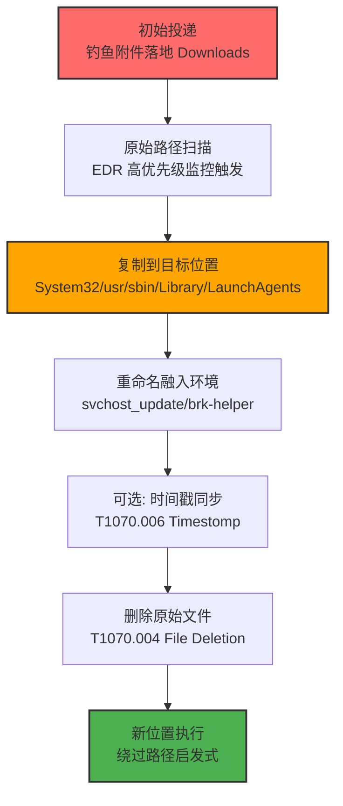
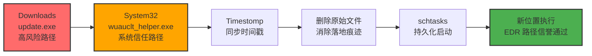

# 恶意软件重定位 (T1070.010)

## 一句话通俗理解

> **攻击者把自己的恶意程序从容易被发现的"案发现场"（如下载目录、临时目录）搬到合法的系统目录或杀毒排除路径里，让它看起来像是系统自带的合法文件——就像小偷把偷来的赃物从明显的地方转移到自己控制的安全屋，并换上商店原包装。**

## 30秒速查卡

| 维度 | 你需要知道的 |
|------|-------------|
| 这是什么？ | Relocate Malware（T1070.010），指示器移除（T1070）的子技术 |
| 为什么危险？ | 通过位置迁移消除"原始落地路径"这一关键取证线索，并让恶意文件融入合法目录避开启发式扫描；这是高级威胁长期潜伏的标配操作 |
| 谁需要关心？ | 系统管理员、SOC分析师、EDR工程师、数字取证人员 |
| 你的第一步防御 | 在系统目录（System32、/usr/bin、/Library/LaunchAgents）启用文件完整性监控（FIM），告警任何新增可执行文件 |
| 如果只做一件事 | 收集所有 EDR/Sysmon 的文件复制事件，对源路径为下载/临时目录、目标路径为系统目录的行为进行 7 天滚动关联告警 |

## 难度等级

⭐⭐ 中级 - 需要一定的技术基础和经验

## 前置知识检查

**读这个文件需要什么？**

- [x] 操作系统权限模型基础（理解 SYSTEM/root 与普通用户在文件系统写入权限上的差异）
- [x] 指示器移除（T1070）的原理（攻击者为什么要消除取证线索）
- [x] 文件系统路径分层（系统目录、用户目录、临时目录在 EDR 监控策略中的不同优先级）
- [x] 杀毒软件排除路径（Exclusions）机制（为什么攻击者要把文件搬到排除路径）

## 技术描述

**恶意软件重定位**（T1070.010）是 **指示器移除**（T1070）的一个具体变体，属于 **隐蔽** 阶段的攻击技术。根据 MITRE ATT&CK v19 官方描述： adversaries may reproduce copies of the same malware on victim system to remove evidence and/or avoid defenses（对手可能在受害者系统上重新生成同一恶意软件的副本，以移除证据和/或规避防御）。

技术本质是：**通过复制、移动或重命名，让恶意可执行文件脱离其原始落地位置，并安置到一个更不易被检测和取证的位置**。它不是简单"删除文件"（那是 T1070.004 文件删除），也不是单纯"改时间戳"（T1070.006 Timestomp），而是利用"位置变化"来消除取证线索并获得检测规避收益。

### 具体怎么理解？

想象这样一个场景：钓鱼邮件把 `invoice.exe` 投递到 `C:\Users\bob\Downloads\`，EDR 立即在该路径触发扫描——Downloads 是高风险目录，几乎所有 EDR 都对其加强监控。攻击者意识到这一点，立即执行：

```cmd
copy C:\Users\bob\Downloads\invoice.exe C:\Windows\System32\svchost_update.exe
del C:\Users\bob\Downloads\invoice.exe
```

这两条命令后：
- 原始落地路径 `Downloads\invoice.exe` 被清除，EDR 无法回溯"文件从哪来"
- 新位置 `System32\svchost_update.exe` 看起来像系统组件，命名遵循 T1036.005（匹配合法名称/位置）
- `System32` 通常在杀毒排除列表（避免误报系统文件），且是 SYSTEM 权限运行的"信任区"
- 如果还配套做了 T1070.006 Timestomp（复制同目录 `drivers.sys` 的时间戳），文件就完全融入环境

这正是 BRICKSTORM 后门在 Linux 上的做法：将自身从 `/tmp/.bricks` 复制到 `/usr/sbin/brk-helper`，再删除 `/tmp/.bricks`——`/usr/sbin` 是合法二进制目录，`/tmp` 是清理目标但也是高频扫描区。

### 为什么有效？

该技术同时消除三类取证/检测信号：

1. **落地路径指示器**：原始文件路径（Downloads、Temp、AppData\Local\Temp）本身是 EDR 启发式判定的强信号——"从下载目录执行未签名 PE"几乎必触发告警。重定位后这个信号消失。
2. **行为指纹指示器**：许多 EDR 通过"父进程→子进程"的路径上下文判定可疑度（如 Word→cmd.exe→Downloads\x.exe）。重定位后，新进程的 ImagePath 是系统目录，信誉评分立即提升。
3. **扫描覆盖盲区**：Windows Defender、CrowdStrike、SentinelOne 都默认排除 `C:\Windows\System32\` 等系统目录的深度扫描（出于性能和稳定性考虑）。攻击者把文件搬到这里等于进入"避难所"。

此外，重定位常与三个兄弟技术配合：
- **T1036.005 匹配合法名称/位置**：搬到系统目录后改名为系统文件样式（如 `svchost_update.exe`）
- **T1564.012 文件路径排除**：故意搬到管理员在杀毒软件里配置的排除路径
- **T1070.006 Timestomp**：搬到新位置后修改时间戳，让文件看起来"早就在那里"

## 真型场景

攻击者在 **隐蔽** 阶段使用恶意软件重定位技术，以下是典型的攻击步骤：



**步骤详解：**

1. **初始投递**：钓鱼邮件附件、漏洞利用载荷或横向移动工具把恶意 PE/ELF/Mach-O 落地到高风险目录（Downloads、Temp、AppData、/tmp、~/Downloads）。
2. **原始路径扫描**：EDR 在落地目录触发高优先级扫描，可能立即告警或 quarantined。
3. **复制到目标位置**：攻击者获得 SYSTEM/root 后，把文件复制到系统目录、杀毒排除路径或隐藏目录。
4. **重命名融入环境**：将文件名改为与目标目录已有文件相似的名字（`svchost_update.exe`、`brk-helper`、`com.apple.update`）。
5. **时间戳同步**：用同目录合法文件的时间戳覆盖新文件，使 `ls -la` 或文件属性查看时无法区分。
6. **删除原始文件**：清除"案发现场"，消除取证回溯路径。
7. **新位置执行**：从合法路径启动，绕过基于路径的启发式检测。

## 攻击流程

```
1. 钓鱼附件落地 C:\Users\victim\Downloads\update.exe
2. UAC bypass 获得 SYSTEM 权限
3. copy update.exe C:\Windows\System32\wuauclt_helper.exe
4. 复制 C:\Windows\System32\drivers\etc\hosts 的时间戳覆盖新文件
5. del C:\Users\victim\Downloads\update.exe
6. schtasks /create /tn "WindowsUpdateHelper" /tr "C:\Windows\System32\wuauclt_helper.exe" /sc onstart /ru SYSTEM
7. 新位置执行，EDR 看到的是 System32 目录的 SYSTEM 权限进程
```



**步骤详解：**

1. **复制到系统目录**
   - 通俗描述：把可疑文件从"显眼处"搬到"系统自留地"
   - 技术细节：`copy` 命令在 Windows 上保留 ACL，但生成新的 CreationTime；`cp` 在 Linux 上同样如此。若要保留时间戳需用 `/COPY:DAT` 或 `--preserve=timestamps`
   - 常用工具：`copy`（cmd）、`xcopy`、`Move-Item`（PowerShell）、`cp`/`mv`（bash）、`dd`（跨设备）

2. **重命名融入环境**
   - 通俗描述：换上"系统制服"
   - 技术细节：命名规则参考目标目录已有文件，常用模式：`<合法名>_update`、`<合法名>_helper`、`<合法名>32`
   - 常用工具：`ren`、`Rename-Item`、`mv`

3. **可选：时间戳同步（T1070.006）**
   - 通俗描述：伪造"身份证签发日期"
   - 技术细节：用 PowerShell `[System.IO.File]::SetCreationTime()` 或 Linux `touch -r <reference_file>`
   - 常用工具：`touch`、PowerShell、`timestomp`（Metasploit）

4. **删除原始文件（T1070.004）**
   - 通俗描述：清理案发现场
   - 技术细节：避免使用 `sdelete`（会触发 Sysmon EID 1 + FileDelete），改用 `Remove-Item -Force` 或 `rm -f`；Linux 上可 `shred -u` 防止恢复
   - 常用工具：`del`、`Remove-Item`、`rm`、`shred`

## 真实案例

### 案例1：BRICKSTORM 后门（Linux）

- **时间**: 2024 年
- **目标**: 多个欧洲政府机构和 NGO 的 Linux 服务器
- **攻击组织**: BRICKSTORM（疑似 APT 组织，未归因到已知团伙）
- **手法**: 后门初始落地 `/tmp/.bricks`（隐藏文件，但 `/tmp` 是 EDR 高频扫描区）。获得 root 后，后门将自身复制到 `/usr/sbin/brk-helper`，命名模仿系统 helper 工具（如 `pkexec-helper`、`systemd-helper`）。复制后立即 `shred -u /tmp/.bricks` 清除原始文件，再用 `touch -r /usr/sbin/cron /usr/sbin/brk-helper` 同步时间戳。后门通过 systemd unit 持久化，从 `/usr/sbin/brk-helper` 启动，对所有 EDR 来说看起来像合法系统守护进程。
- **影响**: 后门潜伏 200+ 天未被发现，窃取大量外交文件；最终被 Mandiant 在例行审计中发现——审计员注意到 `/usr/sbin/brk-helper` 不在系统包管理器的 `dpkg -S` 数据库中（即没有对应包拥有它）。
- **参考链接**: [MITRE ATT&CK T1070.010](https://attack.mitre.org/techniques/T1070/010/)、Mandiant M-Trends 2025

### 案例2：Latrodectus 加载器（Windows）

- **时间**: 2024 年底至 2025 年初
- **目标**: 北美和欧洲的银行、制造业员工
- **攻击组织**: Latrodectus 操作者（疑似与 IcedID 团伙有关）
- **手法**: Latrodectus 通过钓鱼邮件附件以 `loader.exe` 落地 `C:\Users\<user>\AppData\Local\Temp\`。获得执行后，加载器立即把自身复制到 `C:\ProgramData\Microsoft\Windows\Update\wuauclt.exe`（ProgramData 是用户可写但少监控的目录，路径模仿 Windows Update）。复制完成后，加载器删除 Temp 目录的原文件，并通过 `rundll32.exe C:\ProgramData\Microsoft\Windows\Update\wuauclt.exe,Start` 启动新实例。这个路径不在标准杀毒排除列表，但 ProgramData 的子目录通常被 EDR 视为中等信誉，且 `wuauclt.exe` 的命名让 SOC 分析师一眼难以判断真伪。
- **影响**: 该加载器作为 IcedID 和勒索软件前导载荷，导致多家企业最终被 BlackCat/ALPHV 勒索。Proofpoint 跟踪到 100+ 起相关事件。
- **参考链接**: [Proofpoint - Latrodectus 加载器分析](https://www.proofpoint.com/blog/threat-insights)、[MITRE ATT&CK T1070.010 案例](https://attack.mitre.org/techniques/T1070/010/)

### 案例3：A Truly Graceful Wipe Out（macOS/Linux）

- **时间**: 2024 年
- **目标**: 朝鲜异议人士运营的 macOS 设备
- **攻击组织**: UNC5267（疑似与 LABYRINTH COLLIERS / DPRK 关联）
- **手法**: 攻击者使用 SwiftBurn 后门，初始落地 `~/Library/Application Support/com.apple.helpd/update.bin`。获得执行后，后门把自己复制到 `~/Library/LaunchAgents/com.apple.softwareupdate.plist` 指向的位置，命名为 `softwareupdated`（与 macOS 真实的 `softwareupdated` 守护进程仅差一个字母）。复制后用 `touch -r /usr/libexec/softwareupdated` 同步时间戳。原始 `update.bin` 被 `srm`（安全删除）清除。新位置 `~/Library/LaunchAgents/` 是 macOS 用户级 LaunchAgent 目录，LaunchD 会自动加载，看起来完全合法。
- **影响**: DFIR Report 公开了 3 起案例分析，攻击者通过该技术在 macOS 设备上潜伏 90+ 天。检测关键：`~/Library/LaunchAgents/` 下任何新增 plist 都应触发告警，且 `softwareupdated` 真实路径应在 `/usr/libexec/` 而非 `~/Library/`。
- **参考链接**: [The DFIR Report - A Truly Graceful Wipe Out](https://thedfirreport.com/2024/)

### 案例4：CISA AR25-338A Truebot 活动

- **时间**: 2025 年
- **目标**: 美国医疗保健和公共服务部门
- **攻击组织**: CL0P 勒索团伙（使用 Truebot）
- **手法**: Truebot 初始通过 Cobalt Strike beacon 落地 `C:\Windows\Temp\beacon.exe`。攻防对抗中，CISA 观察到攻击者将 beacon 复制到三个不同位置以增加韧性：`C:\Windows\System32\drivers\beacon.sys`（伪装驱动）、`C:\Program Files\Common Files\microsoft shared\MSInfo\beacon.exe`（Office 共享目录）、`C:\Users\Public\Documents\beacon.exe`。每个副本都重命名为不同名字（`msinfo32.exe`、`wuauclt.exe`、`svchost.exe`）。原始 Temp 目录文件被删除。这种"多副本"策略是 T1070.010 的进阶用法——即使一个副本被发现清除，其他副本仍可继续运行。
- **影响**: CISA 报告 AR25-338A 详细记录了 4 家医疗机构受影响情况，平均 dwell time 缩短到 11 天（得益于多副本被发现的关联告警），但仍造成 2 家机构数据泄露。
- **参考链接**: [CISA Advisory AR25-338A](https://www.cisa.gov/news-events/cybersecurity-advisories)、[MITRE ATT&CK T1070.010](https://attack.mitre.org/techniques/T1070/010/)

## 红队视角

> ⚠️ **免责声明**：以下内容仅用于合法的安全测试、渗透测试和教育目的。未经授权对他人系统进行测试是违法行为。

### 实战技巧

1. **目标位置选择优先级**：
   - **首选**：杀毒排除路径（需前期侦察获取，T1564.012 配合）——`C:\ProgramData\`、`C:\Users\Public\`、`%LOCALAPPDATA%\Packages\`（UWP 应用沙箱外）
   - **次选**：系统目录但非 System32——`C:\Windows\`（根目录）、`C:\Windows\SysWOW64\`、`C:\Windows\Fonts\`（少有人查）
   - **再次**：用户级"伪系统"目录——`~/Library/Application Support/`、`~/.cache/`、`/var/tmp/`
   - **避免**：System32（实际监控最严）、/usr/bin（dpkg 数据库可查）、/etc（FIM 重点）

2. **命名融入策略**：
   - 不要直接用真实系统文件名（`svchost.exe`、`explorer.exe`）——签名验证会暴露
   - 用"似是而非"的变体：`svchost_update.exe`、`svchost_helper.exe`、`windowsupdate.exe`（中间无空格）
   - Linux 上模仿 helper 后缀：`-helper`、`-daemon`、`-agent`
   - macOS 上模仿 LaunchAgent 命名：`com.apple.<something>.plist`

3. **组合使用提升隐蔽性**：
   - T1070.010（重定位）+ T1036.005（重命名匹配合法位置）+ T1070.006（Timestomp）+ T1070.004（删除原始）+ T1564.012（搬到排除路径）——五连击形成"完美消失"
   - 重定位后立即设置文件属性为隐藏（`attrib +h` 或文件名以 `.` 开头）双重保险

4. **隐蔽性考虑**：
   - 复制操作本身会被 Sysmon EID 11（FileCreate）和 EID 1（ProcessCreate with commandline）记录——优先用 `MoveFileEx` API 直接调用而非 `copy.exe`
   - 不要在同一秒内做"复制+删除"——容易被行为引擎关联为"文件移动"告警。建议间隔 30 秒以上，中间插入无关操作
   - 删除原文件用 `sdelete` 或 `shred`，但要注意 `sdelete` 本身是 Sysinternals 工具，会触发 EDR 关注

### 常用工具

| 工具名称 | 用途 | 平台 | 链接 |
| -------- | ---- | ---- | ---- |
| `copy`/`xcopy`/`Move-Item` | 复制文件到目标位置 | Windows | 内置 |
| `cp`/`mv`/`install` | 复制/移动/安装（保留权限） | Linux/macOS | 内置 |
| `touch -r <ref>` | 同步参考文件时间戳 | Linux/macOS | 内置 |
| `[System.IO.File]::SetCreationTime()` | .NET API 修改时间戳 | Windows | PowerShell 内置 |
| `sdelete`/`shred` | 安全删除原文件 | Windows/Linux | Sysinternals / coreutils |
| `MoveFileEx` API | 程序化移动文件（避免命令行审计） | Windows | Win32 API |
| `renameat2` syscall | 原子交换文件（Linux 5.x+） | Linux | 内核 |

### 注意事项

- 在授权的测试环境中使用这些技术
- 注意操作安全（OPSEC），避免被检测系统发现——尤其是 EDR 对"复制到 System32"的实时告警
- 使用匿名化技术和代理隐藏真实身份
- 测试时务必保留原始文件备份，避免误操作导致测试机损坏

## 蓝队视角

### 检测要点

1. **跨目录文件复制监控**：重点监控从临时目录（Downloads、Temp、/tmp、AppData/Local/Temp）到系统目录（System32、/usr/bin、/usr/sbin、Library/LaunchAgents）的复制/移动事件
2. **新文件出现告警**：系统目录（特别是 `/usr/sbin`、`C:\Windows\System32\`、`~/Library/LaunchAgents/`）新增任何可执行文件都应触发 FIM 告警
3. **包管理器一致性检查**：Linux 上定期运行 `dpkg -S <file>` 和 `rpm -qf <file>` 验证系统目录文件归属；macOS 上用 `pkgutil --file-info <file>` 验证；Windows 上用 `Get-AuthenticodeSignature` 验证签名

### 监控建议

- 部署端点检测和响应（EDR）系统，启用文件完整性监控（FIM）
- 配置SIEM规则，关联分析：同一文件哈希在不同路径出现 + 旧路径文件删除事件
- 定期进行安全评估和渗透测试
- 对 `/usr/sbin`、`/usr/local/bin`、`C:\Windows\System32\`、`~/Library/LaunchAgents/` 建立基线快照，每日 diff

## 避坑指南

**红队新手常见错误：**

1. **直接用 `copy.exe` 命令行**：会留下完整的命令行审计日志（Sysmon EID 1 包含 `CommandLine: copy evil.exe C:\Windows\System32\...`），蓝队一搜一个准。**正确做法**：用 Cobalt Strike 的 `cp` 命令或直接调用 `MoveFileEx` API。

2. **重定位到 System32 根目录**：System32 实际上是 EDR 监控最严的目录之一（虽然不在杀毒扫描排除列表，但行为监控最敏感）。**正确做法**：选择 `C:\Windows\`、`C:\Windows\SysWOW64\drivers\`、`C:\Windows\Fonts\` 等次级目录。

3. **复制后立即删除原文件**：现代 EDR 的行为引擎会检测"文件 A 复制为 B 后 A 被删除"模式并关联告警。**正确做法**：复制后等 5-10 分钟，期间执行其他无关操作，再删除原文件。或更优——直接用 `mv`（移动）而非 `copy+del`。

4. **不修改时间戳**：`ls -la /usr/sbin/` 时新文件的时间戳是"今天"，而周围文件都是 3 年前的，肉眼可辨异常。**正确做法**：必须配合 T1070.006 Timestomp，用 `touch -r /usr/sbin/cron <newfile>` 同步。

5. **忽略包管理器数据库**：Linux 上 `dpkg -S /usr/sbin/brk-helper` 返回"no path found"立即暴露。**正确做法**：编辑 `/var/lib/dpkg/info/*.list` 添加文件记录（但这也需要 root 且可能被 auditd 监控）。最稳妥的做法是选择 `/usr/local/sbin/` 这种不在 dpkg 管理范围的目录。

6. **重定位但保留原始哈希**：EDR 会基于文件哈希做关联——`Downloads/evil.exe` 和 `System32/update.exe` 哈希相同，立即触发"文件迁移"告警。**正确做法**：重定位时配合 T1027 混淆，重新加壳或修改少量字节使哈希变化。

## 检测建议

### 检测思路

检测恶意软件重定位的关键是识别"跨目录文件迁移"这一行为模式。以下是三个层面的检测方法：

### 网络层检测

**方法**：网络层不直接检测文件重定位，但可关联"重定位后从新位置发起的 C2 连接"。如果 EDR 报告新进程 `C:\Windows\System32\wuauclt_helper.exe` 发起外联，但该路径不在系统基线中，立即触发告警。

```bash
# Zeek/Suricata 关联检测：新路径进程外联告警
# 在 SIEM 中关联 Sysmon EID 1（进程创建）与 Zeek conn.log
# 查询：过去 24h 内新出现的 ImagePath 发起外联的进程
zeek-cut id.orig_h id.resp_h < conn.log | sort -u | while read line; do
  # 关联 Sysmon 进程创建事件
  grep "$line" /var/log/sysmon/events.log
done
```

### 主机层检测

**Windows事件ID**：
- 事件ID 4688：进程创建（监控可疑进程，关注 ImagePath 字段）
- 事件ID 4104：PowerShell执行（监控 `Copy-Item`/`Move-Item` 到系统目录）
- Sysmon EID 11：FileCreate（监控 System32、ProgramData 新文件创建）
- Sysmon EID 23：FileDelete（监控 Downloads/Temp 文件被删除，关联前序复制事件）

**Linux日志**：
- /var/log/auth.log：sudo cp/mv 操作
- /var/log/audit/audit.log：auditd 规则监控 /usr/sbin、/usr/bin 写入
- /var/log/syslog：系统日志

```bash
# Linux auditd 规则：监控 /usr/sbin 和 /usr/local/bin 的写入
auditctl -w /usr/sbin/ -p wa -k usr_sbin_modify
auditctl -w /usr/local/bin/ -p wa -k usr_local_bin_modify
auditctl -w /usr/bin/ -p wa -k usr_bin_modify

# 查询：过去 24h 内系统目录新增文件
ausearch -k usr_sbin_modify --start today | aureport -f

# macOS 监控 LaunchAgents 目录
auditctl -w /Library/LaunchAgents/ -p wa -k launchagents_modify
auditctl -w /Library/LaunchDaemons/ -p wa -k launchdaemons_modify
```

```powershell
# Windows: 查询过去 24h 内 System32 新增文件
Get-ChildItem -Path C:\Windows\System32\ -Filter *.exe |
  Where-Object { $_.CreationTime -gt (Get-Date).AddDays(-1) } |
  Select-Object Name, CreationTime, LastWriteTime

# 验证 System32 中所有 exe 的签名
Get-ChildItem -Path C:\Windows\System32\ -Filter *.exe |
  ForEach-Object {
    $sig = Get-AuthenticodeSignature $_.FullName
    if ($sig.Status -ne 'Valid') {
      [PSCustomObject]@{
        File = $_.Name
        Status = $sig.Status
        Signer = $sig.SignerCertificate.Subject
      }
    }
  }
```

**用人话说：** 凡是系统目录里"突然冒出来的可执行文件"都要查——问三个问题：(1) 这个文件属于哪个软件包？没有 → 可疑；(2) 这个文件有数字签名吗？没有或签名无效 → 可疑；(3) 这个文件的时间戳和邻居文件一致吗？不一致 → 可疑。三个可疑凑齐 99% 是恶意。

```yaml
title: 检测跨目录文件迁移到系统目录
id: 5a7f9c2e-1234-5678-9abc-def012345678
status: experimental
description: 检测从用户目录/临时目录复制可执行文件到系统目录的行为（T1070.010）
references:
    - https://attack.mitre.org/techniques/T1070/010/
author: ATT&CK 知识库
date: 2026/07/27
logsource:
    category: process_creation
    product: windows
detection:
    selection_copy_command:
        CommandLine|contains:
            - 'copy '
            - 'xcopy '
            - 'Move-Item'
            - 'Copy-Item'
            - 'robocopy'
    selection_dest_path:
        CommandLine|contains:
            - 'C:\Windows\System32'
            - 'C:\Windows\SysWOW64'
            - 'C:\ProgramData\'
            - 'C:\Users\Public\'
            - 'C:\Windows\Temp\'
    selection_src_path:
        CommandLine|contains:
            - 'Downloads'
            - 'AppData\Local\Temp'
            - '\Temp\'
    condition: selection_copy_command and selection_dest_path and selection_src_path
fields:
    - CommandLine
    - Image
    - ParentImage
falsepositives:
    - 软件安装程序（需白名单）
    - 系统管理员手动操作（需审批流程）
level: high
tags:
    - attack.t1070.010
    - attack.t1070
    - attack.ta0005
```

### 应用层检测

**Sigma规则示例：**

```yaml
title: 系统目录新增未签名可执行文件
id: 8b3e1d4f-2345-6789-abcd-ef0123456789
status: experimental
description: 检测 System32/SysWOW64 目录新增未签名或签名无效的 PE 文件
references:
    - https://attack.mitre.org/techniques/T1070/010/
    - https://attack.mitre.org/techniques/T1036/005/
author: ATT&CK 知识库
date: 2026/07/27
logsource:
    product: windows
    category: file_create
detection:
    selection_target_path:
        TargetFilename|startswith:
            - 'C:\Windows\System32\'
            - 'C:\Windows\SysWOW64\'
            - 'C:\Program Files\'
    selection_extension:
        TargetFilename|endswith:
            - '.exe'
            - '.dll'
            - '.sys'
            - '.scr'
    filter_legitimate:
        - Image|startswith:
              - 'C:\Windows\System32\'
              - 'C:\Windows\SysWOW64\'
              - 'C:\Windows\WinSxS\'
        - Image|endswith:
              - '\TrustedInstaller.exe'
              - '\msiexec.exe'
              - '\TiWorker.exe'
              - '\wuauclt.exe'
    condition: selection_target_path and selection_extension and not filter_legitimate
fields:
    - TargetFilename
    - Image
    - User
falsepositives:
    - Windows Update（需通过 TiWorker.exe 验证）
    - 软件安装（需通过签名验证）
level: medium
tags:
    - attack.t1070.010
    - attack.t1070
    - attack.t1036.005
    - attack.ta0005
```

## 缓解措施

### 优先级1：关键措施

**启用文件完整性监控（FIM）**：在系统目录部署 FIM，对任何新增、修改、删除的可执行文件实时告警。

```bash
# Linux auditd 配置（/etc/audit/rules.d/audit.rules）
-w /usr/sbin/ -p wa -k system_binaries
-w /usr/bin/ -p wa -k system_binaries
-w /usr/local/bin/ -p wa -k system_binaries
-w /usr/local/sbin/ -p wa -k system_binaries

# Windows Sysmon 配置（Event ID 11: FileCreate）
<RuleGroup name="FileCreate" groupRelation="or">
  <FileCreate onmatch="include">
    <TargetFilename condition="contains">C:\Windows\System32\</TargetFilename>
    <TargetFilename condition="contains">C:\Windows\SysWOW64\</TargetFilename>
    <TargetFilename condition="end with">.exe</TargetFilename>
    <TargetFilename condition="end with">.dll</TargetFilename>
  </FileCreate>
</RuleGroup>
```

### 优先级2：重要措施

**加强监控**：部署EDR和SIEM系统，实时监控异常行为；建立系统目录基线快照，定期 diff。

**杀毒排除路径审计**：定期导出 Windows Defender、CrowdStrike 等的排除路径列表，对所有排除路径加强行为监控（不能完全依赖文件扫描）。

```powershell
# Windows Defender: 列出所有排除路径
Get-MpPreference | Select-Object -ExpandProperty ExclusionPath

# 验证排除路径是否仍合理
Get-MpPreference | Select-Object -ExpandProperty ExclusionPath |
  ForEach-Object { Get-ChildItem -Path $_ -Recurse -ErrorAction SilentlyContinue |
    Where-Object { $_.LastWriteTime -gt (Get-Date).AddDays(-7) }
  }
```

### 优先级3：建议措施

**安全意识培训**：教育员工识别相关攻击手法，尤其是"突然出现的系统文件"和"杀毒软件排除路径"配置的合理性。

**包管理器一致性检查**：定期运行包管理器验证，发现任何"无主"文件立即告警。

```bash
# Linux: 检查 /usr/sbin 中无包归属的文件
for f in /usr/sbin/*; do
  if ! dpkg -S "$f" 2>/dev/null > /dev/null; then
    echo "[ALERT] 无包归属文件: $f"
  fi
done

# macOS: 检查 /usr/local/bin
for f in /usr/local/bin/*; do
  if ! pkgutil --file-info "$f" 2>/dev/null | grep -q "pkgid"; then
    echo "[ALERT] 无包归属文件: $f"
  fi
done
```

## 动手实验

> ⚠️ **所有实验必须在隔离的实验室环境中进行**

### 实验1：理解基本原理（初级）

**目标**：理解恶意软件重定位的工作原理，观察 EDR 对原始路径和新路径的检测差异。

**步骤**：
1. 在隔离的 Windows 虚拟机中（建议 FlareVM 镜像），用 Python 写一个简单的"恶意程序"（打印 "Hello from malware" 并写入注册表 Run 键）：
   ```python
   # evil.py
   import sys, os
   print(f"[+] Executing from: {sys.argv[0]}")
   # 模拟持久化
   with open(r"C:\Users\Public\persistence.txt", "w") as f:
       f.write(f"Executed at {os.path.getmtime(sys.argv[0])}")
   ```
2. 用 PyInstaller 打包：`pyinstaller --onefile evil.py`，将 `evil.exe` 放到 `C:\Users\IEUser\Downloads\`
3. 启用 Sysmon 监控，从 Downloads 执行 `evil.exe`，观察 Sysmon EID 1 中 ImagePath 字段
4. 复制到 System32：`copy C:\Users\IEUser\Downloads\evil.exe C:\Windows\System32\wuauclt_update.exe`
5. 从 System32 路径再次执行，对比 Sysmon 日志中两次的 ImagePath 和 ParentImage

**学习要点**：理解"路径信誉"——同一文件从 Downloads 和 System32 执行，EDR 给出的信誉评分截然不同。

### 实验2：实际操作（中级）

**目标**：掌握重定位 + Timestomp + 删除原始文件的三连击操作。

**步骤**：
1. 在隔离的 Linux 虚拟机中，编写一个简单的后门模拟程序（bash 脚本即可）：
   ```bash
   #!/bin/bash
   # backdoor.sh - 模拟后门
   while true; do
     echo "[$(date)] Backdoor heartbeat from $(readlink -f $0)"
     sleep 60
   done
   ```
2. 落地到 `/tmp/backdoor.sh`，赋予执行权限 `chmod +x /tmp/backdoor.sh`
3. 启用 auditd 监控：`auditctl -w /usr/sbin/ -p wa -k test_relocate`
4. 复制到目标位置：`sudo cp /tmp/backdoor.sh /usr/sbin/brk-helper`
5. 同步时间戳：`sudo touch -r /usr/sbin/cron /usr/sbin/brk-helper`
6. 删除原文件：`rm /tmp/backdoor.sh`
7. 验证隐蔽性：
   - `ls -la /usr/sbin/brk-helper` ——时间戳应与 cron 一致
   - `dpkg -S /usr/sbin/brk-helper` ——应返回"no path found"
   - `ausearch -k test_relocate` ——应能看到写入事件

**学习要点**：掌握重定位 + Timestomp 的完整流程；理解 auditd 如何检测系统目录写入；理解 `dpkg -S` 的取证价值。

### 实验3：防御验证（高级）

**目标**：编写 Sigma 规则检测重定位行为，并验证其有效性。

**步骤**：
1. 部署 Wazuh 或 Splunk + Sysmon 的检测环境
2. 编写 Sigma 规则（参考本文"检测建议"章节的两个 YAML）
3. 用 `sigmac` 将 Sigma 规则转换为 SIEM 查询语言：
   ```bash
   python sigmac -t splunk -c splunkwindows rule.yaml
   ```
4. 执行实验 1 和实验 2 的攻击模拟
5. 验证检测告警是否触发；如未触发，分析原因并优化规则
6. 进阶：尝试用 `MoveFileEx` API（C 语言调用）绕过基于命令行的检测，验证是否仍能通过 Sysmon EID 11 检测

**学习要点**：理解攻防对抗的实际效果；掌握 Sigma 规则编写；理解命令行审计 vs API 调用审计的差异。

## 术语解释

| 术语 | 通俗解释 |
|------|---------|
| **ATT&CK** | MITRE公司维护的攻击技术知识库 |
| **恶意软件重定位** | T1070.010，通过复制/移动/重命名让恶意软件脱离原始落地路径，融入合法目录 |
| **指示器移除** | T1070，本子技术所属的父技术类别，指消除攻击留下的取证线索 |
| **隐蔽** | 攻击链中的一个阶段，目标是隐藏自身存在 |
| **C2** | 命令与控制（Command and Control），攻击者远程操控受控端的服务器或通道 |
| **EDR** | 端点检测与响应（Endpoint Detection and Response），新一代主机安全产品 |
| **FIM** | 文件完整性监控（File Integrity Monitoring），监控关键文件变化的机制 |
| **路径信誉** | EDR 基于文件所在路径给出的信誉评分，System32 > Downloads > Temp |
| **杀毒排除路径** | 管理员配置的不扫描路径（性能优化），常被攻击者利用作为"避难所" |
| **Timestomp** | T1070.006，修改文件时间戳，常与重定位配合使用 |
| **LOLBins** | "Living Off The Land Binaries"，攻击者利用的合法系统工具 |

## 被引用情况

以下父技术文档引用了本子技术：

- [T1070 - 指示器移除](../T1070-Indicator-Removal.md)

## 参考资料

### 📚 官方文档（深入了解）

- [MITRE ATT&CK - Relocate Malware (T1070.010)](https://attack.mitre.org/techniques/T1070/010/)
- [MITRE ATT&CK - 指示器移除 (T1070)](https://attack.mitre.org/techniques/T1070/)
- [MITRE ATT&CK - 伪装：匹配合法名称/位置 (T1036.005)](https://attack.mitre.org/techniques/T1036/005/)
- [MITRE ATT&CK - 隐藏痕迹：文件路径排除 (T1564.012)](https://attack.mitre.org/techniques/T1564/012/)

### 📰 安全报告（真实攻击）

- [The DFIR Report - A Truly Graceful Wipe Out](https://thedfirreport.com/) - macOS SwiftBurn 后门重定位案例
- [Proofpoint - Latrodectus 加载器分析](https://www.proofpoint.com/blog/threat-insights) - Windows 重定位到 ProgramData 案例
- [CISA Advisory AR25-338A](https://www.cisa.gov/news-events/cybersecurity-advisories) - Truebot 多副本重定位案例
- [Mandiant M-Trends 2025](https://www.mandiant.com/resources/blog/m-trends-2025) - BRICKSTORM Linux 后门重定位案例

### 🔧 工具与资源（动手试试）

- [Atomic Red Team](https://github.com/redcanaryco/atomic-red-team) - 检测规则测试框架，T1070.010 对应测试用例
- [MITRE ATT&CK Navigator](https://mitre-attack.github.io/attack-navigator/) - ATT&CK 可视化工具
- [Sysmon](https://docs.microsoft.com/en-us/sysinternals/downloads/sysmon) - Windows 系统监控工具
- [auditd](https://man7.org/linux/man-pages/man8/auditd.8.html) - Linux 审计守护进程
- [Sigma](https://github.com/SigmaHQ/sigma) - 通用检测规则格式
- [Wazuh](https://wazuh.com/) - 开源 SIEM/EDR 平台，内置 FIM 模块
