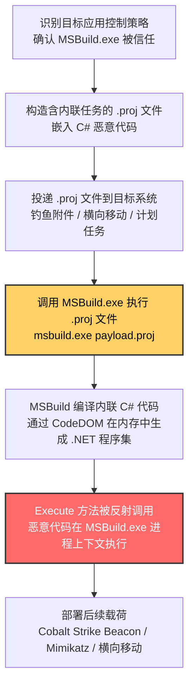
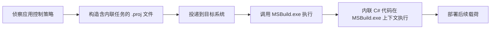

# MSBuild (T1127.001)

## 一句话通俗理解

> **攻击者把恶意 C# 代码藏在 MSBuild 项目文件的"内联任务"里，让被微软签名的 MSBuild.exe 替自己编译并执行——应用控制策略看见 MSBuild.exe 就放行，根本不知道它正在编译攻击者的恶意代码**

## 30秒速查卡

| 维度 | 你需要知道的 |
|------|-------------|
| 这是什么？ | 滥用 MSBuild.exe（Microsoft Build Engine）的"内联任务"特性，在 XML 项目文件中嵌入 C# / VB 代码并自动编译执行 |
| 为什么危险？ | MSBuild.exe 是微软签名二进制，应用控制（AppLocker / WDAC / Smart App Control）通常默认放行；恶意代码在 MSBuild.exe 进程上下文执行，继承签名信任状态 |
| 谁需要关心？ | Windows 系统管理员、应用控制策略制定者、SOC 分析师、.NET 应用开发者 |
| 你的第一步防御 | 在非开发系统中通过 WDAC 阻断 MSBuild.exe；在开发系统中限制仅允许 Visual Studio / dotnet.exe / CI Agent 调用 MSBuild |
| 如果只做一件事 | 监控 MSBuild.exe 的执行上下文，识别非开发上下文调用、用户目录下 .proj 文件、派生可疑子进程等行为（DET0556 / AN1535） |

## 难度等级

⭐⭐⭐ 高级 - 需要深入的技术知识和实践

MSBuild 代理执行属于高级技术，原因在于：

- 攻击者需要熟悉 MSBuild XML 项目文件格式与内联任务机制（`<UsingTask>` + `<Code>` 元素）
- 需要理解 .NET 运行时如何 JIT 编译内联代码，以及如何在 MSBuild.exe 进程上下文中调用任意 Win32 API
- 防御方需要区分"合法的 MSBuild 构建脚本"与"恶意的内联任务载荷"，这要求对开发态行为有深入理解
- 该技术能直接绕过基于签名或路径的现代应用控制方案，是 APT 与红队在面对加固环境时的首选执行通道之一

## 前置知识检查

**读这个文件需要什么？**

- [ ] MSBuild 项目文件 XML 格式基础（.csproj / .vbproj / .proj）
- [ ] .NET Framework 与 .NET (Core) 运行时架构
- [ ] C# 或 Visual Basic .NET 编程基础
- [ ] Windows 应用控制机制（AppLocker / WDAC / Smart App Control）
- [ ] Sysmon 日志事件模型（Event ID 1/7/11/22）

## 技术描述

**MSBuild**（T1127.001）是 **受信任的开发者实用程序代理执行**（T1127）的一个具体变体，**同时属于隐蔽（TA0005）与执行（TA0002）两个战术**。攻击者利用 MSBuild.exe（Microsoft Build Engine）的"内联任务"能力，在 XML 项目文件中嵌入 C# 或 Visual Basic 代码，MSBuild 在编译时会自动编译并执行这些代码，从而实现恶意载荷的代理执行。

### 具体怎么理解？

MSBuild.exe 是 Visual Studio 的核心构建平台，处理 XML 格式的项目文件（`.csproj`、`.vbproj`、`.proj`）。.NET Framework 4.0 引入的"内联任务"（Inline Task）能力允许开发者将 C# 或 VB.NET 代码直接嵌入项目文件的 `<UsingTask><Task><Code>` 元素中——MSBuild 在编译项目时会自动调用 CodeDOM 编译这些代码，并通过反射执行 `Execute()` 方法。这一原本为简化构建任务开发而设计的特性，被攻击者滥用为"无需落地 PE 文件即可执行任意 .NET 代码"的通道。

### 一个最小化的恶意 MSBuild 项目文件

```xml
<Project xmlns="http://schemas.microsoft.com/developer/msbuild/2003">
  <UsingTask TaskName="MaliciousTask" TaskFactory="CodeTaskFactory"
             AssemblyFile="$(MSBuildToolsPath)\Microsoft.Build.Tasks.v4.0.dll">
    <Task>
      <Code Type="Method" Language="cs">
        <![CDATA[
        public override bool Execute() {
            // 这里可以是任意 C# 代码：执行 Shellcode、加载 DLL、连接 C2
            System.Diagnostics.Process.Start("calc.exe");
            return true;
        }
        ]]>
      </Code>
    </Task>
  </UsingTask>
  <Target Name="Build">
    <MaliciousTask />
  </Target>
</Project>
```

执行命令：`MSBuild.exe malicious.proj`——MSBuild 会编译这段 C# 代码，调用 `Execute()` 方法，calc.exe 弹出。整个过程没有任何未签名二进制落地，calc.exe 的父进程是微软签名的 MSBuild.exe。

### 为什么有效？

这种技术之所以有效，是因为：

1. **签名信任继承**：MSBuild.exe 是微软 Authenticode 签名二进制，应用控制方案（AppLocker、WDAC、Smart App Control）通常将其列入白名单——任何在 MSBuild.exe 上下文中执行的代码都"看起来"是合法的构建行为
2. **无需落地 PE 文件**：恶意载荷以 C# 源代码形式存在于 XML 项目文件中，MSBuild 在内存中通过 CodeDOM 编译并执行，避免了传统的"未签名 exe 落地即被检测"问题
3. **广泛可用性**：MSBuild.exe 随 .NET Framework 预装在所有 Windows 系统上（路径如 `C:\Windows\Microsoft.NET\Framework64\v4.0.30319\MSBuild.exe`），无需额外部署
4. **历史悠久的滥用基础**：自 2016 年 Casey Smith（@subTee）公开披露 MSBuild 滥用技术以来，安全社区已有大量公开 PoC，攻击门槛持续降低

**过渡段：** MSBuild 代理执行的精髓在于"用合法的编译能力掩盖非法的代码执行"——攻击者不需要绕过应用控制策略，因为策略本身就放行了 MSBuild.exe；只需要构造一个看起来像合法项目文件的载荷，就能让 MSBuild 替自己完成"编译并执行恶意代码"的全过程。

## 真实攻击流程



**步骤详解：**

1. **识别目标应用控制策略**
   - 通俗描述：攻击者像小偷踩点，先确认目标"门卫放行 MSBuild.exe"
   - 技术细节：通过 `Get-AppLockerPolicy -Xml` 查询策略、检查 WDAC CIM 策略、检测 Smart App Control 状态
   - 常用工具：PowerShell、PolicyFileParser、自定义枚举脚本

2. **构造含内联任务的 .proj 文件**
   - 通俗描述：把"恶意私货"装进 XML 项目文件的合法外壳里
   - 技术细节：使用 `<UsingTask TaskFactory="CodeTaskFactory">` 嵌入 C# 代码，可调用任意 Win32 API、加载 Shellcode、连接 C2
   - 常用工具：Cobalt Strike Aggressor Script、自定义 Payload 生成器、Atomic Red Team 测试模板

3. **投递 .proj 文件到目标系统**
   - 通俗描述：把"伪装好的项目文件"送到目标机器
   - 技术细节：钓鱼邮件附件、SMB 共享、PowerShell 下载、计划任务触发
   - 常用工具：Cobalt Strike、Empire、自定义 PowerShell 投递脚本

4. **调用 MSBuild.exe 执行 .proj 文件**
   - 通俗描述：让被信任的 MSBuild 替自己"送货上门"
   - 技术细节：命令行 `msbuild.exe payload.proj`，或通过 WMI、计划任务、PowerShell 间接调用
   - 常用工具：cmd.exe、powershell.exe、schtasks.exe、wmic.exe

5. **MSBuild 编译内联 C# 代码**
   - 通俗描述：MSBuild 在内存中编译恶意 C# 代码，生成 .NET 程序集
   - 技术细节：MSBuild 调用 CodeDOM（`Microsoft.CSharp.CSharpCodeProvider`）将内联 C# 代码编译为内存中的程序集
   - 常用工具：MSBuild.exe 内置编译能力

6. **Execute 方法被反射调用**
   - 通俗描述：MSBuild 通过反射调用 `Execute()` 方法，恶意代码正式执行
   - 技术细节：MSBuild 通过 `ITask.Execute()` 接口调用编译后的代码，恶意 C# 代码在 MSBuild.exe 进程上下文运行，继承其令牌、权限与签名状态
   - 常用工具：Cobalt Strike Beacon、Mimikatz、自定义 .NET 加载器

7. **部署后续载荷**
   - 通俗描述：站稳脚跟后，开始横向移动与持久化
   - 技术细节：通过 MSBuild.exe 进程发起 C2 通信、转储凭证、横向移动到其他系统
   - 常用工具：Cobalt Strike、Impacket、PowerShell Empire

## 攻击流程

```
侦察应用控制策略 --> 构造含内联任务的 .proj 文件 --> 投递到目标系统 --> 调用 MSBuild.exe 执行 --> 内联 C# 代码在 MSBuild.exe 上下文执行 --> 部署后续载荷
```



**步骤详解：**

1. **侦察应用控制策略**
   - 通俗描述：确认 MSBuild.exe 在目标环境被信任，可以作为代理执行通道
   - 技术细节：通过 `Get-AppLockerPolicy -Xml` 查询 AppLocker 规则；检查 `C:\Windows\System32\CodeIntegrity\CiPolicy.bin` 是否存在 WDAC 策略；检测 Smart App Control 状态（注册表 `HKLM\SYSTEM\CurrentControlSet\Control\CI\TenantPolicies`）
   - 常用工具：PowerShell、PolicyFileParser

2. **构造含内联任务的 .proj 文件**
   - 通俗描述：将 C# 恶意代码包装在 MSBuild 内联任务中
   - 技术细节：使用 `<UsingTask TaskFactory="CodeTaskFactory" AssemblyFile="$(MSBuildToolsPath)\Microsoft.Build.Tasks.v4.0.dll">`，将 C# 代码嵌入 `<Code Type="Method" Language="cs">` 元素中
   - 常用工具：文本编辑器、Atomic Red Team T1127.001 模板

3. **投递到目标系统**
   - 通俗描述：将 .proj 文件送达目标
   - 技术细节：通过钓鱼邮件附件、SMB 共享、PowerShell `Invoke-WebRequest` 下载、Cobalt Strike `upload` 命令
   - 常用工具：Cobalt Strike、Empire、自定义投递脚本

4. **调用 MSBuild.exe 执行**
   - 通俗描述：通过命令行触发 MSBuild 编译执行
   - 技术细节：直接执行 `msbuild.exe payload.proj`，或通过 WMI `wmic process call create`、计划任务、PowerShell `Start-Process` 间接调用
   - 常用工具：cmd.exe、powershell.exe、schtasks.exe、wmic.exe

5. **内联 C# 代码在 MSBuild.exe 上下文执行**
   - 通俗描述：MSBuild 编译并执行内联任务，恶意代码开始运行
   - 技术细节：MSBuild 调用 `CSharpCodeProvider.CompileAssemblyFromSource` 在内存中编译 C# 代码，再通过 `ITask.Execute()` 反射调用
   - 常用工具：MSBuild.exe 内置编译能力

6. **部署后续载荷**
   - 通俗描述：恶意代码执行后，部署持久化与横向移动工具
   - 技术细节：在 MSBuild.exe 进程中加载 Cobalt Strike Beacon Shellcode、调用 Mimikatz 转储凭证、通过 WMI / PsExec 横向移动
   - 常用工具：Cobalt Strike、Mimikatz、Impacket

## 真实案例

### 案例1：Frankenstein 攻击活动滥用 MSBuild 执行恶意代码（2019）

- **时间**：2019 年 6 月
- **目标**：全球多个行业组织
- **攻击组织**：Frankenstein 攻击活动（C0001）
- **手法**：Frankenstein 攻击活动以"缝合怪"著称，攻击者将多个开源工具与合法系统工具组合成攻击链。在该活动中，攻击者使用 MSBuild 执行攻击者构造的恶意项目文件，将 Shellcode 加载到内存中部署 Cobalt Strike Beacon。MSBuild.exe 的签名状态使其绕过了目标组织部署的应用控制方案。
- **影响**：多家组织被入侵，攻击者在网络中长期潜伏
- **参考链接**：[MITRE - Frankenstein Campaign C0001](https://attack.mitre.org/campaigns/C0001/)、[Talos - Frankenstein Campaign](https://blog.talosintelligence.com/2019/06/frankenstein-campaign.html)

### 案例2：MirrorFace Operation AkaiRyū 使用 MSBuild 编译 FaceXInjector（2024-2025）

- **时间**：2024 年-2025 年
- **目标**：日本与欧洲组织（含 2025 年大阪世博会相关目标）
- **攻击组织**：MirrorFace（G1054）
- **手法**：在 Operation AkaiRyū 攻击活动中，MirrorFace 使用 MSBuild 编译并执行其自研注入工具 FaceXInjector。攻击者通过钓鱼邮件投递包含恶意内联任务的 MSBuild 项目文件，目标用户打开附件后 MSBuild.exe 自动编译 C# 代码并执行 FaceXInjector，将 ANEL 后门注入到合法进程中。
- **影响**：日本政府机构、研究机构、欧洲组织被入侵，ANEL 后门时隔多年重新被部署
- **参考链接**：[MITRE - Operation AkaiRyū C0060](https://attack.mitre.org/campaigns/C0060/)、[ESET - Operation AkaiRyū](https://www.welivesecurity.com/en/eset-research/operation-akairyu-mirrorface-invites-europe-expo-2025-revives-anel-backdoor/)、[JPCERT - MirrorFace Analysis](https://blogs.jpcert.or.jp/en/2024/07/mirrorface-attack-against-japanese-organisations.html)

### 案例3：PlugX 通过 MSBuild 加载 Shellcode 绕过应用控制（2017）

- **时间**：2017 年 6 月
- **目标**：全球政府机构、外交组织、NGO
- **攻击组织**：使用 PlugX（S0013）的多个 APT 组织
- **手法**：PlugX 的某个变种将自身 Shellcode 嵌入到 .NET Framework 项目文件中，通过 MSBuild.exe 加载执行。这种部署方式被攻击者明确选择以绕过应用控制方案——许多企业部署 AppLocker 阻止未签名 exe 运行，但允许 MSBuild.exe 执行。攻击者只需将 PlugX Shellcode 包装在 `.csproj` 项目文件的内联任务中，调用 `msbuild.exe payload.csproj` 即可完成无文件落地加载。
- **影响**：多个国家与组织被长期渗透，PlugX 至今仍是亚太地区最活跃的 RAT 之一
- **参考链接**：[MITRE - PlugX S0013](https://attack.mitre.org/software/S0013/)、[Palo Alto Unit 42 - Paranoid PlugX](https://researchcenter.paloaltonetworks.com/2017/06/unit42-paranoid-plugx/)

### 案例4：Empire 框架内置 MSBuild 滥用模块

- **时间**：2016 年起持续
- **目标**：红队与 APT 攻击目标
- **攻击组织**：使用 PowerShell Empire（S0363）的红队与多个 APT 组织
- **手法**：PowerShell Empire 框架内置了多个滥用 MSBuild 的模块，攻击者可以一键生成包含恶意内联任务的项目文件，并自动通过 MSBuild.exe 执行。这种"框架化"的滥用方式显著降低了攻击门槛——即使不熟悉 MSBuild XML 格式的攻击者也能快速生成载荷。
- **影响**：Empire 是开源红队工具，其 MSBuild 模块被广泛用于合法红队评估与实际攻击
- **参考链接**：[MITRE - Empire S0363](https://attack.mitre.org/software/S0363/)、[PowerShell Empire GitHub](https://github.com/PowerShellEmpire/Empire)

### 案例5：NOOPLDR 后门通过 MSBuild 加载

- **时间**：2024 年
- **目标**：日本组织（MirrorFace 关联）
- **攻击组织**：MirrorFace（G1054）关联组织
- **手法**：NOOPLDR（S9025）是一款自研后门，可通过 MSBuild.exe 加载执行。攻击者将 NOOPLDR 的 .NET 加载器嵌入 MSBuild 项目文件的内联任务中，通过 MSBuild.exe 编译执行，避免后门二进制文件落地被检测。
- **影响**：日本多个组织被入侵
- **参考链接**：[MITRE - NOOPLDR S9025](https://attack.mitre.org/software/S9025/)、[JPCERT - MirrorFace Analysis](https://blogs.jpcert.or.jp/en/2024/07/mirrorface-attack-against-japanese-organisations.html)

## 红队视角

> ⚠️ **免责声明**：以下内容仅用于合法的安全测试、渗透测试和教育目的。未经授权对他人系统进行测试是违法行为。

### 实战技巧

1. **选择合适的 .proj 文件扩展名**：除了 `.proj`，也可以使用 `.csproj`、`.vbproj`、`.props`、`.targets` 等扩展名，部分应用控制策略可能仅阻断 `.proj` 但允许其他扩展名
2. **混淆内联任务代码**：使用 Base64 编码、字符串反转、动态 API 解析等技术混淆 C# 代码，绕过静态检测规则
3. **避免触发 DET0556 检测**：不要在 MSBuild.exe 执行后立即派生 powershell.exe / cmd.exe，可在内联任务中直接通过 Win32 API 完成所有操作
4. **利用远程路径**：通过 UNC 路径（`\\server\share\payload.proj`）执行 MSBuild 项目，避免文件落地目标系统
5. **结合其他 LOLBins**：使用 `mshta.exe`、`wmic.exe` 等其他 LOLBins 间接调用 MSBuild.exe，进一步混淆进程树

### 常用工具

| 工具名称 | 用途 | 平台 | 链接 |
| -------- | ---- | ---- | ---- |
| MSBuild.exe | 内联任务编译执行 | Windows | 系统自带 |
| Atomic Red Team | T1127.001 测试模板 | 跨平台 | [Atomic Red Team](https://github.com/redcanaryco/atomic-red-team) |
| Empire | 内置 MSBuild 模块 | Windows | [PowerShell Empire](https://github.com/PowerShellEmpire/Empire) |
| Cobalt Strike | Aggressor Script 生成载荷 | Windows | [Cobalt Strike](https://www.cobaltstrike.com/) |
| LOLBAS | MSBuild 滥用参考 | 跨平台 | [LOLBAS - MSBuild](https://lolbas-project.github.io/lolbas/Binaries/Msbuild/) |

### 注意事项

- 在授权的测试环境中使用这些技术
- 注意操作安全（OPSEC），避免被 EDR 检测到内联任务的 C# 代码特征
- 使用匿名化技术和代理隐藏真实身份
- 测试后清理所有 .proj 文件与 MSBuild.exe 进程

## 蓝队视角

### 检测要点

1. **MSBuild.exe 执行上下文异常**：监控 MSBuild.exe 的父进程，识别非开发工具（如 Office 应用、浏览器、邮件客户端）调用 MSBuild 的场景
2. **可疑命令行参数**：识别 MSBuild.exe 命令行中包含用户目录（`C:\Users\`）、临时目录（`C:\Temp\`）、UNC 路径（`\\`）或 Base64 编码字符串的场景
3. **可疑子进程派生**：监控 MSBuild.exe 派生 powershell.exe、cmd.exe、rundll32.exe 等高危 LOLBins 的行为
4. **网络连接立即发起**：MSBuild.exe 在执行后短时间内发起出站网络连接（非 NuGet.org / Microsoft CDN）
5. **未签名 DLL 加载**：MSBuild.exe 加载来自用户可写路径的未签名 DLL

### 监控建议

- 部署 Sysmon 并配置针对 MSBuild.exe 的进程创建、模块加载、网络连接、文件创建事件采集
- 在 EDR 中建立"开发者工具执行上下文基线"，对偏离基线的执行场景自动告警
- 配置 SIEM 规则，关联 Sysmon Event ID 1（进程创建）+ Event ID 7（模块加载）+ Event ID 22（DNS 查询）形成行为链检测
- 定期审计终端上的 MSBuild.exe 调用日志，识别非开发岗位终端的 MSBuild 执行

## 避坑指南

防御者常见误区：

1. **只监控 .proj 扩展名**：攻击者可以使用 `.csproj`、`.vbproj`、`.props`、`.targets` 等其他扩展名绕过扩展名过滤——应监控 MSBuild.exe 的所有命令行调用
2. **依赖签名验证**：MSBuild.exe 是微软签名二进制，签名验证无法识别其执行的恶意载荷——必须基于行为链检测
3. **忽略远程路径执行**：攻击者可通过 UNC 路径 `\\server\share\payload.proj` 执行 MSBuild 项目，避免文件落地——应监控 MSBuild.exe 命令行中的 UNC 路径
4. **过度依赖 WDAC 默认规则**：微软推荐的 WDAC 阻断规则虽然包含 MSBuild.exe，但许多组织因开发需求未启用——需在非开发系统强制启用
5. **忽略 .NET Core 的 MSBuild**：.NET SDK 自带的 `dotnet build` 命令也调用 MSBuild，可能成为绕过通道——应同时监控 `dotnet.exe` 的构建行为

## 检测建议

### 检测思路

检测 MSBuild 代理执行的关键是"行为链分析"（DET0556 / AN1535）——单看 MSBuild.exe 执行本身是合法的开发行为，但如果串联起来看：MSBuild.exe 在非开发上下文中执行 + 命令行包含非规范路径 + 派生高危子进程 + 加载未签名模块 + 发起出站网络连接，这一连串行为组合就高度可疑。

### 网络层检测

**方法**：监控 MSBuild.exe 进程发起的出站网络连接

```powershell
# 检测 MSBuild.exe 发起的可疑网络连接（Sysmon Event ID 3）
Get-WinEvent -FilterHashtable @{LogName='Microsoft-Windows-Sysmon/Operational'; ID=3} |
    Where-Object { $_.Message -match 'MSBuild\.exe' } |
    Select-Object TimeCreated, Message -First 50
```

### 主机层检测

**Windows事件ID：**
- Sysmon Event ID 1：进程创建（监控 MSBuild.exe 的父进程与命令行参数）
- Sysmon Event ID 7：Image Loaded（监控 MSBuild.exe 加载未签名 DLL）
- Sysmon Event ID 11：FileCreate（监控 .proj / .csproj 文件在非标准目录的创建）
- Sysmon Event ID 22：DNS Query（监控 MSBuild.exe 发起的 DNS 解析）
- Event ID 4688：进程创建（Windows 安全审计）

**Linux日志**：本技术仅针对 Windows 平台

```powershell
# 检测 MSBuild.exe 在非开发上下文中执行（DET0556 / AN1535）
Get-WinEvent -FilterHashtable @{LogName='Microsoft-Windows-Sysmon/Operational'; ID=1} |
    Where-Object {
        $_.Message -match 'MSBuild\.exe' -and
        $_.Message -notmatch 'Program Files\\Microsoft Visual Studio|Program Files\\dotnet|Windows\\Microsoft\.NET'
    } |
    Select-Object TimeCreated, Message -First 50

# 检测 MSBuild.exe 派生可疑子进程
Get-WinEvent -FilterHashtable @{LogName='Microsoft-Windows-Sysmon/Operational'; ID=1} |
    Where-Object {
        $_.Message -match 'ParentImage:.*MSBuild\.exe' -and
        $_.Message -match 'powershell\.exe|cmd\.exe|rundll32\.exe|regsvr32\.exe|wscript\.exe|cscript\.exe'
    } |
    Select-Object TimeCreated, Message -First 50
```

### 应用层检测

**Sigma规则示例**：

```yaml
title: MSBuild 内联任务代理执行检测（DET0556 / AN1535）
id: d4e5f6a7-b8c9-490d-abcd-ef1234567890
status: experimental
description: 检测 MSBuild.exe 在非开发上下文中执行并派生高危子进程或加载未签名模块，对应 T1127.001 MSBuild 代理执行攻击
references:
    - https://attack.mitre.org/techniques/T1127/001/
    - https://attack.mitre.org/detectionstrategies/DET0556
author: ATT&CK知识库
date: 2026/07/24
logsource:
    product: windows
    service: sysmon
detection:
    selection_msbuild_exec:
        EventID: 1
        Image|endswith: '\MSBuild.exe'
    filter_dev_context:
        ParentImage|contains:
            - '\Program Files\Microsoft Visual Studio\'
            - '\Program Files\dotnet\'
            - '\devenv.exe'
            - '\dotnet.exe'
    selection_suspicious_commandline:
        CommandLine|contains:
            - '\Users\'
            - '\Temp\'
            - '\AppData\'
            - '\\\\'
            - 'base64'
    condition: selection_msbuild_exec and not filter_dev_context
    # 进一步可结合子进程派生、模块加载、网络连接形成行为链
falsepositives:
    - 合法的构建脚本在非标准路径调用 MSBuild（需建立基线白名单）
    - CI/CD 系统在构建服务器上调用 MSBuild（应单独建模）
level: high
tags:
    - attack.t1127
    - attack.t1127.001
    - attack.defense_evasion
    - attack.execution
```

## 缓解措施

### 优先级1：关键措施

**措施名称：** 在非开发系统中通过 WDAC 阻断 MSBuild.exe

**具体实施步骤：**
1. 评估企业终端的 MSBuild.exe 使用需求，对非开发岗位终端通过 WDAC 策略阻断 MSBuild.exe 执行
2. 应用微软推荐的 WDAC 阻断规则，显式拒绝 `msbuild.exe` 在非开发上下文中的执行
3. 部署 WDAC 策略后，通过 CI/CD 系统集中完成构建任务，避免在终端上调用 MSBuild

```powershell
# 检查 MSBuild.exe 的存在位置（多处可能存在）
Get-ChildItem -Path "C:\Windows\Microsoft.NET" -Filter "MSBuild.exe" -Recurse -ErrorAction SilentlyContinue
Get-ChildItem -Path "C:\Program Files\Microsoft Visual Studio" -Filter "MSBuild.exe" -Recurse -ErrorAction SilentlyContinue
Get-ChildItem -Path "C:\Program Files\dotnet" -Filter "MSBuild.exe" -Recurse -ErrorAction SilentlyContinue
```

### 优先级2：重要措施

**措施名称：** 在开发系统中建立上下文敏感的执行白名单

**具体实施步骤：**
1. WDAC 策略中不仅基于文件名/签名放行 MSBuild.exe，还需结合父进程（如仅允许 devenv.exe / dotnet.exe / CI Agent 调用 MSBuild.exe）
2. 启用 AppLocker 的 DLL 规则集合，监控并阻断 MSBuild.exe 加载非系统目录下的未签名 DLL
3. 配置 Sysmon 配置文件，专门记录 MSBuild.exe 的执行、子进程派生、模块加载、网络连接事件
4. 在 EDR 中建立"MSBuild 开发态行为基线"，对偏离基线的执行场景自动告警

### 优先级3：建议措施

**措施名称：** 审计与监控 MSBuild 内联任务

**具体实施步骤：**
1. 对开发团队的 MSBuild 项目文件进行审计，识别使用 `<UsingTask><Code>` 内联任务的项目
2. 建立"合法内联任务基线"，对偏离基线的内联任务项目文件进行人工审查
3. 教育开发者识别钓鱼式 .proj / .csproj 文件，避免打开不可信来源的项目文件
4. 在源代码仓库中审计所有 .proj / .csproj / .targets 文件的变更历史

### MITRE ATT&CK 缓解措施映射

| 缓解措施ID | 缓解措施名称 | 适用性 | 说明 |
|------------|-------------|--------|------|
| M1042 | 禁用或移除功能或程序 | 适用 | 在非开发系统中移除 MSBuild.exe 或通过 WDAC 阻断 |
| M1038 | 执行防护 | 适用 | 通过 WDAC 阻断规则显式拒绝 msbuild.exe，仅允许在开发上下文中执行 |

## 动手实验

> ⚠️ **所有实验必须在隔离的实验室环境中进行**

### 实验1：MSBuild 内联任务基础（初级）

**目标**：理解 MSBuild 内联任务的工作原理，观察 MSBuild.exe 如何编译并执行嵌入的 C# 代码

**步骤**：
1. 在实验虚拟机中确认 MSBuild.exe 位置（如 `C:\Windows\Microsoft.NET\Framework64\v4.0.30319\MSBuild.exe`）
2. 创建测试项目文件 `payload.proj`：
   ```xml
   <Project xmlns="http://schemas.microsoft.com/developer/msbuild/2003">
     <UsingTask TaskName="DemoTask" TaskFactory="CodeTaskFactory"
                 AssemblyFile="$(MSBuildToolsPath)\Microsoft.Build.Tasks.v4.0.dll">
       <Task>
         <Code Type="Method" Language="cs">
           <![CDATA[
           public override bool Execute() {
               System.Diagnostics.Process.Start("calc.exe");
               return true;
           }
           ]]>
         </Code>
       </Task>
     </UsingTask>
     <Target Name="Build">
       <DemoTask />
     </Target>
   </Project>
   ```
3. 执行命令：`MSBuild.exe payload.proj`
4. 观察 calc.exe 是否弹出，其父进程应为 MSBuild.exe
5. 通过 ProcMon 查看 MSBuild.exe 的进程树与文件访问行为
6. 检查 Sysmon Event ID 1，确认父进程关系被记录

**预期结果**：calc.exe 弹出，父进程为 MSBuild.exe

**学习要点**：理解 MSBuild 内联任务如何被滥用执行任意 C# 代码

### 实验2：MSBuild 加载 Shellcode（中级）

**目标**：掌握通过 MSBuild 内联任务加载 Shellcode 的方法，理解无文件落地攻击

**步骤**：
1. 使用 msfvenom 生成测试 Shellcode：
   ```bash
   msfvenom -p windows/x64/exec CMD=calc.exe -f csharp
   ```
2. 将生成的 byte 数组嵌入 MSBuild 内联任务的 C# 代码中，使用 `VirtualAlloc` + `CreateThread` 加载执行
3. 执行 `MSBuild.exe shellcode_loader.proj`
4. 观察 Shellcode 是否在 MSBuild.exe 进程中执行
5. 通过 Process Hacker 查看 MSBuild.exe 进程内存中的可执行区域

**预期结果**：Shellcode 在 MSBuild.exe 进程内存中执行

**学习要点**：掌握 MSBuild 内联任务加载 Shellcode 的方法

### 实验3：检测规则验证（高级）

**目标**：验证 MSBuild 代理执行检测规则的有效性

**步骤**：
1. 在实验环境中部署 Sysmon 与 Sigma 规则
2. 执行实验1 和实验2 的攻击模拟
3. 验证检测告警是否触发
4. 调整规则阈值与过滤条件，降低误报
5. 测试绕过技术（如使用 .csproj 扩展名、远程路径执行）

**预期结果**：检测规则成功识别 MSBuild 代理执行行为

**学习要点**：理解攻防对抗的实际效果

## 术语解释

| 术语 | 通俗解释 |
|------|---------|
| **MSBuild** | 微软构建平台，处理 XML 项目文件并编译 .NET 应用 |
| **内联任务** | MSBuild 特性，允许在项目文件中嵌入 C# / VB 代码并自动编译执行 |
| **CodeDOM** | .NET 的代码生成框架，MSBuild 使用其编译内联任务代码 |
| **代理执行** | 通过合法进程间接执行恶意代码，让恶意代码继承合法进程的权限与信任状态 |
| **WDAC** | Windows Defender Application Control，微软基于内核的应用控制方案 |
| **AppLocker** | Windows 应用控制功能，基于规则限制可执行文件、脚本、安装包运行 |
| **Smart App Control** | Windows 11 引入的应用控制方案，基于微软云端信誉判断应用安全性 |
| **LOLBins** | "生活在陆地上的二进制文件"——被攻击者滥用的系统自带合法工具 |
| **行为链检测** | 通过串联多个相关行为事件进行检测的方法，弥补单事件检测的不足 |

## 被引用情况

以下父技术文档引用了本子技术：

- [T1127 - 受信任的开发者实用程序代理执行](../T1127-Trusted-Developer-Utilities-Proxy-Execution.md)

## 参考资料

### 官方文档（深入了解）

- [MITRE ATT&CK - T1127.001 MSBuild](https://attack.mitre.org/techniques/T1127/001/)
- [MITRE ATT&CK - T1127 Trusted Developer Utilities Proxy Execution](https://attack.mitre.org/techniques/T1127/)
- [MITRE ATT&CK - DET0556 Detection Strategy](https://attack.mitre.org/detectionstrategies/DET0556)

### 安全报告（真实攻击）

- [Talos - Frankenstein Campaign](https://blog.talosintelligence.com/2019/06/frankenstein-campaign.html) - Frankenstein 攻击活动深度分析
- [ESET - Operation AkaiRyū](https://www.welivesecurity.com/en/eset-research/operation-akairyu-mirrorface-invites-europe-expo-2025-revives-anel-backdoor/) - MirrorFace 攻击日本与欧洲组织
- [JPCERT - MirrorFace Attack against Japanese Organisations](https://blogs.jpcert.or.jp/en/2024/07/mirrorface-attack-against-japanese-organisations.html) - MirrorFace 早期活动分析
- [Palo Alto Unit 42 - Paranoid PlugX](https://researchcenter.paloaltonetworks.com/2017/06/unit42-paranoid-plugx/) - PlugX 通过 MSBuild 加载

### 工具与资源（动手试试）

- [LOLBAS - MSBuild.exe](https://lolbas-project.github.io/lolbas/Binaries/Msbuild/) - MSBuild 滥用方式参考
- [Microsoft Learn - MSBuild Inline Tasks](https://docs.microsoft.com/en-us/visualstudio/msbuild/msbuild-inline-tasks) - 内联任务官方文档
- [Microsoft Recommended Block Rules](https://docs.microsoft.com/windows/security/threat-protection/windows-defender-application-control/microsoft-recommended-block-rules) - WDAC 推荐阻断规则（含 MSBuild）
- [Atomic Red Team - T1127.001](https://atomicredteam.io/) - 可执行的检测测试用例
- [MITRE ATT&CK Navigator](https://mitre-attack.github.io/attack-navigator/) - ATT&CK 可视化工具

### 学习资料（深入了解）

- [MITRE ATT&CK 知识库](https://attack.mitre.org/resources/) - ATT&CK 官方资源中心
