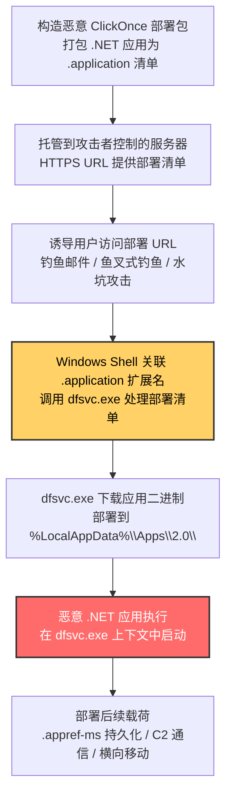

# ClickOnce (T1127.002)

## 一句话通俗理解

> **攻击者构造 ClickOnce 部署包，让 Windows 的 ClickOnce 部署服务（dfsvc.exe / dfshim.dll）替自己下载并执行恶意 .NET 应用——这一连串过程由微软签名组件完成，应用控制策略只看见合法的部署流程，根本不会拦截**

## 30秒速查卡

| 维度 | 你需要知道的 |
|------|-------------|
| 这是什么？ | 滥用 Windows ClickOnce 部署机制，通过 .application / .appref-ms 清单文件触发 dfsvc.exe / dfshim.dll 下载并执行恶意 .NET 应用 |
| 为什么危险？ | ClickOnce 部署服务由微软签名；.appref-ms 文件可放入启动文件夹实现持久化；ClickOnce 应用运行在临时目录且无 UAC 提示 |
| 谁需要关心？ | Windows 系统管理员、应用控制策略制定者、SOC 分析师、邮件安全团队 |
| 你的第一步防御 | 监控 .application / .appref-ms 文件在用户目录与启动文件夹中的出现，以及 dfsvc.exe 由非浏览器进程触发的场景（DET0191 / AN0550） |
| 如果只做一件事 | 阻断 .appref-ms / .application 扩展名在邮件附件与浏览器下载中的传播，监控启动文件夹中的 .appref-ms 持久化项 |

## 难度等级

⭐⭐⭐ 高级 - 需要深入的技术知识和实践

ClickOnce 代理执行属于高级技术，原因在于：

- 攻击者需要熟悉 ClickOnce 部署清单格式（.application / .appref-ms / .manifest）与签名要求
- 需要理解 dfsvc.exe / dfshim.dll 的部署流程，以及如何通过 rundll32 间接调用 dfshim.dll
- 防御方需要区分"合法的 ClickOnce 应用部署"与"恶意的 ClickOnce 载荷分发"，这要求对开发态部署行为有深入理解
- 该技术能直接绕过基于签名或路径的应用控制方案，并通过启动文件夹实现隐蔽的持久化

## 前置知识检查

**读这个文件需要什么？**

- [ ] ClickOnce 部署机制基础（部署清单 .application、应用程序清单 .manifest）
- [ ] .NET Framework 与 .NET (Core) 应用部署
- [ ] Windows 文件关联与 Shell 执行机制
- [ ] rundll32.exe 与 dfshim.dll 协作机制
- [ ] Windows 启动文件夹持久化机制

## 技术描述

**ClickOnce**（T1127.002）是 **受信任的开发者实用程序代理执行**（T1127）的一个具体变体，**同时属于隐蔽（TA0005）与执行（TA0002）两个战术**。攻击者利用 Windows ClickOnce 部署机制（dfsvc.exe / dfshim.dll）作为代理执行通道，通过构造部署清单文件（.application / .appref-ms）触发 ClickOnce 服务下载并执行恶意 .NET 应用。

### 具体怎么理解？

ClickOnce 是 .NET Framework 引入的应用部署技术，允许开发者将 .NET 应用发布到 Web 服务器、网络共享或可移动介质，终端用户点击部署清单（.application 文件）即可自动下载并运行应用，无需管理员权限。ClickOnce 部署服务由微软签名的 `dfsvc.exe`（位于 `C:\Windows\System32\`）和 `dfshim.dll`（ClickOnce 部署运行时）提供，应用控制方案通常默认放行。

攻击者滥用 ClickOnce 的方式包括：
1. **托管恶意 ClickOnce 应用**：在攻击者控制的 Web 服务器上托管恶意 .NET 应用，诱导用户访问 .application 部署清单 URL，触发 dfsvc.exe 自动下载并执行
2. **投放 .appref-ms 持久化项**：将 .appref-ms 文件（ClickOnce 应用引用快捷方式）放入启动文件夹，实现开机自启——由于 .appref-ms 是合法的 ClickOnce 部署组件，启动文件夹持久化检测往往忽略此类文件
3. **rundll32 间接调用 dfshim.dll**：通过 `rundll32.exe dfshim.dll,ShOpenVerbAction <url>` 间接触发 ClickOnce 部署流程，进一步混淆进程树

### 一个最小化的 ClickOnce 滥用场景

攻击者将一个恶意 .NET 应用打包为 ClickOnce 部署包，托管在 `https://attacker.example/payload.application`：

```
1. 攻击者诱导用户访问 URL 或双击 .application 文件
2. Windows Shell 关联 .application 扩展名 → 调用 dfsvc.exe 处理部署清单
3. dfsvc.exe 下载部署清单，验证签名（可使用自签名证书）
4. dfsvc.exe 下载应用程序清单与 .NET 应用二进制
5. dfsvc.exe 启动应用，应用在临时目录 `%LocalAppData%\Apps\2.0\` 中执行
```

整个过程由微软签名的 dfsvc.exe / dfshim.dll 完成，应用控制策略只看见合法的 ClickOnce 部署流程，根本不会拦截。

### 为什么有效？

这种技术之所以有效，是因为：

1. **签名信任继承**：dfsvc.exe / dfshim.dll 是微软签名二进制，应用控制方案（AppLocker、WDAC、Smart App Control）通常将其列入白名单
2. **无 UAC 提示**：ClickOnce 应用以当前用户权限运行，无需 UAC 提示，攻击者可获得用户态完全控制
3. **临时目录执行**：ClickOnce 应用部署到 `%LocalAppData%\Apps\2.0\` 临时目录，许多 EDR 规则不监控该路径
4. **持久化能力**：.appref-ms 文件可放入启动文件夹，伪装成合法的 ClickOnce 应用更新检查，实现隐蔽的持久化
5. **远程加载能力**：ClickOnce 部署清单可指向任意 URL，攻击者可在远程动态更新载荷，无需重新投递

**过渡段：** ClickOnce 代理执行的精髓在于"用合法的应用部署机制掩盖恶意代码分发"——攻击者不需要绕过应用控制策略，因为策略本身就放行了 ClickOnce 部署服务；只需要构造一个看起来合法的部署清单，就能让 dfsvc.exe 替自己完成"下载并执行恶意 .NET 应用"的全过程。

## 真实攻击流程



**步骤详解：**

1. **构造恶意 ClickOnce 部署包**
   - 通俗描述：把恶意 .NET 应用"打包"成 ClickOnce 部署格式
   - 技术细节：使用 mage.exe / mageui.exe 生成部署清单（.application）与应用程序清单（.manifest），可使用自签名证书
   - 常用工具：mage.exe（.NET SDK 自带）、Visual Studio 发布向导

2. **托管到攻击者控制的服务器**
   - 通俗描述：将部署包上传到攻击者控制的 Web 服务器
   - 技术细节：将 .application 部署清单与应用二进制托管在 HTTPS 服务器上，配置 MIME 类型 `application/x-ms-application`
   - 常用工具：Apache / Nginx / 攻击者控制的 CDN

3. **诱导用户访问部署 URL**
   - 通俗描述：通过钓鱼邮件诱导用户点击 URL
   - 技术细节：钓鱼邮件包含 `https://attacker.example/payload.application` 链接，用户点击后浏览器自动调用 dfsvc.exe 处理
   - 常用工具：鱼叉式钓鱼邮件、水坑攻击、社工话术

4. **Windows Shell 关联 .application 扩展名**
   - 通俗描述：Windows 自动调用 dfsvc.exe 处理 .application 文件
   - 技术细节：Windows Shell 通过文件关联将 .application 扩展名关联到 dfsvc.exe（实际通过 rundll32.exe 调用 dfshim.dll,ShOpenVerbAction）
   - 常用工具：Windows Shell 内置机制

5. **dfsvc.exe 下载应用二进制**
   - 通俗描述：dfsvc.exe 下载应用二进制到本地临时目录
   - 技术细节：dfsvc.exe 解析部署清单，下载应用二进制到 `%LocalAppData%\Apps\2.0\<hash>\<hash>\` 目录
   - 常用工具：dfsvc.exe 内置下载能力

6. **恶意 .NET 应用执行**
   - 通俗描述：dfsvc.exe 启动恶意 .NET 应用，应用在临时目录中执行
   - 技术细节：dfsvc.exe 调用 .NET 运行时启动应用，应用以当前用户权限运行，无 UAC 提示
   - 常用工具：Cobalt Strike Beacon、Mimikatz、自定义 .NET 加载器

7. **部署后续载荷**
   - 通俗描述：恶意应用执行后，部署持久化与横向移动工具
   - 技术细节：将 .appref-ms 文件放入启动文件夹实现持久化；通过 ClickOnce 应用发起 C2 通信、转储凭证、横向移动
   - 常用工具：Cobalt Strike、Impacket、自定义 .NET 工具

## 攻击流程

```
构造恶意 ClickOnce 部署包 --> 托管到攻击者服务器 --> 诱导用户访问部署 URL --> dfsvc.exe 处理部署清单并下载应用 --> 恶意 .NET 应用执行 --> 部署后续载荷与持久化
```


**步骤详解：**

1. **构造恶意 ClickOnce 部署包**
   - 通俗描述：将恶意 .NET 应用打包为 ClickOnce 部署格式
   - 技术细节：使用 mage.exe 生成部署清单（.application）与应用程序清单（.manifest），清单中包含应用入口点、依赖项、URL 部署位置
   - 常用工具：mage.exe、Visual Studio 发布向导

2. **托管到攻击者服务器**
   - 通俗描述：将部署包上传到攻击者控制的 Web 服务器
   - 技术细节：配置 HTTPS 服务器，确保 .application MIME 类型正确返回（`application/x-ms-application`）
   - 常用工具：Apache / Nginx、攻击者控制的 CDN

3. **诱导用户访问部署 URL**
   - 通俗描述：通过钓鱼邮件诱导用户点击部署 URL
   - 技术细节：钓鱼邮件包含 `https://attacker.example/payload.application` 链接，用户点击后浏览器调用 dfsvc.exe 处理部署清单
   - 常用工具：鱼叉式钓鱼邮件、社工话术

4. **dfsvc.exe 处理部署清单并下载应用**
   - 通俗描述：dfsvc.exe 解析部署清单，下载应用二进制到临时目录
   - 技术细节：dfsvc.exe 解析 .application 部署清单，验证签名，下载应用二进制到 `%LocalAppData%\Apps\2.0\<hash>\<hash>\` 目录
   - 常用工具：dfsvc.exe 内置部署能力

5. **恶意 .NET 应用执行**
   - 通俗描述：dfsvc.exe 启动恶意 .NET 应用
   - 技术细节：dfsvc.exe 调用 .NET 运行时启动应用入口点（如 `Program.Main`），应用以当前用户权限运行，无 UAC 提示
   - 常用工具：Cobalt Strike Beacon、自定义 .NET 加载器

6. **部署后续载荷与持久化**
   - 通俗描述：恶意应用执行后，部署持久化与横向移动工具
   - 技术细节：将 .appref-ms 文件放入启动文件夹实现开机自启；通过 ClickOnce 应用发起 C2 通信、转储凭证
   - 常用工具：Cobalt Strike、Impacket

## 真实案例

### 案例1：攻击者通过 ClickOnce 部署 Cobalt Strike Beacon

- **时间**：2023 年起持续
- **目标**：全球多个行业组织
- **攻击组织**：多个未具名 APT 组织与勒索软件团伙
- **手法**：攻击者将 Cobalt Strike Beacon 打包为 ClickOnce 部署包，托管在攻击者控制的 HTTPS 服务器上。通过鱼叉式钓鱼邮件诱导目标用户点击 `https://attacker.example/update.application` 链接，dfsvc.exe 自动下载并执行 Beacon。由于 dfsvc.exe 是微软签名二进制，应用控制策略默认放行；Beacon 部署到 `%LocalAppData%\Apps\2.0\` 临时目录，许多 EDR 规则不监控该路径。
- **影响**：多个组织被入侵，攻击者在网络中长期潜伏
- **参考链接**：[MITRE - T1127.002 ClickOnce](https://attack.mitre.org/techniques/T1127/002/)、[LOLBAS - ClickOnce](https://lolbas-project.github.io/lolbas/Partitions/)

### 案例2：.appref-ms 启动文件夹持久化

- **时间**：2022 年起持续
- **目标**：Windows 终端用户
- **攻击组织**：多个未具名威胁组织
- **手法**：攻击者将 .appref-ms 文件放入 Windows 启动文件夹（`%AppData%\Microsoft\Windows\Start Menu\Programs\Startup\`），实现开机自启。.appref-ms 文件是 ClickOnce 应用引用快捷方式，开机时 Windows Shell 自动调用 dfsvc.exe 处理该文件，触发 ClickOnce 应用远程加载执行。由于 .appref-ms 是合法的 ClickOnce 部署组件，传统启动文件夹持久化检测往往忽略此类文件。
- **影响**：受害终端被长期控制，即使删除恶意进程也会在重启后自动恢复
- **参考链接**：[MITRE - T1127.002 ClickOnce](https://attack.mitre.org/techniques/T1127/002/)、[T1555.003 Boot or Logon Initialization Scripts](https://attack.mitre.org/techniques/T1037/001/)

### 案例3：rundll32 调用 dfshim.dll 间接触发 ClickOnce 部署

- **时间**：2021 年起持续
- **目标**：Windows 终端用户
- **攻击组织**：多个未具名威胁组织与红队
- **手法**：攻击者通过 `rundll32.exe dfshim.dll,ShOpenVerbAction <url>` 间接触发 ClickOnce 部署流程。rundll32.exe 加载 dfshim.dll 并调用 `ShOpenVerbAction` 函数，函数内部调用 dfsvc.exe 处理部署清单。这种间接调用方式进一步混淆了进程树——安全分析师看到的进程链是 `rundll32.exe → dfsvc.exe → 恶意应用`，而非直接的浏览器或邮件客户端调用。
- **影响**：攻击者成功绕过部分 EDR 的进程树检测规则
- **参考链接**：[MITRE - T1127.002 ClickOnce](https://attack.mitre.org/techniques/T1127/002/)、[LOLBAS - rundll32.exe](https://lolbas-project.github.io/lolbas/Binaries/Rundll32/)

### 案例4：ScarletEel 通过 ClickOnce 投递载荷

- **时间**：2022 年
- **目标**：AWS 云环境中的 Windows 实例
- **攻击组织**：ScarletEel
- **手法**：ScarletEel 攻击活动在入侵 AWS 环境后，通过 ClickOnce 部署恶意载荷到 Windows 实例。攻击者利用已获得的 IAM 凭证访问 EC2 实例元数据服务，获取实例凭证后横向移动到 Windows 实例，通过 ClickOnce 部署持久化后门。
- **影响**：AWS 环境被入侵，敏感数据泄露
- **参考链接**：[CrowdStrike - ScarletEel](https://www.crowdstrike.com/blog/scarlesteel-and-scarleteel-campaigns/)、[MITRE - T1127.002 ClickOnce](https://attack.mitre.org/techniques/T1127/002/)

## 红队视角

> ⚠️ **免责声明**：以下内容仅用于合法的安全测试、渗透测试和教育目的。未经授权对他人系统进行测试是违法行为。

### 实战技巧

1. **使用 mage.exe 生成部署清单**：.NET SDK 自带的 mage.exe 是生成 ClickOnce 部署清单的标准工具，可指定应用入口点、URL 部署位置、签名证书
2. **使用自签名证书签名部署清单**：ClickOnce 部署清单需要签名，可使用自签名证书生成（如 `New-SelfSignedCertificate`），签名后 ClickOnce 会显示"未知发布者"警告但不会阻止执行
3. **.appref-ms 启动文件夹持久化**：将 .appref-ms 文件放入 `%AppData%\Microsoft\Windows\Start Menu\Programs\Startup\`，实现开机自启，比传统的 .lnk 持久化更隐蔽
4. **rundll32 间接调用 dfshim.dll**：通过 `rundll32.exe dfshim.dll,ShOpenVerbAction <url>` 间接触发 ClickOnce 部署，混淆进程树
5. **结合 HTML Smuggling 投递**：通过 HTML Smuggling 技术将 .application 文件投递到目标浏览器，绕过邮件网关的附件过滤
6. **使用 HTTPS 托管部署包**：通过 HTTPS 托管 ClickOnce 部署清单与应用二进制，避免明文传输被网络检测识别

### 常用工具

| 工具名称 | 用途 | 平台 | 链接 |
| -------- | ---- | ---- | ---- |
| mage.exe | 生成 ClickOnce 部署清单 | Windows | .NET SDK 自带 |
| Visual Studio | 发布 ClickOnce 应用 | Windows | [Visual Studio](https://visualstudio.microsoft.com/) |
| dfsvc.exe | ClickOnce 部署服务 | Windows | 系统自带 |
| rundll32.exe | 间接调用 dfshim.dll | Windows | 系统自带 |
| LOLBAS | ClickOnce 滥用参考 | 跨平台 | [LOLBAS - ClickOnce](https://lolbas-project.github.io/lolbas/Partitions/) |

### 注意事项

- 在授权的测试环境中使用这些技术
- 注意操作安全（OPSEC），避免被 EDR 检测到 ClickOnce 部署行为特征
- 测试后清理所有 .application / .appref-ms 文件与 dfsvc.exe 进程
- 使用匿名化域名与 CDN 隐藏攻击者服务器真实身份

## 蓝队视角

### 检测要点

1. **dfsvc.exe 执行上下文异常**：监控 dfsvc.exe 的父进程，识别非浏览器（chrome.exe / msedge.exe / firefox.exe / iexplore.exe）调用 dfsvc.exe 的场景
2. **.application / .appref-ms 文件创建**：监控 .application / .appref-ms 文件在用户目录与启动文件夹中的创建
3. **rundll32 调用 dfshim.dll**：监控 `rundll32.exe dfshim.dll,ShOpenVerbAction` 命令行调用
4. **dfsvc.exe 网络连接**：监控 dfsvc.exe 发起的出站网络连接，识别非 Microsoft / 非已知合法 ClickOnce 发布者的 URL
5. **%LocalAppData%\Apps\2.0\ 目录异常**：监控 `%LocalAppData%\Apps\2.0\` 临时目录中的新应用部署行为

### 监控建议

- 部署 Sysmon 并配置针对 dfsvc.exe / rundll32.exe + dfshim.dll 的进程创建、模块加载、网络连接、文件创建事件采集
- 在 EDR 中建立"ClickOnce 部署行为基线"，对偏离基线的部署场景自动告警
- 配置 SIEM 规则，关联 Sysmon Event ID 1（进程创建）+ Event ID 11（文件创建）+ Event ID 22（DNS 查询）形成行为链检测
- 邮件网关阻断 .application / .appref-ms 扩展名附件
- 浏览器代理阻断未知域名的 .application / .appref-ms 文件下载

## 避坑指南

防御者常见误区：

1. **只监控 .application 扩展名**：攻击者可以使用 .appref-ms 扩展名绕过扩展名过滤——应同时监控 .application 与 .appref-ms 扩展名
2. **忽略启动文件夹持久化**：.appref-ms 文件可放入启动文件夹实现持久化，传统启动文件夹检测往往忽略此类文件——应专门审计启动文件夹中的 .appref-ms 文件
3. **依赖浏览器警告**：ClickOnce 部署清单使用自签名证书时，浏览器会显示"未知发布者"警告，但许多用户仍会点击继续——不能依赖用户判断
4. **忽略 rundll32 间接调用**：攻击者可通过 `rundll32.exe dfshim.dll,ShOpenVerbAction <url>` 间接触发 ClickOnce 部署——应监控 rundll32 加载 dfshim.dll 的行为
5. **过度依赖应用控制**：dfsvc.exe / dfshim.dll 是微软签名二进制，应用控制方案通常默认放行——必须基于行为链检测

## 检测建议

### 检测思路

检测 ClickOnce 代理执行的关键是"行为链分析"（DET0191 / AN0550）——单看 dfsvc.exe 执行本身是合法的部署行为，但如果串联起来看：dfsvc.exe 在非浏览器上下文中执行 + 下载来自未知 URL 的应用 + 部署到临时目录 + 启动文件夹出现 .appref-ms 文件，这一连串行为组合就高度可疑。

### 网络层检测

**方法**：监控 dfsvc.exe 进程发起的出站网络连接

```powershell
# 检测 dfsvc.exe 发起的可疑网络连接（Sysmon Event ID 3）
Get-WinEvent -FilterHashtable @{LogName='Microsoft-Windows-Sysmon/Operational'; ID=3} |
    Where-Object { $_.Message -match 'dfsvc\.exe' -or $_.Message -match 'dfshim\.dll' } |
    Select-Object TimeCreated, Message -First 50
```

### 主机层检测

**Windows事件ID：**
- Sysmon Event ID 1：进程创建（监控 dfsvc.exe 的父进程与命令行参数）
- Sysmon Event ID 7：Image Loaded（监控 rundll32.exe 加载 dfshim.dll）
- Sysmon Event ID 11：FileCreate（监控 .application / .appref-ms 文件在非标准目录的创建）
- Sysmon Event ID 22：DNS Query（监控 dfsvc.exe 发起的 DNS 解析）
- Event ID 4688：进程创建（Windows 安全审计）

**Linux日志**：本技术仅针对 Windows 平台

```powershell
# 检测 dfsvc.exe 在非浏览器上下文中执行（DET0191 / AN0550）
Get-WinEvent -FilterHashtable @{LogName='Microsoft-Windows-Sysmon/Operational'; ID=1} |
    Where-Object {
        $_.Message -match 'Image:.*dfsvc\.exe' -and
        $_.Message -notmatch 'chrome\.exe|msedge\.exe|firefox\.exe|iexplore\.exe'
    } |
    Select-Object TimeCreated, Message -First 50

# 检测 .appref-ms 文件在启动文件夹中创建
Get-WinEvent -FilterHashtable @{LogName='Microsoft-Windows-Sysmon/Operational'; ID=11} |
    Where-Object {
        $_.Message -match '\.appref-ms' -and
        $_.Message -match 'Startup|启动'
    } |
    Select-Object TimeCreated, Message -First 50

# 检测 rundll32.exe 调用 dfshim.dll
Get-WinEvent -FilterHashtable @{LogName='Microsoft-Windows-Sysmon/Operational'; ID=1} |
    Where-Object {
        $_.Message -match 'Image:.*rundll32\.exe' -and
        $_.Message -match 'dfshim\.dll'
    } |
    Select-Object TimeCreated, Message -First 50
```

### 应用层检测

**Sigma规则示例**：

```yaml
title: ClickOnce 代理执行检测（DET0191 / AN0550）
id: e5f6a7b8-c9d0-4a1e-bcde-f23456789012
status: experimental
description: 检测 dfsvc.exe 在非浏览器上下文中执行，或 rundll32.exe 调用 dfshim.dll，对应 T1127.002 ClickOnce 代理执行攻击
references:
    - https://attack.mitre.org/techniques/T1127/002/
    - https://attack.mitre.org/detectionstrategies/DET0191
author: ATT&CK知识库
date: 2026/07/24
logsource:
    product: windows
    service: sysmon
detection:
    selection_dfsvc_exec:
        EventID: 1
        Image|endswith: '\dfsvc.exe'
    filter_browser_context:
        ParentImage|endswith:
            - '\chrome.exe'
            - '\msedge.exe'
            - '\firefox.exe'
            - '\iexplore.exe'
    selection_rundll32_dfshim:
        EventID: 1
        Image|endswith: '\rundll32.exe'
        CommandLine|contains:
            - 'dfshim.dll'
            - 'ShOpenVerbAction'
    selection_appref_startup:
        EventID: 11
        TargetFilename|endswith: '.appref-ms'
        TargetFilename|contains:
            - '\Start Menu\Programs\Startup\'
            - '\启动\'
    condition: (selection_dfsvc_exec and not filter_browser_context) or selection_rundll32_dfshim or selection_appref_startup
falsepositives:
    - 合法的 ClickOnce 应用部署（需建立基线白名单）
    - 企业内部 ClickOnce 应用更新检查
level: high
tags:
    - attack.t1127
    - attack.t1127.002
    - attack.defense_evasion
    - attack.execution
```

## 缓解措施

### 优先级1：关键措施

**措施名称：** 阻断 .application / .appref-ms 扩展名在邮件附件与浏览器下载中的传播

**具体实施步骤：**
1. 在邮件网关配置阻断 .application / .appref-ms 扩展名附件
2. 在浏览器代理配置阻断未知域名的 .application / .appref-ms 文件下载
3. 在终端配置文件关联，禁用 .application / .appref-ms 扩展名的自动执行

```powershell
# 检查 .application 与 .appref-ms 扩展名的文件关联
cmd /c "assoc .application"
cmd /c "assoc .appref-ms"
```

### 优先级2：重要措施

**措施名称：** 监控启动文件夹中的 .appref-ms 持久化项

**具体实施步骤：**
1. 定期审计启动文件夹（`%AppData%\Microsoft\Windows\Start Menu\Programs\Startup\` 与 `C:\ProgramData\Microsoft\Windows\Start Menu\Programs\StartUp\`）中的 .appref-ms 文件
2. 配置 Sysmon 监控启动文件夹中的 .appref-ms 文件创建事件
3. 在 EDR 中建立启动文件夹基线，对偏离基线的 .appref-ms 文件自动告警

```powershell
# 审计启动文件夹中的 .appref-ms 文件
Get-ChildItem -Path "$env:APPDATA\Microsoft\Windows\Start Menu\Programs\Startup" -Filter "*.appref-ms" -ErrorAction SilentlyContinue
Get-ChildItem -Path "C:\ProgramData\Microsoft\Windows\Start Menu\Programs\StartUp" -Filter "*.appref-ms" -ErrorAction SilentlyContinue
```

### 优先级3：建议措施

**措施名称：** 通过 WDAC 限制 ClickOnce 部署行为

**具体实施步骤：**
1. 评估企业终端的 ClickOnce 应用使用需求，对非开发岗位终端通过 WDAC 策略阻断 dfsvc.exe 执行
2. 在开发系统中建立 ClickOnce 部署上下文白名单，仅允许从已知合法发布者 URL 部署应用
3. 教育用户识别钓鱼式 .application / .appref-ms 文件，避免打开不可信来源的部署清单

### MITRE ATT&CK 缓解措施映射

| 缓解措施ID | 缓解措施名称 | 适用性 | 说明 |
|------------|-------------|--------|------|
| M1042 | 禁用或移除功能或程序 | 部分适用 | 在非开发系统中可通过 WDAC 阻断 dfsvc.exe，但 ClickOnce 是 .NET Framework 核心组件，难以完全移除 |
| M1038 | 执行防护 | 适用 | 通过 WDAC 阻断规则限制 ClickOnce 部署行为，仅允许从已知合法发布者 URL 部署 |

## 动手实验

> ⚠️ **所有实验必须在隔离的实验室环境中进行**

### 实验1：ClickOnce 部署基础（初级）

**目标**：理解 ClickOnce 部署机制，观察 dfsvc.exe 如何下载并执行 .NET 应用

**步骤**：
1. 在实验虚拟机中使用 Visual Studio 创建一个简单的 .NET 控制台应用（弹 calc.exe）
2. 通过 Visual Studio 发布向导将应用发布为 ClickOnce 部署包，托管到本地 IIS
3. 在另一台实验虚拟机中访问 `http://localhost/payload.application`，观察 dfsvc.exe 的执行行为
4. 通过 ProcMon 查看 dfsvc.exe 的进程树与文件访问行为
5. 检查 Sysmon Event ID 1，确认父进程关系被记录
6. 检查 `%LocalAppData%\Apps\2.0\` 目录，确认应用二进制已下载

**预期结果**：calc.exe 弹出，父进程链为 `浏览器 → dfsvc.exe → 应用`

**学习要点**：理解 ClickOnce 部署机制与 dfsvc.exe 的工作原理

### 实验2：.appref-ms 启动文件夹持久化（中级）

**目标**：掌握通过 .appref-ms 文件实现启动文件夹持久化的方法

**步骤**：
1. 在实验1 的基础上，将 .appref-ms 文件复制到 `%AppData%\Microsoft\Windows\Start Menu\Programs\Startup\`
2. 重启实验虚拟机
3. 观察开机后 calc.exe 是否自动弹出
4. 检查 Sysmon Event ID 1，确认 .appref-ms 文件触发了 dfsvc.exe 执行
5. 测试绕过技术（如修改 .appref-ms 文件指向远程 URL）

**预期结果**：重启后 calc.exe 自动弹出

**学习要点**：掌握 .appref-ms 启动文件夹持久化方法

### 实验3：检测规则验证（高级）

**目标**：验证 ClickOnce 代理执行检测规则的有效性

**步骤**：
1. 在实验环境中部署 Sysmon 与 Sigma 规则
2. 执行实验1 和实验2 的攻击模拟
3. 验证检测告警是否触发
4. 调整规则阈值与过滤条件，降低误报
5. 测试绕过技术（如使用 rundll32 间接调用 dfshim.dll）

**预期结果**：检测规则成功识别 ClickOnce 代理执行行为

**学习要点**：理解攻防对抗的实际效果

## 术语解释

| 术语 | 通俗解释 |
|------|---------|
| **ClickOnce** | .NET Framework 引入的应用部署技术，允许通过 URL 自动下载并运行 .NET 应用 |
| **dfsvc.exe** | ClickOnce 部署服务，处理 .application 部署清单并下载应用 |
| **dfshim.dll** | ClickOnce 部署运行时，由 rundll32.exe 加载调用 |
| **.application** | ClickOnce 部署清单文件，包含应用入口点与部署位置信息 |
| **.appref-ms** | ClickOnce 应用引用快捷方式，可放入启动文件夹实现持久化 |
| **.manifest** | ClickOnce 应用程序清单，包含应用二进制与依赖项信息 |
| **mage.exe** | .NET SDK 自带的 ClickOnce 部署清单生成工具 |
| **代理执行** | 通过合法进程间接执行恶意代码，让恶意代码继承合法进程的权限与信任状态 |
| **WDAC** | Windows Defender Application Control，微软基于内核的应用控制方案 |
| **AppLocker** | Windows 应用控制功能，基于规则限制可执行文件、脚本、安装包运行 |

## 被引用情况

以下父技术文档引用了本子技术：

- [T1127 - 受信任的开发者实用程序代理执行](../T1127-Trusted-Developer-Utilities-Proxy-Execution.md)

## 参考资料

### 官方文档（深入了解）

- [MITRE ATT&CK - T1127.002 ClickOnce](https://attack.mitre.org/techniques/T1127/002/)
- [MITRE ATT&CK - T1127 Trusted Developer Utilities Proxy Execution](https://attack.mitre.org/techniques/T1127/)
- [MITRE ATT&CK - DET0191 Detection Strategy](https://attack.mitre.org/detectionstrategies/DET0191)

### 安全报告（真实攻击）

- [CrowdStrike - ScarletEel](https://www.crowdstrike.com/blog/scarlesteel-and-scarleteel-campaigns/) - ScarletEel 通过 ClickOnce 部署载荷
- [Microsoft - ClickOnce Security](https://docs.microsoft.com/en-us/visualstudio/deployment/securing-clickonce-applications) - ClickOnce 安全官方文档

### 工具与资源（动手试试）

- [LOLBAS - ClickOnce](https://lolbas-project.github.io/lolbas/Partitions/) - ClickOnce 滥用方式参考
- [Microsoft Learn - ClickOnce Deployment](https://docs.microsoft.com/en-us/visualstudio/deployment/clickonce-security-and-deployment) - ClickOnce 部署官方文档
- [mage.exe Reference](https://docs.microsoft.com/en-us/dotnet/framework/tools/mage-exe-manifest-generation-and-editing-tool) - 部署清单生成工具
- [Atomic Red Team - T1127.002](https://atomicredteam.io/) - 可执行的检测测试用例
- [MITRE ATT&CK Navigator](https://mitre-attack.github.io/attack-navigator/) - ATT&CK 可视化工具

### 学习资料（深入了解）

- [MITRE ATT&CK 知识库](https://attack.mitre.org/resources/) - ATT&CK 官方资源中心
