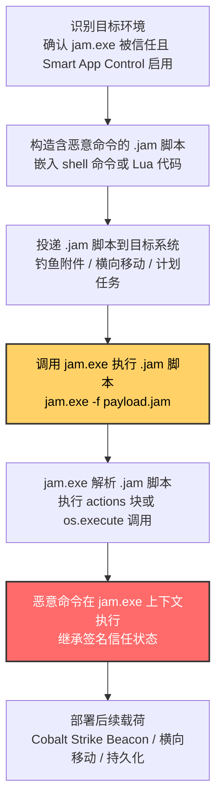
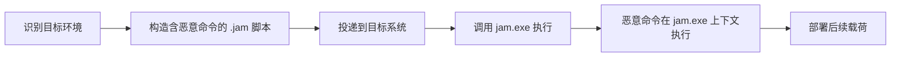

# JamPlus (T1127.003)

## 一句话通俗理解

> **攻击者把恶意代码藏在 JamPlus 的 .jam 脚本里，让被微软信任的 jam.exe 替自己执行——由于 jam.exe 是合法的构建工具，应用控制策略（包括 Windows 11 的 Smart App Control）通常放行，根本不知道脚本里装的是什么**

## 30秒速查卡

| 维度 | 你需要知道的 |
|------|-------------|
| 这是什么？ | 滥用 JamPlus 构建工具（jam.exe），通过 .jam 脚本执行任意代码，绕过应用控制策略 |
| 为什么危险？ | jam.exe 是合法的构建工具，被 Smart App Control 等现代应用控制方案信任；.jam 脚本可执行任意 shell 命令与 Lua 代码 |
| 谁需要关心？ | Windows 11 用户（Smart App Control 启用者）、游戏开发者、SOC 分析师 |
| 你的第一步防御 | 监控 jam.exe 在非开发上下文中的执行（DET0585 / AN1610），关注非开发岗位终端调用 jam.exe、.jam 脚本在用户目录创建 |
| 如果只做一件事 | 在 Smart App Control 启用的终端上，将 jam.exe 加入显式阻断规则，仅允许从已知合法的游戏开发环境调用 |

## 难度等级

⭐⭐⭐ 高级 - 需要深入的技术知识和实践

JamPlus 代理执行属于高级技术，原因在于：

- 攻击者需要熟悉 JamPlus 构建系统与 .jam 脚本格式（Lua 语法扩展）
- 需要理解 Smart App Control 的信任传递机制与 bypass 原理
- 防御方需要区分"合法的 JamPlus 构建脚本"与"恶意的 .jam 载荷"，这要求对游戏开发态行为有深入理解
- 该技术是 ATT&CK v19（2025 年 3 月）新增的子技术，防御社区对其认识尚浅，检测覆盖不足

## 前置知识检查

**读这个文件需要什么？**

- [ ] JamPlus 构建系统基础（基于 Boost.Jam 与 Perforce Jam）
- [ ] .jam 脚本语法（Lua 扩展语法）
- [ ] Windows 11 Smart App Control 信任机制
- [ ] 游戏开发工作流（Unity / Unreal Engine 与 JamPlus 集成）
- [ ] Sysmon 日志事件模型（Event ID 1/7/11）

## 技术描述

**JamPlus**（T1127.003）是 **受信任的开发者实用程序代理执行**（T1127）的一个具体变体，**同时属于隐蔽（TA0005）与执行（TA0002）两个战术**。攻击者利用 JamPlus 构建工具（jam.exe）的脚本执行能力，通过 .jam 脚本执行任意代码，绕过应用控制策略（特别是 Windows 11 的 Smart App Control）。

### 具体怎么理解？

JamPlus 是一个基于 Boost.Jam 与 Perforce Jam 的开源构建系统，广泛用于游戏开发（如某些 AAA 游戏工作室的内部构建流水线）。jam.exe 处理 .jam 脚本（使用 Lua 扩展语法），可执行任意的 shell 命令、文件操作与流程控制。jam.exe 通常由可信发布者签名（如游戏工作室的代码签名证书或开源社区签名），被 Smart App Control 等现代应用控制方案信任。

2024 年 Elastic Security 的研究人员披露，jam.exe 可被滥用于绕过 Windows 11 的 Smart App Control——攻击者只需构造一个含恶意 shell 命令的 .jam 脚本，通过 jam.exe 执行即可。由于 jam.exe 是受信任的签名二进制，Smart App Control 不会拦截其执行；而 .jam 脚本中的 shell 命令（如 `os.execute()`）会在 jam.exe 上下文中执行，继承其签名信任状态。这一发现导致 MITRE 在 ATT&CK v19（2025 年 3 月）中将 JamPlus 滥用正式新增为 T1127.003 子技术。

### 一个最小化的恶意 .jam 脚本

```lua
-- malicious.jam
-- JamPlus 脚本可执行任意 shell 命令与 Lua 代码

actions Calc {
    calc.exe
}

rule RunPayload {
    Calc ;
    -- 也可以通过 os.execute 执行任意命令
    os.execute("powershell.exe -enc <base64_payload>");
}

RunPayload ;
```

执行命令：`jam.exe -f malicious.jam`——jam.exe 解析 .jam 脚本，执行 `RunPayload` 规则，calc.exe 弹出。整个过程没有任何未签名二进制落地，calc.exe 的父进程是受信任的 jam.exe。

### 为什么有效？

这种技术之所以有效，是因为：

1. **签名信任继承**：jam.exe 是受信任的签名二进制（游戏工作室签名或开源社区签名），Smart App Control 等现代应用控制方案将其列入白名单
2. **Smart App Control bypass**：Smart App Control 主要基于微软云端信誉判断应用安全性，jam.exe 作为合法的构建工具具有良好信誉；而 .jam 脚本作为"数据文件"不被 Smart App Control 视为可执行内容
3. **脚本能力强大**：.jam 脚本支持完整的 shell 命令执行（`actions` 块）与 Lua 代码（`os.execute()`、`io.popen()`），可执行任意系统操作
4. **广泛可用性**：JamPlus 是开源工具，可从 GitHub 免费获取；许多游戏开发环境预装 jam.exe
5. **ATT&CK 新增技术**：作为 ATT&CK v19（2025 年 3 月）新增的子技术，防御社区对其认识尚浅，检测覆盖不足

**过渡段：** JamPlus 代理执行的精髓在于"用合法的构建脚本能力掩盖恶意代码执行"——攻击者不需要绕过 Smart App Control，因为 Smart App Control 本身就放行了 jam.exe；只需要构造一个看起来合法的 .jam 脚本，就能让 jam.exe 替自己完成"执行任意 shell 命令"的全过程。

## 真实攻击流程



**步骤详解：**

1. **识别目标环境**
   - 通俗描述：攻击者确认目标启用 Smart App Control 且 jam.exe 被信任
   - 技术细节：通过注册表 `HKLM\SYSTEM\CurrentControlSet\Control\CI\TenantPolicies` 检测 Smart App Control 状态；查询 jam.exe 是否存在于系统路径或游戏开发环境
   - 常用工具：PowerShell、自定义枚举脚本

2. **构造含恶意命令的 .jam 脚本**
   - 通俗描述：把"恶意私货"装进 .jam 脚本的合法外壳里
   - 技术细节：使用 `actions` 块定义 shell 命令，或使用 `os.execute()` / `io.popen()` 调用任意命令
   - 常用工具：文本编辑器、Atomic Red Team T1127.003 模板

3. **投递 .jam 脚本到目标系统**
   - 通俗描述：把"伪装好的脚本文件"送到目标机器
   - 技术细节：通过钓鱼邮件附件、SMB 共享、PowerShell 下载、计划任务触发
   - 常用工具：Cobalt Strike、Empire、自定义投递脚本

4. **调用 jam.exe 执行 .jam 脚本**
   - 通俗描述：让被信任的 jam.exe 替自己"送货上门"
   - 技术细节：命令行 `jam.exe -f payload.jam`，或通过 WMI、计划任务、PowerShell 间接调用
   - 常用工具：cmd.exe、powershell.exe、schtasks.exe、wmic.exe

5. **jam.exe 解析 .jam 脚本**
   - 通俗描述：jam.exe 解析 .jam 脚本，准备执行 actions 块
   - 技术细节：jam.exe 解析 .jam 脚本的 Lua 扩展语法，构建依赖图并执行定义的 actions 块
   - 常用工具：jam.exe 内置解析能力

6. **恶意命令在 jam.exe 上下文执行**
   - 通俗描述：actions 块中的 shell 命令在 jam.exe 上下文执行
   - 技术细节：jam.exe 通过 `system()` 或 `CreateProcess()` 调用 actions 块中的命令，命令在 jam.exe 进程上下文运行，继承其令牌、权限与签名状态
   - 常用工具：Cobalt Strike Beacon、Mimikatz、自定义加载器

7. **部署后续载荷**
   - 通俗描述：站稳脚跟后，开始横向移动与持久化
   - 技术细节：通过 jam.exe 进程发起 C2 通信、转储凭证、横向移动到其他系统
   - 常用工具：Cobalt Strike、Impacket、PowerShell Empire

## 攻击流程

```
识别目标环境 --> 构造含恶意命令的 .jam 脚本 --> 投递到目标系统 --> 调用 jam.exe 执行 --> 恶意命令在 jam.exe 上下文执行 --> 部署后续载荷
```



**步骤详解：**

1. **识别目标环境**
   - 通俗描述：确认目标启用 Smart App Control 且 jam.exe 被信任
   - 技术细节：通过注册表 `HKLM\SYSTEM\CurrentControlSet\Control\CI\TenantPolicies` 检测 Smart App Control 状态；查询 jam.exe 是否存在于系统路径或游戏开发环境
   - 常用工具：PowerShell、自定义枚举脚本

2. **构造含恶意命令的 .jam 脚本**
   - 通俗描述：将恶意 shell 命令包装在 .jam 脚本的 actions 块中
   - 技术细节：使用 `actions <name> { command }` 定义 shell 命令块，或使用 `os.execute()` / `io.popen()` 调用任意命令
   - 常用工具：文本编辑器、Atomic Red Team T1127.003 模板

3. **投递到目标系统**
   - 通俗描述：将 .jam 脚本送达目标
   - 技术细节：通过钓鱼邮件附件、SMB 共享、PowerShell `Invoke-WebRequest` 下载、Cobalt Strike `upload` 命令
   - 常用工具：Cobalt Strike、Empire、自定义投递脚本

4. **调用 jam.exe 执行**
   - 通俗描述：通过命令行触发 jam.exe 解析执行 .jam 脚本
   - 技术细节：直接执行 `jam.exe -f payload.jam`，或通过 WMI `wmic process call create`、计划任务、PowerShell `Start-Process` 间接调用
   - 常用工具：cmd.exe、powershell.exe、schtasks.exe、wmic.exe

5. **恶意命令在 jam.exe 上下文执行**
   - 通俗描述：jam.exe 解析 .jam 脚本并执行 actions 块中的 shell 命令
   - 技术细节：jam.exe 通过 `system()` 或 `CreateProcess()` 调用 actions 块中的命令，命令在 jam.exe 进程上下文运行，继承其令牌、权限与签名状态
   - 常用工具：jam.exe 内置脚本执行能力

6. **部署后续载荷**
   - 通俗描述：恶意命令执行后，部署持久化与横向移动工具
   - 技术细节：在 jam.exe 进程中加载 Cobalt Strike Beacon、调用 Mimikatz 转储凭证、通过 WMI / PsExec 横向移动
   - 常用工具：Cobalt Strike、Mimikatz、Impacket

## 真实案例

### 案例1：Elastic Security 披露 JamPlus 绕过 Smart App Control（2024）

- **时间**：2024 年
- **目标**：Windows 11 终端用户（Smart App Control 启用者）
- **攻击组织**：安全研究披露，未观察到实际 APT 滥用
- **手法**：Elastic Security 的研究人员披露，jam.exe 可被滥用于绕过 Windows 11 的 Smart App Control。研究人员构造了一个含恶意 shell 命令的 .jam 脚本，通过 jam.exe 执行，成功在 Smart App Control 启用的环境中执行任意代码。由于 jam.exe 是受信任的签名二进制，Smart App Control 不会拦截其执行；而 .jam 脚本中的 shell 命令在 jam.exe 上下文中执行，继承其签名信任状态。这一发现促使 MITRE 在 ATT&CK v19（2025 年 3 月）中将 JamPlus 滥用正式新增为 T1127.003 子技术。
- **影响**：披露后该技术被红队与 APT 关注，可能在未来攻击中被滥用
- **参考链接**：[Elastic Security - Smart App Control Bypass](https://www.elastic.co/security-labs)、[MITRE - T1127.003 JamPlus](https://attack.mitre.org/techniques/T1127/003/)

### 案例2：ATT&CK v19 新增 T1127.003 子技术（2025）

- **时间**：2025 年 3 月
- **目标**：ATT&CK 知识库
- **攻击组织**：N/A（知识库更新）
- **手法**：MITRE 在 ATT&CK v19（2025 年 3 月）中正式将 JamPlus 滥用新增为 T1127.003 子技术，归入 T1127 受信任的开发者实用程序代理执行。这一新增反映了安全社区对 JamPlus 滥用风险的认识提升，也促使防御方开始建立针对 jam.exe 的检测与缓解能力。
- **影响**：防御社区开始关注 JamPlus 滥用，检测覆盖逐步建立
- **参考链接**：[MITRE - ATT&CK v19 Release](https://attack.mitre.org/resources/updates/)、[MITRE - T1127.003 JamPlus](https://attack.mitre.org/techniques/T1127/003/)

### 案例3：红队利用 JamPlus 绕过企业应用控制

- **时间**：2024 年起
- **目标**：游戏开发公司与其他部署 jam.exe 的企业
- **攻击组织**：多个红队
- **手法**：红队在针对游戏开发公司的授权评估中，利用 JamPlus 绕过企业部署的 AppLocker / WDAC 策略。由于游戏开发公司广泛使用 JamPlus 作为构建工具，jam.exe 被列入应用控制白名单；红队只需将恶意载荷包装在 .jam 脚本中，通过 jam.exe 执行即可绕过应用控制。这种"利用目标环境特有的受信任工具"的策略，是红队在面对加固环境时的常用手法。
- **影响**：游戏开发公司的应用控制策略被评估为不足
- **参考链接**：[MITRE - T1127.003 JamPlus](https://attack.mitre.org/techniques/T1127/003/)、[JamPlus GitHub](https://github.com/jamplus/jamplus)

## 红队视角

> ⚠️ **免责声明**：以下内容仅用于合法的安全测试、渗透测试和教育目的。未经授权对他人系统进行测试是违法行为。

### 实战技巧

1. **识别目标环境的 jam.exe**：游戏开发公司与某些 AAA 游戏工作室广泛使用 JamPlus，jam.exe 通常预装在开发终端；可通过 `where jam.exe` 或查询 PATH 环境变量识别
2. **构造 .jam 脚本载荷**：使用 `actions` 块定义 shell 命令，或使用 `os.execute()` / `io.popen()` 调用任意命令；可将 Cobalt Strike Beacon 的 PowerShell 一行命令嵌入 actions 块
3. **绕过 Smart App Control**：jam.exe 是受信任的签名二进制，Smart App Control 不会拦截其执行；.jam 脚本作为"数据文件"不被 Smart App Control 视为可执行内容
4. **结合其他 LOLBins**：使用 `mshta.exe`、`wmic.exe` 等其他 LOLBins 间接调用 jam.exe，进一步混淆进程树
5. **利用远程路径**：通过 UNC 路径（`\\server\share\payload.jam`）执行 .jam 脚本，避免文件落地目标系统
6. **混淆 .jam 脚本内容**：使用 Base64 编码、字符串拼接等技术混淆 .jam 脚本中的命令，绕过静态检测规则

### 常用工具

| 工具名称 | 用途 | 平台 | 链接 |
| -------- | ---- | ---- | ---- |
| jam.exe | .jam 脚本解析执行 | Windows | [JamPlus GitHub](https://github.com/jamplus/jamplus) |
| Atomic Red Team | T1127.003 测试模板 | 跨平台 | [Atomic Red Team](https://github.com/redcanaryco/atomic-red-team) |
| Cobalt Strike | Aggressor Script 生成载荷 | Windows | [Cobalt Strike](https://www.cobaltstrike.com/) |
| Empire | 内置脚本执行模块 | Windows | [PowerShell Empire](https://github.com/PowerShellEmpire/Empire) |
| LOLBAS | jam.exe 滥用参考 | 跨平台 | [LOLBAS](https://lolbas-project.github.io/lolbas/) |

### 注意事项

- 在授权的测试环境中使用这些技术
- 注意操作安全（OPSEC），避免被 EDR 检测到 .jam 脚本的命令特征
- 使用匿名化技术和代理隐藏真实身份
- 测试后清理所有 .jam 文件与 jam.exe 进程

## 蓝队视角

### 检测要点

1. **jam.exe 执行上下文异常**：监控 jam.exe 的父进程，识别非开发工具（如 Office 应用、浏览器、邮件客户端）调用 jam.exe 的场景
2. **可疑命令行参数**：识别 jam.exe 命令行中包含用户目录（`C:\Users\`）、临时目录（`C:\Temp\`）、UNC 路径（`\\`）或 `-f` 参数指向非标准路径的场景
3. **可疑子进程派生**：监控 jam.exe 派生 powershell.exe、cmd.exe、rundll32.exe 等高危 LOLBins 的行为
4. **网络连接立即发起**：jam.exe 在执行后短时间内发起出站网络连接（非游戏开发相关 CDN）
5. **.jam 文件在非标准目录创建**：监控 .jam 脚本文件在用户目录、临时目录、启动文件夹中的创建

### 监控建议

- 部署 Sysmon 并配置针对 jam.exe 的进程创建、模块加载、网络连接、文件创建事件采集
- 在 EDR 中建立"JamPlus 开发态行为基线"，对偏离基线的执行场景自动告警
- 配置 SIEM 规则，关联 Sysmon Event ID 1（进程创建）+ Event ID 11（文件创建）+ Event ID 22（DNS 查询）形成行为链检测
- 在 Smart App Control 启用的终端上，将 jam.exe 加入显式阻断规则，仅允许从已知合法的游戏开发环境调用
- 定期审计终端上的 jam.exe 调用日志，识别非开发岗位终端的 jam.exe 执行

## 避坑指南

防御者常见误区：

1. **忽略 JamPlus 滥用**：JamPlus 不如 MSBuild / ClickOnce 知名，许多防御者不知道 jam.exe 可被滥用——应将 jam.exe 纳入 LOLBins 监控范围
2. **依赖 Smart App Control**：jam.exe 是受信任的签名二进制，Smart App Control 不会拦截其执行——必须基于行为链检测
3. **只监控 .jam 扩展名**：JamPlus 也支持其他扩展名（如 .mk），应监控 jam.exe 的所有命令行调用
4. **忽略远程路径执行**：攻击者可通过 UNC 路径 `\\server\share\payload.jam` 执行 .jam 脚本，避免文件落地——应监控 jam.exe 命令行中的 UNC 路径
5. **过度依赖文件签名**：jam.exe 是签名二进制，签名验证无法识别其执行的恶意载荷——必须基于行为链检测

## 检测建议

### 检测思路

检测 JamPlus 代理执行的关键是"行为链分析"（DET0585 / AN1610）——单看 jam.exe 执行本身是合法的构建行为，但如果串联起来看：jam.exe 在非开发上下文中执行 + 命令行包含非规范路径 + 派生高危子进程 + 发起出站网络连接，这一连串行为组合就高度可疑。

### 网络层检测

**方法**：监控 jam.exe 进程发起的出站网络连接

```powershell
# 检测 jam.exe 发起的可疑网络连接（Sysmon Event ID 3）
Get-WinEvent -FilterHashtable @{LogName='Microsoft-Windows-Sysmon/Operational'; ID=3} |
    Where-Object { $_.Message -match '\bjam\.exe\b' } |
    Select-Object TimeCreated, Message -First 50
```

### 主机层检测

**Windows事件ID：**
- Sysmon Event ID 1：进程创建（监控 jam.exe 的父进程与命令行参数）
- Sysmon Event ID 7：Image Loaded（监控 jam.exe 加载未签名 DLL）
- Sysmon Event ID 11：FileCreate（监控 .jam 文件在非标准目录的创建）
- Sysmon Event ID 22：DNS Query（监控 jam.exe 发起的 DNS 解析）
- Event ID 4688：进程创建（Windows 安全审计）

**Linux日志**：本技术仅针对 Windows 平台

```powershell
# 检测 jam.exe 在非开发上下文中执行（DET0585 / AN1610）
Get-WinEvent -FilterHashtable @{LogName='Microsoft-Windows-Sysmon/Operational'; ID=1} |
    Where-Object {
        $_.Message -match 'Image:.*\\jam\.exe' -and
        $_.Message -notmatch 'Program Files\\|GameDevelopment|Unity|Unreal'
    } |
    Select-Object TimeCreated, Message -First 50

# 检测 jam.exe 派生可疑子进程
Get-WinEvent -FilterHashtable @{LogName='Microsoft-Windows-Sysmon/Operational'; ID=1} |
    Where-Object {
        $_.Message -match 'ParentImage:.*\\jam\.exe' -and
        $_.Message -match 'powershell\.exe|cmd\.exe|rundll32\.exe|regsvr32\.exe|wscript\.exe|cscript\.exe'
    } |
    Select-Object TimeCreated, Message -First 50

# 检测 .jam 文件在用户目录创建
Get-WinEvent -FilterHashtable @{LogName='Microsoft-Windows-Sysmon/Operational'; ID=11} |
    Where-Object {
        $_.Message -match '\.jam' -and
        $_.Message -match '\\Users\\|\\Temp\\|\\AppData\\'
    } |
    Select-Object TimeCreated, Message -First 50
```

### 应用层检测

**Sigma规则示例**：

```yaml
title: JamPlus 代理执行检测（DET0585 / AN1610）
id: f6a7b8c9-d0e1-4b2f-cdef-345678901234
status: experimental
description: 检测 jam.exe 在非开发上下文中执行并派生高危子进程，或 .jam 脚本在非标准目录创建，对应 T1127.003 JamPlus 代理执行攻击
references:
    - https://attack.mitre.org/techniques/T1127/003/
    - https://attack.mitre.org/detectionstrategies/DET0585
    - https://www.elastic.co/security-labs
author: ATT&CK知识库
date: 2026/07/24
logsource:
    product: windows
    service: sysmon
detection:
    selection_jam_exec:
        EventID: 1
        Image|endswith: '\jam.exe'
    filter_dev_context:
        ParentImage|contains:
            - '\Program Files\'
            - '\GameDevelopment\'
            - '\Unity\'
            - '\Unreal\'
            - '\devenv.exe'
    selection_suspicious_commandline:
        CommandLine|contains:
            - '\Users\'
            - '\Temp\'
            - '\AppData\'
            - '\\\\'
            - 'base64'
    selection_jam_child:
        EventID: 1
        ParentImage|endswith: '\jam.exe'
        Image|endswith:
            - '\powershell.exe'
            - '\cmd.exe'
            - '\rundll32.exe'
            - '\regsvr32.exe'
            - '\wscript.exe'
            - '\cscript.exe'
    selection_jam_file:
        EventID: 11
        TargetFilename|endswith: '.jam'
        TargetFilename|contains:
            - '\Users\'
            - '\Temp\'
            - '\AppData\'
    condition: (selection_jam_exec and not filter_dev_context) or selection_jam_child or selection_jam_file
falsepositives:
    - 合法的 JamPlus 构建脚本在非标准路径调用 jam.exe（需建立基线白名单）
    - 游戏开发团队在开发终端上调用 jam.exe（应单独建模）
level: high
tags:
    - attack.t1127
    - attack.t1127.003
    - attack.defense_evasion
    - attack.execution
```

## 缓解措施

### 优先级1：关键措施

**措施名称：** 在非开发系统中通过 WDAC 阻断 jam.exe

**具体实施步骤：**
1. 评估企业终端的 jam.exe 使用需求，对非游戏开发岗位终端通过 WDAC 策略阻断 jam.exe 执行
2. 在 Smart App Control 启用的终端上，将 jam.exe 加入显式阻断规则，仅允许从已知合法的游戏开发环境调用
3. 部署 WDAC 策略后，通过 CI/CD 系统集中完成构建任务，避免在终端上调用 jam.exe

```powershell
# 检查 jam.exe 的存在位置
where.exe jam.exe 2>$null
Get-ChildItem -Path "C:\Program Files" -Filter "jam.exe" -Recurse -ErrorAction SilentlyContinue
Get-ChildItem -Path "C:\Program Files (x86)" -Filter "jam.exe" -Recurse -ErrorAction SilentlyContinue
```

### 优先级2：重要措施

**措施名称：** 在开发系统中建立上下文敏感的执行白名单

**具体实施步骤：**
1. WDAC 策略中不仅基于文件名/签名放行 jam.exe，还需结合父进程（如仅允许 devenv.exe / Unity.exe / Unreal.exe / CI Agent 调用 jam.exe）
2. 启用 AppLocker 的 DLL 规则集合，监控并阻断 jam.exe 加载非系统目录下的未签名 DLL
3. 配置 Sysmon 配置文件，专门记录 jam.exe 的执行、子进程派生、模块加载、网络连接事件
4. 在 EDR 中建立"JamPlus 开发态行为基线"，对偏离基线的执行场景自动告警

### 优先级3：建议措施

**措施名称：** 审计与监控 .jam 脚本

**具体实施步骤：**
1. 对游戏开发团队的 .jam 脚本进行审计，识别使用 `actions` 块或 `os.execute()` 的脚本
2. 建立"合法 .jam 脚本基线"，对偏离基线的 .jam 脚本进行人工审查
3. 教育开发者识别钓鱼式 .jam 文件，避免打开不可信来源的脚本文件
4. 在源代码仓库中审计所有 .jam 文件的变更历史

### MITRE ATT&CK 缓解措施映射

| 缓解措施ID | 缓解措施名称 | 适用性 | 说明 |
|------------|-------------|--------|------|
| M1042 | 禁用或移除功能或程序 | 适用 | 在非游戏开发系统中移除 jam.exe 或通过 WDAC 阻断 |
| M1038 | 执行防护 | 适用 | 通过 WDAC 阻断规则显式拒绝 jam.exe，仅允许在游戏开发上下文中执行 |

## 动手实验

> ⚠️ **所有实验必须在隔离的实验室环境中进行**

### 实验1：JamPlus 脚本基础（初级）

**目标**：理解 JamPlus 脚本的工作原理，观察 jam.exe 如何解析并执行 .jam 脚本

**步骤**：
1. 从 [JamPlus GitHub](https://github.com/jamplus/jamplus) 下载 jam.exe，或在实验虚拟机中确认 jam.exe 位置
2. 创建测试脚本 `payload.jam`：
   ```lua
   actions Calc {
       calc.exe
   }

   rule RunPayload {
       Calc ;
   }

   RunPayload ;
   ```
3. 执行命令：`jam.exe -f payload.jam`
4. 观察 calc.exe 是否弹出，其父进程应为 jam.exe
5. 通过 ProcMon 查看 jam.exe 的进程树与文件访问行为
6. 检查 Sysmon Event ID 1，确认父进程关系被记录

**预期结果**：calc.exe 弹出，父进程为 jam.exe

**学习要点**：理解 JamPlus 脚本如何被滥用执行任意 shell 命令

### 实验2：JamPlus 加载 Shellcode（中级）

**目标**：掌握通过 .jam 脚本加载 Shellcode 的方法，理解无文件落地攻击

**步骤**：
1. 使用 msfvenom 生成测试 Shellcode：
   ```bash
   msfvenom -p windows/x64/exec CMD=calc.exe -f raw -o shellcode.bin
   ```
2. 构造 .jam 脚本，通过 `os.execute()` 调用 PowerShell 加载 Shellcode：
   ```lua
   actions RunShellcode {
       powershell.exe -enc <base64_encoded_ps_payload>
   }

   rule Main {
       RunShellcode ;
   }

   Main ;
   ```
3. 执行 `jam.exe -f shellcode_loader.jam`
4. 观察 Shellcode 是否在 jam.exe 进程中执行
5. 通过 Process Hacker 查看 jam.exe 进程内存中的可执行区域

**预期结果**：Shellcode 在 jam.exe 进程内存中执行

**学习要点**：掌握 .jam 脚本加载 Shellcode 的方法

### 实验3：Smart App Control Bypass 验证（高级）

**目标**：验证 JamPlus 绕过 Windows 11 Smart App Control 的有效性

**步骤**：
1. 在 Windows 11 实验虚拟机中启用 Smart App Control（设置 → 隐私和安全性 → Windows 安全中心 → 应用和浏览器控制 → Smart App Control）
2. 尝试执行一个未签名的测试 exe，确认 Smart App Control 阻断
3. 执行实验1 的 .jam 脚本（`jam.exe -f payload.jam`），观察是否被 Smart App Control 阻断
4. 如果 jam.exe 被允许执行，确认 calc.exe 是否成功弹出
5. 通过 Sysmon 日志分析 Smart App Control 的拦截行为

**预期结果**：Smart App Control 阻断未签名 exe，但允许 jam.exe 执行 .jam 脚本

**学习要点**：理解 Smart App Control 的信任传递机制与 bypass 原理

## 术语解释

| 术语 | 通俗解释 |
|------|---------|
| **JamPlus** | 基于 Boost.Jam 与 Perforce Jam 的开源构建系统，广泛用于游戏开发 |
| **jam.exe** | JamPlus 构建工具的可执行文件，解析 .jam 脚本并执行构建任务 |
| **.jam 脚本** | JamPlus 构建脚本，使用 Lua 扩展语法，可执行 shell 命令与 Lua 代码 |
| **actions 块** | .jam 脚本中定义 shell 命令的语法块，由 jam.exe 通过 system() 调用 |
| **Smart App Control** | Windows 11 引入的应用控制方案，基于微软云端信誉判断应用安全性 |
| **WDAC** | Windows Defender Application Control，微软基于内核的应用控制方案 |
| **AppLocker** | Windows 应用控制功能，基于规则限制可执行文件、脚本、安装包运行 |
| **LOLBins** | "生活在陆地上的二进制文件"——被攻击者滥用的系统自带合法工具 |
| **行为链检测** | 通过串联多个相关行为事件进行检测的方法，弥补单事件检测的不足 |
| **ATT&CK v19** | MITRE ATT&CK 知识库 2025 年 3 月发布版本，新增 T1127.003 JamPlus 子技术 |

## 被引用情况

以下父技术文档引用了本子技术：

- [T1127 - 受信任的开发者实用程序代理执行](../T1127-Trusted-Developer-Utilities-Proxy-Execution.md)

## 参考资料

### 官方文档（深入了解）

- [MITRE ATT&CK - T1127.003 JamPlus](https://attack.mitre.org/techniques/T1127/003/)
- [MITRE ATT&CK - T1127 Trusted Developer Utilities Proxy Execution](https://attack.mitre.org/techniques/T1127/)
- [MITRE ATT&CK - DET0585 Detection Strategy](https://attack.mitre.org/detectionstrategies/DET0585)
- [MITRE ATT&CK - v19 Release Notes](https://attack.mitre.org/resources/updates/)

### 安全报告（真实攻击）

- [Elastic Security Labs](https://www.elastic.co/security-labs) - Smart App Control Bypass 研究披露
- [MITRE - T1127.003 JamPlus](https://attack.mitre.org/techniques/T1127/003/) - ATT&CK 官方技术页面

### 工具与资源（动手试试）

- [JamPlus GitHub](https://github.com/jamplus/jamplus) - JamPlus 开源仓库
- [LOLBAS](https://lolbas-project.github.io/lolbas/) - LOLBins 滥用方式参考
- [Microsoft - Smart App Control](https://support.microsoft.com/en-us/topic/smart-app-control-in-windows-11-f6f6a5d4-3a7e-4b6b-9c9c-4f3a7e9b8c8a) - Smart App Control 官方文档
- [Microsoft Recommended Block Rules](https://docs.microsoft.com/windows/security/threat-protection/windows-defender-application-control/microsoft-recommended-block-rules) - WDAC 推荐阻断规则
- [Atomic Red Team - T1127.003](https://atomicredteam.io/) - 可执行的检测测试用例
- [MITRE ATT&CK Navigator](https://mitre-attack.github.io/attack-navigator/) - ATT&CK 可视化工具

### 学习资料（深入了解）

- [MITRE ATT&CK 知识库](https://attack.mitre.org/resources/) - ATT&CK 官方资源中心
