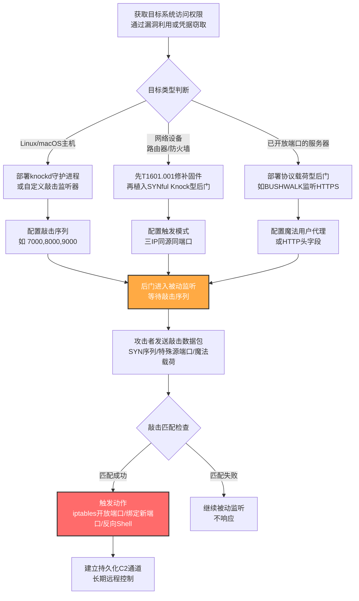

# 端口敲击 (T1205.001)

## 一句话通俗理解

就像在密码门上输入"暗号"——你必须按特定顺序触碰几个特定的关闭端口，门（防火墙规则）才会为你打开；不知暗号的人怎么看都只是几个被拒绝的连接。

## 30秒速查卡

| 维度 | 你需要知道的 |
|------|-------------|
| 这是什么？ | 按预定义顺序向一组关闭端口发送连接尝试（通常是SYN包），触发防火墙动态开放端口或激活后门功能 |
| 为什么危险？ | 端口扫描只看到一堆被拒绝的连接，与正常网络扫描无异；隐藏的"真实服务"端口完全隐形，直到敲击序列正确 |
| 谁需要关心？ | Linux/macOS系统管理员、网络设备管理员（路由器/防火墙）、SOC分析师 |
| 你的第一步防御 | 在边界防火墙启用状态检测识别敲击序列；监控iptables/PF/WFP规则变更与新端口监听的关联 |
| 如果只做一件事 | 部署检测规则：同一源IP在30秒内向3个以上关闭端口发送SYN→RST连接，随后宿主防火墙规则被修改或新进程开始监听端口 |

## 难度等级

⭐⭐⭐ 高级（需要熟悉防火墙规则与网络协议）

端口敲击虽然是流量信令中最"经典"的实现方式，但攻击者要正确部署一个隐蔽的端口敲击后门仍需具备以下能力：

- 熟悉iptables/nftables/ufw（Linux）、PF（macOS/BSD）、Windows Filtering Platform（WFP）的规则语法与持久化机制
- 理解TCP三次握手与RST响应机制——敲击通常使用SYN包触发RST，因为它轻量、不建立完整连接、难以被检测
- 在网络设备上实施需要先获取设备级权限，并完成"修补系统镜像"（T1601.001）以持久化后门
- 高级变体（如SYNful Knock）使用同源IP同时连接接口IP/广播IP/网络地址IP的复杂模式，需要理解网络设备控制平面流量处理逻辑

## 前置知识检查

**读这个文件需要什么？**

- [ ] TCP三次握手与RST（连接重置）响应机制
- [ ] SYN包格式与`tcpflags=syn`在knockd配置中的含义
- [ ] Linux iptables/nftables规则匹配语法（`-p tcp --dport`、`-j ACCEPT/DROP`）
- [ ] macOS/BSD的PF（Packet Filter）防火墙配置
- [ ] Windows Filtering Platform（WFP）与`netsh wfp`命令
- [ ] Cisco IOS的`ip access-list`与Juniper JunOS的`firewall filter`配置
- [ ] knockd守护进程的工作原理与配置文件格式

## 技术描述

端口敲击（Port Knocking, T1205.001）是流量信令（T1205）最经典、最广为人知的子技术。攻击者向目标系统发送一系列预定义的连接尝试（通常是到一组关闭端口的SYN包），当连接序列匹配预定义的"敲击模式"时，目标系统触发特定动作——通常是动态开放一个端口（如SSH 22端口）、修改防火墙规则或激活后门功能。

**通俗解释：**

想象一栋大厦的后门——它没有门铃、没有把手、看起来就是一面墙。但是这面墙上藏着5个看似装饰的"按钮"（对应5个关闭端口）。你必须按特定顺序触摸这5个按钮（比如"按钮3→按钮1→按钮5→按钮2→按钮4"），后门才会突然打开。任何不知顺序的人在墙外怎么摸都摸不出门来，外人路过也只看到有人在一面墙上乱摸——这正是端口敲击的核心：用一组看似"被拒绝的连接尝试"作为激活后门的暗号。

**为什么隐蔽？**

- 从网络层看：敲击是到关闭端口的SYN包，目标会回复RST（连接重置），这与正常网络扫描（nmap、masscan）行为无异，难以区分
- 从主机层看：在敲击序列完成前，没有任何监听端口或服务进程暴露给外部，netstat/ss/lsof都看不见后门
- 从流量分析看：敲击包载荷为空或随机，没有明显的协议特征，看起来就是失败的连接尝试

**过渡段：** 端口敲击本质上是"序列→动作"的映射机制。它有两种主要实现方式：基于防火墙规则的传统实现（如knockd）和基于自定义后门的实现（如SYNful Knock）。前者修改防火墙规则开放端口，后者直接绑定新端口或激活反向Shell。下面我们看看具体的攻击流程。

**技术原理：**

### 一、传统端口敲击（knockd型）

最经典的实现。攻击者在Linux上部署`knockd`守护进程，它监听网络接口上的所有流量（使用libpcap），当检测到匹配预配置端口序列的SYN包时，执行预定义的shell命令——通常是`iptables -A INPUT -s %IP% -p tcp --dport 22 -j ACCEPT`开放SSH端口给敲击来源IP。`knockd`是合法工具，本用于远程管理，但被APT组织（如PROMETHIUM）滥用于C2持久化。变体包括：
- **加密端口敲击**：在敲击包载荷中放入加密数据（如SPA - Single Packet Authorization），更难被检测但需要更复杂的实现
- **基于UDP/ICMP的敲击**：使用UDP或ICMP包代替TCP SYN，进一步降低特征

### 二、网络设备级端口敲击（SYNful Knock型）

针对Cisco IOS/Juniper JunOS等网络设备的实现。攻击者必须先通过T1601.001修补设备固件镜像，植入后门模块。后门通过特殊构造的SYN包激活，典型模式是攻击者从同一源IP同时向路由器的接口IP、广播IP和网络地址IP发送连接尝试（例如同时尝试`1.1.1.1:23`、`1.1.1.255:23`、`1.1.1.0:23`），这种"三IP同源同端口"模式触发后门激活telnet服务或绕过设备认证。激活后攻击者可以通过特殊数据包动态加载新功能模块，实现模块化扩展。

### 三、源端口/源IP型敲击

变体实现。某些后门（如Kobalos）使用特定的源端口作为触发条件，而非端口序列。例如，Kobalos在受感染的高性能计算集群上监听特定源端口（如32821）的连接，匹配后激活Kobalos远程Shell。这种方式更简单，但隐蔽性略低于序列敲击。

### 四、协议载荷型敲击

高级变体。后门监听已开放端口上的合法协议流量，通过检查协议载荷中的魔法值触发。例如BUSHWALK（UNC3886使用）在已开放的HTTPS端口上监听，匹配特定的用户代理字符串或HTTP头字段后激活反向Shell。这种方式将敲击"叠加"在合法服务上，更难被防火墙日志识别。

**用途与影响：**

端口敲击是攻击者在**需要远程访问但又想完全隐藏服务**的场景下的首选技术。它的价值在于：**强隐蔽性**（敲击前的端口扫描完全看不见后门）、**精准控制**（只有持有敲击序列的攻击者能激活）、**易于实现**（knockd是现成工具）。从PROMETHIUM滥用knockd到SYNful Knock攻击Cisco路由器，从Kobalos感染超算集群到BUSHWALK隐藏在HTTPS中，端口敲击已成为APT在网络设备与Linux服务器持久化的"标配"。

## 真实攻击流程

### 典型攻击流程

```
获取目标系统访问权限 --> 部署knockd或自定义端口敲击后门 --> 配置敲击序列与触发动作 --> 攻击者发送敲击数据包 --> 防火墙规则变更或后门激活 --> 建立持久化C2通道
```



**步骤详解：**

1. **获取目标系统访问权限**
   - 通俗描述：攻击者先要"进门"一次——通过漏洞利用或窃取的凭据登录目标系统，把端口敲击后门装上去
   - 技术细节：利用外部远程服务漏洞（T1190）、有效账户（T1078）或横向移动技术（T1021）获取初始访问权限，然后部署后门并配置为开机自启动（T1547）
   - 常用工具：漏洞利用框架、SSH爆破、Cobalt Strike Beacon

2. **部署knockd或自定义端口敲击后门**
   - 通俗描述：把"暗号门铃"装到目标系统里
   - 技术细节：在Linux上`apt install knockd`并修改`/etc/knockd.conf`配置敲击序列；在网络设备上通过T1601.001修补固件植入SYNful型后门模块；自定义后门则使用libpcap监听流量并匹配预定义序列
   - 常用工具：knockd、BPFDoor、SYNful Knock、BUSHWALK、Kobalos

3. **配置敲击序列与触发动作**
   - 通俗描述：设定暗号本身和暗号对上后做什么
   - 技术细节：在knockd配置文件中定义`sequence = 7000,8000,9000`和`command = iptables -A INPUT -s %IP% -p tcp --dport 22 -j ACCEPT`；SYNful Knock定义三IP同源同端口模式；BUSHWALK定义特定User-Agent字符串
   - 常用工具：knockd配置文件、BPF字节码、自定义后门配置

4. **攻击者发送敲击数据包**
   - 通俗描述：从外部按暗号敲门
   - 技术细节：使用`knock <目标IP> 7000 8000 9000`命令发送SYN包序列；对于SYNful Knock使用脚本同时向三IP发包；对于Kobalos使用`nc -p 32821 <目标IP> <端口>`指定源端口
   - 常用工具：knock客户端、sendip、scapy、hping3、netcat

5. **防火墙规则变更或后门激活**
   - 通俗描述：暗号对上后门开了
   - 技术细节：knockd执行`iptables -A`命令添加ACCEPT规则，开放22端口给敲击来源IP；SYNful Knock后门加载telnet服务模块；BUSHWALK fork子进程执行反向Shell；某些后门还会在指定时间后自动关闭端口（"自毁"机制）
   - 常用工具：iptables/nftables、bash反弹Shell、Cobalt Strike

6. **建立持久化C2通道**
   - 通俗描述：站稳脚跟后开始长期潜伏
   - 技术细节：通过新开放的端口建立加密C2通道；由于敲击后门本身不持久监听，每次C2断开后需要重新敲击激活；为提升便利性，攻击者常配合T1547自启动机制使后门重启后仍能响应敲击
   - 常用工具：Cobalt Strike、自定义HTTPS C2、Protocol Tunneling（T1572）

## 父技术

**本子技术属于**：[流量信令 (T1205)](../T1205-Traffic-Signaling.md)

流量信令（T1205）是同时属于隐蔽（TA0005）、持久化（TA0003）和命令与控制（TA0011）三个战术的技术。端口敲击（T1205.001）是其最经典的实现方式，通过关闭端口的连接序列触发动作。父技术还包含另一个子技术——套接字过滤器（T1205.002），它使用libpcap/BPF实现更隐蔽的被动监听。

## 检测建议

**用人话说：** 端口敲击的检测核心是"识别敲击序列+规则变更的组合模式"——单看任何一个信号都不可疑（端口扫描天天有，防火墙规则变更也是常规运维），但**短时间内两者同时发生且来自同一来源IP**就高度可疑。对于网络设备，则要监控"同源IP同时连接接口IP/广播IP/网络地址IP的同一端口"这一SYNful Knock典型模式。

### 网络层检测

**检测方法：** 监控网络流量中的端口敲击模式——同一源IP在短时间内（如10秒）按顺序尝试连接多个关闭端口（SYN→RST或ICMP unreachable），随后该IP成功建立TCP/UDP连接到新开放的端口。对于网络设备，特别关注同源IP同时连接设备接口IP、广播IP和网络地址IP的同一端口（这是SYNful Knock的典型模式）。

**网络层异常特征：**
- 同一源IP在30秒内向5个以上关闭端口发送SYN包，全部收到RST响应
- 敲击序列完成后，短时间内（如5秒内）该源IP成功建立连接到新端口
- 同一源IP同时向`X.X.X.X`、`X.X.X.255`、`X.X.X.0`的同一端口发送连接（SYNful Knock模式）
- UDP广播包载荷以6字节0xFF开头（Wake-on-LAN魔法包）

### 主机层检测

**Linux/macOS事件：**
- 监控iptables/nftables/ufw/PF规则变更：
  ```bash
  sudo iptables-save | diff - <(sudo iptables-save)
  sudo nft list ruleset
  sudo pfctl -sr
  ```
- 监控knockd服务启动与配置文件变更：
  ```bash
  systemctl status knockd
  sudo stat /etc/knockd.conf
  ```
- 监控`/dev/bpf*`设备文件的访问（knockd使用libpcap）
- 监控新创建的原始套接字（`socket(AF_PACKET, SOCK_RAW, ...)`）

**Windows事件：**
- Sysmon Event ID 3：Network Connection（关注短时间内多个失败连接后紧跟成功连接的模式）
- 监控Windows Filtering Platform（WFP）规则变更：
  ```powershell
  netsh wfp show state
  ```
- 监控新进程开始监听端口（Sysmon Event ID 3 状态为Listen）

**网络设备日志：**
- 监控Cisco IOS的`show logging`中短时间内多个`%SEC-6-IPACCESSLOGP`拒绝日志
- 监控Juniper JunOS的防火墙过滤器日志
- 监控Fortinet FortiOS的`log traffic`中关闭端口的连接尝试序列
- 监控设备配置变更：`show configuration | compare`

**具体命令示例：**

```bash
# Linux: 检测knockd服务状态
systemctl status knockd 2>/dev/null
ps aux | grep -i knock

# Linux: 检测iptables规则最近变更
sudo iptables-save | head -50
sudo stat /etc/iptables/rules.v4 2>/dev/null
sudo journalctl -u netfilter-persistent --since "1 hour ago"

# Linux: 检测BPF设备文件访问（knockd需要打开/dev/bpf*）
sudo lsof /dev/bpf0 2>/dev/null
sudo cat /proc/net/packet  # 列出所有打开AF_PACKET套接字的进程

# macOS: 检测PF规则变更
sudo pfctl -sr 2>/dev/null
sudo ls -la /etc/pf.anchors/

# 网络设备: 检测Cisco IOS上的SYNful Knock指标
show ip sockets
show tcp brief all
show running-config | include ^(ip access-list|line vty)
show platform  # 检查固件完整性
```

```powershell
# Windows: 检测WFP规则变更
netsh wfp show state 2>$null | Select-String "filterName|providerName"

# Windows: 监控Sysmon Event ID 3中失败连接后成功连接的模式
Get-WinEvent -FilterHashtable @{LogName='Microsoft-Windows-Sysmon/Operational'; ID=3} |
    Where-Object { $_.Message -match 'RST|rejected' } |
    Select-Object TimeCreated, Message -First 20

# Windows: 检测新进程监听端口
Get-NetTCPConnection -State Listen | 
    Where-Object { $_.CreationTime -gt (Get-Date).AddHours(-1) }
```

### 应用层检测

**检测要点：**

1. **端口敲击序列检测（最核心）**
   - 日志来源：防火墙日志、IDS/IPS告警、NetFlow
   - 关注字段：源IP、目的端口、连接结果（RST/ICMP unreachable）、时间戳
   - 异常特征：同一源IP在10-30秒内向3-5个以上关闭端口按顺序发送SYN包，且全部被拒绝
   - 后续行为：随后短时间内（5-30秒）同一源IP成功建立连接到新端口

2. **防火墙规则变更检测**
   - 日志来源：iptables审计日志、WFP日志、设备配置变更日志
   - 关注字段：规则添加时间、新规则允许的端口、添加规则的进程/用户
   - 异常特征：规则添加后短时间内有外部IP成功连接到新开放端口，且添加规则的进程不是已知管理工具（如ansible、puppet）

3. **knockd服务异常检测**
   - 日志来源：systemd日志、进程列表
   - 关注字段：服务启动时间、配置文件路径、监听接口
   - 异常特征：非预期时间knockd服务启动；配置文件被修改；knockd运行在非管理网段

4. **网络设备三IP同源同端口检测**
   - 日志来源：网络设备Syslog、NetFlow
   - 关注字段：源IP、目的IP、目的端口、时间戳
   - 异常特征：同一源IP在3秒内同时连接`X.X.X.X:port`、`X.X.X.255:port`、`X.X.X.0:port`（接口IP/广播IP/网络地址IP）

5. **Wake-on-LAN魔法包检测**
   - 日志来源：网络流量监控
   - 关注字段：UDP广播包、目的端口（7或9）、载荷前6字节
   - 异常特征：UDP广播包载荷以`FF FF FF FF FF FF`开头（6字节0xFF后跟16次MAC地址）

## 检测规则示例

### Sigma规则：检测端口敲击序列与防火墙规则变更关联（Linux）

```yaml
title: 可疑端口敲击后防火墙规则变更检测
id: a1b2c3d4-e5f6-4a7b-8c9d-0e1f2a3b4c5d
status: experimental
description: 检测同一源IP在短时间内触碰多个关闭端口后，宿主iptables/nftables规则被修改的行为，可能表明T1205.001端口敲击激活
references:
    - https://attack.mitre.org/techniques/T1205/001/
    - https://attack.mitre.org/techniques/T1205/
    - https://attack.mitre.org/detectionstrategies/DET0524
author: ATT&CK知识库
date: 2026/07/24
logsource:
    product: linux
    service: auditd
detection:
    selection_knock_sequence:
        type: SYSCALL
        syscall: connect
        success: 'false'
    timeframe: 30s
    condition: selection_knock_sequence | count() by src_ip > 5
falsepositives:
    - 合法的端口扫描工具（如nmap）配合人工运维操作
    - 自动化监控系统对多端口的健康检查
level: high
tags:
    - attack.t1205
    - attack.t1205.001
    - attack.stealth
    - attack.persistence
    - attack.command_and_control
```

### Sigma规则：检测knockd服务异常启动

```yaml
title: knockd端口敲击守护进程异常启动检测
id: e5f6a7b8-c9d0-4e1f-2a3b-4c5d6e7f8091
status: experimental
description: 检测knockd服务在非预期时间启动或配置文件被修改，可能表明攻击者部署端口敲击后门
references:
    - https://attack.mitre.org/techniques/T1205/001/
author: ATT&CK知识库
date: 2026/07/24
logsource:
    product: linux
    service: systemd
detection:
    selection_service_start:
        message|contains: 'knockd'
        state: 'started'
    selection_config_modify:
        path: '/etc/knockd.conf'
        action: 'modified'
    condition: selection_service_start or selection_config_modify
falsepositives:
    - 管理员合法部署knockd用于远程管理
    - 系统初始化脚本配置knockd
level: medium
tags:
    - attack.t1205
    - attack.t1205.001
    - attack.persistence
```

### Sigma规则：检测SYNful Knock三IP同源同端口模式

```yaml
title: 网络设备SYNful Knock三IP同源同端口检测
id: f6a7b8c9-d0e1-4f2a-3b4c-5d6e7f80912a
status: experimental
description: 检测同一源IP在短时间内同时连接网络设备接口IP/广播IP/网络地址IP的同一端口，是SYNful Knock后门的典型激活模式
references:
    - https://attack.mitre.org/techniques/T1205/001/
    - https://cloud.google.com/blog/topics/threat-intelligence/synful-knock-acis/
author: ATT&CK知识库
date: 2026/07/24
logsource:
    product: firewall
detection:
    selection_three_ip:
        dst_port: 23  # telnet端口，SYNful Knock常激活telnet
        protocol: tcp
    timeframe: 3s
    condition: selection_three_ip | count() by src_ip > 3
falsepositives:
    - 网络管理工具同时测试多个IP的连通性
    - 自动化网络发现脚本
level: high
tags:
    - attack.t1205
    - attack.t1205.001
    - attack.persistence
```

### Sigma规则：检测Wake-on-LAN魔法包

```yaml
title: 非预期网段Wake-on-LAN魔法包检测
id: d4e5f6a7-b8c9-4d0e-1f2a-3b4c5d6e7f80
status: experimental
description: 检测UDP广播包载荷以6字节0xFF开头（Wake-on-LAN魔法包格式），出现在非预期场景可能表明T1205相关活动（如Ryuk勒索软件唤醒离线设备）
references:
    - https://attack.mitre.org/techniques/T1205/
    - https://www.bleepingcomputer.com/news/security/ryuk-ransomware-uses-wake-on-lan-to-encrypt-offline-devices/
author: ATT&CK知识库
date: 2026/07/24
logsource:
    product: firewall
detection:
    selection_wol_packet:
        dst_port: 7  # 或9，常见的WoL端口
        protocol: udp
    filter_broadcast_legitimate:
        dst_ip: '255.255.255.255'
    condition: selection_wol_packet
falsepositives:
    - 企业IT运维使用WoL远程唤醒员工电脑
    - 自动化补丁部署系统在非工作时间唤醒设备
level: low
tags:
    - attack.t1205
    - attack.lateral_movement
```

## 缓解措施

### 优先级1：关键措施

**措施名称：** 部署状态检测防火墙识别敲击序列

**具体实施步骤：**
1. 在网络边界部署状态检测防火墙（Stateful Firewall），它能跟踪连接状态，识别同一源IP的连续连接尝试模式
2. 配置防火墙规则限制单个源IP在短时间内的最大连接尝试次数（如30秒内不超过20个不同端口）
3. 启用防火墙的"端口扫描检测"功能（如Cisco ASA的`threat basic-threat`、iptables的`recent`模块）
4. 对内部网络设备实施CoPP（Control Plane Policing），限制发往设备CPU的管理流量速率

### 优先级2：重要措施

**措施名称：** 加固网络设备固件与监控配置变更

**具体实施步骤：**
1. 对Cisco/Juniper/Fortinet设备启用固件完整性校验（如Cisco的SXP、Juniper的secure boot），防止T1601.001固件修补
2. 部署网络设备配置变更监控（如RANCID、Oxidized），对任何配置变更告警
3. 禁用网络设备上不必要的服务（telnet、FTP、HTTP管理），强制使用SSH/HTTPS
4. 限制设备管理接口的访问源IP，配置ACL仅允许跳板机访问
5. 定期检查网络设备的`show platform`、`show version`等命令输出，对比固件哈希

### 优先级3：建议措施

**措施名称：** 限制knockd部署与监控libpcap使用

**具体实施步骤：**
1. 在企业Linux/macOS基线上明确禁止部署knockd（除非有明确业务需求并经过安全审批）
2. 使用AppArmor/SELinux限制哪些进程可以打开`/dev/bpf*`设备和创建`AF_PACKET`套接字
3. 部署auditd审计规则监控`setsockopt`、`socket(AF_PACKET)`等关键系统调用
4. 在主机层安装EDR agent，监控iptables/nftables规则变更与新进程监听端口的关联

### MITRE ATT&CK 缓解措施映射

| 缓解措施ID | 缓解措施名称 | 适用性 | 说明 |
|------------|-------------|--------|------|
| M1037 | 过滤网络流量 | 适用 | 部署状态检测防火墙可识别敲击序列，缓解端口敲击变体 |

## 动手实验

> ⚠️ **重要提示**：所有实验必须在隔离的实验室环境中进行，禁止对未授权的真实系统进行测试。端口敲击后门极易绕过检测，请确保实验网络与生产网络完全隔离。

### 实验环境准备

**所需工具：**
- 两台Linux虚拟机（一台作为攻击机，一台作为目标机，Ubuntu 22.04+）
- `knockd`软件包（`apt install knockd`）
- `tcpdump`与`Wireshark`（流量分析）
- `auditd`与`auditctl`（系统调用审计）
- `iptables`/`nftables`（防火墙配置）
- `knock`客户端（`apt install knockd`自带）

### 实验1：knockd端口敲击基础（初级）

**实验目标：** 理解T1205.001端口敲击的原理，观察"敲击序列→端口开放"的完整流程

**实验步骤：**
1. 在目标机上安装并配置`knockd`：
   ```bash
   sudo apt install knockd
   sudo vim /etc/knockd.conf
   ```
   配置内容：
   ```ini
   [openSSH]
   sequence    = 7000,8000,9000
   seq_timeout = 15
   command     = /sbin/iptables -A INPUT -s %IP% -p tcp --dport 22 -j ACCEPT
   tcpflags    = syn

   [closeSSH]
   sequence    = 9000,8000,7000
   seq_timeout = 15
   command     = /sbin/iptables -D INPUT -s %IP% -p tcp --dport 22 -j ACCEPT
   tcpflags    = syn
   ```
2. 启动`knockd`服务：`sudo systemctl start knockd`
3. 确认目标机22端口默认被iptables拒绝：`sudo iptables -A INPUT -p tcp --dport 22 -j DROP`
4. 在攻击机上尝试直接SSH，应失败
5. 在攻击机上执行敲击：`knock <目标IP> 7000 8000 9000`
6. 立即再次尝试SSH，应成功
7. 在目标机上用`tcpdump -i any port 7000 or port 8000 or port 9000`观察敲击数据包
8. 检查iptables规则：`sudo iptables -L INPUT -n`，确认22端口的ACCEPT规则已添加
9. 清理：`knock <目标IP> 9000 8000 7000`关闭端口

**预期结果：** 敲击序列完成后iptables自动添加ACCEPT规则，SSH连接成功；逆向敲击后规则被删除

**学习要点：** 理解端口敲击的"序列→动作"映射机制，以及它为何对端口扫描隐形

### 实验2：模拟SYNful Knock三IP同源同端口模式（中级）

**实验目标：** 理解SYNful Knock的"接口IP/广播IP/网络地址IP同源同端口"触发模式

**实验步骤：**
1. 在目标机上配置网络接口`eth0` IP为`192.168.1.100/24`
2. 编写一个简单的Python监听器，模拟SYNful Knock的触发逻辑：
   ```python
   #!/usr/bin/env python3
   # synful_sim.py - 仅用于教学演示
   from scapy.all import sniff, IP, TCP
   from collections import defaultdict
   import time

   connections = defaultdict(list)

   def callback(pkt):
       if pkt.haslayer(IP) and pkt.haslayer(TCP):
           src_ip = pkt[IP].src
           dst_ip = pkt[IP].dst
           dport = pkt[TCP].dport
           key = (src_ip, dport)
           now = time.time()
           connections[key].append((dst_ip, now))
           # 仅保留3秒内的连接
           connections[key] = [(d, t) for d, t in connections[key] if now - t < 3]
           # 检查是否同时命中接口IP/广播IP/网络地址IP
           ips = {d for d, _ in connections[key]}
           if '192.168.1.100' in ips and '192.168.1.255' in ips and '192.168.1.0' in ips:
               print(f"[!] SYNful Knock pattern detected from {src_ip}!")
               print(f"    Would activate telnet/backdoor")

   print("[*] Listening for SYNful Knock pattern...")
   sniff(filter="tcp", prn=callback, store=0)
   ```
3. 启动监听器：`sudo python3 synful_sim.py`
4. 在攻击机上用scapy发送三IP同源同端口数据包：
   ```python
   from scapy.all import IP, TCP, send
   for dst in ['192.168.1.100', '192.168.1.255', '192.168.1.0']:
       pkt = IP(dst=dst)/TCP(dport=23, flags='S')
       send(pkt)
   ```
5. 在目标机上观察监听器输出，应打印"SYNful Knock pattern detected"
6. 在攻击机上用`tcpdump`观察：`sudo tcpdump -i any 'port 23'`

**预期结果：** 三IP同源同端口模式被正确识别，模拟后门激活

**学习要点：** 理解SYNful Knock在网络设备上的触发模式，以及为何这种模式难以被常规防火墙检测

### 实验3：检测规则验证（高级）

**实验目标：** 验证本文给出的Sigma检测规则是否能识别实验1和实验2的攻击行为

**实验步骤：**
1. 在目标机上配置`auditd`审计iptables规则变更：
   ```bash
   sudo auditctl -w /sbin/iptables -p x -k iptables_modify
   sudo auditctl -w /etc/iptables/rules.v4 -p wa -k iptables_config
   ```
2. 重复实验1和实验2
3. 收集`/var/log/audit/audit.log`，使用`ausearch`查询：
   ```bash
   sudo ausearch -k iptables_modify | tail -20
   sudo ausearch -k iptables_config | tail -20
   ```
4. 编写Sigma规则转换为Splunk/Elastic查询，验证能否检测到knockd触发的iptables变更
5. 检查`iptables`规则变更是否被记录：`sudo journalctl -u netfilter-persistent`
6. 评估检测的误报率：正常运行ansible、puppet等配置管理工具是否触发告警

**预期结果：** auditd日志清晰记录了iptables规则变更，Sigma规则能在实验环境中触发告警

**学习要点：** 掌握端口敲击的主机层检测方法，理解检测规则的有效性与误报场景

## 真实案例

### 案例1：PROMETHIUM滥用knockd实现C2持久化（2017-2025）

- **时间**：2017年-2025年（持续活动）
- **目标**：全球政府、外交机构、电信运营商
- **攻击组织**：PROMETHIUM（也被称为StrongPity，土耳其关联APT）
- **手法**：PROMETHIUM是滥用合法knockd工具实现端口敲击C2持久化的典型代表。他们在被入侵的Linux服务器上部署knockd，配置复杂的敲击序列（如7个端口的特定顺序），序列匹配后knockd执行脚本打开SSH端口给敲击来源IP，攻击者随后通过SSH建立C2通道。这种手法的巧妙之处在于：knockd是合法软件，不会被杀毒软件标记；敲击序列可以随时通过修改配置文件更改；即使运维人员发现SSH端口对外开放，也很难追溯到敲击触发机制。Bitdefender的研究显示，PROMETHIUM在2024年的攻击活动中将knockd与Tor隐藏服务结合，进一步增强了C2的隐蔽性。
- **影响**：多国政府与电信机构的Linux服务器被长期持久化，敏感数据被窃取
- **参考链接**：[Bitdefender - StrongPity APT](https://www.bitdefender.com/files/News/CaseStudies/study/353/Bitdefender-Whitepaper-StrongPity-APT.pdf)

### 案例2：SYNful Knock针对Cisco路由器的固件级后门（2015）

- **时间**：2015年（首次公开披露，实际活动可能更早）
- **目标**：全球Cisco IOS路由器（涉及墨西哥、印度、菲律宾、乌克兰等多国政府与企业）
- **攻击组织**：未归因（疑似国家支持）
- **手法**：SYNful Knock是T1205.001在网络设备上的经典案例。攻击者通过修改Cisco IOS固件镜像（T1601.001）植入后门，后门通过特殊构造的SYN包激活——这是典型的"魔法值触发"。激活后，攻击者可以通过特殊数据包向后门发送指令，动态加载新功能模块（实现模块化扩展）。攻击者还会向路由器接口IP、广播IP和网络地址IP发送同源同端口连接（例如同时尝试`1.1.1.1:23`、`1.1.1.255:23`、`1.1.1.0:23`），以触发telnet服务开放或设备级认证。由于后门修改的是固件本身，重启路由器也无法清除——这正是端口敲击在持久化战术中的威力。
- **影响**：全球数百台Cisco路由器被植入后门，攻击者获得网络基础设施长期控制权；由于后门在固件层，多数受害者完全不知情
- **参考链接**：[Google Cloud - SYNful Knock Analysis](https://cloud.google.com/blog/topics/threat-intelligence/synful-knock-acis/)、[Cisco - Evolution of Attacks on Cisco IOS Devices](https://blogs.cisco.com/security/evolution-of-attacks-on-cisco-ios-devices)

### 案例3：Ryuk勒索软件使用Wake-on-LAN唤醒离线设备进行加密（2021）

- **时间**：2021年
- **目标**：全球医疗机构、地方政府、企业的Windows服务器
- **攻击组织**：Ryuk勒索软件运营团伙
- **手法**：Ryuk将Wake-on-LAN作为T1205.001的特殊变体使用。在大型企业环境中，许多服务器为了节能或维护会处于关机或休眠状态，但网卡仍然通电并响应Wake-on-LAN魔法包。Ryuk在被入侵的网络中扫描内网，发现关机但支持WoL的设备后，向其发送魔法包（UDP广播，6字节0xFF + 16次目标MAC），唤醒这些设备。设备启动后，Ryuk通过已有的横向移动机制（如PsExec、WMI）感染并加密这些原本"安全"的离线设备，最大化勒索收益。这种手法特别阴险——离线设备通常被认为"天然安全"，运维人员往往不会监控它们是否被唤醒。
- **影响**：多家医院的离线备份服务器被唤醒并加密，导致部分急诊服务中断
- **参考链接**：[BleepingComputer - Ryuk Wake-on-LAN](https://www.bleepingcomputer.com/news/security/ryuk-ransomware-uses-wake-on-lan-to-encrypt-offline-devices/)、[AMD - Magic Packet Technical White Paper](https://www.amd.com/system/files/TechDocs/20213.pdf)

### 案例4：Kobalos使用源端口触发感染超算集群（2021）

- **时间**：2021年（ESET披露）
- **目标**：全球高性能计算（HPC）集群、超级计算机
- **攻击组织**：未归因（疑似国家支持）
- **手法**：Kobalos是T1205.001的源端口触发变体。它使用特定的源端口（如32821）作为触发条件——后门监听网络流量，匹配到来自该源端口的连接后激活Kobalos远程Shell。ESET的研究显示，Kobalos感染了多个国家级超算中心，包括亚洲、欧洲和北美的HPC基础设施。这种源端口触发方式比端口序列敲击更简单，但隐蔽性略低——因为特定源端口本身可以作为检测特征。Kobalos的复杂之处在于其代码高度紧凑且跨平台（支持Linux、BSD、Solaris等），显示开发者具备深厚的系统级编程能力。
- **影响**：多个国家级超算中心被感染，研究人员与黑客可远程执行任意命令
- **参考链接**：[ESET - Kobalos Linux Threat](https://www.welivesecurity.com/2021/02/02/kobalos-complex-linux-threat-high-performance-computing-infrastructure/)

### 案例5：BUSHWALK隐藏在HTTPS中的协议载荷型敲击（2023-2025）

- **时间**：2023年-2025年（UNC3886攻击活动）
- **目标**：全球Fortinet、Juniper、Cisco网络设备
- **攻击组织**：UNC3886（中国关联APT组织）
- **手法**：BUSHWALK是T1205.001的协议载荷型变体。它在已开放的HTTPS端口（443）上监听，匹配特定的用户代理字符串或HTTP头字段后激活反向Shell。这种方式的隐蔽性极高——攻击流量看起来就是正常的HTTPS访问，防火墙日志只会记录"443端口连接"，不会触发任何告警。Mandiant的研究显示，UNC3886将BUSHWALK部署在被入侵的网络设备上，配合TABLEFLIP（流量重定向工具）和REPTILE（反向Shell组件）形成完整的持久化工具链。由于BUSHWALK叠加在合法HTTPS服务上，传统的端口敲击检测（基于关闭端口的连接序列）完全失效，必须依赖深度包检测（DPI）才能识别魔法用户代理。
- **影响**：受害者包括政府、国防、电信等高价值目标，攻击者获得网络基础设施级持久化
- **参考链接**：[Mandiant - Fortinet Malware Ecosystem](https://www.mandiant.com/resources/blog/fortinet-malware-ecosystem)、[Mandiant - Cutting Edge Ivanti Investigation](https://www.mandiant.com/resources/blog/investigating-ivanti-exploitation-persistence)

## 术语解释

| 术语 | 英文原名 | 通俗解释 |
|------|----------|----------|
| 端口敲击 | Port Knocking | 按预定义顺序向一组关闭端口发送连接尝试，触发特定动作 |
| 敲击序列 | Knock Sequence | 预定义的端口顺序，作为激活后门的"暗号" |
| knockd | knockd | Linux上的端口敲击守护进程，本为合法工具，被APT滥用 |
| SYNful Knock | SYNful Knock | 针对Cisco路由器的固件级端口敲击后门，通过特殊SYN包激活 |
| 三IP同源同端口 | Three-IP Same-Source Same-Port | SYNful Knock的典型触发模式：同源IP同时连接接口IP/广播IP/网络地址IP的同一端口 |
| 协议载荷型敲击 | Protocol Payload Knocking | 在已开放端口上监听协议载荷中的魔法值（如User-Agent）触发动作 |
| 魔法包 | Magic Packet | Wake-on-LAN技术中用于远程唤醒设备的特殊UDP广播包（6字节0xFF + 16次MAC） |
| Wake-on-LAN | Wake-on-LAN | 网卡硬件特性，允许通过魔法包远程唤醒关机设备 |
| 状态检测防火墙 | Stateful Firewall | 跟踪连接状态的防火墙，可识别端口敲击序列 |
| CoPP | Control Plane Policing | 网络设备的控制平面策略，限制发往CPU的管理流量速率 |
| BPF | Berkeley Packet Filter | 伯克利数据包过滤器，knockd底层使用它监听流量 |
| 加密端口敲击 | Encrypted Port Knocking | 在敲击包载荷中放入加密数据（如SPA），更难被检测 |
| SPA | Single Packet Authorization | 单包授权，加密端口敲击的标准化形式 |

## 参考资料

### 📚 官方文档（深入了解）

- [MITRE ATT&CK - T1205.001 Port Knocking](https://attack.mitre.org/techniques/T1205/001/)
- [MITRE ATT&CK - T1205 Traffic Signaling](https://attack.mitre.org/techniques/T1205/)
- [MITRE ATT&CK - DET0524 Detection Strategy](https://attack.mitre.org/detectionstrategies/DET0524)

### 📰 安全报告（真实攻击）

- [Google Cloud - SYNful Knock Analysis](https://cloud.google.com/blog/topics/threat-intelligence/synful-knock-acis/) - Cisco路由器固件级后门技术细节
- [Cisco - Evolution of Attacks on Cisco IOS Devices](https://blogs.cisco.com/security/evolution-of-attacks-on-cisco-ios-devices) - 网络设备攻击演化
- [Bitdefender - StrongPity APT](https://www.bitdefender.com/files/News/CaseStudies/study/353/Bitdefender-Whitepaper-StrongPity-APT.pdf) - PROMETHIUM knockd滥用
- [ESET - Kobalos Linux Threat](https://www.welivesecurity.com/2021/02/02/kobalos-complex-linux-threat-high-performance-computing-infrastructure/) - Kobalos源端口触发机制
- [Mandiant - Fortinet Malware Ecosystem](https://www.mandiant.com/resources/blog/fortinet-malware-ecosystem) - BUSHWALK、TABLEFLIP分析
- [Mandiant - Cutting Edge Ivanti Investigation](https://www.mandiant.com/resources/blog/investigating-ivanti-exploitation-persistence) - UNC3886工具链分析
- [BleepingComputer - Ryuk Wake-on-LAN](https://www.bleepingcomputer.com/news/security/ryuk-ransomware-uses-wake-on-lan-to-encrypt-offline-devices/) - Ryuk勒索软件WoL利用
- [AMD - Magic Packet Technical White Paper](https://www.amd.com/system/files/TechDocs/20213.pdf) - Wake-on-LAN技术白皮书

### 🔧 工具与资源（动手试试）

- [knockd](http://www.zeroflux.org/projects/knock) - Linux端口敲击守护进程（合法工具，被APT滥用）
- [knock](http://www.zeroflux.org/projects/knock) - 端口敲击客户端
- [fwknop](https://www.cipherdyne.org/fwknop/) - 单包授权（SPA）工具，加密端口敲击的实现
- [tcpdump](https://www.tcpdump.org/) - 命令行抓包工具，可用于观察敲击序列
- [Wireshark](https://www.wireshark.org/) - 图形化抓包分析
- [scapy](https://scapy.net/) - Python数据包构造库，可模拟敲击数据包
- [auditd](https://linux.die.net/man/8/auditd) - Linux系统调用审计
- [Atomic Red Team - T1205.001](https://atomicredteam.io/) - 可执行的检测测试用例
- [Suricata](https://suricata.io/) - 开源IDS/IPS，支持端口敲击检测规则

### 📚 学习资料（深入了解）

- [Wikipedia - Port Knocking](https://en.wikipedia.org/wiki/Port_knocking) - 端口敲击概念入门
- [Linux man page - iptables](https://linux.die.net/man/8/iptables) - iptables防火墙规则手册
- [OpenBSD PF FAQ](https://www.openbsd.org/faq/pf/) - PF防火墙配置指南
- [Microsoft - Windows Filtering Platform](https://learn.microsoft.com/en-us/windows/win32/fwp/windows-filtering-platform-start-page) - WFP架构文档

## 相关技术

- **[T1205 流量信令](../T1205-Traffic-Signaling.md)**：本子技术的父技术，端口敲击是其最经典的实现方式
- **[T1205.002 套接字过滤器](./T1205.002-Socket-Filters.md)**：兄弟子技术，使用BPF/libpcap实现更隐蔽的被动监听
- **[T1601.001 修补系统镜像](../T1601-Modify-System-Image.md)**：在网络设备上实施端口敲击的前置技术，必须先修补固件才能持久化后门
- **[T1556.004 网络设备认证](../T1556-Modify-Authentication-Process.md)**：端口敲击常用于触发网络设备认证绕过，与T1205.001在网络设备场景下紧密配合
- **[T1572 协议隧道](../../13-Command-and-Control/T1572-Protocol-Tunneling.md)**：协议载荷型敲击常与协议隧道配合，将C2流量伪装成合法协议
- **[T1095 非应用层协议](../../13-Command-and-Control/T1095-Non-Application-Layer-Protocol.md)**：端口敲击常使用ICMP/UDP等非应用层协议作为敲击载体
- **[T1105 入口工具传输](../../13-Command-and-Control/T1105-Ingress-Tool-Transfer.md)**：端口敲击激活后常用于接收新工具或后门模块
- **[T1547 开机启动或登录自动执行](../../05-Persistence/T1547-Boot-or-Logon-Autostart-Execution.md)**：端口敲击后门常配合自启动机制实现双重持久化
- **[T1014 Rootkit](../T1014-Rootkit.md)**：高级端口敲击后门常与rootkit技术结合，进一步隐藏进程与网络连接
