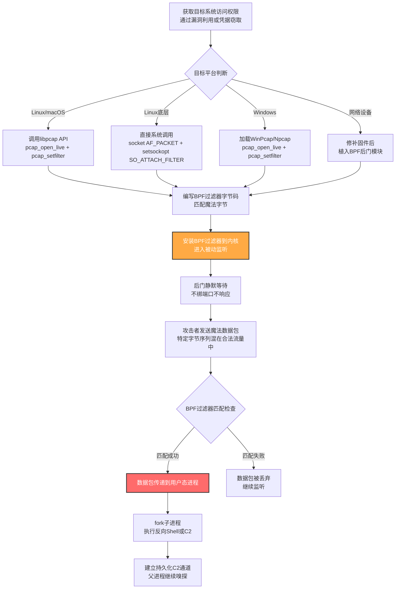

# 套接字过滤器 (T1205.002)

## 一句话通俗理解

攻击者在系统里藏了一个"密码嗅探犬"——它蹲在网络入口处默默嗅闻所有经过的数据包，既不开门也不回应，只有闻到特定的"气味"（魔法字节）才会突然跳起来执行攻击者预设的命令。

## 30秒速查卡

| 维度 | 你需要知道的 |
|------|-------------|
| 这是什么？ | 使用libpcap库或`setsockopt(SO_ATTACH_FILTER)`系统调用在原始套接字上安装BPF过滤器，匹配预定义"魔法字节"后激活反向Shell或其他恶意动作 |
| 为什么危险？ | 后门不绑定任何端口、不响应任何请求，netstat/ss/lsof完全看不见它；BPF过滤器在内核态运行CPU开销极低，可长期潜伏；魔法字节可混在合法协议流量中（如TLS记录头`17 03 03`） |
| 谁需要关心？ | Linux/macOS系统管理员、SOC分析师、EDR开发人员、IoT/嵌入式设备运维 |
| 你的第一步防御 | 监控非抓包类进程加载libpcap/WinPcap的行为；监控`setsockopt(SO_ATTACH_FILTER)`和`AF_PACKET`套接字的创建；识别"加载抓包库的进程随后发起外连"组合模式 |
| 如果只做一件事 | 部署auditd审计规则监控`setsockopt`、`socket(AF_PACKET)`系统调用，并对加载libpcap的非网络工具进程告警 |

## 难度等级

⭐⭐⭐⭐ 专家级（需要内核级网络与BPF虚拟机知识）

套接字过滤器是流量信令中**最隐蔽但实现难度最高**的子技术，原因在于：

- 攻击者需要深入理解BPF（Berkeley Packet Filter）虚拟机指令集，能够手写或生成BPF字节码
- 需要熟悉`setsockopt(SO_ATTACH_FILTER)`、`setsockopt(SO_ATTACH_BPF)`、`socket(AF_PACKET, SOCK_RAW, ...)`等底层系统调用
- 需要理解libpcap的工作原理——它如何打开`/dev/bpf*`设备文件、如何将BPF过滤器安装到内核
- 在Windows上需要使用WinPcap/Npcap的等价API，且需要绕过EDR对`wpcap.dll`/`packet.dll`加载的监控
- 高级变体（如BPFDoor）需要在BPF过滤器中实现复杂的协议解析逻辑（区分TCP/UDP/ICMP并提取载荷），技术门槛极高
- 防御方若不理解BPF的工作方式，几乎无法在主机层发现这种后门——它根本不开端口

## 前置知识检查

**读这个文件需要什么？**

- [ ] BPF（Berkeley Packet Filter）虚拟机指令集与字节码格式
- [ ] `setsockopt(SO_ATTACH_FILTER)`与`setsockopt(SO_ATTACH_BPF)`系统调用的区别
- [ ] `socket(AF_PACKET, SOCK_RAW, htons(ETH_P_ALL))`与`socket(AF_INET, SOCK_RAW, ...)`的差异
- [ ] libpcap库的`pcap_open_live`、`pcap_compile`、`pcap_setfilter`等核心API
- [ ] WinPcap/Npcap在Windows上的等价API（`pcap_open_live`、`pcap_setfilter`）
- [ ] Linux的`/dev/bpf*`设备文件与`/proc/net/packet`接口
- [ ] TCP/UDP/ICMP协议头部结构与载荷偏移量（用于BPF过滤器编写）

## 技术描述

套接字过滤器（Socket Filters, T1205.002）是流量信令（T1205）中**最隐蔽的子技术**。攻击者使用libpcap库或直接调用`setsockopt(SO_ATTACH_FILTER)`系统调用，在原始套接字上安装BPF（Berkeley Packet Filter）过滤器。这个过滤器会检查所有经过指定网络接口（或全部接口）的数据包，只有匹配预定义"魔法字节"的数据包才会触发后续动作（如fork出反向Shell）。由于过滤器安装在内核态BPF虚拟机中，CPU开销极低，且不暴露任何监听端口，传统主机层检测手段（netstat、ss、lsof）完全看不见它。

**通俗解释：**

想象一栋大厦的通风管道里藏着一条训练有素的"嗅探犬"。这条狗24小时蹲在通风口默默闻所有经过的空气——它既不叫也不动，从外面看通风管道完全正常。但是它身上带着一个特殊的项圈，项圈里写着一个特定的"气味密码"（魔法字节）。只有当空气中出现了这个密码气味时，狗才会突然跳起来，按下通风管道里的一个按钮（fork出反向Shell），让攻击者从外面悄悄进入大厦。任何不知密码的人在通风管道外怎么看都只是一条普通的通风管道——这正是套接字过滤器的核心思想：用内核态的BPF虚拟机作为"嗅探犬"，让后门在网络栈最底层被动监听，对所有端口扫描和进程列表完全隐形。

**为什么比端口敲击更隐蔽？**

- 端口敲击（T1205.001）至少会在防火墙日志中留下"SYN→RST"序列痕迹，且敲击完成后的端口开放可被检测
- 套接字过滤器**根本不开端口**——BPF过滤器安装在内核态，数据包到达网卡后被BPF虚拟机检查，即使匹配魔法字节也只是在用户态进程的`recvfrom`调用中返回，不会触发任何网络栈响应
- BPF过滤器可以监听**任意端口**的流量（如BPFDoor监听22/80/443），将魔法字节混在合法协议流量中（如TLS记录头`17 03 03`），让深度包检测（DPI）也难以分辨
- BPFDoor型后门甚至能在**所有接口**上嗅探，攻击者从任何方向发送魔法包都能激活

**过渡段：** 套接字过滤器的核心是"BPF虚拟机+魔法字节匹配+用户态动作"的三段式架构。攻击者首先创建原始套接字并安装BPF过滤器，过滤器在内核态高效筛选数据包；当匹配到魔法字节时，数据包被传递到用户态进程；用户态进程解析数据包并执行预设动作（通常是fork反向Shell）。下面我们看看具体的攻击流程与技术细节。

**技术原理：**

### 一、libpcap型BPF后门（最常见）

最经典的实现。攻击者使用libpcap库的`pcap_open_live`打开网络接口，使用`pcap_compile`将过滤表达式编译为BPF字节码，再用`pcap_setfilter`将过滤器安装到内核。BPFDoor是典型代表——它在Linux上监听端口22（SSH）、80（HTTP）、443（HTTPS）的ICMP、UDP和TCP数据包，BPF过滤器检查数据包载荷是否包含预定义的魔法字节（如`17 03 03`或`46 77 4d`）。匹配后，BPFDoor从数据包中解析出两个字段（命令类型和参数），fork自身——父进程继续监控过滤后的流量，子进程执行解析出的指令（通常是反向Shell回连攻击者控制的服务器）。

**关键代码模式：**
```c
// 简化的BPFDoor型后门核心逻辑
pcap_handle = pcap_open_live("any", 65535, 1, 1000, errbuf);
pcap_compile(pcap_handle, &fp, "tcp or udp or icmp", 0, 0);
pcap_setfilter(pcap_handle, &fp);
while (1) {
    packet = pcap_next(pcap_handle, &header);
    if (contains_magic_bytes(packet, MAGIC)) {
        if (fork() == 0) {
            // 子进程执行反向Shell
            exec_reverse_shell(packet);
        }
        // 父进程继续嗅探
    }
}
```

### 二、SO_ATTACH_FILTER型BPF后门

更底层的实现，不依赖libpcap库。攻击者直接调用`socket(AF_PACKET, SOCK_RAW, htons(ETH_P_ALL))`创建原始套接字，然后通过`setsockopt(SO_ATTACH_FILTER, &filter_prog, sizeof(filter_prog))`将手工编写的BPF字节码安装到套接字上。这种方式的优势是：不依赖libpcap库（避免被`libpcap`加载监控检测）、字节码完全自定义（可以实现更复杂的匹配逻辑）、CPU开销更低（BPF虚拟机在内核态执行）。REPTILE（UNC3886使用）和Chaos后门采用此方式。

**关键代码模式：**
```c
// 简化的SO_ATTACH_FILTER型后门核心逻辑
sock = socket(AF_PACKET, SOCK_RAW, htons(ETH_P_ALL));
struct sock_fprog filter_prog = {
    .len = sizeof(filter) / sizeof(struct sock_filter),
    .filter = filter  // 手工编写的BPF字节码
};
setsockopt(sock, SOL_SOCKET, SO_ATTACH_FILTER, &filter_prog, sizeof(filter_prog));
while (1) {
    recvfrom(sock, buffer, sizeof(buffer), 0, &saddr, &saddr_len);
    // 处理匹配的数据包
}
```

### 三、Windows上的WinPcap/Npcap型后门

在Windows上的等价实现。攻击者使用WinPcap或其现代继任者Npcap的API（`pcap_open_live`、`pcap_setfilter`），在Windows网络栈上安装BPF过滤器。Sysmon Event ID 7可以检测`wpcap.dll`和`packet.dll`的加载，但攻击者可以通过静态链接或直接调用NDIS驱动绕过。某些高级变种使用Windows Filtering Platform（WFP）callout驱动实现类似功能，更难被用户态工具检测。

### 四、协议模拟型BPF后门

最隐蔽的变体。BPF过滤器不仅匹配魔法字节，还模拟合法协议的握手过程。例如，某些后门在BPF过滤器中实现TLS记录层解析（匹配`17 03 03`开头的TLS ApplicationData记录），将魔法字节嵌入合法TLS流量中。Mustang Panda的PUBLOAD后门就是典型——它仅在内存中执行，C2响应数据包匹配`17 03 03`（TLS记录头）或`46 77 4d`（ASCII "FWM"）时才激活功能。由于魔法值混在正常TLS流量中，即使部署了SSL/TLS解密代理也难以分辨。

**用途与影响：**

套接字过滤器是攻击者在**需要极致隐蔽的长期潜伏场景**下的首选技术。它的价值在于：**极致隐蔽性**（不绑端口、不响应、netstat看不见）、**低CPU开销**（BPF在内核态执行）、**协议模拟**（魔法字节可混在合法流量中）。从BPFDoor感染全球Linux服务器到UNC3886在网络设备上部署REPTILE，从Mustang Panda的PUBLOAD到Chaos后门扩散，套接字过滤器已成为高级APT在Linux与网络设备持久化中的"皇冠上的明珠"。

## 真实攻击流程

### 典型攻击流程

```
获取目标系统访问权限 --> 创建原始套接字或打开libpcap --> 编写并安装BPF过滤器（含魔法字节匹配） --> 后门进入被动监听 --> 攻击者发送魔法数据包 --> BPF匹配触发用户态处理 --> fork反向Shell或激活C2通道
```



**步骤详解：**

1. **获取目标系统访问权限**
   - 通俗描述：攻击者先要"进门"一次——通过漏洞利用或窃取的凭据登录目标系统，把BPF后门装上去
   - 技术细节：利用外部远程服务漏洞（T1190）、有效账户（T1078）或横向移动技术（T1021）获取初始访问权限，然后部署后门并配置为开机自启动（T1547）或注入到现有进程
   - 常用工具：漏洞利用框架、SSH爆破、Cobalt Strike Beacon

2. **创建原始套接字或打开libpcap**
   - 通俗描述：在后门进程里开一个"网络监听器"——它能听到所有经过网卡的数据包，但不需要开端口
   - 技术细节：调用`socket(AF_PACKET, SOCK_RAW, htons(ETH_P_ALL))`创建原始套接字；或使用libpcap的`pcap_open_live("any", 65535, 1, 1000, errbuf)`打开所有接口；在Windows上加载`wpcap.dll`并调用`pcap_open_live`
   - 常用工具：libpcap、WinPcap、Npcap、直接系统调用

3. **编写并安装BPF过滤器（含魔法字节匹配）**
   - 通俗描述：写一个"气味密码"识别程序，告诉内核态BPF虚拟机"只有闻到这个特定气味的包才告诉我"
   - 技术细节：使用`pcap_compile`将过滤表达式（如`tcp or udp or icmp`）编译为BPF字节码；或在C代码中手工编写`struct sock_filter`数组，匹配特定偏移量的魔法字节（如TCP载荷偏移52处的`17 03 03`）；用`pcap_setfilter`或`setsockopt(SO_ATTACH_FILTER)`安装到内核
   - 常用工具：libpcap、自定义BPF字节码、bpftool（Linux BPF调试工具）

4. **后门进入被动监听**
   - 通俗描述：后门开始默默嗅探，从外面看完全正常
   - 技术细节：后门进程调用`recvfrom`或`pcap_next`循环等待数据包，BPF过滤器在内核态高效筛选，只有匹配魔法字节的包才会被传递到用户态；进程不绑定任何端口，`netstat -tlnp`、`ss -tlnp`、`lsof -i`都看不见它
   - 常用工具：自定义后门二进制（BPFDoor、REPTILE、Chaos）

5. **攻击者发送魔法数据包**
   - 通俗描述：从外部发送"气味密码"——可以混在任意协议流量中
   - 技术细节：使用scapy构造包含魔法字节的TCP/UDP/ICMP包，发送到目标机的任意端口（BPFDoor接受22/80/443，Chaos接受任意端口）；魔法字节可放在载荷开头（如`17 03 03`）或特定偏移量（如偏移52处）；高级变体将魔法字节嵌入合法TLS记录层（`17 03 03`正好是TLS ApplicationData类型）
   - 常用工具：scapy、sendip、hping3、自定义Python脚本

6. **BPF匹配触发用户态处理**
   - 通俗描述：嗅探犬闻到气味密码，跳起来按下按钮
   - 技术细节：BPF过滤器在内核态匹配魔法字节后，数据包通过`recvfrom`返回到用户态后门进程；后门进程解析数据包载荷，提取命令类型和参数（如反向Shell的目标IP和端口）
   - 常用工具：自定义后门二进制

7. **fork反向Shell或激活C2通道**
   - 通俗描述：按下按钮后门打开——攻击者从外面进入
   - 技术细节：后门进程调用`fork()`，子进程执行`execve("/bin/bash", ...)`并通过socketpair连接到反向Shell的目标IP/端口；父进程继续在原始套接字上嗅探，等待下一次魔法包激活；某些后门还支持通过魔法包动态加载新功能模块
   - 常用工具：bash反弹Shell、Cobalt Strike、自定义HTTPS C2

## 父技术

**本子技术属于**：[流量信令 (T1205)](../T1205-Traffic-Signaling.md)

流量信令（T1205）是同时属于隐蔽（TA0005）、持久化（TA0003）和命令与控制（TA0011）三个战术的技术。套接字过滤器（T1205.002）是其最隐蔽的实现方式，使用libpcap/BPF实现内核态被动监听。父技术还包含另一个子技术——端口敲击（T1205.001），它通过关闭端口的连接序列触发动作，实现更简单但隐蔽性略低。

## 检测建议

**用人话说：** 套接字过滤器的检测核心是"监控BPF与libpcap的使用"——由于后门不开端口，传统网络层检测完全失效，必须依赖主机层系统调用审计。重点关注：非抓包类进程加载`libpcap`/`wpcap.dll`、非网络工具进程调用`setsockopt(SO_ATTACH_FILTER)`、`/dev/bpf*`设备文件被异常进程打开、"加载抓包库的进程随后发起外连"这一组合行为。

### 网络层检测

**检测方法：** 套接字过滤器在网络上**几乎没有可检测特征**——BPF过滤器不响应任何数据包，魔法字节可混在合法流量中。网络层检测只能依赖间接信号：
- 监控同一源IP向目标机22/80/443端口的连接中，是否存在特定字节模式（如`17 03 03`开头的TLS记录层在非TLS端口上出现）
- 监控目标机在收到特定数据包后短时间内发起外连（可能表明BPF后门激活后fork反向Shell）
- 监控网络设备接口流量中是否有可疑的ICMP/UDP魔法包模式

### 主机层检测（核心）

**Linux/macOS事件（最有效的检测层）：**
- 监控`/dev/bpf*`设备文件的访问：
  ```bash
  sudo lsof /dev/bpf0 2>/dev/null
  sudo cat /proc/net/packet  # 列出所有打开AF_PACKET套接字的进程
  ```
- 监控`setsockopt(SO_ATTACH_FILTER)`和`setsockopt(SO_ATTACH_BPF)`系统调用：
  ```bash
  sudo auditctl -a always,exit -F arch=b64 -S setsockopt -k setsockopt
  sudo ausearch -k setsockopt | tail -20
  ```
- 监控新创建的原始套接字：
  ```bash
  sudo auditctl -a always,exit -F arch=b64 -S socket -F a0=17 -k raw_socket  # AF_PACKET=17
  sudo ss -anp | grep -E 'RAW|PACKET'
  ```
- 监控`libpcap`共享库被非网络工具进程加载：
  ```bash
  sudo lsof -n | grep -E 'libpcap|wpcap'
  # 检查可疑进程的内存映射
  sudo cat /proc/<pid>/maps | grep -i pcap
  ```
- 监控`knockd`服务启动与配置文件变更

**Windows事件：**
- Sysmon Event ID 7：Image Loaded（监控`wpcap.dll`、`packet.dll`、`npcap.sys`等抓包库的加载）—— 这是检测Windows上BPF后门的最有效手段
- Sysmon Event ID 3：Network Connection（关注加载抓包库的进程随后发起外连的组合模式）
- 监控Windows Filtering Platform（WFP）callout驱动的加载
- 监控`npcap`服务的异常启动

**网络设备日志：**
- 监控设备进程列表中是否有非预期的`pcap`相关进程
- 监控设备配置变更与固件完整性校验（防止T1601.001修补固件后植入BPF后门）

**具体命令示例：**

```bash
# Linux: 检测BPF设备文件被异常进程打开
sudo ls -la /dev/bpf* 2>/dev/null
sudo lsof /dev/bpf0 2>/dev/null
sudo cat /proc/net/packet  # 列出所有打开AF_PACKET套接字的进程

# Linux: 检测raw socket和pcap库加载
sudo ss -anp | grep -E 'RAW|PACKET'
sudo lsof -n | grep -E 'libpcap|wpcap'

# Linux: 检测所有进程的内存映射中的pcap库
for pid in $(ls /proc | grep -E '^[0-9]+$'); do
    if grep -qi pcap /proc/$pid/maps 2>/dev/null; then
        echo "PID $pid: $(cat /proc/$pid/comm) loads pcap"
        grep -i pcap /proc/$pid/maps
    fi
done

# Linux: 配置auditd审计关键系统调用
sudo auditctl -a always,exit -F arch=b64 -S socket -F a0=17 -k raw_socket
sudo auditctl -a always,exit -F arch=b64 -S setsockopt -k setsockopt
sudo auditctl -w /dev/bpf0 -p rwa -k bpf_device

# Linux: 查询审计日志
sudo ausearch -k raw_socket | tail -20
sudo ausearch -k setsockopt | tail -20
sudo ausearch -k bpf_device | tail -20

# macOS: 检测PF规则与socketfilterfw状态
sudo pfctl -sr 2>/dev/null
sudo /usr/libexec/ApplicationFirewall/socketfilterfw --getglobalstate

# 检测所有使用BPF的系统进程
sudo bpftrace -e 'tracepoint:syscalls:sys_enter_setsockopt /comm != "tcpdump" && comm != "wireshark" && comm != "suricata"/ { printf("PID %d (%s) called setsockopt\n", pid, comm); }'
```

```powershell
# Windows: 检测WinPcap/Npcap驱动加载
Get-Service | Where-Object { $_.Name -match 'npcap|winpcap' }
Get-Process | Where-Object { $_.Modules -match 'wpcap|packet' } | Select-Object Name, Id, Path

# Windows: 检测加载wpcap.dll的所有进程
Get-Process | ForEach-Object {
    $proc = $_
    $_.Modules | Where-Object { $_.ModuleName -match 'wpcap|packet' } | ForEach-Object {
        [PSCustomObject]@{
            PID = $proc.Id
            ProcessName = $proc.ProcessName
            Module = $_.ModuleName
            Path = $proc.Path
        }
    }
}

# Windows: 监控Sysmon Event ID 7中wpcap.dll加载事件
Get-WinEvent -FilterHashtable @{LogName='Microsoft-Windows-Sysmon/Operational'; ID=7} |
    Where-Object { $_.Message -match 'wpcap\.dll|packet\.dll' } |
    Select-Object TimeCreated, Message -First 20

# Windows: 检测WFP规则变更
netsh wfp show state 2>$null | Select-String "filterName|providerName"
```

### 应用层检测

**检测要点：**

1. **libpcap/WinPcap异常加载检测（最有效）**
   - 日志来源：Sysmon Event ID 7（Windows）、`/proc/<pid>/maps`（Linux）、`lsof`（macOS）
   - 关注字段：进程名、加载的DLL/共享库、进程路径
   - 异常特征：非抓包类合法软件（如Wireshark、tcpdump、Suricata、Zeek）的进程加载`libpcap`/`wpcap.dll`，特别是后台守护进程或非预期进程
   - 关键过滤：排除已知合法工具（wireshark.exe、tshark.exe、dumpcap.exe、tcpdump、nmap、suricata、zeek、IDS传感器agent）

2. **`setsockopt(SO_ATTACH_FILTER)`调用检测**
   - 日志来源：`auditd`系统调用审计（Linux）、Sysmon Event ID 8/10（Windows）
   - 关注字段：系统调用类型、套接字选项、调用进程
   - 异常特征：非网络工具进程调用`setsockopt(SO_ATTACH_FILTER)`（选项值26）或`setsockopt(SO_ATTACH_BPF)`（选项值50）

3. **`AF_PACKET`/`SOCK_RAW`套接字创建检测**
   - 日志来源：`auditd`系统调用审计（Linux）
   - 关注字段：`socket`系统调用的第一个参数（domain）
   - 异常特征：非网络工具进程调用`socket(AF_PACKET, SOCK_RAW, ...)`（domain=17）或`socket(AF_INET, SOCK_RAW, ...)`

4. **"加载抓包库后发起外连"组合行为检测**
   - 日志来源：Sysmon Event ID 7 + Event ID 3（Windows）、`/proc/<pid>/maps` + `ss`/`netstat`（Linux）
   - 关注字段：进程加载pcap库的时间、进程发起外连的时间
   - 异常特征：进程在加载`libpcap`/`wpcap.dll`后短时间内（如5分钟内）发起外向网络连接，可能表明BPF后门激活后fork反向Shell

5. **`/dev/bpf*`设备文件访问检测**
   - 日志来源：`auditd`文件审计（Linux）
   - 关注字段：访问`/dev/bpf*`的进程名、PID
   - 异常特征：非抓包类进程打开`/dev/bpf*`设备文件

## 检测规则示例

### Sigma规则：检测BPF过滤器安装与反向Shell关联（Linux）

```yaml
title: BPF过滤器安装后进程发起外连检测
id: b2c3d4e5-f6a7-4b8c-9d0e-1f2a3b4c5d6e
status: experimental
description: 检测进程调用setsockopt(SO_ATTACH_FILTER)安装BPF过滤器后，短时间内发起外向连接的行为，可能表明T1205.002套接字过滤器后门激活
references:
    - https://attack.mitre.org/techniques/T1205/002/
    - https://attack.mitre.org/detectionstrategies/DET0162
author: ATT&CK知识库
date: 2026/07/24
logsource:
    product: linux
    service: auditd
detection:
    selection_bpf_attach:
        type: SYSCALL
        syscall: setsockopt
        a2: 26  # SOL_SOCKET
        a3: 26  # SO_ATTACH_FILTER
    timeframe: 60s
    condition: selection_bpf_attach
falsepositives:
    - 合法抓包工具（tcpdump、Wireshark、Suricata）启动
    - 网络监控agent安装BPF过滤器
level: medium
tags:
    - attack.t1205
    - attack.t1205.002
    - attack.stealth
    - attack.persistence
    - attack.command_and_control
```

### Sigma规则：检测WinPcap/Npcap异常加载（Windows）

```yaml
title: 非抓包类进程加载WinPcap/Npcap库检测
id: c3d4e5f6-a7b8-4c9d-0e1f-2a3b4c5d6e7f
status: experimental
description: 检测非已知抓包工具的进程加载wpcap.dll/packet.dll，可能表明T1205.002套接字过滤器后门在Windows上的实现
references:
    - https://attack.mitre.org/techniques/T1205/002/
author: ATT&CK知识库
date: 2026/07/24
logsource:
    product: windows
    service: sysmon
detection:
    selection_image_loaded:
        EventID: 7
        ImageLoaded|endswith:
            - '\wpcap.dll'
            - '\packet.dll'
            - '\npcap.sys'
    filter_legitimate:
        Image|endswith:
            - '\wireshark.exe'
            - '\tshark.exe'
            - '\dumpcap.exe'
            - '\tcpdump.exe'
            - '\windump.exe'
            - '\nmap.exe'
            - '\suricata.exe'
            - '\zeek.exe'
    condition: selection_image_loaded and not filter_legitimate
falsepositives:
    - 企业网络监控agent（如端点NDR传感器）
    - 合法安全工具安装时短暂加载
level: high
tags:
    - attack.t1205
    - attack.t1205.002
    - attack.stealth
    - attack.persistence
    - attack.command_and_control
```

### Sigma规则：检测AF_PACKET套接字创建（Linux）

```yaml
title: 非网络工具进程创建AF_PACKET套接字检测
id: d4e5f6a7-b8c9-4d0e-1f2a-3b4c5d6e7f81
status: experimental
description: 检测非已知网络工具的进程创建AF_PACKET原始套接字，可能表明T1205.002套接字过滤器后门在Linux上的部署
references:
    - https://attack.mitre.org/techniques/T1205/002/
author: ATT&CK知识库
date: 2026/07/24
logsource:
    product: linux
    service: auditd
detection:
    selection_socket:
        type: SYSCALL
        syscall: socket
        a0: 17  # AF_PACKET
        a1: 3   # SOCK_RAW
    filter_legitimate:
        comm:
            - 'tcpdump'
            - 'wireshark'
            - 'tshark'
            - 'dumpcap'
            - 'suricata'
            - 'zeek'
            - 'nmap'
            - 'arpwatch'
            - 'networkd'
    condition: selection_socket and not filter_legitimate
falsepositives:
    - 容器网络插件（如Cilium、Calico）创建AF_PACKET套接字
    - 主机网络监控agent
level: high
tags:
    - attack.t1205
    - attack.t1205.002
    - attack.stealth
    - attack.persistence
```

### Sigma规则：检测加载pcap库后发起外连（组合检测）

```yaml
title: 加载libpcap后发起外向连接检测
id: e5f6a7b8-c9d0-4e1f-2a3b-4c5d6e7f8092
status: experimental
description: 检测进程加载libpcap/wpcap库后短时间内发起外向网络连接的组合行为，可能表明BPF后门激活后fork反向Shell
references:
    - https://attack.mitre.org/techniques/T1205/002/
author: ATT&CK知识库
date: 2026/07/24
logsource:
    product: linux
    service: auditd
detection:
    selection_pcap_load:
        type: SYSCALL
        syscall: openat
        path|contains: 'libpcap'
    selection_outbound:
        type: SYSCALL
        syscall: connect
    timeframe: 5m
    condition: selection_pcap_load | near selection_outbound
falsepositives:
    - 合法抓包工具启动后连接远程服务（如Zeek连接日志服务器）
    - 网络监控agent正常外连
level: high
tags:
    - attack.t1205
    - attack.t1205.002
    - attack.command_and_control
```

## 缓解措施

### 优先级1：关键措施

**措施名称：** 限制libpcap/raw socket使用与部署auditd审计

**具体实施步骤：**
1. 在Linux上使用AppArmor/SELinux限制哪些进程可以打开`/dev/bpf*`设备和创建`AF_PACKET`套接字
2. 部署`auditd`审计规则监控`setsockopt`、`socket(AF_PACKET)`等关键系统调用：
   ```bash
   sudo auditctl -a always,exit -F arch=b64 -S socket -F a0=17 -k raw_socket
   sudo auditctl -a always,exit -F arch=b64 -S setsockopt -k setsockopt
   sudo auditctl -w /dev/bpf0 -p rwa -k bpf_device
   ```
3. 在Windows上通过WDAC（Windows Defender Application Control）限制只有签名的合法抓包工具可以加载`wpcap.dll`/`npcap.sys`
4. 部署EDR agent，监控进程加载pcap库与发起外连的组合行为

### 优先级2：重要措施

**措施名称：** 部署状态检测防火墙与限制网络设备固件修改

**具体实施步骤：**
1. 在网络边界部署状态检测防火墙（Stateful Firewall），识别BPF后门激活后的反向Shell连接
2. 对Cisco/Juniper/Fortinet网络设备启用固件完整性校验（如Cisco的SXP、Juniper的secure boot），防止T1601.001固件修补
3. 部署网络设备配置变更监控（如RANCID、Oxidized），对任何配置变更告警
4. 在网络设备上启用CoPP（Control Plane Policing）限制发往设备CPU的管理流量速率

### 优先级3：建议措施

**措施名称：** 加固Linux内核与监控BPF程序加载

**具体实施步骤：**
1. 启用Linux内核的`unprivileged_bpf_disabled=1`参数，禁止非特权用户加载BPF程序：
   ```bash
   echo 1 > /proc/sys/kernel/unprivileged_bpf_disabled
   ```
2. 部署`bpftrace`或`Falco`等运行时安全工具，监控BPF程序的加载与执行
3. 限制`CAP_NET_RAW`与`CAP_BPF`能力的授予，仅授予必要的网络监控工具
4. 定期审计系统中所有打开`/dev/bpf*`设备的进程，与已知合法白名单比对

### MITRE ATT&CK 缓解措施映射

| 缓解措施ID | 缓解措施名称 | 适用性 | 说明 |
|------------|-------------|--------|------|
| M1042 | 禁用或移除功能或程序 | 部分适用 | 禁用Wake-on-LAN、限制`unprivileged_bpf_disabled` |
| M1037 | 过滤网络流量 | 部分适用 | 状态检测防火墙可识别BPF后门激活后的反向Shell |

## 动手实验

> ⚠️ **重要提示**：所有实验必须在隔离的实验室环境中进行，禁止对未授权的真实系统进行测试。BPF后门几乎无法被传统检测手段发现，请确保实验网络与生产网络完全隔离。

### 实验环境准备

**所需工具：**
- 两台Linux虚拟机（一台作为攻击机，一台作为目标机，Ubuntu 22.04+）
- `libpcap-dev`开发库（`apt install libpcap-dev`）
- `python3-scapy`（构造魔法数据包）
- `auditd`与`auditctl`（系统调用审计）
- `tcpdump`与`Wireshark`（流量分析）
- `bpftrace`（BPF程序监控，可选）

### 实验1：BPF过滤器嗅探后门模拟（初级）

**实验目标：** 理解T1205.002套接字过滤器的原理，观察BPFDoor型后门如何"被动监听"并响应魔法字节

**实验步骤：**
1. 在目标机上编写一个简化的BPF嗅探器（Python + scapy）：
   ```python
   #!/usr/bin/env python3
   # bpf_listener.py - 仅用于教学演示
   from scapy.all import sniff, IP, TCP, Raw
   import subprocess

   MAGIC = b'\x17\x03\x03'  # PUBLOAD型魔法字节（TLS记录头）

   def callback(pkt):
       if pkt.haslayer(Raw):
           payload = bytes(pkt[Raw].load)
           if MAGIC in payload:
               print(f"[!] Magic packet from {pkt[IP].src}, activating...")
               # 模拟反向Shell激活（这里只是打印，实际后门会fork shell）
               subprocess.run(["echo", "Backdoor activated"])

   print("[*] Listening passively on all interfaces...")
   sniff(filter="tcp", prn=callback, store=0)
   ```
2. 启动嗅探器：`sudo python3 bpf_listener.py`
3. 在攻击机上确认目标机没有监听任何异常端口：`nmap -sS <目标IP>`（应只看到常见端口，无后门端口）
4. 在攻击机上用scapy发送魔法数据包：
   ```python
   from scapy.all import IP, TCP, Raw, send
   pkt = IP(dst="<目标IP>")/TCP(dport=80)/Raw(load=b'\x17\x03\x03' + b'A'*10)
   send(pkt)
   ```
5. 在目标机上观察嗅探器输出，应打印"[!] Magic packet from..."
6. 用`tcpdump`观察数据包：`sudo tcpdump -i any -X 'tcp port 80'`
7. 检查`auditd`审计日志：`sudo ausearch -k raw_socket`（如果预先配置了审计规则）
8. 清理：停止嗅探器

**预期结果：** 嗅探器在不绑定任何端口的情况下捕获并响应魔法数据包，nmap扫描完全看不见后门

**学习要点：** 理解libpcap/BPF过滤器的"被动监听"机制，以及为何传统端口扫描失效

### 实验2：使用SO_ATTACH_FILTER实现内核态BPF过滤器（中级）

**实验目标：** 理解`setsockopt(SO_ATTACH_FILTER)`的底层工作原理，观察BPF字节码如何安装到内核

**实验步骤：**
1. 在目标机上编写一个使用`SO_ATTACH_FILTER`的C程序（简化版）：
   ```c
   // bpf_raw_socket.c - 仅用于教学演示
   #include <stdio.h>
   #include <stdlib.h>
   #include <string.h>
   #include <unistd.h>
   #include <sys/socket.h>
   #include <linux/if_ether.h>
   #include <linux/filter.h>
   #include <arpa/inet.h>

   // 简化的BPF过滤器：匹配TCP包（仅演示，实际后门更复杂）
   struct sock_filter code[] = {
       { 0x28, 0, 0, 0x0000000c },  // ldh [12]        -> 加载以太网类型
       { 0x15, 0, 3, 0x00000800 },  // jeq #0x800, 0, 3 -> 是IPv4？
       { 0x30, 0, 0, 0x00000017 },  // ldb [23]         -> 加载IP协议
       { 0x15, 0, 1, 0x00000006 },  // jeq #6, 0, 1     -> 是TCP？
       { 0x06, 0, 0, 0x0000ffff },  // ret #65535        -> 接受
       { 0x06, 0, 0, 0x00000000 },  // ret #0            -> 拒绝
   };
   struct sock_fprog prog = {
       .len = sizeof(code)/sizeof(struct sock_filter),
       .filter = code
   };

   int main() {
       int sock = socket(AF_PACKET, SOCK_RAW, htons(ETH_P_ALL));
       if (sock < 0) { perror("socket"); return 1; }

       if (setsockopt(sock, SOL_SOCKET, SO_ATTACH_FILTER, &prog, sizeof(prog)) < 0) {
           perror("setsockopt"); return 1;
       }
       printf("[*] BPF filter installed, listening passively...\n");

       char buf[65536];
       while (1) {
           ssize_t n = recvfrom(sock, buf, sizeof(buf), 0, NULL, NULL);
           if (n > 0) printf("[+] Captured %zd bytes\n", n);
       }
       close(sock);
       return 0;
   }
   ```
2. 编译并运行：`gcc -o bpf_raw_socket bpf_raw_socket.c && sudo ./bpf_raw_socket`
3. 在攻击机上发送TCP包：`nc <目标IP> 80`
4. 观察目标机输出，应捕获到TCP包
5. 用`sudo cat /proc/net/packet`检查AF_PACKET套接字
6. 用`sudo lsof /dev/bpf0`检查BPF设备访问
7. 检查auditd日志：`sudo ausearch -k setsockopt | tail -10`

**预期结果：** BPF过滤器成功安装到内核，程序在不绑定端口的情况下捕获TCP包

**学习要点：** 理解`SO_ATTACH_FILTER`的工作原理，掌握BPF字节码的基本结构

### 实验3：检测规则验证（高级）

**实验目标：** 验证本文给出的Sigma检测规则是否能识别实验1和实验2的攻击行为

**实验步骤：**
1. 在目标机上配置`auditd`审计raw socket与`setsockopt`：
   ```bash
   sudo auditctl -a always,exit -F arch=b64 -S socket -F a0=17 -k raw_socket  # AF_PACKET=17
   sudo auditctl -a always,exit -F arch=b64 -S setsockopt -k setsockopt
   sudo auditctl -w /dev/bpf0 -p rwa -k bpf_device
   ```
2. 重复实验1和实验2
3. 收集`/var/log/audit/audit.log`，使用`ausearch`查询：
   ```bash
   sudo ausearch -k raw_socket | tail -20
   sudo ausearch -k setsockopt | tail -20
   sudo ausearch -k bpf_device | tail -20
   ```
4. 编写Sigma规则转换为Splunk/Elastic查询，验证能否检测到BPF过滤器安装
5. 检查`iptables`规则变更是否被记录：`sudo journalctl -u netfilter-persistent`
6. 评估检测的误报率：正常运行tcpdump、curl等合法工具是否触发告警
7. 使用`bpftrace`监控BPF程序加载：
   ```bash
   sudo bpftrace -e 'tracepoint:syscalls:sys_enter_setsockopt /comm != "tcpdump" && comm != "wireshark"/ { printf("PID %d (%s) called setsockopt\n", pid, comm); }'
   ```

**预期结果：** auditd日志清晰记录了`socket(AF_PACKET)`和`setsockopt(SO_ATTACH_FILTER)`调用，Sigma规则能在实验环境中触发告警

**学习要点：** 掌握套接字过滤器的主机层检测方法，理解检测规则的有效性与误报场景

## 真实案例

### 案例1：BPFDoor Linux隐蔽后门全球扩散（2022-2025）

- **时间**：2022年-2025年（持续演化）
- **目标**：全球Linux服务器、电信运营商、ISP、教育机构
- **攻击组织**：未明确归因（疑似中国关联APT）
- **手法**：BPFDoor是T1205.002套接字过滤器的典型代表。它使用BPF（Berkeley Packet Filter）字节码在网络套接字上安装过滤器，监控经过端口22（SSH）、80（HTTP）、443（HTTPS）的ICMP、UDP和TCP数据包。当BPF过滤器发现包含"魔法字节"的数据包时，BPFDoor从数据包中解析出两个字段并fork自身——父进程继续监控过滤后的流量，子进程执行解析出的指令（通常是反向Shell）。由于BPF过滤器在内核态运行，CPU开销极低，且后门不绑定任何端口，netstat、ss等传统工具完全看不见它。即使安全团队在端口22/80/443上看到正常的SSH/HTTP/HTTPS流量，也无法分辨其中是否夹带了魔法包。2023年Deep Instinct的研究显示BPFDoor已演化出更复杂的变种，增加反分析能力。
- **影响**：全球数百台Linux服务器被植入，攻击者获得长期持久化的隐蔽C2通道
- **参考链接**：[Sandfly Security - BPFDoor Analysis](https://sandflysecurity.com/blog/bpfdoor-an-evasive-linux-backdoor-technical-analysis/)、[Deep Instinct - BPFDoor Evolution](https://www.deepinstinct.com/blog/bpfdoor-malware-evolves-stealthy-sniffing-backdoor-ups-its-game)

### 案例2：UNC3886在网络设备上部署REPTILE与BPFDoor（2022-2025）

- **时间**：2022年-2025年
- **目标**：全球FortiGate防火墙、Juniper路由器、思科设备
- **攻击组织**：UNC3886（中国关联APT组织）
- **手法**：UNC3886在受害者网络设备上部署多个套接字过滤器型后门，是近年来最典型的T1205.002攻击案例：
  - **REPTILE**：反向Shell组件，可监听TCP、UDP或ICMP中的特殊数据包以激活，使用BPF过滤器实现被动监听
  - **BPFDoor**：使用BPF字节码在套接字上安装过滤器，监控端口22/80/443上的ICMP/UDP/TCP数据包，匹配魔法字节后fork出反向Shell
  - **CASTLETAP**：监听特殊ICMP数据包激活，部署在被入侵的网络设备上
  - 在Juniper路由器上通过ICMP端口敲击实现持久化
  - 在RedPenguin攻击活动中，恶意软件能检查数据包中的魔法字符串以激活后门功能
- **影响**：受害者包括政府、国防、电信等高价值目标，攻击者获得网络基础设施级持久化，传统端点检测完全失效
- **参考链接**：[Mandiant - Fortinet Malware Ecosystem](https://www.mandiant.com/resources/blog/fortinet-malware-ecosystem)、[Google Cloud - UNC3886 Espionage Operations](https://cloud.google.com/blog/topics/threat-intelligence/uncovering-unc3886-espionage-operations)、[Google Cloud - Juniper Routers](https://cloud.google.com/blog/topics/threat-intelligence/china-nexus-espionage-targets-juniper-routers)

### 案例3：Mustang Panda使用魔法值实现内存型C2（2022-2025）

- **时间**：2022年-2025年
- **目标**：缅甸、菲律宾、美国、巴基斯坦、台湾、东盟等多国政府与NGO
- **攻击组织**：Mustang Panda（Stately Taurus、Hive0154，中国关联APT）
- **手法**：Mustang Panda在PUBLOAD和TONESHELL后门中使用了魔法值机制。后门仅在内存中执行，只有当C2响应数据包匹配特定魔法值（`17 03 03`或`46 77 4d`）时才激活功能。这种设计的巧妙之处在于：魔法值`17 03 03`正好是TLS记录层的协议头字节，使魔法包混在正常TLS流量中难以识别；而`46 77 4d`则是ASCII字符串"FWM"的十六进制表示。由于后门不落盘（纯内存执行），文件完整性监控（FIM）和YARA扫描完全失效；由于激活前不响应任何请求，蓝队即使发现可疑进程也无法通过模拟攻击者通信来验证。这一案例展示了套接字过滤器与内存执行、协议模拟的组合应用。
- **影响**：多国政府和NGO的内部通信被长期监听
- **参考链接**：[CSIRT CTI - Stately Taurus Targets Myanmar](https://csirt-cti.net/2024/01/23/stately-taurus-targets-myanmar/)、[IBM X-Force - Hive0154](https://www.ibm.com/think/x-force/hive0154-mustang-panda-shifts-focus-tibetan-community-deploy-pubload-backdoor)

### 案例4：Chaos后门使用任意端口魔法字符串（2021-2025）

- **时间**：2021年-2025年（持续演化）
- **目标**：全球Linux、FreeBSD服务器，电信运营商
- **攻击组织**：未明确归因（疑似中国关联APT）
- **手法**：Chaos后门是T1205.002的变体，其独特之处在于接受**任意端口**上的魔法字符串激活。与BPFDoor仅监听22/80/443不同，Chaos在所有端口上嗅探，匹配预定义的魔法字符串后激活反向Shell。GoSecure的研究显示，Chaos后门还具备DDoS功能与多协议支持（TCP/UDP/ICMP/DNS），是一个功能丰富的多用途后门。由于接受任意端口激活，攻击者可以将魔法包发送到目标机的任何开放端口（如DNS 53、SMTP 25），使流量看起来完全合法。Chaos后门的代码质量较高，支持多种架构（x86、x64、ARM、MIPS），显示开发者具备跨平台嵌入式开发能力。
- **影响**：全球数百台Linux/FreeBSD服务器被感染，部分被用于DDoS攻击
- **参考链接**：[GoSecure - Chaos Backdoor](http://gosecure.net/2018/02/14/chaos-stolen-backdoor-rising/)、[Lumen - Chaos Linux Threat](https://blog.lumen.com/researchers-identify-linux-based-malware-stealthily-recruiting-servers-and-iot-devices-into-distributed-denial-of-service-botnets/)

### 案例5：Snake/Uroburs使用TCP握手魔法值（2004-2023）

- **时间**：2004年-2023年（CISA披露时已活动近20年）
- **目标**：全球政府、外交机构、教育机构（主要针对北约成员国与盟国）
- **攻击组织**：Snake组织（俄罗斯关联APT，Turla前身之一）
- **手法**：Snake（又名Uroburs）是已知最古老的套接字过滤器型后门之一，由俄罗斯联邦安全局（FSB）开发。它使用特殊的TCP握手魔法值实现隐蔽激活——攻击者发送特定格式的TCP SYN包，Snake后门在内核态匹配握手序列后激活，建立加密C2通道。这种设计的精妙之处在于：握手包看起来就是正常的TCP连接尝试，但只有匹配特定字节序列的握手才会被后门响应；对于其他所有连接尝试，Snake完全静默。CISA在2023年5月发布的联合公告中详细分析了Snake的魔法值机制，指出它已在全球数十个国家潜伏了近20年，是网络间谍活动的"教科书级"案例。
- **影响**：全球数十个国家的高价值目标被长期监听，部分外交通信被窃取
- **参考链接**：[CISA - Snake/Uroburs Malware](https://www.cisa.gov/sites/default/files/2023-05/aa23-129a_snake_malware_2.pdf)

## 术语解释

| 术语 | 英文原名 | 通俗解释 |
|------|----------|----------|
| 套接字过滤器 | Socket Filter | 在网络套接字上安装BPF过滤器，匹配特定数据包模式后触发动作 |
| BPF | Berkeley Packet Filter | 伯克利数据包过滤器，内核态虚拟机，用于高效过滤网络数据包 |
| BPF字节码 | BPF Bytecode | BPF虚拟机的指令集，用于定义数据包过滤逻辑 |
| SO_ATTACH_FILTER | SO_ATTACH_FILTER | Linux系统调用`setsockopt`的选项（值26），用于在套接字上附加BPF过滤器 |
| SO_ATTACH_BPF | SO_ATTACH_BPF | Linux系统调用`setsockopt`的选项（值50），用于附加扩展BPF（eBPF）程序 |
| AF_PACKET | AF_PACKET | Linux套接字地址族，用于在链路层接收所有数据包 |
| SOCK_RAW | SOCK_RAW | 原始套接字类型，允许进程直接访问网络栈底层数据包 |
| libpcap | libpcap | Unix-like系统上的抓包库，许多BPF后门基于它实现 |
| WinPcap/Npcap | WinPcap/Npcap | Windows上的libpcap等价物，支持raw socket抓包 |
| 魔法字节 | Magic Bytes | 预定义的特殊字节序列，用于识别合法的激活请求 |
| BPFDoor | BPFDoor | 使用BPF过滤器监听流量并响应魔法字节的Linux隐蔽后门 |
| REPTILE | REPTILE | UNC3886使用的反向Shell组件，支持TCP/UDP/ICMP魔法包激活 |
| CASTLETAP | CASTLETAP | UNC3886使用的ICMP激活型后门，部署在网络设备上 |
| PUBLOAD | PUBLOAD | Mustang Panda使用的内存型后门，使用`17 03 03`魔法值 |
| Chaos | Chaos | 支持任意端口魔法字符串激活的多平台后门 |
| Snake/Uroburs | Snake/Uroburs | 俄罗斯FSB开发的TCP握手魔法值后门，潜伏近20年 |
| /dev/bpf* | /dev/bpf* | BSD/Linux上的BPF设备文件，libpcap必须打开它才能抓包 |
| /proc/net/packet | /proc/net/packet | Linux接口，列出所有打开AF_PACKET套接字的进程 |

## 参考资料

### 📚 官方文档（深入了解）

- [MITRE ATT&CK - T1205.002 Socket Filters](https://attack.mitre.org/techniques/T1205/002/)
- [MITRE ATT&CK - T1205 Traffic Signaling](https://attack.mitre.org/techniques/T1205/)
- [MITRE ATT&CK - DET0162 Detection Strategy](https://attack.mitre.org/detectionstrategies/DET0162)

### 📰 安全报告（真实攻击）

- [Sandfly Security - BPFDoor Analysis](https://sandflysecurity.com/blog/bpfdoor-an-evasive-linux-backdoor-technical-analysis/) - BPFDoor技术深度分析
- [Deep Instinct - BPFDoor Evolution](https://www.deepinstinct.com/blog/bpfdoor-malware-evolves-stealthy-sniffing-backdoor-ups-its-game) - BPFDoor 2023变种分析
- [Mandiant - Fortinet Malware Ecosystem (UNC3886)](https://www.mandiant.com/resources/blog/fortinet-malware-ecosystem) - REPTILE、CASTLETAP分析
- [Google Cloud - UNC3886 Espionage Operations](https://cloud.google.com/blog/topics/threat-intelligence/uncovering-unc3886-espionage-operations) - UNC3886全套工具链深度分析
- [CSIRT CTI - Stately Taurus](https://csirt-cti.net/2024/01/23/stately-taurus-targets-myanmar/) - Mustang Panda PUBLOAD魔法值
- [IBM X-Force - Hive0154](https://www.ibm.com/think/x-force/hive0154-mustang-panda-shifts-focus-tibetan-community-deploy-pubload-backdoor) - PUBLOAD后门分析
- [GoSecure - Chaos Backdoor](http://gosecure.net/2018/02/14/chaos-stolen-backdoor-rising/) - Chaos后门任意端口魔法字符串
- [Lumen - Chaos Linux Threat](https://blog.lumen.com/researchers-identify-linux-based-malware-stealthily-recruiting-servers-and-iot-devices-into-distributed-denial-of-service-botnets/) - Chaos后门DDoS功能分析
- [CISA - Snake/Uroburs Malware](https://www.cisa.gov/sites/default/files/2023-05/aa23-129a_snake_malware_2.pdf) - Snake后门TCP握手魔法值
- [Black Lotus Labs - J-Magic Show](https://blog.lumen.com/the-j-magic-show-magic-packets-and-where-to-find-them/) - J-magic魔法包分析

### 🔧 工具与资源（动手试试）

- [libpcap](https://www.tcpdump.org/) - Unix-like系统抓包库，BPF后门的基础
- [WinPcap](https://www.winpcap.org/) - Windows上的libpcap等价物（已停止维护）
- [Npcap](https://npcap.com/) - WinPcap的现代继任者
- [tcpdump](https://www.tcpdump.org/) - 命令行抓包工具，可用于观察魔法包
- [Wireshark](https://www.wireshark.org/) - 图形化抓包分析，支持BPF过滤器语法
- [scapy](https://scapy.net/) - Python数据包构造库，可模拟魔法包发送
- [auditd](https://linux.die.net/man/8/auditd) - Linux系统调用审计，关键检测基础设施
- [bpftrace](https://github.com/iovisor/bpftrace) - Linux eBPF高级追踪语言
- [Falco](https://falco.org/) - CNCF项目，基于eBPF的运行时安全工具
- [bpftool](https://man7.org/linux/man-pages/man8/bpftool.8.html) - Linux BPF程序调试工具
- [Atomic Red Team - T1205.002](https://atomicredteam.io/) - 可执行的检测测试用例
- [Suricata](https://suricata.io/) - 开源IDS/IPS，支持BPF规则

### 📚 学习资料（深入了解）

- [Hakin9 - libpcap Tutorial by Luis Martin Garcia](http://recursos.aldabaknocking.com/libpcapHakin9LuisMartinGarcia.pdf) - libpcap与BPF过滤器经典教程
- [Linux man page - bpf(2)](https://man7.org/linux/man-pages/man2/bpf.2.html) - BPF系统调用手册
- [Linux man page - socket(7)](https://man7.org/linux/man-pages/man7/socket.7.html) - SO_ATTACH_FILTER选项说明
- [Linux man page - packet(7)](https://man7.org/linux/man-pages/man7/packet.7.html) - AF_PACKET套接字文档
- [Linux man page - sock_filter(9)](https://man7.org/linux/man-pages/man9/sock_filter.9.html) - BPF过滤器结构体文档
- [Cilium - BPF and XDP Reference Guide](https://docs.cilium.io/) - 现代eBPF/XDP技术指南
- [eBPF.io](https://ebpf.io/) - eBPF社区学习资源

## 相关技术

- **[T1205 流量信令](../T1205-Traffic-Signaling.md)**：本子技术的父技术，套接字过滤器是其最隐蔽的实现方式
- **[T1205.001 端口敲击](./T1205.001-Port-Knocking.md)**：兄弟子技术，通过关闭端口的连接序列触发动作，实现更简单但隐蔽性略低
- **[T1601.001 修补系统镜像](../T1601-Modify-System-Image.md)**：在网络设备上实施套接字过滤器后门的前置技术，必须先修补固件才能持久化后门
- **[T1014 Rootkit](../T1014-Rootkit.md)**：高级BPF后门常与rootkit技术结合，进一步隐藏进程与网络连接；eBPF rootkit是新兴威胁
- **[T1572 协议隧道](../../13-Command-and-Control/T1572-Protocol-Tunneling.md)**：套接字过滤器型后门常与协议隧道配合，将C2流量伪装成合法协议
- **[T1095 非应用层协议](../../13-Command-and-Control/T1095-Non-Application-Layer-Protocol.md)**：套接字过滤器常使用ICMP/UDP等非应用层协议作为魔法包载体
- **[T1105 入口工具传输](../../13-Command-and-Control/T1105-Ingress-Tool-Transfer.md)**：套接字过滤器激活后常用于接收新工具或后门模块
- **[T1547 开机启动或登录自动执行](../../05-Persistence/T1547-Boot-or-Logon-Autostart-Execution.md)**：BPF后门常配合自启动机制实现双重持久化
- **[T1620 反射代码加载](../T1620-Reflective-Code-Loading.md)**：PUBLOAD等内存型BPF后门常使用反射加载技术，避免落盘
