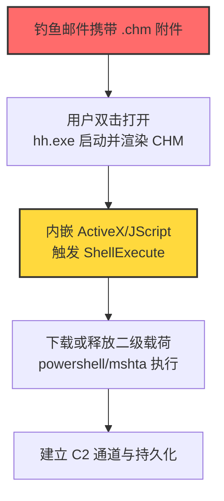
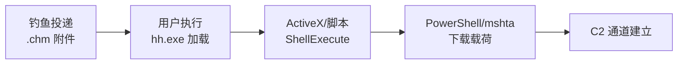

# 编译HTML帮助文件 (T1218.001)

## 一句话通俗理解

> **攻击者把恶意代码塞进 Windows 帮助文档（.chm）里，让 hh.exe 这个合法程序替它执行——好比把密信藏在说明书里，让邮差替你送出。**

## 30秒速查卡

| 维度 | 你需要知道的 |
|------|-------------|
| 这是什么？ | 编译HTML帮助文件（T1218.001），系统二进制代理执行（T1218）的子技术 |
| 为什么危险？ | hh.exe 是微软签名二进制，CHM 内嵌 HTML/ActiveX/JScript/VBScript，可绕过应用白名单与文件扩展名检测 |
| 谁需要关心？ | 系统管理员、安全运维团队、SOC分析师、邮件网关管理员 |
| 你的第一步防御 | 阻断 CHM 文件进入（邮件附件/下载），并对 hh.exe 启用应用控制 |
| 如果只做一件事 | 在 Sysmon 中监控 hh.exe 进程创建及其子进程（powershell/mshta/cmd） |

## 难度等级

⭐⭐ 中级 - 需要一定的技术基础和经验

## 前置知识检查

**读这个文件需要什么？**

- [ ] 操作系统权限模型基础
- [ ] 系统二进制代理执行（T1218）的原理
- [ ] Windows HTML Help（hh.exe / .chm）基础知识
- [ ] Internet Explorer ActiveX/脚本引擎工作机制

## 技术描述

**编译HTML帮助文件**（T1218.001）是 **系统二进制代理执行**（T1218）的一个具体变体，属于 **隐蔽** 阶段的攻击技术。

攻击者可能滥用编译HTML文件（.chm）来隐蔽恶意代码。CHM 文件通常作为 Microsoft HTML Help 系统的一部分进行分发。CHM 文件是 HTML 文档、图像以及 VBA、JScript、Java、ActiveX 等 Web 相关编程语言的压缩编译集合。CHM 内容由 HTML Help 可执行程序（hh.exe）加载的 Internet Explorer 浏览器底层组件进行显示。

攻击者可将内嵌载荷的自定义 CHM 文件投递到受害者主机，然后通过用户执行（T1204）触发。在未考虑通过 hh.exe 执行二进制的旧系统或未打补丁的系统上，CHM 执行还可绕过应用控制。已知 CVE-2017-8625（Internet Explorer 安全特性绕过漏洞）可被用于绕过 Device Guard UMCI。

### 具体怎么理解？

把 CHM 文件想象成一个**压缩包 + 网页 + 可执行脚本**的三合一容器：

1. **容器层**：`.chm` 是微软专有的压缩格式，外观像普通帮助文档
2. **内容层**：内部是 HTML 页面、图像、ActiveX 控件、JScript/VBScript 脚本
3. **执行层**：双击或命令行调用时，hh.exe 启动并调用 IE 引擎渲染内容——脚本引擎和 ActiveX 在此过程中被激活

由于 hh.exe 是 `C:\Windows` 下的微软签名二进制，应用白名单（如 AppLocker 默认规则）通常不会阻止它运行；同时 .chm 扩展名不像 .exe/.dll 那样受到严格审查。

### 为什么有效？

- **签名信任**：hh.exe 是系统自带签名二进制，应用控制策略通常信任
- **扩展名盲区**：.chm 不在常见可执行扩展名黑名单中，邮件网关与文件下载策略常忽略
- **脚本能力**：CHM 内嵌的 HTML Help ActiveX 控件可执行 ShellExecute、WScript.Shell 等危险对象
- **CVE 加成**：CVE-2017-8625 允许在 Device Guard UMCI 启用环境下绕过执行限制（旧系统）

## 真型场景

攻击者在 **隐蔽** 阶段使用编译HTML帮助文件技术，以下是典型的攻击步骤：



**步骤详解：**

1. **投递**：攻击者将武器化 CHM 文件作为邮件附件或下载链接投递，常伪装成"产品手册""合同说明""培训资料"。
2. **触发**：用户双击 .chm，系统调用 hh.exe 加载，IE 引擎渲染内部 HTML 页面。
3. **执行**：页面中嵌入的 `<OBJECT>` 标签实例化 HTML Help ActiveX 控件（clsid:52A2AAAE-085D-4187-97EA-8C39DBF8D959）或 WScript.Shell，调用 `Run()`/`ShellExecute()` 执行任意命令。
4. **载荷落地**：脚本通过 PowerShell、mshta、certutil 等下载二级载荷，建立 C2 通道并完成持久化。

## 攻击流程

```
邮件投递 .chm → hh.exe 渲染 → ActiveX 调用 → 脚本引擎执行 → 二级载荷下载 → C2 持久化
```



**步骤详解：**

1. **钓鱼投递**
   - 通俗描述：攻击者把"毒药"包装成帮助文档寄给受害者
   - 技术细节：邮件附件 .chm 文件，文件名伪装成业务相关（如"Q3财务报告.chm"）；MIME 类型为 `application/vnd.ms-htmlhelp`
   - 常用工具：自研 CHM 构造工具、HTML Help Workshop、学术钓鱼模板

2. **用户执行触发**
   - 通俗描述：受害者双击打开"帮助文档"
   - 技术细节：hh.exe 解析 .chm 头部、解压内部 ITStorage，调用 IE 渲染 default topic 页面
   - 常用工具：hh.exe（系统自带）

3. **ActiveX/脚本执行**
   - 通俗描述：藏在文档里的"自动程序"开始运行
   - 技术细节：HTML Help ActiveX 控件 `Click()` 方法触发 `HHCTRL.ocx` 内 ShellExecute；或 JScript 调用 `new ActiveXObject("WScript.Shell").Run("...")`
   - 常用工具：HTML Help ActiveX、WScript.Shell、Shell.Application

4. **载荷落地与持久化**
   - 通俗描述：通过 PowerShell 等下载真正的恶意软件并驻留
   - 技术细节：`powershell -w hidden -enc <base64>` 下载执行；写入 Run 键或计划任务持久化
   - 常用工具：PowerShell、mshta、certutil、bitsadmin

## 真实案例

### 案例1：APT38 利用 CHM 转移隐蔽载荷

- **时间**: 2017年（公开报告）
- **目标**: 全球金融机构（SWIFT 系统攻击）
- **攻击组织**: APT38（Lazarus 子组织，G0082）
- **手法**: APT38 使用 CHM 文件转移隐蔽载荷，CHM 内嵌恶意脚本在受害者主机上解密并执行后续攻击组件，绕过应用控制
- **影响**: 造成数千万美元损失，金融机构长期潜伏未被发现
- **参考链接**: [Kaspersky - Lazarus Under the Hood](https://media.kasperskycontenthub.com/wp-content/uploads/sites/43/2018/03/07180244/Lazarus_Under_The_Hood_PDF_final.pdf)

### 案例2：APT41 使用 CHM 文件定向攻击

- **时间**: 2019年（公开报告）
- **目标**: 多行业组织（游戏、医疗、电信）
- **攻击组织**: APT41（G0096，双线操作：间谍+网络犯罪）
- **手法**: APT41 使用编译HTML（.chm）文件作为初始访问载荷，针对特定目标投递
- **影响**: 双重 espionage 与 cyber crime 操作并行
- **参考链接**: [Mandiant - APT41 Dual Operation](https://www.mandiant.com/sites/default/files/2022-02/rt-apt41-dual-operation.pdf)

### 案例3：Silence 钓鱼武器化 CHM

- **时间**: 2017-2019年
- **目标**: 金融机构（银行）
- **攻击组织**: Silence（G0091）
- **手法**: Silence 在钓鱼活动中武器化 CHM 文件，附件打开后通过内嵌命令下载并运行可执行文件
- **影响**: 多家银行被攻陷，ATN/ATM 攻击造成重大资金损失
- **参考链接**: [Securelist - The Silence](https://securelist.com/the-silence/83009/)

### 案例4：OilRig 用 CHM 载荷加载执行后门

- **时间**: 2016年
- **目标**: 沙特阿拉伯组织
- **攻击组织**: OilRig（G0049，伊朗 APT）
- **手法**: OilRig 使用 CHM 载荷，一旦投递到受害者主机即加载并执行另一个恶意文件（Helminth 后门）
- **影响**: 中东能源行业长期情报收集
- **参考链接**: [Palo Alto - OilRig Campaign](http://researchcenter.paloaltonetworks.com/2016/05/the-oilrig-campaign-attacks-on-saudi-arabian-organizations-deliver-helminth-backdoor/)

### 案例5：Dark Caracal 全球间谍活动

- **时间**: 2018年（公开报告）
- **目标**: 全球政府、军事、企业（跨 21 国）
- **攻击组织**: Dark Caracal（G0070）
- **手法**: 利用包含下载并运行可执行文件命令的 CHM 文件
- **影响**: 大规模跨平台间谍活动，窃取大量敏感数据
- **参考链接**: [Lookout - Dark Caracal](https://info.lookout.com/rs/051-ESQ-475/images/Lookout_Dark-Caracal_srr_20180118_us_v.1.0.pdf)

### 案例6：Astaroth WMIC 木马复现

- **时间**: 2018-2019年
- **目标**: 拉丁美洲用户
- **攻击组织**: Astaroth（S0373，无文件木马）
- **手法**: Astaroth 使用 ActiveX 对象进行文件执行与操作，CHM 内嵌 ActiveX 触发后续 WMIC 调用链
- **影响**: 凭证窃取、横向移动
- **参考链接**: [Cofense - Astaroth WMIC Trojan](https://web.archive.org/web/20200302071436/https://cofense.com/seeing-resurgence-demonic-astaroth-wmic-trojan/)

### 案例7：安全研究中的实践

- **时间**: 2017年
- **目标**: 安全研究测试环境
- **攻击组织**: 红队/安全研究人员（Oddvar Moe）
- **手法**: 利用 CVE-2017-8625 在启用 Device Guard UMCI 的环境中通过 CHM 绕过应用控制
- **影响**: 证明 CHM 可绕过当时主流应用控制方案，推动微软发布补丁
- **参考链接**: [Oddvar Moe - Bypassing Device Guard UMCI using CHM](https://oddvar.moe/2017/08/13/bypassing-device-guard-umci-using-chm-cve-2017-8625/)

## 红队视角

> ⚠️ **免责声明**：以下内容仅用于合法的安全测试、渗透测试和教育目的。未经授权对他人系统进行测试是违法行为。

### 实战技巧

1. **深入理解原理**：掌握 CHM 文件格式（ITSF/ITSP 头部、#STRINGS/#URLTBL 节）、HTML Help ActiveX 控件能力、HHCTRL.ocx 加载流程
2. **环境适配**：先侦察目标是否启用 hh.exe 应用控制规则与 CHM 文件类型阻断；优先针对未打补丁（< 2017-08 补丁）系统使用 CVE-2017-8625
3. **组合使用**：与用户执行（T1204）组合触发；与进程注入（T1055）或系统二进制代理执行的其他子技术（如 Mshta T1218.005）链式使用，让 hh.exe 调用 mshta.exe 进一步混淆
4. **隐蔽性考虑**：CHM 文件名伪装成业务文档；利用 HTML Help Workshop 自定义图标；ActiveX 调用前先显示帮助页面降低怀疑；执行后删除 .chm 文件

### 常用工具

| 工具名称 | 用途 | 平台 | 链接 |
| -------- | ---- | ---- | ---- |
| HTML Help Workshop | 微软官方 CHM 制作工具 | Windows | [Microsoft HTML Help 1.4 SDK](https://docs.microsoft.com/previous-versions/windows/desktop/htmlhelp/microsoft-html-help-1-4-sdk) |
| FAR HTML | 商业 CHM 编辑器，支持脚本注入 | Windows | https://helpware.net/farhtml/ |
| Ninesky/ChmBuilder | 自定义 CHM 载荷构造 | Windows | 红队自研工具 |
| Atomic Red Team T1218.001 | 检测规则测试用例 | Windows | [Atomic Red Team](https://github.com/redcanaryco/atomic-red-team/blob/master/atomics/T1218.001/T1218.001.md) |
| LOLBAS hh.exe | 二进制滥用参考 | Windows | [LOLBAS - hh.exe](https://lolbas-project.github.io/lolbas/Binaries/Hh/) |

### 注意事项

- 在授权的测试环境中使用这些技术
- 注意操作安全（OPSEC），避免被检测系统发现：执行后清理 .chm 文件、清空 hh.exe 命令行历史
- 使用匿名化技术和代理隐藏真实身份
- 旧系统上 CVE-2017-8625 可绕过 Device Guard，但已打补丁环境无效

## 蓝队视角

### 检测要点

1. **系统日志监控**：Sysmon Event ID 1（进程创建）监控 hh.exe 启动，特别是带 .chm 参数的命令行
2. **异常行为检测**：hh.exe 子进程异常（powershell/cmd/mshta/wscript/cscript）；从非标准目录（用户临时目录、下载文件夹）加载 CHM
3. **工具特征识别**：邮件网关与文件下载扫描 .chm 附件；EDR 监控 HHCTRL.ocx 内 ShellExecute 调用链

### 监控建议

- 部署端点检测和响应（EDR）系统，配置 hh.exe 进程创建与子进程关联规则
- 配置SIEM规则，关联分析来自多个来源的告警（邮件附件 + hh.exe 进程 + 子进程网络外联）
- 定期进行安全评估和渗透测试，验证 CHM 投递链的检测覆盖
- 在邮件网关阻断 .chm 附件（默认应阻断）

## 避坑指南

- **不要只盯 hh.exe 本身**：合法用户也会打开帮助文档，需结合子进程与文件来源综合判断
- **不要忽视命令行调用**：`hh.exe malicious.chm` 与双击行为日志特征相同，但前者更可疑
- **不要假设补丁已打**：旧系统、嵌入式系统、OT 环境可能仍存在 CVE-2017-8625
- **不要漏掉 rundll32 路径**：部分变种通过 `rundll32.exe hhctrl.ocx,HtmlHelpA` 调用，绕过对 hh.exe 的监控

## 检测建议

### 检测思路

检测 编译HTML帮助文件 的关键是识别 hh.exe 的异常执行模式及其后续行为。以下是三个层面的检测方法：

### 网络层检测

**方法**：监控 hh.exe 进程发起的出站连接，特别是连接到非企业域名或新注册域名。

```bash
# 检测 hh.exe 异常网络外联
# Sysmon Event ID 3 (网络连接) 过滤 hh.exe 源
Get-WinEvent -FilterHashtable @{LogName='Microsoft-Windows-Sysmon/Operational'; ID=3} |
  Where-Object {$_.Message -match 'hh\.exe'} |
  Select-Object TimeCreated, Message
```

### 主机层检测

**Windows事件ID**：
- Sysmon Event ID 1：进程创建（监控 hh.exe 启动及其子进程）
- Sysmon Event ID 7：镜像加载（监控 hh.exe 加载 hhctrl.ocx、mshtml.dll）
- Sysmon Event ID 11：文件创建（监控 .chm 文件落地）
- 事件ID 4688：进程创建（监控可疑进程）

```bash
# 检测 hh.exe 打开 .chm 后的可疑子进程
# Sysmon 配置：
# <RuleGroup name="CHM Execution" groupRelation="or">
#   <ProcessCreate onmatch="include">
#     <Image condition="is">C:\Windows\hh.exe</Image>
#     <CommandLine condition="contains">.chm</CommandLine>
#   </ProcessCreate>
#   <ProcessCreate onmatch="include">
#     <ParentImage condition="is">C:\Windows\hh.exe</ParentImage>
#   </ProcessCreate>
# </RuleGroup>

# 查询 hh.exe 子进程
Get-WinEvent -FilterHashtable @{LogName='Microsoft-Windows-Sysmon/Operational'; ID=1} |
  Where-Object {$_.Message -match 'ParentImage.*hh\.exe'} |
  Select-Object TimeCreated, @{n='ChildProcess';e={$_.Properties[5].Value}}
```

**用人话说：** hh.exe 是 Windows 帮助查看器，正常情况下用户偶尔会打开 .chm 文档，但**几乎不会**在打开帮助文档后立即启动 PowerShell、cmd、mshta 等命令行工具——一旦看到这个组合，几乎可以确定是攻击。

```yaml
title: 检测 hh.exe 异常执行与可疑子进程
status: experimental
description: 检测 hh.exe 打开 .chm 文件后启动可疑子进程（编译HTML帮助文件 T1218.001）
references:
    - https://attack.mitre.org/techniques/T1218/001/
    - https://github.com/SigmaHQ/sigma/blob/master/rules/windows/process_creation/proc_creation_win_hh_chm_execution.yml
logsource:
    category: process_creation
    product: windows
detection:
    selection_hh:
        Image|endswith: '\hh.exe'
        CommandLine|contains: '.chm'
    selection_child:
        ParentImage|endswith: '\hh.exe'
        Image|endswith:
            - '\powershell.exe'
            - '\pwsh.exe'
            - '\cmd.exe'
            - '\mshta.exe'
            - '\wscript.exe'
            - '\cscript.exe'
            - '\regsvr32.exe'
            - '\rundll32.exe'
    condition: selection_hh or selection_child
fields:
    - CommandLine
    - ParentCommandLine
    - Image
    - User
falsepositives:
    - 极少数合法软件通过 hh.exe 调用脚本（罕见）
level: high
tags:
    - attack.t1218.001
    - attack.t1218
    - attack.ta0005
    - attack.stealth
```

### 应用层检测

**Sigma规则示例**（基于 ATT&CK DET0342 / AN0968）：

```yaml
title: DET0342 - 可疑编译HTML文件执行 (hh.exe)
id: e12221c2-ba47-4a39-949d-78b9b22d8c5c
status: stable
description: |
    检测 hh.exe 打开 .chm 文件后跟可疑子进程或脚本引擎调用。
    对应 ATT&CK DET0342 / AN0968。
references:
    - https://attack.mitre.org/detectionstrategies/DET0342/
logsource:
    product: windows
    category: process_creation
detection:
    selection_hh_chm:
        Image|endswith: '\hh.exe'
        CommandLine|contains:
            - '.chm'
    selection_hh_child:
        ParentImage|endswith: '\hh.exe'
    filter_legitimate:
        Image|endswith: '\hh.exe'
        ParentImage|endswith:
            - '\explorer.exe'
            - '\winshell.exe'
    condition: (selection_hh_chm or selection_hh_child) and not filter_legitimate
fields:
    - CommandLine
    - ParentCommandLine
    - Image
    - User
falsepositives:
    - 合法软件帮助系统调用（极罕见）
level: high
tags:
    - attack.t1218.001
    - attack.t1218
    - attack.ta0005
```

## 缓解措施

### 优先级1：关键措施

**M1038 执行预防（应用控制阻止 hh.exe）**：在不需要查看 .chm 帮助文档的环境中（绝大多数企业终端），通过 AppLocker / WDAC / SRP 阻止 hh.exe 执行。

```bash
# AppLocker 规则示例（默认拒绝 hh.exe）
# 通过 GPO 部署：
# Path condition: %WINDIR%\hh.exe → Deny
New-AppLockerPolicy -Xml -PolicyType Deny -Path "%WINDIR%\hh.exe" -User "Everyone"
```

**M1021 限制 Web 内容（阻断 CHM 文件类型）**：在邮件网关、Web 代理、文件下载策略中阻断 .chm 文件传输。

```bash
# Exchange 邮件流规则示例
New-TransportRule -Name "Block CHM Attachments" -AttachmentNamePatterns "*.chm" -RejectMessageReasonText "CHM 文件被安全策略禁止"
```

### 优先级2：重要措施

**加强监控**：部署EDR和SIEM系统，针对 hh.exe 进程创建、子进程链、网络外联建立关联告警规则（见上文 Sigma 规则）。

**及时打补丁**：确保系统已安装 2017-08 安全更新（修复 CVE-2017-8625），消除 Device Guard UMCI 绕过。

### 优先级3：建议措施

**安全意识培训**：教育员工识别可疑的 .chm 帮助文档附件，不要轻易打开来自不受信来源的"说明书""手册"类文件。

## 动手实验

> ⚠️ **所有实验必须在隔离的实验室环境中进行**

### 实验1：理解基本原理（初级）

**目标**：理解 编译HTML帮助文件 的工作原理

**步骤**：
1. 在隔离环境中搭建 Windows 测试虚拟机（关闭 Defender 或加入排除项）
2. 使用 HTML Help Workshop 创建一个简单的 .chm 文件，内含一个 HTML 页面显示"Hello"
3. 用 hh.exe 打开该 .chm，观察进程树（Process Explorer / Sysinternals）
4. 查看 hh.exe 加载的模块（特别是 hhctrl.ocx、mshtml.dll）

**学习要点**：理解 CHM 文件结构、hh.exe 加载流程、IE 引擎渲染机制

### 实验2：实际操作（中级）

**目标**：掌握 编译HTML帮助文件 的实际使用方法

**步骤**：
1. 在 CHM 中嵌入 JScript：`new ActiveXObject("WScript.Shell").Run("calc.exe")`
2. 通过 `<OBJECT>` 标签实例化 HTML Help ActiveX 控件并调用 `Click()` 方法
3. 触发 hh.exe 打开 CHM，观察 calc.exe 是否启动
4. 配置 Sysmon 监控，分析 hh.exe → calc.exe 进程链的日志特征
5. 测试不同子进程（powershell、mshta）的检测告警触发

**学习要点**：掌握 ActiveX 触发链、Sysmon 日志特征、Sigma 规则匹配

### 实验3：防御验证（高级）

**目标**：验证检测规则的有效性

**步骤**：
1. 部署本文 Sigma 规则到 SIEM（如 Splunk、Microsoft Sentinel）
2. 配置 AppLocker 阻止 hh.exe 执行
3. 执行 Atomic Red Team T1218.001 测试用例
4. 验证检测告警是否触发，AppLocker 是否阻断
5. 测试绕过：尝试通过 `rundll32.exe hhctrl.ocx,HtmlHelpA` 路径绕过 hh.exe 监控
6. 改进检测规则覆盖绕过路径

**学习要点**：理解攻防对抗的实际效果，掌握检测规则迭代优化

## 术语解释

| 术语 | 通俗解释 |
|------|---------|
| **ATT&CK** | MITRE公司维护的攻击技术知识库 |
| **编译HTML帮助文件** | T1218.001，利用 hh.exe 加载 .chm 文件执行嵌入的恶意脚本 |
| **CHM** | Compiled HTML，微软专有的压缩HTML帮助文档格式 |
| **hh.exe** | HTML Help 可执行程序，系统自带的 .chm 查看器 |
| **HHCTRL.ocx** | HTML Help ActiveX 控件，CHM 内可调用的危险对象 |
| **系统二进制代理执行** | T1218，本子技术所属的父技术类别 |
| **隐蔽** | 攻击链中的一个阶段（TA0005） |
| **C2** | 命令与控制 |
| **EDR** | 端点检测与响应 |
| **CVE-2017-8625** | IE 安全特性绕过漏洞，可绕过 Device Guard UMCI |
| **UMCI** | 用户模式代码完整性（Device Guard 组件） |

## 被引用情况

以下父技术文档引用了本子技术：

- [T1218 - 系统二进制代理执行](../T1218-System-Binary-Proxy-Execution.md)

## 参考资料

### 📚 官方文档（深入了解）

- [MITRE ATT&CK - Compiled HTML File (T1218.001)](https://attack.mitre.org/techniques/T1218/001/)
- [MITRE ATT&CK - System Binary Proxy Execution (T1218)](https://attack.mitre.org/techniques/T1218/)
- [MITRE ATT&CK - DET0342 检测策略](https://attack.mitre.org/detectionstrategies/DET0342/)
- [Microsoft HTML Help 1.4 SDK](https://docs.microsoft.com/previous-versions/windows/desktop/htmlhelp/microsoft-html-help-1-4-sdk)
- [Microsoft - About the HTML Help Executable Program](https://msdn.microsoft.com/windows/desktop/ms524405)
- [Microsoft - HTML Help ActiveX Control Overview](https://msdn.microsoft.com/windows/desktop/ms644670)

### 📰 安全报告（真实攻击）

- [Kaspersky - Lazarus Under the Hood (APT38)](https://media.kasperskycontenthub.com/wp-content/uploads/sites/43/2018/03/07180244/Lazarus_Under_The_Hood_PDF_final.pdf)
- [Mandiant - APT41 Dual Operation](https://www.mandiant.com/sites/default/files/2022-02/rt-apt41-dual-operation.pdf)
- [Securelist - The Silence](https://securelist.com/the-silence/83009/)
- [Group-IB - Silence 2.0: Going Global](https://www.group-ib.com/resources/threat-research/silence_2.0.going_global.pdf)
- [Palo Alto - OilRig Campaign](http://researchcenter.paloaltonetworks.com/2016/05/the-oilrig-campaign-attacks-on-saudi-arabian-organizations-deliver-helminth-backdoor/)
- [Lookout - Dark Caracal](https://info.lookout.com/rs/051-ESQ-475/images/Lookout_Dark-Caracal_srr_20180118_us_v.1.0.pdf)
- [Cofense - Astaroth WMIC Trojan](https://web.archive.org/web/20200302071436/https://cofense.com/seeing-resurgence-demonic-astaroth-wmic-trojan/)
- [Skulkin - Silence: Dissecting Malicious CHM Files](https://web.archive.org/web/20220119133748/https://cyberforensicator.com/2019/01/20/silence-dissecting-malicious-chm-files-and-performing-forensic-analysis/)
- [Oddvar Moe - Bypassing Device Guard UMCI using CHM (CVE-2017-8625)](https://oddvar.moe/2017/08/13/bypassing-device-guard-umci-using-chm-cve-2017-8625/)
- [Microsoft - CVE-2017-8625 Advisory](https://web.archive.org/web/20250419140549/https://msrc.microsoft.com/update-guide/en-US/advisory/CVE-2017-8625)

### 🔧 工具与资源（动手试试）

- [Atomic Red Team - T1218.001 测试用例](https://github.com/redcanaryco/atomic-red-team/blob/master/atomics/T1218.001/T1218.001.md) - 检测规则测试框架
- [LOLBAS - hh.exe](https://lolbas-project.github.io/lolbas/Binaries/Hh/) - LOLBins 参考
- [MITRE ATT&CK Navigator](https://mitre-attack.github.io/attack-navigator/) - ATT&CK 可视化工具
- [HTML Help Workshop](https://docs.microsoft.com/previous-versions/windows/desktop/htmlhelp/microsoft-html-help-1-4-sdk) - 微软官方 CHM 制作工具
- [Sigma Rule - hh.exe CHM Execution](https://github.com/SigmaHQ/sigma/blob/master/rules/windows/process_creation/proc_creation_win_hh_chm_execution.yml) - 检测规则参考
