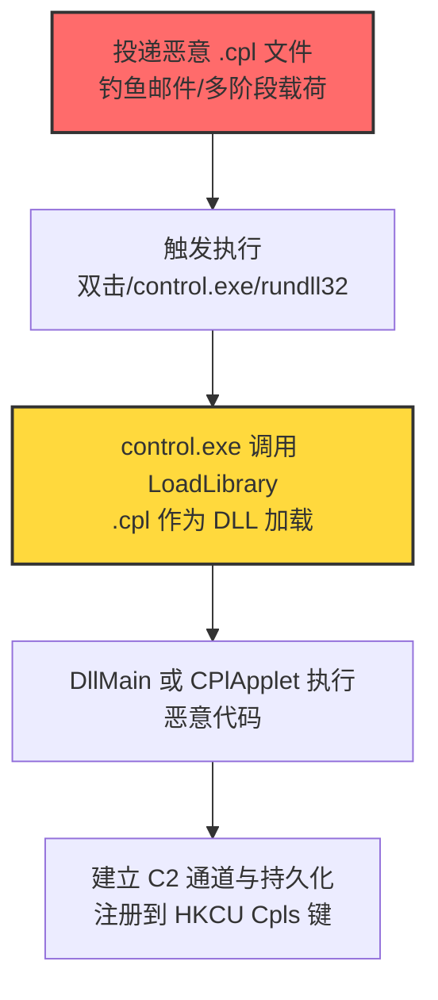
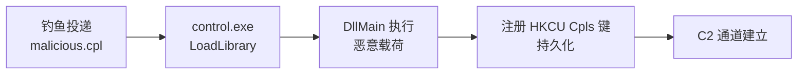

# 控制面板 (T1218.002)

## 一句话通俗理解

> **攻击者把恶意 DLL 改名成 .cpl 文件，让 control.exe 这个"控制面板启动器"替它加载执行——好比把违禁品塞进快递盒里，让快递员替你送货。**

## 30秒速查卡

| 维度 | 你需要知道的 |
|------|-------------|
| 这是什么？ | 控制面板（T1218.002），系统二进制代理执行（T1218）的子技术 |
| 为什么危险？ | control.exe 是微软签名二进制，.cpl 实际是重命名的 DLL，可绕过应用/文件扩展名白名单 |
| 谁需要关心？ | 系统管理员、安全运维团队、SOC分析师、邮件网关管理员 |
| 你的第一步防御 | 应用控制阻止非标准目录的 .cpl 加载；监控 control.exe 异常子进程 |
| 如果只做一件事 | 在 Sysmon 中监控 control.exe 启动参数及子进程链 |

## 难度等级

⭐⭐ 中级 - 需要一定的技术基础和经验

## 前置知识检查

**读这个文件需要什么？**

- [ ] 操作系统权限模型基础
- [ ] 系统二进制代理执行（T1218）的原理
- [ ] Windows DLL 加载机制
- [ ] 控制面板项（.cpl）的 CPlApplet 接口规范

## 技术描述

**控制面板**（T1218.002）是 **系统二进制代理执行**（T1218）的一个具体变体，属于 **隐蔽** 阶段的攻击技术。

攻击者可能滥用 control.exe 来代理执行恶意载荷。控制面板项是注册的 .exe 或 .cpl 文件，其中 .cpl 实际是重命名的 DLL，必须导出 `CPlApplet()` 函数。攻击者可向受害者投递恶意 CPL 文件，然后通过命令行直接执行、API 调用或双击文件触发。

CPL 文件可绕过未考虑其潜在滥用的应用控制和文件扩展名白名单。攻击者还可将恶意 DLL 重命名为 .cpl 并注册到注册表 `HKCU\Software\Microsoft\Windows\CurrentVersion\Control Panel\Cpls`——即使该 DLL 不导出 CPlApplet 函数，也会通过 DllEntryPoint 加载执行，从而实现持久化。

### 具体怎么理解？

把 .cpl 文件想象成一个**穿了控制面板外衣的 DLL**：

1. **本质是 DLL**：.cpl 扩展名只是 DLL 的伪装，文件内部 PE 头部就是标准 DLL
2. **加载器是 control.exe**：双击 .cpl 或运行 `control.exe file.cpl` 时，control.exe 调用 `LoadLibrary()` 把 .cpl 当作 DLL 加载
3. **执行入口**：正常 CPL 通过 `CPlApplet()` 函数响应控制面板消息；恶意 CPL 可在 `DllMain`（DllEntryPoint）中直接执行代码，无需 CPlApplet
4. **持久化注册**：注册到 `HKCU\...\Control Panel\Cpls` 后，每次用户打开控制面板都会触发加载

### 为什么有效？

- **签名信任**：control.exe 是 `C:\Windows\System32` 下的微软签名二进制，应用控制策略通常信任
- **扩展名盲区**：.cpl 不在常见可执行扩展名（.exe/.dll/.scr）黑名单中，文件下载策略常忽略
- **入口灵活性**：即使 DLL 不导出 CPlApplet，DllMain 也会被加载执行，绕过对导出函数的检查
- **持久化隐蔽**：注册到 `HKCU\...\Control Panel\Cpls` 是合法机制，安全审计常忽略

## 真型场景

攻击者在 **隐蔽** 阶段使用控制面板技术，以下是典型的攻击步骤：



**步骤详解：**

1. **投递**：通过钓鱼邮件、多阶段恶意软件投递武器化 .cpl 文件，常伪装成"驱动安装包""系统工具"。
2. **触发**：用户双击 .cpl 文件（默认关联 control.exe），或攻击者通过命令行 `control.exe malicious.cpl`、API `WinExec`、`rundll32.exe shell32.dll,Control_RunDLL malicious.cpl` 触发。
3. **加载**：control.exe 调用 `LoadLibrary()` 加载 .cpl 文件作为 DLL，触发 `DllMain`（DLL_PROCESS_ATTACH）。
4. **执行**：恶意代码在 DllMain 中执行，或通过 CPlApplet 响应 CPL_INIT/CPL_GETCOUNT 消息时执行。
5. **持久化**：将恶意 .cpl 路径写入 `HKCU\Software\Microsoft\Windows\CurrentVersion\Control Panel\Cpls`，每次打开控制面板时自动加载。

## 攻击流程

```
投递 .cpl → control.exe 加载 → DllMain 执行 → 注册 HKCU Cpls 持久化 → C2 通信
```



**步骤详解：**

1. **投递**
   - 通俗描述：攻击者把"毒药"伪装成系统工具寄给受害者
   - 技术细节：邮件附件 .cpl 文件，文件名伪装成业务相关；或通过已植入的恶意软件二阶段下载
   - 常用工具：自研 .cpl 构造工具、Visual Studio 编译 DLL 后改名

2. **触发执行**
   - 通俗描述：受害者双击"工具"或攻击者远程命令执行
   - 技术细节：`control.exe C:\Users\Public\file.cpl`；或 `rundll32.exe shell32.dll,Control_RunDLL C:\Users\Public\file.cpl`；或 `WinExec("control.exe file.cpl", 0)`
   - 常用工具：control.exe（系统自带）、rundll32.exe（系统自带）

3. **DLL 加载与执行**
   - 通俗描述：control.exe 把 .cpl 当作 DLL 加载，DllMain 自动运行
   - 技术细节：control.exe 通过 `LoadLibraryW` 加载 .cpl；DllMain 在 DLL_PROCESS_ATTACH 时执行；可选 CPlApplet 函数响应控制面板消息
   - 常用工具：恶意 DLL 编译器（MSVC、MinGW）

4. **持久化注册**
   - 通俗描述：把恶意 .cpl 注册成"控制面板项"，每次打开控制面板都自动加载
   - 技术细节：写入注册表 `HKCU\Software\Microsoft\Windows\CurrentVersion\Control Panel\Cpls`，新建字符串值 `malicious` = `C:\Users\Public\file.cpl`
   - 常用工具：reg.exe、regedit、PowerShell `New-ItemProperty`

## 真实案例

### 案例1：InvisiMole 通过控制面板实现执行与持久化

- **时间**: 2018-2020年（公开报告）
- **目标**: 东欧政府与外交机构
- **攻击组织**: InvisiMole（S0260）
- **手法**: InvisiMole 通过控制面板注册自身实现执行和持久化——将恶意 DLL 重命名为 .cpl，注册到 `HKCU\...\Control Panel\Cpls`，每次控制面板启动时自动加载
- **影响**: 长期隐蔽监听，截获敏感会议录音与文档
- **参考链接**: [ESET - InvisiMole 报告](https://www.welivesecurity.com/2020/06/24/dropping-anchor-invisimole/)

### 案例2：Reaver 投递并执行恶意 CPL 文件

- **时间**: 2017-2018年
- **目标**: 中东政府组织
- **攻击组织**: Reaver（S0172）
- **手法**: Reaver 投递并执行恶意 CPL 文件，绕过应用白名单限制
- **影响**: 情报收集与横向移动
- **参考链接**: [TrendMicro - CPL 恶意软件白皮书](https://www.trendmicro.com/cloud-content/us/pdfs/security-intelligence/white-papers/wp-cpl-malware.pdf)

### 案例3：安全研究中的实践

- **时间**: 2025年
- **目标**: 安全研究测试环境
- **攻击组织**: 红队/安全研究人员
- **手法**: 在授权测试中模拟 控制面板 攻击，使用 .cpl 持久化绕过 EDR
- **影响**: 验证防御体系的检测和响应能力
- **参考链接**: [Atomic Red Team](https://github.com/redcanaryco/atomic-red-team)

## 红队视角

> ⚠️ **免责声明**：以下内容仅用于合法的安全测试、渗透测试和教育目的。未经授权对他人系统进行测试是违法行为。

### 实战技巧

1. **深入理解原理**：掌握 CPL 文件格式（PE 头部 IMAGE_FILE_HEADER + IMAGE_OPTIONAL_HEADER）、CPlApplet 函数签名、DllMain 加载时机、control.exe 与 rundll32.exe 的调用关系
2. **环境适配**：先侦察目标的应用控制策略——AppLocker 默认规则通常允许 `C:\Windows\System32\*.cpl`，可利用 DLL 侧加载（T1574.002）替换合法 .cpl；或检查 .cpl 文件类型是否在邮件网关黑名单
3. **组合使用**：与 DLL 侧加载（T1574.002）组合替换系统 .cpl；与持久化注册表键（T1547.001 Run 键）组合，写入 `HKCU\...\Control Panel\Cpls` 实现"打开控制面板即触发"
4. **隐蔽性考虑**：.cpl 文件名伪装成系统组件（如 `ncpa.cpl`、`sysdm.cpl`）；放置在用户可写目录避免触发 UAC；DllMain 中只做最小初始化，主逻辑通过 CPlApplet 延迟执行降低怀疑

### 常用工具

| 工具名称 | 用途 | 平台 | 链接 |
| -------- | ---- | ---- | ---- |
| Visual Studio | 编译恶意 DLL 后改名为 .cpl | Windows | https://visualstudio.microsoft.com/ |
| MinGW | 跨平台 DLL 编译 | Windows/Linux | http://www.mingw.org/ |
| control.exe | 系统自带控制面板启动器 | Windows | 系统自带 |
| rundll32.exe | 通过 `shell32.dll,Control_RunDLL` 加载 .cpl | Windows | 系统自带 |
| Atomic Red Team T1218.002 | 检测规则测试用例 | Windows | [Atomic Red Team](https://github.com/redcanaryco/atomic-red-team/blob/master/atomics/T1218.002/T1218.002.md) |
| LOLBAS control.exe | 二进制滥用参考 | Windows | [LOLBAS - control.exe](https://lolbas-project.github.io/lolbas/Binaries/Control/) |

### 注意事项

- 在授权的测试环境中使用这些技术
- 注意操作安全（OPSEC），避免被检测系统发现：执行后清理 .cpl 文件与注册表项
- 使用匿名化技术和代理隐藏真实身份
- DllMain 中避免执行复杂逻辑（加载器锁限制），主逻辑通过新线程或 CPlApplet 触发

## 蓝队视角

### 检测要点

1. **系统日志监控**：Sysmon Event ID 1（进程创建）监控 control.exe 启动，特别是带 .cpl 参数的命令行；监控 rundll32.exe 调用 `shell32.dll,Control_RunDLL` 的命令行
2. **异常行为检测**：control.exe 子进程异常（powershell/cmd/mshta）；从非标准目录（用户临时目录、下载文件夹、Public 目录）加载 .cpl；新创建的 .cpl 文件立即被 control.exe 加载
3. **工具特征识别**：监控注册表 `HKCU\Software\Microsoft\Windows\CurrentVersion\Control Panel\Cpls` 的写入操作；EDR 监控 control.exe 的 `LoadLibrary` 调用目标

### 监控建议

- 部署端点检测和响应（EDR）系统，配置 control.exe 进程创建与 .cpl 加载关联规则
- 配置SIEM规则，关联分析来自多个来源的告警（.cpl 文件落地 + control.exe 加载 + 注册表修改）
- 定期进行安全评估和渗透测试，验证 CPL 投递链的检测覆盖
- 在邮件网关阻断 .cpl 附件（默认应阻断）

## 避坑指南

- **不要只盯 control.exe 本身**：合法用户也会打开控制面板，需结合 .cpl 来源与子进程综合判断
- **不要忽视 rundll32 路径**：`rundll32.exe shell32.dll,Control_RunDLL file.cpl` 是等价调用路径，绕过对 control.exe 的监控
- **不要漏掉 HKCU Cpls 键**：这是持久化的关键位置，需监控该键的非系统 .cpl 写入
- **不要假设 .cpl 一定导出 CPlApplet**：恶意 .cpl 可能只依赖 DllMain 执行，检测应覆盖所有 .cpl 加载行为

## 检测建议

### 检测思路

检测 控制面板 的关键是识别 control.exe 或 rundll32.exe 带指向 CPL 文件的参数执行，尤其来自非标准目录或新创建文件，后跟可疑子进程或注册表修改。以下是三个层面的检测方法：

### 网络层检测

**方法**：监控 control.exe 进程发起的出站连接，特别是连接到非企业域名或新注册域名。

```bash
# 检测 control.exe 异常网络外联
# Sysmon Event ID 3 (网络连接) 过滤 control.exe 源
Get-WinEvent -FilterHashtable @{LogName='Microsoft-Windows-Sysmon/Operational'; ID=3} |
  Where-Object {$_.Message -match 'control\.exe'} |
  Select-Object TimeCreated, Message
```

### 主机层检测

**Windows事件ID**：
- Sysmon Event ID 1：进程创建（监控 control.exe 启动及子进程）
- Sysmon Event ID 7：镜像加载（监控 control.exe 加载非系统目录 .cpl）
- Sysmon Event ID 11：文件创建（监控 .cpl 文件落地）
- Sysmon Event ID 12/13/14：注册表修改（监控 `HKCU\...\Control Panel\Cpls` 写入）
- 事件ID 4688：进程创建（监控可疑进程）

```bash
# 检测 control.exe / rundll32.exe 加载 .cpl 后的可疑子进程
# Sysmon 配置：
# <RuleGroup name="CPL Execution" groupRelation="or">
#   <ProcessCreate onmatch="include">
#     <Image condition="is">C:\Windows\System32\control.exe</Image>
#     <CommandLine condition="contains">.cpl</CommandLine>
#   </ProcessCreate>
#   <ProcessCreate onmatch="include">
#     <Image condition="is">C:\Windows\System32\rundll32.exe</Image>
#     <CommandLine condition="contains">Control_RunDLL</CommandLine>
#   </ProcessCreate>
#   <RegistryEvent onmatch="include">
#     <TargetObject condition="contains">\Control Panel\Cpls</TargetObject>
#   </RegistryEvent>
# </RuleGroup>

# 查询 control.exe 子进程
Get-WinEvent -FilterHashtable @{LogName='Microsoft-Windows-Sysmon/Operational'; ID=1} |
  Where-Object {$_.Message -match 'ParentImage.*control\.exe'} |
  Select-Object TimeCreated, @{n='ChildProcess';e={$_.Properties[5].Value}}

# 查询 HKCU Cpls 键的修改
Get-WinEvent -FilterHashtable @{LogName='Microsoft-Windows-Sysmon/Operational'; ID=13} |
  Where-Object {$_.Message -match 'Control Panel\\Cpls'} |
  Select-Object TimeCreated, Message
```

**用人话说：** control.exe 是控制面板启动器，正常情况下用户打开控制面板时不会立即启动 PowerShell、cmd、mshta 等命令行工具——一旦看到 `control.exe file.cpl` 后跟可疑子进程，几乎可以确定是攻击；而 `HKCU\...\Control Panel\Cpls` 键的非系统 .cpl 写入，则几乎可以确定是持久化。

```yaml
title: 检测 control.exe 异常执行与可疑子进程
status: experimental
description: 检测 control.exe 或 rundll32.exe 加载 .cpl 文件后启动可疑子进程（控制面板 T1218.002）
references:
    - https://attack.mitre.org/techniques/T1218/002/
    - https://attack.mitre.org/detectionstrategies/DET0194/
logsource:
    category: process_creation
    product: windows
detection:
    selection_control_cpl:
        Image|endswith: '\control.exe'
        CommandLine|contains: '.cpl'
    selection_rundll_cpl:
        Image|endswith: '\rundll32.exe'
        CommandLine|contains:
            - 'Control_RunDLL'
            - '.cpl'
    selection_child:
        ParentImage|endswith:
            - '\control.exe'
            - '\rundll32.exe'
        Image|endswith:
            - '\powershell.exe'
            - '\pwsh.exe'
            - '\cmd.exe'
            - '\mshta.exe'
            - '\wscript.exe'
            - '\cscript.exe'
    condition: selection_control_cpl or selection_rundll_cpl or selection_child
fields:
    - CommandLine
    - ParentCommandLine
    - Image
    - User
falsepositives:
    - 合法软件安装程序调用 control.exe 加载自家 .cpl（需白名单）
level: high
tags:
    - attack.t1218.002
    - attack.t1218
    - attack.ta0005
    - attack.stealth
```

### 应用层检测

**Sigma规则示例**（基于 ATT&CK DET0194 / AN0558）：

```yaml
title: DET0194 - 可疑控制面板 CPL 执行
id: 0b7c4a8d-8c5e-4f1a-9c4e-7b1a3f5c8e2d
status: stable
description: |
    检测 control.exe 或 rundll32.exe 带指向 CPL 文件的参数执行，尤其来自非标准目录或新创建文件，
    后跟可疑子进程或注册表修改。对应 ATT&CK DET0194 / AN0558。
references:
    - https://attack.mitre.org/detectionstrategies/DET0194/
logsource:
    product: windows
    category: process_creation
detection:
    selection_control_cpl:
        Image|endswith: '\control.exe'
        CommandLine|contains: '.cpl'
    selection_control_nonstd:
        Image|endswith: '\control.exe'
        CommandLine|contains:
            - 'C:\Users\'
            - 'C:\Temp\'
            - 'C:\ProgramData\'
            - '\AppData\Local\Temp\'
            - '\Downloads\'
    selection_rundll_controldll:
        Image|endswith: '\rundll32.exe'
        CommandLine|contains: 'Control_RunDLL'
    condition: selection_control_cpl or selection_control_nonstd or selection_rundll_controldll
fields:
    - CommandLine
    - ParentCommandLine
    - Image
    - User
falsepositives:
    - 合法软件安装程序（需白名单特定路径）
level: high
tags:
    - attack.t1218.002
    - attack.t1218
    - attack.ta0005
```

## 缓解措施

### 优先级1：关键措施

**M1038 执行预防（应用控制阻止非标准 .cpl）**：通过 WDAC / AppLocker / SRP 限制 .cpl 加载，仅允许 `C:\Windows\System32\*.cpl` 系统自带项。

```bash
# AppLocker 规则示例（仅允许系统目录 .cpl）
# Path rule: %WINDIR%\System32\*.cpl → Allow
# Path rule: * → Deny (默认拒绝)
New-AppLockerPolicy -Xml -PolicyType Allow -Path "%WINDIR%\System32\*.cpl" -User "Everyone"
```

**M1022 限制文件目录权限（限制可写 .cpl 路径）**：限制用户可写目录（如 `C:\Users\Public\`、`%TEMP%`）下的 .cpl 文件加载，将控制面板加载范围限制到 `C:\Windows` 而非用户目录。

```bash
# 通过 WDAC 策略限制 .cpl 加载路径
# <FileRule>
#   <Allow ID="ID_ALLOW_SYSCPL" FriendlyName="System CPL" Hash="..." />
#   <Deny ID="ID_DENY_USERCPL" FriendlyName="User CPL" FilePath="%OSDRIVE%\USERS\*\*.CPL" />
# </FileRule>
```

### 优先级2：重要措施

**加强监控**：部署EDR和SIEM系统，针对 control.exe 进程创建、子进程链、`HKCU\...\Control Panel\Cpls` 注册表写入建立关联告警规则（见上文 Sigma 规则）。

### 优先级3：建议措施

**安全意识培训**：教育员工识别可疑的 .cpl 文件附件，不要轻易打开来自不受信来源的"驱动安装包""系统工具"。

## 动手实验

> ⚠️ **所有实验必须在隔离的实验室环境中进行**

### 实验1：理解基本原理（初级）

**目标**：理解 控制面板 的工作原理

**步骤**：
1. 在隔离环境中搭建 Windows 测试虚拟机（关闭 Defender 或加入排除项）
2. 用 Visual Studio 编译一个最小 DLL，DllMain 中弹 MessageBox
3. 将 DLL 改名为 test.cpl，双击观察是否触发 MessageBox
4. 用 Process Explorer 观察 control.exe 加载 test.cpl 的进程树与模块

**学习要点**：理解 .cpl 本质是 DLL、control.exe 调用 LoadLibrary 加载、DllMain 执行时机

### 实验2：实际操作（中级）

**目标**：掌握 控制面板 的实际使用方法

**步骤**：
1. 编译一个 DLL，DllMain 中调用 `WinExec("calc.exe", 0)`，导出 CPlApplet 桩函数
2. 改名为 malicious.cpl，执行 `control.exe C:\Users\Public\malicious.cpl`
3. 配置 Sysmon 监控，分析 control.exe → calc.exe 进程链的日志特征
4. 写入 `HKCU\Software\Microsoft\Windows\CurrentVersion\Control Panel\Cpls`，验证控制面板打开时自动加载
5. 测试 rundll32 调用路径：`rundll32.exe shell32.dll,Control_RunDLL C:\Users\Public\malicious.cpl`

**学习要点**：掌握 .cpl 触发链、Sysmon 日志特征、注册表持久化、rundll32 等价路径

### 实验3：防御验证（高级）

**目标**：验证检测规则的有效性

**步骤**：
1. 部署本文 Sigma 规则到 SIEM（如 Splunk、Microsoft Sentinel）
2. 配置 AppLocker 仅允许系统目录 .cpl 加载
3. 执行 Atomic Red Team T1218.002 测试用例
4. 验证检测告警是否触发，AppLocker 是否阻断
5. 测试绕过：尝试通过 rundll32 路径或 DLL 侧加载绕过 control.exe 监控
6. 改进检测规则覆盖绕过路径

**学习要点**：理解攻防对抗的实际效果，掌握检测规则迭代优化

## 术语解释

| 术语 | 通俗解释 |
|------|---------|
| **ATT&CK** | MITRE公司维护的攻击技术知识库 |
| **控制面板** | T1218.002，利用 control.exe 加载 .cpl 文件执行嵌入的恶意 DLL |
| **CPL** | Control Panel Item，控制面板项，本质是重命名的 DLL |
| **control.exe** | Windows 控制面板启动器，系统自带二进制 |
| **CPlApplet** | CPL 文件必须导出的回调函数，响应控制面板消息 |
| **DllMain** | DLL 入口函数，加载时自动执行（DLL_PROCESS_ATTACH） |
| **HKCU Cpls 键** | 注册表 `HKCU\...\Control Panel\Cpls`，控制面板项注册位置 |
| **系统二进制代理执行** | T1218，本子技术所属的父技术类别 |
| **隐蔽** | 攻击链中的一个阶段（TA0005） |
| **C2** | 命令与控制 |
| **EDR** | 端点检测与响应 |

## 被引用情况

以下父技术文档引用了本子技术：

- [T1218 - 系统二进制代理执行](../T1218-System-Binary-Proxy-Execution.md)

## 参考资料

### 📚 官方文档（深入了解）

- [MITRE ATT&CK - Control Panel (T1218.002)](https://attack.mitre.org/techniques/T1218/002/)
- [MITRE ATT&CK - System Binary Proxy Execution (T1218)](https://attack.mitre.org/techniques/T1218/)
- [MITRE ATT&CK - DET0194 检测策略](https://attack.mitre.org/detectionstrategies/DET0194/)
- [MSDN - CPlApplet 函数规范](https://docs.microsoft.com/windows/win32/api/cpl/nc-cpl-applet_proc)

### 📰 安全报告（真实攻击）

- [ESET - InvisiMole: Dropping Anchor](https://www.welivesecurity.com/2020/06/24/dropping-anchor-invisimole/)
- [TrendMicro - CPL 恶意软件白皮书](https://www.trendmicro.com/cloud-content/us/pdfs/security-intelligence/white-papers/wp-cpl-malware.pdf)

### 🔧 工具与资源（动手试试）

- [Atomic Red Team - T1218.002 测试用例](https://github.com/redcanaryco/atomic-red-team/blob/master/atomics/T1218.002/T1218.002.md) - 检测规则测试框架
- [LOLBAS - control.exe](https://lolbas-project.github.io/lolbas/Binaries/Control/) - LOLBins 参考
- [MITRE ATT&CK Navigator](https://mitre-attack.github.io/attack-navigator/) - ATT&CK 可视化工具
- [Sigma Rule - control.exe CPL Execution](https://github.com/SigmaHQ/sigma) - 检测规则参考
