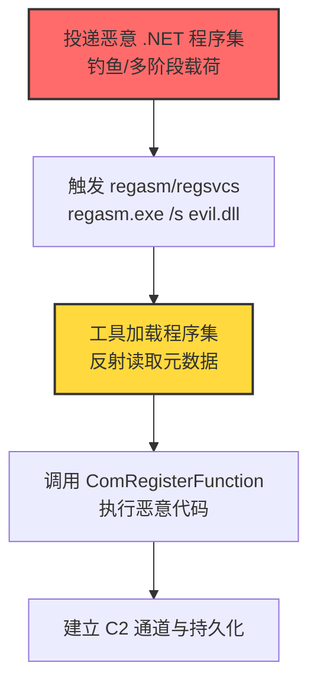
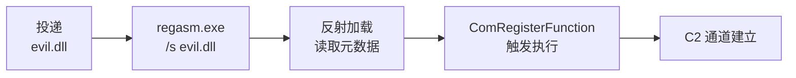

# Regsvcs/Regasm (T1218.009)

## 一句话通俗理解

> **攻击者把恶意 .NET 代码用 `[ComRegisterFunction]` 属性包成 COM 组件，再交给 regsvcs.exe / regasm.exe 这个"微软官方注册器"触发执行——好比把违禁品封进官方快递袋，让邮政替你投递。**

## 30秒速查卡

| 维度 | 你需要知道的 |
|------|-------------|
| 这是什么？ | Regsvcs/Regasm（T1218.009），系统二进制代理执行（T1218）的子技术 |
| 为什么危险？ | regsvcs.exe/regasm.exe 是 .NET Framework 自带的微软签名二进制，可通过 `[ComRegisterFunction]`/`[ComUnregisterFunction]` 属性执行任意 .NET 代码，绕过未考虑其滥用的应用控制 |
| 谁需要关心？ | 系统管理员、安全运维团队、SOC分析师、应用控制策略管理员 |
| 你的第一步防御 | 应用控制阻止 regsvcs.exe / regasm.exe 执行（除非环境中确实需要注册 COM 组件） |
| 如果只做一件事 | 在 Sysmon 中监控 regsvcs.exe/regasm.exe 进程创建及其命令行参数（/s、/u）与子进程链 |

## 难度等级

⭐⭐ 中级 - 需要一定的技术基础和经验

## 前置知识检查

**读这个文件需要什么？**

- [ ] 操作系统权限模型基础
- [ ] 系统二进制代理执行（T1218）的原理
- [ ] .NET Framework 基础知识（程序集、强名称、COM 互操作）
- [ ] C# 属性（Attribute）与反射（Reflection）基础

## 技术描述

**Regsvcs/Regasm**（T1218.009）是 **系统二进制代理执行**（T1218）的一个具体变体，属于 **隐蔽** 阶段的攻击技术。

攻击者可能滥用 regsvcs.exe 和 regasm.exe 来代理执行恶意载荷。这两个工具都是 .NET Framework 自带的微软数字签名二进制：

- **regsvcs.exe**（.NET Services Installation Tool）：用于将 .NET 程序集注册到 COM+ 服务，路径如 `C:\Windows\Microsoft.NET\Framework\v4.0.30319\regsvcs.exe`
- **regasm.exe**（Assembly Registration Tool）：用于读取 .NET 程序集元数据并将相应条目添加到注册表，路径如 `C:\Windows\Microsoft.NET\Framework\v4.0.30319\regasm.exe`

二者均可注册 .NET 程序集为 COM 组件。当 .NET 程序集中类带有 `[ComRegisterFunction]` 属性标记的静态方法时，regsvcs/regasm 在注册过程中会调用该方法，进而执行任意代码：

```csharp
using System;
using System.Runtime.InteropServices;

[ComVisible(true)]
[Guid("AAAAAAAA-AAAA-AAAA-AAAA-AAAAAAAAAAAA")]
public class EvilClass
{
    [ComRegisterFunction]
    public static void Register(Type t)
    {
        // 此处执行任意代码——regsvcs/regasm 注册时触发
        System.Diagnostics.Process.Start("calc.exe");
    }

    [ComUnregisterFunction]
    public static void Unregister(Type t)
    {
        // 反注册时触发（regsvcs /u、regasm /u）
        System.Diagnostics.Process.Start("powershell.exe", "-enc <base64>");
    }
}
```

攻击者编译此 .NET 程序集为 DLL，然后执行：

```
regasm.exe /s C:\Users\Public\evil.dll
regsvcs.exe /s C:\Users\Public\evil.dll
```

其中 `/s` 表示静默模式（不显示成功消息框）。注册过程中 regasm/regsvcs 自动调用 `[ComRegisterFunction]` 标记的 `Register` 方法，执行任意代码。

### 具体怎么理解？

把 regsvcs/regasm 想象成**持官方通行证的"快递签收员"**：

1. **官方身份**：regsvcs.exe 和 regasm.exe 都是 .NET Framework 自带的微软签名二进制，应用控制策略默认信任
2. **隐藏能力**：虽然名义上是"COM 注册工具"，但注册过程会自动执行程序集中 `[ComRegisterFunction]` 标记的代码——本质上是把任意代码执行能力隐藏在注册流程中
3. **执行入口**：注册过程调用带 `[ComRegisterFunction]` 属性的静态方法，方法体内可以是任意 .NET 代码（启动进程、网络通信、文件操作）
4. **静默模式**：`/s` 标志避免显示成功提示框，攻击完全无感
5. **反注册通道**：`[ComUnregisterFunction]` 属性标记的方法在 `/u` 卸载时触发，可作备用执行通道

### 为什么有效？

- **签名信任**：regsvcs.exe/regasm.exe 都是微软签名二进制，AppLocker 默认规则允许执行
- **应用控制盲区**：许多组织未将 .NET 工具纳入应用控制黑名单，因为合法开发者确实需要它们注册 COM 组件
- **属性触发灵活性**：`[ComRegisterFunction]`/`[ComUnregisterFunction]` 属性标记的方法体内可以是任意 .NET 代码
- **静默执行**：`/s` 标志避免显示提示框，攻击完全静默
- **执行通道多样**：注册（默认）、反注册（`/u`）两个执行入口；regsvcs 和 regasm 两个二进制可互相替换

## 真型场景

攻击者在 **隐蔽** 阶段使用 Regsvcs/Regasm 技术，以下是典型的攻击步骤：



**步骤详解：**

1. **投递**：通过钓鱼邮件、多阶段恶意软件投递武器化 .NET 程序集（DLL），常伪装成"业务组件""驱动安装包"。
2. **触发**：攻击者通过命令行执行 `regasm.exe /s C:\Users\Public\evil.dll`，或通过已植入的恶意软件二阶段调用。
3. **加载**：regasm/regsvcs 加载 .NET 程序集，反射读取元数据查找 `[ComRegisterFunction]` 属性方法。
4. **执行**：调用 `[ComRegisterFunction]` 标记的静态方法，方法体内执行任意 .NET 代码。
5. **持久化**：恶意代码写入 Run 键、计划任务或 WMI 订阅实现持久化；建立 C2 通道。

## 攻击流程

```
投递 .NET DLL → regasm/regsvcs /s → 加载程序集 → 调用 ComRegisterFunction → C2 持久化
```



**步骤详解：**

1. **投递**
   - 通俗描述：攻击者把"毒药"伪装成 .NET 组件寄给受害者
   - 技术细节：邮件附件 .dll 文件，文件名伪装成业务相关（如"BusinessLogic.dll"）；或通过已植入的恶意软件二阶段下载到 `C:\Users\Public\` 等用户可写目录。注意 .NET DLL 需带强名称（Strong Name）或不带强名称（regasm 默认接受）
   - 常用工具：Visual Studio、csc.exe、MSBuild

2. **触发执行**
   - 通俗描述：攻击者远程命令执行 regasm/regsvcs 注册 DLL
   - 技术细节：`regasm.exe /s C:\Users\Public\evil.dll`；`/s` 静默模式不显示提示框；可选 `/nologo` 不显示徽标；可选 `/codebase` 设置 CodeBase 注册表项（需 DLL 带强名称）
   - 常用工具：regasm.exe、regsvcs.exe（系统自带）、cmd.exe、PowerShell

3. **程序集加载与执行**
   - 通俗描述：regasm/regsvcs 把 .NET 程序集加载进内存，ComRegisterFunction 自动运行
   - 技术细节：regasm/regsvcs 通过 .NET CLR 加载程序集，反射查找带 `[ComRegisterFunction]` 属性的静态方法；调用该方法时传入注册的 Type 参数；方法体内可执行任意 .NET 代码（启动进程、HTTP 通信、文件操作）
   - 常用工具：恶意 .NET 程序集编译器（csc.exe、MSBuild、Visual Studio）

4. **持久化与 C2**
   - 通俗描述：恶意代码驻留并连接攻击者服务器
   - 技术细节：写入 `HKCU\...\Run` 键持久化；通过 HTTP/HTTPS/DNS 隧道建立 C2 通道；可选利用 `[ComUnregisterFunction]` 作为备用执行通道（`regasm /u`）
   - 常用工具：Cobalt Strike、Sliver、自研 C2 框架

## 真实案例

### 案例1：Agent Tesla 用 regasm.exe 加载恶意 .NET 程序集

- **时间**: 2020-2023年（持续活跃）
- **目标**: 全球企业（制造业、能源、金融）
- **攻击组织**: Agent Tesla（S0331，商业信息窃取木马）
- **手法**: Agent Tesla 通过钓鱼邮件投递恶意 .NET 程序集，使用 regasm.exe 加载并触发 `[ComRegisterFunction]` 属性方法执行载荷——regasm.exe 作为 LOLBin 绕过应用控制，加载 Agent Tesla RAT 模块
- **影响**: 窃取浏览器凭证、邮件客户端凭证、FTP 客户端凭证；作为多个勒索软件家族的初始访问跳板
- **参考链接**: [Red Canary - 2021 Threat Detection Report](https://redcanary.com/threat-detection-report/techniques/regsvcs-regasm/)

### 案例2：安全研究中的实践

- **时间**: 2017年至今
- **目标**: 安全研究测试环境
- **攻击组织**: 红队/安全研究人员
- **手法**: 在授权测试中模拟 Regsvcs/Regasm 攻击，使用 regasm.exe / regsvcs.exe 加载自定义 .NET 程序集绕过 EDR 和应用控制；与 MSBuild（T1127.001）等 LOLBin 组合使用
- **影响**: 验证防御体系的检测和响应能力
- **参考链接**: [Atomic Red Team - T1218.009](https://github.com/redcanaryco/atomic-red-team/blob/master/atomics/T1218.009/T1218.009.md)

### 案例3：Inquest 报告的钓鱼活动

- **时间**: 2020-2021年
- **目标**: 全球企业
- **攻击组织**: 未命名（疑似商业恶意软件运营者）
- **手法**: Inquest 报告的钓鱼活动中，攻击者使用 regasm.exe 加载恶意 .NET 程序集——邮件附件中包含伪装的 .NET DLL，配套的 LNK 文件触发 regasm.exe 静默加载该 DLL
- **影响**: 初始访问与持久化跳板，常作为勒索软件投放链的一部分
- **参考链接**: [Inquest - Regasm abuse](https://inquest.net/blog/2020/11/10/Regasm)

### 案例4：Cobalt Strike Beacon 加载

- **时间**: 2021-2023年
- **目标**: 全球企业
- **攻击组织**: 多个勒索软件团伙（关联 Cobalt Strike）
- **手法**: 攻击者将 Cobalt Strike Beacon 编译为 .NET DLL，DLL 中带 `[ComRegisterFunction]` 属性方法，方法体内反射加载 Beacon shellcode；通过 regasm.exe /s 加载触发 Beacon 执行
- **影响**: 内网横向移动跳板
- **参考链接**: [LOLBAS - regasm.exe](https://lolbas-project.github.io/lolbas/Binaries/Regasm/)

## 红队视角

> ⚠️ **免责声明**：以下内容仅用于合法的安全测试、渗透测试和教育目的。未经授权对他人系统进行测试是违法行为。

### 实战技巧

1. **深入理解原理**：掌握 regasm/regsvcs 命令行参数（`/s` 静默、`/u` 反注册、`/nologo` 无徽标、`/codebase` 设置 CodeBase、`/tlb` 生成类型库）、`[ComRegisterFunction]`/`[ComUnregisterFunction]` 属性触发机制、.NET CLR 程序集加载流程
2. **环境适配**：先侦察目标的应用控制策略——regasm/regsvcs 通常不在 AppLocker 默认黑名单中；检查 .NET Framework 是否安装（默认 Windows 10/11 都带）；选择对应 .NET 版本目录下的 regasm（v2.0 / v4.0）
3. **组合使用**：与用户执行（T1204）组合触发；与持久化（T1547.001 Run 键）组合，ComRegisterFunction 中写入注册表；与进程注入（T1055）链式使用，ComRegisterFunction 中注入合法进程；与 MSBuild（T1127.001）等 LOLBin 互为备份
4. **隐蔽性考虑**：DLL 文件名伪装成系统组件（如 `Microsoft.Office.Interop.dll`）；放置在用户可写目录避免触发 UAC；`/s` 静默模式避免提示框；执行后删除 DLL 文件（无文件恶意软件）；利用 `[ComUnregisterFunction]` 作为备用执行通道（`regasm /u`）

### 常用工具

| 工具名称 | 用途 | 平台 | 链接 |
| -------- | ---- | ---- | ---- |
| regasm.exe | .NET Framework 程序集注册工具 | Windows | 系统自带 |
| regsvcs.exe | .NET Services Installation Tool | Windows | 系统自带 |
| Visual Studio | 编译恶意 .NET 程序集 | Windows | https://visualstudio.microsoft.com/ |
| csc.exe | C# 命令行编译器 | Windows | 系统自带 |
| Atomic Red Team T1218.009 | 检测规则测试用例 | Windows | [Atomic Red Team](https://github.com/redcanaryco/atomic-red-team/blob/master/atomics/T1218.009/T1218.009.md) |
| LOLBAS regasm.exe | 二进制滥用参考 | Windows | [LOLBAS - regasm.exe](https://lolbas-project.github.io/lolbas/Binaries/Regasm/) |
| LOLBAS regsvcs.exe | 二进制滥用参考 | Windows | [LOLBAS - regsvcs.exe](https://lolbas-project.github.io/lolbas/Binaries/Regsvcs/) |

### 注意事项

- 在授权的测试环境中使用这些技术
- 注意操作安全（OPSEC），避免被检测系统发现：执行后清理 DLL 文件与 regasm/regsvcs 命令行历史
- 使用匿名化技术和代理隐藏真实身份
- ComRegisterFunction 中避免执行复杂逻辑（注册过程在 CLR 加载器锁内），主逻辑通过新线程延迟执行
- 注意 .NET Framework 版本兼容性：v2.0 和 v4.0 路径不同，目标机器可能未安装某版本

## 蓝队视角

### 检测要点

1. **系统日志监控**：Sysmon Event ID 1（进程创建）监控 regasm.exe / regsvcs.exe 启动，特别是带 `/s`、`/u` 参数和指向用户目录 DLL 的命令行
2. **异常行为检测**：regasm/regsvcs 子进程异常（powershell/cmd/mshta）；从非标准目录加载 DLL；regasm/regsvcs 加载非标准或未签名 .NET 程序集；regasm/regsvcs 发起网络外联
3. **工具特征识别**：监控 regasm/regsvcs 命令行中的 `/s`、`/u`、`/codebase` 关键字；EDR 监控 regasm/regsvcs 的程序集加载（`Assembly.Load`）调用目标

### 监控建议

- 部署端点检测和响应（EDR）系统，配置 regasm.exe / regsvcs.exe 进程创建与命令行参数监控规则
- 配置SIEM规则，关联分析来自多个来源的告警（DLL 文件落地 + regasm/regsvcs 加载 + 子进程网络外联）
- 定期进行安全评估和渗透测试，验证 regasm/regsvcs 投递链的检测覆盖
- 在邮件网关阻断 .dll 附件（默认应阻断）
- 建立 .NET Framework 工具使用基线，普通用户终端几乎不需要运行 regasm/regsvcs

## 避坑指南

- **不要只盯 regasm/regsvcs 本身**：合法开发者偶尔会用 regasm/regsvcs 注册 COM 组件，需结合命令行参数与子进程综合判断
- **不要忽视 /u 反注册通道**：`[ComUnregisterFunction]` 属性在 `regasm /u` 时触发，攻击者可作为备用执行通道
- **不要漏掉 32/64 位版本差异**：.NET Framework 同时有 32 位（`C:\Windows\Microsoft.NET\Framework\`）和 64 位（`C:\Windows\Microsoft.NET\Framework64\`）版本，需同时监控
- **不要漏掉 v2.0/v4.0 版本差异**：regasm/regsvcs 在 `v2.0.50727\` 和 `v4.0.30319\` 两个目录都有副本，需同时监控
- **不要假设应用控制覆盖**：许多组织的 AppLocker 策略未纳入 .NET 工具，需显式添加规则

## 检测建议

### 检测思路

检测 Regsvcs/Regasm 的关键是识别 regasm.exe/regsvcs.exe 用 `/s` 等命令标志静默注册恶意 .NET 程序集并触发 ComRegisterFunction 执行代码。行为链：(1) regsvcs.exe/regasm.exe 进程创建带 /s /u 等参数 → (2) regsvcs/regasm 加载非标准 .NET 程序集 → (3) 可选后续进程创建或网络活动。以下是三个层面的检测方法：

### 网络层检测

**方法**：监控 regasm.exe / regsvcs.exe 进程发起的出站连接，特别是连接到非企业域名或新注册域名。

```bash
# 检测 regasm.exe / regsvcs.exe 异常网络外联
# Sysmon Event ID 3 (网络连接) 过滤 regasm.exe / regsvcs.exe 源
Get-WinEvent -FilterHashtable @{LogName='Microsoft-Windows-Sysmon/Operational'; ID=3} |
  Where-Object {$_.Message -match 'regasm\.exe|regsvcs\.exe'} |
  Select-Object TimeCreated, Message
```

### 主机层检测

**Windows事件ID**：
- Sysmon Event ID 1：进程创建（监控 regasm.exe / regsvcs.exe 启动及子进程）
- Sysmon Event ID 7：镜像加载（监控 regasm.exe / regsvcs.exe 加载非系统 DLL）
- Sysmon Event ID 11：文件创建（监控 .NET DLL 文件落地）
- 事件ID 4688：进程创建（监控可疑进程）

```bash
# 检测 regasm.exe / regsvcs.exe 执行及可疑子进程
# Sysmon 配置：
# <RuleGroup name="Regasm/Regsvcs Execution" groupRelation="or">
#   <ProcessCreate onmatch="include">
#     <Image condition="end with">\regasm.exe</Image>
#   </ProcessCreate>
#   <ProcessCreate onmatch="include">
#     <Image condition="end with">\regsvcs.exe</Image>
#   </ProcessCreate>
#   <ProcessCreate onmatch="include">
#     <ParentImage condition="end with">\regasm.exe</ParentImage>
#   </ProcessCreate>
#   <ProcessCreate onmatch="include">
#     <ParentImage condition="end with">\regsvcs.exe</ParentImage>
#   </ProcessCreate>
# </RuleGroup>

# 查询 regasm.exe / regsvcs.exe 进程及命令行
Get-WinEvent -FilterHashtable @{LogName='Microsoft-Windows-Sysmon/Operational'; ID=1} |
  Where-Object {$_.Message -match 'regasm\.exe|regsvcs\.exe'} |
  Select-Object TimeCreated, @{n='CommandLine';e={$_.Properties[8].Value}}

# 查询 regasm.exe / regsvcs.exe 子进程
Get-WinEvent -FilterHashtable @{LogName='Microsoft-Windows-Sysmon/Operational'; ID=1} |
  Where-Object {$_.Message -match 'ParentImage.*(regasm|regsvcs)\.exe'} |
  Select-Object TimeCreated, @{n='ChildProcess';e={$_.Properties[5].Value}}
```

**用人话说：** regasm.exe 和 regsvcs.exe 是 .NET Framework 的 COM 注册工具，普通用户终端几乎不会主动运行它们——一旦看到 regasm.exe 或 regsvcs.exe 启动，特别是带 `/s` 参数和指向用户目录的 DLL 路径，几乎可以确定是攻击；而 regasm/regsvcs 加载非系统目录的 DLL 模块，则几乎可以确定是滥用。

```yaml
title: 检测 regasm.exe / regsvcs.exe 异常执行与可疑子进程
status: experimental
description: 检测 regasm.exe / regsvcs.exe 静默注册恶意 .NET 程序集触发 ComRegisterFunction 执行（Regsvcs/Regasm T1218.009）
references:
    - https://attack.mitre.org/techniques/T1218/009/
    - https://attack.mitre.org/detectionstrategies/DET0361/
logsource:
    category: process_creation
    product: windows
detection:
    selection_regasm_silent:
        Image|endswith:
            - '\regasm.exe'
            - '\regsvcs.exe'
        CommandLine|contains:
            - '/s'
            - '-s'
    selection_regasm_action:
        Image|endswith:
            - '\regasm.exe'
            - '\regsvcs.exe'
        CommandLine|contains:
            - '/u'
            - '/nologo'
            - '/codebase'
    selection_regasm_nonstd:
        Image|endswith:
            - '\regasm.exe'
            - '\regsvcs.exe'
        CommandLine|contains:
            - 'C:\Users\'
            - 'C:\Temp\'
            - 'C:\ProgramData\'
            - '\AppData\Local\Temp\'
            - '\Downloads\'
    selection_regasm_child:
        ParentImage|endswith:
            - '\regasm.exe'
            - '\regsvcs.exe'
        Image|endswith:
            - '\powershell.exe'
            - '\pwsh.exe'
            - '\cmd.exe'
            - '\mshta.exe'
            - '\wscript.exe'
            - '\cscript.exe'
            - '\rundll32.exe'
    condition: selection_regasm_silent or selection_regasm_action or selection_regasm_nonstd or selection_regasm_child
fields:
    - CommandLine
    - ParentCommandLine
    - Image
    - User
falsepositives:
    - 合法 .NET COM 组件注册（开发者机器，需白名单）
level: high
tags:
    - attack.t1218.009
    - attack.t1218
    - attack.ta0005
    - attack.stealth
```

### 应用层检测

**Sigma规则示例**（基于 ATT&CK DET0361 / AN1028）：

```yaml
title: DET0361 - 可疑 Regasm/Regsvcs 静默注册执行
id: 1c9e3a4d-8b5f-4c2a-bd3e-9c4f7b6a5d8e
status: stable
description: |
    识别 regasm.exe / regsvcs.exe 用 /s 等命令标志静默注册恶意 .NET 程序集并触发
    ComRegisterFunction 执行代码。行为链：
    (1) regsvcs.exe/regasm.exe 进程创建带 /s /u 等参数
    → (2) regsvcs/regasm 加载非标准 .NET 程序集
    → (3) 可选后续进程创建或网络活动。对应 ATT&CK DET0361 / AN1028。
references:
    - https://attack.mitre.org/detectionstrategies/DET0361/
logsource:
    product: windows
    category: process_creation
detection:
    selection_regasm_regsvcs:
        Image|endswith:
            - '\regasm.exe'
            - '\regsvcs.exe'
    selection_silent_flag:
        CommandLine|contains:
            - '/s'
            - '-s'
    selection_unreg_flag:
        CommandLine|contains:
            - '/u'
            - '-u'
    filter_legitimate_dev:
        User|contains:
            - 'developer'
            - 'builder'
        CommandLine|contains:
            - 'C:\Program Files\'
            - 'C:\Build\'
    condition: selection_regasm_regsvcs and (selection_silent_flag or selection_unreg_flag) and not filter_legitimate_dev
fields:
    - CommandLine
    - ParentCommandLine
    - Image
    - User
falsepositives:
    - 合法 .NET COM 组件注册（开发者机器，需白名单特定路径）
level: high
tags:
    - attack.t1218.009
    - attack.t1218
    - attack.ta0005
```

## 缓解措施

### 优先级1：关键措施

**M1042 禁用/移除功能（禁用 regasm.exe / regsvcs.exe）**：在不需要注册 .NET COM 组件的环境中（绝大多数企业终端），通过 AppLocker / WDAC / SRP 阻止 regasm.exe 和 regsvcs.exe 执行（包括 v2.0/v4.0 与 32/64 位所有副本）。

```bash
# AppLocker 规则示例（默认拒绝 regasm.exe / regsvcs.exe）
# 通过 GPO 部署：
# Path conditions:
# %WINDIR%\Microsoft.NET\Framework\v2.0.50727\regasm.exe → Deny
# %WINDIR%\Microsoft.NET\Framework\v4.0.30319\regasm.exe → Deny
# %WINDIR%\Microsoft.NET\Framework64\v2.0.50727\regasm.exe → Deny
# %WINDIR%\Microsoft.NET\Framework64\v4.0.30319\regasm.exe → Deny
# （regsvcs.exe 同理）
New-AppLockerPolicy -Xml -PolicyType Deny -Path "%WINDIR%\Microsoft.NET\Framework*\v*\regasm.exe" -User "Everyone"
New-AppLockerPolicy -Xml -PolicyType Deny -Path "%WINDIR%\Microsoft.NET\Framework*\v*\regsvcs.exe" -User "Everyone"
```

**M1038 执行预防（应用控制阻止 regasm.exe / regsvcs.exe）**：通过 WDAC / AppLocker / SRP 限制 regasm.exe 和 regsvcs.exe 执行（注意需覆盖所有 .NET Framework 版本和位数）。

### 优先级2：重要措施

**加强监控**：部署EDR和SIEM系统，针对 regasm.exe / regsvcs.exe 进程创建、命令行参数、子进程链、模块加载建立关联告警规则（见上文 Sigma 规则）。

### 优先级3：建议措施

**安全意识培训**：教育员工识别可疑的 .dll 文件附件，不要轻易打开来自不受信来源的".NET 组件""COM 组件"。

## 动手实验

> ⚠️ **所有实验必须在隔离的实验室环境中进行**

### 实验1：理解基本原理（初级）

**目标**：理解 Regsvcs/Regasm 的工作原理

**步骤**：
1. 在隔离环境中搭建 Windows 测试虚拟机（关闭 Defender 或加入排除项）
2. 用 Visual Studio 编译一个最小 .NET DLL，类带 `[ComRegisterFunction]` 属性方法，方法体内弹 MessageBox
3. 执行 `regasm.exe /s C:\Users\Public\test.dll`，观察是否触发 MessageBox
4. 用 Process Explorer 观察 regasm.exe 加载 test.dll 的进程树与模块
5. 测试反注册通道：在 `[ComUnregisterFunction]` 方法中弹 MessageBox，执行 `regasm.exe /u C:\Users\Public\test.dll`

**学习要点**：理解 regasm/regsvcs 命令行参数、`[ComRegisterFunction]`/`[ComUnregisterFunction]` 属性触发机制、.NET CLR 程序集加载流程

### 实验2：实际操作（中级）

**目标**：掌握 Regsvcs/Regasm 的实际使用方法

**步骤**：
1. 编译一个 .NET DLL，`[ComRegisterFunction]` 方法中调用 `WinExec("calc.exe", 0)`
2. 执行 `regasm.exe /s C:\Users\Public\malicious.dll`
3. 配置 Sysmon 监控，分析 regasm.exe → calc.exe 进程链的日志特征
4. 测试 regsvcs.exe 等价路径：`regsvcs.exe /s C:\Users\Public\malicious.dll`
5. 测试 64 位版本路径：`C:\Windows\Microsoft.NET\Framework64\v4.0.30319\regasm.exe /s C:\Users\Public\malicious.dll`
6. 测试反注册通道：`regasm.exe /u /s C:\Users\Public\malicious.dll`

**学习要点**：掌握 ComRegisterFunction 触发链、ComUnregisterFunction 备用通道、regasm/regsvcs 等价性、32/64 位与 v2.0/v4.0 路径覆盖、Sysmon 日志特征

### 实验3：防御验证（高级）

**目标**：验证检测规则的有效性

**步骤**：
1. 部署本文 Sigma 规则到 SIEM（如 Splunk、Microsoft Sentinel）
2. 配置 AppLocker 阻止 regasm.exe 和 regsvcs.exe 执行（覆盖所有版本/位数路径）
3. 执行 Atomic Red Team T1218.009 测试用例
4. 验证检测告警是否触发，AppLocker 是否阻断
5. 测试绕过：尝试通过 ComUnregisterFunction 反注册通道或非标准 DLL 扩展名绕过监控
6. 改进检测规则覆盖绕过路径

**学习要点**：理解攻防对抗的实际效果，掌握检测规则迭代优化

## 术语解释

| 术语 | 通俗解释 |
|------|---------|
| **ATT&CK** | MITRE公司维护的攻击技术知识库 |
| **Regsvcs/Regasm** | T1218.009，利用 regasm.exe/regsvcs.exe 触发 ComRegisterFunction 执行任意 .NET 代码 |
| **regasm.exe** | .NET Framework Assembly Registration Tool，注册 .NET 程序集为 COM 组件 |
| **regsvcs.exe** | .NET Services Installation Tool，注册 .NET 程序集到 COM+ 服务 |
| **ComRegisterFunction** | C# 属性，标记 COM 注册时自动调用的静态方法 |
| **ComUnregisterFunction** | C# 属性，标记 COM 反注册时自动调用的静态方法（/u 触发） |
| **程序集** | .NET 编译产物（.dll/.exe），包含元数据与中间语言代码 |
| **COM** | Component Object Model，微软组件对象模型 |
| **反射** | .NET 运行时动态读取类型元数据的机制 |
| **系统二进制代理执行** | T1218，本子技术所属的父技术类别 |
| **隐蔽** | 攻击链中的一个阶段（TA0005） |
| **C2** | 命令与控制 |
| **EDR** | 端点检测与响应 |
| **LOLBin** | Living Off The Land Binary，滥用合法系统二进制 |

## 被引用情况

以下父技术文档引用了本子技术：

- [T1218 - 系统二进制代理执行](../T1218-System-Binary-Proxy-Execution.md)

## 参考资料

### 📚 官方文档（深入了解）

- [MITRE ATT&CK - Regsvcs/Regasm (T1218.009)](https://attack.mitre.org/techniques/T1218/009/)
- [MITRE ATT&CK - System Binary Proxy Execution (T1218)](https://attack.mitre.org/techniques/T1218/)
- [MITRE ATT&CK - DET0361 检测策略](https://attack.mitre.org/detectionstrategies/DET0361/)
- [Microsoft - Regasm.exe 文档](https://docs.microsoft.com/dotnet/framework/tools/regasm-exe-assembly-registration-tool)
- [Microsoft - Regsvcs.exe 文档](https://docs.microsoft.com/dotnet/framework/tools/regsvcs-exe-net-services-installation-tool)
- [Microsoft - ComRegisterFunction 属性](https://docs.microsoft.com/dotnet/api/system.runtime.interopservices.comregisterfunctionattribute)

### 📰 安全报告（真实攻击）

- [Red Canary - 2021 Threat Detection Report - Regsvcs/Regasm](https://redcanary.com/threat-detection-report/techniques/regsvcs-regasm/)
- [Inquest - Regasm abuse](https://inquest.net/blog/2020/11/10/Regasm)
- [MITRE ATT&CK - Agent Tesla (S0331)](https://attack.mitre.org/software/S0331/)

### 🔧 工具与资源（动手试试）

- [Atomic Red Team - T1218.009 测试用例](https://github.com/redcanaryco/atomic-red-team/blob/master/atomics/T1218.009/T1218.009.md) - 检测规则测试框架
- [LOLBAS - regasm.exe](https://lolbas-project.github.io/lolbas/Binaries/Regasm/) - LOLBins 参考
- [LOLBAS - regsvcs.exe](https://lolbas-project.github.io/lolbas/Binaries/Regsvcs/) - LOLBins 参考
- [MITRE ATT&CK Navigator](https://mitre-attack.github.io/attack-navigator/) - ATT&CK 可视化工具
