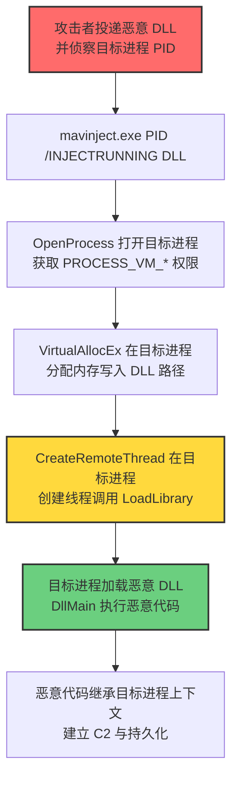
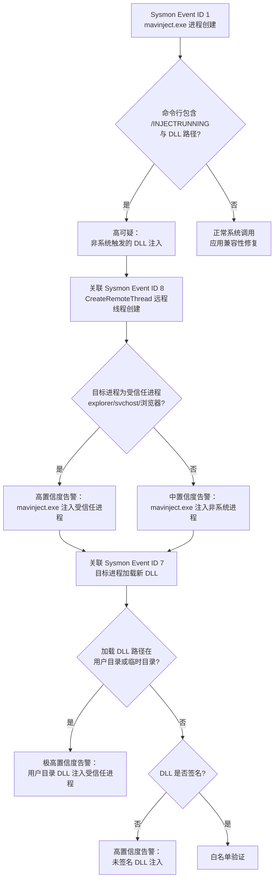

# Mavinject (T1218.013)

## 一句话通俗理解

> **攻击者把恶意 DLL 塞进另一个正在运行的进程里，让 Windows 自带的"应用兼容性注入器" mavinject.exe 替它做这件事——好比把违禁品藏在邮政包裹里，让邮局替你送货上门。**

## 30秒速查卡

| 维度 | 你需要知道的 |
|------|-------------|
| 这是什么？ | Mavinject（T1218.013），系统二进制代理执行（T1218）的子技术，滥用 mavinject.exe 向运行进程注入任意 DLL |
| 为什么危险？ | mavinject.exe 是 Windows 系统自带微软签名二进制，可被命令行指定目标进程 PID 与 DLL 路径，向运行进程注入 DLL，绕过未考虑其滥用的应用控制 |
| 谁需要关心？ | 系统管理员、SOC 分析师、应用控制策略管理员、EDR 规则开发者 |
| 你的第一步防御 | 在 Sysmon 中监控 mavinject.exe 进程创建及其 `/INJECTRUNNING` 参数与 DLL 路径组合 |
| 如果只做一件事 | 应用控制（AppLocker / WDAC）阻止 mavinject.exe 执行，除非环境确实需要应用兼容性注入 |

## 难度等级

中级 - 需要掌握进程注入、DLL 加载机制与 mavinject.exe 工作原理

## 前置知识检查

**读这个文件需要什么？**

- [ ] 系统二进制代理执行（T1218）的原理
- [ ] Windows 进程注入基础：CreateRemoteThread、QueueUserAPC、SetWindowsHookEx
- [ ] DLL 加载与 `LoadLibrary` 机制
- [ ] Windows 应用兼容性框架（Application Compatibility Toolkit / Fix-It）基础
- [ ] 进程访问权限与 OpenProcess API

## 1. 概述

**Mavinject**（T1218.013）是 **系统二进制代理执行**（T1218）的一个具体变体，属于 **隐蔽**（TA0005）战术下的攻击技术。攻击者可能滥用 `mavinject.exe` 来代理执行恶意载荷或向其他进程注入代码。`mavinject.exe` 是 Windows 操作系统自带的微软数字签名二进制，原始用途是应用兼容性框架中的 DLL 注入工具，用于向运行中的进程注入兼容性修复（Fix-It）DLL，使旧版本应用程序能在新版本 Windows 上正常运行。

`mavinject.exe` 接收目标进程 ID（PID）与 DLL 路径作为命令行参数，通过 `/INJECTRUNNING` 开关触发注入流程。其内部使用 `OpenProcess` 打开目标进程，获取必要的进程访问权限（PROCESS_CREATE_THREAD、PROCESS_VM_OPERATION、PROCESS_VM_WRITE），然后将 DLL 路径字符串写入目标进程的内存空间，通过 `CreateRemoteThread` 或 `QueueUserAPC` 在目标进程创建远程线程调用 `LoadLibrary` 函数加载指定 DLL。攻击者通过此机制将恶意 DLL 注入到任意运行中的进程（如 explorer.exe、svchost.exe、浏览器进程），使恶意代码在受信任进程的上下文中执行，绕过应用控制策略并隐藏自身。

由于 `mavinject.exe` 位于 `C:\Windows\System32\`，是微软签名二进制，且其正常功能确实涉及 DLL 注入，应用控制策略（如 AppLocker 默认规则、白名单方案）通常不会阻止其执行；同时普通用户权限即可调用 mavinject.exe 注入同权限级别的进程，无需提权（注入更高权限进程需要管理员权限）。此技术在多个 APT 组织的真实攻击活动中被观测到，包括 APT29、Hafnium、OilRig 等。

## 2. 工作原理

`mavinject.exe` 的工作机制可以拆解为以下流程：

### 2.1 正常用途

Windows 应用兼容性框架（Application Compatibility Toolkit，ACT）允许系统管理员创建"兼容性修复"（Fix-It），通过向旧版本应用程序注入修复 DLL 来解决兼容性问题。`mavinject.exe` 是该框架的底层注入工具，命令行格式为：

```
mavinject.exe <PID> /INJECTRUNNING <DLL_PATH>
```

其中：
- `<PID>`：目标进程的进程 ID
- `/INJECTRUNNING`：指定向正在运行的进程注入
- `<DLL_PATH>`：要注入的 DLL 的完整路径

mavinject.exe 内部执行以下操作：
1. 调用 `OpenProcess` 打开目标进程，请求 `PROCESS_CREATE_THREAD | PROCESS_VM_OPERATION | PROCESS_VM_WRITE | PROCESS_QUERY_INFORMATION` 权限
2. 调用 `VirtualAllocEx` 在目标进程分配内存，写入 DLL 路径字符串
3. 获取目标进程中 `kernel32.dll!LoadLibraryW` 的地址
4. 调用 `CreateRemoteThread` 或 `RtlCreateUserThread` 在目标进程创建远程线程，线程函数为 `LoadLibraryW`，参数为 DLL 路径字符串地址
5. 远程线程执行 `LoadLibraryW`，加载指定 DLL 到目标进程地址空间
6. DLL 的 `DllMain` 在 `DLL_PROCESS_ATTACH` 阶段被调用，执行 DLL 初始化代码

### 2.2 滥用原理

攻击者滥用 mavinject.exe 的核心思路是：用 mavinject.exe 替代自定义的进程注入代码。攻击者不需要自己实现 `OpenProcess` + `VirtualAllocEx` + `CreateRemoteThread` 的注入逻辑，而是直接调用 mavinject.exe 一次性完成注入。

攻击者投递恶意 DLL 到目标主机后，识别一个合适的受害进程（通常是受信任的微软签名进程，如 explorer.exe、svchost.exe、msmpeng.exe），然后执行：

```
mavinject.exe <PID> /INJECTRUNNING C:\Users\Public\evil.dll
```

mavinject.exe 完成注入后，恶意 DLL 的 `DllMain` 在目标进程中执行，攻击者在 `DllMain` 中放置任意恶意逻辑——后门、C2 客户端、键盘记录器、凭证窃取模块等。所有执行都发生在受信任进程的上下文中，绕过基于进程白名单的检测。

### 2.3 关键点

1. **微软签名信任**：mavinject.exe 是系统自带二进制，应用控制策略默认信任
2. **同权限注入**：普通用户权限可注入同权限级别的进程；管理员权限可注入任意进程
3. **DLL 加载入口**：`DllMain`（DLL_PROCESS_ATTACH）在 `LoadLibrary` 时自动调用
4. **进程上下文继承**：恶意 DLL 继承目标进程的令牌与权限，可访问目标进程能访问的所有资源
5. **持久化能力**：注入到长期运行进程（如 services.exe、svchost.exe）可实现会话级持久化

## 3. 攻击流程



**步骤详解：**

1. **载荷投递**：攻击者将恶意 DLL 投递到目标主机的用户可写目录（如 `C:\Users\Public\evil.dll`、`%APPDATA%\Microsoft\Windows\Templates\evil.dll`），可通过钓鱼附件、已植入的恶意软件二阶段下载、Web 投递等方式落地。
2. **目标进程侦察**：攻击者通过 `tasklist`、`Get-Process` 等方式枚举运行进程，选择一个合适的受害进程——通常是受信任的微软签名进程、长期运行进程、具有网络访问权限的进程（如 explorer.exe、svchost.exe、msedge.exe、chrome.exe）。
3. **触发注入**：攻击者执行 `mavinject.exe <PID> /INJECTRUNNING <DLL_PATH>`，mavinject.exe 启动并完成注入流程。
4. **远程线程执行**：mavinject.exe 在目标进程创建远程线程，调用 `LoadLibraryW` 加载恶意 DLL。
5. **代码执行**：恶意 DLL 的 `DllMain` 在目标进程上下文中被调用，攻击者在 `DllMain` 中放置恶意逻辑（启动 C2 客户端、注入其他进程、键盘记录、凭证窃取），代码在受信任进程中执行，继承其权限与访问能力。
6. **持久化**：恶意代码通过钩子（hook）持久化在目标进程内存中；如果目标进程是长期运行的系统进程（如 services.exe），可实现会话级或系统级持久化。

## 4. 关键技术细节

### 4.1 mavinject.exe 命令行参数

mavinject.exe 支持以下命令行参数（来自逆向分析与官方文档）：

| 参数 | 含义 |
|------|------|
| `<PID>` | 目标进程的进程 ID（第一个位置参数） |
| `/INJECTRUNNING` | 向正在运行的进程注入 DLL |
| `<DLL_PATH>` | 要注入的 DLL 的完整路径（位于 `/INJECTRUNNING` 之后） |

实际利用中的典型命令行：

```
mavinject.exe 1234 /INJECTRUNNING C:\Users\Public\evil.dll
```

### 4.2 进程访问权限要求

mavinject.exe 通过 `OpenProcess` 打开目标进程，请求以下权限：

```c
DWORD dwDesiredAccess = PROCESS_CREATE_THREAD   // 创建远程线程
                      | PROCESS_VM_OPERATION    // VirtualAllocEx / WriteProcessMemory
                      | PROCESS_VM_WRITE        // 写入目标进程内存
                      | PROCESS_QUERY_INFORMATION; // 查询进程信息
```

权限检查规则：
- 同权限级别进程：普通用户可注入同用户权限的进程（如普通用户进程之间）
- 跨权限级别进程：需要管理员权限注入更高权限进程（如普通用户注入 svchost.exe 需要 SYSTEM 权限）
- 受保护进程（PPL）：Windows 8+ 引入的受保护进程无法被注入，即使具有管理员权限

### 4.3 DLL 入口点

恶意 DLL 通常在 `DllMain` 中放置恶意逻辑：

```c
#include <windows.h>

BOOL APIENTRY DllMain(HMODULE hModule, DWORD dwReason, LPVOID lpReserved) {
    if (dwReason == DLL_PROCESS_ATTACH) {
        // 在目标进程上下文中执行任意恶意代码
        // 启动 C2 客户端、键盘记录、凭证窃取等
        HANDLE hThread = CreateThread(NULL, 0, MaliciousThread, NULL, 0, NULL);
        CloseHandle(hThread);
    }
    return TRUE;
}

DWORD WINAPI MaliciousThread(LPVOID lpParam) {
    // C2 通信、持久化、横向移动等
    while (true) {
        // Beacon C2 server
        Sleep(30000);
    }
    return 0;
}

// COM 必需导出函数（可选）
HRESULT __stdcall DllRegisterServer(void) { return S_OK; }
HRESULT __stdcall DllUnregisterServer(void) { return S_OK; }
```

**注意事项**：
- `DllMain` 中不应直接调用复杂 API（受 Loader Lock 限制），通常创建新线程执行恶意逻辑
- 使用 `CreateThread` 在 `DllMain` 中启动后台线程是标准模式

### 4.4 路径与版本

mavinject.exe 在不同 Windows 版本中的位置：
- 64 位：`C:\Windows\System32\mavinject.exe`
- 32 位：`C:\Windows\SysWOW64\mavinject.exe`

Windows 7/8/8.1/10/11/Server 2008 R2 及以后版本均自带此工具，是应用兼容性框架的标准组件。

### 4.5 与 LOLBins 的关系

mavinject.exe 是 LOLBAS（Living Off The Land Binaries and Scripts）项目收录的滥用二进制之一，与 rundll32.exe（T1218.002）、regsvr32.exe（T1218.003）、verclsid.exe（T1218.012）属于同一类"系统二进制代理执行"技术。其特殊性在于：mavinject.exe 提供了现成的进程注入能力，攻击者不需要自己实现注入代码——这降低了攻击门槛，同时利用微软签名绕过应用控制。

### 4.6 与其他进程注入技术的关系

mavinject.exe 实现的注入本质上是 `CreateRemoteThread + LoadLibrary` 经典注入模式（对应 T1055.001 DLL Injection）。但 mavinject.exe 作为系统工具的注入具有以下特点：
- **签名信任**：mavinject.exe 是微软签名，不会被基于签名验证的应用控制阻止
- **API 调用合法**：mavinject.exe 调用 OpenProcess、CreateRemoteThread 是其正常功能，难以通过 API 行为区分
- **审计绕过**：注入行为被记录为 mavinject.exe 的正常操作，而非可疑的进程注入尝试

## 5. 检测方法



### 5.1 主机层检测

**Sysmon 事件 ID**：
- Event ID 1（进程创建）：监控 mavinject.exe 启动，特别是带 `/INJECTRUNNING` 参数和 DLL 路径的命令行
- Event ID 7（镜像加载）：监控目标进程加载新 DLL（特别是非系统目录 DLL）
- Event ID 8（CreateRemoteThread）：监控 mavinject.exe 向其他进程创建远程线程
- Event ID 10（ProcessAccess）：监控 mavinject.exe 打开其他进程（请求 PROCESS_VM_* 权限）
- Event ID 11（文件创建）：监控恶意 DLL 落地

**Windows 安全事件**：
- Event ID 4688（进程创建）：监控 mavinject.exe 进程创建及命令行

### 5.2 网络层检测

监控目标进程（被注入进程）发起的异常网络连接。如果 explorer.exe、svchost.exe 等系统进程突然发起 HTTP/HTTPS 连接到未知 IP 或域名，可能是被注入恶意 DLL 后的 C2 通信。

### 5.3 应用层检测

- EDR 监控 mavinject.exe 的进程注入行为（OpenProcess + VirtualAllocEx + CreateRemoteThread）
- EDR 监控目标进程加载非系统目录 DLL 的行为
- 应用控制（AppLocker / WDAC）记录 mavinject.exe 的执行日志

## 6. 缓解措施

### 6.1 应用控制

通过 AppLocker / WDAC / SRP 阻止 mavinject.exe 执行。在不需要应用兼容性注入的企业终端（绝大多数场景）中，mavinject.exe 几乎不会被合法调用。

```powershell
# AppLocker 规则示例（默认拒绝 mavinject.exe）
New-AppLockerPolicy -Xml -PolicyType Deny -Path "%WINDIR%\System32\mavinject.exe" -User "Everyone"
New-AppLockerPolicy -Xml -PolicyType Deny -Path "%WINDIR%\SysWOW64\mavinject.exe" -User "Everyone"
```

### 6.2 进程保护

- **PPL（Protected Process Light）**：Windows 8+ 引入的受保护进程机制，受保护进程无法被注入，即使具有管理员权限。可将关键系统进程（如 LSA、Defender）设为 PPL。
- **CFG（Control Flow Guard）**：启用 CFG 的进程可检测控制流劫持，缓解部分注入变种。
- **ACG（Arbitrary Code Guard）**：WDAC 支持的进程策略，禁止进程动态生成或修改可执行代码。

### 6.3 监控告警

部署 EDR 和 SIEM 系统，针对 mavinject.exe 进程创建、命令行参数、CreateRemoteThread 行为、目标进程模块加载建立关联告警规则（详见第 7 节检测规则）。

### 6.4 最小权限原则

限制普通用户的权限，避免普通用户进程可写系统目录或注入系统进程。在服务器环境中，应使用最小权限原则，避免普通用户运行可被注入的应用程序。

## 7. 检测规则

### 7.1 Sigma 规则示例

```yaml
title: 检测 mavinject.exe 异常执行与进程注入滥用
id: b4d8f0e1-5a2c-4f9b-8d6e-3a7c9f1d2e8b
status: experimental
description: |
    检测 mavinject.exe 异常执行，特别是带 /INJECTRUNNING 参数与 DLL 路径的命令行，
    以及 mavinject.exe 向其他进程创建远程线程的行为。
    对应 ATT&CK T1218.013 系统二进制代理执行 - Mavinject。
references:
    - https://attack.mitre.org/techniques/T1218/013/
    - https://lolbas-project.github.io/lolbas/Binaries/Mavinject/
    - https://www.cisa.gov/news-events/cybersecurity-advisories/aa21-077a
logsource:
    product: windows
    category: process_creation
detection:
    selection_mavinject:
        Image|endswith:
            - '\mavinject.exe'
    selection_inject_cmd:
        Image|endswith: '\mavinject.exe'
        CommandLine|contains:
            - '/INJECTRUNNING'
            - '-INJECTRUNNING'
    selection_dll_path_suspicious:
        Image|endswith: '\mavinject.exe'
        CommandLine|contains:
            - 'C:\Users\'
            - 'C:\Temp\'
            - 'C:\Windows\Temp\'
            - '%APPDATA%'
            - '%TEMP%'
    selection_inject_target:
        Image|endswith: '\mavinject.exe'
        CommandLine|re: '.*\\mavinject\.exe\s+\d+\s+/INJECTRUNNING\s+.*\.dll.*'
    filter_legitimate_system:
        Image|endswith: '\mavinject.exe'
        ParentImage|endswith:
            - '\svchost.exe'
            - '\TrustedInstaller.exe'
            - '\TiWorker.exe'
    condition: (selection_mavinject and selection_inject_cmd) or selection_dll_path_suspicious or (selection_mavinject and not filter_legitimate_system)
fields:
    - CommandLine
    - ParentCommandLine
    - Image
    - User
falsepositives:
    - 合法应用兼容性修复（极少见，需白名单特定 DLL）
    - 系统更新触发的兼容性注入
level: high
tags:
    - attack.t1218.013
    - attack.t1218
    - attack.ta0005
    - attack.stealth
    - attack.t1055.001
```

### 7.2 Sysmon 配置示例

```xml
<RuleGroup name="Mavinject Execution Monitoring" groupRelation="or">
    <ProcessCreate onmatch="include">
        <Image condition="end with">mavinject.exe</Image>
    </ProcessCreate>
    <ProcessCreate onmatch="include">
        <Image condition="end with">mavinject.exe</Image>
        <CommandLine condition="contains">/INJECTRUNNING</CommandLine>
    </ProcessCreate>
    <CreateRemoteThread onmatch="include">
        <SourceImage condition="end with">mavinject.exe</SourceImage>
    </CreateRemoteThread>
    <ProcessAccess onmatch="include">
        <SourceImage condition="end with">mavinject.exe</SourceImage>
        <GrantedAccess condition="contains">0x1f0fff</GrantedAccess>
    </ProcessAccess>
    <ImageLoad onmatch="include">
        <ImageLoaded condition="contains">C:\Users\</ImageLoaded>
    </ImageLoad>
</RuleGroup>
```

### 7.3 YARA 规则示例

```yara
rule Malicious_DLL_For_Mavinject {
    meta:
        description = "检测可能被 mavinject.exe 注入的恶意 DLL 特征"
        author = "ATT&CK Knowledge Base"
        date = "2026-07-28"
        reference = "https://attack.mitre.org/techniques/T1218/013/"
    strings:
        $dllmain = "DllMain" ascii
        $createthread = "CreateThread" ascii
        $loadlibrary = "LoadLibrary" ascii
        $winhttp = "WinHttp" ascii
        $wininet = "WinINet" ascii
        $winsock = "WSAStartup" ascii
        $suspicious_api1 = "VirtualAllocEx" ascii
        $suspicious_api2 = "WriteProcessMemory" ascii
        $suspicious_api3 = "CreateRemoteThread" ascii
    condition:
        $dllmain and $createthread and
        any of ($winhttp, $wininet, $winsock) and
        any of ($suspicious_api*)
}
```

### 7.4 Splunk SPL 查询示例

```spl
index=windows sourcetype=XmlWinEventLog:Microsoft-Windows-Sysmon/Operational EventCode=1
(Image="*\\mavinject.exe" OR (ParentImage="*\\mavinject.exe"))
| eval is_inject_cmd = if(like(CommandLine, "%/INJECTRUNNING%"), 1, 0)
| eval is_user_dll = if(like(CommandLine, "%C:\\Users\\%") OR like(CommandLine, "%C:\\Temp\\%"), 1, 0)
| where is_inject_cmd=1 OR is_user_dll=1
| stats count by _time, Computer, User, Image, CommandLine, ParentImage
| sort - _time
```

## 8. 防御绕过技巧

### 8.1 攻击者常用绕过手段

1. **路径混淆**：将恶意 DLL 放在合法系统目录的子目录中（如 `C:\Windows\System32\config\evil.dll`），伪装成系统组件，绕过仅监控用户目录的检测规则。
2. **签名伪造**：为恶意 DLL 申请 EV 代码签名证书，伪装成合法软件厂商，绕过未签名 DLL 检测。
3. **目标进程选择**：注入到合法进程而非系统进程，避免触发"系统进程被注入"的高置信度告警。
4. **进程链伪装**：通过合法的父进程（如 explorer.exe、services.exe）触发 mavinject.exe 执行，绕过父进程白名单。
5. **延迟执行**：在 `DllMain` 中通过 `Sleep` 或事件等待延迟恶意代码执行，避开 mavinject.exe 短暂的进程生命周期检测窗口。
6. **无文件变种**：通过反射式 DLL 加载（Reflective DLL Loading）将恶意代码直接加载到目标进程内存，不在磁盘留下 DLL 文件——但 mavinject.exe 仍需要磁盘上的 DLL 路径，攻击者常结合内存中的 DLL 解密使用。
7. **命令行混淆**：使用大小写变体（`/injectrunning`、`/INJECTRUNNING`）、添加多余空格、使用短路径等方式混淆命令行，绕过简单的字符串匹配检测。
8. **间接调用**：通过 WMI、计划任务、PowerShell `Start-Process` 等方式间接调用 mavinject.exe，绕过直接的进程创建检测。

### 8.2 防御者应对策略

- **多层防御**：组合使用应用控制、行为监控、网络层检测，避免依赖单一检测层
- **基线建立**：建立 mavinject.exe 的合法使用基线，偏离基线即告警
- **关联分析**：将 mavinject.exe 进程创建事件与 CreateRemoteThread、目标进程模块加载、目标进程网络外联等事件关联分析
- **威胁情报集成**：集成威胁情报源，关联已知恶意 DLL 哈希

## 9. 案例分析

### 案例1：APT29 在 SolarWinds 攻击中的进程注入

- **时间**：2020年（公开报告）
- **目标**：美国政府机构、关键基础设施供应商
- **攻击组织**：APT29（G0016，又称 Cozy Bear、Nobelium、Midnight Blizzard）
- **手法**：APT29 在 SolarWinds 供应链攻击的后渗透阶段，使用 mavinject.exe 向受信任进程注入 SUNBURST 后门 DLL。攻击者通过钓鱼或供应链植入初始访问后，使用 mavinject.exe 将 SUNBURST DLL 注入到 explorer.exe 或 svchost.exe 进程中，使后门代码在受信任的系统进程上下文中运行，规避基于进程白名单的检测。注入后的 SUNBURST 后门建立与 C2 服务器的通信，进行横向移动与数据窃取
- **影响**：影响 18,000+ SolarWinds 客户，包括美国财政部、国务院、国土安全部；微软、FireEye 等安全公司自身也被攻陷
- **参考链接**：[CISA - Alert AA21-077A SolarWinds Compromise](https://www.cisa.gov/news-events/cybersecurity-advisories/aa21-077a)

### 案例2：Hafnium Exchange Server 攻击后利用

- **时间**：2021年3月（公开报告）
- **目标**：本地部署 Microsoft Exchange Server 的组织
- **攻击组织**：Hafnium（G0125，中国关联 APT）
- **手法**：Hafnium 利用 ProxyLogon 漏洞链（CVE-2021-26855 等）攻陷 Exchange Server 后，植入 webshell 并使用 mavinject.exe 向 LSASS 或其他系统进程注入凭证窃取 DLL，绕过 Exchange 服务器上的应用控制策略。攻击者通过 mavinject.exe 注入的 DLL 调用 Mimikatz 类技术窃取域凭证，进而横向移动到域控
- **影响**：影响全球 30,000+ 组织的 Exchange 服务器，美国政府将此事件归因于中国国家支持的黑客组织
- **参考链接**：[Microsoft - Hafnium Targeting Exchange Servers](https://www.microsoft.com/en-us/security/blog/2021/03/02/hafnium-targeting-exchange-servers/)

### 案例3：OilRig 针对中东政府组织的攻击

- **时间**：2018-2019年（公开报告）
- **目标**：中东政府、金融、能源组织
- **攻击组织**：OilRig（G0049，又称 APT34、Helix Kitten，伊朗关联 APT）
- **手法**：OilRig 在针对中东组织的攻击中，使用 mavinject.exe 向受信任进程注入 ISMInjector 后门 DLL。攻击者通过钓鱼邮件投递恶意文档，文档宏代码调用 mavinject.exe 向 explorer.exe 注入后门 DLL，建立 C2 通道。ISMInjector 后门支持文件上传、命令执行、屏幕截图等功能
- **影响**：多个中东政府与金融机构被攻陷，敏感数据被窃取
- **参考链接**：[Palo Alto Unit 42 - OilRig ISMInjector](https://unit42.paloaltonetworks.com/unit42-oilrig-uses-updated-ismagent-attack-group-targets-middle-eastern-organizations/)

### 案例4：CISA 警报 AA21-077A 中观测的 mavinject.exe 滥用

- **时间**：2021年（公开报告）
- **目标**：美国组织
- **攻击组织**：多个 APT 组织（包括 APT29、Hafnium、Conti 勒索软件）
- **手法**：CISA 在多份警报与威胁狩猎报告中明确将 mavinject.exe 列为高风险 LOLBin，记录了多个 APT 组织与勒索软件家族（如 Conti、TrickBot、QakBot）滥用 mavinject.exe 进行进程注入。攻击者使用 mavinject.exe 注入凭证窃取 DLL、横向移动工具、勒索软件载荷到受信任进程
- **影响**：推动企业将 mavinject.exe 纳入应用控制黑名单，强化进程注入检测
- **参考链接**：[CISA - Alert AA21-077A SolarWinds Compromise](https://www.cisa.gov/news-events/cybersecurity-advisories/aa21-077a)

## 10. 参考链接

1. [MITRE ATT&CK - Mavinject (T1218.013)](https://attack.mitre.org/techniques/T1218/013/) - MITRE 官方技术页面
2. [MITRE ATT&CK - System Binary Proxy Execution (T1218)](https://attack.mitre.org/techniques/T1218/) - 父技术页面
3. [LOLBAS - mavinject.exe](https://lolbas-project.github.io/lolbas/Binaries/Mavinject/) - LOLBAS 项目 mavinject 条目，含滥用方法与 PoC
4. [CISA - Alert AA21-077A SolarWinds Compromise](https://www.cisa.gov/news-events/cybersecurity-advisories/aa21-077a) - SolarWinds 供应链攻击 CISA 警报
5. [Microsoft - Hafnium Targeting Exchange Servers](https://www.microsoft.com/en-us/security/blog/2021/03/02/hafnium-targeting-exchange-servers/) - Hafnium Exchange 攻击分析
6. [Palo Alto Unit 42 - OilRig ISMInjector](https://unit42.paloaltonetworks.com/unit42-oilrig-uses-updated-ismagent-attack-group-targets-middle-eastern-organizations/) - OilRig ISMInjector 攻击分析
7. [Microsoft - Application Compatibility Toolkit](https://learn.microsoft.com/windows/deployment/planning/application-compatibility-toolkit-act) - 应用兼容性框架官方文档
8. [Microsoft - CreateRemoteThread Function](https://learn.microsoft.com/windows/win32/api/processthreadsapi/nf-processthreadsapi-createremotethread) - CreateRemoteThread API 文档
9. [MITRE ATT&CK - Process Injection (T1055)](https://attack.mitre.org/techniques/T1055/) - 进程注入父技术页面
10. [Red Canary - 2022 Threat Detection Report](https://redcanary.com/threat-detection-report/) - Red Canary 威胁检测报告，含 LOLBins 滥用统计

## 11. 关联技术

- [[T1218-System-Binary-Proxy-Execution|系统二进制代理执行 (T1218)]] - 父技术
- [[T1055-Process-Injection|进程注入 (T1055)]] - mavinject.exe 实现的注入本质上是进程注入
- [[T1055.001-DLL-Injection|DLL注入 (T1055.001)]] - 经典 DLL 注入模式
- [[T1218.002-Rundll32|Rundll32 (T1218.002)]] - 同类 LOLBin，rundll32.exe 滥用
- [[T1218.003-Regsvr32|Regsvr32 (T1218.003)]] - 同类 LOLBin，regsvr32.exe 滥用
- [[T1218.012-Verclsid|Verclsid (T1218.012)]] - 同类 LOLBin，verclsid.exe 滥用
- [[T1218.011-WMIC|WMIC (T1218.011)]] - 同类 LOLBin，wmic.exe 滥用
- [[T1574.001-DLL-Search-Order-Hijacking|DLL搜索顺序劫持 (T1574.001)]] - DLL 加载相关技术
- [[T1003-OS-Credential-Dumping|操作系统凭证转储 (T1003)]] - 注入 LSASS 进行凭证窃取
- [[T1547.001-Registry-Auto-start-Entry|注册表自启项 (T1547.001)]] - 持久化机制

## 12. 版本历史

| 时间 | ATT&CK 版本 | 变更内容 |
|------|-------------|----------|
| 2020-03-31 | ATT&CK v7 | Mavinject (T1218.013) 作为子技术首次引入 Enterprise 矩阵 |
| 2021-04-29 | ATT&CK v9 | 技术描述细化，明确 mavinject.exe 通过 /INJECTRUNNING 参数实现进程注入 |
| 2022-04-25 | ATT&CK v11 | 检测策略细化，新增对 CreateRemoteThread 与 ProcessAccess 事件的关联监控建议 |
| 2023-04-25 | ATT&CK v13 | 平台与权限要求字段标准化 |
| 2024-04-24 | ATT&CK v15 | 与 T1055 进程注入的关联关系明确化 |
| 2025-04-30 | ATT&CK v19 | Defense Evasion 拆分为 Stealth (TA0005) 与 Defense Impairment (TA0112)，Mavinject 归入 Stealth |
| 2026-07-28 | ATT&CK v19.1 | 本文档基于 v19.1 编写，技术描述与检测建议对齐最新版本 |

## 13. 术语表

| 术语 | 通俗解释 |
|------|---------|
| **ATT&CK** | MITRE 公司维护的攻击技术知识库，全球安全行业的事实标准 |
| **Mavinject** | T1218.013，滥用 mavinject.exe 向运行进程注入任意 DLL |
| **mavinject.exe** | Windows 自带的应用兼容性 DLL 注入工具，微软签名二进制 |
| **DLL** | Dynamic-Link Library，动态链接库，Windows 可执行代码模块 |
| **PID** | Process Identifier，进程标识符，操作系统用于唯一标识进程 |
| **进程注入** | 将代码注入到另一个进程的地址空间中执行的技术 |
| **CreateRemoteThread** | Windows API，在另一个进程中创建线程 |
| **OpenProcess** | Windows API，打开指定进程获取句柄 |
| **VirtualAllocEx** | Windows API，在另一个进程的内存空间分配内存 |
| **WriteProcessMemory** | Windows API，向另一个进程的内存写入数据 |
| **LoadLibrary** | Windows API，将指定 DLL 加载到调用进程的地址空间 |
| **DllMain** | DLL 的入口函数，DLL 被加载（LoadLibrary）时自动调用 |
| **DLL_PROCESS_ATTACH** | DllMain 的 dwReason 参数之一，表示 DLL 首次被加载到当前进程 |
| **PPL** | Protected Process Light，受保护进程，Windows 8+ 引入的进程保护机制 |
| **应用兼容性框架** | Windows ACT，用于解决旧版本应用在新版本系统上的兼容性问题 |
| **Fix-It** | 应用兼容性框架中的修复包，通过注入修复 DLL 解决兼容性问题 |
| **LOLBin** | Living Off The Land Binary，滥用合法系统二进制执行恶意操作 |
| **LOLBAS** | LOLBin And Scripts 项目，收录可被滥用的系统二进制与脚本 |
| **系统二进制代理执行** | T1218，本子技术所属的父技术类别 |
| **隐蔽** | 攻击链中的一个阶段（TA0005），原 Defense Evasion 拆分而来 |
| **C2** | Command and Control，命令与控制，攻击者远程控制受害主机的通道 |
| **EDR** | Endpoint Detection and Response，端点检测与响应 |
| **AppLocker** | Windows 应用控制策略，限制可执行文件运行 |
| **WDAC** | Windows Defender Application Control，基于代码完整性策略的应用控制 |
| **Sysmon** | Windows Sysinternals 系统监控工具，记录进程、文件、网络等事件 |

## 14. 常见问题

### Q1: mavinject.exe 与其他进程注入工具的区别是什么？

A: mavinject.exe 的独特之处在于它是微软签名的系统自带工具：
- **mavinject.exe**：微软签名，提供现成的进程注入能力，绕过应用控制
- **自定义注入代码**：需要攻击者自己实现 OpenProcess + VirtualAllocEx + CreateRemoteThread，可能被 EDR 检测
- **Cobalt Strike 注入**：内置注入功能，但 Cobalt Strike 本身是被检测目标

mavinject.exe 的优势在于利用系统工具的合法身份完成注入，降低被检测的风险。

### Q2: mavinject.exe 是否需要管理员权限？

A: 取决于目标进程：
- **注入同权限进程**：普通用户权限可注入同用户运行的进程（如普通用户进程之间）
- **注入更高权限进程**：需要管理员权限（如普通用户注入 SYSTEM 进程需要管理员权限）
- **注入受保护进程（PPL）**：无法注入，即使具有管理员权限

### Q3: mavinject.exe 在 Windows 11 上是否仍然可用？

A: 是的。mavinject.exe 在 Windows 11 中仍然存在，路径为 `C:\Windows\System32\mavinject.exe`，仍是应用兼容性框架的标准组件。微软未将其移除，也未提供禁用选项。

### Q4: 应用控制（AppLocker / WDAC）默认是否阻止 mavinject.exe？

A: 不阻止。AppLocker 默认规则允许 `C:\Windows\*` 路径下的所有可执行文件运行，包括 mavinject.exe。WDAC 默认策略同样信任 System32 目录。需要显式添加 Deny 规则才能阻止 mavinject.exe 执行。

### Q5: mavinject.exe 注入的 DLL 是否会被 Windows Defender 扫描？

A: 会被扫描，但 mavinject.exe 是受信任的系统进程，且注入是合法操作，可能存在信任路径白名单。攻击者常通过签名伪造、文件名混淆、反射式加载等方式绕过 Defender 扫描。

### Q6: 如何区分 mavinject.exe 的合法调用与恶意调用？

A: 关键判断点：
- **父进程**：合法调用通常由 svchost.exe、TrustedInstaller.exe、TiWorker.exe 触发；恶意调用通常由 cmd.exe、powershell.exe、wscript.exe 或攻击者控制的进程触发
- **DLL 路径**：合法调用注入系统目录的微软签名 DLL；恶意调用注入用户目录或未签名 DLL
- **目标进程**：合法调用注入特定应用进程（兼容性修复目标）；恶意调用注入系统进程（explorer.exe、svchost.exe）或浏览器进程
- **使用频率**：合法调用极少发生（仅在应用兼容性修复时）；任何频繁使用都应被怀疑

### Q7: 是否有合法软件会主动调用 mavinject.exe？

A: 极少。mavinject.exe 主要由系统应用兼容性框架自动调用，普通应用程序几乎不会主动调用。如果看到非系统进程触发的 mavinject.exe 执行，应高度怀疑为攻击行为。

## 15. 检测陷阱与误报

### 15.1 常见误报场景

1. **应用兼容性修复**：Windows Update 或某些软件安装时，可能调用 mavinject.exe 注入兼容性修复 DLL。这些合法调用通常父进程是 svchost.exe、TrustedInstaller.exe、TiWorker.exe。
2. **旧版本应用兼容性**：运行某些旧版本应用程序时，系统可能自动调用 mavinject.exe 注入兼容性修复 DLL。这些合法调用通常由 svchost.exe 触发。

### 15.2 检测陷阱

1. **仅监控命令行**：仅通过命令行匹配 mavinject.exe 调用会漏掉通过 Win32 API `CreateProcess` 间接调用的变种，攻击者可在不暴露完整命令行的情况下触发 mavinject.exe。
2. **忽视父进程**：仅监控 mavinject.exe 本身，未关联其父进程，难以区分合法系统调用与恶意调用。
3. **忽视 CreateRemoteThread 事件**：仅监控 mavinject.exe 执行，未关联 Sysmon Event ID 8（CreateRemoteThread），可能漏掉注入行为。
4. **忽视目标进程模块加载**：仅监控 mavinject.exe，未监控目标进程加载新 DLL（Sysmon Event ID 7），无法发现注入后的恶意活动。
5. **忽视 32 位版本**：仅监控 `C:\Windows\System32\mavinject.exe`，漏掉 `C:\Windows\SysWOW64\mavinject.exe`（32 位版本）。
6. **依赖单一检测层**：仅依赖进程创建事件，未关联 CreateRemoteThread、ProcessAccess、模块加载、网络外联等多源事件。

### 15.3 误报降低策略

- **父进程白名单**：合法 mavinject.exe 调用父进程通常为 svchost.exe、TrustedInstaller.exe、TiWorker.exe，其他父进程触发应告警
- **DLL 路径白名单**：合法 mavinject.exe 注入的 DLL 通常位于 `C:\Windows\System32\` 或受信任软件安装目录，用户目录加载应告警
- **签名验证**：合法 mavinject.exe 注入的 DLL 通常为微软签名，未签名 DLL 应告警
- **目标进程基线**：建立系统已知合法注入目标进程基线，告警仅针对非基线目标进程
- **关联分析**：将 mavinject.exe 执行与 CreateRemoteThread、目标进程模块加载、目标进程网络外联事件关联，形成完整攻击链告警

## 16. 缓解优先级

### 优先级 1：关键措施（必做）

**M1042 禁用/移除功能（应用控制阻止 mavinject.exe）**

在不需要应用兼容性注入的企业终端（绝大多数场景）中，通过 AppLocker / WDAC / SRP 阻止 mavinject.exe 执行。这是最直接、最有效的缓解措施。

```powershell
# AppLocker 规则（通过 GPO 部署）
New-AppLockerPolicy -Xml -PolicyType Deny -Path "%WINDIR%\System32\mavinject.exe" -User "Everyone"
New-AppLockerPolicy -Xml -PolicyType Deny -Path "%WINDIR%\SysWOW64\mavinject.exe" -User "Everyone"
```

**注意事项**：阻止 mavinject.exe 可能影响某些依赖应用兼容性修复的旧版本软件，建议先在测试环境验证。

### 优先级 2：重要措施（推荐）

**M1040 行为监控（CreateRemoteThread 检测）**

部署 EDR 和 Sysmon，监控 mavinject.exe 向其他进程创建远程线程的行为（Sysmon Event ID 8）。这是检测进程注入的核心事件。

**M1028 行为监控（关联告警）**

部署 EDR 和 SIEM 系统，针对 mavinject.exe 进程创建、命令行参数、CreateRemoteThread 行为、目标进程模块加载建立关联告警规则（详见第 7 节）。建议至少监控以下行为：
- mavinject.exe 进程创建
- mavinject.exe 向其他进程创建远程线程
- 目标进程加载非系统目录 DLL
- 目标进程发起异常网络外联

### 优先级 3：建议措施（可选）

**M1027 密码策略（保护 LSASS）**

由于 mavinject.exe 常用于注入 LSASS 进行凭证窃取，应启用 LSA Protection（RunAsPPL）保护 LSASS 进程，防止被注入。

```powershell
# 启用 LSA Protection
New-ItemProperty -Path "HKLM:\SYSTEM\CurrentControlSet\Control\Lsa" -Name "RunAsPPL" -Value 1 -PropertyType DWORD -Force
```

**M1017 安全意识培训**

教育员工识别可疑的 DLL 文件附件与钓鱼邮件，不要轻易打开来自不受信来源的"系统补丁""兼容性修复"类文件。

## 17. 红队视角

> 免责声明：以下内容仅用于合法的安全测试、渗透测试和教育目的。未经授权对他人系统进行测试是违法行为。

### 17.1 实战技巧

1. **深入理解原理**：掌握 mavinject.exe 命令行参数（`/INJECTRUNNING`）、进程注入机制（OpenProcess + VirtualAllocEx + CreateRemoteThread）、DLL 加载流程（LoadLibrary → DllMain）、Loader Lock 限制（DllMain 中应创建新线程执行复杂逻辑）。
2. **环境适配**：先侦察目标的应用控制策略——mavinject.exe 通常不在 AppLocker 默认黑名单中；检查目标是否部署了 Sysmon 或 EDR；评估目标系统的进程保护机制（PPL、CFG、ACG）。
3. **目标进程选择**：选择受信任的微软签名进程作为注入目标，使其在系统进程白名单中不引起怀疑；选择长期运行进程（如 explorer.exe、svchost.exe）实现持久化；选择具有网络访问权限的进程（如浏览器进程）方便 C2 通信；避免注入 LSASS 等高敏感进程触发额外告警（除非目标就是凭证窃取）。
4. **组合使用**：与用户执行（T1204）组合触发；与持久化（T1547.001 Run 键、T1053 计划任务）组合，DllMain 中写入持久化项；与凭证窃取（T1003）链式使用，注入 LSASS 进行 Mimikatz 类攻击；与横向移动（T1021 远程服务）链式使用，注入凭证后横向移动。
5. **隐蔽性考虑**：DLL 文件名伪装成系统组件（如 `mscorbi.dll`）；放置在系统目录的子目录中（需绕过权限检查）；使用反射式 DLL 加载避免文件落地；执行后删除 DLL 文件；利用已存在的合法进程作为父进程触发 mavinject.exe。

### 17.2 常用工具

| 工具名称 | 用途 | 平台 | 链接 |
| -------- | ---- | ---- | ---- |
| mavinject.exe | Windows 自带应用兼容性 DLL 注入工具 | Windows | 系统自带 |
| Cobalt Strike | 商业渗透测试平台，内置进程注入功能 | Windows | https://www.cobaltstrike.com/ |
| Process Hacker | 进程监控与注入工具 | Windows | https://processhacker.sourceforge.io/ |
| Process Monitor | 监控 mavinject.exe 的文件、注册表、进程、网络操作 | Windows | [Sysinternals Process Monitor](https://docs.microsoft.com/sysinternals/downloads/procmon) |
| x64dbg / WinDbg | 调试 mavinject.exe 与注入过程 | Windows | https://x64dbg.com/ |
| Atomic Red Team | T1218.013 检测规则测试用例 | Windows | [Atomic Red Team](https://github.com/redcanaryco/atomic-red-team) |
| LOLBAS | mavinject.exe 滥用参考 | - | [LOLBAS - mavinject.exe](https://lolbas-project.github.io/lolbas/Binaries/Mavinject/) |

### 17.3 攻击操作流程（红队实战）

```powershell
# 步骤1：编译恶意 DLL（C 代码示例略，DllMain 中放置恶意逻辑）
# DllMain 中创建新线程执行 C2 通信

# 步骤2：投递 DLL 到目标主机
# (通过钓鱼附件、二阶段下载等方式)
$dllPath = "C:\Users\Public\evil.dll"

# 步骤3：选择目标进程（受信任的微软签名进程）
$targetProcess = Get-Process -Name "explorer" -ErrorAction Stop
$pid = $targetProcess.Id

# 步骤4：触发 mavinject.exe 注入
mavinject.exe $pid /INJECTRUNNING $dllPath

# 步骤5：（可选）清理痕迹
Remove-Item -Path $dllPath -Force
```

### 17.4 注意事项

- 在授权的测试环境中使用这些技术，确保遵守相关法律法规
- 注意操作安全（OPSEC），避免被检测系统发现：
  - 注入完成后删除磁盘上的 DLL 文件
  - 避免在命令行中暴露完整的 DLL 路径（可使用短路径或环境变量）
  - 选择合理的父进程触发 mavinject.exe（如通过 explorer.exe 间接启动）
  - 注入到合理的进程（避免注入 LSASS 等高敏感进程，除非目标就是凭证窃取）
- 使用匿名化技术和代理隐藏真实身份
- 注意 mavinject.exe 在不同 Windows 版本中的行为差异
- 注意 32 位与 64 位版本差异（System32 vs SysWOW64，且不能跨架构注入）

### 17.5 与其他进程注入技术的对比

| 注入技术 | 工具 | 签名信任 | 检测难度 | 适用场景 |
|----------|------|----------|----------|----------|
| mavinject.exe 注入 | mavinject.exe（微软签名） | 高 | 中等（CreateRemoteThread 易检测） | 利用系统工具绕过应用控制 |
| CreateRemoteThread + LoadLibrary | 自定义代码 | 低 | 中等 | 通用进程注入 |
| 反射式 DLL 注入 | 自定义代码 | 低 | 较高（不调用 LoadLibrary） | 隐蔽注入，避免模块加载事件 |
| Process Hollowing | 自定义代码 | 低 | 中等 | 创建新进程并替换其代码 |
| APC 注入 | 自定义代码 | 低 | 较高（异步执行） | 注入到等待中的线程 |
| SetWindowsHookEx | 自定义代码 | 低 | 中等（需窗口消息） | 注入到 GUI 进程 |

mavinject.exe 的核心优势在于利用系统工具的合法身份完成注入，绕过基于签名验证的应用控制；劣势在于 CreateRemoteThread 是 EDR 重点监控的 API，仍需结合其他规避技术降低被检测的风险。
