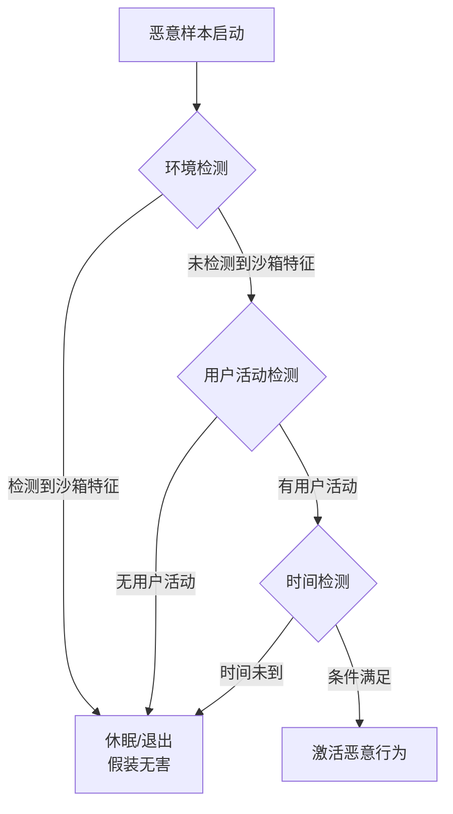

# 虚拟化/沙箱逃逸 (T1497)

## 一句话通俗理解

> **恶意代码在运行前先"四处张望"，确认自己不是在安全沙箱里，然后再决定是否激活**

## 30秒速查卡

| 维度 | 你需要知道的 |
|------|-------------|
| 这是什么？ | 检测和规避虚拟机、沙箱、分析环境的技术 |
| 为什么危险？ | 让安全分析失效，恶意软件只在真实目标上激活 |
| 谁需要关心？ | 安全分析师、恶意软件研究员、SOC团队 |
| 你的第一步防御 | 使用多种分析环境交叉验证可疑样本 |
| 如果只做一件事 | 在沙箱中模拟真实用户行为（鼠标移动、文件操作） |

## 难度等级

⭐⭐⭐ 高级 - 需要虚拟化技术、恶意软件分析和逆向工程知识

## 前置知识检查

**读这个文件需要什么？**

- [ ] 虚拟化技术原理（VMware, Hyper-V, VirtualBox）
- [ ] 恶意软件分析基础（动态分析、静态分析）
- [ ] Windows系统信息查询API

## 技术描述

### 通俗解释

安全团队用沙箱（一种隔离的虚拟环境）来分析可疑文件——文件在沙箱里运行，安全人员观察它的行为来判断是否恶意。聪明的恶意软件也知道这一点，所以它在运行前会先检查"我是不是在沙箱里"——检查CPU特征、内存大小、鼠标是否在动、有没有用户活动等。如果发现自己在沙箱中，就假装是正常程序什么都不做；一旦确认在真实用户的电脑上，才露出獠牙。

### 过渡段

简单来说，虚拟机和沙箱环境有一些物理机没有的特征（如特定的注册表项、MAC地址前缀、驱动名称）。恶意软件通过检测这些特征来判断运行环境，只在真实环境中激活。

### 技术原理

虚拟化/沙箱检测的主要方法：
1. **硬件特征检测**：检查CPUID指令返回的Hypervisor位、BIOS版本字符串
2. **注册表/文件检测**：检查VMware Tools、VirtualBox Guest Additions的存在
3. **MAC地址检测**：检查网卡MAC地址前缀（00:0C:29=VMware, 08:00:27=VirtualBox）
4. **时序检测**：利用VM和物理机的指令执行时间差
5. **用户交互检测**：检查鼠标移动、点击频率、最近文档数量
6. **进程检测**：检查分析工具进程（Wireshark, Process Monitor, x64dbg）
7. **资源检测**：检查CPU核心数、内存大小、磁盘空间（沙箱通常资源较少）

### 用途与影响

虚拟化/沙箱逃逸是现代恶意软件的标准配置，几乎所有APT组织和专业恶意软件都内置了反分析功能。这严重降低了安全团队的分析效率，许多恶意样本在沙箱中表现为"无害"，但在真实环境中会造成严重破坏。

## 子技术列表

| 子技术ID | 名称 | 说明 |
|----------|------|------|
| T1497.001 | System Checks | 系统检查 |
| T1497.002 | User Activity Based Checks | 基于用户活动的检查 |
| T1497.003 | Time Based Evasion | 基于时间的规避 |
| T1497.004 | Vagrant-Evasion | Vagrant环境规避 |

## 攻击流程



### 步骤详解
1. 恶意样本启动后首先进行多项环境检测
2. 检查硬件特征（CPUID、BIOS、MAC地址）判断是否在VM中
3. 如果通过，检查用户交互（鼠标移动、点击、窗口切换）
4. 检查时间条件（是否等待了足够长时间、是否在特定日期）
5. 检查分析工具进程是否存在
6. 所有检测通过后才激活恶意行为
7. 在沙箱环境中则表现为无害程序或直接退出

## 真实案例

### 案例1：LockBit勒索软件的多层反沙箱检测（2022-2023年）
- **时间**：2022-2023年
- **目标**：全球企业
- **攻击组织**：LockBit 3.0
- **手法**：LockBit 3.0在加密前执行超过20项环境检测：检查CPU核心数是否≥2，内存是否≥2GB，磁盘空间是否≥100GB；检查用户语言是否为俄语/乌克兰语（如果是则退出）；检查是否存在VMware/VirtualBox/Hyper-V的注册表键和驱动；检查鼠标是否在移动，桌面上是否有超过3个文件；使用`IsDebuggerPresent`和`CheckRemoteDebuggerPresent`检测调试器。如果任一检测失败，程序直接退出而不加密任何文件
- **影响**：大量恶意样本在自动沙箱分析中被判定为"无害"，导致安全团队误判
- **参考链接**：Cisco Talos LockBit分析

### 案例2：APT29 SUNBURST后门的时间规避（2020年）
- **时间**：2020年
- **目标**：SolarWinds客户
- **攻击组织**：APT29（Cozy Bear）
- **手法**：SUNBURST后门在激活前会等待12-14天，以此规避沙箱的动态分析窗口（通常沙箱分析时间不超过几分钟到几小时）。此外，后门会检查域名是否在特定列表中（如以".zip"结尾的域名），只有在符合条件的环境中才开始C2通信。C2通信的间隔时间也是随机化的（从1小时到几天不等），进一步规避行为分析
- **影响**：后门在受害者环境中潜伏数月，沙箱分析从未触发其恶意行为
- **参考链接**：FireEye SUNBURST分析

### 案例3：Emotet木马的用户交互检测（2020-2021年）
- **时间**：2020-2021年
- **目标**：全球Windows用户
- **攻击组织**：Emotet运营团队
- **手法**：Emotet在启动后检查多项用户交互指标：鼠标是否在移动（GetCursorPos对比）、最近打开的文档数量（检查Recent文件夹）、系统运行时间是否超过30分钟、是否有桌面图标被移动过。如果检测到是沙箱环境（无用户交互），Emotet不执行后续payload，仅表现为一个普通的文档文件
- **影响**：多个安全厂商的沙箱未能检测出Emotet的恶意行为
- **参考链接**：GData Emotet分析报告

## 红队视角

### 实战技巧
- 使用多重检测而非单一检测——任何一个检测都可能被沙箱欺骗
- 时间延迟是最有效的沙箱规避方法（沙箱通常不会等待数天）
- 检查用户行为是最难模拟的——鼠标轨迹、打字节奏
- 在payload前加入大量无害代码，增加沙箱分析超时概率

### 常用工具
| 工具 | 类型 | 特点 |
|------|------|------|
| pafish | 开源工具 | 沙箱检测演示工具 |
| al-khaser | 开源工具 | 反分析技术集合 |
| ScyllaHide | 反调试工具 | 隐藏调试器存在 |
| VMProtect | 商业工具 | 代码混淆和反分析 |

## 蓝队视角

### 检测要点
- 监控程序对特定API的调用模式（CPUID、GetCursorPos、IsDebuggerPresent）
- 检测程序启动后的异常延迟（Sleep调用超过几分钟）
- 分析程序的反调试行为

### 监控建议
- 在沙箱中模拟真实用户行为（鼠标移动、键盘输入）
- 使用多环境交叉验证（物理机+VM+不同配置）
- 设置超长分析时间窗口（数天而非数分钟）

## 避坑指南

- 单一沙箱环境无法检测所有规避技术——需要多环境组合
- 时间延迟规避无法通过技术手段解决，需要延长分析窗口
- 商业沙箱的特征可能被恶意软件识别——考虑使用定制环境

## 检测建议

### 网络层
- 监控程序启动后长时间无网络活动然后突然开始通信的模式
- 检测DNS查询的时间间隔异常

### 主机层
- **用人话说**：系统可以记录程序查询了哪些系统信息，重点关注大量查询硬件/环境信息的程序
```yaml
# 监控点
API调用: CPUID, IsDebuggerPresent, GetCursorPos, GetSystemInfo
注册表查询: HKLM\HARDWARE\DESCRIPTION\System\BIOS
文件检查: C:\Windows\System32\drivers\vmhgfs.sys (VMware)
```

### 应用层
```yaml
# Sigma规则：检测反沙箱行为
title: 检测可疑的沙箱检测行为
status: experimental
description: 监控程序进行大量环境检测的行为
logsource:
    category: process_creation
    product: windows
detection:
    selection:
        CommandLine|contains:
            - 'IsDebuggerPresent'
            - 'CheckRemoteDebuggerPresent'
            - 'GetCursorPos'
    condition: selection
level: medium
```

## 缓解措施

### 优先级1（必须实施）
- 在沙箱中模拟真实用户交互行为
- 使用多种分析环境交叉验证
- 延长沙箱分析时间窗口

### 优先级2（推荐实施）
- 使用物理机分析环境补充VM分析
- 定制沙箱环境，移除VM特征指纹
- 部署交互式分析（分析师手动操作样本）

### 优先级3（长期规划）
- 使用AI辅助行为分析识别规避模式
- 建立多阶段分析管道（快速分析+深度分析）

## 动手实验

### 实验1：使用pafish测试沙箱检测能力
```bash
# 预期输出：pafish显示哪些检测被触发，哪些被绕过
pafish.exe
# 输出示例：[!] VMware registry key detected
```

### 实验2：检查当前环境的VM特征
```powershell
# 预期输出：显示BIOS版本（包含VM标识则为虚拟机）
Get-WmiObject Win32_BIOS | Select-Object SMBIOSBIOSVersion, Manufacturer
# 检查MAC地址前缀
Get-NetAdapter | Select-Object Name, MacAddress
```

## 术语解释

| 术语 | 说明 |
|------|------|
| CPUID | x86指令，可检测Hypervisor存在 |
| Hypervisor | 虚拟机监控器，管理VM的软件层 |
| LOLBins | Living Off The Land Binaries，系统自带可滥用工具 |
| IsDebuggerPresent | Windows API，检测是否有调试器附加 |
| Sleep调用 | 让程序暂停执行的API，常用于时间规避 |

## 参考资料

### 📚 深入了解
- [MITRE ATT&CK T1497](https://attack.mitre.org/techniques/T1497/)
- [反虚拟机检测技术综述](https://evasions.cyonic.ch/)

### 📰 真实攻击
- [Cisco Talos LockBit分析](https://blog.talosintelligence.com/)
- [FireEye SUNBURST分析](https://www.fireeye.com/blog/threat-research/2020/12/evasive-attacker-leverages-solarwinds-supply-chain-compromises.html)

### 🔧 动手试试
- [pafish沙箱检测工具](https://github.com/a0rtega/pafish)
- [al-khaser反分析工具](https://github.com/LordNoteworthy/al-khaser)
