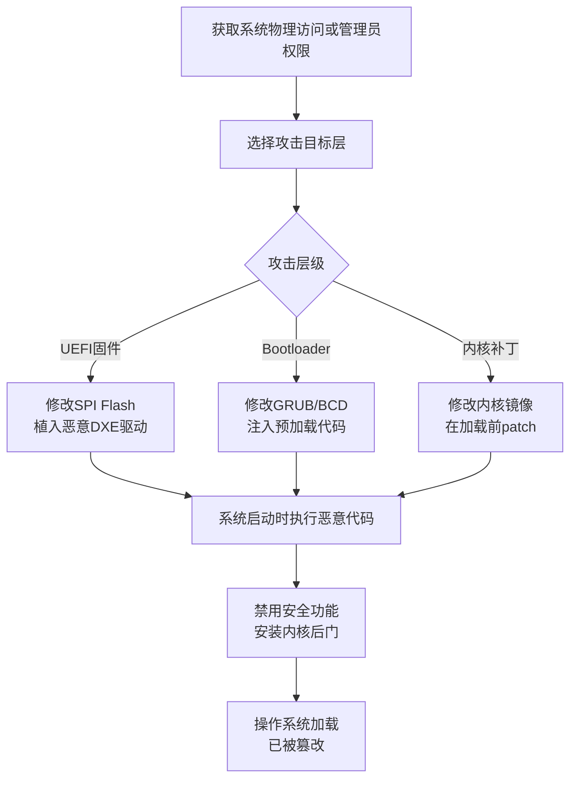

# 引导前启动 (T1542)

## 一句话通俗理解

> **在操作系统启动之前就先运行恶意代码，就像在房子建好之前就在地基里埋了暗门**

## 30秒速查卡

| 维度 | 你需要知道的 |
|------|-------------|
| 这是什么？ | 在操作系统启动前执行的恶意代码（Bootkit/UEFI rootkit） |
| 为什么危险？ | 在操作系统加载前运行，能控制整个系统且极难检测 |
| 谁需要关心？ | 系统管理员、安全架构师、固件安全团队 |
| 你的第一步防御 | 启用Secure Boot并验证固件完整性 |
| 如果只做一件事 | 启用UEFI Secure Boot功能 |

## 难度等级

⭐⭐⭐ 高级 - 需要UEFI/BIOS固件、引导过程和内核级编程知识

## 前置知识检查

**读这个文件需要什么？**

- [ ] UEFI/BIOS启动流程
- [ ] Windows/Linux内核加载过程
- [ ] 固件编程和驱动开发基础

## 技术描述

### 通俗解释

电脑开机时，首先运行的不是Windows，而是主板上的固件（UEFI/BIOS），然后是引导程序（Bootloader），最后才是操作系统。攻击者如果在这个"操作系统启动之前"的阶段植入恶意代码，就能在操作系统加载前控制整个系统。这就像在房子的地基里预先埋了一个暗门，无论你在房子里装多少锁都防不住，因为暗门在房子建好之前就有了。

### 过渡段

简单来说，Pre-OS Boot攻击在固件（UEFI/BIOS）或引导加载器层面植入恶意代码。这些代码在操作系统内核加载之前执行，能够修改内核、禁用安全功能、安装内核级后门。

### 技术原理

Pre-OS Boot的主要攻击方式：
1. **UEFI固件植入**：修改SPI Flash中的UEFI固件模块，植入恶意DXE驱动
2. **Bootloader修改**：修改GRUB或Windows Boot Manager，在加载内核前注入代码
3. **BCD修改**：修改Windows启动配置数据（BCD），禁用安全启动或修改加载顺序
4. **内核补丁**：在内核加载到内存后、执行前修改内核代码（bootkit）
5. **Option ROM攻击**：在设备的Option ROM（如网卡PXE ROM）中植入恶意代码

### 用途与影响

Pre-OS Boot攻击是最高级别的持久化手段，能在系统重装后仍然存活。被FinFisher、Equation Group（NSA）等高级威胁组织使用。由于在OS层面之下运行，传统安全软件完全无法检测。

## 子技术列表

| 子技术ID | 名称 | 说明 |
|----------|------|------|
| T1542.001 | System Firmware | 系统固件 |
| T1542.002 | Component Firmware | 组件固件 |
| T1542.003 | Bootkit | 引导套件 |
| T1542.004 | Rommonkit | Cisco ROM监控器 |
| T1542.005 | TFTP Boot | TFTP启动 |

## 攻击流程



### 步骤详解
1. 攻击者通过物理访问或管理员权限获取系统控制
2. 选择攻击的层级（UEFI固件、Bootloader、内核镜像）
3. 修改目标——如写入SPI Flash中的UEFI DXE驱动
4. 恶意代码在系统启动时优先执行
5. 禁用Secure Boot验证或Patch安全功能
6. 在内核加载前安装后门或Rootkit
7. 操作系统加载后已处于被控制状态，安全软件无法检测

## 真实案例

### 案例1：FinFisher使用UEFI Bootkit（2021年）
- **时间**：2021年
- **目标**：记者、活动人士
- **攻击组织**：FinFisher（商业间谍软件公司）
- **手法**：FinFisher开发了一个UEFI Bootkit模块，通过修改SPI Flash中的UEFI固件来植入持久化后门。攻击者需要先获取管理员权限，然后使用flashrom工具直接写入SPI Flash芯片。植入的恶意DXE驱动在UEFI启动阶段执行，在Windows内核加载前安装内核驱动。该驱动会注入到Windows的LSASS进程中，实现凭据拦截和持久化。即使重装Windows，后门仍存在于固件中
- **影响**：目标设备在多次系统重装后仍被监控
- **参考链接**：ESET FinFisher分析报告

### 案例2：Equation Group的硬盘固件攻击（2015年曝光）
- **时间**：2001-2015年
- **目标**：政府、军事、能源部门
- **攻击组织**：Equation Group（NSA相关）
- **手法**：Equation Group开发了能够修改硬盘驱动器（HDD）固件的恶意软件。通过重写硬盘的Controller Firmware，在硬盘启动时将恶意代码注入操作系统内核。这种攻击利用了各硬盘厂商（Seagate, Western Digital, Toshiba等）固件更新的漏洞。恶意代码存储在硬盘固件的隐藏区域，即使格式化硬盘也无法清除
- **影响**：被认为是史上最复杂的恶意软件之一，感染了30多个国家的政府机构
- **参考链接**：Kaspersky Equation Group报告

### 案例3：LoJax UEFI Rootkit攻击（2018年）
- **时间**：2018年
- **目标**：巴尔干半岛和东欧政府机构
- **攻击组织**：APT28（Fancy Bear，俄罗斯GRU）
- **手法**：APT28使用LoJax UEFI Rootkit，通过RWEverything工具直接写入SPI Flash。LoJax将恶意NTFS模块植入UEFI固件，在Windows启动时写入system32文件夹中的恶意DLL，并设置自动启动。该Rootkit还通过修改Runtime DXE驱动来绕过Secure Boot。即使受害者重装操作系统或更换硬盘，只要主板固件未被刷新，恶意代码就会持续存在
- **影响**：多个政府机构被长期监控，系统重装无法清除后门
- **参考链接**：ESET LoJax深度分析

## 红队视角

### 实战技巧
- UEFI攻击需要物理访问或Ring 0权限，但一旦成功极其持久
- 使用flashrom或SPI编程器直接操作SPI Flash
- 植入DXE驱动是UEFI攻击的核心——它在最早阶段执行
- 修改BCD（bcdedit）是更简单但效果较弱的Bootloader攻击

### 常用工具
| 工具 | 类型 | 特点 |
|------|------|------|
| flashrom | 开源工具 | 读写SPI Flash芯片 |
| RWEverything | Windows工具 | 直接读写硬件寄存器 |
| UEFITool | 开源工具 | 解析和修改UEFI固件镜像 |
| CHIPSEC | 安全工具 | 固件安全评估框架 |
| GRUB修改 | 系统工具 | 修改Linux Bootloader |

## 蓝队视角

### 检测要点
- 监控SPI Flash固件版本的异常变更
- 检测BCD（启动配置数据）的修改
- 使用TPM测量启动环境（Measured Boot）
- 监控UEFI变量存储的异常修改

### 监控建议
- 启用Secure Boot和TPM 2.0
- 定期检查固件版本是否与厂商发布的版本一致
- 使用Windows Device Guard和Credential Guard

## 避坑指南

- Secure Boot不是万能的——部分UEFI实现存在漏洞
- 固件更新是清除UEFI Rootkit的唯一可靠方法
- TPM的Measured Boot能检测但不能阻止攻击

## 检测建议

### 网络层
- Pre-OS Boot攻击在网络层几乎不可见——代码在OS网络栈启动前执行
- 可能检测到C2通信（但已在OS层运行）

### 主机层
- **用人话说**：系统可以检查固件版本是否被篡改，就像检查房子的地基是否被动过手脚
```powershell
# 检查Secure Boot状态
Confirm-SecureBootUEFI
# 检查TPM状态
Get-Tpm
# 检查BCD配置
bcdedit /enum all
```

### 应用层
```yaml
# 检测BCD修改
title: 检测启动配置数据修改
status: experimental
description: 监控bcdedit对启动配置的修改
logsource:
    category: process_creation
    product: windows
detection:
    selection:
        Image|endswith: '\bcdedit.exe'
        CommandLine|contains:
            - '/set'
            - '/delete'
            - 'nointegritychecks'
            - 'disable_integrity_checks'
    condition: selection
level: high
```

## 缓解措施

### 优先级1（必须实施）
- 启用UEFI Secure Boot
- 启用TPM 2.0和Measured Boot
- 限制对固件更新工具的访问

### 优先级2（推荐实施）
- 使用CHIPSEC定期审计固件完整性
- 部署Windows Device Guard
- 监控BCD修改操作

### 优先级3（长期规划）
- 使用支持固件远程证明的硬件
- 建立固件版本基线监控

## 动手实验

### 实验1：检查Secure Boot和TPM状态
```powershell
# 预期输出：Secure Boot状态为True
Confirm-SecureBootUEFI
# 预期输出：TPM Ready为True
Get-Tpm
```

### 实验2：使用CHIPSEC检查固件完整性
```bash
# 预期输出：显示SPI Flash描述符和固件模块
chipsec_util.py spi dump spi_dump.bin
chipsec_util.py uefi list
```

## 术语解释

| 术语 | 说明 |
|------|------|
| UEFI | 统一可扩展固件接口，取代传统BIOS的固件标准 |
| Secure Boot | 安全启动，验证启动组件签名防止未授权代码执行 |
| SPI Flash | 串行外设接口Flash芯片，存储UEFI固件 |
| DXE Driver | Driver eXecution Environment驱动，UEFI启动阶段执行的驱动 |
| Bootkit | 引导套件，在OS启动前执行的恶意代码 |
| Measured Boot | 测量启动，使用TPM记录启动组件哈希值 |

## 参考资料

### 📚 深入了解
- [MITRE ATT&CK T1542](https://attack.mitre.org/techniques/T1542/)
- [CHIPSEC固件安全框架](https://github.com/chipsec/chipsec)

### 📰 真实攻击
- [ESET LoJax分析](https://www.welivesecurity.com/2018/09/27/lojax-first-uefi-rootkit-found-wild-courtesy-sednit-group/)
- [Kaspersky Equation Group](https://www.kaspersky.com/)

### 🔧 动手试试
- [UEFITool](https://github.com/LongSoft/UEFITool)
- [CHIPSEC使用指南](https://chipsec.github.io/)
