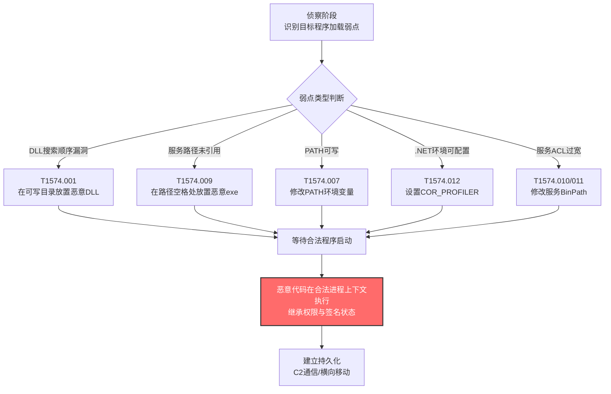

# 劫持执行流 (T1574)

## 一句话通俗理解

攻击者像在高速公路上偷偷换掉路标，让合法程序沿着"假路"开进恶意代码的陷阱——程序以为自己走的是正道，实际上执行的却是攻击者想要的内容。

## 30秒速查卡

| 维度 | 你需要知道的 |
|------|-------------|
| 这是什么？ | 利用操作系统或应用程序在加载代码、解析路径、启动服务时的"信任机制"，把恶意DLL/脚本/可执行文件塞进合法执行路径 |
| 为什么危险？ | 恶意代码借着合法程序（往往是微软签名进程）的"外壳"运行，安全软件很难分辨善恶，权限继承让攻击者直接获得高权限 |
| 谁需要关心？ | Windows系统管理员、应用开发者、EDR研发人员、SOC分析师 |
| 你的第一步防御 | 强制使用绝对路径加载DLL、启用KnownDLLs保护、为服务配置强ACL并校验可执行路径 |
| 如果只做一件事 | 启用Sysmon Event ID 7（Image Loaded）审计，监控非系统目录下未签名DLL被合法进程加载的行为 |

## 难度等级

⭐⭐⭐ 高级（需要深入的技术知识和实践）

劫持执行流属于高级隐蔽技术，原因在于：
- 攻击者需要理解操作系统底层的DLL加载机制、服务管理模型、.NET运行时架构
- 不同的子技术对应不同的平台和场景，选择合适的劫持点需要对目标环境的深入侦察
- 防御方若不了解合法加载链路，很难区分"正常加载"与"被劫持的加载"

## 前置知识检查

**读这个文件需要什么？**

- [ ] Windows DLL搜索顺序与PE加载机制
- [ ] Windows服务管理（Service Control Manager）与注册表结构
- [ ] .NET CLR运行时与Profiling API基础
- [ ] Linux/macOS动态链接器（ld.so/dyld）工作原理
- [ ] 文件系统权限模型（ACL/DACL）与PATH环境变量

## 技术描述

劫持执行流（T1574）是MITRE ATT&CK框架中**同时属于隐蔽（TA0005）与执行（TA0002）两个战术**的技术。攻击者通过操纵操作系统或应用程序在执行代码时的"查找与加载"过程，让合法进程加载并运行恶意内容，而非其原本应该加载的内容。

**通俗解释：**

想象你每天下班都走同一条路回家，路边有个"回家指示牌"指向你家方向。攻击者偷偷把这个指示牌转了个方向，你就跟着指示牌走进了贼窝——你以为是回家，实际上被引到了陷阱里。在计算机世界里，"指示牌"就是DLL搜索顺序、PATH环境变量、服务可执行路径、.NET运行时配置等机制。攻击者只要在这些"指示牌"上动手脚，合法程序就会乖乖加载恶意代码。

**过渡段：** 劫持执行流的精髓在于"借壳"——不需要自己启动恶意进程，而是让已经存在的、被系统信任的合法进程去执行恶意内容。这意味着恶意代码继承了合法进程的权限、签名状态和可信度，传统的"检测未知可执行文件"防御策略对它完全无效。下面我们按攻击面分类，看看14个子技术各自"换路标"的方式。

**技术原理（按攻击面分类）：**

### 一、DLL加载劫持类（Windows核心）

Windows在加载DLL时遵循固定的搜索顺序：应用所在目录 → System32 → System → Windows目录 → 当前工作目录 → PATH环境变量目录。攻击者只要在搜索路径中靠前的可写位置放置同名恶意DLL，就能让程序优先加载它。

1. **DLL搜索顺序劫持（T1574.001）**：利用默认搜索顺序漏洞，在可写目录放置恶意DLL
2. **DLL侧载（T1574.002）**：利用WinSxS清单机制，在程序清单指定的并行组件路径放置恶意DLL
3. **DLL劫持（T1574.003）**：替换程序正常依赖的DLL为恶意版本（通常针对缺乏完整签名的DLL）

### 二、路径劫持类

1. **PATH劫持（T1574.007）**：修改PATH环境变量，在靠前位置插入恶意目录
2. **搜索顺序劫持（T1574.008）**：泛指利用各类搜索顺序（不仅是DLL）的劫持
3. **未引用路径劫持（T1574.009）**：利用Windows服务路径中含空格且未加引号的弱点（如`C:\Program Files\app\service.exe`被解析为`C:\Program.exe`）

### 三、服务劫持类

1. **可执行安装程序文件权限弱点（T1574.005）**：利用安装程序文件ACL过宽，替换可执行文件
2. **服务权限劫持（T1574.010）**：修改服务的BinPath或权限配置
3. **服务注册表权限弱点（T1574.011）**：利用`HKLM\SYSTEM\CurrentControlSet\Services`下注册表项ACL过宽

### 四、.NET运行时劫持类

1. **COR_PROFILER劫持（T1574.012）**：设置`COR_ENABLE_PROFILING`与`COR_PROFILER`环境变量，让所有.NET进程加载恶意Profiler DLL
2. **AppDomainManager劫持（T1574.014）**：通过配置文件指定恶意的AppDomainManager，在.NET应用启动时获得执行权

### 五、macOS/Linux专属

1. **Dylib劫持（T1574.004）**：macOS上利用dyld搜索顺序与`@rpath`/`@loader_path`机制劫持动态库
2. **动态链接器劫持（T1574.006）**：Linux上利用`LD_PRELOAD`、`LD_LIBRARY_PATH`或`/etc/ld.so.preload`注入恶意库

### 六、其他高级劫持

1. **KernelCallbackTable劫持（T1574.013）**：修改进程PEB中的KernelCallbackTable指针，劫持窗口消息回调函数，常用于进程注入与持久化

**用途与影响：**

劫持执行流是APT组织最爱用的技术之一。它的价值体现在三个层面：**隐蔽性**（恶意代码披着合法进程的外衣）、**权限继承**（直接获得SYSTEM或服务账户权限）、**持久化**（每次合法程序启动都会触发恶意加载）。几乎所有针对Windows环境的高级攻击都会用到至少一种劫持子技术——从DLL侧载到COR_PROFILER，已成为现代红队和APT的标配。

## 真实攻击流程

### 典型攻击流程

```
侦察目标程序的加载弱点 --> 在劫持点放置恶意DLL/修改路径 --> 等待合法程序启动 --> 恶意代码借合法进程执行 --> 持久化与横向移动
```



**步骤详解：**

1. **侦察目标程序的加载弱点**
   - 通俗描述：攻击者像小偷踩点，找出目标程序"哪里能塞私货"
   - 技术细节：使用Process Monitor分析DLL加载顺序、检查服务路径是否加引号、检查注册表项ACL
   - 常用工具：Sysinternals Process Monitor、AccessChk、PowerUp

2. **在劫持点放置恶意内容**
   - 通俗描述：把"假路标"放到合法程序必经的路上
   - 技术细节：根据弱点类型选择放置DLL、修改注册表、改PATH或设置环境变量
   - 常用工具：自定义恶意DLL、Mimikatz、PowerShell Empire

3. **等待合法程序启动**
   - 通俗描述：不需要主动触发，等系统或用户自然调用合法程序即可
   - 技术细节：许多劫持点会在系统启动、服务启动、用户登录时自动触发
   - 常用工具：无（被动等待）

4. **恶意代码借合法进程执行**
   - 通俗描述：合法程序像"特洛伊木马"，外壳是它，里面跑的是攻击者的代码
   - 技术细节：恶意DLL的DllMain在加载时自动执行，继承宿主进程的令牌与权限
   - 常用工具：Cobalt Strike Beacon、自定义Shellcode加载器

5. **持久化与横向移动**
   - 通俗描述：站稳脚跟后，开始向其他机器扩张
   - 技术细节：利用继承的SYSTEM权限转储凭证、通过WMI/PsExec横向移动
   - 常用工具：Mimikatz、Cobalt Strike、Impacket

## 子技术概览

**该技术共有 14 个子技术：**

| 子技术ID | 中文名称 | 一句话理解 | 主要平台 |
|----------|----------|------------|----------|
| [T1574.001](./T1574/T1574.001-DLL-Search-Order-Hijacking.md) | DLL搜索顺序劫持 | 利用Windows DLL搜索顺序漏洞，在可写目录放置恶意同名DLL | Windows |
| [T1574.002](./T1574/T1574.002-DLL-Side-Loading.md) | DLL侧载 | 利用WinSxS清单机制，让程序加载指定并行组件路径下的恶意DLL | Windows |
| [T1574.003](./T1574/T1574.003-DLL-Hijacking.md) | DLL劫持 | 替换程序正常依赖的DLL为恶意版本 | Windows |
| [T1574.004](./T1574/T1574.004-Dylib-Hijacking.md) | Dylib劫持 | macOS上利用dyld搜索顺序与`@rpath`机制劫持动态库 | macOS |
| [T1574.005](./T1574/T1574.005-Executable-Installer-File-Permissions-Weakness.md) | 可执行安装程序文件权限弱点 | 利用安装程序文件ACL过宽，替换可执行文件 | Windows |
| [T1574.006](./T1574/T1574.006-Dynamic-Linker-Hijacking.md) | 动态链接器劫持 | Linux上利用`LD_PRELOAD`或`/etc/ld.so.preload`注入恶意库 | Linux |
| [T1574.007](./T1574/T1574.007-Path-Hijacking.md) | PATH劫持 | 修改PATH环境变量，在靠前位置插入恶意目录 | Windows、Linux、macOS |
| [T1574.008](./T1574/T1574.008-Search-Order-Hijacking.md) | 搜索顺序劫持 | 泛指利用各类搜索顺序（脚本、库、可执行文件）的劫持 | Windows、Linux、macOS |
| [T1574.009](./T1574/T1574.009-Unquoted-Service-Path.md) | 未引用路径劫持 | 利用Windows服务路径含空格且未加引号的弱点执行恶意exe | Windows |
| [T1574.010](./T1574/T1574.010-Service-Permissions-Hijacking.md) | 服务权限劫持 | 修改服务的BinPath或权限配置，让服务启动时执行恶意代码 | Windows |
| [T1574.011](./T1574/T1574.011-Services-Registry-Permissions-Weakness.md) | 服务注册表权限弱点 | 利用服务注册表项ACL过宽，修改ImagePath指向恶意程序 | Windows |
| [T1574.012](./T1574/T1574.012-COR-PROFILER-Hijacking.md) | COR_PROFILER劫持 | 设置COR_PROFILER环境变量，让所有.NET进程加载恶意Profiler DLL | Windows |
| [T1574.013](./T1574/T1574.013-KernelCallbackTable-Hijacking.md) | KernelCallbackTable劫持 | 修改进程PEB中的KernelCallbackTable指针，劫持窗口消息回调 | Windows |
| [T1574.014](./T1574/T1574.014-AppDomainManager-Hijacking.md) | AppDomainManager劫持 | 通过.NET配置文件指定恶意AppDomainManager，在应用启动时获得执行权 | Windows |

## 检测建议

**用人话说：** 劫持执行流的检测核心是"建立合法加载基线，识别偏离基线的加载行为"。安全软件平时记录每个合法进程加载哪些DLL、从哪些路径加载、签名状态如何——一旦发现某进程突然加载了非标准路径下的未签名DLL，或服务可执行路径被改写，就高度可疑。

### 网络层检测

**检测方法：** 监控网络流量中的可疑DLL下载行为，识别从非标准位置拉取DLL的C2通信模式。许多DLL劫持型恶意软件在加载后会向C2服务器回连，可通过流量基线异常发现。

### 主机层检测

**Windows事件ID：**
- Sysmon Event ID 1：进程创建（关注父进程为服务的可疑子进程）
- Sysmon Event ID 7：Image Loaded（**核心**——监控DLL加载路径与签名状态）
- Sysmon Event ID 11：FileCreate（监控可写目录中的DLL创建）
- Event ID 7045：服务创建（监控可疑服务路径）
- Event ID 4697：服务创建（安全审计）
- Event ID 4657：注册表值修改（监控Services注册表项与COR_PROFILER环境变量）

**具体命令示例：**
```powershell
# 检测非系统目录下被合法进程加载的未签名DLL（Sysmon Event ID 7）
Get-WinEvent -FilterHashtable @{LogName='Microsoft-Windows-Sysmon/Operational'; ID=7} |
    Where-Object { $_.Message -match 'ImageLoaded' -and $_.Message -notmatch 'System32|SysWOW64|Windows\\assembly' } |
    Select-Object TimeCreated, Message -First 50

# 检测服务路径未加引号的高危服务
Get-WmiObject Win32_Service | Where-Object { $_.PathName -and ($_.PathName -notmatch '^"' -and $_.PathName -match '\s') } |
    Select-Object Name, PathName, State

# 检测COR_PROFILER环境变量被设置（全局或进程级）
Get-ItemProperty 'HKLM:\SYSTEM\CurrentControlSet\Control\Session Manager\Environment' -ErrorAction SilentlyContinue |
    Select-Object COR_ENABLE_PROFILING, COR_PROFILER
reg query "HKLM\SYSTEM\CurrentControlSet\Control\Session Manager\Environment" /v COR_PROFILER 2>$null
```

### 应用层检测

**检测要点：**

1. **DLL加载异常检测**
   - 日志来源：Sysmon Event ID 7
   - 关注字段：Image（加载方）、ImageLoaded（被加载DLL）、Signed（签名状态）
   - 异常特征：合法系统进程加载非系统目录下的未签名DLL

2. **服务配置变更检测**
   - 日志来源：Event ID 7045、4697、4657
   - 关注字段：ServiceName、ImagePath、BinaryPathName
   - 异常特征：服务的可执行路径被改为非标准位置，或注册表项ACL被修改

3. **环境变量异常检测**
   - 日志来源：注册表监控、进程环境块
   - 关注字段：COR_ENABLE_PROFILING、COR_PROFILER、LD_PRELOAD、LD_LIBRARY_PATH
   - 异常特征：全局环境变量中出现Profiler或预加载配置

4. **PATH环境变量变更检测**
   - 日志来源：注册表监控（`HKLM\SYSTEM\CurrentControlSet\Control\Session Manager\Environment`）
   - 关注字段：Path值的新增条目
   - 异常特征：PATH中加入可写目录，或新目录在前排位置

## 检测规则示例

### Sigma规则：检测DLL搜索顺序劫持

```yaml
title: 可疑DLL搜索顺序劫持行为检测
id: 60adald6-f1fc-4b6e-9b7a-1b3c4d5e6f70
status: experimental
description: 检测合法系统进程从非标准可写目录加载未签名DLL的行为，可能表明T1574.001 DLL搜索顺序劫持
references:
    - https://attack.mitre.org/techniques/T1574/001/
    - https://attack.mitre.org/techniques/T1574/
author: ATT&CK知识库
date: 2026/07/23
logsource:
    product: windows
    service: sysmon
detection:
    selection_image_loaded:
        EventID: 7
        ImageLoaded|contains:
            - 'C:\Users\'
            - 'C:\ProgramData\'
            - 'C:\Temp\'
            - 'C:\Windows\Temp\'
            - 'C:\Users\Public\'
    filter_signed:
        Signed: 'true'
    filter_system_dirs:
        ImageLoaded|contains:
            - 'C:\Windows\System32\'
            - 'C:\Windows\SysWOW64\'
            - 'C:\Windows\assembly\'
    condition: selection_image_loaded and not filter_signed and not filter_system_dirs
falsepositives:
    - 第三方软件从用户目录加载合法DLL（需建立基线白名单）
    - 开发环境从临时目录加载调试DLL
level: high
tags:
    - attack.t1574
    - attack.t1574.001
    - attack.defense_evasion
    - attack.execution
    - attack.persistence
```

### Sigma规则：检测COR_PROFILER劫持

```yaml
title: COR_PROFILER环境变量异常设置检测
id: 7b8c9d0e-1f2a-3b4c-5d6e-7f809192a3b4
status: experimental
description: 检测全局环境变量中COR_ENABLE_PROFILING与COR_PROFILER被设置，可能表明T1574.012 COR_PROFILER劫持
references:
    - https://attack.mitre.org/techniques/T1574/012/
author: ATT&CK知识库
date: 2026/07/23
logsource:
    product: windows
    service: security
detection:
    selection_registry:
        EventID: 4657
        ObjectName|contains:
            - 'COR_ENABLE_PROFILING'
            - 'COR_PROFILER'
            - 'CORECLR_ENABLE_PROFILING'
            - 'CORECLR_PROFILER'
    condition: selection_registry
falsepositives:
    - 合法性能分析工具（如dotTrace、Application Insights）的部署
    - 开发团队启用.NET Profiling进行调试
level: critical
tags:
    - attack.t1574
    - attack.t1574.012
    - attack.defense_evasion
    - attack.execution
    - attack.persistence
```

## 缓解措施

### 优先级1：关键措施

**措施名称：** 启用KnownDLLs与SafeDllSearchMode

**具体实施步骤：**
1. 确认注册表`HKLM\SYSTEM\CurrentControlSet\Control\Session Manager\KnownDLLs`包含关键系统DLL
2. 启用`SafeDllSearchMode`（注册表`SafeDllSearchMode=1`），将当前工作目录从搜索顺序第一位降到第三位之后
3. 为关键服务账户配置`CWD_ILLEGAL`策略，禁止从当前目录加载DLL

### 优先级2：重要措施

**措施名称：** 强制代码签名与绝对路径加载

**具体实施步骤：**
1. 通过WDAC（Windows Defender Application Control）要求所有加载的DLL必须有受信任的数字签名
2. 推动开发团队在应用程序中使用`LoadLibraryEx`配合`LOAD_LIBRARY_SEARCH_*`标志指定绝对搜索路径
3. 对Windows服务使用`sc qc`定期审计ImagePath，确保路径已加引号且指向受保护目录

### 优先级3：建议措施

**措施名称：** 加固服务与注册表ACL

**具体实施步骤：**
1. 使用`sc sdshow`审计所有服务的ACL，确保只有SYSTEM与管理员可修改
2. 限制`HKLM\SYSTEM\CurrentControlSet\Services`下注册表项的写权限
3. 监控并限制环境变量`COR_PROFILER`、`LD_PRELOAD`、`LD_LIBRARY_PATH`的全局设置
4. 对Linux系统，使用`/etc/ld.so.preload`的文件完整性监控（FIM）

### MITRE ATT&CK 缓解措施映射

| 缓解措施ID | 缓解措施名称 | 适用性 | 说明 |
|------------|-------------|--------|------|
| M1040 | 行为检测 | 适用 | 监控异常DLL加载行为，建立加载基线 |
| M1038 | 执行防护 | 适用 | 限制未签名DLL的加载 |
| M1045 | 软件限制策略 | 适用 | AppLocker/WDAC限制可执行代码来源 |
| M1022 | 限制文件与目录权限 | 适用 | 加固服务路径与注册表项ACL |
| M1015 | 修改系统配置 | 部分适用 | 启用SafeDllSearchMode与KnownDLLs |

## 动手实验

> ⚠️ **重要提示**：所有实验必须在隔离的实验室环境中进行，禁止对未授权的真实系统进行测试。

### 实验环境准备

**所需工具：**
- Windows 10/11虚拟机（启用Sysmon日志）
- Process Monitor（ProcMon）
- 一个简单的测试程序（如notepad.exe或自定义loader）
- msfvenom（用于生成测试payload）

### 实验1：DLL搜索顺序劫持基础（初级）

**实验目标：** 理解T1574.001 DLL搜索顺序劫持的原理，观察合法进程如何加载恶意DLL

**实验步骤：**
1. 使用`procmon.exe`监控一个目标程序（如`calc.exe`）启动时的DLL加载行为，过滤`Result is NAME NOT FOUND`
2. 识别目标程序查找但未找到的DLL名称（如`version.dll`、`iertutil.dll`等常见劫持目标）
3. 使用msfvenom生成一个测试DLL：
   ```bash
   msfvenom -p windows/x64/exec CMD=calc.exe -f dll -o version.dll
   ```
4. 将生成的`version.dll`放到目标程序所在目录
5. 启动目标程序，观察calc.exe是否弹出（证明恶意DLL被加载执行）
6. 检查Sysmon Event ID 7日志，确认DLL加载事件被记录

**预期结果：** 目标程序优先加载了同目录下的恶意DLL，弹出calc.exe，Sysmon日志记录了ImageLoaded事件

**学习要点：** 理解Windows DLL搜索顺序的工作原理，以及为什么"应用所在目录"是最高优先级

### 实验2：未引用服务路径劫持（中级）

**实验目标：** 理解T1574.009未引用服务路径劫持，掌握利用服务路径空格弱点的方法

**实验步骤：**
1. 创建一个测试服务，路径含空格且未加引号：
   ```powershell
   New-Service -Name "VulnService" -BinaryPathName "C:\Program Files\MyApp\service.exe" -DisplayName "Vulnerable Test Service"
   ```
2. 使用`sc qc VulnService`确认BINARY_PATH_NAME未加引号
3. 在`C:\Program.exe`放置一个测试可执行文件（如弹出msgbox的程序）
4. 启动服务，观察`C:\Program.exe`是否被执行（Windows会将路径解析为`C:\Program.exe` + `Files\MyApp\service.exe`）
5. 清理：删除测试服务与测试文件

**预期结果：** 服务启动时，Windows因路径未加引号而优先执行了`C:\Program.exe`

**学习要点：** 理解Windows服务路径解析机制，掌握检测与修复未引用服务路径的方法

## 真实案例

### 案例1：Lazarus集团DLL侧载攻击全球金融机构（2018-2023）

- **时间**：2018年-2023年
- **目标**：全球金融机构、加密货币交易所、国防承包商
- **攻击组织**：Lazarus Group（APT38）
- **手法**：Lazarus广泛使用DLL侧载技术（T1574.002）分发恶意软件。他们将恶意DLL与一个合法的、微软签名的可执行文件（如`winver.exe`、`mshta.exe`的合法副本）打包在一起。当受害者运行合法exe时，它会按照WinSxS清单加载同目录下的恶意DLL（如`msvcr100.dll`、`version.dll`）。恶意DLL的DllMain在加载时自动执行Shellcode，部署Cobalt Strike Beacon或自定义后门。由于宿主进程是微软签名程序，安全软件往往不会拦截。
- **影响**：多家银行与加密货币交易所被入侵，损失估计超过数亿美元
- **参考链接**：[MITRE - Lazarus Group](https://attack.mitre.org/groups/G0032/)、[Kaspersky - Lazarus DLL Side-Loading](https://securelist.com/)

### 案例2：APT41利用COR_PROFILER实现全环境持久化（2020-2021）

- **时间**：2020年-2021年
- **目标**：跨国科技公司、游戏开发商、电信运营商
- **攻击组织**：APT41（Wicked Panda、Barium）
- **手法**：APT41在受害者系统上设置全局环境变量`COR_ENABLE_PROFILING=1`与`COR_PROFILER={GUID}`，并注册恶意的COM Profiler对象。一旦设置完成，**所有**.NET进程（包括IIS工作进程、SQL Server、Office应用）在启动时都会加载攻击者的Profiler DLL。这个DLL在.NET运行时初始化阶段执行，可以劫持所有.NET方法的调用，实现深度持久化与代码注入。由于攻击发生在CLR初始化前，传统EDR很难检测。
- **影响**：受害环境中所有.NET应用被深度渗透，攻击者获得多个高权限执行通道
- **参考链接**：[MITRE - T1574.012](https://attack.mitre.org/techniques/T1574/012/)、[Mandiant - APT41 Report](https://www.mandiant.com/resources/apt41-global-cyber-espionage)

### 案例3：Sandworm利用服务注册表权限弱点攻击乌克兰基础设施（2022）

- **时间**：2022年
- **目标**：乌克兰政府机构、能源基础设施
- **攻击组织**：Sandworm Team（APT44）
- **手法**：Sandworm在横向移动阶段利用T1574.011（服务注册表权限弱点），对目标系统上ACL配置宽松的服务注册表项进行修改。他们将`HKLM\SYSTEM\CurrentControlSet\Services\<vuln_service>\ImagePath`的值改为指向恶意可执行文件路径，同时保留服务的原始显示名与描述以避免被运维发现。当服务下次启动时（或攻击者通过`sc start`触发），系统执行的是恶意程序而非原始服务，攻击者借此获得SYSTEM权限执行Industroyer2等破坏性payload。
- **影响**：多处能源设施遭受破坏性攻击，部分区域停电
- **参考链接**：[MITRE - Sandworm](https://attack.mitre.org/groups/G0034/)、[CERT-UA - Industroyer2 Analysis](https://cert.gov.ua/)

## 术语解释

| 术语 | 英文原名 | 通俗解释 |
|------|----------|----------|
| 劫持执行流 | Hijack Execution Flow | 操纵程序加载与执行路径，让合法进程运行恶意代码 |
| DLL搜索顺序 | DLL Search Order | Windows查找DLL时遵循的目录优先级序列 |
| DLL侧载 | DLL Side-Loading | 利用WinSxS并行组件清单机制加载指定路径DLL |
| KnownDLLs | Known DLLs | Windows注册表中受保护的系统DLL列表，防止被替换 |
| SafeDllSearchMode | Safe DLL Search Mode | Windows安全策略，降低当前目录在搜索顺序中的优先级 |
| COR_PROFILER | .NET Profiling API | .NET运行时提供的性能分析接口，可被滥用加载任意DLL |
| AppDomainManager | AppDomain Manager | .NET应用域管理器，可在应用启动时获得执行权 |
| LD_PRELOAD | LD_PRELOAD | Linux环境变量，强制动态链接器优先加载指定库 |
| 未引用路径 | Unquoted Service Path | Windows服务路径含空格但未加引号，导致路径解析歧义 |
| KernelCallbackTable | Kernel Callback Table | 进程PEB中的回调函数表，可被劫持用于代码执行 |

## 参考资料

### 📚 官方文档（深入了解）

- [MITRE ATT&CK - T1574 Hijack Execution Flow](https://attack.mitre.org/techniques/T1574/)
- [MITRE ATT&CK - TA0005 Defense Evasion](https://attack.mitre.org/tactics/TA0005/)
- [MITRE ATT&CK - TA0002 Execution](https://attack.mitre.org/tactics/TA0002/)

### 📰 安全报告（真实攻击）

- [Dynamic-link Library Search Order - Microsoft Learn](https://learn.microsoft.com/en-us/windows/win32/dlls/dynamic-link-library-search-order)
- [Mandiant - APT41 Global Cyber Espionage](https://www.mandiant.com/resources/apt41-global-cyber-espionage)
- [Kaspersky - Lazarus DLL Side-Loading Campaigns](https://securelist.com/)
- [Microsoft - COR_PROFILER Abuse Detection](https://www.microsoft.com/en-us/security/blog/)

### 🔧 工具与资源（动手试试）

- [Sysinternals Process Monitor](https://learn.microsoft.com/en-us/sysinternals/downloads/procmon) - 监控DLL加载与服务配置变更
- [PowerSploit PowerUp](https://github.com/PowerShellMafia/PowerSploit) - Windows权限提升弱点扫描（含服务路径检查）
- [PE-sieve](https://github.com/hasherezade/pe-sieve) - 检测进程中被注入与劫持的DLL
- [Atomic Red Team - T1574 Tests](https://atomicredteam.io/) - 可执行的检测测试用例

## 相关技术

- **[T1055 进程注入](./T1055-Process-Injection.md)**：进程注入与执行流劫持经常配合使用——劫持DLL加载后，恶意代码在合法进程内执行注入操作
- **[T1129 共享模块](../04-Execution/T1129-Shared-Modules.md)**：执行战术中的DLL加载技术，与T1574的DLL劫持子技术形成互补
- **[T1543 创建或修改系统进程](../05-Persistence/T1543-Create-or-Modify-System-Process.md)**：持久化战术中的服务创建，常与T1574.010/011服务劫持配合
- **[T1547 开机启动或登录自动执行](../05-Persistence/T1547-Boot-or-Logon-Autostart-Execution.md)**：持久化战术中的自动执行机制，部分子技术（如T1547.011路径劫持）与T1574路径类子技术重叠
- **[T1106 原生API调用](../04-Execution/T1106-Native-API.md)**：执行战术中的API调用，恶意DLL常通过Native API实现隐蔽功能
- **[T1562 削弱防御](./T1562-Impair-Defenses.md)**：隐蔽战术中的防御削弱，攻击者常先削弱EDR再实施DLL劫持以提高成功率
